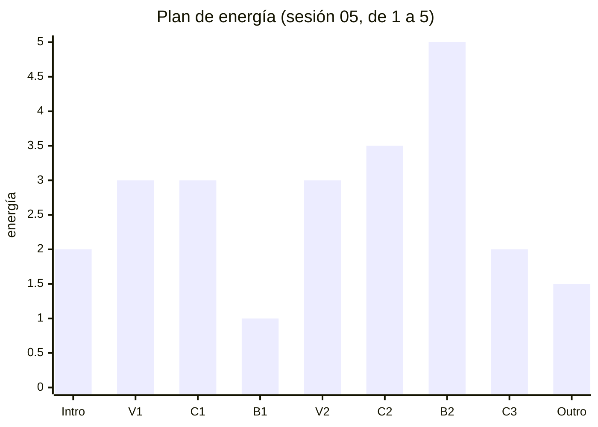
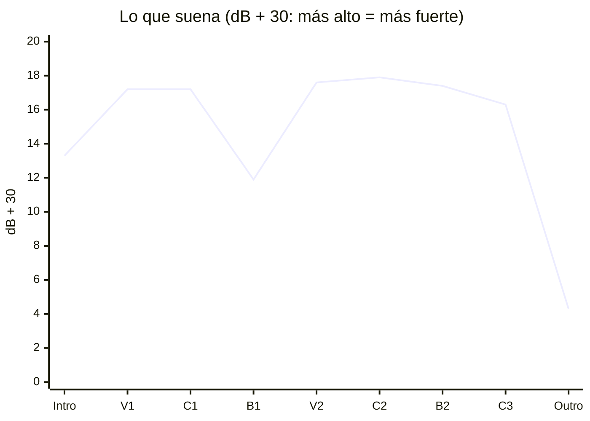
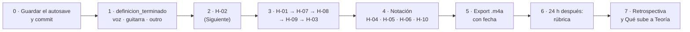

# Feedback 07 · pieza

> [!info] Fuente
> **Claude, 2026-10-22.** Primer feedback de **la pieza entera** (c.1–111): los 00–06 miraban solo el B2. La
> partitura no cambió desde [[3. Composiciones/6. louise/5. Feedback/06. B2|F 06]] (mismo blob, `480df3a`), así
> que lo que ese feedback midió en el B2 sigue igual y no se repite. Se leyeron como contexto las siete sesiones
> (00–06), sobre todo la 05 (la curva de energía) y la 06 (la conversación entre piano y guitarra).
> Se midió nota por nota sobre el `.musicxml` y con el volumen de un render de MuseScore, por compás y por tiempo.
>
> El alcance `pieza` es la palabra que [[6. Práctica/1. Estructura|Estructura]] usa para "toda la pieza" en
> las tomas de Contexto; para el alcance de un feedback no hay una documentada.

> [!abstract] Qué se evaluó, exactamente
> | Archivo | Commit | ¿Limpio? | Blob | Guardado |
> |---|---|---|---|---|
> | `7. Partituras/2. Composiciones/Louise-melancolica.mscz` | `073b73d` | sí | `480df3a` | 2026-10-22 09:26 |
>
> - **Limpio:** se recupera con `git show 71a4804:"7. Partituras/2. Composiciones/Louise-melancolica.mscz"`
>   (el último commit que tocó la partitura; `073b73d` solo cambió notas).
> - **Hay un autosave más nuevo** (`Louise-melancolica.mscz.autosave`, 09:41) con dos cambios que no se
>   guardaron: **c.84**, piano, Mi2 → Re2, y **c.88**, piano, Fa2 → Sol2 (este último toca
>   [[3. Composiciones/6. louise/6. Hallazgos#^h-04|H-04]]). Aquí se evaluó lo guardado. Si esos cambios son
>   tuyos, guárdalos desde MuseScore y haz commit antes de la próxima sesión.

> [!important] Qué cuenta como error
> Un error es cuando **lo que escribiste dice una cosa y lo que suena dice otra**: el cifrado, el
> [[3. Composiciones/6. louise/1. Mapa|Mapa]], las [[3. Composiciones/6. louise/2. Decisiones|Decisiones]] o el
> [[3. Composiciones/6. louise/4. Contexto|Contexto]] (una toma ✅ que no se oye, o una ❌ que se coló). Lo que
> contradice una decisión vigente no se reporta. Los ejemplos muestran **lo que suena hoy**; no traen
> correcciones.

---

## En una pantalla

1. **La forma está completa y la armonía cuenta la historia que escribiste.** Cada vez que llega a D se escapa
   (V7→vi en el verso, E♭7 al final del C2), el coro sí cierra, y el B♭ del que nació la pieza suena por
   primera vez en el pico (c.91), con la nota más aguda de toda la obra.
2. **Lo que no se oye es la curva de energía.** De V1 a C3, seis secciones y 80 compases caben en **1.5 dB**, y
   no hay ni una marca de dinámica en la partitura. El pico (B2) suena por debajo del C2 y pierde la batería al
   segundo compás. Es el hallazgo de más peso: [[3. Composiciones/6. louise/6. Hallazgos#^h-02|H-02]].
3. **El final todavía no suena a final.** El C3 es el C1 nota por nota sin batería, y por eso **sube** en su
   segunda mitad ([[3. Composiciones/6. louise/6. Hallazgos#^h-07|H-07]]); la cadencia A7→D llega sin bajo
   ([[3. Composiciones/6. louise/6. Hallazgos#^h-08|H-08]]); y el outro son dos compases que el Mapa no define.
4. **Para terminar falta algo que no es un hallazgo:** `definicion_terminado` está vacío. Tres preguntas de
   *Por decidir* lo bloquean: ¿voz o instrumental?, ¿la guitarra la grabas tú? y ¿qué es el outro? Sin eso no
   hay línea de meta, y cualquier hallazgo puede alargar la pieza para siempre.
5. **No existe ningún audio de Louise.** No hay carpeta `render/`, la tabla *Grabaciones* de la ficha está
   vacía y `ultimo_audio` también. El bucle ② se da por hecho cuando *existe un `.m4a` y la rúbrica está
   aplicada*.

---

## Qué funciona (para no romperlo)

Lo que escribiste y se oye tal cual:

| Escribiste | Suena | Dónde |
|---|---|---|
| [[3. Composiciones/6. louise/2. Decisiones#^d-02\|D-02]] B1: contraste, piano solo, bajo por quintas | 5.3 dB debajo del C1, sin guitarra ni batería; el bajo baja Si3–Mi3–La2–Re2 | c.43–46 |
| [[3. Composiciones/6. louise/2. Decisiones#^d-06\|D-06]] C1 más plano | sin crash ni fills; caja en el 2 y el 3 como único cambio de patrón | c.27–42 |
| [[3. Composiciones/6. louise/2. Decisiones#^d-07\|D-07]] C2 sube y no cierra | crash (c.67), fills (c.70, 73), bombo de 1–3 a 1–2–3 desde el c.76; la segunda mitad sube 1.9 dB (la del C1, 0.9); A7 → E♭7 en c.81–82 | c.67–82 |
| [[3. Composiciones/6. louise/2. Decisiones#^d-08\|D-08]] el B2 estrena lo que nunca sonó | Re menor, la cadena de dominantes y el B♭ (c.91, con Si♭5, la nota más aguda de la pieza) | c.82–92 |
| [[3. Composiciones/6. louise/2. Decisiones#^d-09\|D-09]] cadencia rota | V7→vi en c.14→15, 22→23, 54→55 y 62→63; el coro cierra en D | verso y coro |
| [[3. Composiciones/6. louise/2. Decisiones#^d-03\|D-03]] unos 100–115 compases | 110 compases, 2:04 | toda la pieza |
| Mapa · Intro: el motivo en una frase de 5 | c.1–5 y c.6–10; el verso entra 4 dB por encima | c.1–10 |

---

## Lista

| ID | Dónde | Qué escribiste | Qué suena | Peso | Contra | Estado |
|---|---|---|---|---|---|---|
| [[3. Composiciones/6. louise/6. Hallazgos#^h-02\|H-02]] | V1–C3 | C2 3→4 · B2 5 · C3 2 | seis secciones en 1.5 dB; el B2 debajo del C2 y sin batería desde el c.84; ninguna dinámica | **alto** (sube) | Mapa · [[3. Composiciones/6. louise/2. Decisiones#^d-08\|D-08]] | abierto, ampliado |
| [[3. Composiciones/6. louise/6. Hallazgos#^h-01\|H-01]] | c.85–91 | una subida hacia el pico | siete compases dentro de 0.8 dB; el pico se apaga 5.7 dB | **alto** | Mapa B2 | abierto, sin cambios |
| [[3. Composiciones/6. louise/6. Hallazgos#^h-07\|H-07]] | c.93–108 | C3 de despedida, energía 2 | sube 1.5 dB en su segunda mitad: es el C1 sin batería | medio | Mapa C3 · [[3. Composiciones/6. louise/2. Decisiones#^d-04\|D-04]] | **nuevo** |
| [[3. Composiciones/6. louise/6. Hallazgos#^h-08\|H-08]] | c.107–110 | "sí cierra en A7→D" | el D del c.108 llega sin bajo; el Re2 aparece dos compases después | medio | [[3. Composiciones/6. louise/2. Decisiones#^d-04\|D-04]] · Mapa C3 | **nuevo** |
| [[3. Composiciones/6. louise/6. Hallazgos#^h-09\|H-09]] | c.11–18, 51–58 | bajo en el 1 y acorde en el 2 y el 3 | piano y guitarra atacan juntos en el 1 y sostienen; en el 2 y el 3 no ataca ninguna nota | medio | [[3. Composiciones/6. louise/2. Decisiones#^d-12\|D-12]] · [[3. Composiciones/6. louise/4. Contexto#^r-01\|R-01]] | **nuevo** |
| [[3. Composiciones/6. louise/6. Hallazgos#^h-03\|H-03]] | c.82 | la entrada del B2 | hueco – golpe – hueco | medio | Mapa B2 | abierto, sin cambios |
| [[3. Composiciones/6. louise/6. Hallazgos#^h-04\|H-04]] | c.88→89 | G7 → C7 | el Fa del bajo salta a Do | bajo | cifrado | abierto (el autosave lo toca) |
| [[3. Composiciones/6. louise/6. Hallazgos#^h-10\|H-10]] | c.7, 44, 45 | "D", "Em", "E" | D/F♯, Em7, E/A | bajo | cifrado · [[3. Composiciones/6. louise/2. Decisiones#^d-02\|D-02]] | **nuevo** |
| [[3. Composiciones/6. louise/6. Hallazgos#^h-05\|H-05]] | c.93 | — | sin marca de ensayo "C3" | bajo | Mapa | abierto, sin cambios |
| [[3. Composiciones/6. louise/6. Hallazgos#^h-06\|H-06]] | c.87 | "C4" | Csus4 y C7sus4 | bajo | cifrado | abierto, sin cambios |

**Cerrados en este feedback:** ninguno (la partitura guardada es la misma que evaluó F 06).

### Por área

Lo que pediste: dónde puedes mejorar. Cada área con su dimensión de la [[Rúbrica - Composición|rúbrica]], para
que al cerrar sepas dónde mirar.

| Área | Dimensión de la rúbrica | Hallazgos | Cómo está |
|---|---|---|---|
| **Energía y trayectoria** | Trayectoria y clímax · Contraste | H-02, H-01, H-03, H-07 | la forma sube y baja en el papel; en el sonido, una meseta |
| **Cierre** | Calidad de cierre | H-08 · outro sin definir | el final se detiene más de lo que termina |
| **Ritmo y roles** | Ritmo y fraseo · Textura y registro | H-09 | el vals está en el coro y el B1; en la primera mitad del verso, no |
| **Conducción** | Conducción de voces · Armonía y bajo | H-04 | la armonía es lo más sólido de la pieza; queda un eslabón |
| **Notación** | — | H-05, H-06, H-10 | minutos de trabajo; importa para cualquier herramienta que lea la partitura |
| **Identidad** | Identidad o memorabilidad · Intención | sin hallazgo | depende de dos cosas sin decidir: voz o instrumental, y si el motivo vuelve en el outro |

---

## Uno por uno

### H-02 · La curva de energía no se oye (ampliado)

**Qué escribiste.** En el Mapa: C2 **3 → 4**, B2 **5** ("lo más alto de la pieza, por encima de todos los
coros"), C3 **2**. En la sesión 05, la curva entera: Intro 2 · V1 3 · C1 3 · B1 1 · V2 3 · C2 3→4 · B2 5 · C3 2 ·
Outro 1–2.

**Qué suena.** Volumen medio de cada sección en el render (promedio en potencia):

| Sección | c. | Plan (S 05) | Mapa | Suena | Capas |
|---|---|:-:|:-:|---:|---|
| Intro | 1–10 | 2 | ____ | −16.7 dB | piano · percusión ligera |
| V1 | 11–26 | 3 | ____ | −12.8 dB | piano · guitarra · batería |
| C1 | 27–42 | 3 | ____ | −12.8 dB | piano · guitarra · batería |
| B1 | 43–50 | 1 | ____ | −18.1 dB | piano |
| V2 | 51–66 | 3 | ____ | −12.4 dB | piano · guitarra · batería |
| C2 | 67–82 | 3→4 | 3→4 | **−12.1 dB** | piano · guitarra · batería (con crash, fills, bombo 1–2–3) |
| **B2** | 83–92 | **5** | **5** | **−12.6 dB** | piano · guitarra · **batería solo en c.82–83** |
| C3 | 93–108 | 2 | 2 | −13.7 dB | piano · guitarra |
| Outro | 109–110 | 1–2 | ____ | −25.7 dB | piano |





Qué suena en cada sección (el eje es el número de compás menos uno):

```mermaid
gantt
    title Capas por sección
    dateFormat X
    axisFormat %s
    section Forma
    Intro      :s1, 0, 10s
    V1         :s2, 10, 16s
    C1         :s3, 26, 16s
    B1         :s4, 42, 8s
    V2         :s5, 50, 16s
    C2         :s6, 66, 16s
    B2         :crit, s7, 82, 10s
    C3         :s8, 92, 16s
    Outro      :s9, 108, 2s
    section Piano
    c.1–110    :p1, 0, 110s
    section Guitarra
    c.11–41    :g1, 10, 31s
    c.51–81    :g2, 50, 31s
    c.85–107   :g3, 84, 23s
    section Batería
    c.2–42     :b1, 1, 41s
    c.51–83    :b2, 50, 33s
    section Dinámicas
    ninguna    :crit, d1, 0, 110s
```



**Qué pasa.**

- **Seis secciones en 1.5 dB.** De V1 a C3 todo queda entre −12.1 y −13.7. Lo único que se separa son la
  intro, el B1 y el outro: **las tres secciones sin guitarra**. Quitar solo la batería mueve menos de 1 dB (el C3,
  sin batería, queda a 0.9 dB del C1, que tiene las mismas notas con batería).
- **El B2 tiene menos capas que el C2.** La batería se calla en el c.84, al segundo compás del pico, y no vuelve.
  Para el oído, el B2 empieza bajando. Es **más denso** que cualquier otra sección (3.8 ataques por compás contra
  3.0 del coro) y llega más arriba (Si♭5), pero eso no compensa una capa que se va.
- **El B2 y el C3 tienen exactamente las mismas capas** (piano y guitarra). Lo que los separa es la armonía y
  1.1 dB.
- **Ninguna marca de dinámica en 110 compases.** Sin dinámicas, MuseScore toca todo con la misma fuerza; el
  volumen sale solo de cuántas notas suenan. Si la versión final es un export de MuseScore, **esto es lo que
  va a oír quien la escuche**.
- **Lo que sí funciona** (el C2 crece 1.9 dB en su segunda mitad; el C1, con las mismas notas, 0.9) muestra que
  el crecimiento de la batería suma alrededor de un dB. Es lo único que hoy mueve la curva entre V1 y C3, y en el
  B2 desaparece.

**¿Es un error?** Sí: el Mapa pone el B2 por encima de todos los coros y el C3 abajo, y suena al revés en el
primer caso y casi igual en el segundo. Se amplía desde F 06 (que medía C2, B2 y C3) porque a escala de la pieza
es el mismo problema, y los H-01, H-03 y H-07 son casos locales de él. Por eso sube a peso **alto**.

Recursos que ya están catalogados para esto, sin decidir nada por ti:
[[3. Composiciones/6. louise/AI/0. Recursos de energía y forma - Louise|0. Recursos de energía y forma]]
§2.1 (dinámica, con la equivalencia energía → *p*…*ff*), §2.2 (capas), §2.5 (batería) y §3.9 (mapa de
dinámicas).

### H-07 · El C3 sube en su segunda mitad (nuevo)

**Qué escribiste.** Mapa · C3: *"el coro con capas quitadas, que sí cierra en A7→D"*, energía **2**, despedida.
[[3. Composiciones/6. louise/2. Decisiones#^d-04|D-04]]: *"después del pico llega la resolución que el B2
retuvo"*.

**Qué suena.** Piano y guitarra de los c.94–107 son **idénticos nota por nota** a los c.28–41 del C1. Lo único
que cambia es el primer compás (c.93, la llegada desde el B2), el último (c.108) y que no hay batería. Y el C1
sube a la mitad: desde el c.35 el piano dobla en octavas y la mano izquierda toca los tres tiempos.

| | 1.ª mitad | 2.ª mitad (sin el último compás) | Cambio |
|---|---:|---:|---:|
| C1 (c.27–34 · 35–41) | −13.0 dB | −12.1 dB | +0.9 |
| C3 (c.93–100 · 101–107) | −14.2 dB | **−12.7 dB** | **+1.5** |

Sin batería, las octavas del piano pesan más: el C3 sube más que el C1.

```music-abc
X:1
T:c.97 y c.105: el mismo Em en cada mitad del C3, como suenan
M:3/4
L:1/16
K:D
V:1 clef=treble name="Piano MD"
V:2 clef=bass name="Piano MI"
V:3 clef=bass name="Guitarra (real)"
[V:1] "^c.97 · Em"z4 E4 E4 | "^c.105 · Em"z4 G4 G4 |]
[V:2] E,4 z8 | [E,,E,]4 [E,B,]4 [E,B,]4 |]
[V:3] [E,,G,,E,G,]12 | [E,,G,,E,G,E]12 |]
```

**Qué pasa.** El oído reconoce el coro, y lo oye crecer igual que la primera vez: la despedida dice "otra vez el
coro, sin batería". "Capas quitadas" hoy quiere decir una capa, la batería, y las otras dos siguen tocando lo
mismo, incluido el crecimiento de la segunda mitad.

**¿Es un error?** Sí, contra el Mapa: una sección de energía 2 que sube 1.5 dB hacia el final. Se relaciona con
*Por decidir · C3 de 8 o de 16 compases*: hoy son 16, y la segunda mitad es la que sube.

### H-08 · El A7→D del c.107→108 llega sin bajo (nuevo)

**Qué escribiste.** [[3. Composiciones/6. louise/2. Decisiones#^d-04|D-04]] y Mapa · C3: el C3 *"sí cierra en
A7→D"*, la resolución que el B2 retuvo.

**Qué suena.** En el tiempo 1 del c.108 la mano izquierda está en silencio y la guitarra ya no toca: la nota más
grave del acorde de llegada es **Re4**. El bajo vuelve en el tiempo 3 como Fa♯2 (D/F♯), sube a Sol2, baja a
Fa♯2 y llega a **Re2 en el tiempo 3 del c.109**, dos compases después de la cadencia.

```music-abc
X:1
T:c.107–110 como suenan hoy
M:3/4
L:1/16
K:D
V:1 clef=treble name="Piano MD"
V:2 clef=bass name="Piano MI"
V:3 clef=bass name="Guitarra (real)"
[V:1] "^A7"z4 [Ac]6 [Ac]2 | "^D"[DAd]12- | [DAd]4 z8 | z12 |]
[V:2] [A,,G,]4 G,6 G,2 | "_sin bajo"z8 [F,,A,,]3 G,,1- | G,,4- G,,1 F,,3 D,,4- | D,,1 D,8 z3 |]
[V:3] [A,,C,EAe]12 | z12 | z12 | z12 |]
```

| c. | Tiempo 1 | Tiempo 2 | Tiempo 3 | Nota más grave en el tiempo 1 |
|---|---:|---:|---:|---|
| 107 (A7) | −12.0 | −13.6 | −14.3 | La2 |
| **108 (D)** | **−16.8** | **−26.0** | −20.4 | **Re4** |
| 109 | −24.9 | −24.0 | −24.5 | Sol2 |
| 110 | −24.8 | −27.2 | −35.6 | Re2 |

**Qué pasa.** En una cadencia perfecta, lo que la hace sonar a cierre es el bajo que va del V al I (La → Re). Aquí
el La2 del A7 no va a ningún lado: desaparece, y la llegada queda en el registro medio. El tiempo 2 del c.108
(−26.0 dB) es el momento más callado desde el B1. Lo que suena es una resolución suave que se
completa, por el bajo, un compás y medio después → [[0. Cadencias, progresiones y líneas melódicas]].

**¿Es un error?** Solo si quieres que el C3 cierre con la fuerza que el B2 retuvo. Si el bajo que llega tarde y
baja por Fa♯–Sol–Fa♯–Re es la despedida que buscas, va a *Decisiones*.

### H-09 · En la primera mitad del verso nadie toca el 2 ni el 3 (nuevo)

**Qué escribiste.** [[3. Composiciones/6. louise/2. Decisiones#^d-12|D-12]]: *"3/4 en toda la pieza, bajo en el 1
y acorde en el 2 y el 3"*. [[3. Composiciones/6. louise/4. Contexto#^r-01|R-01]] (aplicada) se reconoce así. Y
[[3. Composiciones/6. louise/2. Decisiones#^d-05|D-05]]: *"un rol específico para cada parte"*.

**Qué suena.** En los c.11–18 (y su copia, c.51–58), piano y guitarra atacan **juntos en el 1** y sostienen el
compás entero. En el 2 y el 3 no ataca ninguna nota; solo, en compases alternos, un acorde del piano a
contratiempo (2& o 3e: el balanceo). El vals lo llevan el shaker y el cencerro *ghost* (38 %) y la pandereta en
el 3.

Quién ataca en cada tiempo (P = piano, G = guitarra):

| c. | 1 | 2 | 2& | 3 | 3e |
|---|:-:|:-:|:-:|:-:|:-:|
| 11 · Dmaj7 | P G | | | | |
| 12 · F♯m | P G | | | | P |
| 13 · C♯° | P G | | | | |
| 14 · A→A7 | P G | | P | | |
| 15 · Bm7 | P G | | | | |
| 16 · G→G6 | P G | | | | P |
| 17 · Dmaj7 | P G | | | | |
| 18 · F♯m | P G | | P | | |
| *27 · Em (coro, para comparar)* | *P G* | *P* | | *P* | |

En la segunda mitad del verso (c.19–26) la guitarra ya toca el 2 y el 3 en compases alternos (c.19, 21, 23, 25):
ahí sí está la conversación de D-05.

| Volumen por tiempo | 1 | 2 | 3 | Caída del 1 al 3 |
|---|---:|---:|---:|---:|
| V1, 1.ª mitad (c.11–18) | −10.3 | −14.3 | −15.6 | **5.3 dB** |
| V1, 2.ª mitad (c.19–26) | −11.3 | −13.2 | −14.1 | 2.8 dB |
| C1, 1.ª mitad (c.27–34) | −12.1 | −13.1 | −14.1 | 2.0 dB |

```music-abc
X:1
T:c.11–14 como suenan hoy (la batería no está escrita aquí)
M:3/4
L:1/16
K:D
V:1 clef=treble name="Piano MD"
V:2 clef=bass name="Piano MI"
V:3 clef=bass name="Guitarra (real)"
[V:1] "^Dmaj7"[Fd]12 | "^F#m"[Cc]8- [Cc]1 [CA]3 | "^C#dim"[EG]12 | "^A"[Ec]6 "^A7"[Cg]6 |]
[V:2] [D,,C]12 | F,8- F,1 G,3 | [C,E,]12 | A,6 A,6 |]
[V:3] [E,,A,,D,A,CF]12 | [F,,A,,F,A,Fc]12 | [C,E,CG]12 | [A,,C,A,CAe]12 |]
```

**Qué pasa.** Dos instrumentos con el mismo rol: los dos dicen el acorde completo, en el mismo tiempo y en el
mismo registro (piano de Re2 a Sol5, guitarra de Mi2 a Fa♯5, cinco notas por acorde de media en la guitarra). El
compás se apaga después del 1: es un "UNO . ." más que un "uno-dos-tres". En la sesión 06 lo describiste desde el
otro lado: buscas que piano y guitarra conversen y *"no siento que realmente esté generando mucho"*. En el
coro el reparto sí existe (el piano lleva el vals, la guitarra sostiene), y en los compases de cadencia también.

**¿Es un error?** Contra D-12 y R-01, sí: la toma está marcada como aplicada y en estos ocho compases su señal
(acorde en el 2 y el 3) no está en las notas. Puede ser a propósito: que el verso empiece flotando y el vals se
arme en la segunda mitad. Entonces va a *Decisiones*.

### H-10 · El cifrado no dice lo que suena en c.7, 44 y 45 (nuevo)

| c. | Cifrado | Suena | Nota |
|---|---|---|---|
| 7 | D | **D/F♯**: Fa♯2 en el bajo | el c.2, el mismo compás del motivo, sí dice D/F♯ |
| 44 | Em (en el tiempo 2) | **Em7** desde el tiempo 1: Mi3 en el bajo, Sol, Si y Re arriba | [[3. Composiciones/6. louise/2. Decisiones#^d-02\|D-02]] dice Em7 |
| 45 | E | **E/A**: La2 en el bajo | D-02 dice E/A |

**¿Es un error?** De notación: lo que lea la partitura (las fuentes de ChatGPT, un análisis, tú dentro de seis
meses) va a leer otros acordes. Las notas están bien.

### H-01, H-03, H-04, H-05, H-06 · sin cambios desde F 06

La partitura guardada es la misma, así que los números son los de
[[3. Composiciones/6. louise/5. Feedback/06. B2|F 06]], donde están explicados uno por uno.

| ID | Lo que sigue igual |
|---|---|
| H-01 | c.85–91 entre −11.7 y −12.5 dB; el golpe del c.91 (−9.3) cae a −15.0 en el mismo compás |
| H-03 | c.82: −17.8 dB, entre −11.6 (c.81) y −13.9 (c.83) |
| H-04 | c.88: Fa2 y Fa3 en la mano izquierda bajo el G7. **El autosave de las 09:41 cambia el Fa2 por Sol2**, sin guardar |
| H-05 | marcas de ensayo en la partitura: Intro, Verso, Coro, Bridge, Verso, Coro 2, B2. Nada en el c.93 |
| H-06 | c.87 cifrado "C4" |

---

## Lo que bloquea el cierre y no es un hallazgo

Son preguntas de *Por decidir* en [[3. Composiciones/6. louise/2. Decisiones|Decisiones]]. No describen un error
de la pieza; deciden cuándo está terminada. Así están hoy:

| Por decidir | Cómo está hoy en la partitura |
|---|---|
| **¿Voz o instrumental?** | el pentagrama de Voz tiene 0 notas. Define `definicion_terminado` |
| **Guitarra: ¿la grabas tú?** | 13 compases piden Mi2 y Sol2 a la vez, y los dos solo caben en la 6.ª cuerda: c.27, 31, 35, 39, 53, 67, 71, 75, 79, 93, 97, 101, 105 |
| **Outro** | c.109–110: el piano sostiene Re–La–Re y el bajo baja Sol2 → Fa♯2 → Re2. Dura 2.3 s, 12 dB debajo del C3. El motivo no vuelve después del c.84 |
| **c.51: ¿el bajo es Mi o Re?** | ya no es ninguno: la guitarra dejó el Mi2 y ahora el bajo es **La2** (Dmaj7/A). El V2 entra en segunda inversión |
| **C3 de 8 o de 16** | 16, idéntico al C1 (ver H-07) |
| **La descarga después del B2** | ni corte ni vaciado: c.92 −12.3 dB, c.93 −12.2 dB |
| **Mapa de dinámicas** | ninguna marca (ver H-02) |
| **Qué capa estrena el B2** | ninguna capa nueva: estrena armonía (D-08) y pierde la batería |
| Qué le quito al C1 | **hecho**: se oye D-06 |
| Que el B2 no arranque como el B1 | **hecho**: el c.82 ya no repite el D–C♯–B del c.42; ahora es E♭7 |

---

## Camino al cierre

Lo que pediste: los siguientes pasos. Es el bucle ② de [[6. Práctica/0. Flujos|Flujos]], paso 4 (*Cerrar*), con
la cola de hallazgos en orden de peso. **Una cosa a la vez**: cada sesión ataca un solo hallazgo.



0. **Antes de nada:** decidir si los dos cambios del autosave (c.84 y c.88) se quedan, guardar y hacer commit.
1. **`definicion_terminado`** en [[3. Composiciones/6. louise/0. Obra|0. Obra]]. Depende de las tres preguntas
   de arriba (voz, guitarra, outro). Si entra voz, es una dificultad nueva entera, y la regla 4 dice *una por
   proyecto*: el §3.8 de los
   [[3. Composiciones/6. louise/AI/0. Recursos de energía y forma - Louise|Recursos]] ya compara las dos rutas.
   Si el outro va a existir, el Mapa necesita su *Qué quiero*.
2. **El Siguiente** (abajo).
3. **Los hallazgos por peso**, uno por sesión, pidiendo feedback cuando quieras: H-01, H-07, H-08, H-09, H-03.
   Varios pueden moverse solos al resolver H-02; el feedback siguiente lo dirá.
4. **Notación**: H-04 (si no lo cierra el autosave), H-05, H-06, H-10. Son de minutos.
5. **Exportar** a `3. Composiciones/6. louise/render/` con la fecha delante (`2026-10-22 worktape.m4a`). Hoy no
   hay ninguno; el bounce incondicional dice que se exporta cada vez que paras, aunque no esté terminada.
6. **Descansar 24 h** y aplicar la [[Rúbrica - Composición|rúbrica]]. La tabla *Por área* de arriba dice qué
   hallazgo toca cada dimensión. El cronograma de la ficha cerraba el 17 de octubre: la fecha nueva va en la
   *Decisión de revisión* de la rúbrica.
7. **Cerrar**: retrospectiva de tres líneas y *Qué sube a Teoría*. Candidatos que salieron de Louise, para que
   tú los escribas con tus palabras:
   - la cadencia rota como firma (*cada vez que llega a D se escapa*) → [[0. Cadencias, progresiones y líneas melódicas]];
   - el B2 en Re menor sobre una pieza en Re mayor → [[3. Intercambios modales]];
   - la cadena G7 → C7 → F7 → B♭ → [[9. Dominantes en progresiones]] · [[09. Tonos guía]];
   - la energía como presupuesto y los roles de cada instrumento: `8. Textura y arreglo/` no tiene ninguna nota de
     concepto todavía. Sería la primera.

---

## Siguiente

➡️ **[[3. Composiciones/6. louise/6. Hallazgos#^h-02|H-02]]**: que la curva del Mapa se oiga. Es el que más pesa
en la pieza entera y el que más hallazgos arrastra (H-01, H-03 y H-07 son partes de él). La pregunta de *Por
decidir* que lo ataca de frente es el **mapa de dinámicas**: hoy no hay ninguna, y si la versión final sale de
MuseScore, son la única palanca que mueve el volumen sin tocar una nota.

---

## Propuestas

**Para el Mapa**

- **Energía** de Intro, V1, C1, B1, V2 y Outro: en la sesión 05 escribiste 2 · 3 · 3 · 1 · 3 · 1–2; en el Mapa
  están vacías, y sin ellas el feedback solo puede medir C2, B2 y C3.
- **V2 · Cómo se reconoce:** el comentario de *Por decidir* sobre el c.51 quedó viejo: hoy el bajo es La2.
- **C3 · Cómo se reconoce:** ____ (hoy, lo único que lo distingue del C1 es que no hay batería).
- **Outro · Qué quiero:** ____. Hoy son los c.109–110 (ver *Lo que bloquea el cierre*).

**Para Decisiones**

- **D-10** dice que *el único cromatismo de toda la pieza es el G♯ del c.45*. Desde el B2 ya no (E♭7, Gm, C7, F7,
  B♭ en c.82–92). Tacharla y pasarla a *Reemplazadas*, apuntando a la que la sustituya: `D-NN · … · porque ____`.
- Si H-08 es a propósito: `D-NN · el C3 resuelve sin bajo y el Re2 llega por Fa♯–Sol–Fa♯ · porque ____`.
- Si H-09 es a propósito: `D-NN · en la primera mitad del verso el vals lo lleva la percusión; piano y guitarra sostienen · porque ____`.
- Cerrar en *Por decidir* lo que ya está hecho: *Qué le quito al C1* (D-06) y *Que el B2 no arranque como el B1*.

**Para Contexto**

- `R-02 · Elouise · el riff de la intro vuelve igual al final (c.54–57 del arreglo de Seth Kauffman) · ____ ·
  forma → Outro`. Es la toma que contestaría *¿qué riff para el outro?* desde la canción de la que nació Louise
  (lo describe [[3. Composiciones/6. louise/AI/2. Louise y The Lumineers - gráficas/2. Louise y The Lumineers|2. Louise y The Lumineers]], §2). Si la quieres, lo que tomas y por qué son tuyos.
- *No quiero ❌* sigue vacío: ____.

---

## Cómo se midió

- `Louise-melancolica.mscz` (09:26, blob `480df3a`) se copió a una carpeta temporal y se exportó con MuseScore 4
  a WAV. El `.musicxml` de la bóveda estaba al día (09:27). La partitura no se tocó.
- El autosave de las 09:41 se copió aparte, se exportó a MusicXML y se comparó con `diff-musical.py`.
- **Volumen:** RMS de cada compás (1.125 s a ♩=160) y de cada tiempo (0.375 s). Los promedios por sección y por
  mitad se sacaron en potencia, no promediando los dB. Los números de C2, B2 y C3 coinciden con F 06.
- **Comparación entre secciones:** cada compás de cada pentagrama (alturas, ataques y duraciones) contra su
  compás equivalente en la otra sección: V1 contra V2, C1 contra C2 y C3.
- **Ataques:** inicios de nota de piano y guitarra por compás, sin contar las ligaduras. Las alturas de guitarra
  son **reales** (una octava debajo de lo escrito).
- **Bajo contra cifrado:** la nota más grave que suena (piano y guitarra) en la posición de cada acorde.
- **Guitarra imposible:** acordes con dos notas entre Mi2 y Sol♯2, que solo caben en la 6.ª cuerda.
- **Lo que el render no mide:** el timbre, la densidad y el registro también hacen energía. Por eso el B2, que es
  la sección más densa y más aguda, se lee junto con sus capas y no solo con su volumen.
