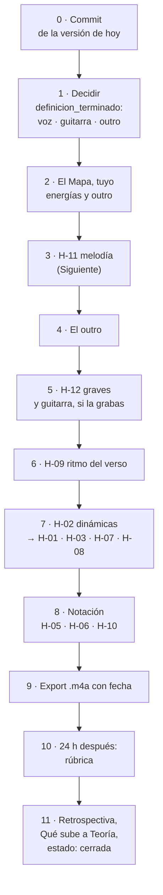

# Feedback 08 · pieza

> [!info] Fuente
> **Claude, 2026-10-23.** Inventario de **la pieza entera** (c.1–111): todo lo que le falta a Louise para estar
> completa. Desde aquí, cada feedback mira **un solo punto** de esta lista; la columna *Alcance* dice con qué
> nombre pedirlo (`melodia`, `guitarra.voicing`, `C3.energia`…).
>
> **Qué cambió desde [[3. Composiciones/6. louise/5. Feedback/07. pieza|F 07]]:** dos notas, las del autosave que
> F 07 había encontrado sin guardar: **c.84**, piano, Mi2 → Re2, y **c.88**, piano, Fa2 → Sol2 en el 3&. No hay
> sesiones nuevas. Se releyeron como contexto las sesiones 00, 02, 03 y 06: lo que querías del verso, del coro y
> del motivo.
>
> F 07 miró sobre todo la energía. Este mira **todos los aspectos** del alcance (forma, armonía, voicing, ritmo,
> melodía, arreglo, energía, notación) sección por sección, sobre el `.musicxml` nota por nota y con el volumen de
> un render de MuseScore.

> [!abstract] Qué se evaluó, exactamente
> | Archivo | Commit | ¿Limpio? | Blob | Guardado |
> |---|---|---|---|---|
> | `7. Partituras/2. Composiciones/Louise-melancolica.mscz` | `a10f3d8` | **no** | `4cba577` | 2026-10-23 10:00 |
>
> - **No limpio:** el `.mscz` tiene los dos cambios de arriba sin commit. El blob identifica esta versión, pero no
>   la guarda: para poder volver a ella hace falta un commit. Se recomienda hacerlo antes de la próxima sesión.
> - El `.musicxml` estaba desactualizado (era del 22 a las 09:27). Se regeneró con `sync-partituras.py`, así que
>   también aparece modificado: va en el mismo commit.
> - No hay autosave más nuevo que el archivo.

> [!important] Qué cuenta como error
> Un error es cuando **lo que escribiste dice una cosa y lo que suena dice otra**: el cifrado, el
> [[3. Composiciones/6. louise/1. Mapa|Mapa]], las [[3. Composiciones/6. louise/2. Decisiones|Decisiones]] o el
> [[3. Composiciones/6. louise/4. Contexto|Contexto]] (una toma ✅ que no se oye, o una ❌ que se coló). Lo que
> contradice una decisión vigente no se reporta. Los ejemplos muestran **lo que suena hoy**; no traen
> correcciones.

---

## En una pantalla

1. **Lo que está:** la forma completa (110 compases, 2:04), una armonía que cuenta la historia que escribiste, y
   un B2 que ya pasó por siete feedback: abierto en el grave, con su cadena de dominantes y el B♭ en el pico. El
   cambio de hoy cierra [[3. Composiciones/6. louise/6. Hallazgos#^h-04|H-04]].
2. **Lo que más falta es una melodía.** Fuera de la intro, el B1 y el B2, ninguna capa lleva una línea: en el
   verso y el coro (80 de 110 compases) lo de arriba es la nota de arriba del acorde. El motivo suena en 8
   compases y el pentagrama de Voz está vacío →
   [[3. Composiciones/6. louise/6. Hallazgos#^h-11|H-11]], **nuevo**.
3. **La energía sigue igual que en F 07:** la curva del Mapa no se oye y no hay ninguna dinámica
   ([[3. Composiciones/6. louise/6. Hallazgos#^h-02|H-02]] y sus casos locales H-01, H-03, H-07).
4. **Lo que arreglaste en el B2 sigue sin arreglar en el resto:** fuera del B2 la guitarra toca terceras en la
   octava 2 en 41 compases, debajo de su límite grave, y dobla al piano en el mismo registro →
   [[3. Composiciones/6. louise/6. Hallazgos#^h-12|H-12]], **nuevo**.
5. **Diez cosas son tuyas de decidir** y no son hallazgos. La primera bloquea a las demás:
   `definicion_terminado` sigue vacío.
6. **Del cierre falta todo:** ni audio, ni rúbrica, ni retrospectiva.

**En números:** 11 hallazgos abiertos (2 nuevos, 2 ampliados), 1 cerrado, 10 decisiones y 7 pasos de cierre.

---

## Qué le falta para estar completa

### Por sección y aspecto

Cada celda es lo que está abierto en esa sección y ese aspecto: el alcance para pedirle feedback. `—` quiere
decir que no hay nada abierto ahí (no que sea perfecto).

| Sección | c. | forma | armonia | voicing | ritmo | melodia | arreglo | energia | notacion |
|---|---|---|---|---|---|---|---|---|---|
| Intro | 1–10 | — | — | — | — | — | — | *vacío* | H-10 |
| V1 | 11–26 | — | — | H-12 | H-09 | **H-11** | 🎸 6 | *vacío* | H-10 |
| C1 | 27–42 | — | — | H-12 | — | **H-11** | 🎸 4 | *vacío* | H-10 |
| B1 | 43–50 | — | — | — | — | — | — | *vacío* | H-10 |
| V2 | 51–66 | — | — | H-12 | H-09 | **H-11** | 🎸 8 | *vacío* | H-10 |
| C2 | 67–82 | — | — | H-12 | — | **H-11** | 🎸 4 | H-03 | H-05 · H-10 |
| B2 | 83–92 | — | — | — | — | — | decidir | H-01 | H-06 · H-10 |
| C3 | 93–108 | decidir | H-08 | H-12 | — | **H-11** | 🎸 4 | H-07 · decidir | H-05 · H-10 |
| Outro | 109–111 | **decidir** | — | — | — | decidir | — | *vacío* | H-05 |

- **[[3. Composiciones/6. louise/6. Hallazgos#^h-02|H-02]]** (la curva entera) cruza todas las secciones de V1 a
  C3; en la tabla solo aparecen los casos locales.
- *vacío*: el Mapa no dice qué energía quieres ahí, así que el feedback no tiene con qué medirla.
- 🎸 *N*: compases con un acorde de guitarra que no cabe en una mano. Solo cuenta si la guitarra la grabas tú
  (*Decidir*, punto 3).
- *decidir*: una pregunta de *Por decidir* (abajo).

### 1 · Decidir

Son tuyas y no son hallazgos: no describen un error, deciden cuándo está terminada. Están en orden: cada una
depende de las de arriba.

| # | Qué decides | Alcance | Cómo está hoy | Qué desbloquea |
|---|---|---|---|---|
| 1 | **`definicion_terminado`** | — | vacío desde el 2 de octubre | todo: es la línea de meta. Las tres siguientes son su contenido |
| 2 | **¿Voz o instrumental?** | `melodia` | el pentagrama de Voz tiene 0 notas en 111 compases | qué es H-11: escribir la voz, o que una capa lleve la línea |
| 3 | **Guitarra: ¿la grabas tú?** | `guitarra.voicing` | 26 de los 85 compases con guitarra tienen un acorde que no cabe en una mano (F 07 contaba 13: solo buscaba Mi2 con Sol2) | si sí, esos 26 se revoicean, y H-12 se mueve casi entero con ellos |
| 4 | **El outro** | `Outro.forma` | c.109–110, 2.3 s, y el c.111 vacío con la doble barra. Termina en la octava Re2–Re3, sin tercera, sin *rit.* ni calderón. El motivo no vuelve desde el c.84 | el final de la pieza; el Mapa *Outro* está vacío entero |
| 5 | **C3 de 8 o de 16** | `C3.forma` | 16; 14 de ellos son compases del C1 | H-07 |
| 6 | **La descarga después del B2** | `C3.energia` | ni corte ni vaciado: c.92 −12.3 dB, c.93 −12.2 dB | H-02 |
| 7 | **Mapa de dinámicas** | `energia` | ninguna marca en toda la partitura | H-02, H-01, H-07 |
| 8 | **Qué capa estrena el B2** | `B2.arreglo` | ninguna capa nueva; pierde la batería desde el c.84 | H-01, H-02 |
| 9 | **El Mapa, tuyo** | — | `estado: borrador`, lo armó Claude el 22; 17 campos con `____`, entre ellos la energía de seis secciones | la vara de todos los feedback |
| 10 | **El Contexto, tuyo** | — | borrador; *No quiero ❌* vacío; la toma R-02 que propuso F 07 sin contestar | que el feedback pueda decir si algo se coló |

> [!warning] La regla 4
> *Una dificultad nueva por proyecto.* Si la respuesta a la 2 es "voz", es una dificultad entera (melodía para
> voz y letra). El §3.8 de los
> [[3. Composiciones/6. louise/AI/0. Recursos de energía y forma - Louise|Recursos]] compara las dos rutas y
> tiene un punto medio: instrumental ahora y la voz en una segunda versión.

### 2 · Corregir

Los hallazgos: la *Lista*, abajo.

### 3 · Cerrar

El paso 4 del bucle ② de [[6. Práctica/0. Flujos|Flujos]]. Su definición de hecho: *existe un `.m4a` y la
rúbrica está aplicada*.

| Paso | Cómo está hoy |
|---|---|
| Commit de la versión de hoy | `.mscz` y `.musicxml` con cambios sin commit |
| Triage de los hallazgos (bucle ⑦, paso 4) | H-07 a H-12 no tienen destino: ninguno es objetivo de una sesión, decisión ni cambio de Mapa |
| Audio en `render/` | no existe la carpeta; `ultimo_audio` y *Grabaciones* de la ficha, vacíos |
| Rúbrica en frío, 24 h después | sin aplicar |
| Exportación final con fecha | — |
| Retrospectiva y *Qué sube a Teoría* | vacías |
| La ficha | `estado: boceto` y `cierre` vacío; el cronograma terminaba el 17 de octubre; *Problemas abiertos* y *Material* describen la versión de Strudel (ver *Propuestas*) |

---

## Lista

| ID | Dónde | Alcance | Qué escribiste | Qué suena | Peso | Contra | Estado |
|---|---|---|---|---|---|---|---|
| [[3. Composiciones/6. louise/6. Hallazgos#^h-11\|H-11]] | V1, C1, V2, C2, C3 | `melodia` | un vals tipo *Elouise*, con el motivo como identidad | 80 de 110 compases sin línea propia; el motivo en 8; Voz vacía | **alto** | Mapa · Intención y Motivo | **nuevo** |
| [[3. Composiciones/6. louise/6. Hallazgos#^h-02\|H-02]] | V1–C3 | `energia` | C2 3→4 · B2 5 · C3 2 | seis secciones en 1.5 dB; el B2 debajo del C2; ninguna dinámica | **alto** | Mapa · [[3. Composiciones/6. louise/2. Decisiones#^d-08\|D-08]] | sin cambios |
| [[3. Composiciones/6. louise/6. Hallazgos#^h-01\|H-01]] | c.85–91 | `B2.energia` | una subida hacia el pico | siete compases en 0.8 dB; el pico se apaga 5.7 dB | **alto** | Mapa B2 | sin cambios |
| [[3. Composiciones/6. louise/6. Hallazgos#^h-12\|H-12]] | V1, C1, V2, C2, C3 | `guitarra.voicing` | "en registros graves, es mejor abrir las voces"; el B2 ya abierto | terceras en la octava 2 en 41 compases (y 12 en el límite); la guitarra dobla al piano en el grave en 70 de 85 | medio | [[00. Voicing e inversiones]] · [[3. Composiciones/6. louise/2. Decisiones#^d-05\|D-05]] | **nuevo** |
| [[3. Composiciones/6. louise/6. Hallazgos#^h-07\|H-07]] | c.93–108 | `C3.energia` | despedida, energía 2 | sube 1.5 dB en su segunda mitad: es el C1 sin batería | medio | Mapa C3 · [[3. Composiciones/6. louise/2. Decisiones#^d-04\|D-04]] | sin cambios |
| [[3. Composiciones/6. louise/6. Hallazgos#^h-08\|H-08]] | c.107–110 | `C3.armonia` | "sí cierra en A7→D" | el D del c.108 llega sin bajo | medio | [[3. Composiciones/6. louise/2. Decisiones#^d-04\|D-04]] | sin cambios |
| [[3. Composiciones/6. louise/6. Hallazgos#^h-09\|H-09]] | c.11–18, 51–58 | `ritmo` | bajo en el 1 y acorde en el 2 y el 3 | en el 2 y el 3 no ataca ninguna nota | medio | [[3. Composiciones/6. louise/2. Decisiones#^d-12\|D-12]] · [[3. Composiciones/6. louise/4. Contexto#^r-01\|R-01]] | sin cambios |
| [[3. Composiciones/6. louise/6. Hallazgos#^h-03\|H-03]] | c.82 | `B2.energia` | la entrada del B2 | hueco – golpe – hueco | medio | Mapa B2 | sin cambios |
| [[3. Composiciones/6. louise/6. Hallazgos#^h-10\|H-10]] | 35 compases | `notacion` | el cifrado | bajos, notas y tiempos que el cifrado no dice | bajo | cifrado · [[3. Composiciones/6. louise/2. Decisiones#^d-02\|D-02]] | **ampliado** (eran 3 compases) |
| [[3. Composiciones/6. louise/6. Hallazgos#^h-05\|H-05]] | c.67, 93, 109 | `notacion` | las secciones del Mapa | sin marca de C3 ni de Outro; una marca vacía en el c.67 | bajo | Mapa | **ampliado** (era solo el c.93) |
| [[3. Composiciones/6. louise/6. Hallazgos#^h-06\|H-06]] | c.87 | `B2.notacion` | "C4" | Csus4 y C7sus4 | bajo | cifrado | sin cambios |

**Cerrados en este feedback:** [[3. Composiciones/6. louise/6. Hallazgos#^h-04|H-04]], arreglado: el G7 del
c.88 vuelve a Sol2 en el 3&, y de ahí el bajo va a Do3 (Sol → Do, la cadena por cuartas); el Fa2 del tiempo 2
queda como bordado. El Fa3 de arriba de la mano izquierda tampoco baja a Mi (va a Si♭3), pero el Mi llega en la
guitarra (Re4 → Mi4) y nada de lo escrito pide más: no abre hallazgo.

### Por área

Cada área con su dimensión de la [[Rúbrica - Composición|rúbrica]], para que al cerrar sepas dónde mirar.

| Área | Dimensión de la rúbrica | Hallazgos | Cómo está |
|---|---|---|---|
| **Melodía e identidad** | Identidad o memorabilidad · Intención | H-11 | el motivo es claro donde suena, y suena en el 7 % de la pieza |
| **Energía y trayectoria** | Trayectoria y clímax · Contraste | H-02, H-01, H-03, H-07 | la forma sube y baja en el papel; en el sonido, una meseta |
| **Textura y registro** | Textura y registro · Conducción de voces | H-12, H-09 | el B2 está limpio; el resto, grave, cerrado y doblado |
| **Cierre** | Calidad de cierre · Proporción formal | H-08 · outro | se detiene más de lo que termina |
| **Armonía** | Armonía y bajo | ninguno (H-04 cerrado) | lo más sólido de la pieza |
| **Realización** | Interpretación o realización | H-02 · guitarra | sin dinámicas, un export de MuseScore suena con la misma fuerza de principio a fin |
| **Notación** | — | H-05, H-06, H-10 | minutos de trabajo, mejor al final: cada nota que cambie puede cambiar un cifrado |

---

## Uno por uno

### H-11 · Fuera de la intro, el B1 y el B2 no hay melodía (nuevo)

**Qué escribiste.**

- Mapa · *Intención*: un vals tipo *Elouise* de The Lumineers, que es una canción. Mapa · *Motivo*: La–Sol–Fa♯–Re–Fa♯,
  el material que la pieza trae desde `happy_beats`.
- Como contexto, en las sesiones: la 02 se propuso *"Converting the chorus and verse with his own melodies and
  structure"*; la 03, pulir un motivo en el coro y *"give space to the voice"*; la 00, que el motivo *"aún no me
  convence y no sé bien como incluírlo o replicarlo"*.
- En la ficha, *Problemas abiertos* (5 oct), sin marcar: *"Los compases de respuesta no tienen voz. El motivo
  suena una vez y desaparece."*
- Los [[3. Composiciones/6. louise/AI/0. Recursos de energía y forma - Louise|Recursos]] §3.8: si es
  instrumental, *"la voz superior del piano es la melodía"*.

**Qué suena.** Dónde está el motivo y qué hay arriba en cada sección:

| Sección | c. | El motivo | Qué hay arriba | Quién |
|---|---|---|---|---|
| Intro | 1–10 | **c.1–2 y 6–7** | el motivo, y los acordes en el 1a y el 3e | piano |
| V1 | 11–26 | — | una nota larga por compás (1.8 ataques), la de arriba del acorde | piano y guitarra, **la misma nota** en 18 de sus 32 tiempos 2 y 3 |
| C1 | 27–42 | — | en el 1, Sol3, Si3 o La3 de la guitarra; en el 2 y el 3, una nota del acorde en el piano (en la primera mitad, la fundamental) | se alternan: la guitarra tiene la nota de arriba en 12 de los 16 tiempos 1 |
| B1 | 43–50 | **c.46–47** | el motivo, y el bajo que baja por quintas | piano |
| V2 | 51–66 | — | lo mismo que el V1: 11 de sus 16 compases son idénticos | |
| C2 | 67–82 | — | lo mismo que el C1: 13 de 16 idénticos | |
| B2 | 83–92 | **c.83–84**, en Re menor | una línea propia: 3.5 ataques por compás, hasta Si♭5 | piano |
| C3 | 93–108 | — | lo mismo que el C1: 14 de 16 idénticos | |
| Outro | 109–111 | — | Re4–La4–Re5 sostenido | piano |

La nota más aguda de cada tiempo en la primera mitad del coro:

| c. | Acorde | Tiempo 1 | Tiempo 2 | Tiempo 3 |
|---|---|---|---|---|
| 27 | Em | Sol3 · guitarra | Mi4 · piano | Mi4 · piano |
| 28 | G | Si3 · guitarra | Sol4 · piano | Sol4 · piano |
| 29 | F♯m7 | La3 · guitarra | Fa♯4 · piano | Fa♯4 · piano |
| 30 | Bm | Si3 · piano | Fa♯5 · guitarra | Fa♯5 · guitarra |
| 31 | Em | Sol3 · guitarra | Mi4 · piano | Mi4 · piano |
| 32 | G | Si3 · guitarra | Sol4 · piano | Sol4 · piano |
| 33 | A7 | Mi5 · guitarra | (sostenido) | (sostenido) |
| 34 | D | Re3 · piano | La4 · guitarra | La4 · guitarra |

```music-abc
X:1
T:c.27–30 como suenan hoy (la batería no está escrita aquí)
M:3/4
L:1/4
K:D
V:1 clef=treble name="Piano MD"
V:2 clef=bass name="Piano MI"
V:3 clef=bass name="Guitarra (real)"
[V:1] "^Em"z E E | "^G"z G G | "^F#m7"z F F | "^Bm"z3 |]
[V:2] E, z z | G, z z | F, z z | [B,,B,-] B,2 |]
[V:3] [E,,G,,E,G,]3 | [G,,B,,G,B,]3 | [F,,A,,F,A,]3 | z [B,DBf] [B,DBf] |]
```

Dónde suena el motivo, y dónde hay una línea que no es el acorde (el eje es el número de compás menos uno):

```mermaid
gantt
    title Motivo y línea propia
    dateFormat X
    axisFormat %s
    section Forma
    Intro      :s1, 0, 10s
    V1         :s2, 10, 16s
    C1         :s3, 26, 16s
    B1         :s4, 42, 8s
    V2         :s5, 50, 16s
    C2         :s6, 66, 16s
    B2         :s7, 82, 10s
    C3         :s8, 92, 16s
    Outro      :s9, 108, 3s
    section Motivo
    c.1–2      :m1, 0, 2s
    c.6–7      :m2, 5, 2s
    c.46–47    :m3, 45, 2s
    c.83–84    :m4, 82, 2s
    section Línea propia
    c.85–92    :l1, 84, 8s
    section Sin línea
    V1 y C1    :crit, n1, 10, 32s
    V2 y C2    :crit, n2, 50, 32s
    C3         :crit, n3, 92, 16s
```



**Qué pasa.** En el coro, el "uno-dos-tres" del vals está repartido: la guitarra sostiene el acorde en el 1 y el
piano repite una nota del acorde en el 2 y el 3. Es un buen acompañamiento, y por eso mismo no es una línea: la
nota de arriba salta de Sol3 a Mi4 y de vuelta en cada compás, y cambia solo cuando cambia el acorde. En el verso
pasa lo contrario: una nota larga por compás que piano y guitarra tocan a la vez. Lo que el oído puede seguir, el
motivo, aparece cuatro veces de dos compases: entre el c.7 y el c.46 pasan **38 compases** (43 s) sin él; entre el
c.47 y el c.83, otros 35 (39 s); y después del c.84 no vuelve. Con V2, C2 y C3 copiados casi enteros de V1 y C1,
esos compases no traen nada nuevo encima del acompañamiento. Se relaciona con H-02: sin una línea que suba, lo que
puede crecer es la densidad y el volumen, y el B2 (la única sección con línea propia) es también la más densa.

**¿Es un error?** Depende de la pregunta 2 de *Decidir*, y en las dos rutas falta lo mismo:

- **Si hay voz**, el verso y el coro son el acompañamiento de una voz que no está escrita.
- **Si es instrumental**, la "voz superior del piano" del §3.8 no es una melodía: es la nota de arriba del acorde.

Si lo quieres así (el verso y el coro como acompañamiento, y la identidad solo en el motivo de la intro, el B1 y el
B2), va a *Decisiones*. Es el hallazgo de más peso de la pieza: toca 80 de 110 compases y la dimensión de la
rúbrica que contesta *¿qué material reconoce el oyente como identidad de la pieza?* →
[[0. Enlaces 2.0 y motivos]].

### H-12 · Fuera del B2, la guitarra toca terceras debajo de su límite grave (nuevo)

**Qué escribiste.** Tu nota [[00. Voicing e inversiones]]: *"En registros graves, es mejor abrir las voces"*. En
el B2 lo hiciste: después de [[3. Composiciones/6. louise/5. Feedback/03. B2|F 03]] abriste los graves de los
c.85–88, y hoy el B2 no tiene ningún intervalo cerrado debajo de su límite. Y
[[3. Composiciones/6. louise/2. Decisiones#^d-05|D-05]]: *"un rol específico para cada parte"*.

**Qué suena.** Intervalos entre dos notas vecinas (piano y guitarra juntos) debajo del límite que usó F 03.
Todos menos dos son de la guitarra:

| Intervalo | Límite | ¿Cuánto debajo? | Acorde | Compases |
|---|---|---|---|---|
| Re2–Mi2 (2ª mayor, piano y guitarra) | Mi♭3 | una octava y más | Dmaj7 | 11 |
| Mi2–Sol2 (3ª menor) | Do3 | una sexta | Em y el C♯° del c.53 | 27, 31, 35, 39, 53, 67, 71, 75, 79, 93, 97, 101, 105 |
| Fa♯2–La2 (3ª menor) | Do3 | una cuarta aumentada | F♯m | 12, 20, 29, 37, 52, 57, 58, 60, 69, 77, 95, 103, 108 (el 108, en el piano) |
| Sol2–Si2 (3ª mayor) | Si♭2 | una tercera menor | G | 16, 28, 32, 36, 40, 56, 68, 72, 76, 80, 94, 98, 102, 106 |
| La2–Do♯3 (3ª mayor) | Si♭2 | un semitono: **en el límite** | A y A7 | 14, 22, 33, 41, 54, 62, 73, 81, 99, 107 |
| Si2–Re3 (3ª menor) | Do3 | un semitono: **en el límite** | Bm7 | 15, 55 |

| Sección | Claramente debajo | En el límite |
|---|---:|---:|
| V1 | 4 | 3 |
| C1 | 10 | 2 |
| V2 | 6 | 3 |
| C2 | 10 | 2 |
| B2 | **0** | **0** |
| C3 | 11 | 2 |

Encima, la guitarra y el piano tocan **la misma nota debajo de Do4** en 70 de los 85 compases con guitarra (en el
coro, Mi2 y Mi3, Sol2 y Sol3, Fa♯2 y Fa♯3 en los dos a la vez).

Lo que suena en el tiempo 2 sin la mano derecha: el coro de hoy, y para comparar tu B2:

```music-abc
X:2
T:Tiempo 2, sin la mano derecha: el coro hoy (c.27–29) y tu B2 (c.85–87)
M:3/4
L:1/4
K:D
V:1 clef=bass name="Grave (real)"
[V:1] "^c.27 Em"[E,,G,,E,G,]3 | "^c.28 G"[G,,B,,G,B,]3 | "^c.29 F#m7"[F,,A,,F,A,]3 || "^c.85 Gm"[G,,D,G,_B,]3 | "^c.86 Am"[A,,E,A,=C]3 | "^c.87 C"[=F,,=C,=F,_B,]3 |]
```

**Qué pasa.** En el B2, la nota de abajo tiene una quinta encima (Sol2–Re3, La2–Mi3, Fa2–Do3). En el coro tiene
una tercera, en la octava donde ya está el bajo del piano: es el barro que F 03 explicó en el B2 (los armónicos de
dos notas tan graves y tan juntas se rozan, y el acorde pierde definición). En el coro, además, piano y guitarra
dicen las mismas notas en el mismo registro: la guitarra no tiene un rol propio en el grave, lo engrosa.

Un matiz: Sol2–Si2 es la forma del Sol abierto de guitarra (3-2-0-0-0-3) y por sí sola suena normal en una
nylon. Lo que la empasta es sumarle el Sol3 del piano (y en la segunda mitad del coro, también el Sol2). Mi2–Sol2, en cambio, ni siquiera se puede
tocar: las dos notas solo caben en la sexta cuerda.

**¿Es un error?** Sí, contra tu nota de voicing, y contra lo que tú mismo hiciste en el B2. Los 12 compases *en el
límite* pesan menos. Si quieres ese grave grueso en el coro a propósito, va a *Decisiones*. Si la respuesta a
*¿la grabas tú?* es sí, buena parte de estos compases se revoicea de todas formas: los 26 que no se pueden tocar
están todos en esta tabla.

### H-10 · El cifrado no dice lo que suena (ampliado)

F 07 encontró tres compases (c.7, 44, 45). Revisado el cifrado entero, son 35. Las notas están bien; lo que leen el
análisis, las fuentes de ChatGPT o tú dentro de seis meses son otros acordes. No se cuentan las quintas que faltan
ni las notas de paso de menos de un tiempo.

**Bajos que el cifrado no escribe**

| c. | Cifrado | Suena |
|---|---|---|
| 7 | D | D/F♯: Fa♯2 (el c.2, el mismo compás del motivo, sí dice D/F♯) |
| 19, 59 | Dmaj7 | Dmaj7/A en el tiempo 1: La2 en la mano izquierda |
| 26, 66 | F♯m | F♯m/C♯: el Do♯3 de la guitarra queda debajo del Fa♯3 del piano |
| 45 | E | E/A: La2 ([[3. Composiciones/6. louise/2. Decisiones#^d-02\|D-02]] dice E/A) |
| 47 | D | D/A: La2 |
| 51 | Dmaj7 | Dmaj7/A: el La2 de la guitarra |
| 53 | C♯dim | C♯°/E: el Mi2 de la guitarra (el c.13, el mismo acorde, está en estado fundamental) |
| 57 | Dmaj7 | Dmaj7/F♯: el Fa♯2 de la guitarra (el c.17 tiene Re3) |
| 90, en el 3& | F7 | La–Mi♭, sin Fa ni Do: F7/A sin fundamental |

**Notas que el cifrado dice y no suenan, o al revés**

| c. | Cifrado | Suena |
|---|---|---|
| 10 | Gmaj7 | Gmaj7♯11 sin Si: Do♯4 en la mano izquierda |
| 12, en el 3& | D | ningún Re: Sol3, Do♯4 y La4 sobre el F♯m de la guitarra |
| 15, 23, 55, 63 | Bm7 | Bm: no suena La |
| 25, 65 | D6 | D: no suena Si |
| 29, 69, 95 | F♯m7 | solo Fa♯ y La: ni Do♯ ni Mi |
| 33, 73, 99 | A7 | A: no suena Sol (los c.41, 81 y 107 sí lo tienen) |
| 44 | Em, en el tiempo 2 | Em7 desde el tiempo 1 (D-02 dice Em7) |
| 50 | Gmaj7 | G: no suena Fa♯ |
| 52, en el 3 | F♯m7 | F♯m: no suena Mi |
| 91 | B♭ | B♭add9: Do4 en la mano izquierda |

**Cifrados en otro tiempo**

| c. | Dónde está | Dónde empieza el acorde |
|---|---|---|
| 5, 10, 50 | en el 1& | en el 1, con el bajo |
| 35, 75, 101 | Em, en el 2 | en el 1: hasta el 2, el cifrado sigue diciendo D |
| 86 | Am, en el 2 | en el 1 (Do3–La3 y Mi5): hasta ahí dice Gm |
| 90 | F, en el 2 | en el 1 (Fa2–Fa3–La3): hasta ahí dice C7 |
| 12, 20, 26, 52, 66 | F♯m escrito dos o tres veces en el mismo compás | — |

El c.87 ("C4") sigue aparte, como [[3. Composiciones/6. louise/6. Hallazgos#^h-06|H-06]].

**¿Es un error?** De notación. Peso bajo, y mejor al final: cada nota que cambie por H-11 o H-12 puede cambiar
un cifrado.

### H-05 · Las marcas de ensayo no siguen el Mapa (ampliado)

| c. | En la partitura | En el Mapa |
|---|---|---|
| 1 | Intro | Intro |
| 11 | Verso | V1 |
| 27 | Coro | C1 |
| 43 | Bridge | B1 |
| 51 | Verso | V2 |
| 67 | "Coro 2" (con un salto de línea dentro) **y una segunda marca vacía** | C2 |
| 83 | B2 | B2 |
| 93 | **—** | C3 |
| 109 | **—** | Outro |

**¿Es un error?** Contra el Mapa: para la partitura, el B2 dura hasta el final. Los nombres largos (*Verso*,
*Coro*) no son un error; usar los del Mapa hace que la partitura y los alcances hablen igual.

### Sin cambios desde F 07

Medidos otra vez sobre la versión de hoy. Los números son los de
[[3. Composiciones/6. louise/5. Feedback/07. pieza|F 07]], donde están explicados uno por uno.

| ID | Hoy |
|---|---|
| H-02 | V1 −12.8 · C1 −12.8 · V2 −12.4 · C2 −12.1 · **B2 −12.6** · C3 −13.7 dB: seis secciones en 1.5 dB. Ninguna dinámica |
| H-01 | c.85–91 entre −11.7 y −12.6 dB; el golpe del c.91 (−9.3) cae a −15.0 en el mismo compás |
| H-03 | c.82: −17.8 dB (tiempos 2 y 3 en −22.1 y −21.0), entre −11.6 (c.81) y −13.9 (c.83) |
| H-07 | C3: −14.2 dB en c.93–100 y −12.7 en c.101–107 (+1.5). El C1 sube +0.9 |
| H-08 | tiempo 1 del c.108: la nota más grave es Re4; el Re2 llega en el tiempo 3 del c.109 |
| H-09 | caída del tiempo 1 al 3: 5.3 dB en c.11–18 y 4.9 dB en c.51–58 (el coro: 2.0) |
| H-06 | c.87 cifrado "C4" |

---

## Lo que ya está (para no romperlo)

Lo que escribiste y se oye tal cual. Detalle en F 07, *Qué funciona*.

| Escribiste | Suena |
|---|---|
| [[3. Composiciones/6. louise/2. Decisiones#^d-03\|D-03]] la forma, unos 100–115 compases | 110 compases, 2:04 |
| [[3. Composiciones/6. louise/2. Decisiones#^d-09\|D-09]] cadencia rota | V7→vi en c.14→15, 22→23, 54→55, 62→63; el coro cierra en D |
| [[3. Composiciones/6. louise/2. Decisiones#^d-02\|D-02]] B1 de contraste | piano solo, 5.3 dB debajo del C1, el bajo por quintas |
| [[3. Composiciones/6. louise/2. Decisiones#^d-05\|D-05]] el vals repartido en la cadencia | piano en el 1 y guitarra en el 2 y el 3 en c.19, 21, 23, 25, 30, 34, 38 y sus copias |
| [[3. Composiciones/6. louise/2. Decisiones#^d-06\|D-06]] y [[3. Composiciones/6. louise/2. Decisiones#^d-07\|D-07]] | C1 sin crash ni fills; el C2 sube 1.9 dB en su segunda mitad y termina en E♭7 |
| [[3. Composiciones/6. louise/2. Decisiones#^d-08\|D-08]] el B2 estrena lo que nunca sonó | Re menor, la cadena G7–C7–F7–B♭ y el Si♭5, la nota más aguda de la pieza |
| [[3. Composiciones/6. louise/2. Decisiones#^d-11\|D-11]] el bajo de F♯m en c.12 y c.52 | Fa♯3, con el Sol3 al final del c.12 |
| [[00. Voicing e inversiones]], en el B2 | ningún intervalo cerrado debajo de su límite en c.83–92 |

---

## Camino al cierre

**Una cosa a la vez**: cada sesión ataca un punto. El orden va de lo que cambia notas a lo que solo las marca,
porque cada paso puede mover al siguiente.



- **0–2** no tocan la partitura: son la línea de meta y la vara. Sin ellas, cualquier hallazgo puede alargar la
  pieza para siempre.
- **3–4** son las únicas que componen material nuevo. H-11 va antes que la energía porque la energía depende de
  qué capa lleve la línea.
- **5–6** cambian cómo suenan los acordes que ya están. Si la guitarra no la grabas, el 5 es solo H-12.
- **7** es sobre todo dinámicas: con lo de arriba resuelto, se marca lo que ya existe. Varios de sus hallazgos
  pueden moverse solos con el 3.
- **8** al final, por lo que dice H-10.
- **Bounce incondicional:** un audio a `render/` al terminar cada sesión, no solo en el 9.

---

## Siguiente

➡️ **[[3. Composiciones/6. louise/6. Hallazgos#^h-11|H-11]]**: que el verso y el coro tengan una línea. Cambia
respecto a F 07, que recomendaba H-02: H-02 se arregla sobre todo con dinámicas, y qué dinámica lleva cada
sección depende de qué capa cante. H-11 lo decide, y toca 80 de los 110 compases.

Empieza por la pregunta 2 de *Decidir* (*¿voz o instrumental?*), porque decide qué es la sesión: escribir la voz,
o hacer que el piano o la guitarra lleven la línea, o anotar en *Decisiones* que el verso y el coro son
acompañamiento a propósito. Para el feedback de esa sesión, el alcance es la sección que trabajes:
`V1.melodia` o `C1.melodia`.

---

## Propuestas

**Para la ficha** ([[3. Composiciones/6. louise/0. Obra|0. Obra]])

- `definicion_terminado`, con la forma que pide [[6. Práctica/0. Flujos|Flujos]]:
  `____ s · forma ____ · ____ (voz / instrumental) · guitarra ____ (MuseScore / grabada) · un .m4a exportado con fecha`.
- *Problemas abiertos* (5 oct) describe la versión de Strudel. Cómo está cada uno en la partitura:

  | Problema | Hoy |
  |---|---|
  | La guitarra pisa al bajo | sigue en parte: la guitarra queda debajo del piano en c.26, 51, 53 y 57 (H-10), y en el grave cerrado (H-12) |
  | La melodía no cae en los tiempos del vals | era de Strudel; ya no aplica |
  | El kick dura 4 compases y la frase 5 | era de Strudel; ya no aplica |
  | La frase dura 5 compases | [[3. Composiciones/6. louise/2. Decisiones#^d-02\|D-02]] la conserva en la intro y en el B1 |
  | Los compases de respuesta no tienen voz | **sigue siendo cierto**, a escala de la pieza: H-11 |
  | No hay forma | resuelto: [[3. Composiciones/6. louise/2. Decisiones#^d-03\|D-03]] |

- El cronograma terminó el 17 de octubre. La fecha nueva puede ir en la *Decisión de revisión* de la rúbrica.

**Para el Mapa** (las de F 07 siguen sin contestar, y se suman dos)

- **Energía** de Intro, V1, C1, B1, V2 y Outro. En la sesión 05 escribiste 2 · 3 · 3 · 1 · 3 · 1–2.
- **V2 · Cómo se reconoce:** el comentario sobre el c.51 quedó viejo: hoy el bajo es La2.
- **C3 · Cómo se reconoce:** ____ (hoy lo único que lo distingue del C1 es que no hay batería).
- **Outro:** nombre, *Qué quiero*, energía y cómo se reconoce. Hoy son los c.109–110.
- **Nuevo · Roles:** `____ lleva la línea en el verso y el coro` (o "nadie, a propósito").
- **Nuevo · Motivo:** dónde quieres que suene. Hoy: c.1–2, 6–7, 46–47 y 83–84. ____

**Para Decisiones**

- **D-10** dice que *el único cromatismo de toda la pieza es el G♯ del c.45*; desde el B2 ya no lo es (F 07).
  Tacharla y pasarla a *Reemplazadas*: `D-NN · … · porque ____`.
- Cerrar en *Por decidir* lo que ya está hecho: *Qué le quito al C1* y *Que el B2 no arranque como el B1*.
- *c.51: ¿el bajo es Mi o Re?* ya no es ninguno: es La2 (Dmaj7/A). Si lo quieres así:
  `D-NN · el V2 entra en Dmaj7/A · porque ____`.
- Si H-11 es a propósito: `D-NN · el verso y el coro son acompañamiento; la identidad es el motivo de la intro, el B1 y el B2 · porque ____`.
- Si H-12 es a propósito: `D-NN · en el coro la guitarra engrosa el grave del piano · porque ____`.
- Si la guitarra la toca MuseScore: `D-NN · la guitarra no se graba: los voicings no tienen que caber en una mano · porque ____`.
- Las de F 07 para H-08 y H-09, si son a propósito, siguen abiertas.

**Para Contexto**

- La toma `R-02` de F 07 (el riff de la intro vuelve al final de *Elouise*, para el outro) sigue sin contestar:
  lo que tomas y por qué son tuyos.
- *No quiero ❌* sigue vacío: ____.

---

## Cómo se midió

- **Qué cambió:** `diff-musical.py` entre el `.musicxml` de `a10f3d8` y el regenerado hoy: dos cambios (c.84 y
  c.88, piano).
- **Volumen:** una copia del `.mscz` (10:00, blob `4cba577`) en una carpeta temporal, exportada a WAV con
  MuseScore 4.7.5. RMS de cada compás (1.125 s a ♩=160) y de cada tiempo (0.375 s); promedios por sección en
  potencia, no promediando los dB. Coinciden con F 07 a 0.1 dB.
- **Notas:** el `.musicxml` leído nota por nota, con las ligaduras unidas y la guitarra en su **altura real** (una
  octava debajo de lo escrito).
- **Graves:** en cada ataque, todas las notas que suenan de piano y guitarra; cada par de notas vecinas contra la
  tabla de límites de [[3. Composiciones/6. louise/5. Feedback/03. B2|F 03]] (2ª menor Mi3, 2ª mayor Mi♭3, 3ª
  menor Do3, 3ª mayor Si♭2). *En el límite* = un semitono debajo.
- **Guitarra que no se puede tocar:** cada acorde repartido en cuerdas distintas de la afinación estándar
  (Mi2 La2 Re3 Sol3 Si3 Mi4), trastes 0–15, con las notas pisadas dentro de cuatro trastes y cuerdas apagadas
  permitidas. Es una aproximación: no sabe de cejillas ni de estiramientos.
- **Cifrado:** por cada cifrado, las notas que suenan hasta el siguiente y la nota más grave al entrar. No se
  cuentan las quintas que faltan ni las notas de menos de un tiempo.
- **Motivo:** el patrón de intervalos (2ª, 2ª menor, 3ª mayor hacia abajo y la 3ª de vuelta) en la voz de arriba
  de la mano derecha, y su forma en menor, revisada a mano.
- **Compases idénticos:** mismo ataque, duración y altura en piano y guitarra que un compás anterior.
- **Lo que esto no mide:** el timbre, ni cómo suena una melodía que todavía no existe. H-11 describe que falta una
  línea, no cómo tendría que ser.
