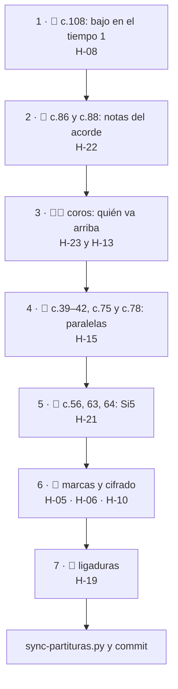

# Feedback 12 · pieza, por instrumento

> [!tldr] En corto
> **Para cerrar MuseScore te faltan pocas cosas, y casi todas son puntuales.**
>
> - 🎻 **Violín:** cerraste la melodía de la pieza y la copia del C2. Quedan:
>   - dos notas que contradicen el cifrado del B2: el Fa del c.86 sobre Am y el Si♭ del c.88 sobre G7 → H-22;
>   - la cadencia c.41→42, que sigue en octavas con el bajo → H-15;
>   - tres Si5 del V2, que suenan más agudos que el B♭ del B2 → H-21.
> - 🎹 **Piano:** el final no tiene bajo. El A7→D del c.107→108 llega con Re4 como nota más grave, y el bajo
>   no entra hasta el c.109 → H-08. **Es lo primero.**
> - 🎸 **Guitarra:** no cambió desde el F 09. Siguen abiertos el Em del coro, que no cabe en la mano (H-13), y las
>   terceras en el grave (H-12).
> - 🎼 **Entre instrumentos:** en los coros, la mano derecha y la guitarra suben por encima del violín en 12 de los
>   16 compases del C1 → H-23.
>
> **Qué hacer ahora:** poner bajo en el tiempo 1 del c.108.

> [!info] Fuente
> **Claude, 2026-10-25.** Feedback de **violín, piano y guitarra en toda la pieza**, uno por uno, para cerrar
> MuseScore. Lo pediste después de la [[3. Composiciones/6. louise/3. Sesiones/09. Violin.melodia|S 09]].
>
> **Fuera de este feedback:** la batería, la energía y las dinámicas. Sus hallazgos (H-01, H-02, H-03, H-07,
> H-17 y H-20) no se tocaron.
>
> **Qué cambió desde el [[3. Composiciones/6. louise/5. Feedback/11. violin|F 11]]:**
> - Siete compases del violín: c.34–36, 38, 66, 76 y 79.
> - D-16: el *pizz.* del V1 acompaña a propósito.
>
> Piano y guitarra no cambiaron ni una nota. El piano tampoco desde la S 07 (solo el bajo del final), y la guitarra
> desde el [[3. Composiciones/6. louise/5. Feedback/09. C1.guitarra.voicing|F 09]].
>
> **Cómo se midió, en una línea:** el `.musicxml` nota por nota, las tres partes juntas y por corchea, con la
> guitarra en altura real. Sin audio.

> [!abstract] Qué se evaluó, exactamente
> | Archivo | Commit | ¿Limpio? | Blob | Guardado |
> |---|---|---|---|---|
> | `7. Partituras/2. Composiciones/Louise-melancolica.mscz` | `d1d1f8d` | **sí** | `f43d5af` | 2026-10-25 12:23 |
>
> - **Limpio:** es exactamente lo que está en el commit `d1d1f8d`, y se puede volver a él.
> - MuseScore estaba abierto, pero no hay ningún autosave.

> [!important] Qué cuenta como error
> Un error es cuando **lo que escribiste dice una cosa y lo que suena dice otra**: el cifrado, el
> [[3. Composiciones/6. louise/1. Mapa|Mapa]], las [[3. Composiciones/6. louise/2. Decisiones|Decisiones]] o el
> [[3. Composiciones/6. louise/4. Contexto|Contexto]].
>
> Aquí pesan sobre todo:
> - [[3. Composiciones/6. louise/2. Decisiones#^d-13|D-13]] (*el violín lleva la línea*) y
>   [[3. Composiciones/6. louise/2. Decisiones#^d-16|D-16]] (*el V1 acompaña*);
> - [[3. Composiciones/6. louise/2. Decisiones#^d-04|D-04]] (*el C3 sí cierra en A7→D*) y
>   [[3. Composiciones/6. louise/2. Decisiones#^d-05|D-05]] (*piano en el 1, guitarra en el 2 y el 3*);
> - el cifrado, y el B2 del Mapa (*la cadena de dominantes*, *el B♭ con la nota más aguda*).
>
> Los ejemplos muestran **lo que suena hoy**. El *cómo* son opciones con su lugar exacto, no notas nuevas.

> [!warning] Antes de seguir · fuera de la partitura
> - **La S 09 apunta a los commits de la S 08:** dice `commit_inicio: 76af301` y `commit_fin: 2f1566c`. Por lo que
>   cambió, serían `2f1566c` y `d1d1f8d`.
> - **`violin` sigue sin estar en `instrumentos`** de [[3. Composiciones/6. louise/0. Obra|0. Obra]].
> - **D-15 sigue sin escribir:** el violín toca todo el B2, y la S 07 planeaba que no.

---

## En una pantalla

| | Lo que quedó bien | Lo que falta (abierto o nuevo) |
|---|---|---|
| 🎻 **Violín** | la melodía de la pieza (H-11) y el C2 que ya no es copia (H-16), los dos cerrados; el 2 y el 3 del verso tienen ataques (H-09, cerrado) | H-22 · c.86 y c.88 contra el cifrado · H-15 · c.39→42 · H-21 · Si5 en c.56, 63, 64 · H-19 · ninguna ligadura |
| 🎹 **Piano** | nada cambió; D-05 se cumple en c.19, 30, 34 y 38 | **H-08 · el c.108 sin bajo** · H-06 y H-10 · cifrado |
| 🎸 **Guitarra** | nada cambió | H-13 · el Em del coro · H-12 · terceras en el grave |
| 🎼 **Entre todos** | la marca *C3* ya está en el c.93 | H-23 · piano y guitarra encima del violín en los coros · H-05 · falta *Outro*, sobran dos marcas vacías |

**En números:**
- 2 hallazgos nuevos (H-22 y H-23, medios).
- 5 actualizados: H-08 sube a alto, y H-15 y H-21 bajan a bajo.
- 3 cerrados: H-09, H-11 y H-16.

### Quién toca dónde

```mermaid
gantt
    title Louise, compás por compás (sin batería)
    dateFormat X
    axisFormat %s
    section Violín
    V1 pizz que acompaña : 11, 27
    C1 arco : 27, 43
    V2 pizz que canta : 51, 67
    C2 arco : 67, 83
    B2 arco en acordes : 83, 93
    C3 arco : 93, 109
    section Piano
    De la Intro al Outro : 1, 112
    section Guitarra
    V1 y C1 : 11, 42
    V2 y C2 : 51, 82
    B2 : 85, 93
    C3 : 93, 108
```



La voz de arriba, por sección (% de las corcheas en que suena algo; si dos empatan, cuentan los dos):

| | V1 | C1 | V2 | C2 | B2 | C3 |
|---|---|---|---|---|---|---|
| 🎻 Violín | 5 % | **44 %** | **93 %** | 65 % | 73 % | **54 %** |
| 🎹 Piano | 79 % | 35 % | 17 % | 29 % | 48 % | 36 % |
| 🎸 Guitarra | 67 % | 27 % | 17 % | 25 % | 0 % | 29 % |

*En el V1, que el violín no esté arriba es D-16. En el V2 el violín manda; en los coros, no tanto (H-23).*

---

## Lista

| ID                                                      | Instrumento · dónde    | Qué escribiste                                                 | Qué suena                                                                                                  | Peso                 | Contra                                                          | Estado          |
| ------------------------------------------------------- | ---------------------- | -------------------------------------------------------------- | ---------------------------------------------------------------------------------------------------------- | -------------------- | --------------------------------------------------------------- | --------------- |
| [[3. Composiciones/6. louise/6. Hallazgos#^h-08\|H-08]] | 🎹 c.107–110           | *"el C3 sí cierra en A7→D"*                                    | el c.108 no tiene bajo: lo más grave es Re4; el bajo entra en el c.109 como Fa♯2 y llega a Re2 en el c.110 | **alto** (era medio) | [[3. Composiciones/6. louise/2. Decisiones#^d-04\|D-04]] · Mapa | **actualizado** |
| [[3. Composiciones/6. louise/6. Hallazgos#^h-22\|H-22]] | 🎻 B2, c.86 y c.88     | cifrado Am y G7; *"la cadena de dominantes"*                   | Fa5 sostenido sobre Am; Si♭4 contra el Si4 del piano sobre G7                                              | medio                | cifrado · Mapa                                                  | **nuevo**       |
| [[3. Composiciones/6. louise/6. Hallazgos#^h-23\|H-23]] | 🎹🎸 coros: C1, C2, C3 | *"el violín lleva la línea"*                                   | algo suena por encima del violín en 12 de 16 compases del C1, 9 del C2 y 13 del C3                         | medio                | D-13                                                            | **nuevo**       |
| [[3. Composiciones/6. louise/6. Hallazgos#^h-13\|H-13]] | 🎸 c.27–41 y copias    | *"adaptación de voicings a las posibilidades del instrumento"* | el Em no cabe en la mano; Bm y A7 arriba del mástil                                                        | medio                | F 09                                                            | sin cambios     |
| [[3. Composiciones/6. louise/6. Hallazgos#^h-12\|H-12]] | 🎸 V1, C1, V2, C2, C3  | *"las terceras por debajo de C3 se embarran"*                  | terceras en la octava 2                                                                                    | medio                | Recursos §2.3                                                   | sin cambios     |
| [[3. Composiciones/6. louise/6. Hallazgos#^h-15\|H-15]] | 🎻 c.39–42 y copias    | *"Evitar quintas y octavas paralelas"*                         | quintas en c.39→40, octavas en c.41→42; la fundamental en 5 de 8 tiempos 1                                 | **bajo** (era medio) | [[00. Voicing e inversiones]]                                   | **actualizado** |
| [[3. Composiciones/6. louise/6. Hallazgos#^h-21\|H-21]] | 🎻 V2, c.56, 63, 64    | *"el B♭ con la nota más aguda de la pieza"*                    | Si5, un semitono por encima del Si♭5 del c.91                                                              | **bajo** (era medio) | Mapa · D-08                                                     | **actualizado** |
| [[3. Composiciones/6. louise/6. Hallazgos#^h-05\|H-05]] | 🎼 c.43, 67, 109       | las secciones del Mapa                                         | falta *Outro* en el c.109; marcas vacías en c.43 y c.67                                                    | bajo                 | Mapa                                                            | **actualizado** |
| [[3. Composiciones/6. louise/6. Hallazgos#^h-06\|H-06]] | 🎹🎸 c.87              | *"C4"*                                                         | Csus4 y luego C7sus4                                                                                       | bajo                 | cifrado                                                         | sin cambios     |
| [[3. Composiciones/6. louise/6. Hallazgos#^h-10\|H-10]] | 🎹🎸 35 compases       | el cifrado                                                     | bajos, notas y tiempos que no dice                                                                         | bajo                 | cifrado                                                         | sin cambios     |
| [[3. Composiciones/6. louise/6. Hallazgos#^h-19\|H-19]] | 🎻 todo el violín      | —                                                              | ya dice *arco*; sigue sin ligaduras ni articulaciones                                                      | bajo                 | la propia notación                                              | **actualizado** |

**Cerrados en este feedback:**
- [[3. Composiciones/6. louise/6. Hallazgos#^h-09|H-09]], **arreglado**: el 2 y el 3 de c.11–18 y c.51–58 tienen
  ataques, del violín.
- [[3. Composiciones/6. louise/6. Hallazgos#^h-11|H-11]], **arreglado**: hay melodía en C1, V2, C2 y C3, y el V1
  va sin ella por D-16.
- [[3. Composiciones/6. louise/6. Hallazgos#^h-16|H-16]], **arreglado**: el C2 repite 5 de 16 compases del C1
  (tenía 15).

---

## 🎻 Violín

> [!tldr] En corto
> El violín ya es la línea de la pieza. Quedan dos notas del B2 que contradicen el cifrado (c.86 y c.88), una
> cadencia en octavas con el bajo (c.41→42) y tres Si5 del V2 que pisan el pico del B2. Y en la notación, ninguna
> ligadura.

**Lo que quedó bien (para no romperlo):**
- **H-11 se cierra.** El violín lleva la línea en el C1, el V2, el C2 y el C3, y el V1 va sin ella a propósito
  ([[3. Composiciones/6. louise/2. Decisiones#^d-16|D-16]]). En el F 08, fuera de Intro, B1 y B2 no había melodía
  en 80 compases.
- **H-16 se cierra (la copia).** El C2 repite 5 de los 16 compases del C1 (c.67, 70, 72, 76, 77). Tenía 15.
- **H-09 se cierra.** En c.11–18 y c.51–58, todos los compases tienen ataques en el 2 o el 3, del violín.
- **El coro es menos bajo.** La fundamental en el tiempo 1 cae en 6 de 15 compases (en el F 10, 12), y el violín va
  a octavas exactas del bajo el 35 % del tiempo (en el F 10, el 65 %).

### H-22 · Dos notas del B2 contra su acorde (c.86 y c.88) · nuevo

> [!tldr] En corto
> En el c.86, el violín sostiene un Fa sobre Am. En el c.88, toca Si♭ mientras el piano toca Si natural en el
> G7. El cifrado dice Am y G7, y el Mapa quiere *"la cadena de dominantes"*: un G7 con Si♭ deja de ser dominante.

**Qué escribiste.** El cifrado: **Am** en el c.86 y **G7** en el c.88. El Mapa, en el B2: *"la cadena de
dominantes"* (G7 → C7 → F7 → B♭, en c.88–91).

**Qué suena.**

```music-abc
X:1
T:c.86 y c.88 como suenan hoy (B2, armadura de Fa)
M:3/4
L:1/8
K:F
V:1 clef=treble name="Violín"
V:2 clef=treble name="Piano MD"
V:3 clef=bass name="Piano MI"
[V:1] "^c.86 Am"[CA=f]6 || "^c.88 G7"[G=d]2 [D_B]3 [=B,G] |]
[V:2] e A3 F A || [G=d] [=Bf]3 =d =B |]
[V:3] [C,A,] [E,A,]3 [A,,E,]2 || [G,,G,]2 [F,,F,]3 [G,,F,] |]
```

| c. | Tiempo | Violín | Contra | Qué pasa |
|---|---|---|---|---|
| 86 | 1 (todo el compás) | Do4 + La4 + **Fa5** | el Mi5 de la mano derecha en el 1; el acorde es Am | Fa sobre Am: la nota de arriba dice F (o Fmaj7/A), no Am. El Fa no resuelve a Mi: sigue a Sol en el c.87. |
| 88 | 2 a 3& | Re4 + **Si♭4** | el **Si4** de la mano derecha (1&, que suena hasta el 2&) y otra vez en el 3& | Si♭ contra Si en el mismo registro, a medio tono: el violín dice Gm, el piano dice G7 |

**¿Es un error?** Sí, contra el cifrado y contra la cadena de dominantes del Mapa. Antes de la S 08 los dos
compases tenían notas del acorde (Mi4 en el c.86; Sol, Re y Si natural en el c.88). Peso medio: son dos compases, pero
el Si♭ contra el Si está en el mismo registro y se oye.

**Dónde y cómo.**

| c. | Nota | Cómo, en MuseScore | Opciones |
|---|---|---|---|
| 86 | Fa5 del acorde de tres notas | selecciona solo el Fa5 (clic en la cabeza de la nota) | una nota de Am (La, Do, Mi), o que el Fa baje a Mi dentro del compás (apoyatura que resuelve) |
| 88, tiempo 2 | Si♭4 | selecciona el Si♭4 y pulsa ↑ para el Si natural, o cámbialo por otra nota del G7 | si lo que querías es Gm, entonces el cifrado y el piano dicen otra cosa: cambia el cifrado (doble clic en *G7*) y decide qué hace el Si4 del piano |

- **Cuándo queda:** en c.86 y c.88, el violín solo con notas del acorde cifrado (o el cifrado cambiado a lo que
  suena).
- **Pídelo así:** `B2.violin.armonia`.

### H-15 · La cadencia del coro sigue en octavas con el bajo (c.39–42) · actualizado

> [!tldr] En corto
> Quedan dos paralelas, las dos en el final del coro. Además, el C2 tiene otras dos donde copia el C1 viejo.

**Qué escribiste.** [[00. Voicing e inversiones]]: *"Evitar quintas y octavas paralelas"*. La vara del F 11 para
c.35–42: la fundamental en el tiempo 1 en menos de la mitad de los compases, y ninguna octava paralela.

**Qué suena.**

```music-abc
X:2
T:c.39–42 como suenan hoy: el final del C1
M:3/4
L:1/8
K:D
V:1 clef=treble name="Violín"
V:2 clef=bass name="Bajo"
[V:1] "^c.39 Em""_fund."E4 "_quintas →"B,2 | "^40 G""_5ª"D6 | "^41 A7""_13ª"F2 A3 "_octavas →"A | "^42 D""_fund."D6 |]
[V:2] E,,6 | G,,6 | A,,6 | D,,6 |]
```

| Dónde | Violín | Bajo | Qué es |
|---|---|---|---|
| c.39, tiempo 3 → c.40, tiempo 1 | Si3 → Re4 | Mi2 → Sol2 | quintas paralelas (suben los dos) |
| c.41, tiempo 3& → c.42, tiempo 1 | La4 → Re4 | La2 → Re2 | octavas paralelas, en la cadencia V→I |
| c.75, tiempo 3 → c.76, tiempo 1 (C2) | Si3 → Re4 | Mi2 → Sol2 | quintas: el c.75 sigue siendo el c.35 de antes |
| c.77 → c.78, tiempo 1 (C2) | Fa♯4 → Si4 | Fa♯2 → Si2 | octavas: el c.78 sigue siendo el c.38 de antes |

- **Fundamental en el tiempo 1, c.35–42:** 5 de 8 (c.35, 37, 38, 39 y 42). En todo el coro, 6 de 15.
- Lo que cambiaste en la S 09 quitó dos paralelas (c.36→37 y 37→38) y una fundamental: el c.36 ahora es la 5ª.

**¿Es un error?** Sí, contra tu nota. Peso bajo, antes medio: el coro ya no suena a bajo doblado. Lo que queda es
la cadencia y dos compases del C2.

**Dónde y cómo.**

| Dónde | Cómo, en MuseScore | Opciones |
|---|---|---|
| c.41, tiempo 3& (La4) o c.42 (Re4) | selecciona la nota y muévela con ↑/↓ | que el violín llegue al Re por grado (Do♯ → Re, como hace en el c.33→34) o que llegue a otra nota del D (Fa♯, La) |
| c.39, tiempo 3 (Si3) o c.40 (Re4) | igual | que una de las dos sea otra nota del acorde, o ir al revés del bajo |
| c.75 y c.78 (C2) | copia el c.35 y el c.38 nuevos encima (selecciona el compás, Ctrl+C; el destino, Ctrl+V) o escríbelos distintos | decide si el C2 sigue al C1 nuevo |

- **Cuándo queda:** ninguna octava paralela con el bajo en el C1 ni en el C2.
- **Pídelo así:** `C1.violin.melodia`.

### H-21 · Tres Si5 del V2 pasan por encima del pico (c.56, 63 y 64) · actualizado

> [!tldr] En corto
> Quitaste el Do♯6 del c.66. Pero el Si5 del V2 sigue un semitono por encima del Si♭5 del B2, que según el Mapa es
> la nota más aguda de la pieza.

```music-abc
X:3
T:Lo más agudo del violín hoy: el V2 (pizz.) y el B♭ del B2
M:3/4
L:1/8
K:D
V:1 clef=treble name="Violín"
[V:1] "^c.56"d4 [eb]2 | "^c.63"[db]6 | "^64"d2 g3 b || "^c.91 B♭"[_B=f_b]4 [=Fg]2 |]
```

| c. | Tiempo | Nota | Cómo, en MuseScore | Opciones |
|---|---|---|---|---|
| 56 | 3 | Si5 (con Mi5) | selecciona el Si5 y pulsa Ctrl+↓ para bajarlo una octava | Si4, u otra nota del acorde por debajo de Si♭5 |
| 63 | 1 (todo el compás) | Si5 (con Re5) | igual | igual |
| 64 | 3& | Si5 | igual | igual |

- **O cambia el Mapa:** que el B2 se reconozca por otra cosa (por ejemplo, los acordes del violín).
- **¿Es un error?** Sí, contra el Mapa y D-08. Peso bajo: es un semitono, en *pizz.* y en tres compases.
- **Cuándo queda:** la nota más aguda de la pieza en el B2, o el Mapa cambiado.
- **Pídelo así:** `V2.violin.melodia`.

### H-19 · Notación del violín · actualizado

- ✓ **c.27 y c.67 ya dicen *arco*.**
- **Ninguna ligadura ni articulación en 251 notas.** En arco, cada nota sin ligadura es un golpe de arco nuevo, y
  MuseScore las toca así.
  - **Cómo:** selecciona las notas de una frase y pulsa `S`.
  - **Dónde primero:** las frases por grado conjunto del C3 (c.100: Fa♯–Mi–Re; c.103: Fa♯–Sol–La; c.107: Mi–Sol–
    La–Do♯) y las negras con puntillo del C1 y el C2 (c.69–70).

### Para tus manos (violín, no son errores)

Solo importa si lo va a tocar un violinista; sigue sin decidirse (ver *Propuestas*).

| Qué | Dónde | Por qué |
|---|---|---|
| Acordes que no caben | c.84, 2& (Fa4 + La5) · c.85 (Si♭3 + Si♭4 + Sol5) · c.91, tiempo 3 (Fa4 + Sol5) | no hay cuerdas vecinas que den esas notas en una posición |
| Tres notas sostenidas | c.80, 85, 86 (blancas con puntillo) · c.87, 91 (blancas) | el arco sostiene dos cuerdas; la tercera suena un instante |
| *Pizz.* largo | c.52 (tiempo 2, La4 + Fa♯5) · c.56 (Re5) · c.59 (Re5 + La5) · c.63 (Re5 + Si5) · c.65 (Fa♯5) | el *pizz.* se apaga enseguida: se oye el ataque y luego un hueco |

---

## 🎹 Piano

> [!tldr] En corto
> Lo único importante: **el final no tiene bajo.** En el c.108, donde llega el D de la última cadencia, la mano
> izquierda calla. El resto es cifrado y, para tus manos, varios acordes demasiado abiertos para una mano.

### H-08 · La última cadencia llega sin bajo (c.107→110) · actualizado y subido a alto

> [!tldr] En corto
> El C3 existe para cerrar en A7→D, y es el único sitio de la pieza donde la canción por fin llega a D. En el
> c.108, que es esa llegada, no hay bajo. El bajo entra un compás tarde (c.109), y entra como Fa♯, no como Re.

**Qué escribiste.** [[3. Composiciones/6. louise/2. Decisiones#^d-04|D-04]]: *"C3 de despedida: el coro con capas
quitadas, que sí cierra en A7→D · después del pico llega la resolución que el B2 retuvo"*. El Mapa, en la
*Intención*: *"cada vez que llega a D se escapa"*. El C3 es donde deja de escaparse.

**Qué suena.**

```music-abc
X:4
T:c.107–110 como suenan hoy: el A7→D y el bajo que llega tarde
M:3/4
L:1/8
K:D
V:1 clef=treble name="Violín"
V:2 clef=treble name="Piano MD"
V:3 clef=bass name="Piano MI"
[V:1] "^c.107 A7"E G A2 c2 | "^108 D"[Fd]6 | "^109"z6 | "^110"z6 |]
[V:2] z2 [Ac]3 [Ac] | [DAd]6 | [DAd]2 z4 | z6 |]
[V:3] [A,,G,]2 G,3 G, | "_sin bajo"z6 | [F,,A,,]3/2 G,,/ G,,2 G,,/ F,,/ F,, | D,,2 D,,/ D,7/2 |]
```

| c. | Lo más grave en el tiempo 1 | Qué es |
|---|---|---|
| 107 | La2 (guitarra y piano) | el V: bien |
| **108** | **Re4** (piano, mano derecha) | la llegada al I, sin bajo: dos octavas por encima de donde cae el bajo en el resto de la pieza |
| 109 | Fa♯2 (piano) | el bajo entra un compás tarde, y en primera inversión (D/F♯) |
| 110 | Re2 (piano) | la fundamental, dos compases después de la cadencia |

- **Qué cambió:** en el F 07 el bajo entraba en el tiempo 3 del c.108. En la S 07 la figura se movió un tiempo, y
  ahora el c.108 no tiene ni una nota en la mano izquierda.
- **La guitarra** termina en el c.107: tampoco da el bajo del c.108.

**¿Es un error?** Sí, contra D-04 y la *Intención* del Mapa. **Peso alto**, antes medio: es la cadencia para la
que está hecha la forma. Si el D llega sin su bajo, el final se escapa otra vez.

**Dónde y cómo.**

| Opción | Dónde | Cómo, en MuseScore |
|---|---|---|
| **El Re en el 1** | c.108, tiempo 1, pentagrama de abajo del piano | selecciona el silencio, entra en modo de escritura (`N`) y escribe un Re (`D`) en la octava del bajo de la pieza (Re2, como en el c.42); la duración, a tu gusto |
| **Adelantar la figura** | la figura de c.109–110 (Fa♯2 + La2 … Re2) | selecciónala y llévala al c.108 (Ctrl+X / Ctrl+V), para que el Re2 caiga cerca de la llegada |
| **Que la guitarra lo dé** | c.108, tiempo 1 | un acorde de D con Re en el grave, que la guitarra tiene libre ese compás |

- **Cuándo queda:** en el tiempo 1 del c.108, la nota más grave es un Re en la octava 2 o 3.
- **Pídelo así:** `C3.armonia`, o `C3.piano.armonia`.

### H-06 y H-10 · El cifrado · sin cambios

- **H-06:** el c.87 dice *"C4"*. Suena Csus4 en el tiempo 1 y C7sus4 en el 2 y el 3.
  - **Cómo:** doble clic en el cifrado y escribe *C7sus4* (o *Csus4* en el 1 y *C7sus4* en el 2, con Ctrl+K en el
    tiempo 2).
- **H-10:** 35 compases cuyo cifrado no dice lo que suena. La lista exacta está en el hallazgo.
  - Por ejemplo: bajos sin escribir en c.7, 19, 45, 47, 51, 53, 57 y 90; Em7 en el c.44; B♭add9 en el c.91.
  - **Cómo:** doble clic en cada cifrado; para el bajo, una barra (*F♯m/C♯*).
  - Lo único que cambió: en el c.26 se borró un F♯m repetido.
- Peso bajo los dos: no cambian ni una nota, pero el cifrado es la vara de todos los feedback de armonía.

### Para tus manos (piano, no son errores)

Eres pianista. Si alguna vez lo tocas, estos acordes no caben en una mano (a partir de una décima):

| Mano | Dónde | Qué | Cómo, si lo vas a tocar |
|---|---|---|---|
| Derecha | c.14, 22, 54, 62 (tiempo 2&) | Do♯4–Sol5, una 11ª aumentada | arpegiado (paleta *Arpegios y glissandos*), o el Do♯4 a la izquierda (Ctrl+Mayús+↓) |
| Derecha | c.15, 23, 55, 63 (tiempo 1) | Re4–Fa♯5, décima | arpegiado, o quitar una nota |
| Derecha | c.16, 24, 56, 64 (tiempo 1) | Si3–Re5, décima | igual |
| Derecha | c.91 (tiempos 1, 2& y 3) | Re4–Si♭5 y Fa4–Si♭5 | la izquierda ya va llena (Si♭2–Do4): hay que soltar una nota |
| Derecha | c.92 (tiempo 1) | Fa♯4–La5, décima | arpegiado |
| Izquierda | c.6, 83, 92 (tiempo 1) | Re2–La3, 12ª | el bajo antes y el acorde después, o arpegiado |
| Izquierda | c.11 (tiempo 1) | Re2–Do♯4, casi dos octavas | igual |
| Izquierda | c.42, 84, 90, 92 (3&) | Re2–Fa♯3, Re2–Fa3, Fa2–La3, Re2–Fa♯3 | igual |

Tampoco hay ninguna marca de pedal. En un vals con el bajo en el 1 y el acorde en el 2 y el 3, tocándolo de verdad
lo vas a necesitar. MuseScore no.

---

## 🎸 Guitarra

> [!tldr] En corto
> La guitarra no cambió desde el F 09, así que sus dos hallazgos siguen igual. Si no la vas a grabar tú (*Por
> decidir*), no hace falta tocarlos. Pero el Em y los acordes agudos del coro también tapan al violín (H-23), y eso
> sí importa en MuseScore.

### H-13 · El coro no cabe en la mano (c.27–41 y sus copias) · sin cambios

| Acorde | Compases (C1 · C2 · C3) | Qué toca hoy (altura real) | Qué pasa |
|---|---|---|---|
| Em | c.27, 31, 35, 39 · 67, 71, 75, 79 · 93, 97, 101, 105 | Mi2 + Sol2 + Mi3 + Sol3 (c.39, + Mi4; c.93, + Sol4) | Mi2 y Sol2 solo existen en la 6.ª cuerda: no se pueden tocar a la vez |
| Bm | c.30, 38 · 70, 78 · 96, 104 (tiempos 2 y 3) | Si3 + Re4 + Si4 + **Fa♯5** | solo cabe del traste 9 al 14, y queda **por encima del violín** (H-23) |
| A7 | c.33, 41 · 73, 81 · 99, 107 | La2 + Do♯3 + Mi4 + La4 + **Mi5** | arriba del mástil, con una cuerda apagada en medio; también por encima del violín |

**Dónde y cómo.** Las opciones del F 09: *una forma abierta* (tu c.11, 0-0-0-2-2-2), *abrir la nota de abajo*
(quinta u octava encima del bajo, no tercera), *dejarle el grave al piano* o *menos notas* (como en el B2: tres
notas, trastes 0–5). En MuseScore: selecciona el acorde y borra o mueve notas con ↑/↓ y Ctrl+↓. Los voicings
abiertos de Bm y A7 quedan más abajo, y así resuelven también H-23 en esos compases.

- **Cuándo queda:** el Em con una digitación posible, y Bm y A7 cerca de los trastes del compás anterior.
- **Pídelo así:** `C1.guitarra.voicing`.

### H-12 · Terceras en el grave · sin cambios

Terceras con la nota de abajo en Sol2 o más grave. Con este criterio de corte salen 39 compases; el F 08 contó 41.

> c.12, 16, 20 · 27–29, 31, 32, 35–37, 39, 40 · 52, 53, 56–58, 60 · 67–69, 71, 72, 75–77, 79, 80 · 93–95, 97, 98,
> 101–103, 105, 106

Y 12 más con la nota de abajo en La2–Si2: c.14, 15, 22, 33, 41, 54, 55, 62, 73, 81, 99 y 107.

- **Cómo:** quita la nota de abajo (selecciona y Supr) o súbela una octava (Ctrl+↑). Empieza por donde el piano ya
  toca ese mismo grave: en 31 compases, la guitarra toca debajo de Re3 la misma nota que la mano izquierda.
- **Pídelo así:** `guitarra.voicing`.

### D-05 se cumple

En c.19, 30, 34 y 38, el piano ataca en el 1 y la guitarra en el 2 y el 3, como dice
[[3. Composiciones/6. louise/2. Decisiones#^d-05|D-05]]. Si arreglas el Bm de c.30 y c.38 (H-13), conserva ese
reparto.

---

## 🎼 Entre instrumentos

### H-23 · En los coros, el acompañamiento sube por encima de la línea · nuevo

> [!tldr] En corto
> El violín lleva la línea del coro, pero en la mayoría de los compases la mano derecha o la guitarra tocan más
> agudo que él. La línea está, pero no es lo más agudo, y el oído tiende a seguir lo más agudo.

**Qué escribiste.** [[3. Composiciones/6. louise/2. Decisiones#^d-13|D-13]]: *"el violín lleva la línea"*. En el V2
lo cumple: arriba de todo el 79 % del tiempo.

**Qué suena.**

```music-abc
X:5
T:c.35–37 como suenan hoy: la mano derecha encima del violín
M:3/4
L:1/8
K:D
V:1 clef=treble name="Violín"
V:2 clef=treble name="Piano MD"
[V:1] "^c.35 Em"E6 | "^36 G"D6 | "^37 F#m7"F6 |]
[V:2] z2 [Ee]2 [Ee]2 | z2 [DB]2 [DB]2 | z2 [EA]2 [EA]2 |]
```

```music-abc
X:6
T:c.30 y c.33 como suenan hoy: la guitarra encima del violín (solo sus notas de arriba)
M:3/4
L:1/8
K:D
V:1 clef=treble name="Violín"
V:2 clef=treble name="Guitarra (real)"
[V:1] "^c.30 Bm"F3 D3 | "^c.33 A7"C6 |]
[V:2] z2 [B,DBf]2 [B,DBf]2 | [EAe]6 |]
```

| Sección | Violín arriba de todo | Compases con algo por encima del violín | Quién |
|---|---|---|---|
| C1 | 38 % del tiempo | **12 de 16:** c.30, 32–42 | la mano derecha en c.32, 33, 35–42 (Mi5 en el c.35, Re5 en el c.42); la guitarra en c.30 y 38 (Fa♯5), c.33 y 41 (Mi5), c.34 y 39 |
| C2 | 47 % | 9 de 16: c.70, 72–78, 81 | lo mismo, en las copias; la guitarra en c.70 y 78 (Fa♯5) y c.73 y 81 (Mi5) |
| C3 | 34 % | 13 de 16: c.93–96, 98–101, 103–107 | la mano derecha (Mi5 y Sol5 en el c.93); la guitarra en c.96 y 104 (Fa♯5), c.99 y 107 (Mi5) |
| V2 (para comparar) | 79 % | 3 de 16 | — |

*"Arriba de todo" = por encima de todo lo que suena de piano y guitarra.*

**¿Es un error?** Contra D-13, sí: la línea está, pero no manda en el registro. Peso medio: el timbre del arco
ayuda a distinguirla.

**Dónde y cómo.** Hay tres palancas, y se pueden combinar:

| Opción | Dónde | Cómo, en MuseScore | Ojo |
|---|---|---|---|
| **La mano derecha más abajo** | c.35–42 (y c.75–82, c.101–108) | selecciona las notas de arriba de la mano derecha y Ctrl+↓, o bórralas (el acorde queda en la nota de abajo) | el acorde queda más cerrado, debajo del violín |
| **La guitarra en voicings abiertos** | c.30, 33, 38, 41 y copias | H-13: los mismos compases | arregla dos hallazgos a la vez |
| **El violín una octava arriba** | el coro entero, o la segunda mitad | selecciona los compases del violín y Ctrl+↑; en el C1 nadie toca por encima de Fa♯5 | el violín pasa a vivir entre Si4 y Si5, como en el V2 |

- **Cuándo queda:** el violín arriba de todo en más de la mitad del tiempo en el C1 (hoy, 38 %).
- **Pídelo así:** `C1.arreglo`.

### H-05 · Marcas de ensayo · actualizado

| Dónde | Qué hay | Cómo, en MuseScore |
|---|---|---|
| c.93 | ✓ *C3* | ya está |
| c.109 | nada | selecciona el compás y Ctrl+M; escribe *Outro* |
| c.43 | *B1* y una segunda marca vacía | selecciona la vacía y Supr |
| c.67 | *C2* y una segunda marca vacía | igual |

### Para tu oído (no son errores)

Momentos en que el violín roza a medio tono algo que suena. Todos son notas del acorde o de paso; los únicos
contra el cifrado son los de H-22.

| Dónde | Violín | Contra | Qué es |
|---|---|---|---|
| c.11 y c.20 (2 y 3) | Re4 | Do♯4 de piano y guitarra | la 7ª del Dmaj7 debajo de la fundamental (ya en el F 10) |
| c.51, 57 y 59 | Re5 | Do♯4 o Do♯5 del piano | lo mismo, en el V2: el color del Dmaj7 |
| c.69 (2&) | Sol4 | Fa♯ de piano y guitarra | nota de paso en el F♯m7 |
| c.80 | Sol4 | Fa♯3 del piano | la 7ª del Gmaj13 |
| c.94, 98 (2) | Fa♯4 | Sol4 del piano, encima | bordadura (ya en el F 10) |
| c.103 (2) | Sol4 | Fa♯3 | nota de paso (ya en el F 10) |

---

## Para cerrar MuseScore

El orden importa poco. Lo único es empezar por lo que cambia la armonía y dejar la notación para el final.



- [ ] 🎹 **c.108, tiempo 1:** un bajo en Re (H-08)
- [ ] 🎻 **c.86:** el Fa5, una nota de Am, o que resuelva (H-22)
- [ ] 🎻 **c.88, tiempo 2:** el Si♭4, una nota del G7, o cambiar el cifrado (H-22)
- [ ] 🎹🎸 **coros:** la mano derecha de c.35–42 más abajo, o la guitarra abierta en c.30, 33, 38, 41, o el violín
  arriba (H-23 y H-13), y lo mismo en las copias
- [ ] 🎻 **c.39→40 y c.41→42:** romper las paralelas; **c.75 y c.78:** seguir al C1 nuevo (H-15)
- [ ] 🎻 **c.56, 63, 64:** los Si5, una octava abajo (H-21), o cambiar el Mapa
- [ ] 🎼 **c.109:** *Outro*; **c.43 y c.67:** borrar la marca vacía (H-05)
- [ ] 🎼 **c.87:** *C7sus4* (H-06); el resto del cifrado, con la lista de H-10
- [ ] 🎻 **ligaduras** en las frases de arco (H-19)
- [ ] `./_scripts/sync-partituras.py` y commit

---

## Siguiente

➡️ **[[3. Composiciones/6. louise/6. Hallazgos#^h-08|H-08]]: el bajo del c.108.**

- Es el único alto de este feedback, y es una sola nota.
- Es la cadencia para la que existe el C3 (D-04): la única vez que la canción llega a D sin escaparse. Sin bajo, se
  escapa también ahí.
- Hazlo antes de pasar a Strudel: la transcripción se lleva el final tal como esté.

---

## Propuestas

> [!tldr] En corto
> Líneas para que tú las completes. La que más ayuda a cerrar: decidir si alguien va a tocar esto de verdad. Eso
> convierte los *para tus manos* en hallazgos o los descarta para siempre.

- **Para Decisiones:**
  - `D-NN · La partitura es para MuseScore y Strudel: no se escribe para tocarse · porque ____` /
    `D-NN · La partitura se escribe para tocarse (violín, piano, guitarra) · porque ____`. Decide los tres
    *Para tus manos* de una vez, y el *Por decidir* de la guitarra.
  - D-15, con lo que hace el violín en el B2: `D-15 · El B2 lo lleva el piano; el violín acompaña en acordes ·
    porque ____`.
  - Si el c.88 quiere Gm (H-22): `D-NN · El c.88 es Gm, no G7: la cadena de dominantes empieza en el C7 ·
    porque ____`.
  - Si el V2 se queda con su Si5 (H-21), es una línea para el Mapa, no para Decisiones.
- **Para el Mapa:**
  - *Roles*: *"violín: pizz. que acompaña en el V1 (D-16), pizz. que canta en el V2, arco en los coros y el C3;
    en el B2, acordes"* ____
  - *Outro*: todavía sin *Qué quiero* ni *Cómo se reconoce*. Hoy son tres compases de piano (c.109–111).
- **Para la ficha:** `violin` en `instrumentos`.
- **Para la S 09:** `commit_inicio: 2f1566c` y `commit_fin: d1d1f8d`.

---

## Cómo se midió

- **Notas:** el `.musicxml` del commit `d1d1f8d` (blob `f43d5af`), leído nota por nota. Las tres partes se
  comparan por corchea, con la guitarra en altura real (una octava debajo de lo escrito).
- **Qué cambió:** `diff-musical.py` contra `2f1566c` (la versión del F 11). Piano y guitarra se compararon contra
  `eca2c4f`, que es lo que evaluó el F 09.
- **"Arriba de todo" y "algo por encima del violín":** por corchea, mientras suena el violín, contra todo lo que
  suena de piano y guitarra.
- **Paralelas:** como en el F 10 y el F 11. Entre dos momentos seguidos en que se mueven el violín y el bajo (lo más
  grave de piano y guitarra), en la misma dirección y con el mismo intervalo: 8ª o 5ª justa, simple o compuesta.
- **Roces:** 2ª o 9ª menor entre una nota del violín, en su ataque, y algo que suena en piano o guitarra.
- **Acordes que caben (violín):** notas en cuerdas vecinas, con las pisadas dentro de cinco semitonos, o al aire.
  **Aperturas (piano):** notas de una misma mano que atacan juntas a 15 semitonos o más (una décima menor).
- **Terceras de la guitarra (H-12):** dos notas a 3 o 4 semitonos, con la de abajo en Sol2 o más grave (o en
  La2–Si2, "en el límite").
- **Lo que esto no mide:** cómo lo oyes tú.
