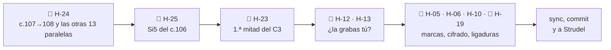

# Feedback 13 · pieza, por instrumento

> [!tldr] En corto
> **Cerraste cuatro: el bajo del final, los coros sin paralelas, el V2 por debajo del B♭ y las dos notas del B2.**
> Lo que queda:
>
> - 🎻 **Violín:** quintas y octavas con el bajo **fuera de los coros**: 14 (3 en el V1, 5 en el V2, 4 en el B2 y
>   2 en el C3). La más importante es la última cadencia (c.107→108) → H-24.
> - 🎹 **Piano:** un Si5 en el c.106, más agudo que el B♭ del B2 → H-25.
> - 🎸 **Guitarra:** lo de siempre (H-12 y H-13). Se cierra o se queda según decidas si la vas a grabar tú.
> - 🎼 **C3:** la segunda mitad ya la cierra el piano, como querías. En la primera mitad, el violín todavía tiene
>   algo encima en c.93, 96, 99 y 100 → H-23.
>
> **Qué hacer ahora:** la octava de la última cadencia, c.107→108.

> [!info] Fuente
> **Claude, 2026-10-25.** Violín, piano y guitarra en toda la pieza, igual que el
> [[3. Composiciones/6. louise/5. Feedback/12. pieza|F 12]]. Fuera de este feedback: la batería, la energía y las
> dinámicas. Sus hallazgos no se tocaron.
>
> **Qué cambió desde el F 12:**
> - **Violín** (10 compases): c.39 y c.75 (Do♯4 en el tiempo 3), c.56, 63 y 64 (sin Si5), c.77, c.86 (Mi5),
>   c.88 (Si4), c.93 y c.96.
> - **Piano** (7 compases): el bajo en c.42 (Fa♯2), c.76 (Si2) y c.108 (Re2); la mano derecha entra en el c.96 y
>   sube una octava en c.105–107.
> - **Guitarra:** sale del c.96, y en el c.93 pierde el Sol4. Ahora se llama *Classical Guitar*. Exporta en altura
>   real en lugar de escrita, pero las notas son las mismas.
> - **Partitura:** la marca *Outro* en el c.109.
>
> **Cómo se midió, en una línea:** el `.musicxml` nota por nota, las tres partes juntas y por corchea, con la
> guitarra en altura real. Sin audio.

> [!abstract] Qué se evaluó, exactamente
> | Archivo | Commit | ¿Limpio? | Blob | Guardado |
> |---|---|---|---|---|
> | `7. Partituras/2. Composiciones/Louise-melancolica.mscz` | `db3d9ca` | **no** | `1af0255` | 2026-10-25 15:50 |
>
> - **No limpio:** lo de hoy, desde el F 12, todavía no tiene commit. El blob identifica el contenido exacto, pero no
>   lo guarda: para volver a esta versión hace falta el commit.
> - No hay ningún autosave más nuevo que el archivo.

> [!important] Qué cuenta como error
> Lo mismo que en el F 12: lo que escribiste (el cifrado, el Mapa, las Decisiones, tus notas de Teoría) contra lo
> que suena. Desde el F 12 hay una decisión nueva:
> [[3. Composiciones/6. louise/2. Decisiones#^d-17|D-17]]. En el C1 y el C2, el violín va dentro de la textura, así
> que ahí lo que suena por encima de él ya no se reporta.

---

## En una pantalla

| | Cerrado hoy | Queda abierto |
|---|---|---|
| 🎻 **Violín** | H-15 (los coros, sin paralelas) · H-21 (el V2 ya no pasa de La5) · H-22 (c.86 y c.88) | **H-24 · 14 paralelas fuera de los coros** · H-19 · ligaduras |
| 🎹 **Piano** | H-08 (Re2 en el c.108) | H-25 · Si5 en el c.106 · H-06 y H-10 · cifrado |
| 🎸 **Guitarra** | — | H-12 · H-13 |
| 🎼 **Entre todos** | parte de H-05 (*Outro*) | H-23 · la 1.ª mitad del C3 · H-05 · dos marcas vacías |

**En números:**
- 4 cerrados: H-08, H-15, H-21 y H-22.
- 2 nuevos: H-24 (medio) y H-25 (bajo).
- 3 actualizados: H-05, H-13 y H-23.



---

## Lista

| ID | Instrumento · dónde | Qué escribiste | Qué suena | Peso | Contra | Estado |
|---|---|---|---|---|---|---|
| [[3. Composiciones/6. louise/6. Hallazgos#^h-24\|H-24]] | 🎻 V1, V2, B2, C3 | *"Evitar quintas y octavas paralelas"* | 14 paralelas del violín con el bajo; la última, en la cadencia final (c.107→108) | medio | [[00. Voicing e inversiones]] | **nuevo** |
| [[3. Composiciones/6. louise/6. Hallazgos#^h-23\|H-23]] | 🎹🎸 C3, 1.ª mitad | *"el violín lleva la línea"* | en c.93, 96, 99 y 100 algo suena por encima del violín; solo arriba el 42 % del tiempo | medio | [[3. Composiciones/6. louise/2. Decisiones#^d-13\|D-13]] | **actualizado** |
| [[3. Composiciones/6. louise/6. Hallazgos#^h-13\|H-13]] | 🎸 c.27–41 y copias | *"adaptación de voicings a las posibilidades del instrumento"* | el Em no cabe en la mano; Bm y A7 arriba del mástil | medio | F 09 | **actualizado** (sale el c.96) |
| [[3. Composiciones/6. louise/6. Hallazgos#^h-12\|H-12]] | 🎸 V1, C1, V2, C2, C3 | *"las terceras por debajo de C3 se embarran"* | terceras en la octava 2 | medio | Recursos §2.3 | sin cambios |
| [[3. Composiciones/6. louise/6. Hallazgos#^h-25\|H-25]] | 🎹 c.106 | *"el B♭ con la nota más aguda de la pieza"* | la mano derecha toca Si5, un semitono por encima del Si♭5 del c.91 | bajo | Mapa · [[3. Composiciones/6. louise/2. Decisiones#^d-08\|D-08]] | **nuevo** |
| [[3. Composiciones/6. louise/6. Hallazgos#^h-05\|H-05]] | 🎼 c.43, 67 | — | dos marcas de ensayo vacías | bajo | Mapa | **actualizado** |
| [[3. Composiciones/6. louise/6. Hallazgos#^h-06\|H-06]] | 🎹🎸 c.87 | *"C4"* | Csus4 y luego C7sus4 | bajo | cifrado | sin cambios |
| [[3. Composiciones/6. louise/6. Hallazgos#^h-10\|H-10]] | 🎹🎸 35 compases | el cifrado | bajos, notas y tiempos que no dice | bajo | cifrado | sin cambios |
| [[3. Composiciones/6. louise/6. Hallazgos#^h-19\|H-19]] | 🎻 todo el violín | — | ninguna ligadura ni articulación | bajo | la propia notación | sin cambios |

**Cerrados en este feedback:**
- [[3. Composiciones/6. louise/6. Hallazgos#^h-08|H-08]], **arreglado**: el c.108 tiene Re2 en el tiempo 1.
- [[3. Composiciones/6. louise/6. Hallazgos#^h-15|H-15]], **arreglado**: el C1 y el C2 no tienen ni una paralela con
  el bajo. La fundamental cae en el tiempo 1 en 5 de 15 compases del C1 (en el F 10, 12).
- [[3. Composiciones/6. louise/6. Hallazgos#^h-21|H-21]], **arreglado**: lo más agudo del V2 es La5 (c.52, 54, 55,
  58, 59, 62 y 66). Bajaste los tres Si5.
- [[3. Composiciones/6. louise/6. Hallazgos#^h-22|H-22]], **arreglado**: Mi5 sobre Am en el c.86, y Si4 sobre G7 en
  el c.88. El B2 ya no tiene ningún roce de medio tono.

---

## 🎻 Violín

> [!tldr] En corto
> Los coros quedaron limpios. Las paralelas que quedan están fuera de ellos, y casi todas caen en el cambio de
> compás: la última corchea del violín (3&) y el tiempo 1 siguiente se mueven igual que el bajo.

### H-24 · Quintas y octavas con el bajo fuera de los coros · nuevo

**Qué escribiste.** [[00. Voicing e inversiones]]: *"Evitar quintas y octavas paralelas"*. Y que *"La sensible tiende
a resolver a la tónica"*: aquí resuelve, pero doblada.

**Qué suena.** La última cadencia: la sensible está en tres voces a la vez y las tres suben a Re.

```music-abc
X:1
T:c.107–108 como suenan hoy: Do♯ → Re en el violín, la mano derecha y el bajo
M:3/4
L:1/8
K:D
V:1 clef=treble name="Violín"
V:2 clef=treble name="Piano MD"
V:3 clef=bass name="Piano MI"
[V:1] "^c.107 A7"E G A2 "_Do♯5 →"c2 | "^108 D""_Re5"[Fd]6 |]
[V:2] z2 [Aca]3 [Aca] | [DAd]6 |]
[V:3] [A,,G,]2 G,3 "_Do♯2 →"[C,,G,] | "_Re2"[D,,A,]6 |]
```

Y una del V2, la sección donde el violín canta:

```music-abc
X:2
T:c.52–53 como suenan hoy (V2, pizz.): el violín y el bajo bajan juntos de Fa♯ a Mi
M:3/4
L:1/8
K:D
V:1 clef=treble name="Violín"
V:2 clef=bass name="Bajo"
[V:1] "^c.52"[ca]2 "_Fa♯5 →"[Af]4 | "^53""_Mi5"e2 c2 e2 |]
[V:2] "_Fa♯2 →"F,,6 | "_Mi2"E,,6 |]
```

**Dónde.** Las 14, en orden:

| Sección | Dónde | Violín | Bajo | Qué |
|---|---|---|---|---|
| V1 *(D-16: acompaña)* | c.15 (3&) → c.16 (1) | Fa♯4 → Re4 | Si2 → Sol2 | quintas |
| | c.18 (3&) → c.19 (1) | Fa♯4 → La4 | Fa♯2 → La2 | octavas |
| | c.22 (3&) → c.23 (1) | La4 → Si4 | La2 → Si3 | octavas |
| V2 | **c.52 (3&) → c.53 (1)** | Fa♯5 → Mi5 | Fa♯2 → Mi2 | octavas |
| | c.55 (3&) → c.56 (1) | Fa♯5 → Re5 | Si2 → Sol2 | quintas |
| | c.58 (3&) → c.59 (1) | Fa♯5 → La5 | Fa♯2 → La2 | octavas |
| | c.59 (3&) → c.60 (1) | La5 → Do♯5 | Re3 → Fa♯2 | quintas |
| | c.63 (3&) → c.64 (1) | Fa♯5 → Re5 | Si3 → Sol3 | quintas |
| B2 | c.84 (3&) → c.85 (1) | La5 → Sol5 | La2 → Sol2 | octavas |
| | c.86 (3&) → c.87 (1) | Mi5 → Sol5 | La2 → Do3 | quintas |
| | c.90 (2&) → c.90 (3) | Fa5 → La5 | Fa2 → La3 | octavas |
| | c.90 (3&) → c.91 (1) | La5 → Si♭5 | La2 → Si♭2 | octavas (la que el F 10 defendía: *"todos al B♭"*) |
| C3 | c.98 (3&) → c.99 (1) | Sol4 → La4 | Sol2 → La2 | octavas |
| | **c.107 (3&) → c.108 (1)** | Do♯5 → Re5 | Do♯2 → Re2 | octavas, con la sensible doblada |

- **El patrón:** 13 de las 14 caen en la barra. La última corchea del violín (3&) está a la octava o la quinta del
  bajo, y en el tiempo 1 siguiente los dos se mueven igual.
- **El V1** va por dentro, como acompañamiento (D-16): esas tres pesan menos. Las del V2 y el C3 son de la voz
  que canta.

**¿Es un error?** Sí, contra tu nota. Peso medio: son puntuales, pero dos caen en la línea principal (V2 y C3), y una
es la última cadencia de la pieza.

**Cómo, en MuseScore.** En cada par, cambia **una** de las dos notas del violín, la del 3& o la del tiempo 1:
selecciona la nota y súbela o bájala con ↑/↓.

| Opción | Qué haces | Modelo en tu pieza |
|---|---|---|
| **Otra nota del acorde en el 1** | que el violín no llegue a la nota del bajo (ni a su quinta) | c.39 y c.75: el Do♯4 que pusiste hoy |
| **Ir al revés del bajo** | si el bajo sube, el violín baja o se queda | c.33→34: Do♯4 → Re4 contra La2 → Re2 |
| **Quedarse** | repetir la nota del 3& en el tiempo 1 (movimiento oblicuo) | — |
| **En la cadencia final** | que la sensible esté solo en una voz: el bajo llega desde La2 (como antes), o el violín llega a Fa♯ o La | c.108: el violín ya tiene Fa♯4 debajo del Re5 |

- **Cuándo queda:** ninguna paralela con el bajo en el V2 ni en el C3. Las del V1 y la del c.90→91, si las dejas,
  mejor como decisión.
- **Pídelo así:** `violin.melodia`.

### H-19 · Ligaduras · sin cambios

Ninguna ligadura ni articulación en el violín. **Cómo:** selecciona las notas de una frase y pulsa `S`. Las frases
por grado conjunto del C3 son un buen comienzo: c.100, c.103 y c.107.

### Para tu oído (no son errores)

- **c.42: el C1 cierra en D/F♯.** Desde que el bajo del c.42 es Fa♯2, la cadencia A7→D del coro llega en primera
  inversión. Sigue llegando al I, como dice [[3. Composiciones/6. louise/2. Decisiones#^d-09|D-09]], pero cierra
  más abierto que el c.34, que tiene Re2. Si es a propósito, que es lo que parece, no hay nada que hacer.
- **c.77 (tiempo 2): Sol4 contra Fa♯3** del piano y la guitarra. Es nota de paso (Fa♯–Sol–La), como la del c.103.
- **Para tus manos:** siguen los acordes del B2 que no caben en una mano (c.84, 2&; c.85; c.91, tiempo 3), los
  mismos del F 12.

---

## 🎹 Piano

> [!tldr] En corto
> El final ya tiene su bajo. Queda un Si5 en el c.106, que vuelve a pasar por encima del B♭ del B2.

### H-25 · Un Si5 en el C3 (c.106) · nuevo

**Qué escribiste.** El Mapa, en el B2: *"el B♭ con la nota más aguda de la pieza"*. Y
[[3. Composiciones/6. louise/2. Decisiones#^d-08|D-08]]: *"El B2 estrena lo único que nunca sonó"*.

| Lo más agudo de la pieza, hoy | Dónde |
|---|---|
| **Si5** | piano, c.106 (tiempos 2 y 3: Re4 + Si4 + **Si5**) |
| Si♭5 | piano y violín, c.91 (el B♭) |
| La5 | piano en c.90, 92 y 107; violín en c.84, 90 y el V2 |

- El Si5 del c.96 ya no está (la mano derecha llega a Fa♯5), y el V2 no pasa de La5. **Queda solo este.**
- **¿Es un error?** Sí, contra el Mapa. Peso bajo: es una nota, doblando el Si4 una octava arriba.
- **Cómo:** selecciona el Si5 de los dos acordes del c.106 y bórralo (Supr), o bájalo a otra nota del G por debajo
  de Si♭5 (Sol5 está libre, y es la del c.105).
- **Cuándo queda:** nada por encima de Si♭5 fuera del B2.
- **Pídelo así:** `C3.piano.voicing`.

### H-06 y H-10 · El cifrado · sin cambios

Nada cambió en el cifrado. La lista exacta sigue en los dos hallazgos. Lo más rápido es el c.87: doble clic en
*"C4"* y escribe *C7sus4*.

### Para tus manos (piano, no son errores)

Lo nuevo de hoy, más allá de lo del F 12:

| Mano | Dónde | Qué | Cómo, si lo tocas |
|---|---|---|---|
| Derecha | c.106 (tiempos 2 y 3) | Re4 + Si4 + Si5: una 13ª (octava y sexta) | se resuelve solo si quitas el Si5 (H-25) |
| Izquierda | c.107 (3&) | Do♯2 + Sol3, una 11ª aumentada | arpegiado, o el Sol3 a la derecha |
| Izquierda | c.108 (tiempo 1) | Re2 + La3, una 12ª | arpegiado, o el bajo antes y el La3 después |

---

## 🎸 Guitarra

> [!tldr] En corto
> Sin cambios desde el F 09, salvo que el c.96 ya no tiene guitarra. Lo que queda depende de una decisión: **¿la
> grabas tú?**

- **H-13 (el coro no cabe en la mano):** el Em de c.27, 31, 35 y 39 (y copias), y el Bm y el A7 arriba del mástil.
  El c.96, que era el Bm del C3, ya no tiene guitarra. Si decides que **la guitarra es de MuseScore**, H-13 se
  cierra como decisión: es un hallazgo de manos, no de sonido.
- **H-12 (terceras en el grave):** no depende de quién la toque, porque es cómo suena el grave. Sigue igual: 39
  compases con la nota de abajo en Sol2 o más grave (la lista está en el F 12).
- **Herramienta:** una tablatura vinculada te marca en rojo las notas que caen en la misma cuerda. Es la forma
  más rápida de ver H-13 compás por compás.

---

## 🎼 Entre instrumentos

### H-23 · La primera mitad del C3 · actualizado

> [!tldr] En corto
> El C1 y el C2 ya son decisión (D-17). En el C3 querías que el violín cante la primera mitad y que el piano cierre
> la segunda. La segunda ya está. En la primera, todavía hay cuatro compases con algo encima del violín.

| C3 | Violín solo arriba | Mano derecha arriba (o empata) | Lo que quieres |
|---|---|---|---|
| 1.ª mitad (c.93–100) | 42 % | 38 % | el violín canta |
| 2.ª mitad (c.101–108) | 29 % | **58 %** | el piano cierra ✓ |

**Dónde, en la primera mitad, y cómo:**

| c. | Qué está por encima del violín | Cómo, en MuseScore |
|---|---|---|
| 93 (tiempo 1) | el Sol5 de la mano derecha, sobre el Mi5 nuevo del violín | quita el Sol5 o bájalo (Ctrl+↓) |
| 96 (tiempos 2 y 3&) | el Fa♯5 de la mano derecha, sobre Re5 y Si4 | igual: quita o baja el Fa♯5 |
| 99 | la guitarra, con Mi5 (el A7 arriba del mástil, de H-13) | un A7 abierto, como en H-13 |
| 100 | la guitarra, con La4 y Fa♯4 sobre el Re4 del violín | quita las notas de arriba, o que el violín suba |

En c.94, 95 y 98 la mano derecha queda encima solo un instante, cuando el violín baja a sus notas graves. No hace
falta tocarlo.

- **Cuándo queda:** el violín arriba de todo en más de la mitad del tiempo en c.93–100. O una decisión para el C3,
  como la de D-17 (ver *Propuestas*).
- **Pídelo así:** `C3.arreglo`.

### H-05 · Marcas de ensayo · actualizado

✓ *Outro* ya está en el c.109. Quedan las dos marcas vacías: la que está junto a *B1* en el c.43 y la que está junto a
*C2* en el c.67. **Cómo:** selecciónalas y Supr.

---

## Siguiente

➡️ **[[3. Composiciones/6. louise/6. Hallazgos#^h-24|H-24]], empezando por c.107→108.**

- Es lo que dijiste que quedaba, y de los hallazgos medios es el único que no espera una decisión. La guitarra y el
  C3 sí la esperan.
- La última cadencia es lo último que se oye de la pieza, y hoy lleva la sensible en tres voces en octavas.
- Después, el V2: cinco pares, todos en el cambio de compás.

---

## Propuestas

- **Para Decisiones:**
  - Por H-23, para cerrar el C3 igual que el C1 y el C2:
    ```
    | D-18 | 2026-10-25 | **C3: el violín canta la primera mitad y el piano cierra la segunda** | ____ | ____ | nace de [[3. Composiciones/6. louise/6. Hallazgos#^h-23\|H-23]] |
    ^d-18
    ```
    (en su propia tabla, con el encabezado de columnas).
  - Por H-12 y H-13, la del *Por decidir*: *"Guitarra: ¿la grabas tú?"*.
    `D-NN · La guitarra es de MuseScore: no se escribe para tocarse · porque ____` (cierra H-13) /
    `D-NN · La guitarra la grabo yo · porque ____` (H-13 se queda y hay que revoicear).
  - Si dejas alguna paralela del V1 (acompaña) o la del c.90→91 (*"todos al B♭"*), una línea que lo diga.
- **Para la ficha:** `violin` en `instrumentos` (sigue faltando).

---

## Cómo se midió

- **Notas:** el `.musicxml` regenerado desde el `.mscz` de las 15:50 (blob `1af0255`), comparado con el de `d1d1f8d`
  (lo que evaluó el F 12).
- **La guitarra en altura real:** antes se exportaba en altura escrita, con la indicación de una octava abajo; desde
  que se llama *Classical Guitar*, se exporta ya en altura real. Este feedback lee esa indicación en cada versión,
  así que las dos se comparan bien: cambian solo c.93 y c.96.
- **Paralelas:** entre dos momentos seguidos en que se mueven el violín (su nota de arriba) y el bajo (lo más grave
  de piano y guitarra), en la misma dirección y con el mismo intervalo: 8ª o 5ª justa, simple o compuesta.
- **"Arriba de todo":** por corchea, mientras suena el violín, contra todo lo que suena de piano y guitarra.
- **Lo que esto no mide:** cómo lo oyes tú.
