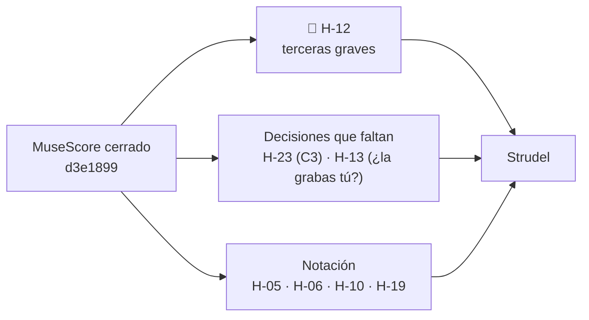

# Feedback 14 · pieza, por instrumento

> [!tldr] En corto
> **MuseScore queda cerrado.** De las 14 paralelas, arreglaste 10; las otras 4 se quedan a propósito
> (D-18). El Si5 del c.106 bajó, y el B♭ del c.91 vuelve a ser lo más agudo de la pieza.
>
> - 🎻 **Violín:** nada abierto, salvo las ligaduras (H-19).
> - 🎹 **Piano:** nada abierto, salvo el cifrado (H-06 y H-10).
> - 🎸 **Guitarra:** H-12 (terceras en el grave) y H-13 (lo que no cabe en la mano), sin cambios.
> - 🎼 **C3:** la primera mitad no cambió. Lo marcaste *ready*: si es *"así se queda"*, falta escribirlo como
>   decisión (H-23).
>
> **Qué hacer ahora:** las terceras graves de la guitarra (H-12). Es lo único abierto que es de sonido y no espera
> una decisión.

> [!info] Fuente
> **Claude, 2026-10-25.** Violín, piano y guitarra en toda la pieza, igual que el F 12 y el F 13. Fuera: la batería,
> la energía y las dinámicas.
>
> **Contexto:** lo que marcaste en el [[3. Composiciones/6. louise/5. Feedback/13. pieza|F 13]]:
> - las paralelas del V1, el V2 y el B2 (c.84 y c.86), hechas;
> - las de c.90, c.90→91, c.98→99 y c.107→108: *"se queda, anótalo como decisión"*;
> - H-23 y H-25: *ready*.
>
> **Qué cambió desde el F 13:**
> - **Violín** (10 compases): c.15, 19, 21, 23, 53, 56, 59, 64, 84 y 87.
> - **Piano:** el bajo en c.59 (Re2) y c.98 (Sol2), y en el c.106 el Si5 pasa a Sol5.
> - **Guitarra:** nada.

> [!abstract] Qué se evaluó, exactamente
> | Archivo | Commit | ¿Limpio? | Blob | Guardado |
> |---|---|---|---|---|
> | `7. Partituras/2. Composiciones/Louise-melancolica.mscz` | `d3e1899` | **sí** | `a4af38f` | 2026-10-25 18:02 |
>
> Es la partitura con la que se cerró MuseScore, y la que tiene el Strudel
> (`4. Instrumento/2. Strudel/10. Folk/Louise/6.melancolica.strudel.js`), comprobado compás por compás.

---

## En una pantalla

| | Cerrado hoy | Queda |
|---|---|---|
| 🎻 **Violín** | H-24: 10 arreglados, 4 por decisión (D-18) | H-19 · ligaduras |
| 🎹 **Piano** | H-25 (el Si5 del c.106) | H-06 y H-10 · cifrado |
| 🎸 **Guitarra** | — | **H-12** · H-13 |
| 🎼 **Entre todos** | — | H-23 (falta la decisión) · H-05 · dos marcas vacías |



---

## Lista

| ID | Instrumento · dónde | Qué escribiste | Qué suena | Peso | Contra | Estado |
|---|---|---|---|---|---|---|
| [[3. Composiciones/6. louise/6. Hallazgos#^h-12\|H-12]] | 🎸 V1, C1, V2, C2, C3 | *"las terceras por debajo de C3 se embarran"* | terceras con la nota de abajo en Sol2 o más grave, en 39 compases | medio | Recursos §2.3 | sin cambios |
| [[3. Composiciones/6. louise/6. Hallazgos#^h-13\|H-13]] | 🎸 c.27–41 y copias | *"adaptación de voicings a las posibilidades del instrumento"* | el Em no cabe en la mano; Bm y A7 arriba del mástil | medio | F 09 | sin cambios |
| [[3. Composiciones/6. louise/6. Hallazgos#^h-23\|H-23]] | 🎹🎸 C3, c.93–100 | *"el violín lleva la línea"* | el violín va solo arriba el 42 % del tiempo; encima de él, c.93, 96, 99 y 100 | medio | [[3. Composiciones/6. louise/2. Decisiones#^d-13\|D-13]] | sin cambios en la partitura · *ready* |
| [[3. Composiciones/6. louise/6. Hallazgos#^h-05\|H-05]] | 🎼 c.43, 67 | — | dos marcas de ensayo vacías | bajo | Mapa | sin cambios |
| [[3. Composiciones/6. louise/6. Hallazgos#^h-06\|H-06]] | 🎹🎸 c.87 | *"C4"* | Csus4 y luego C7sus4 | bajo | cifrado | sin cambios |
| [[3. Composiciones/6. louise/6. Hallazgos#^h-10\|H-10]] | 🎹🎸 35 compases | el cifrado | bajos, notas y tiempos que no dice | bajo | cifrado | sin cambios |
| [[3. Composiciones/6. louise/6. Hallazgos#^h-19\|H-19]] | 🎻 todo el violín | — | ninguna ligadura ni articulación | bajo | la propia notación | sin cambios |

**Cerrados en este feedback:**
- [[3. Composiciones/6. louise/6. Hallazgos#^h-24|H-24]], **decisión**: 10 de las 14 paralelas se arreglaron, y las
  4 que quedan se quedan a propósito, en [[3. Composiciones/6. louise/2. Decisiones#^d-18|D-18]].
- [[3. Composiciones/6. louise/6. Hallazgos#^h-25|H-25]], **arreglado**: el c.106 toca Sol5. Lo más agudo de la
  pieza es el Si♭5 del c.91.

---

## 🎻 Violín

### H-24 · Las paralelas, una por una · cerrado

| Dónde | Antes (F 13) | Ahora | Cómo se resolvió |
|---|---|---|---|
| c.15 → 16 (V1) | Fa♯4 → Re4 sobre Si2 → Sol2, quintas | el 3& del c.15 es Si3 | el violín llega desde la octava del bajo, no desde su quinta |
| c.18 → 19 (V1) | Fa♯4 → La4 sobre Fa♯2 → La2, octavas | el c.19 es Re4 + Do♯5 | arriba, la 7ª del Dmaj7 |
| c.22 → 23 (V1) | La4 → Si4 sobre La2 → Si3, octavas | el c.23 es Re4 + Do♯5 | arriba, la 9ª del Bm7 |
| c.52 → 53 (V2) | Fa♯5 → Mi5 sobre Fa♯2 → Mi2, octavas | el c.53 empieza en Sol5 | movimiento contrario |
| c.55 → 56 (V2) | Fa♯5 → Re5 sobre Si2 → Sol2, quintas | el c.56 empieza en Si4 | arriba, la 3ª |
| c.58 → 59 (V2) | Fa♯5 → La5 sobre Fa♯2 → La2, octavas | el bajo del c.59 es Re2 | el bajo baja mientras el violín sube |
| c.59 → 60 (V2) | La5 → Do♯5 sobre Re3 → Fa♯2, quintas | el 3 del c.59 es Re5 + Fa♯5 | ya no hay quinta en el 3 |
| c.63 → 64 (V2) | Fa♯5 → Re5 sobre Si3 → Sol3, quintas | el c.64 empieza en Si4 | arriba, la 3ª |
| c.84 → 85 (B2) | La5 → Sol5 sobre La2 → Sol2, octavas | el 2& del c.84 es Fa4 + Re5 | movimiento contrario; y el acorde ahora cabe en la mano |
| c.86 → 87 (B2) | Mi5 → Sol5 sobre La2 → Do3, quintas | el c.87 empieza en Fa5 | la sus4 del Csus4 |
| dentro del c.90, c.90 → 91 (B2) · c.98 → 99, c.107 → 108 (C3) | octavas | igual | **se quedan: D-18** |

Ninguno de estos cambios trajo un roce nuevo con piano o guitarra: los roces de medio tono son los mismos del
F 13, todos notas del acorde o de paso.

### H-19 · Ligaduras · sin cambios

Ninguna ligadura ni articulación en el violín. Si sigues en Strudel, aquí no aplica tal cual: en Strudel una ligadura
es `legato` o `clip` sobre la frase. Queda como hallazgo de la partitura.

### Para tus manos (no son errores)

- **Siguen sin caber en una mano** el c.85 (Si♭3 + Si♭4 + Sol5) y el c.91, tiempo 3 (Fa4 + Sol5).
- **El c.84 ya cabe:** Fa4 + Re5 en lugar de Fa4 + La5.

---

## 🎹 Piano

- **H-25 se cierra:** el c.106 toca Re4 + Si4 + Sol5.
- **H-06 y H-10, sin cambios:** el cifrado, con la lista en cada hallazgo.
- **Para tus manos:** el c.106 sigue siendo una 11ª para la mano derecha (Re4–Sol5). Las demás aperturas, como en el
  F 12 y el F 13.

---

## 🎸 Guitarra

### H-12 · Terceras en el grave · sin cambios

Terceras con la nota de abajo en Sol2 o más grave, en estos 39 compases:

| Sección | Compases |
|---|---|
| V1 | c.12, 16, 20 |
| C1 | c.27, 28, 29, 31, 32, 35, 36, 37, 39, 40 |
| V2 | c.52, 53, 56, 57, 58, 60 |
| C2 | c.67, 68, 69, 71, 72, 75, 76, 77, 79, 80 |
| C3 | c.93, 94, 95, 97, 98, 101, 102, 103, 105, 106 |

Y 12 más con la nota de abajo en La2–Si2: c.14, 15, 22, 33, 41, 54, 55, 62, 73, 81, 99 y 107.

- **¿Es un error?** Sí, contra los Recursos §2.3 (*"las terceras por debajo de C3 se embarran"*). Peso medio: es
  cómo suena el grave en cinco secciones, la toque quien la toque.
- **Cómo:** quita la nota de abajo de la tercera, o súbela una octava, sobre todo donde el piano ya toca ese grave.
  Se puede hacer en MuseScore o directo en las líneas de `guitarra` del Strudel. Si lo haces en el Strudel,
  la partitura deja de ser igual a él.
- **Pídelo así:** `guitarra.voicing`.

### H-13 · Lo que no cabe en la mano · sin cambios

Solo importa si la guitarra la va a tocar alguien. Con la línea del *Por decidir* (*"Guitarra: ¿la grabas tú?"*)
se cierra como decisión, o se queda.

---

## 🎼 Entre instrumentos

### H-23 · La primera mitad del C3 · sin cambios en la partitura

| C3 | Violín solo arriba | Encima del violín |
|---|---|---|
| 1.ª mitad (c.93–100) | 42 % | c.93 (Sol5 de la mano derecha), c.96 (Fa♯5 de la mano derecha), c.99 (Mi5 de la guitarra), c.100 (La4 y Fa♯4 de la guitarra) |
| 2.ª mitad (c.101–108) | 29 % | el piano cierra, como querías |

En el F 13 lo marcaste *ready*. Si quiere decir *"así se queda"*, la línea está en *Propuestas* y H-23 pasa a
`decisión`. Si quiere decir que lo cambiaste, la partitura de las 18:02 no lo tiene.

### H-05 · Marcas de ensayo · sin cambios

Las dos marcas vacías, junto a *B1* (c.43) y junto a *C2* (c.67).

---

## Siguiente

➡️ **[[3. Composiciones/6. louise/6. Hallazgos#^h-12|H-12]], las terceras graves de la guitarra.**

- Es el único hallazgo medio que es de sonido y no espera una decisión. H-13 y H-23 se cierran con una línea cada
  uno.
- Tienes 39 compases, pero son pocos acordes que se repiten: el Em, el G y el F♯m7 de los coros, y sus copias.

---

## Propuestas

- **Para Decisiones:**
  - Por H-23, si *ready* quiere decir *"así se queda"*:
    ```
    | D-19 | 2026-10-25 | **C3: el violín canta la primera mitad, con el piano y la guitarra por encima en c.93, 96, 99 y 100, y el piano cierra la segunda** | ____ | ninguna nota | nace de [[3. Composiciones/6. louise/6. Hallazgos#^h-23\|H-23]] |
    ^d-19
    ```
  - Por H-13: `La guitarra es de MuseScore y Strudel: no se escribe para tocarse · porque ____`, o `La guitarra la
    grabo yo · porque ____`.
- **Para D-18:** el *por qué* está en `____`. El F 10 decía de la del c.90→91 que suena a *"todos al B♭"*. Si
  es eso, dilo con tus palabras.
- **Para la ficha:** `violin` en `instrumentos`.

---

## Cómo se midió

- **Notas:** el `.musicxml` de `d3e1899` (blob `a4af38f`), comparado con el de `94d11ba` (lo que evaluó el F 13).
  Las tres partes por corchea, con la guitarra en altura real.
- **Paralelas:** como en el F 13. Entre dos momentos seguidos en que se mueven el violín (su nota de arriba) y el
  bajo (lo más grave de piano y guitarra), en la misma dirección y con el mismo intervalo: 8ª o 5ª justa, simple o
  compuesta.
- **Lo que esto no mide:** cómo lo oyes tú.
