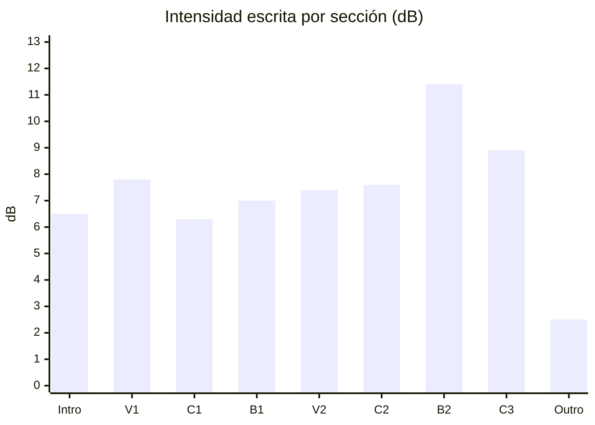
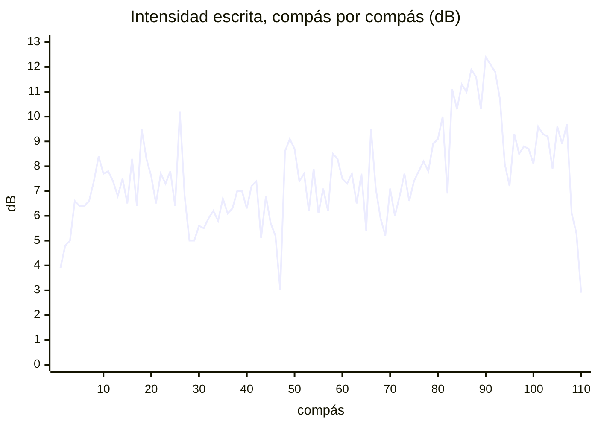
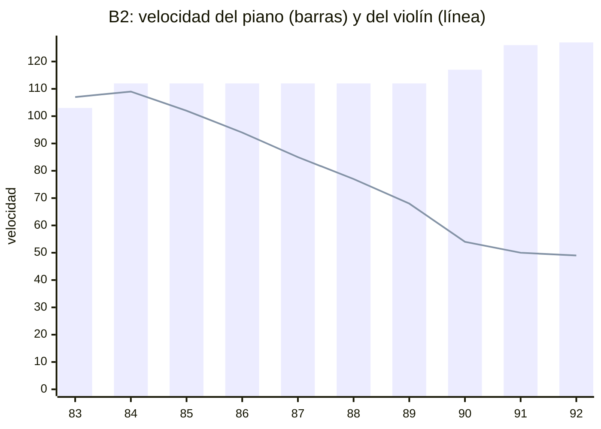

# Feedback 15 · energia

> [!tldr] En corto
> **El pico ya es el pico.** En la producción en Strudel, el B2 queda 3.8 dB por encima del C2, y el C2 crece de una
> mitad a la otra (+1.8 dB). Lo que no sigue el Mapa es la despedida: **el C3 es la segunda sección más fuerte de la
> pieza.**
>
> - 🎼 **C3** (H-02): 1.3 dB por encima del C2 y 2.6 por encima del C1, con el piano en 96 (*f*) y las cuatro capas.
> - 📈 **B2** (H-01): la subida no sube. El violín baja de 102 a 50 mientras el piano sube de 112 a 127.
> - 🎻 **Violín** (H-17): el B2 ya es su sección más fuerte; en el C3 sigue por encima de los dos coros. Baja a medio.
> - ✅ **H-07 se cierra:** las dos mitades del C3 quedan a 0.1 dB.
>
> **Qué hacer ahora:** el C3 (H-02).

> [!info] Fuente
> **Claude, 2026-11-02.** La energía de la pieza entera (c.1–111) en la producción de Strudel
> (`4. Instrumento/2. Strudel/10. Folk/Louise/9.produccion/`), con cada sección tomada de su propio archivo. El alcance
> es el de tu última sesión, la [[3. Composiciones/6. louise/3. Sesiones/10. energia|S 10]].
>
> **Contexto:** la S 10 (V1 y C1) y los commits de la S 11, que todavía no tiene nota (`b78ebb2` a `2fa0e6b`: B1, V2,
> C2, B2 y C3). Se leyeron para saber qué quisiste; no se evalúan.
>
> **Qué cambió desde el último feedback de energía** ([[3. Composiciones/6. louise/5. Feedback/07. pieza|F 07]] para
> la pieza, [[3. Composiciones/6. louise/5. Feedback/11. violin|F 11]] para el violín): las dinámicas de violín y piano
> (S 08–09), la batería que crece del C1 al Outro (`fa80a73`) y la producción en Strudel, sección por sección:
> velocidades, batería, reverb y paneo.
>
> **Esto mide lo escrito, no el audio.** No hay audio de la producción, y Strudel no se puede renderizar aquí. Los
> números son la *intensidad escrita* (ver *Cómo se midió*): sirven para comparar secciones y para comparar un
> instrumento consigo mismo; entre instrumentos distintos no dicen cuánto suena cada uno.

> [!abstract] Qué se evaluó, exactamente
> | Archivo (`…/9.produccion/`) | Commit | ¿Limpio? | Blob | Guardado |
> |---|---|---|---|---|
> | `0.intro.strudel.js` | `2fa0e6b` | sí | `8a755e5` | 2026-11-02 19:16 |
> | `1.v1.strudel.js` | `2fa0e6b` | sí | `aa7c7e0` | 2026-11-01 15:14 |
> | `2.c1.strudel.js` | `2fa0e6b` | sí | `6ef8d79` | 2026-11-02 18:36 |
> | `3.b1.strudel.js` | `2fa0e6b` | sí | `d27d9ae` | 2026-11-02 19:05 |
> | `4.v2.strudel.js` | `2fa0e6b` | sí | `665e519` | 2026-11-02 19:15 |
> | `5.c2.strudel.js` | `2fa0e6b` | sí | `3b027e2` | 2026-11-02 20:16 |
> | `6.b2.strudel.js` | `2fa0e6b` | sí | `607a82c` | 2026-11-02 20:44 |
> | `7.c3.strudel.js` | `2fa0e6b` | sí | `e18d35d` | 2026-11-02 20:27 |
>
> - **Limpios:** cada uno se recupera con `git show 2fa0e6b:"<archivo>"`.
> - **La partitura no se evaluó.** `Louise-melancolica.mscz` tiene cambios sin commit (guardado a las 19:37); el
>   alcance es la producción, que vive en Strudel.

> [!important] Qué cuenta como error
> Un error es cuando **lo que escribiste dice una cosa y lo que suena dice otra**: el cifrado, el
> [[3. Composiciones/6. louise/1. Mapa|Mapa]], las [[3. Composiciones/6. louise/2. Decisiones|Decisiones]] o el
> [[3. Composiciones/6. louise/4. Contexto|Contexto]] (una toma ✅ que no se oye, o una ❌ que se coló). Lo que
> contradice una decisión vigente no se reporta. Los ejemplos muestran **lo que suena hoy**; no traen
> correcciones.

---

## En una pantalla

Lo que hay hoy en cada sección. Velocidades de 0 a 127, como en MuseScore (64 *mp*, 80 *mf*, 96 *f*, 112 *ff*).
El Mapa solo da energía al C2, al B2 y al C3; la columna *S 05* es el plan de la
[[3. Composiciones/6. louise/3. Sesiones/05. Second bridge|S 05]], que es contexto y no vara.

| Sección | Mapa | S 05 | Intensidad | Piano | Violín | Guitarra | Batería (golpes/compás · vel.) | Reverb |
|---|:-:|:-:|---:|---|---|---|---|---|
| Intro · c.1–10 | ____ | 2 | 6.5 dB | 80–100 | — | — | 4.0 · 80 | piano, con eco |
| V1 · c.11–26 | ____ | 3 | 7.8 dB | 80 | 127 *pizz.* | 90 | 6.0 · 53 | piano |
| C1 · c.27–42 | ____ | 3 | 6.3 dB | 80 → 64 | 49 → 85 | 100 | 4.4 · 71 | piano |
| B1 · c.43–50 | ____ | 1 | 7.0 dB | 96 → 112 | — | — | 2.5 · 77 | — |
| V2 · c.51–66 | ____ | 3 | 7.4 dB | 64 → 79 | 100 *pizz.* | 100 | 6.1 · 53 | piano |
| C2 · c.67–82 | 3 → 4 | 3 → 4 | 7.6 dB | 80 → 64 → 79 | 49 → 90 | 80 | 8.6 · 67 | violín (c.67–78) |
| **B2** · c.83–92 | **5** | 5 | **11.4 dB** | 103 → 127 | 112 → 49 | 80 | 10.9 · 66 | piano |
| C3 · c.93–108 | **2** | 2 | **8.9 dB** | 127, luego 96 | 82 → 96 → 42 | 80 | 9.1 · 59 | piano |
| Outro · c.109–111 | ____ | 1–2 | 2.5 dB | 96 | — | — | 1.7 · 78 | — |

- **Lo que ya cumple el Mapa:** el C2 crece (6.6 → 8.4 dB de una mitad a la otra) y el B2 es lo más alto de la pieza,
  3.8 dB sobre el C2 y 2.5 sobre la siguiente sección.
- **Lo que no:** después del B2, la curva no baja a la despedida. El C3 queda debajo del B2 y por encima de todo lo
  demás.

---

## Lista

| ID | Dónde | Qué escribiste | Qué suena | Peso | Contra | Estado |
|---|---|---|---|---|---|---|
| [[3. Composiciones/6. louise/6. Hallazgos#^h-02\|H-02]] | 🎼 C3 · c.93–108 | Mapa: C3 *"Energía: 2"*; D-04: *"el coro con capas quitadas"* | la segunda sección más fuerte: +1.3 dB sobre el C2, +2.6 sobre el C1; piano en 96, cuatro capas | alto | Mapa · [[3. Composiciones/6. louise/2. Decisiones#^d-04\|D-04]] | abierto · el C2 y el B2 ya cumplen |
| [[3. Composiciones/6. louise/6. Hallazgos#^h-01\|H-01]] | 📈 B2 · c.85–91 | Mapa: B2 *"el pico"*, *"Energía: 5"* | siete compases en 2.1 dB, sin subir; el violín baja mientras el piano sube | alto | Mapa | abierto · números nuevos |
| [[3. Composiciones/6. louise/6. Hallazgos#^h-17\|H-17]] | 🎻 violín · C3 | Mapa: C3 *"Energía: 2"* | el violín del C3, por encima de los dos coros (+1.5 y +3.7 dB) | medio | Mapa · [[3. Composiciones/6. louise/2. Decisiones#^d-04\|D-04]] | abierto · baja de alto: el B2 ya es su sección más fuerte |
| [[3. Composiciones/6. louise/6. Hallazgos#^h-03\|H-03]] | 📉 c.82 | Mapa: C2 *"hacer crescendo"*, *"tensión hacia el B2"* | 3.1 dB debajo del c.81 y 4.2 debajo del c.83; en el 2 y el 3, casi nada ataca | medio | Mapa | abierto · espera tu decisión |
| [[3. Composiciones/6. louise/6. Hallazgos#^h-20\|H-20]] | 🎻 V2 · c.52–66 | D-13: *"el violín lleva la línea"* | *pizz.* a 100, a la izquierda; piano a la derecha, creciendo debajo | medio | [[3. Composiciones/6. louise/2. Decisiones#^d-13\|D-13]] | abierto · sin medir: hace falta audio |

**Cerrados en este feedback:** [[3. Composiciones/6. louise/6. Hallazgos#^h-07|H-07]], **arreglado**: la segunda
mitad del C3 ya no sube (8.8 y 8.9 dB). El violín baja de 96 a 42 y el piano cierra, como dice
[[3. Composiciones/6. louise/2. Decisiones#^d-19|D-19]]. El C3 entero sigue alto: eso es H-02.

---

## Uno por uno

### H-02 · El C3 no se despide

**Qué escribiste.** En el Mapa, C2 *"Energía: 3 → 4"*, B2 *"Energía: 5"* y C3 *"Energía: 2"*: la despedida por
debajo de los coros. En [[3. Composiciones/6. louise/2. Decisiones#^d-04|D-04]]: *"C3 de despedida: el coro con capas
quitadas"*.

**Qué suena.** Los tres coros, por instrumento:

| | C1 | C2 | C3 | C3 − C2 |
|---|---:|---:|---:|---:|
| **Toda la sección** | 6.3 dB | 7.6 dB | **8.9 dB** | **+1.3** |
| Piano | 1.9 dB · 80 → 64 | 2.5 dB · 80 → 64 → 79 | **5.8 dB · 96** (127 en el c.93) | **+3.3** |
| Violín | −2.7 dB · 49 → 85 | −0.5 dB · 49 → 90 | 1.0 dB · 82 → 96 → 42 | +1.5 |
| Guitarra | −1.0 dB · 100 | −2.9 dB · 80 | −3.4 dB · 80 | −0.5 |
| Batería | 1.4 dB · 4.4 golpes · 71 | 4.0 dB · 8.6 golpes · 67 | 3.3 dB · 9.1 golpes · 59 | −0.7 |
| Compases con las cuatro capas | 15 de 16 | 15 de 16 | 14 de 16 | |

**Qué pasa.**

- **El piano hace casi toda la diferencia.** En los coros va entre *mp* y *mf* (64–80); en el C3, en *f* (96) de
  c.96 a c.108, y en 127 en el c.93. El piano del C3 suena 3.3 dB por encima del piano del C2.
- **No se quitó ninguna capa.** Suenan las cuatro en 14 de 16 compases (sin guitarra solo en c.96 y c.108). La
  batería es más suave que la del C2, pero tiene más golpes por compás, el bombo en NORMAL (90) donde el C2 lo tiene
  en MEDIO (80), y toms en FUERTE (103) en c.97, 99 y 107.
- **El c.93 arranca al nivel del B2** (10.7 dB): el piano en 127, crash y tres bombos.
- **La producción lo acentuó.** Con las velocidades de MuseScore (los archivos de `62b82c6`), el C3 quedaba 0.7 dB
  sobre el C2. La batería bajó en las dos, pero más en el C2, y ahora son 1.3.

**¿Es un error?** Sí, contra el Mapa (el C3 en 2, por debajo de un C2 en 3 → 4) y contra D-04. Peso alto: es la
despedida, y hoy suena como la segunda sección más fuerte de la pieza. Si lo que quieres ahora es un C3 que cierre
fuerte, lo que cambia es el Mapa: la línea está en *Propuestas*.

**Dónde se mueve:** en `7.c3`, `C3.dinamica` y la batería del C3. `6.b2` lleva una copia de c.93–100.

### H-01 · La subida del B2 no sube

**Qué escribiste.** En el Mapa, el B2 es *"el pico"*, *"lo más alto de la pieza"*, *"Energía: 5"*, y se reconoce por
*"el B♭ con la nota más aguda de la pieza"*.

**Qué suena.** Compás por compás:

| c. | Intensidad | Violín | Piano | Batería |
|---|---:|---|---|---|
| 83 | 11.1 dB | 101 · 112 | 96 · 112 | 14 golpes |
| 84 | 10.3 dB | 111 · 107 | 112 | 6 |
| **85** | **11.3 dB** | 102 | 112 | 12 |
| 86 | 11.0 dB | 94 | 112 | 10 |
| 87 | 11.9 dB | 85 | 112 | 11 |
| 88 | 11.6 dB | 77 | 112 | 10 |
| 89 | **10.3 dB** | 68 | 112 | 8 |
| 90 | **12.4 dB** | 54 | 112 → 122 | **17** |
| **91** | **12.1 dB** | **50** | 124 · 127 | 12 |
| 92 | 11.8 dB | 49 | 127 | 9 |

**Qué pasa.**

- **Siete compases en 2.1 dB, sin dirección.** Del c.85 al c.91 se gana 0.8 dB. El más bajo es el c.89, justo antes
  de los dos más altos.
- **Violín y piano se cancelan.** El violín baja de 102 a 50: es el regulador de MuseScore (*f* en el c.83, > hasta el
  91), que el Strudel conserva; solo el c.87 cambió, a 85. El piano se queda en 112 hasta el c.89 y sube a 127 solo en
  c.90–92.
- **El B♭5 del c.91**, la nota más aguda de la pieza, lo tocan el violín a 50 y la mano derecha a 124.
- **El c.90 es el compás con más golpes de la pieza** (17). El pico de la batería cae un compás antes que el B♭.

**¿Es un error?** Sí, contra el Mapa: el pico existe como sección (H-02), pero dentro no sube hacia el B♭. Peso alto.
Si el violín que se retira es a propósito, escríbelo como decisión: el hallazgo se queda con lo demás.

### H-17 · El violín del C3

**Qué escribiste.** En el Mapa, el C3 en *"Energía: 2"* y el B2 como *"lo más alto de la pieza"*.

**Qué suena.** El violín con arco, por sección:

| | Velocidad | Intensidad |
|---|---|---:|
| C1 | 49 → 85 | −2.7 dB |
| C2 | 49 → 90 | −0.5 dB |
| **B2** | 101 → 112 → 49 | **2.6 dB** |
| C3 | 82 → **96** (c.94–98) → 42 | 1.0 dB |

El C3, compás por compás: 82 · 96 · 96 · 96 · 96 · 95 · 89 · 84 · 80 · 73 · 67 · 64 · 57 · 51 · 46 · 42.

**Qué pasa.**

- **El B2 ya es la sección más fuerte del violín**, 1.6 dB sobre el C3. En el render del F 11, el C3 quedaba 9.9 dB
  por encima del B2.
- **El C3 sigue sobre los dos coros:** 1.5 dB sobre el C2 y 3.7 sobre el C1. Los cinco compases en 96 (c.94–98) son
  el escalón más alto del arco fuera del B2.
- El *pizz.* del V1 (127) y del V2 (100) no entra en esta comparación: es otra muestra.

**¿Es un error?** Sí, contra el Mapa. Baja de alto a medio: lo del B2 ya está, y lo que queda es el mismo C3 de H-02,
visto desde el violín.

### H-03 · El c.82

**Qué escribiste.** En el Mapa, el C2 tiene que *"hacer crescendo"*, con *"tensión hacia el B2"*. Si el c.82 es la
respiración antes del golpe, no está escrito en ningún lado.

**Qué suena.** Intensidad por tiempo, contando solo lo que ataca en cada uno:

| c. | Tiempo 1 | Tiempo 2 | Tiempo 3 | Compás |
|---|---:|---:|---:|---:|
| 81 (C2) | 4.1 | 5.6 | 5.7 | 10.0 dB |
| **82 (C2)** | 5.2 | **−2.4** | **0.3** | **6.9 dB** |
| 83 (B2) | 9.0 | −0.1 | 6.1 | 11.1 dB |
| 84 (B2) | 7.1 | 7.0 | −2.9 | 10.3 dB |

**Qué pasa.**

- **El c.82 (E♭7) ataca en el 1 y sostiene.** En el 1 entran el violín (Sol4 + Mi♭5, 90), la mano derecha (Si♭4 +
  Mi♭5), la izquierda (Mi♭2 + Re♭3, 79) y el tom grave en FUERTE. En el 2 solo ataca la caja (dos golpes, 68); en el 3, el tom
  medio (68) y dos notas sueltas de la mano izquierda (Si♭3, Sol3).
- **La guitarra calla de c.82 a c.84.**
- **El c.84 ya no hace hueco:** queda 0.8 dB debajo del c.83. El hueco es solo el c.82.

**¿Es un error?** Depende de ti. Si es la respiración antes del golpe, es una decisión (la línea está en
*Propuestas*). Si no, va contra el crescendo del C2 que pide el Mapa. Peso medio.

### H-20 · La línea del V2

**Qué escribiste.** [[3. Composiciones/6. louise/2. Decisiones#^d-13|D-13]]: *"el violín lleva la línea"*.

**Qué suena.**

| V2 · c.51–66 | Velocidad | Paneo | Reverb |
|---|---|---|---|
| Violín *pizz.* | 70 en el c.51, 100 de c.52 a c.66 | 0.1, a la izquierda | no |
| Piano | 112 en el c.51, 64 → 79 | 0.8, a la derecha | sí (room 1, roomsize 0.5) |
| Guitarra | 100, y 80 en c.65–66 (a la mitad en la mezcla) | centro | no |
| Batería | 6.1 golpes por compás · 53 | centro | no |

**Qué pasa.** Casi todo lo que cambió en la S 11 va a favor de la línea: más velocidad, el violín separado del piano
en el paneo y el piano con reverb, detrás. La guitarra también subió (80 → 100). Pero el hallazgo es cuánto suena el violín contra el resto, y eso no se puede
medir sin audio: la velocidad de una muestra de *pizz.* y la de un piano no dicen cuánto suena cada una. El piano
sigue creciendo debajo (64 → 79).

**¿Es un error?** Sigue abierto, sin medir. Para cerrarlo o confirmarlo, hace falta un audio del V2.

---

## Siguiente

➡️ **[[3. Composiciones/6. louise/6. Hallazgos#^h-02|H-02]], el C3.**

- Es alto, y es el único lugar donde la curva va contra el Mapa: la despedida suena como la segunda sección más fuerte.
- Se resuelve en un archivo (`7.c3`), o con una línea en el Mapa si el C3 que quieres ahora es otro.
- Lo que muevas en el C3 también mueve a H-17, que es el mismo C3 desde el violín.
- **Pídelo así:** `C3.energia`.

---

## Propuestas

- **Para el Mapa:**
  - **C3**, si ahora quieres que cierre fuerte: `**Energía:** ____ <!-- hoy suena entre el C2 y el B2 -->`, y D-04
    pasaría a *Reemplazadas*. Si no, el Mapa se queda y lo que cambia es el C3.
  - **La energía de Intro, V1, C1, B1, V2 y Outro** está en blanco. La S 05 tenía un plan: Intro 2 · V1 3 · C1 3 ·
    B1 1 · V2 3 · Outro 1–2. Si sigue valiendo, cópialo. Ojo con el B1: el plan decía *"valle, piano solo"*, y hoy,
    en lo escrito, queda por encima del C1 y del Intro (7.0 contra 6.3 y 6.5 dB), con el piano en 96 → 112.
- **Para Decisiones**, por H-03, si el c.82 es la respiración antes del golpe:

| ID | Fecha | Qué | Por qué | Qué cambió | Enlaces |
|---|---|---|---|---|---|
| D-20 | 2026-11-02 | **c.82: el hueco antes del B2 se queda, como la respiración antes del golpe** | ____ | ninguna nota | nace de [[3. Composiciones/6. louise/6. Hallazgos#^h-03\|H-03]] |
^d-20

- **Para la ficha:** `ultimo_audio` está vacío, y la S 10 dice *"Audio: no hay"*. Con un audio de la producción, el
  próximo feedback puede medir lo que suena, y H-20 lo necesita.

---

## Cómo se midió

- **Las notas:** cada archivo se evaluó en Node con el mismo Strudel que usa `.motor/exportar.js` (1.2.6): todas
  las notas y golpes de cada sección, con su velocidad, `gain`, `room` y `pan`.
- **La pieza:** cada sección sale de su propio archivo (el Intro de `0.intro`, el V1 de `1.v1`… el C3 y el Outro de
  `7.c3`). Los compases que comparten varios archivos (c.6–100) son iguales en todos: comprobado golpe por golpe, sin
  ninguna diferencia.
- **Intensidad escrita:** en cada compás, la suma de (velocidad/127 × `gain`)² de todo lo que ataca, en dB; 0 dB es
  un solo ataque a 127. El `gain` lleva la mezcla (la guitarra a 0.5) y el KIT (el shaker a 0.29). Las secciones se
  promedian en potencia. Por tiempo, igual, contando solo lo que empieza en ese tiempo.
- **Velocidad y volumen:** Strudel multiplica el `gain` por la velocidad, con su curva por defecto (lineal); ningún
  archivo la cambia.
- **La línea base** (*"con las velocidades de MuseScore"*): la misma medida sobre los archivos de `62b82c6`, de C1 a
  C3. Ahí el Intro y el V1 ya estaban en producción, así que no tienen línea base.
- **Lo que esto no mide:** cuánto suena cada muestra (el *pizz.*, el arco, el piano y el kit no suenan igual a la
  misma velocidad), cuánto dura cada nota y cuánto suma la reverb. Un instrumento contra sí mismo, o una sección
  contra otra con las mismas capas, se puede comparar; un instrumento contra otro, no. Los números del F 07 y el F 11
  salen de un render de MuseScore y no se comparan uno a uno con estos.
