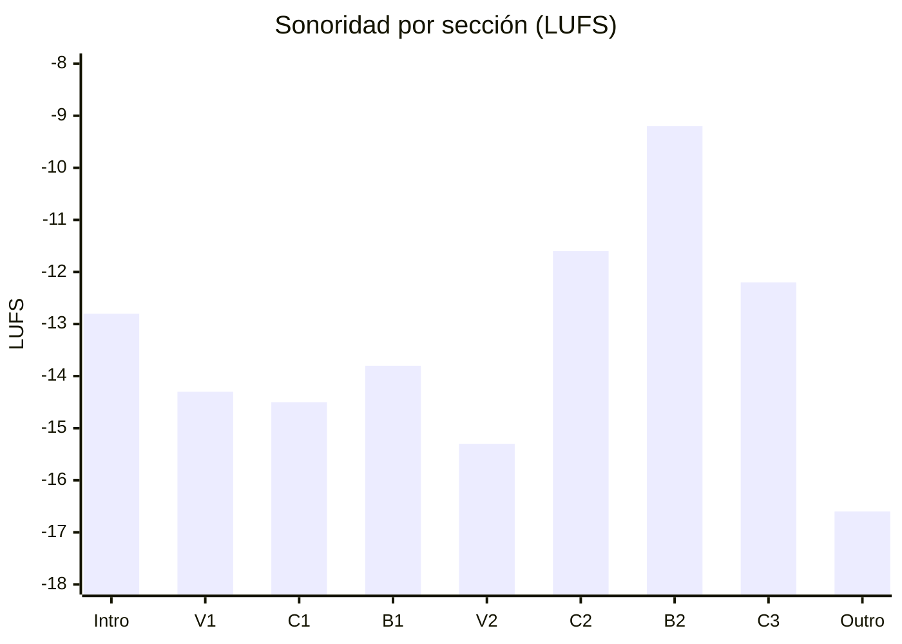
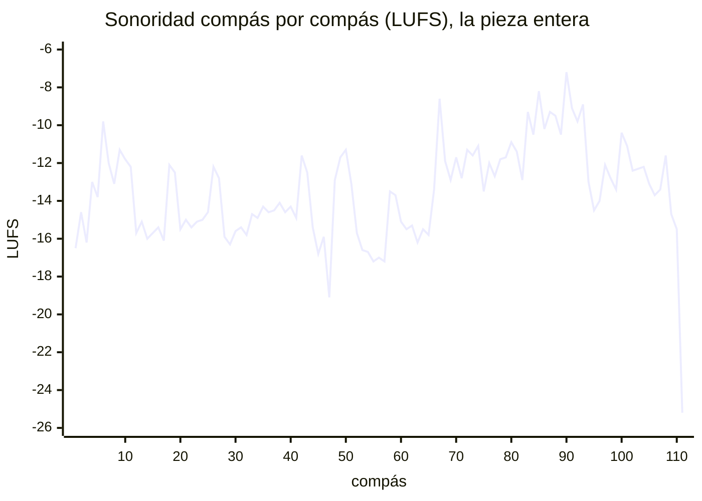
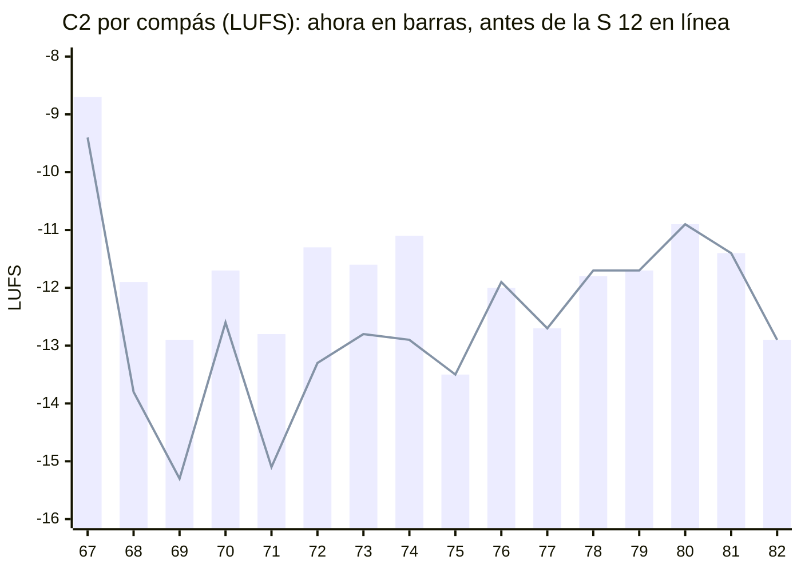

# Feedback 16 · energia

> [!tldr] En corto
> **El primero sobre audio.** La producción de Strudel se renderizó en strudel.cc, sección por sección. Ahora sí se
> sabe cuánto suena cada instrumento.
>
> - ✅ **El B2 es el pico:** 2.4 LU sobre la siguiente sección (el C2).
> - 🎼 **C3** (H-02): la S 12 lo bajó 1.1 LU y ya queda debajo del C2, pero solo 0.6. Sigue 2.3 LU sobre el C1, y la
>   batería pesa el 59 %.
> - 📉 **C2** (H-26, nuevo): ya no crece. La batería de c.67–74 subió y la de c.75–82 no, así que la primera mitad
>   suena más que la segunda.
> - 📈 **B2** (H-01): el violín ya no se apaga al final, pero en la mezcla no se nota: va 10 LU debajo del resto.
> - 🔊 **Recorte** (H-27, nuevo): 83 de 111 compases pasan de 0 dBFS, sobre todo por la batería.
> - 🎻 **Violín:** en el V2 va 13.9 LU debajo del resto (H-20, ya medido), y el c.93 es su compás más fuerte de
>   toda la pieza (H-17).
>
> **Qué hacer ahora:** el C3 (H-02).

> [!info] Fuente
> **Claude, 2026-11-03.** La energía de la pieza entera (c.1–111) en la producción de Strudel
> (`4. Instrumento/2. Strudel/10. Folk/Louise/9.produccion/`), **medida sobre audio**. El alcance es el de tu última
> sesión, la [[3. Composiciones/6. louise/3. Sesiones/12. energia|S 12]].
>
> **Contexto:** la S 12, que sale del [[3. Composiciones/6. louise/5. Feedback/15. energia|F 15]] y ataca H-02.
> Bajó el C3, levantó el violín del final del B2 y subió la batería del principio del C2. Se leyó para saber qué
> quisiste; no se evalúa.
>
> **Qué cambió desde el F 15:** la S 12 (`ce608ea`), y la medida. El F 15 medía lo escrito; este mide lo que suena.
> Los números de los dos no se comparan uno a uno. Para ver qué movió la S 12, las secciones que tocó se
> renderizaron también como estaban antes (`caf57e6`).
>
> **El audio** está en `4. Instrumento/2. Strudel/10. Folk/Louise/9.produccion/render/` (git no lo guarda): la pieza
> entera y una sección por archivo. Cómo se hizo, en *Cómo se midió*.

> [!abstract] Qué se evaluó, exactamente
> | Archivo (`…/9.produccion/`) | Commit | ¿Limpio? | Blob | Guardado |
> |---|---|---|---|---|
> | `0.intro.strudel.js` | `ce608ea` | sí | `8a755e5` | 2026-11-02 19:16 |
> | `1.v1.strudel.js` | `ce608ea` | sí | `aa7c7e0` | 2026-11-01 15:14 |
> | `2.c1.strudel.js` | `ce608ea` | sí | `6ef8d79` | 2026-11-02 18:36 |
> | `3.b1.strudel.js` | `ce608ea` | sí | `d27d9ae` | 2026-11-02 19:05 |
> | `4.v2.strudel.js` | `ce608ea` | sí | `0fb2390` | 2026-11-03 12:00 |
> | `5.c2.strudel.js` | `ce608ea` | sí | `d001d91` | 2026-11-03 12:11 |
> | `6.b2.strudel.js` | `ce608ea` | sí | `ec7260f` | 2026-11-03 12:11 |
> | `7.c3.strudel.js` | `ce608ea` | sí | `bdbc39e` | 2026-11-03 12:11 |
>
> - **Limpios:** cada uno se recupera con `git show ce608ea:"<archivo>"`. strudel.cc los leyó de GitHub en ese
>   commit, y el texto que evaluó es igual, carácter por carácter, al de cada archivo.
> - **`5.c2`, `6.b2` y `7.c3` a las 12:11** es la sincronización que hizo Claude al cerrar la S 12.
> - **La partitura no se evaluó.** El alcance es la producción, que vive en Strudel.

> [!important] Qué cuenta como error
> Un error es cuando **lo que escribiste dice una cosa y lo que suena dice otra**: el cifrado, el
> [[3. Composiciones/6. louise/1. Mapa|Mapa]], las [[3. Composiciones/6. louise/2. Decisiones|Decisiones]] o el
> [[3. Composiciones/6. louise/4. Contexto|Contexto]] (una toma ✅ que no se oye, o una ❌ que se coló). Lo que
> contradice una decisión vigente no se reporta. Los ejemplos muestran **lo que suena hoy**; no traen
> correcciones.

---

## En una pantalla

La sonoridad de cada sección, en LUFS: más cerca de 0, más fuerte. Una diferencia de 1 LU es más o menos lo mínimo
que se distingue. El Mapa solo da energía al C2, al B2 y al C3; la columna *S 05* es el plan de la
[[3. Composiciones/6. louise/3. Sesiones/05. Second bridge|S 05]], que es contexto y no vara.

| Sección | Mapa | S 05 | Sonoridad | Pico | Compases sobre 0 dBFS | Lo que más pesa |
|---|:-:|:-:|---:|---:|:-:|---|
| Intro · c.1–10 | ____ | 2 | −12.8 | +4.1 dBFS | 9 de 10 | batería, 59 % |
| V1 · c.11–26 | ____ | 3 | −14.3 | +4.4 dBFS | 16 de 16 | batería 49 %, piano 39 % |
| C1 · c.27–42 | ____ | 3 | −14.5 | +4.3 dBFS | 8 de 16 | batería, 55 % |
| B1 · c.43–50 | ____ | 1 | −13.8 | +2.9 dBFS | 3 de 8 | piano, 57 % |
| V2 · c.51–66 | ____ | 3 | −15.3 | +2.6 dBFS | 6 de 16 | batería 49 %, piano 41 % |
| C2 · c.67–82 | 3 → 4 | 3 → 4 | −11.6 | +6.3 dBFS | 16 de 16 | batería, **75 %** |
| **B2** · c.83–92 | **5** | 5 | **−9.2** | **+8.4 dBFS** | 10 de 10 | piano 48 %, batería 42 % |
| C3 · c.93–108 | **2** | 2 | **−12.2** | +4.1 dBFS | 15 de 16 | batería, 59 % |
| Outro · c.109–111 | ____ | 1–2 | −16.6 | −0.5 dBFS | 0 de 3 | piano, 66 % |





- **Lo que ya cumple el Mapa:** el B2 es lo más fuerte de la pieza, 2.4 LU sobre el C2 y 3.0 sobre el C3. Sus diez
  compases suenan entre −7.2 y −10.5.
- **Lo que no:** el C2 no crece (H-26), y el C3 suena al nivel del C2 y por encima del C1 (H-02).
- **Lo que pesa:** la batería es lo que más suena en seis de las nueve secciones. Casi todo lo que sube y baja de un
  compás a otro es la batería, y casi todo lo que pasa de 0 dBFS también (H-27).

---

## Lista

| ID | Dónde | Qué escribiste | Qué suena | Peso | Contra | Estado |
|---|---|---|---|---|---|---|
| [[3. Composiciones/6. louise/6. Hallazgos#^h-02\|H-02]] | 🎼 C3 · c.93–108 | Mapa: C3 *"Energía: 2"*; D-04: *"el coro con capas quitadas"* | 0.6 LU debajo del C2 y 2.3 sobre el C1; la batería sola suena más que el C1 entero | alto | Mapa · [[3. Composiciones/6. louise/2. Decisiones#^d-04\|D-04]] | abierto · la S 12 lo bajó 1.1 LU |
| [[3. Composiciones/6. louise/6. Hallazgos#^h-01\|H-01]] | 📈 B2 · c.85–91 | Mapa: B2 *"el pico"*, *"el B♭ con la nota más aguda"* | siete compases en 3.3 LU, sin subir; el c.91 suena menos que el c.85; el B♭ es del piano | alto | Mapa | abierto · el violín ya no cae, pero no se oye |
| [[3. Composiciones/6. louise/6. Hallazgos#^h-26\|H-26]] | 📉 C2 · c.67–82 | Mapa: C2 *"Energía: 3 → 4"*; D-07: *"hace crescendo"* | la primera mitad suena 0.7 LU más que la segunda | medio | Mapa · [[3. Composiciones/6. louise/2. Decisiones#^d-07\|D-07]] | **nuevo** |
| [[3. Composiciones/6. louise/6. Hallazgos#^h-27\|H-27]] | 🔊 batería · toda la pieza | las velocidades: FUERTE (103), MEDIO (80), SUAVE (68)… | 83 de 111 compases pasan de 0 dBFS; arriba, todo sale al mismo techo | medio | lo escrito | **nuevo** |
| [[3. Composiciones/6. louise/6. Hallazgos#^h-20\|H-20]] | 🎻 V2 · c.51–66 | D-13: *"el violín lleva la línea"* | 13.9 LU debajo del resto; ninguno de sus 40 ataques lo supera | medio | [[3. Composiciones/6. louise/2. Decisiones#^d-13\|D-13]] | abierto · ya medido |
| [[3. Composiciones/6. louise/6. Hallazgos#^h-17\|H-17]] | 🎻 violín · C3 | Mapa: C3 *"Energía: 2"*; B2 *"lo más alto de la pieza"* | el c.93 es el compás más fuerte del violín en toda la pieza; el C3, sobre los dos coros | medio | Mapa · [[3. Composiciones/6. louise/2. Decisiones#^d-04\|D-04]] | abierto · números nuevos |

**Cerrados en este feedback:** ninguno. [[3. Composiciones/6. louise/6. Hallazgos#^h-03|H-03]] ya había pasado a
decisión con [[3. Composiciones/6. louise/2. Decisiones#^d-20|D-20]] (el c.82 es el respiro antes del B2), así que
no se mira.

---

## Uno por uno

### H-02 · El C3 no se despide

**Qué escribiste.** En el Mapa, C2 *"Energía: 3 → 4"* y C3 *"Energía: 2"*: la despedida, un escalón por debajo del
coro anterior. En [[3. Composiciones/6. louise/2. Decisiones#^d-04|D-04]]: *"C3 de despedida: el coro con capas
quitadas"*.

**Qué suena.** Los tres coros, por instrumento (LUFS; el *%* es la parte de la energía de la sección):

| | C1 | C2 | C3 | C3 − C2 | C3 − C1 |
|---|---:|---:|---:|---:|---:|
| **Toda la sección** | −14.5 | −11.6 | **−12.2** | −0.6 | **+2.3** |
| Piano | −19.8 | −19.4 | −17.4 | +2.0 | +2.4 |
| Violín | −24.7 | −23.7 | −22.9 | +0.8 | +1.8 |
| Guitarra | −26.9 | −28.9 | −29.1 | −0.2 | −2.2 |
| Batería | −17.1 · 55 % | −12.8 · 75 % | **−14.6 · 59 %** | −1.8 | **+2.5** |

Lo que movió la S 12 en el C3, cada sección renderizada sola:

| C3 | Antes (`caf57e6`) | Ahora | |
|---|---:|---:|---:|
| Toda la sección | −11.1 | −12.2 | −1.1 |
| Piano | −15.9 | −17.4 | −1.5 |
| Batería | −13.9 | −14.6 | −0.7 |
| Violín | −22.5 | −22.9 | −0.4 |
| C3 contra el C2 | +1.2 | −0.5 | |

**Qué pasa.**

- **La S 12 lo movió en la dirección del Mapa.** Antes de la sesión, el C3 sonaba 1.2 LU sobre el C2 (lo mismo que
  decía lo escrito en el F 15). Ahora queda 0.5 por debajo, casi todo por el piano.
- **Pero no se oye como un escalón.** 0.6 LU está por debajo de lo que se distingue, y la segunda mitad del C2 y la
  primera del C3 suenan igual (−12.0 las dos).
- **Contra el C1, no se quitó nada: se agregó.** El C3 suena 2.3 LU sobre el C1, por la batería (+2.5) y el piano
  (+2.4). La batería del C3, sola, suena más que el C1 entero (−14.6 contra −14.5).
- **El c.93 arranca al nivel del B2** (−8.9, cuando los compases del B2 van de −7.2 a −10.5). Después, c.94–96 bajan a
  −13.0…−14.5 (el c.95 es el más bajo del C3), y c.97 y c.100 vuelven a subir con los fills.

**¿Es un error?** Sí, contra el Mapa y contra D-04. Sigue en alto: es la despedida, y hoy suena como un coro más.
Si lo que quieres ahora es un C3 que cierre fuerte, lo que cambia es el Mapa (la línea está en *Propuestas* del
[[3. Composiciones/6. louise/5. Feedback/15. energia|F 15]]).

**Dónde se mueve:** en `7.c3`, `C3.dinamica` y la batería del C3. `6.b2` lleva una copia de c.93–100.

### H-01 · La subida del B2 no sube

**Qué escribiste.** En el Mapa, el B2 es *"el pico"*, *"lo más alto de la pieza"*, *"Energía: 5"*, y se reconoce por
*"el B♭ con la nota más aguda de la pieza"*.

**Qué suena.** Compás por compás (LUFS; el violín, con su velocidad y, entre paréntesis, cómo sonaba antes de la
S 12):

| c. | Mezcla | Violín | Piano | Batería |
|---|---:|---|---:|---:|
| 83 | −9.3 | −18.9 · 101 → 112 | −14.7 | −11.5 |
| 84 | −10.6 | −18.0 · 111 → 107 | −13.1 | −16.1 |
| **85** | **−8.2** | −17.7 · 102 | −12.2 | −10.7 |
| 86 | −10.2 | −17.5 · 94 | −12.7 | −14.1 |
| 87 | −9.3 | −18.7 · 85 | −10.9 | −13.5 |
| 88 | −9.5 | −21.5 · 77 | −10.9 | −14.2 |
| 89 | −10.5 | −21.6 · 77 (−22.7 a 68) | −11.6 | −15.1 |
| **90** | **−7.2** | −19.3 · 85 (−23.3 a 54) | −11.8 | **−9.1** |
| **91** | **−9.1** | **−19.5 · 90** (−24.6 a 50) | **−11.9** | −12.6 |
| 92 | −9.8 | −23.1 · 77 (−27.0 a 49) | −11.9 | −14.3 |

**Qué pasa.**

- **El violín subió y la mezcla no se movió.** La S 12 levantó el violín de c.89–92 entre 1.1 y 5.1 LU. La mezcla de
  esos compases quedó igual (el c.91 suena −9.1 antes y ahora). En el B2 el violín va 10 LU debajo del resto: lo que
  suba no se nota en la mezcla.
- **Siete compases en 3.3 LU, sin dirección.** El c.85 suena más que el c.91. Los dos compases más altos (c.85 y
  c.90) son los de la batería más fuerte, y los dos más bajos (c.86 y c.89) están entre los de batería más suave.
- **El B♭5 del c.91 lo lleva el piano:** suena 7.6 LU sobre el violín.
- **De c.85 a c.88 el violín sigue bajando** (102 → 77): el regulador de MuseScore.

**¿Es un error?** Sí, contra el Mapa: el B2 es el pico como sección, pero no sube hacia el B♭. Peso alto.

### H-26 · El C2 ya no crece (nuevo)

**Qué escribiste.** En el Mapa, C2 *"Energía: 3 → 4"*. En
[[3. Composiciones/6. louise/2. Decisiones#^d-07|D-07]]: *"C2 sube: recupera lo que perdió el C1, hace crescendo y no
cierra en D"*.

**Qué suena.** Las dos mitades (LUFS):

| C2 | c.67–74 | c.75–82 | De una mitad a la otra |
|---|---:|---:|---:|
| Toda la sección, antes de la S 12 | −12.8 | −12.0 | +0.8 |
| **Toda la sección, ahora** | **−11.3** | **−12.0** | **−0.7** |
| Batería | −11.9 | −14.1 | −2.2 |
| Piano | −22.6 | −17.6 | +5.0 |
| Violín | −26.8 | −22.0 | +4.8 |
| Guitarra | −28.6 | −29.1 | −0.5 |



**Qué pasa.**

- **Subió la primera mitad y la segunda quedó igual.** La S 12 subió la batería de c.67–74 (bombo y caja a FUERTE,
  pandereta, cencerro y shaker un escalón). En c.75–82 no la tocó ningún archivo: `5.c2` y `6.b2` la tienen como
  antes. La primera mitad ganó 1.5 LU y la segunda, nada.
- **Lo que crece pesa poco.** El piano (+5.0) y el violín (+4.8) sí hacen crescendo, pero la batería es el 75 % de la
  energía del C2, y baja 2.2 LU.
- **El c.67 es el compás más fuerte del C2** (−8.7), al nivel de los del B2.

**¿Es un error?** Sí, contra el Mapa y D-07. Peso medio: el B2 sigue arriba, 2.4 LU sobre el C2. Si el C2 entra fuerte
a propósito, es una decisión (la línea está en *Propuestas*).

**Dónde se mueve:** la batería del C2 en `5.c2` (c.67–82), con copias en `4.v2` (c.67–74) y `6.b2` (c.75–82).

### H-27 · La mezcla pasa de 0 dBFS (nuevo)

**Qué escribiste.** Las velocidades de la batería: FUERTE (103), NORMAL (90), MEDIO (80), SUAVE (68), GHOST (34).
Cada una dice que un golpe suena más o menos que otro.

**Qué suena.** El pico de cada sección (lo que pasa de 0 dBFS, el WAV lo corta, y strudel.cc también al tocar):

| Sección | Pico de la mezcla | Pico de la batería sola | Compases sobre 0 dBFS | Muestras cortadas |
|---|---:|---:|:-:|---:|
| Intro | +4.1 dBFS | +4.0 | 9 de 10 | 0.05 % |
| V1 | +4.4 | +1.3 | 16 de 16 | 0.06 % |
| C1 | +4.3 | +3.3 | 8 de 16 | 0.01 % |
| B1 | +2.9 | +1.9 | 3 de 8 | 0.05 % |
| V2 | +2.6 | +0.7 | 6 de 16 | 0.01 % |
| C2 | +6.3 | +6.0 | 16 de 16 | **0.39 %** |
| **B2** | **+8.4** | **+7.2** | 10 de 10 | **0.30 %** |
| C3 | +4.1 | +2.6 | 15 de 16 | 0.08 % |
| Outro | −0.5 | −4.3 | 0 de 3 | 0 |

**Qué pasa.**

- **83 de 111 compases pasan de 0 dBFS.** El más alto es el c.83, a +8.4: en el 1 entran juntos el bombo, el tom
  agudo (103), el hi-hat abierto, las palmas, la pandereta, el cencerro y el shaker, con el piano.
- **Es la batería.** Sola pasa de 0 dBFS en todas las secciones menos el Outro. El piano solo pasa en el B2 (+1.3).
- **Son golpes, no la mezcla entera:** se corta el 0.11 % de las muestras de la pieza. Pero se concentra donde la
  energía tiene que ser más alta: el C2 y el B2.
- **Arriba, las velocidades dejan de contar.** En el C2, los compases de c.67–74 (bombo y caja en FUERTE) llegan a
  +3.3…+6.3 dBFS, y los de c.75–82 (MEDIO y SUAVE), a +2.0…+4.1: los dos salen al mismo techo.
- **strudel.cc no tiene limitador:** la salida va del mezclador a una ganancia y de ahí a los altavoces. Lo que suena
  al tocar recorta igual que el WAV.

**¿Es un error?** Sí: lo escrito (velocidades distintas) contra lo que suena (todo lo de arriba al mismo techo). Peso
medio. No va contra el Mapa, pero toca todas las secciones a la vez, y la sonoridad que mide este feedback es de
antes del recorte: en el C2 y el B2, lo que se oye es un poco menos.

**Dónde se mueve:** `MEZCLA` y `KIT` (en 1), igual en los ocho archivos, o las velocidades de la batería.

### H-20 · La línea del V2

**Qué escribiste.** [[3. Composiciones/6. louise/2. Decisiones#^d-13|D-13]]: *"el violín lleva la línea"*.

**Qué suena.**

| V2 · c.51–66 | |
|---|---:|
| Violín *pizz.* | −29.2 LUFS |
| Guitarra | −27.1 LUFS |
| Piano | −19.0 LUFS |
| Batería | −18.2 LUFS |
| Todo menos el violín | −15.3 LUFS |
| **El violín contra el resto** | **−13.9 LU** |
| En el canal izquierdo, donde va el violín (paneo 0.1) | −10.0 dB |
| Ataques del violín que suenan sobre el resto | **0 de 40** (el mejor, −5.5; la mitad, por debajo de −13.1) |
| Lo que el violín le suma a la mezcla | 0.0 LU |

Para comparar, el arco de los coros, que según [[3. Composiciones/6. louise/2. Decisiones#^d-17|D-17]] va dentro de la
textura a propósito: −9.7 LU contra el resto en el C1, −11.8 en el C2 y −10.2 en el C3.

**Qué pasa.** El *pizz.* del V2 va más enterrado que el arco de los coros, que está ahí para no destacar. Ni en su
canal ni en sus ataques supera al resto, y si se quitara, la mezcla del V2 sonaría igual. El paneo lo separa del
piano, pero no alcanza: la batería y la guitarra van al centro y suenan en los dos canales. En el render de
MuseScore del F 11 iba 16.6 dB debajo (otra medida, no se compara uno a uno).

**¿Es un error?** Sí, contra D-13. Sigue en medio; ya no está *sin medir*.

### H-17 · El violín del C3

**Qué escribiste.** En el Mapa, C3 *"Energía: 2"* y B2 *"lo más alto de la pieza"*.

**Qué suena.** El violín con arco, por sección y en sus compases más fuertes (LUFS):

| | Sección | Compás más fuerte |
|---|---:|---|
| C1 | −24.7 | |
| C2 | −23.7 | c.80, −18.4 |
| **B2** | **−19.2** | c.86, −17.5 |
| C3 | −22.9 (−21.4 la primera mitad, −25.2 la segunda) | **c.93, −16.9** |

**Qué pasa.**

- **El c.93 es el compás más fuerte del violín en toda la pieza:** 0.6 LU sobre el más fuerte del B2 y 2.6 sobre el
  B♭ del c.91. La S 12 lo subió de 82 a 96 (antes sonaba −18.3).
- **Como sección, el B2 sigue siendo lo más alto del violín:** 3.7 LU sobre el C3.
- **El C3 queda sobre los dos coros:** 0.8 LU sobre el C2 (no se distingue) y 1.8 sobre el C1.

**¿Es un error?** Sí, contra el Mapa: el violín de la despedida tiene su compás más fuerte justo después del pico.
Sigue en medio. [[3. Composiciones/6. louise/2. Decisiones#^d-19|D-19]] (*"el violín canta la primera mitad"*) dice
quién va arriba, no cuánto suena contra el B2.

---

## Siguiente

➡️ **[[3. Composiciones/6. louise/6. Hallazgos#^h-02|H-02]], el C3.**

- Es alto, y es el que más se aleja del Mapa: la despedida suena al nivel del C2 y 2.3 LU sobre el C1.
- La S 12 ya lo movió en la dirección del Mapa (−1.1 LU). Lo que queda es sobre todo la batería: el 59 % del C3.
- Lo que muevas en el C3 también mueve a H-17 (el c.93 es el mismo C3, visto desde el violín).
- **Pídelo así:** `C3.energia`.

---

## Propuestas

- **Para el Mapa:** la energía de Intro, V1, C1, B1, V2 y Outro sigue en blanco. Con audio, si copias el plan de la
  S 05 (Intro 2 · V1 3 · C1 3 · B1 1 · V2 3 · Outro 1–2), dos secciones quedarían en contra desde el principio:
  - **El Intro** (−12.8) suena más que V1, C1, B1 y V2. Su segunda mitad (−11.5) es tan fuerte como el C2.
  - **El B1**, *"valle, piano solo"* en el plan, suena más que V1, C1 y V2 (−13.8).
  - El comentario del C1 (*"menos que el C2"*) sí se cumple: 2.9 LU debajo.
- **Para Decisiones**, por H-26, si el C2 entra fuerte a propósito y lo que crece son el violín y el piano (en ese
  caso el Mapa del C2 tampoco diría *"3 → 4"*: `**Energía:** ____`):
  ```
  | ID | Fecha | Qué | Por qué | Qué cambió | Enlaces |
  |---|---|---|---|---|---|
  | D-21 | 2026-11-03 | **C2: entra fuerte en la batería y crece en el violín y el piano** | ____ | ninguna nota | nace de [[3. Composiciones/6. louise/6. Hallazgos#^h-26\|H-26]] |
  ^d-21
  ```
- **Para la ficha:** `ultimo_audio` está vacío. El de hoy es
  `"4. Instrumento/2. Strudel/10. Folk/Louise/9.produccion/render/2026-11-03 Louise - pieza.wav"`.

---

## Cómo se midió

- **El audio:** strudel.cc, con su `renderPatternAudio` (el mismo motor que suena al tocar, superdough, con los mismos
  sonidos: General MIDI, el piano y el kit AkaiLinn), a 48 kHz y 128 voces, lo que trae strudel.cc por defecto. Cada archivo se
  leyó de GitHub en `ce608ea` y se evaluó sin tocarlo. Cada sección sale de su propio archivo (el C3 y el Outro de
  `7.c3`), con dos compases de cola para la reverb.
- **La pieza entera:** cada sección en su compás, con su cola sumada al principio de la siguiente. Los números de
  *Toda la sección* y de la mezcla por compás salen de ahí.
- **Por instrumento:** cada sección se renderizó también con un instrumento a la vez (violín, guitarra, piano,
  batería), con sus efectos. Las cuatro pistas suman la mezcla. El *%* es la parte de la energía de cada una.
- **Antes de la S 12:** C2, B2 y C3 renderizados igual desde `caf57e6`, cada sección sola. Las comparaciones de
  antes y ahora usan, en los dos lados, la sección sola.
- **Sonoridad:** K-ponderada (BS.1770, los dos canales), en ventanas de 1/12 de compás, promediada en potencia: por
  compás, por mitad o por sección. Sin compuerta, así que no es el LUFS integrado de una plataforma, pero sirve para
  comparar partes de la misma pieza. Las diferencias van en LU (1 LU = 1 dB).
- **Picos y recorte:** sobre la señal antes de convertirla en WAV. Un compás *recorta* si alguna muestra pasa de 1.0
  (0 dBFS). La sonoridad también es de antes del recorte.
- **El ruido de la medida:** la reverb de superdough genera su respuesta con ruido, distinta en cada render. Una
  misma sección sin cambios varía hasta 0.6 LU en un compás con reverb (el piano del B2). Diferencias menores de 0.5 LU
  en un compás no dicen nada; en una sección entera, la variación llega a 0.3 en un instrumento y a 0.1 en la mezcla.
- **El violín del V2 por canal:** el violín y el resto, renderizados aparte, comparados en cada canal (sin
  ponderar).
- **Lo que no se midió:** frecuencias (cuánto tapa cada instrumento en su registro). Los números del F 15 son *intensidad
  escrita* y los del F 07 y el F 11 salen de un render de MuseScore: ninguno se compara uno a uno con estos.
