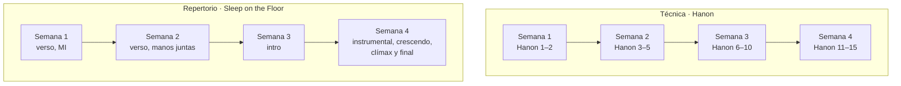
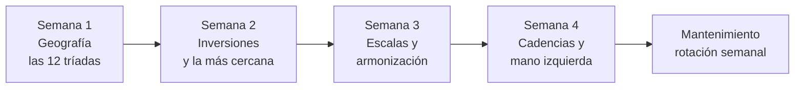

# Programa de piano · 20 sesiones

> [!abstract] Qué es
> Cuatro semanas, cinco sesiones de **40 minutos**, tres carriles en paralelo:
> - **Teclado**: las 12 tríadas, inversiones, escalas, arpegios y cadencias.
> - **Técnica**: Hanon 1–15 ([[Hanon - Ejercicios 1-30.pdf|partitura]]).
> - **Repertorio**: *Sleep on the Floor*, de The Lumineers ([[The Lumineers - Sleep on the Floor.pdf|partitura]]).
>
> La teoría y los ejercicios están en [[Cheat sheet - acordes mayores]]. Aquí está **qué toca cada día y cómo vas**.

## Cómo se usa

1. **Antes:** abre la nota del día (calendario de abajo) y lee solo esa.
2. **Durante:** marca las casillas. El metrónomo empieza donde lo dejaste en la sesión anterior.
3. **Al terminar:** llena las propiedades de la nota (`hecho`, `fecha`, BPM, `audio`). La tabla de
   progreso se actualiza sola.
4. **Cuando logres algo:** marca el hito y anótalo en las tablas de seguimiento.
5. **El último día de cada semana:** graba y llena el registro semanal.





## Progreso de las sesiones

```base
filters:
  and:
    - file.inFolder("4. Instrumento/1. Piano/1. Programa de 20 sesiones")
    - 'tipo == "ejercicio"'
views:
  - type: table
    name: Todas
    order:
      - file.name
      - semana
      - hecho
      - fecha
      - teclado_bpm
      - hanon
      - hanon_bpm
      - sotf
      - sotf_bpm
      - audio
    sort:
      - property: dia
        direction: ASC
  - type: table
    name: Pendientes
    filters:
      and:
        - 'hecho != true'
    order:
      - file.name
      - semana
      - hecho
      - fecha
      - teclado_bpm
      - hanon
      - hanon_bpm
      - sotf
      - sotf_bpm
      - audio
    sort:
      - property: dia
        direction: ASC
  - type: table
    name: Hechas
    filters:
      and:
        - 'hecho == true'
    order:
      - file.name
      - semana
      - hecho
      - fecha
      - teclado_bpm
      - hanon
      - hanon_bpm
      - sotf
      - sotf_bpm
      - audio
    sort:
      - property: dia
        direction: ASC
```

## Calendario

🎙 = ese día se graba.

| Semana | Día | Sesión | Teclado | Hanon | Sleep on the Floor |
|:-:|:-:|---|---|:-:|---|
| 1 | 1 | [[01. Día 1 - Grupo 1 (C F G)\|Día 1]] | Grupo 1 (C, F, G) | 1 | mapa · cc. 18–20 |
| 1 | 2 | [[02. Día 2 - Grupo 2 (D E A)\|Día 2]] | Grupo 2 (D, E, A) | 1 | cc. 18–23 · MI |
| 1 | 3 | [[03. Día 3 - Grupo 3 (Db Eb Ab)\|Día 3]] | Grupo 3 (D♭, E♭, A♭) | 1 | cc. 24–29 · MI |
| 1 | 4 | [[04. Día 4 - Grupo 4 (las únicas)\|Día 4]] | Grupo 4 (F♯/G♭, B♭, B) | 2 | cc. 30–39 · MI |
| 1 | 5 | [[05. Día 5 - El círculo de quintas\|Día 5]] 🎙 | Las 12 por el círculo de quintas | 1–2 | cc. 18–39 · MI |
| 2 | 6 | [[06. Día 6 - Inversiones con la MD\|Día 6]] | Inversiones con la MD, grupo 1 | 3 | cc. 21–25 · MD |
| 2 | 7 | [[07. Día 7 - Inversiones con la MI\|Día 7]] | Inversiones con la MI, grupo 1 · MD, grupo 2 | 3 | cc. 26–33 · MD |
| 2 | 8 | [[08. Día 8 - Inversiones, grupos 2 y 3\|Día 8]] | Ambas manos, grupos 2 y 3 | 4 | cc. 34–39 · MD |
| 2 | 9 | [[09. Día 9 - Inversiones, grupo 4\|Día 9]] | Ambas manos, grupo 4 · repaso del grupo 1 | 5 | cc. 24–33 · juntas |
| 2 | 10 | [[10. Día 10 - La inversión más cercana\|Día 10]] 🎙 | La inversión más cercana | 1–5 | cc. 18–39 · juntas |
| 3 | 11 | [[11. Día 11 - Escalas C G D A E\|Día 11]] | Escalas de C, G, D, A, E | 6 | cc. 1–9 · MI |
| 3 | 12 | [[12. Día 12 - Escalas F y B\|Día 12]] | F y B (las excepciones) · manos juntas | 7 | cc. 1–9 · MD |
| 3 | 13 | [[13. Día 13 - Escalas Bb Eb Ab\|Día 13]] | B♭, E♭, A♭ (la regla del 4 en Si♭) | 8 | cc. 1–9 · juntas |
| 3 | 14 | [[14. Día 14 - Escalas Db y Gb, arpegios\|Día 14]] | D♭ y F♯/G♭ · arpegios | 9 | cc. 10–17 |
| 3 | 15 | [[15. Día 15 - Armonizar la escala\|Día 15]] 🎙 | Armonizar la escala | 10 | cc. 1–39 |
| 4 | 16 | [[16. Día 16 - Cadencia en C G F D\|Día 16]] | Cadencia I – IV⁶₄ – V⁶ – I en C, G, F, D | 11 | cc. 40–47 |
| 4 | 17 | [[17. Día 17 - Cadencia en A E Bb Eb\|Día 17]] | Cadencia en A, E, B♭, E♭ · variante con V⁶₅ | 12 | cc. 48–55 |
| 4 | 18 | [[18. Día 18 - Cadencia en las 12\|Día 18]] | Cadencia en B, F♯, D♭, A♭ · las 12 | 13 | cc. 56–67 |
| 4 | 19 | [[19. Día 19 - Patrones de mano izquierda\|Día 19]] | Patrones de mano izquierda | 14 | cc. 40–55 · 68–76 |
| 4 | 20 | [[20. Día 20 - Aplicación a tu obra\|Día 20]] 🎙 | Aplicación a tu obra | 15 | completa |

> [!info] Si se pierde un día
> La sesión pasa al siguiente día libre y las demás se corren. No se recupera con un maratón.
> Si una sesión no llega a su *hecho cuando*, se repite antes de pasar a la siguiente.

## Hitos

Los hitos son la respuesta a "¿estoy avanzando?". Márcalos cuando ocurran, no cuando acabe la semana.

### Semana 1 · Geografía
- [ ] Las 12 tríadas en posición fundamental, cada mano, **sin mirar**.
- [ ] Hanon 1 completo, manos juntas, a 60.
- [ ] La MI del verso de *Sleep on the Floor* (cc. 18–39) sin parar.

### Semana 2 · Inversiones
- [ ] Las tres posiciones de las 12 tríadas, con los dedos correctos.
- [ ] La cadena del círculo de quintas sin la tabla.
- [ ] Hanon 1–5 seguidos.
- [ ] El verso de *Sleep on the Floor* manos juntas. 🎙

### Semana 3 · Escalas
- [ ] Las 12 escalas, cada mano.
- [ ] Tres tonalidades armonizadas, manos juntas.
- [ ] Hanon 1–10 en rotación.
- [ ] La intro de *Sleep on the Floor* enlazada con el verso. 🎙

### Semana 4 · Cadencias
- [ ] La cadencia I – IV⁶₄ – V⁶ – I en las 12 tonalidades.
- [ ] Cinco patrones de MI sobre la cadencia.
- [ ] Hanon 1–15 en rotación a 72.
- [ ] *Sleep on the Floor* de principio a fin, aunque sea lento. 🎙
- [ ] Los acordes de tu obra activa tocados en piano. 🎙

## Seguimiento por carril

Pon ✓ cuando salga limpio (dedos correctos, sin parar, sin tensión) y escribe el BPM.

### Teclado · las 12 tonalidades

MS = manos separadas · MJ = manos juntas.

| Tonalidad | Tríada (sin mirar) | Inversiones | Escala MS | Escala MJ | Arpegio | Armonizada | Cadencia |
|---|:-:|:-:|:-:|:-:|:-:|:-:|:-:|
| **C** | | | | | | | |
| **G** | | | | | | | |
| **D** | | | | | | | |
| **A** | | | | | | | |
| **E** | | | | | | | |
| **B** | | | | | | | |
| **F♯/G♭** | | | | | | | |
| **D♭** | | | | | | | |
| **A♭** | | | | | | | |
| **E♭** | | | | | | | |
| **B♭** | | | | | | | |
| **F** | | | | | | | |

### Técnica · Hanon

| Nº | Empecé | Manos separadas | Manos juntas | BPM actual | Meta |
|:-:|---|:-:|:-:|:-:|:-:|
| 1 | | | | | 108 |
| 2 | | | | | 108 |
| 3 | | | | | 108 |
| 4 | | | | | 108 |
| 5 | | | | | 108 |
| 6 | | | | | 108 |
| 7 | | | | | 108 |
| 8 | | | | | 108 |
| 9 | | | | | 108 |
| 10 | | | | | 108 |
| 11 | | | | | 108 |
| 12 | | | | | 108 |
| 13 | | | | | 108 |
| 14 | | | | | 108 |
| 15 | | | | | 108 |
| 16 | | | | | 108 |
| 17 | | | | | 108 |
| 18 | | | | | 108 |
| 19 | | | | | 108 |
| 20 | | | | | 108 |
| 21 | | | | | 108 |
| 22 | | | | | 108 |
| 23 | | | | | 108 |
| 24 | | | | | 108 |
| 25 | | | | | 108 |
| 26 | | | | | 108 |
| 27 | | | | | 108 |
| 28 | | | | | 108 |
| 29 | | | | | 108 |
| 30 | | | | | 108 |

### Repertorio · Sleep on the Floor

| Sección | Compases | MI | MD | Manos juntas | BPM actual | Meta |
|---|---|:-:|:-:|:-:|:-:|:-:|
| **Intro** | 1–17 | | | | | 63 |
| **Verso** | 18–39 | | | | | 71 |
| **Instrumental** | 40–47 | | | | | 71 |
| **Crescendo** | 48–59 | | | | | 71 |
| **Clímax** | 60–67 | | | | | 71 |
| **Final** | 68–76 | | | | | 71 |

## Registro semanal

| Semana | Fechas | Sesiones | BPM tríadas | BPM escalas | Hanon (último nº · BPM) | Sleep on the Floor (compases · BPM) | Audio |
|---|---|---:|---:|---:|---|---|---|
| 1 · Geografía | | /5 | | — | | | |
| 2 · Inversiones | | /5 | | — | | | |
| 3 · Escalas | | /5 | | | | | |
| 4 · Cadencias | | /5 | | | | | |

## Después de las 20 sesiones · mantenimiento

Después del plan, **20 minutos al día** mantienen todo vivo y siguen sumando: **un Hanon nuevo por
semana** (16, 17… hasta 30) y la pieza entera cada viernes.

| Día | Tríadas e inversiones | Escalas y arpegios | Cadencia | Hanon | Sleep on the Floor |
|---|---|---|---|---|---|
| Lunes | grupo 1 (C F G) | C, F, G | C | 1–5 | verso |
| Martes | grupo 2 (D E A) | D, E, A | D | 6–10 | intro |
| Miércoles | grupo 3 (D♭ E♭ A♭) | D♭, E♭, A♭ | E♭ | 11–15 | cc. 40–59 |
| Jueves | grupo 4 (F♯ B♭ B) | F♯, B♭, B | B♭ | el nuevo de la semana | clímax, cc. 60–67 |
| Viernes | el círculo (§8.2) | dos al azar | las 12 | tres al azar | completa, y se graba |
