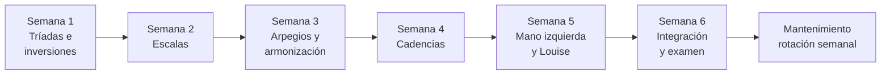
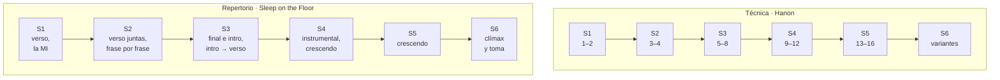

# Programa de piano · 30 sesiones

> [!abstract] Qué es
> Seis semanas, cinco sesiones de **40 minutos**, tres carriles en paralelo:
> - **Teclado**: las 12 tríadas, inversiones, escalas, arpegios, armonización, cadencias y patrones de mano izquierda.
> - **Técnica**: Hanon 1–10, por mitades ([[Hanon - Ejercicios 1-30.pdf|partitura]]); del 11 en adelante, en el mantenimiento.
> - **Repertorio**: *Sleep on the Floor*, de The Lumineers ([[The Lumineers - Sleep on the Floor.pdf|partitura]]), y al final tu *Louise*.
>
> **Punto de partida:** las escalas de C, D, E y F ya salen a dos manos, de arriba abajo, como un
> Hanon. El programa no las vuelve a enseñar: el día 3 las mide, y desde ahí sirven de ancla (G y A
> usan su misma digitación) y de estiramiento (más tempo). Sus tríadas, arpegios y cadencias se
> estudian como las de las demás.
>
> La teoría y los ejercicios están en [[Cheat sheet - acordes mayores]]. Aquí está **qué toca cada día y cómo vas**.

## El plan en una página

| Semana | Tema | Teclado: al terminar la semana… | Hanon | Sleep on the Floor | Se graba |
|:-:|---|---|:-:|---|---|
| **1** | Tríadas e inversiones | las 12 tríadas en tres posiciones con la MD y en fundamental a dos manos; la MI en tres posiciones en seis; la cadena del círculo, de ida | 1–2 | verso (cc. 18–39), MI | la cadena y la MI del verso |
| **2** | Escalas | las 8 que faltaban; las 12 a dos manos por el círculo; la cadena sin tabla | 3 y la subida del 4 | verso a dos manos, frase por frase: entra la MD | las 12 escalas y el verso |
| **3** | Arpegios y armonización | arpegios de las 12 en dos octavas; ocho tonalidades armonizadas | 4–6, por mitades | el final (cc. 68–75) y la intro, enlazada con el verso | tres armonizadas al azar y cc. 1–39 |
| **4** | Cadencias | I – IV⁶₄ – V⁶ – I en las 12, y la variante con V⁶₅ | 6–8, por mitades | instrumental (cc. 40–47) y el principio del crescendo | las 12 cadencias y cc. 1–47 |
| **5** | Mano izquierda y Louise | los ocho patrones de MI; *Louise* en el piano con voicings tuyos | 8–10, por mitades | crescendo (cc. 48–59) | *Louise* y cc. 40–59 |
| **6** | Integración | rotación de las 12 (con la MI de los grupos 3 y 4), examen en frío, toma final | la bajada del 10 · repaso de 1–10 con variantes | clímax (cc. 60–67), ensayo y toma completa | la toma final |





## La rampa · cómo arranca

> [!warning] Por qué el reparto cambió el día 2
> El día 1 tomó **tres sentadas** en vez de una. Traía cinco cosas nuevas a la vez (leer Hanon, seis
> tríadas por mano, sus inversiones, la prueba sin mirar y el mapa de la pieza) y pedía el *hecho
> cuando* ese mismo día, así que la sesión no terminaba hasta que salía. Desde el día 2 el programa
> arranca a media carga y llega al ritmo completo en la semana 3. **Los temas de cada semana no
> cambian; cambia cuánto entra en cada sesión.**

> [!warning] Y por qué cada día se parte en dos
> El día 2 (2 nov) tampoco cupo en una sentada: alcanzaron el Hanon y la Recuperación, y en frío
> salieron solo las fundamentales. En las semanas 1 y 2 cada día se toca en **dos sentadas, una por
> parte**, normalmente en dos días: primero la pieza (Hanon, Recuperación y Sleep on the Floor),
> luego el teclado (Hanon, Principal y Aplicación). La Recuperación va en la primera porque es la
> comprobación en frío de lo del día anterior, y así las dos sentadas quedan parejas, de unos 20
> minutos. El Hanon va en las dos: es el calentamiento, y tocarlo a diario es lo que lo sube. Lo
> que trae cada día no cambia; cambia que cada sentada se concentra en una sola parte.
> Así esas dos semanas ocupan unas cuatro de calendario. Desde la semana 3, un día vuelve a ser una
> sentada.

> [!warning] Y por qué el día 3 se aligeró (3 nov)
> El día 2 alcanzó para el Hanon, la Recuperación (en frío salieron solo las fundamentales), D♭, E♭ y
> A♭ en bloque y quebrada, y las inversiones de D♭. No llegaron E♭ y A♭ invertidos, los espejos ni
> Sleep on the Floor. Las grabaciones dicen por qué: las inversiones salen, pero la mano tarda un
> minuto y medio en entrar y a los dos minutos se cansa. Así que el día 3 dejó de traer tres cosas
> nuevas: termina lo que faltó del día 2 y trae **una sola**, el grupo 4 en bloque y quebrada. Lo que
> salió está en *Lo que se movió*.
>
> **Sleep on the Floor todavía no empieza** (4 nov). Arranca en el día 3 con lo que traía el día 1, y la
> pieza va **dos sesiones atrás**: el 3 toca lo del 1, el 4 lo del 2 y el 5 lo del 3. En la semana 1 la
> pieza es solo la MI del verso; la MD pasa a la semana 2.

| Semana | Carga | Sentadas por día | Qué trae de nuevo una sesión | Hanon |
|:-:|:-:|:-:|---|---|
| **1** | media | dos: pieza y teclado | **una sola cosa**; lo demás repite lo que ya sale | el 1, y el 2 desde el día 4 |
| **2** | tres cuartos | dos: pieza y teclado | lo del teclado; el primer día de la semana, nada más | media pasada nueva por sesión (subida o bajada): el 3 y la subida del 4 |
| **3–5** | completa | una | lo del día en los tres carriles, como estaba | media pasada nueva por sesión, del 4 al 10; del 11 al 16, después del día 30 |
| **6** | colchón | una | nada: rotación, examen y lo que quedó pendiente | la bajada del 10 · repaso de 1–10 con variantes |

### Las dos primeras semanas, día por día

| Día | Lo nuevo | Lo que repite |
|:-:|---|---|
| 1 | todo: era el arranque | nada |
| 2 | el grupo 3, por espejo del grupo 2 | Hanon 1 · la MI del verso donde iba |
| 3 | el grupo 4, en bloque y quebrada · empieza Sleep on the Floor (mapa y cc. 18–23, MI) | Hanon 1 · E♭ y A♭ en tres posiciones (del día 2) · las escalas que ya tienes, medidas |
| 4 | el Hanon 2 · el 5-2-1 de la MI, en seis acordes | el grupo 3 en frío · el círculo, leyendo · la MI del verso, hasta el c. 33 |
| 5 🎙 | la bajada del Hanon 2 (el día 4 no alcanzó) | Hanon 1 · la MI del verso entera, grabada |
| 6 | G, A y B (G y A con la digitación de C, D y E) · la MD del verso, cc. 18–25, juntas | Hanon 2 entero · la cadena, ya sin tabla · la MI del verso |
| 7 | B♭ y E♭ · la subida del Hanon 3 · cc. 26–29 | G, A y B · Hanon 1 |
| 8 | A♭ y D♭ · la bajada del Hanon 3 · cc. 30–33 | Hanon 2 · cc. 34–37, que repiten |
| 9 | F♯ · la subida del Hanon 4 · cc. 38–39 | A♭ y D♭, ahora a dos manos · Hanon 3 entero · el verso entero |
| 10 🎙 | nada: las 12 y el verso a dos manos, grabados | Hanon 1 (y el 2 si sobra tiempo) |

### Lo que se movió

Nada se quitó del programa sin decir a dónde fue.

| Qué | Estaba en | Ahora |
|---|---|---|
| Medir las escalas de C, D, E y F | día 1 (no alcanzó el tiempo) | día 3, Aplicación |
| Los nueve en fundamental, MD y MI | día 2 | fuera: el círculo del día 3 los toca todos |
| Las 12 al azar con los ojos cerrados | día 3 | fuera: el círculo sin mirar del día 4 lo cubre |
| La MI en tres posiciones, grupos 3 y 4 | día 4 | semana 6, en la rotación (días 26 y 27) |
| La MI fija con F y E♭ | día 4 | fuera: C, D y E bastan para la idea |
| La cadena del círculo sin tabla | día 5 | día 6, Recuperación |
| La cadena al revés | día 5 | día 29, Aplicación |
| G, A y B seguidas | día 6 | fuera: B se queda con esos minutos |
| Hanon 17–20 | semana 5 | mantenimiento, uno por semana |
| El Hanon nuevo entero el día que entra | días 4, 7, 9 y 11–24 | por mitades: la subida un día y la bajada otro, a dos manos (10 nov) |
| Hanon 11–16 | semanas 4 y 5 | después del día 30, por mitades, antes que el 17 (10 nov) |
| E♭ y A♭ en tres posiciones | día 2 (no alcanzó) | día 3 |
| Sleep on the Floor desde el principio: mapa, preparatorio 1 y la MI del verso | días 1 a 3 (todavía no se toca) | días 3 a 5: la pieza va dos sesiones atrás |
| El preparatorio 2 y la MD del verso (cc. 21–39) | días 4 y 5 | el preparatorio, día 6; la MD, días 6 a 9, frase por frase y juntas el mismo día (15 nov) |
| Los espejos (D → D♭, E → E♭, A → A♭) | día 2, Aplicación (no alcanzó) | fuera: E♭ y A♭ se trabajan directo en el día 3 |
| Las inversiones del grupo 4 con la MD | día 3 | semana 6, en la rotación (días 26 y 27); hasta entonces, la cadena del día 5 las lee de la tabla |
| Las 12 por el círculo, leyendo | día 3 | día 4, Recuperación |
| El círculo sin partitura | día 4, Recuperación | fuera: la cadena sin tabla del día 6 lo cubre |
| El verso entero sin parar, a 44 | día 3 | día 5, en la toma, a 40 |
| Subir el Hanon a cuatro notas por click | día 3 | cuando la MI suene en la bajada |
| El final (cc. 68–75) | días 24 y 25 | días 11 y 12: es el verso con una voz más (15 nov) |
| La intro: leerla, la MI, la MD y juntas | días 8 a 11 | días 13 y 14, frase por frase (15 nov) |
| Escribir en una tabla el acorde de cada compás de la intro | día 8 | día 13: se nombra cada acorde en voz alta al tocar la MI (15 nov) |
| La intro enlazada con el verso | día 12 | día 14 (15 nov) |
| Grabar cc. 1–47 | día 15 | día 20; el día 15 se graban los cc. 1–39 (15 nov) |
| El instrumental (cc. 40–47) | días 13 y 14 | días 16 a 18 (15 nov) |
| El crescendo (cc. 48–59) | días 14 y 16 a 20 | días 19 y 21 a 24 (15 nov) |
| Grabar cc. 40–59 | día 20 | día 25 (15 nov) |
| El clímax (cc. 60–67) | días 21 a 24 | días 26 a 28 (15 nov) |
| Grabar cc. 40–75 | día 25 | fuera: la toma completa de los días 29 y 30 lo cubre (15 nov) |
| La pieza por mitades a tempo +4 | días 26 y 27 | mantenimiento (15 nov) |
| La primera pasada completa | día 28 | día 29, el ensayo (15 nov) |
| La décima de los acordes de la clave de fa (C–G–E, A–E–C, G–D–B, F–C–A) | la MI, en las notas de tramo y el Preparatorio 1 | la MI toca la octava (1-5-8); la décima, la MD cuando está en silencio, o no se toca (16 nov) |

> [!done] La pieza desde el día 6, repartida (15 nov)
> Las notas de los días 6 a 10 asumían que la MD del verso había salido en los días 4 y 5, y nunca tuvo
> sesión. Se repartió de nuevo, y con una regla: [[#Sleep on the Floor · cómo se reparten las manos]].

## Sleep on the Floor · cómo se reparten las manos

> [!warning] Por qué cambió (15 nov)
> Hasta el día 5 la pieza se repartía **por mano y por sección**: la MI de todo el verso en tres
> sesiones, y la MD del verso en ninguna; el día 6 pedía el verso a dos manos sin que la MD lo hubiera
> tocado. Cada sección traía además su propia receta (MI y luego juntas; MI, MD y juntas; MD, MI y
> juntas; separadas un día y juntas al siguiente) sin nada que dijera qué mano va primero ni cuánto
> tiempo sola. Y lo difícil de una pieza, que las dos manos encajen, quedaba siempre para el final, de
> golpe.
>
> Desde el día 6 la pieza se reparte **por frase**, con la regla de abajo, y vuelve a empezar en el
> verso aunque su MI ya se haya tocado. Los días 4 y 5 no cambian: terminan la MI del verso, que el
> día 6 usa.

### La regla

1. **La unidad es la frase**: de dos a cuatro compases, los de la tabla de abajo. Nunca una sección
   entera con una sola mano.
2. **Una frase nueva termina la sesión a dos manos.** Tres pasos, el mismo día:
   1. la mano que va primero, sola;
   2. la otra, sola, **solo si también es nueva**: si ya la sabes, este paso no existe;
   3. juntas, 8 bpm por debajo de tu tempo de trabajo, hasta dos limpias.
3. **Va primero la mano nueva que más se mueve**: la que tiene más ataques en la frase (un acorde
   cuenta como uno). Lo que más se mueve necesita más repeticiones; lo que se mueve menos se pone
   encima. Si solo una mano es nueva, va esa. Empate: la MD.
4. **Lo que repite algo que ya sale va directo a juntas**, y entra el mismo día que la frase a la que
   repite, o al siguiente.
5. **Como mucho cuatro compases nuevos por sesión.** Un compás es nuevo si una de las dos manos toca
   algo que no ha tocado antes. Por eso el instrumental, el crescendo y el clímax van de dos en dos.
6. **Si la frase no llegó a juntas, la sesión siguiente la repite** en vez de avanzar. Lo que no
   llegue a juntas el día 28 se salta en la toma y pasa al mantenimiento.
7. **Las secciones van de menos a más difícil** (las estrellas del
   [[Cheat sheet - acordes mayores#Mapa de la pieza|mapa de la pieza]]); con empate, primero la que
   reusa lo que ya sale. Por eso el final (★★, el verso con una voz más) va justo después del verso, y
   antes que la intro.

### El bloque de la pieza, desde el día 6

| Min | Paso | Qué |
|--:|---|---|
| 2 | **En frío** | lo nuevo de la sesión anterior, juntas, sin calentarlo antes. El día después de una grabación, los dos compases que más fallaron en la toma |
| 6 | **Lo nuevo** | la frase del día, con los pasos de la regla |
| 3 | **Encadenar** | desde el principio de la sección hasta lo nuevo, juntas, sin parar; en la primera frase de una sección, desde dos compases antes |

Los días de grabación no entra nada nuevo: después del frío, la toma.

### Las frases

*Ya sale* = esa mano ya lo tocó en otra frase. *Repite* = es otra frase que ya sale, con cambios
mínimos. La columna *Primero* es lo que sale de aplicar la regla.

| Frase | Compases | Qué trae | MD | MI | Primero | Día |
|---|---|---|---|---|:-:|:-:|
| **V1** | 18–21 | la MI casi sola: la MD solo pone la décima de sus acordes (E4, cc. 18, 19 y 21); en el 21 entra la anacrusa (*G. A c. A*) | nueva: la décima y la anacrusa | ya sale | MD | [[06. Día 6 - Escalas G A y B\|6]] |
| **V2** | 22–25 | dos veces *d e e* · *d c c*, cada nota larga con su anacrusa | nueva | ya sale | MD | [[06. Día 6 - Escalas G A y B\|6]] |
| **V3** | 26–29 | *d c B* · *d. c c* · *d c B* y la nota larga del 29; la MI baja a Am – G | nueva | ya sale | MD | [[07. Día 7 - Escalas Bb y Eb\|7]] |
| **V4** | 30–33 | V2 con la nota larga en *e–g*; en el silencio del 30, la MD pone la décima | casi repite V2 | ya sale | MD | [[08. Día 8 - Escalas Ab y Db\|8]] |
| **V5** | 34–37 | V2 y V3 seguidas; el 37 cierra en un G largo | repite | ya sale | juntas directo | [[08. Día 8 - Escalas Ab y Db\|8]] |
| **V6** | 38–39 | la última anacrusa y los acordes ligados | nueva | ya sale | MD | [[09. Día 9 - Escala Gb y bemoles a dos manos\|9]] |
| **F1** | 68–71 | la melodía del verso con una segunda voz debajo | nueva: la voz de abajo | ya sale: el patrón del verso | MD | [[11. Día 11 - Arpegios, grupos 1 y 2\|11]] |
| **F2** | 72–75 | F1 hasta el acorde largo del final | casi repite F1 | ya sale | MD | [[12. Día 12 - Arpegios, grupos 3 y 4\|12]] |
| **I1** | 1–3 | la MD salta de octava en corcheas; la MI, un acorde de B cada tres corcheas, cruzando la barra | nueva | nueva | MD | [[13. Día 13 - Armonizar en C D F y G\|13]] |
| **I2** | 4–6 | el mismo dibujo sobre E | el de I1, otras notas | el de I1, otro acorde | MD | [[13. Día 13 - Armonizar en C D F y G\|13]] |
| **I3** | 7–9 | igual a I1 | repite | repite | juntas directo | [[14. Día 14 - Armonizar en A E Bb y Eb\|14]] |
| **I4** | 10–12 | I2, con el 12 distinto en la MD | repite | repite | juntas directo | [[14. Día 14 - Armonizar en A E Bb y Eb\|14]] |
| **I5** | 13–15 | I1 con un acorde nuevo en la MI (cc. 14–15) | repite | nueva: el acorde | MI | [[14. Día 14 - Armonizar en A E Bb y Eb\|14]] |
| **I6** | 16–17 | E y la nota larga que lleva al verso | repite | repite | juntas directo | [[14. Día 14 - Armonizar en A E Bb y Eb\|14]] |
| **T1** | 40–41 | *e d c G C* dos veces; la MI toca lo mismo una octava abajo | nueva | la misma línea | MD | [[16. Día 16 - Cadencia en C G D A E\|16]] |
| **T3** | 44–45 | T1 con una nota ligada y una anacrusa | casi repite T1 | casi repite T1 | juntas directo | [[16. Día 16 - Cadencia en C G D A E\|16]] |
| **T2** | 42–43 | el compás denso: la MD en semicorcheas con acordes, la MI a contratiempo | nueva | nueva | MD | [[17. Día 17 - Cadencia en F Bb Eb Ab\|17]] |
| **T4** | 46–47 | acordes cortos en la MD; en el 47 la MI arranca el dibujo del crescendo | nueva | nueva | MD | [[18. Día 18 - Cadencia en B Gb Db y las 12\|18]] |
| **C1** | 48–49 | la MI en semicorcheas, bajo y acorde alternados; la MD, escala corta y acordes | nueva | nueva | MI | [[19. Día 19 - La cadencia con V7\|19]] |
| **C2** | 50–51 | la MI repite C1; la MD, *g g g* y acordes | nueva | repite C1 | MD | [[21. Día 21 - Patrones de MI, los abiertos\|21]] |
| **C3** | 52–53 | la MI cambia de acorde cada medio compás; la MD, la escala *G A c d c B* | nueva | nueva | MI | [[22. Día 22 - Patrones de MI, los que se mueven\|22]] |
| **C4** | 54–55 | C3 con otro final | repite | repite | juntas directo | [[23. Día 23 - Patrones transportados\|23]] |
| **C5** | 56–58 | notas largas en las dos manos | nueva | nueva | MD | [[23. Día 23 - Patrones transportados\|23]] |
| **C6** | 59 | el compás que lleva al clímax | nueva | nueva | MD | [[24. Día 24 - Louise en el piano\|24]] |
| **K1** | 60–61 | la MD, acordes a contratiempo; la MI, semicorcheas que suben y bajan | nueva | nueva | MI | [[26. Día 26 - Rotación, lado de sostenidos\|26]] |
| **K2** | 62–63 | K1 con otro final | repite | repite | juntas directo | [[26. Día 26 - Rotación, lado de sostenidos\|26]] |
| **K3** | 64–65 | el mismo dibujo con otros acordes | nueva en el 65 | nueva | MI | [[27. Día 27 - Rotación, lado de bemoles\|27]] |
| **K4** | 66–67 | el último compás denso y el acorde largo | nueva | nueva | MI | [[28. Día 28 - Examen de teclado\|28]] |

Las grabaciones caen en los días 10 (el verso), 15 (cc. 1–39), 20 (cc. 1–47), 25 (cc. 40–59) y 30 (la
toma completa); el 29 es el ensayo.

### Qué nota toca cada mano

> [!warning] Por qué cambió (16 nov)
> La clave de fa de esta partitura escribe casi todos sus acordes como **raíz – quinta – décima**:
> C3–G3–E4, A2–E3–C4, G2–D3–B3, F2–C3–A3. De la nota de abajo a la de arriba hay diez teclas blancas.
> Las notas de tramo le daban esos acordes enteros a la MI y el Preparatorio 1 los digitaba 5-2-1, como
> si cupieran. No caben: tu mano llega a la octava. El día 3 tu MI ya tocó por su cuenta C–G–C en vez
> de C–G–E.
>
> Que una nota esté escrita en la clave de fa no dice qué mano la toca. La toca la mano que llega.

1. **Ninguna mano abre más de una octava** (del 5 al 1).
2. **Donde la partitura escribe raíz – quinta – décima, la MI toca raíz – quinta – octava** (1-5-8,
   dedos 5-2-1): la décima se cambia por la raíz una octava arriba. Es la forma que tu mano ya hace
   sola, y es la misma en todos los acordes.
3. **La décima la toca la MD solo si en ese momento está en silencio.** Si la MD está tocando, la
   décima no se toca: arriba ya suena, en la melodía o en los acordes de la MD.
4. **Lo demás de la clave de fa ya cabe en la mano y no cambia**: los acordes de la intro, las líneas
   de una sola nota del instrumental, las semicorcheas del clímax y los F de cuatro notas del verso (F–A–C–F, una octava
   justa).

| La partitura escribe | La MI toca | La décima |
|---|---|---|
| C – G – E | C – G – C | E4 en la MD: en el 1 del c. 18 y en el 2 de los cc. 19, 21 y 30. En el resto, no se toca |
| F – C – A | F – C – F | no se toca |
| A – E – C | A – E – A | no se toca |
| G – D – B | G – D – G | no se toca |

Los acordes de décima aparecen en el verso (cc. 18–39), el instrumental (cc. 42–47), el crescendo
(cc. 48–58), el primer compás del clímax (c. 60) y el final (cc. 68–75). Solo en el verso la MD tiene
silencios donde cae uno; en el resto siempre está tocando.

**La regla vive en Partituras** (`app/manos.py`, desde el 16 nov), no en estas notas: se aplica sola a cualquier
pieza de dos manos. En Practicar, el dibujo lleva el dedo de cada nota (encima en la MD, debajo en la MI), en azul lo
que pasa a la otra mano, en verde lo agregado y entre paréntesis lo que no se toca; mientras practicas, cada paso dice
con qué dedos y por qué, y «Manos y dedos: por qué» lista las reglas (R1–R4 qué mano, D1–D8 qué dedo) y lo que cambió
en el rango. El estudio de piano compara tus tomas contra eso, no contra la partitura cruda. La digitación es una
propuesta hecha con reglas: si Fabs te da otra, gana la de Fabs.

Las notas de tramo de la MI ya están escritas así, con la versión del PDF plegada debajo para comparar:
[[Sleep on the Floor · cc. 18–39 · MI|el verso]] y [[Sleep on the Floor · cc. 48–55 · MI|el
crescendo]]. Las imágenes de cada día son el PDF tal cual: ahí la décima sigue escrita en la clave de fa.

## Una sesión

| Bloque | Min | Qué |
|---|---:|---|
| **Hanon** | 6 | una pasada completa de repaso; si hoy toca, la mitad nueva (subida o bajada) a dos manos |
| **Recuperación** | 3 | lo del día anterior, sin mirar la hoja: es la comprobación en frío de su *hecho cuando* |
| **Principal** | 14 | lo nuevo del día, con metrónomo |
| **Aplicación** | 4 | usarlo en algo musical: transportar, al azar, *Louise* |
| **Sleep on the Floor** | 11 | la frase del día: en frío, lo nuevo y encadenar ([[#Sleep on the Floor · cómo se reparten las manos\|cómo]]) |
| **Registro** | 2 | BPM alcanzados y qué falló |

### Qué la hace más exigente

- **Lo que ya sabes no se estudia, se mide** y se estira: las escalas de C, D, E y F solo suben de tempo, y la semana de escalas enseña únicamente las ocho que faltan.
- **Manos juntas desde la primera semana de cada tema**, no al final del programa.
- **Las 12 tonalidades en todo**: escalas, arpegios y cadencias a dos manos, no solo cuatro o cinco.
- **Cada *hecho cuando* es sin mirar la tabla**, y algunos al azar: si solo sale en el orden en que lo estudiaste, todavía no salió.
- **Hanon nuevo por mitades**: una sesión trae como mucho la subida o la bajada de uno, a dos manos; el resto del bloque es una pasada de repaso (ver *La rampa*).

### Qué hace que salga bien

- **La regla del metrónomo** ([[Cheat sheet - acordes mayores#El metrónomo|§12]]): 3 limpias, +4 bpm; 3 fallos, −8. Nunca se sube por calendario.
- **Una sesión es una sentada de 40 minutos**; en las semanas 1 y 2, dos sentadas, una por parte (ver *La rampa*). Temporizador por bloque: cuando se acaba, pasas al siguiente aunque no haya salido. Lo que quedó se anota en el Registro; no se termina en otra sentada.
- **El *hecho cuando* se comprueba en frío**, en la Recuperación de la sesión siguiente: es la regla de la bóveda de evaluar después de descansar. El mismo día solo se trabaja. Si en frío no sale, esa sesión usa su Aplicación para eso; si falla dos sesiones seguidas, se repite el día.
- **Si vas tarde, recorta en este orden:** Aplicación → la última tarea del Principal. El Hanon calienta, la Recuperación es la comprobación y el Registro es la evidencia: esos no se recortan.
- **Después de una pausa** de más de tres días no se repite la sesión anterior ni se recupera lo perdido: se toca la que sigue, y su Recuperación hace de re-entrada.
- **La semana 6 es colchón:** rotación y examen. Lo que no se consolidó antes se recupera ahí, no a costa de una sesión nueva. Ahí llegan también la MI de los grupos 3 y 4 y la cadena al revés. En la pieza no hay colchón: la semana 6 trae el clímax, y lo que no llegue a juntas el día 28 pasa al mantenimiento.
- **Si algo duele, para.** Se anota en *Dolor o tensión* y se baja el tempo al día siguiente.

## Cómo se usa

1. **Antes:** abre la nota del día (calendario de abajo) y lee solo esa. Pon un temporizador de 40 minutos; en las semanas 1 y 2, uno por sentada.
2. **Durante:** marca las casillas. El metrónomo empieza donde lo dejaste en la sesión anterior.
3. **Al terminar:** llena las propiedades de la nota (`hecho`, `fecha`, BPM, `audio`). La tabla de
   progreso se actualiza sola.
4. **Cuando logres algo:** marca el hito y anótalo en las tablas de seguimiento.
5. **El último día de cada semana:** graba y llena el registro semanal.

## Progreso de las sesiones

```base
filters:
  and:
    - file.inFolder("4. Instrumento/1. Piano/1. Programa de 30 sesiones")
    - 'tipo == "ejercicio"'
views:
  - type: table
    name: Todas
    order:
      - file.name
      - semana
      - hecho
      - fecha
      - teclado_bpm
      - hanon
      - hanon_bpm
      - sotf
      - sotf_bpm
      - audio
    sort:
      - property: dia
        direction: ASC
  - type: table
    name: Pendientes
    filters:
      and:
        - 'hecho != true'
    order:
      - file.name
      - semana
      - hecho
      - fecha
      - teclado_bpm
      - hanon
      - hanon_bpm
      - sotf
      - sotf_bpm
      - audio
    sort:
      - property: dia
        direction: ASC
  - type: table
    name: Hechas
    filters:
      and:
        - 'hecho == true'
    order:
      - file.name
      - semana
      - hecho
      - fecha
      - teclado_bpm
      - hanon
      - hanon_bpm
      - sotf
      - sotf_bpm
      - audio
    sort:
      - property: dia
        direction: ASC
```

## Calendario

🎙 = ese día se graba.

> [!note] Hanon, desde el 10 de noviembre
> **Lo nuevo es solo media pasada**: la subida (14 celdas) o la bajada (15 y el C final) de un Hanon, a dos manos. El resto del bloque es una pasada completa de repaso (unos 2½ minutos a 100 con una nota por click) y, los días sin nada nuevo, otra si sobra tiempo. Con temporizador: cuando suena, al bloque siguiente. Así entran del 3 al 10; del 11 al 16 se recorren a después del día 30. Las lecciones traen solo lo que se toca: el recorte del PDF con los dedos y la pasada (o la mitad) en ABC; de Sleep on the Floor, los compases del día (la pieza tiene 75; el c. 76 no existe).

| Semana | Día | Sesión | Teclado | Hanon | Sleep on the Floor |
|:-:|:-:|---|---|:-:|---|
| 1 | 1 | [[01. Día 1 - Punto de partida y grupos 1 y 2\|Día 1]] | Escalas C, D, E, F (se miden) · tríadas de los grupos 1 y 2 · inversiones con la MD | 1 | mapa · cc. 18–23 · MI |
| 1 | 2 | [[02. Día 2 - Grupo 3 y los espejos\|Día 2]] | Grupo 3 (D♭, E♭, A♭) por espejo · inversiones con la MD | 1 | cc. 18–33 · MI |
| 1 | 3 | [[03. Día 3 - Grupo 3 entero y grupo 4\|Día 3]] | E♭ y A♭ en tres posiciones · grupo 4 (F♯, B♭, B) en bloque y quebrada · se miden C, D, E y F | 1 | empieza: mapa · cc. 18–23 · MI |
| 1 | 4 | [[04. Día 4 - Inversiones con la MI\|Día 4]] | Inversiones con la MI · grupos 1 y 2 | 1 para calentar · 2 nuevo | cc. 18–33 · MI |
| 1 | 5 | [[05. Día 5 - La inversión más cercana\|Día 5]] 🎙 | La cadena del círculo (§8.2), de ida | 2, la bajada · 1 de repaso | cc. 34–39 · el verso con la MI, grabado |
| 2 | 6 | [[06. Día 6 - Escalas G A y B\|Día 6]] | Escalas G, A y B · C, D, E más rápido | 2 de repaso · 1 si sobra tiempo | cc. 18–25 · MD → juntas |
| 2 | 7 | [[07. Día 7 - Escalas Bb y Eb\|Día 7]] | Escalas B♭ y E♭ · la regla del 4 en Si♭ | 3, la subida · 1 de repaso | cc. 26–29 · MD → juntas |
| 2 | 8 | [[08. Día 8 - Escalas Ab y Db\|Día 8]] | Escalas A♭ y D♭ · B♭ y E♭ a dos manos | 3, la bajada · 2 de repaso | cc. 30–37 · MD → juntas |
| 2 | 9 | [[09. Día 9 - Escala Gb y bemoles a dos manos\|Día 9]] | Escala F♯/G♭ · A♭ y D♭ a dos manos | 4, la subida · 3 de repaso | cc. 38–39 · MD → juntas · verso entero |
| 2 | 10 | [[10. Día 10 - Las 12 escalas por el círculo\|Día 10]] 🎙 | Las 12 escalas a dos manos, por el círculo | 1 de repaso · 2 si sobra tiempo | cc. 18–39 · juntas · toma |
| 3 | 11 | [[11. Día 11 - Arpegios, grupos 1 y 2\|Día 11]] | Arpegios C, F, G · D, E, A, B | 4, la bajada · 2 de repaso | cc. 68–71 · MD → juntas |
| 3 | 12 | [[12. Día 12 - Arpegios, grupos 3 y 4\|Día 12]] | Arpegios D♭, E♭, A♭ · B♭ · F♯ | 5, la subida · 4 de repaso | cc. 72–75 · MD → juntas |
| 3 | 13 | [[13. Día 13 - Armonizar en C D F y G\|Día 13]] | Armonizar la escala en C, D, F y G | 5, la bajada · 3 de repaso | cc. 1–6 · MD → MI → juntas |
| 3 | 14 | [[14. Día 14 - Armonizar en A E Bb y Eb\|Día 14]] | Armonizar la escala en A, E, B♭ y E♭ | 6, la subida · 5 de repaso | cc. 7–17 · MI → juntas · intro → verso |
| 3 | 15 | [[15. Día 15 - Armonizar al azar\|Día 15]] 🎙 | Armonizar al azar · B, F♯, D♭, A♭ | 1 de repaso · 2 si sobra tiempo | cc. 1–39 · juntas · toma |
| 4 | 16 | [[16. Día 16 - Cadencia en C G D A E\|Día 16]] | I – IV⁶₄ – V⁶ – I en C, G, D, A y E | 6, la bajada · 2 de repaso | cc. 40–41 y 44–45 · MD → MI → juntas |
| 4 | 17 | [[17. Día 17 - Cadencia en F Bb Eb Ab\|Día 17]] | Cadencia en F, B♭, E♭ y A♭ | 7, la subida · 6 de repaso | cc. 42–43 · MD → MI → juntas |
| 4 | 18 | [[18. Día 18 - Cadencia en B Gb Db y las 12\|Día 18]] | Cadencia en B, F♯ y D♭ · las 12 por el círculo | 7, la bajada · 4 de repaso | cc. 46–47 · MD → MI → juntas · instrumental entero |
| 4 | 19 | [[19. Día 19 - La cadencia con V7\|Día 19]] | La variante con V⁶₅ en ocho tonalidades | 8, la subida · 7 de repaso | cc. 48–49 · MI → MD → juntas |
| 4 | 20 | [[20. Día 20 - Las 12 cadencias\|Día 20]] 🎙 | Las 12 cadencias por el círculo, sin tabla | 3 de repaso · 5 si sobra tiempo | cc. 1–47 · juntas · toma |
| 5 | 21 | [[21. Día 21 - Patrones de MI, los abiertos\|Día 21]] | Raíz, quinta, octava, 1-5-8 y 1-5-10 | 8, la bajada · 5 de repaso | cc. 50–51 · MD → juntas |
| 5 | 22 | [[22. Día 22 - Patrones de MI, los que se mueven\|Día 22]] | Alberti, vals y arpegio largo | 9, la subida · 8 de repaso | cc. 52–53 · MI → MD → juntas |
| 5 | 23 | [[23. Día 23 - Patrones transportados\|Día 23]] | Tres patrones en F, B♭, E♭ y A | 9, la bajada · 1 de repaso | cc. 54–58 · MD → MI → juntas |
| 5 | 24 | [[24. Día 24 - Louise en el piano\|Día 24]] | Los acordes de Louise: intro y coro | 10, la subida · 9 de repaso | c. 59 · MD → MI → juntas · crescendo entero |
| 5 | 25 | [[25. Día 25 - Louise, qué nota va arriba\|Día 25]] 🎙 | Louise: decidir la nota de arriba | 2 de repaso · 6 si sobra tiempo | cc. 40–59 · juntas · toma |
| 6 | 26 | [[26. Día 26 - Rotación, lado de sostenidos\|Día 26]] | G, D, A, E, B, F♯ completas | 10, la bajada · 6 de repaso con puntillo | cc. 60–63 · MI → MD → juntas |
| 6 | 27 | [[27. Día 27 - Rotación, lado de bemoles\|Día 27]] | F, B♭, E♭, A♭, D♭ y C completas | 10 de repaso en staccato · 4 si sobra tiempo | cc. 64–65 · MI → MD → juntas |
| 6 | 28 | [[28. Día 28 - Examen de teclado\|Día 28]] | Examen en frío: seis tonalidades al azar | 4 de repaso con dinámica · 7 si sobra tiempo | cc. 66–67 · MI → MD → juntas · cc. 60–75 |
| 6 | 29 | [[29. Día 29 - Ensayo general\|Día 29]] | Los ✗ del examen · la cadena al revés y en vals | 1 en G · en F si sobra tiempo | completa · ensayo y compases débiles |
| 6 | 30 | [[30. Día 30 - La toma final\|Día 30]] 🎙 | Toma: las 12 escalas y las 12 cadencias | 3 de repaso · 5 si sobra tiempo | completa · toma |

> [!info] Si se pierde un día
> La sesión pasa al siguiente día libre y las demás se corren. No se recupera con un maratón.
> Después de una pausa larga (más de tres días), la Recuperación de esa sesión hace de re-entrada: no se repite la anterior.
> El *hecho cuando* se comprueba en frío en la sesión siguiente; si falla dos sesiones seguidas, se repite ese día.

## Hitos

Los hitos son la respuesta a "¿estoy avanzando?". Márcalos cuando ocurran, no cuando acabe la semana.

### Semana 1 · Tríadas e inversiones
- [ ] Las escalas de C, D, E y F medidas: BPM de partida anotados en la columna *Escala MJ*.
- [ ] Las 12 tríadas en las tres posiciones con la MD, **sin mirar**, a 60; en fundamental, a dos manos por el círculo.
- [ ] La MI en las tres posiciones en los grupos 1 y 2 (C F G D E A).
- [ ] La cadena del círculo (§8.2) de ida, sin parar, a 60; con la tabla si hace falta. 🎙
- [ ] Hanon 1 entero a dos manos; el 2 por mitades.
- [ ] La MI del verso de *Sleep on the Floor* (cc. 18–39) sin parar a 40. 🎙

### Semana 2 · Escalas
- [ ] Las 12 escalas a dos manos, una octava, negras a 60. 🎙
- [ ] C, D y E a dos octavas, a dos manos, en corcheas, 8 bpm arriba de tu punto de partida.
- [ ] La cadena del círculo de ida, sin tabla.
- [ ] Hanon 1–3 enteros y la subida del 4.
- [ ] El verso a dos manos (cc. 18–39), sin parar, a 40 o más. 🎙

### Semana 3 · Arpegios y armonización
- [ ] Los arpegios de las 12 en dos octavas, cada mano.
- [ ] Ocho tonalidades armonizadas a dos manos; tres sacadas al azar. 🎙
- [ ] Hanon 1–5 enteros y la subida del 6.
- [ ] *Sleep on the Floor*: la intro y el verso (cc. 1–39) sin parar 🎙; el final (cc. 68–75) a dos manos.

### Semana 4 · Cadencias
- [ ] La cadencia I – IV⁶₄ – V⁶ – I en las 12, por el círculo, sin tabla. 🎙
- [ ] La variante con V⁶₅ en ocho tonalidades.
- [ ] Hanon 1–7 enteros y la subida del 8.
- [ ] *Sleep on the Floor* de la intro al instrumental (cc. 1–47) sin parar. 🎙

### Semana 5 · Mano izquierda y Louise
- [ ] Los ocho patrones de MI sobre la cadencia de C; tres de ellos en cuatro tonalidades.
- [ ] *Louise* (intro y coro) en el piano, con voicings decididos por ti. 🎙
- [ ] Hanon 1–9 enteros y la subida del 10.
- [ ] El crescendo a dos manos, enlazado desde el instrumental (cc. 40–59). 🎙

### Semana 6 · Integración
- [ ] La tabla de seguimiento de teclado llena en las 12 tonalidades.
- [ ] Las 12 escalas a dos manos, dos octavas, en corcheas a 72.
- [ ] La cadena del círculo de ida sin tabla, y de vuelta.
- [ ] Hanon 1–5 a 88 con las variantes de §10; 6–10 a 72 o más en rotación.
- [ ] El clímax a dos manos (cc. 60–67), enlazado con el final.
- [ ] *Sleep on the Floor* completa, sin parar, al 80 % del tempo o más. 🎙

## Seguimiento por carril

Pon ✓ cuando salga limpio (dedos correctos, sin parar, sin tensión) y escribe el BPM.

### Teclado · las 12 tonalidades

MS = manos separadas · MJ = manos juntas. **C, D, E y F** (marcadas ★): sus escalas ya salen a dos
manos, de arriba abajo. El día 3 escribes a qué BPM en *Escala MJ*; las demás columnas se llenan como
en cualquier otra tonalidad.

| Tonalidad | Tríada (sin mirar) | Inversiones | Escala MS | Escala MJ | Arpegio | Armonizada | Cadencia | V⁶₅ |
|---|:-:|:-:|:-:|:-:|:-:|:-:|:-:|:-:|
| **C** ★ | | | | | | | | |
| **G** | | | | | | | | |
| **D** ★ | | | | | | | | |
| **A** | | | | | | | | |
| **E** ★ | | | | | | | | |
| **B** | | | | | | | | |
| **F♯/G♭** | | | | | | | | |
| **D♭** | | | | | | | | |
| **A♭** | | | | | | | | |
| **E♭** | | | | | | | | |
| **B♭** | | | | | | | | |
| **F** ★ | | | | | | | | |

### Técnica · Hanon

| Nº | Empecé | Manos separadas | Manos juntas | BPM actual | Meta |
|:-:|---|:-:|:-:|:-:|:-:|
| 1 | 13 oct | | | 100, una nota por click (3 nov) | 108 |
| 2 | | | | | 108 |
| 3 | | | | | 108 |
| 4 | | | | | 108 |
| 5 | | | | | 108 |
| 6 | | | | | 108 |
| 7 | | | | | 108 |
| 8 | | | | | 108 |
| 9 | | | | | 108 |
| 10 | | | | | 108 |
| 11 | | | | | 108 |
| 12 | | | | | 108 |
| 13 | | | | | 108 |
| 14 | | | | | 108 |
| 15 | | | | | 108 |
| 16 | | | | | 108 |
| 17 | | | | | 108 |
| 18 | | | | | 108 |
| 19 | | | | | 108 |
| 20 | | | | | 108 |
| 21 | | | | | 108 |
| 22 | | | | | 108 |
| 23 | | | | | 108 |
| 24 | | | | | 108 |
| 25 | | | | | 108 |
| 26 | | | | | 108 |
| 27 | | | | | 108 |
| 28 | | | | | 108 |
| 29 | | | | | 108 |
| 30 | | | | | 108 |

### Repertorio · Sleep on the Floor

La meta del programa es el **80 % del tempo real**; el tempo real queda para el mantenimiento. En
*Juntas* va cuántas frases de la sección salen a dos manos ([[#Las frases|las frases]]); por mano ya no
se lleva cuenta, porque ninguna frase termina el día con una sola.

| Sección | Compases | Frases | Semana | Juntas | BPM actual | Meta del programa | Tempo real |
|---|---|---|:-:|:-:|:-:|:-:|:-:|
| **Verso** | 18–39 | V1–V6 | 1 (la MI) y 2 | /6 | | 56 | 71 |
| **Final** | 68–75 | F1–F2 | 3 | /2 | | 56 | 71 |
| **Intro** | 1–17 | I1–I6 | 3 | /6 | | 50 | 63 |
| **Instrumental** | 40–47 | T1–T4 | 4 | /4 | | 56 | 71 |
| **Crescendo** | 48–59 | C1–C6 | 4 y 5 | /6 | | 56 | 71 |
| **Clímax** | 60–67 | K1–K4 | 6 | /4 | | 56 | 71 |

## Registro semanal

| Semana | Fechas | Sesiones | BPM tríadas | BPM escalas | Hanon (último nº · BPM) | Sleep on the Floor (compases · BPM) | Audio |
|---|---|---:|---:|---:|---|---|---|
| 1 · Tríadas e inversiones | | /5 | | — | | | |
| 2 · Escalas | | /5 | | | | | |
| 3 · Arpegios y armonización | | /5 | | | | | |
| 4 · Cadencias | | /5 | | | | | |
| 5 · Mano izquierda y Louise | | /5 | | | | | |
| 6 · Integración | | /5 | | | | | |

## Después de las 30 sesiones · mantenimiento

Después del plan, **20 minutos al día** mantienen todo vivo y siguen sumando: primero las mitades que no cupieron
(del 11 al 16, una mitad por día) y después **un Hanon nuevo por semana** (17, 18… hasta 30), la pieza entera cada viernes y, con la misma regla del metrónomo,
*Sleep on the Floor* del 80 % al tempo real. Lo que salió ✗ en el examen del día 28 va primero; en la pieza, lo primero son las frases que no llegaron a juntas, con la misma [[#La regla|regla de las manos]].

| Día | Tríadas e inversiones | Escalas y arpegios | Cadencia (con V⁶₅) | Hanon | Sleep on the Floor |
|---|---|---|---|---|---|
| Lunes | grupo 1 (C F G) | C, F, G | C | 1–5 | verso |
| Martes | grupo 2 (D E A) | D, E, A, B | D | 6–10 | intro |
| Miércoles | grupo 3 (D♭ E♭ A♭) | D♭, E♭, A♭ | E♭ | 11–15 | cc. 40–59 |
| Jueves | grupo 4 (F♯ B♭ B) | F♯, B♭ | B♭ | 16 y los nuevos | clímax, cc. 60–67 |
| Viernes | el círculo (§8.2) | dos al azar | las 12 | el nuevo de la semana | completa, y se graba |
