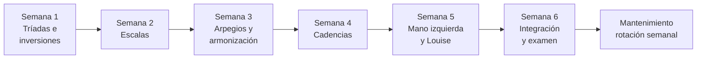
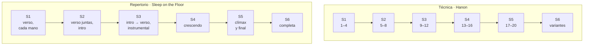

# Programa de piano · 30 sesiones

> [!abstract] Qué es
> Seis semanas, cinco sesiones de **40 minutos**, tres carriles en paralelo:
> - **Teclado**: las 12 tríadas, inversiones, escalas, arpegios, armonización, cadencias y patrones de mano izquierda.
> - **Técnica**: Hanon 1–20 ([[Hanon - Ejercicios 1-30.pdf|partitura]]).
> - **Repertorio**: *Sleep on the Floor*, de The Lumineers ([[The Lumineers - Sleep on the Floor.pdf|partitura]]), y al final tu *Louise*.
>
> **Punto de partida:** las escalas de C, D, E y F ya salen a dos manos, de arriba abajo, como un
> Hanon. El programa no las vuelve a enseñar: el día 1 las mide, y desde ahí sirven de ancla (G y A
> usan su misma digitación) y de estiramiento (más tempo). Sus tríadas, arpegios y cadencias se
> estudian como las de las demás.
>
> La teoría y los ejercicios están en [[Cheat sheet - acordes mayores]]. Aquí está **qué toca cada día y cómo vas**.

## El plan en una página

| Semana | Tema | Teclado: al terminar la semana… | Hanon | Sleep on the Floor | Se graba |
|:-:|---|---|:-:|---|---|
| **1** | Tríadas e inversiones | las 12 tríadas en tres posiciones, cada mano; la cadena del círculo sin tabla | 1–4 | verso (cc. 18–39), cada mano | la cadena y la MI del verso |
| **2** | Escalas | las 8 que faltaban; las 12 a dos manos por el círculo | 5–8 | verso a dos manos · intro, manos separadas | las 12 escalas y el verso |
| **3** | Arpegios y armonización | arpegios de las 12 en dos octavas; ocho tonalidades armonizadas | 9–12 | intro a dos manos, intro → verso, instrumental | tres armonizadas al azar y cc. 1–47 |
| **4** | Cadencias | I – IV⁶₄ – V⁶ – I en las 12, y la variante con V⁶₅ | 13–16 | crescendo (cc. 48–59) | las 12 cadencias y cc. 40–59 |
| **5** | Mano izquierda y Louise | los ocho patrones de MI; *Louise* en el piano con voicings tuyos | 17–20 | clímax y final (cc. 60–76) | *Louise* y cc. 40–76 |
| **6** | Integración | rotación de las 12, examen en frío, toma final | variantes de 1–20 | completa, al 80 % del tempo | la toma final |





## Una sesión

| Bloque | Min | Qué |
|---|---:|---|
| **Hanon** | 6 | el ejercicio nuevo (MD, MI y juntas) y dos de la rotación |
| **Recuperación** | 3 | lo del día anterior, sin mirar la hoja |
| **Principal** | 14 | lo nuevo del día, con metrónomo |
| **Aplicación** | 4 | usarlo en algo musical: transportar, al azar, *Louise* |
| **Sleep on the Floor** | 11 | los compases del día |
| **Registro** | 2 | BPM alcanzados y qué falló |

### Qué la hace más exigente

- **Lo que ya sabes no se estudia, se mide** y se estira: las escalas de C, D, E y F solo suben de tempo, y la semana de escalas enseña únicamente las ocho que faltan.
- **Manos juntas desde la primera semana de cada tema**, no al final del programa.
- **Las 12 tonalidades en todo**: escalas, arpegios y cadencias a dos manos, no solo cuatro o cinco.
- **Cada *hecho cuando* es sin mirar la tabla**, y algunos al azar: si solo sale en el orden en que lo estudiaste, todavía no salió.
- **Hanon nuevo cada sesión**, de manos separadas a juntas en el mismo bloque.

### Qué hace que salga bien

- **La regla del metrónomo** ([[Cheat sheet - acordes mayores#El metrónomo|§12]]): 3 limpias, +4 bpm; 3 fallos, −8. Nunca se sube por calendario.
- **Si no llegas al *hecho cuando*, la sesión se repite** al día siguiente y las demás se corren.
- **Si vas tarde, recorta en este orden:** Aplicación → Recuperación. El Hanon calienta y el Registro es la evidencia: esos no se recortan.
- **La semana 6 es colchón:** rotación y examen. Lo que no se consolidó antes se recupera ahí, no a costa de una sesión nueva.
- **Si algo duele, para.** Se anota en *Dolor o tensión* y se baja el tempo al día siguiente.

## Cómo se usa

1. **Antes:** abre la nota del día (calendario de abajo) y lee solo esa.
2. **Durante:** marca las casillas. El metrónomo empieza donde lo dejaste en la sesión anterior.
3. **Al terminar:** llena las propiedades de la nota (`hecho`, `fecha`, BPM, `audio`). La tabla de
   progreso se actualiza sola.
4. **Cuando logres algo:** marca el hito y anótalo en las tablas de seguimiento.
5. **El último día de cada semana:** graba y llena el registro semanal.

## Progreso de las sesiones

```base
filters:
  and:
    - file.inFolder("4. Instrumento/1. Piano/1. Programa de 30 sesiones")
    - 'tipo == "ejercicio"'
views:
  - type: table
    name: Todas
    order:
      - file.name
      - semana
      - hecho
      - fecha
      - teclado_bpm
      - hanon
      - hanon_bpm
      - sotf
      - sotf_bpm
      - audio
    sort:
      - property: dia
        direction: ASC
  - type: table
    name: Pendientes
    filters:
      and:
        - 'hecho != true'
    order:
      - file.name
      - semana
      - hecho
      - fecha
      - teclado_bpm
      - hanon
      - hanon_bpm
      - sotf
      - sotf_bpm
      - audio
    sort:
      - property: dia
        direction: ASC
  - type: table
    name: Hechas
    filters:
      and:
        - 'hecho == true'
    order:
      - file.name
      - semana
      - hecho
      - fecha
      - teclado_bpm
      - hanon
      - hanon_bpm
      - sotf
      - sotf_bpm
      - audio
    sort:
      - property: dia
        direction: ASC
```

## Calendario

🎙 = ese día se graba.

| Semana | Día | Sesión | Teclado | Hanon | Sleep on the Floor |
|:-:|:-:|---|---|:-:|---|
| 1 | 1 | [[01. Día 1 - Punto de partida y grupos 1 y 2\|Día 1]] | Escalas C, D, E, F (se miden) · tríadas de los grupos 1 y 2 · inversiones con la MD | 1 | mapa · cc. 18–23 · MI |
| 1 | 2 | [[02. Día 2 - Grupo 3 y los espejos\|Día 2]] | Grupo 3 (D♭, E♭, A♭) · espejos · inversiones con la MD | 2 | cc. 18–33 · MI |
| 1 | 3 | [[03. Día 3 - Grupo 4 y el círculo\|Día 3]] | Grupo 4 (F♯, B♭, B) · las 12 por el círculo | 3 | cc. 18–39 · MI |
| 1 | 4 | [[04. Día 4 - Inversiones con la MI\|Día 4]] | Inversiones con la MI · las 12 | 4 | cc. 21–25 · MD |
| 1 | 5 | [[05. Día 5 - La inversión más cercana\|Día 5]] 🎙 | La cadena del círculo (§8.2) | 1–4 | cc. 26–39 · MD |
| 2 | 6 | [[06. Día 6 - Escalas G A y B\|Día 6]] | Escalas G, A y B · C, D, E más rápido | 5 | cc. 18–29 · juntas |
| 2 | 7 | [[07. Día 7 - Escalas Bb y Eb\|Día 7]] | Escalas B♭ y E♭ · la regla del 4 en Si♭ | 6 | cc. 30–39 · juntas |
| 2 | 8 | [[08. Día 8 - Escalas Ab y Db\|Día 8]] | Escalas A♭ y D♭ · B♭ y E♭ a dos manos | 7 | cc. 1–17 · lectura · MI 1–9 |
| 2 | 9 | [[09. Día 9 - Escala Gb y bemoles a dos manos\|Día 9]] | Escala F♯/G♭ · A♭ y D♭ a dos manos | 8 | cc. 1–9 · juntas |
| 2 | 10 | [[10. Día 10 - Las 12 escalas por el círculo\|Día 10]] 🎙 | Las 12 escalas a dos manos, por el círculo | 5–8 | cc. 10–17 · verso juntas |
| 3 | 11 | [[11. Día 11 - Arpegios, grupos 1 y 2\|Día 11]] | Arpegios C, F, G · D, E, A, B | 9 | cc. 1–17 · intro juntas |
| 3 | 12 | [[12. Día 12 - Arpegios, grupos 3 y 4\|Día 12]] | Arpegios D♭, E♭, A♭ · B♭ · F♯ | 10 | cc. 1–39 · intro y verso |
| 3 | 13 | [[13. Día 13 - Armonizar en C D F y G\|Día 13]] | Armonizar la escala en C, D, F y G | 11 | cc. 40–47 · separadas |
| 3 | 14 | [[14. Día 14 - Armonizar en A E Bb y Eb\|Día 14]] | Armonizar la escala en A, E, B♭ y E♭ | 12 | cc. 40–51 |
| 3 | 15 | [[15. Día 15 - Armonizar al azar\|Día 15]] 🎙 | Armonizar al azar · B, F♯, D♭, A♭ | 9–12 | cc. 1–47 |
| 4 | 16 | [[16. Día 16 - Cadencia en C G D A E\|Día 16]] | I – IV⁶₄ – V⁶ – I en C, G, D, A y E | 13 | cc. 48–55 · MI |
| 4 | 17 | [[17. Día 17 - Cadencia en F Bb Eb Ab\|Día 17]] | Cadencia en F, B♭, E♭ y A♭ | 14 | cc. 48–55 · MD |
| 4 | 18 | [[18. Día 18 - Cadencia en B Gb Db y las 12\|Día 18]] | Cadencia en B, F♯ y D♭ · las 12 por el círculo | 15 | cc. 56–59 · 48–51 juntas |
| 4 | 19 | [[19. Día 19 - La cadencia con V7\|Día 19]] | La variante con V⁶₅ en ocho tonalidades | 16 | cc. 52–59 · juntas |
| 4 | 20 | [[20. Día 20 - Las 12 cadencias\|Día 20]] 🎙 | Las 12 cadencias por el círculo, sin tabla | 13–16 | cc. 40–59 · juntas |
| 5 | 21 | [[21. Día 21 - Patrones de MI, los abiertos\|Día 21]] | Raíz, quinta, octava, 1-5-8 y 1-5-10 | 17 | cc. 60–67 · MD |
| 5 | 22 | [[22. Día 22 - Patrones de MI, los que se mueven\|Día 22]] | Alberti, vals y arpegio largo | 18 | cc. 60–67 · MI |
| 5 | 23 | [[23. Día 23 - Patrones transportados\|Día 23]] | Tres patrones en F, B♭, E♭ y A | 19 | cc. 60–63 · juntas |
| 5 | 24 | [[24. Día 24 - Louise en el piano\|Día 24]] | Los acordes de Louise: intro y coro | 20 | cc. 64–76 |
| 5 | 25 | [[25. Día 25 - Louise, qué nota va arriba\|Día 25]] 🎙 | Louise: decidir la nota de arriba | 17–20 | cc. 40–76 |
| 6 | 26 | [[26. Día 26 - Rotación, lado de sostenidos\|Día 26]] | G, D, A, E, B, F♯ completas | 1–5 · puntillo | cc. 1–39 · tempo |
| 6 | 27 | [[27. Día 27 - Rotación, lado de bemoles\|Día 27]] | F, B♭, E♭, A♭, D♭ y C completas | 6–10 · staccato | cc. 40–76 · tempo |
| 6 | 28 | [[28. Día 28 - Examen de teclado\|Día 28]] | Examen en frío: seis tonalidades al azar | 11–15 · dinámica | completa |
| 6 | 29 | [[29. Día 29 - Ensayo general\|Día 29]] | Los ✗ del examen · la cadena en vals | 1 en G y F · 16–20 | completa · compases débiles |
| 6 | 30 | [[30. Día 30 - La toma final\|Día 30]] 🎙 | Toma: las 12 escalas y las 12 cadencias | tres al azar | completa |

> [!info] Si se pierde un día
> La sesión pasa al siguiente día libre y las demás se corren. No se recupera con un maratón.
> Si una sesión no llega a su *hecho cuando*, se repite antes de pasar a la siguiente.

## Hitos

Los hitos son la respuesta a "¿estoy avanzando?". Márcalos cuando ocurran, no cuando acabe la semana.

### Semana 1 · Tríadas e inversiones
- [ ] Las escalas de C, D, E y F medidas: BPM de partida anotados en la columna *Escala MJ*.
- [ ] Las 12 tríadas en las tres posiciones, cada mano, **sin mirar**, a 60.
- [ ] La cadena del círculo (§8.2) sin tabla, de ida y de vuelta. 🎙
- [ ] Hanon 1–4 seguidos a 60.
- [ ] La MI del verso de *Sleep on the Floor* (cc. 18–39) sin parar a 48. 🎙

### Semana 2 · Escalas
- [ ] Las 12 escalas a dos manos, una octava, negras a 60. 🎙
- [ ] C, D y E a dos octavas, a dos manos, en corcheas, 8 bpm arriba de tu punto de partida.
- [ ] Hanon 1–8.
- [ ] El verso a dos manos (cc. 18–39) a 48. 🎙

### Semana 3 · Arpegios y armonización
- [ ] Los arpegios de las 12 en dos octavas, cada mano.
- [ ] Ocho tonalidades armonizadas a dos manos; tres sacadas al azar. 🎙
- [ ] Hanon 1–12.
- [ ] *Sleep on the Floor* de la intro al instrumental (cc. 1–47) sin parar. 🎙

### Semana 4 · Cadencias
- [ ] La cadencia I – IV⁶₄ – V⁶ – I en las 12, por el círculo, sin tabla. 🎙
- [ ] La variante con V⁶₅ en ocho tonalidades.
- [ ] Hanon 1–16.
- [ ] El crescendo a dos manos, enlazado desde el instrumental (cc. 40–59). 🎙

### Semana 5 · Mano izquierda y Louise
- [ ] Los ocho patrones de MI sobre la cadencia de C; tres de ellos en cuatro tonalidades.
- [ ] *Louise* (intro y coro) en el piano, con voicings decididos por ti. 🎙
- [ ] Hanon 1–20.
- [ ] Clímax y final a dos manos; cc. 40–76 sin parar. 🎙

### Semana 6 · Integración
- [ ] La tabla de seguimiento de teclado llena en las 12 tonalidades.
- [ ] Las 12 escalas a dos manos, dos octavas, en corcheas a 72.
- [ ] Hanon 1–5 a 88 con las variantes de §10; 6–20 a 72 o más en rotación.
- [ ] *Sleep on the Floor* completa, sin parar, al 80 % del tempo o más. 🎙

## Seguimiento por carril

Pon ✓ cuando salga limpio (dedos correctos, sin parar, sin tensión) y escribe el BPM.

### Teclado · las 12 tonalidades

MS = manos separadas · MJ = manos juntas. **C, D, E y F** (marcadas ★): sus escalas ya salen a dos
manos, de arriba abajo. El día 1 escribes a qué BPM en *Escala MJ*; las demás columnas se llenan como
en cualquier otra tonalidad.

| Tonalidad | Tríada (sin mirar) | Inversiones | Escala MS | Escala MJ | Arpegio | Armonizada | Cadencia | V⁶₅ |
|---|:-:|:-:|:-:|:-:|:-:|:-:|:-:|:-:|
| **C** ★ | | | | | | | | |
| **G** | | | | | | | | |
| **D** ★ | | | | | | | | |
| **A** | | | | | | | | |
| **E** ★ | | | | | | | | |
| **B** | | | | | | | | |
| **F♯/G♭** | | | | | | | | |
| **D♭** | | | | | | | | |
| **A♭** | | | | | | | | |
| **E♭** | | | | | | | | |
| **B♭** | | | | | | | | |
| **F** ★ | | | | | | | | |

### Técnica · Hanon

| Nº | Empecé | Manos separadas | Manos juntas | BPM actual | Meta |
|:-:|---|:-:|:-:|:-:|:-:|
| 1 | | | | | 108 |
| 2 | | | | | 108 |
| 3 | | | | | 108 |
| 4 | | | | | 108 |
| 5 | | | | | 108 |
| 6 | | | | | 108 |
| 7 | | | | | 108 |
| 8 | | | | | 108 |
| 9 | | | | | 108 |
| 10 | | | | | 108 |
| 11 | | | | | 108 |
| 12 | | | | | 108 |
| 13 | | | | | 108 |
| 14 | | | | | 108 |
| 15 | | | | | 108 |
| 16 | | | | | 108 |
| 17 | | | | | 108 |
| 18 | | | | | 108 |
| 19 | | | | | 108 |
| 20 | | | | | 108 |
| 21 | | | | | 108 |
| 22 | | | | | 108 |
| 23 | | | | | 108 |
| 24 | | | | | 108 |
| 25 | | | | | 108 |
| 26 | | | | | 108 |
| 27 | | | | | 108 |
| 28 | | | | | 108 |
| 29 | | | | | 108 |
| 30 | | | | | 108 |

### Repertorio · Sleep on the Floor

La meta del programa es el **80 % del tempo real**; el tempo real queda para el mantenimiento.

| Sección | Compases | Semana | MI | MD | Manos juntas | BPM actual | Meta del programa | Tempo real |
|---|---|:-:|:-:|:-:|:-:|:-:|:-:|:-:|
| **Intro** | 1–17 | 2–3 | | | | | 50 | 63 |
| **Verso** | 18–39 | 1–2 | | | | | 56 | 71 |
| **Instrumental** | 40–47 | 3 | | | | | 56 | 71 |
| **Crescendo** | 48–59 | 4 | | | | | 56 | 71 |
| **Clímax** | 60–67 | 5 | | | | | 56 | 71 |
| **Final** | 68–76 | 5 | | | | | 56 | 71 |

## Registro semanal

| Semana | Fechas | Sesiones | BPM tríadas | BPM escalas | Hanon (último nº · BPM) | Sleep on the Floor (compases · BPM) | Audio |
|---|---|---:|---:|---:|---|---|---|
| 1 · Tríadas e inversiones | | /5 | | — | | | |
| 2 · Escalas | | /5 | | | | | |
| 3 · Arpegios y armonización | | /5 | | | | | |
| 4 · Cadencias | | /5 | | | | | |
| 5 · Mano izquierda y Louise | | /5 | | | | | |
| 6 · Integración | | /5 | | | | | |

## Después de las 30 sesiones · mantenimiento

Después del plan, **20 minutos al día** mantienen todo vivo y siguen sumando: **un Hanon nuevo por
semana** (21, 22… hasta 30), la pieza entera cada viernes y, con la misma regla del metrónomo,
*Sleep on the Floor* del 80 % al tempo real. Lo que salió ✗ en el examen del día 28 va primero.

| Día | Tríadas e inversiones | Escalas y arpegios | Cadencia (con V⁶₅) | Hanon | Sleep on the Floor |
|---|---|---|---|---|---|
| Lunes | grupo 1 (C F G) | C, F, G | C | 1–5 | verso |
| Martes | grupo 2 (D E A) | D, E, A, B | D | 6–10 | intro |
| Miércoles | grupo 3 (D♭ E♭ A♭) | D♭, E♭, A♭ | E♭ | 11–15 | cc. 40–59 |
| Jueves | grupo 4 (F♯ B♭ B) | F♯, B♭ | B♭ | 16–20 | clímax, cc. 60–67 |
| Viernes | el círculo (§8.2) | dos al azar | las 12 | el nuevo de la semana | completa, y se graba |
