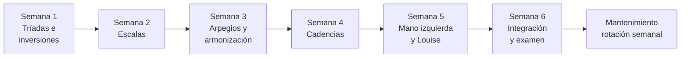
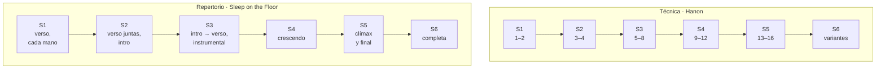

# Programa de piano · 30 sesiones

> [!abstract] Qué es
> Seis semanas, cinco sesiones de **40 minutos**, tres carriles en paralelo:
> - **Teclado**: las 12 tríadas, inversiones, escalas, arpegios, armonización, cadencias y patrones de mano izquierda.
> - **Técnica**: Hanon 1–16 ([[Hanon - Ejercicios 1-30.pdf|partitura]]); del 17 en adelante, en el mantenimiento.
> - **Repertorio**: *Sleep on the Floor*, de The Lumineers ([[The Lumineers - Sleep on the Floor.pdf|partitura]]), y al final tu *Louise*.
>
> **Punto de partida:** las escalas de C, D, E y F ya salen a dos manos, de arriba abajo, como un
> Hanon. El programa no las vuelve a enseñar: el día 3 las mide, y desde ahí sirven de ancla (G y A
> usan su misma digitación) y de estiramiento (más tempo). Sus tríadas, arpegios y cadencias se
> estudian como las de las demás.
>
> La teoría y los ejercicios están en [[Cheat sheet - acordes mayores]]. Aquí está **qué toca cada día y cómo vas**.

## El plan en una página

| Semana | Tema | Teclado: al terminar la semana… | Hanon | Sleep on the Floor | Se graba |
|:-:|---|---|:-:|---|---|
| **1** | Tríadas e inversiones | las 12 tríadas en tres posiciones con la MD y en fundamental a dos manos; la MI en tres posiciones en seis; la cadena del círculo, de ida | 1–2 | verso (cc. 18–39), MI | la cadena y la MI del verso |
| **2** | Escalas | las 8 que faltaban; las 12 a dos manos por el círculo; la cadena sin tabla | 3–4 | verso a dos manos · intro, manos separadas | las 12 escalas y el verso |
| **3** | Arpegios y armonización | arpegios de las 12 en dos octavas; ocho tonalidades armonizadas | 5–8 | intro a dos manos, intro → verso, instrumental | tres armonizadas al azar y cc. 1–47 |
| **4** | Cadencias | I – IV⁶₄ – V⁶ – I en las 12, y la variante con V⁶₅ | 9–12 | crescendo (cc. 48–59) | las 12 cadencias y cc. 40–59 |
| **5** | Mano izquierda y Louise | los ocho patrones de MI; *Louise* en el piano con voicings tuyos | 13–16 | clímax y final (cc. 60–76) | *Louise* y cc. 40–76 |
| **6** | Integración | rotación de las 12 (con la MI de los grupos 3 y 4), examen en frío, toma final | variantes de 1–16 | completa, al 80 % del tempo | la toma final |





## La rampa · cómo arranca

> [!warning] Por qué el reparto cambió el día 2
> El día 1 tomó **tres sentadas** en vez de una. Traía cinco cosas nuevas a la vez (leer Hanon, seis
> tríadas por mano, sus inversiones, la prueba sin mirar y el mapa de la pieza) y pedía el *hecho
> cuando* ese mismo día, así que la sesión no terminaba hasta que salía. Desde el día 2 el programa
> arranca a media carga y llega al ritmo completo en la semana 3. **Los temas de cada semana no
> cambian; cambia cuánto entra en cada sesión.**

> [!warning] Y por qué cada día se parte en dos
> El día 2 (2 nov) tampoco cupo en una sentada: alcanzaron el Hanon y la Recuperación, y en frío
> salieron solo las fundamentales. En las semanas 1 y 2 cada día se toca en **dos sentadas, una por
> parte**, normalmente en dos días: primero la pieza (Hanon, Recuperación y Sleep on the Floor),
> luego el teclado (Hanon, Principal y Aplicación). La Recuperación va en la primera porque es la
> comprobación en frío de lo del día anterior, y así las dos sentadas quedan parejas, de unos 20
> minutos. El Hanon va en las dos: es el calentamiento, y tocarlo a diario es lo que lo sube. Lo
> que trae cada día no cambia; cambia que cada sentada se concentra en una sola parte.
> Así esas dos semanas ocupan unas cuatro de calendario. Desde la semana 3, un día vuelve a ser una
> sentada.

> [!warning] Y por qué el día 3 se aligeró (3 nov)
> El día 2 alcanzó para el Hanon, la Recuperación (en frío salieron solo las fundamentales), D♭, E♭ y
> A♭ en bloque y quebrada, y las inversiones de D♭. No llegaron E♭ y A♭ invertidos, los espejos ni
> Sleep on the Floor. Las grabaciones dicen por qué: las inversiones salen, pero la mano tarda un
> minuto y medio en entrar y a los dos minutos se cansa. Así que el día 3 dejó de traer tres cosas
> nuevas: termina lo que faltó del día 2 y trae **una sola**, el grupo 4 en bloque y quebrada. Lo que
> salió está en *Lo que se movió*.
>
> **Sleep on the Floor todavía no empieza** (4 nov). Arranca en el día 3 con lo que traía el día 1, y la
> pieza va **dos sesiones atrás**: el 3 toca lo del 1, el 4 lo del 2 y el 5 lo del 3. En la semana 1 la
> pieza es solo la MI del verso; la MD pasa a la semana 2.

| Semana | Carga | Sentadas por día | Qué trae de nuevo una sesión | Hanon |
|:-:|:-:|:-:|---|---|
| **1** | media | dos: pieza y teclado | **una sola cosa**; lo demás repite lo que ya sale | el 1, y el 2 desde el día 4 |
| **2** | tres cuartos | dos: pieza y teclado | lo del teclado; el primer día de la semana, nada más | uno nuevo cada dos sesiones: el 3 y el 4 |
| **3–5** | completa | una | lo del día en los tres carriles, como estaba | uno nuevo por sesión, del 5 al 16 |
| **6** | colchón | una | nada: rotación, examen y lo que quedó pendiente | variantes de 1–16 |

### Las dos primeras semanas, día por día

| Día | Lo nuevo | Lo que repite |
|:-:|---|---|
| 1 | todo: era el arranque | nada |
| 2 | el grupo 3, por espejo del grupo 2 | Hanon 1 · la MI del verso donde iba |
| 3 | el grupo 4, en bloque y quebrada · empieza Sleep on the Floor (mapa y cc. 18–23, MI) | Hanon 1 · E♭ y A♭ en tres posiciones (del día 2) · las escalas que ya tienes, medidas |
| 4 | el Hanon 2 · el 5-2-1 de la MI, en seis acordes | el grupo 3 en frío · el círculo, leyendo · la MI del verso, hasta el c. 33 |
| 5 🎙 | nada: la cadena junta lo que ya tienes | Hanon 1 y 2 · la MI del verso entera, grabada |
| 6 | G, A y B (G y A con la digitación de C, D y E) | Hanon 1 y 2 · la cadena, ya sin tabla |
| 7 | B♭ y E♭ · el Hanon 3 | G, A y B |
| 8 | A♭ y D♭ · leer la intro | el Hanon 3 |
| 9 | F♯ · el Hanon 4 | A♭ y D♭, ahora a dos manos |
| 10 🎙 | nada: las 12 y la grabación | Hanon 1–4 |

### Lo que se movió

Nada se quitó del programa sin decir a dónde fue.

| Qué | Estaba en | Ahora |
|---|---|---|
| Medir las escalas de C, D, E y F | día 1 (no alcanzó el tiempo) | día 3, Aplicación |
| Los nueve en fundamental, MD y MI | día 2 | fuera: el círculo del día 3 los toca todos |
| Las 12 al azar con los ojos cerrados | día 3 | fuera: el círculo sin mirar del día 4 lo cubre |
| La MI en tres posiciones, grupos 3 y 4 | día 4 | semana 6, en la rotación (días 26 y 27) |
| La MI fija con F y E♭ | día 4 | fuera: C, D y E bastan para la idea |
| La cadena del círculo sin tabla | día 5 | día 6, Recuperación |
| La cadena al revés | día 5 | día 29, Aplicación |
| G, A y B seguidas | día 6 | fuera: B se queda con esos minutos |
| Hanon 17–20 | semana 5 | mantenimiento, uno por semana |
| E♭ y A♭ en tres posiciones | día 2 (no alcanzó) | día 3 |
| Sleep on the Floor desde el principio: mapa, preparatorio 1 y la MI del verso | días 1 a 3 (todavía no se toca) | días 3 a 5: la pieza va dos sesiones atrás |
| El preparatorio 2 y la MD del verso (cc. 21–39) | días 4 y 5 | semana 2, sin repartir todavía (abajo) |
| Los espejos (D → D♭, E → E♭, A → A♭) | día 2, Aplicación (no alcanzó) | fuera: E♭ y A♭ se trabajan directo en el día 3 |
| Las inversiones del grupo 4 con la MD | día 3 | semana 6, en la rotación (días 26 y 27); hasta entonces, la cadena del día 5 las lee de la tabla |
| Las 12 por el círculo, leyendo | día 3 | día 4, Recuperación |
| El círculo sin partitura | día 4, Recuperación | fuera: la cadena sin tabla del día 6 lo cubre |
| El verso entero sin parar, a 44 | día 3 | día 5, en la toma, a 40 |
| Subir el Hanon a cuatro notas por click | día 3 | cuando la MI suene en la bajada |

> [!todo] La pieza en la semana 2, sin repartir
> Las notas de los días 6 a 10 todavía asumen que la MD del verso salió en los días 4 y 5: el día 6
> pide el verso a dos manos. Con la pieza dos sesiones atrás, eso no cuadra. Se reparte antes del día 6,
> cuando se vea cómo salen los días 3 a 5.

## Una sesión

| Bloque | Min | Qué |
|---|---:|---|
| **Hanon** | 6 | primero los que ya salen, para calentar; después el nuevo, si hoy toca (MD, MI y juntas) |
| **Recuperación** | 3 | lo del día anterior, sin mirar la hoja: es la comprobación en frío de su *hecho cuando* |
| **Principal** | 14 | lo nuevo del día, con metrónomo |
| **Aplicación** | 4 | usarlo en algo musical: transportar, al azar, *Louise* |
| **Sleep on the Floor** | 11 | los compases del día |
| **Registro** | 2 | BPM alcanzados y qué falló |

### Qué la hace más exigente

- **Lo que ya sabes no se estudia, se mide** y se estira: las escalas de C, D, E y F solo suben de tempo, y la semana de escalas enseña únicamente las ocho que faltan.
- **Manos juntas desde la primera semana de cada tema**, no al final del programa.
- **Las 12 tonalidades en todo**: escalas, arpegios y cadencias a dos manos, no solo cuatro o cinco.
- **Cada *hecho cuando* es sin mirar la tabla**, y algunos al azar: si solo sale en el orden en que lo estudiaste, todavía no salió.
- **Hanon nuevo cada sesión desde la semana 3**, de manos separadas a juntas en el mismo bloque. Antes, uno cada dos o tres sesiones (ver *La rampa*).

### Qué hace que salga bien

- **La regla del metrónomo** ([[Cheat sheet - acordes mayores#El metrónomo|§12]]): 3 limpias, +4 bpm; 3 fallos, −8. Nunca se sube por calendario.
- **Una sesión es una sentada de 40 minutos**; en las semanas 1 y 2, dos sentadas, una por parte (ver *La rampa*). Temporizador por bloque: cuando se acaba, pasas al siguiente aunque no haya salido. Lo que quedó se anota en el Registro; no se termina en otra sentada.
- **El *hecho cuando* se comprueba en frío**, en la Recuperación de la sesión siguiente: es la regla de la bóveda de evaluar después de descansar. El mismo día solo se trabaja. Si en frío no sale, esa sesión usa su Aplicación para eso; si falla dos sesiones seguidas, se repite el día.
- **Si vas tarde, recorta en este orden:** Aplicación → la última tarea del Principal. El Hanon calienta, la Recuperación es la comprobación y el Registro es la evidencia: esos no se recortan.
- **Después de una pausa** de más de tres días no se repite la sesión anterior ni se recupera lo perdido: se toca la que sigue, y su Recuperación hace de re-entrada.
- **La semana 6 es colchón:** rotación y examen. Lo que no se consolidó antes se recupera ahí, no a costa de una sesión nueva. Ahí llegan también la MI de los grupos 3 y 4 y la cadena al revés.
- **Si algo duele, para.** Se anota en *Dolor o tensión* y se baja el tempo al día siguiente.

## Cómo se usa

1. **Antes:** abre la nota del día (calendario de abajo) y lee solo esa. Pon un temporizador de 40 minutos; en las semanas 1 y 2, uno por sentada.
2. **Durante:** marca las casillas. El metrónomo empieza donde lo dejaste en la sesión anterior.
3. **Al terminar:** llena las propiedades de la nota (`hecho`, `fecha`, BPM, `audio`). La tabla de
   progreso se actualiza sola.
4. **Cuando logres algo:** marca el hito y anótalo en las tablas de seguimiento.
5. **El último día de cada semana:** graba y llena el registro semanal.

## Progreso de las sesiones

```base
filters:
  and:
    - file.inFolder("4. Instrumento/1. Piano/1. Programa de 30 sesiones")
    - 'tipo == "ejercicio"'
views:
  - type: table
    name: Todas
    order:
      - file.name
      - semana
      - hecho
      - fecha
      - teclado_bpm
      - hanon
      - hanon_bpm
      - sotf
      - sotf_bpm
      - audio
    sort:
      - property: dia
        direction: ASC
  - type: table
    name: Pendientes
    filters:
      and:
        - 'hecho != true'
    order:
      - file.name
      - semana
      - hecho
      - fecha
      - teclado_bpm
      - hanon
      - hanon_bpm
      - sotf
      - sotf_bpm
      - audio
    sort:
      - property: dia
        direction: ASC
  - type: table
    name: Hechas
    filters:
      and:
        - 'hecho == true'
    order:
      - file.name
      - semana
      - hecho
      - fecha
      - teclado_bpm
      - hanon
      - hanon_bpm
      - sotf
      - sotf_bpm
      - audio
    sort:
      - property: dia
        direction: ASC
```

## Calendario

🎙 = ese día se graba.

| Semana | Día | Sesión | Teclado | Hanon | Sleep on the Floor |
|:-:|:-:|---|---|:-:|---|
| 1 | 1 | [[01. Día 1 - Punto de partida y grupos 1 y 2\|Día 1]] | Escalas C, D, E, F (se miden) · tríadas de los grupos 1 y 2 · inversiones con la MD | 1 | mapa · cc. 18–23 · MI |
| 1 | 2 | [[02. Día 2 - Grupo 3 y los espejos\|Día 2]] | Grupo 3 (D♭, E♭, A♭) por espejo · inversiones con la MD | 1 | cc. 18–33 · MI |
| 1 | 3 | [[03. Día 3 - Grupo 3 entero y grupo 4\|Día 3]] | E♭ y A♭ en tres posiciones · grupo 4 (F♯, B♭, B) en bloque y quebrada · se miden C, D, E y F | 1 | empieza: mapa · cc. 18–23 · MI |
| 1 | 4 | [[04. Día 4 - Inversiones con la MI\|Día 4]] | Inversiones con la MI · grupos 1 y 2 | 2 | cc. 18–33 · MI |
| 1 | 5 | [[05. Día 5 - La inversión más cercana\|Día 5]] 🎙 | La cadena del círculo (§8.2), de ida | 1–2 | cc. 34–39 · el verso con la MI, grabado |
| 2 | 6 | [[06. Día 6 - Escalas G A y B\|Día 6]] | Escalas G, A y B · C, D, E más rápido | 1–2 | cc. 18–29 · juntas |
| 2 | 7 | [[07. Día 7 - Escalas Bb y Eb\|Día 7]] | Escalas B♭ y E♭ · la regla del 4 en Si♭ | 3 | cc. 30–39 · juntas |
| 2 | 8 | [[08. Día 8 - Escalas Ab y Db\|Día 8]] | Escalas A♭ y D♭ · B♭ y E♭ a dos manos | 3 | cc. 1–17 · lectura · MI 1–9 |
| 2 | 9 | [[09. Día 9 - Escala Gb y bemoles a dos manos\|Día 9]] | Escala F♯/G♭ · A♭ y D♭ a dos manos | 4 | cc. 1–9 · juntas |
| 2 | 10 | [[10. Día 10 - Las 12 escalas por el círculo\|Día 10]] 🎙 | Las 12 escalas a dos manos, por el círculo | 1–4 | cc. 10–17 · verso juntas |
| 3 | 11 | [[11. Día 11 - Arpegios, grupos 1 y 2\|Día 11]] | Arpegios C, F, G · D, E, A, B | 5 | cc. 1–17 · intro juntas |
| 3 | 12 | [[12. Día 12 - Arpegios, grupos 3 y 4\|Día 12]] | Arpegios D♭, E♭, A♭ · B♭ · F♯ | 6 | cc. 1–39 · intro y verso |
| 3 | 13 | [[13. Día 13 - Armonizar en C D F y G\|Día 13]] | Armonizar la escala en C, D, F y G | 7 | cc. 40–47 · separadas |
| 3 | 14 | [[14. Día 14 - Armonizar en A E Bb y Eb\|Día 14]] | Armonizar la escala en A, E, B♭ y E♭ | 8 | cc. 40–51 |
| 3 | 15 | [[15. Día 15 - Armonizar al azar\|Día 15]] 🎙 | Armonizar al azar · B, F♯, D♭, A♭ | 5–8 | cc. 1–47 |
| 4 | 16 | [[16. Día 16 - Cadencia en C G D A E\|Día 16]] | I – IV⁶₄ – V⁶ – I en C, G, D, A y E | 9 | cc. 48–55 · MI |
| 4 | 17 | [[17. Día 17 - Cadencia en F Bb Eb Ab\|Día 17]] | Cadencia en F, B♭, E♭ y A♭ | 10 | cc. 48–55 · MD |
| 4 | 18 | [[18. Día 18 - Cadencia en B Gb Db y las 12\|Día 18]] | Cadencia en B, F♯ y D♭ · las 12 por el círculo | 11 | cc. 56–59 · 48–51 juntas |
| 4 | 19 | [[19. Día 19 - La cadencia con V7\|Día 19]] | La variante con V⁶₅ en ocho tonalidades | 12 | cc. 52–59 · juntas |
| 4 | 20 | [[20. Día 20 - Las 12 cadencias\|Día 20]] 🎙 | Las 12 cadencias por el círculo, sin tabla | 9–12 | cc. 40–59 · juntas |
| 5 | 21 | [[21. Día 21 - Patrones de MI, los abiertos\|Día 21]] | Raíz, quinta, octava, 1-5-8 y 1-5-10 | 13 | cc. 60–67 · MD |
| 5 | 22 | [[22. Día 22 - Patrones de MI, los que se mueven\|Día 22]] | Alberti, vals y arpegio largo | 14 | cc. 60–67 · MI |
| 5 | 23 | [[23. Día 23 - Patrones transportados\|Día 23]] | Tres patrones en F, B♭, E♭ y A | 15 | cc. 60–63 · juntas |
| 5 | 24 | [[24. Día 24 - Louise en el piano\|Día 24]] | Los acordes de Louise: intro y coro | 16 | cc. 64–76 |
| 5 | 25 | [[25. Día 25 - Louise, qué nota va arriba\|Día 25]] 🎙 | Louise: decidir la nota de arriba | 13–16 | cc. 40–76 |
| 6 | 26 | [[26. Día 26 - Rotación, lado de sostenidos\|Día 26]] | G, D, A, E, B, F♯ completas | 1–5 · puntillo | cc. 1–39 · tempo |
| 6 | 27 | [[27. Día 27 - Rotación, lado de bemoles\|Día 27]] | F, B♭, E♭, A♭, D♭ y C completas | 6–10 · staccato | cc. 40–76 · tempo |
| 6 | 28 | [[28. Día 28 - Examen de teclado\|Día 28]] | Examen en frío: seis tonalidades al azar | 11–15 · dinámica | completa |
| 6 | 29 | [[29. Día 29 - Ensayo general\|Día 29]] | Los ✗ del examen · la cadena al revés y en vals | 1 en G y F · 12 y 16 | completa · compases débiles |
| 6 | 30 | [[30. Día 30 - La toma final\|Día 30]] 🎙 | Toma: las 12 escalas y las 12 cadencias | tres al azar | completa |

> [!info] Si se pierde un día
> La sesión pasa al siguiente día libre y las demás se corren. No se recupera con un maratón.
> Después de una pausa larga (más de tres días), la Recuperación de esa sesión hace de re-entrada: no se repite la anterior.
> El *hecho cuando* se comprueba en frío en la sesión siguiente; si falla dos sesiones seguidas, se repite ese día.

## Hitos

Los hitos son la respuesta a "¿estoy avanzando?". Márcalos cuando ocurran, no cuando acabe la semana.

### Semana 1 · Tríadas e inversiones
- [ ] Las escalas de C, D, E y F medidas: BPM de partida anotados en la columna *Escala MJ*.
- [ ] Las 12 tríadas en las tres posiciones con la MD, **sin mirar**, a 60; en fundamental, a dos manos por el círculo.
- [ ] La MI en las tres posiciones en los grupos 1 y 2 (C F G D E A).
- [ ] La cadena del círculo (§8.2) de ida, sin parar, a 60; con la tabla si hace falta. 🎙
- [ ] Hanon 1 y 2 seguidos, a dos manos, a dos notas por click o más.
- [ ] La MI del verso de *Sleep on the Floor* (cc. 18–39) sin parar a 40. 🎙

### Semana 2 · Escalas
- [ ] Las 12 escalas a dos manos, una octava, negras a 60. 🎙
- [ ] C, D y E a dos octavas, a dos manos, en corcheas, 8 bpm arriba de tu punto de partida.
- [ ] La cadena del círculo de ida, sin tabla.
- [ ] Hanon 1–4.
- [ ] El verso a dos manos (cc. 18–39) a 48. 🎙

### Semana 3 · Arpegios y armonización
- [ ] Los arpegios de las 12 en dos octavas, cada mano.
- [ ] Ocho tonalidades armonizadas a dos manos; tres sacadas al azar. 🎙
- [ ] Hanon 1–8.
- [ ] *Sleep on the Floor* de la intro al instrumental (cc. 1–47) sin parar. 🎙

### Semana 4 · Cadencias
- [ ] La cadencia I – IV⁶₄ – V⁶ – I en las 12, por el círculo, sin tabla. 🎙
- [ ] La variante con V⁶₅ en ocho tonalidades.
- [ ] Hanon 1–12.
- [ ] El crescendo a dos manos, enlazado desde el instrumental (cc. 40–59). 🎙

### Semana 5 · Mano izquierda y Louise
- [ ] Los ocho patrones de MI sobre la cadencia de C; tres de ellos en cuatro tonalidades.
- [ ] *Louise* (intro y coro) en el piano, con voicings decididos por ti. 🎙
- [ ] Hanon 1–16.
- [ ] Clímax y final a dos manos; cc. 40–76 sin parar. 🎙

### Semana 6 · Integración
- [ ] La tabla de seguimiento de teclado llena en las 12 tonalidades.
- [ ] Las 12 escalas a dos manos, dos octavas, en corcheas a 72.
- [ ] La cadena del círculo de ida sin tabla, y de vuelta.
- [ ] Hanon 1–5 a 88 con las variantes de §10; 6–16 a 72 o más en rotación.
- [ ] *Sleep on the Floor* completa, sin parar, al 80 % del tempo o más. 🎙

## Seguimiento por carril

Pon ✓ cuando salga limpio (dedos correctos, sin parar, sin tensión) y escribe el BPM.

### Teclado · las 12 tonalidades

MS = manos separadas · MJ = manos juntas. **C, D, E y F** (marcadas ★): sus escalas ya salen a dos
manos, de arriba abajo. El día 3 escribes a qué BPM en *Escala MJ*; las demás columnas se llenan como
en cualquier otra tonalidad.

| Tonalidad | Tríada (sin mirar) | Inversiones | Escala MS | Escala MJ | Arpegio | Armonizada | Cadencia | V⁶₅ |
|---|:-:|:-:|:-:|:-:|:-:|:-:|:-:|:-:|
| **C** ★ | | | | | | | | |
| **G** | | | | | | | | |
| **D** ★ | | | | | | | | |
| **A** | | | | | | | | |
| **E** ★ | | | | | | | | |
| **B** | | | | | | | | |
| **F♯/G♭** | | | | | | | | |
| **D♭** | | | | | | | | |
| **A♭** | | | | | | | | |
| **E♭** | | | | | | | | |
| **B♭** | | | | | | | | |
| **F** ★ | | | | | | | | |

### Técnica · Hanon

| Nº | Empecé | Manos separadas | Manos juntas | BPM actual | Meta |
|:-:|---|:-:|:-:|:-:|:-:|
| 1 | 13 oct | | | 100, una nota por click (3 nov) | 108 |
| 2 | | | | | 108 |
| 3 | | | | | 108 |
| 4 | | | | | 108 |
| 5 | | | | | 108 |
| 6 | | | | | 108 |
| 7 | | | | | 108 |
| 8 | | | | | 108 |
| 9 | | | | | 108 |
| 10 | | | | | 108 |
| 11 | | | | | 108 |
| 12 | | | | | 108 |
| 13 | | | | | 108 |
| 14 | | | | | 108 |
| 15 | | | | | 108 |
| 16 | | | | | 108 |
| 17 | | | | | 108 |
| 18 | | | | | 108 |
| 19 | | | | | 108 |
| 20 | | | | | 108 |
| 21 | | | | | 108 |
| 22 | | | | | 108 |
| 23 | | | | | 108 |
| 24 | | | | | 108 |
| 25 | | | | | 108 |
| 26 | | | | | 108 |
| 27 | | | | | 108 |
| 28 | | | | | 108 |
| 29 | | | | | 108 |
| 30 | | | | | 108 |

### Repertorio · Sleep on the Floor

La meta del programa es el **80 % del tempo real**; el tempo real queda para el mantenimiento.

| Sección | Compases | Semana | MI | MD | Manos juntas | BPM actual | Meta del programa | Tempo real |
|---|---|:-:|:-:|:-:|:-:|:-:|:-:|:-:|
| **Intro** | 1–17 | 2–3 | | | | | 50 | 63 |
| **Verso** | 18–39 | 1–2 | | | | | 56 | 71 |
| **Instrumental** | 40–47 | 3 | | | | | 56 | 71 |
| **Crescendo** | 48–59 | 4 | | | | | 56 | 71 |
| **Clímax** | 60–67 | 5 | | | | | 56 | 71 |
| **Final** | 68–76 | 5 | | | | | 56 | 71 |

## Registro semanal

| Semana | Fechas | Sesiones | BPM tríadas | BPM escalas | Hanon (último nº · BPM) | Sleep on the Floor (compases · BPM) | Audio |
|---|---|---:|---:|---:|---|---|---|
| 1 · Tríadas e inversiones | | /5 | | — | | | |
| 2 · Escalas | | /5 | | | | | |
| 3 · Arpegios y armonización | | /5 | | | | | |
| 4 · Cadencias | | /5 | | | | | |
| 5 · Mano izquierda y Louise | | /5 | | | | | |
| 6 · Integración | | /5 | | | | | |

## Después de las 30 sesiones · mantenimiento

Después del plan, **20 minutos al día** mantienen todo vivo y siguen sumando: **un Hanon nuevo por
semana** (17, 18… hasta 30), la pieza entera cada viernes y, con la misma regla del metrónomo,
*Sleep on the Floor* del 80 % al tempo real. Lo que salió ✗ en el examen del día 28 va primero.

| Día | Tríadas e inversiones | Escalas y arpegios | Cadencia (con V⁶₅) | Hanon | Sleep on the Floor |
|---|---|---|---|---|---|
| Lunes | grupo 1 (C F G) | C, F, G | C | 1–5 | verso |
| Martes | grupo 2 (D E A) | D, E, A, B | D | 6–10 | intro |
| Miércoles | grupo 3 (D♭ E♭ A♭) | D♭, E♭, A♭ | E♭ | 11–15 | cc. 40–59 |
| Jueves | grupo 4 (F♯ B♭ B) | F♯, B♭ | B♭ | 16 y los nuevos | clímax, cc. 60–67 |
| Viernes | el círculo (§8.2) | dos al azar | las 12 | el nuevo de la semana | completa, y se graba |
