# Cheat sheet de piano: acordes mayores por mano y por dedo

> [!info] Para qué sirve
> 1. **Las 12 tríadas mayores** en sus tres posiciones, con la digitación de cada mano.
> 2. **Las 12 escalas y arpegios mayores**, con digitación, porque los acordes salen de ahí.
> 3. **Cómo se enlazan**: inversión más cercana, cadencias y patrones de mano izquierda.
> 4. **Hanon** (técnica de dedos) y **Sleep on the Floor** (repertorio), con ejercicios.
> 5. **Un plan de 30 sesiones** que lo junta todo, dividido por día: [[4. Instrumento/1. Piano/1. Programa de 30 sesiones/00. Plan y progreso|Plan y progreso]].
>
> Hermana de [[Cheat sheet - acordes por tonalidad]] (guitarra): la teoría es la misma y aquí
> está aplicada al teclado.
> Teoría relacionada: [[1. Tonalidades mayores]] · [[2. Armonización de tonalidades mayores]] ·
> [[00. Voicing e inversiones]] · [[09. Tonos guía]] ·
> [[0. Cadencias, progresiones y líneas melódicas]] · [[7. Familias tonales]]

## Índice

0. [[#0. Cómo leer esta hoja]]
1. [[#1. El acorde mayor en el teclado]]
2. [[#2. Las 12 de un vistazo, en cuatro grupos]]
3. [[#3. Digitación de las tríadas, la regla del hueco]]
4. [[#4. Las 12 fichas]]
5. [[#5. Escalas mayores, digitación de las 12]]
6. [[#6. Arpegios mayores]]
7. [[#7. Armonizar la escala]]
8. [[#8. Enlazar acordes, la inversión más cercana]]
9. [[#9. La mano izquierda, patrones de acompañamiento]]
10. [[#10. Hanon, técnica de dedos]]
11. [[#11. Repertorio, Sleep on the Floor]]
12. [[#12. Plan de 30 sesiones]]
13. [[#13. Errores comunes]]
14. [[#14. Decisión musical]]

---

## 0. Cómo leer esta hoja

### Los dedos

Las dos manos se numeran igual: **el pulgar es 1 y el meñique es 5**.

```
      Mano izquierda (MI)              Mano derecha (MD)
     5    4    3    2    1            1    2    3    4    5
  meñique anular medio índice pulgar  pulgar índice medio anular meñique
```

### Los recursos visuales

| Recurso | Qué muestra | Cómo se lee |
|---|---|---|
| **Teclado en tabla** | la mano sobre las teclas: tríadas, escala y arpegio en una sola vista | ⬜ = tecla blanca · ⬛ = tecla negra · el número bajo cada tecla es el dedo que la toca |
| **Diagrama de texto** | fórmulas y distancias en el teclado | se lee en columnas, como una regla |
| **Partitura abc** | lo mismo en pentagrama, para leerlo | `^` arriba = dedos MD · `_` abajo = dedos MI |
| **Strudel** | cómo suena | cópialo a strudel.cc si el plugin no está activo |
| **Mermaid** | reglas y decisiones como diagrama | se lee de arriba abajo o de izquierda a derecha |

Abreviaturas: **MD** mano derecha · **MI** mano izquierda · **fund.** posición fundamental ·
**1ª inv.** / **2ª inv.** primera / segunda inversión.

---

## 1. El acorde mayor en el teclado

Un acorde mayor son tres notas: **raíz**, **tercera mayor** (4 semitonos arriba) y **quinta
justa** (7 semitonos arriba). En el teclado, un semitono es la tecla de al lado, sea blanca o negra.

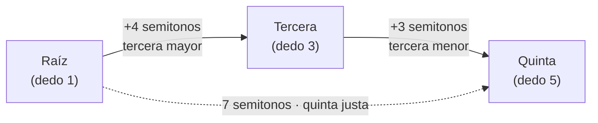

```
Tecla      C    C#   D    D#   E    F    F#   G
Color      ···  ###  ···  ###  ···  ···  ###  ···
Semitono   0    1    2    3    4    5    6    7
C mayor    R                   3              5
           |-------- 4 --------|----- 3 ------|
           |------- 7 = quinta justa ---------|
```

> [!tip] Mayor ↔ menor con un dedo
> Para pasar de un acorde mayor al menor, **baja el dedo 3 una tecla** (4 semitonos → 3).
> C – E – G se vuelve C – E♭ – G. Las 12 fichas de abajo sirven también para los menores.

**Las tres posiciones.** Las tres notas se pueden apilar en tres órdenes distintos. Las notas son
las mismas; cambia cuál queda abajo:

| Posición | Nota de abajo | Intervalos de abajo a arriba | Cómo suena |
|---|---|---|---|
| Fundamental | raíz | 3ª + 3ª | estable, "de libro" |
| 1ª inversión | tercera | 3ª + **4ª** | más ligera, pide moverse |
| 2ª inversión | quinta | **4ª** + 3ª | abierta, suspendida (en cadencias, de paso) |

```strudel
setcpm(60/4)
let tono = "C:major"   // ← cambia la tonalidad aquí
// fundamental → 1ª → 2ª → 1ª, un compás cada una
n("<[0,2,4] [2,4,7] [4,7,9] [2,4,7]>")
  .scale(tono)
  .s("piano")
```

---

## 2. Las 12 de un vistazo, en cuatro grupos

Los 12 acordes mayores se aprenden **por color de teclas**, no por orden alfabético. Cuatro dibujos
cubren los doce.

| Grupo | Acorde | Notas | Colores | MD | MI |
|---|---|---|:-:|:-:|:-:|
| Grupo 1 | **C** | C – E – G | ⬜⬜⬜ | 1-3-5 | 5-3-1 |
| Grupo 1 | **F** | F – A – C | ⬜⬜⬜ | 1-3-5 | 5-3-1 |
| Grupo 1 | **G** | G – B – D | ⬜⬜⬜ | 1-3-5 | 5-3-1 |
| Grupo 2 | **D** | D – F♯ – A | ⬜⬛⬜ | 1-3-5 | 5-3-1 |
| Grupo 2 | **E** | E – G♯ – B | ⬜⬛⬜ | 1-3-5 | 5-3-1 |
| Grupo 2 | **A** | A – C♯ – E | ⬜⬛⬜ | 1-3-5 | 5-3-1 |
| Grupo 3 | **D♭** | D♭ – F – A♭ | ⬛⬜⬛ | 1-3-5 | 5-3-1 |
| Grupo 3 | **E♭** | E♭ – G – B♭ | ⬛⬜⬛ | 1-3-5 | 5-3-1 |
| Grupo 3 | **A♭** | A♭ – C – E♭ | ⬛⬜⬛ | 1-3-5 | 5-3-1 |
| Grupo 4 | **F♯/G♭** | F♯ – A♯ – C♯ | ⬛⬛⬛ | 1-3-5 | 5-3-1 |
| Grupo 4 | **B♭** | B♭ – D – F | ⬛⬜⬜ | 1-3-5 | 5-3-1 |
| Grupo 4 | **B** | B – D♯ – F♯ | ⬜⬛⬛ | 1-3-5 | 5-3-1 |

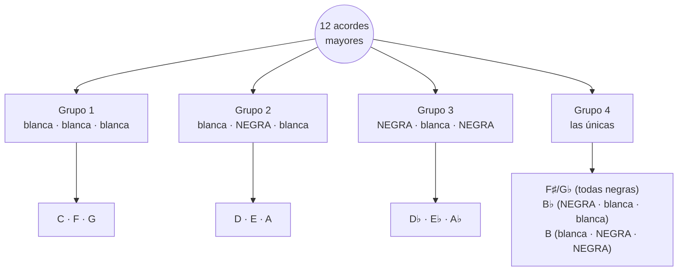

| Grupo | Acordes | Colores (raíz · 3ª · 5ª) | La mano | Relación |
|---|---|---|---|---|
| **1** | C, F, G | blanca · blanca · blanca | plana, al borde de las teclas | la referencia |
| **2** | D, E, A | blanca · **negra** · blanca | el dedo 3 sube a la negra; la mano entra un poco | el grupo 1 con la 3ª subida |
| **3** | D♭, E♭, A♭ | **negra** · blanca · **negra** | toda la mano entra hacia la tapa; el pulgar va sobre negra | el grupo 2 al revés |
| **4** | F♯/G♭ | **negra · negra · negra** | la mano descansa sobre el grupo de 3 negras | la más fácil al tacto |
| | B♭ | **negra** · blanca · blanca | pulgar adentro, 3 y 5 afuera | espejo de B |
| | B | blanca · **negra · negra** | pulgar afuera, 3 y 5 adentro | espejo de B♭ |

> [!tip] Truco de los espejos
> - D, E y A (grupo 2) son el **mismo dibujo en tres sitios**. D♭, E♭ y A♭ (grupo 3) también.
> - Cada acorde del grupo 3 está **un semitono debajo** de uno del grupo 2: D♭ debajo de D,
>   E♭ debajo de E, A♭ debajo de A. Si sabes uno, bajas todo una tecla.
> - B♭ y B son espejos: lo que en uno es negra, en el otro es blanca.

---

## 3. Digitación de las tríadas, la regla del hueco

| Posición | MD | MI | Dónde está el hueco |
|---|---|---|---|
| Fundamental | **1 – 3 – 5** | **5 – 3 – 1** | no hay 4ª: los dedos alternan |
| 1ª inversión | **1 – 2 – 5** | **5 – 3 – 1** | la 4ª está **arriba**: hueco entre 2 y 5 (MD) |
| 2ª inversión | **1 – 3 – 5** | **5 – 2 – 1** | la 4ª está **abajo**: hueco entre 5 y 2 (MI) |

> [!important] La regla
> **El intervalo de cuarta se lleva el hueco.** Donde hay una cuarta, entre los dedos que la
> tocan queda un dedo sin usar. La MD lo deja arriba (1-2-5) y la MI lo deja abajo (5-2-1).
> Con esta regla no hay que memorizar la tabla: se deduce.

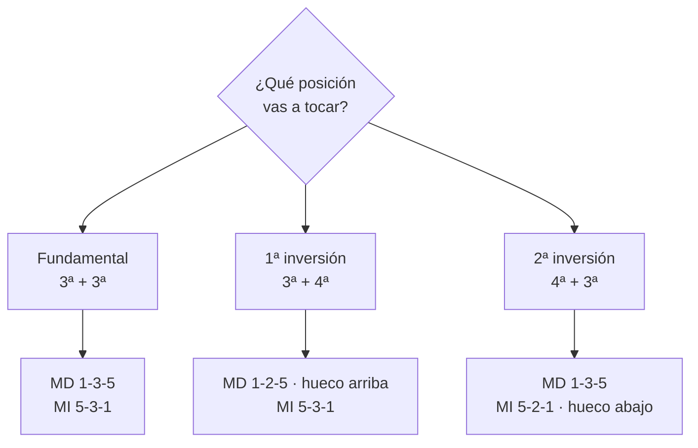

### Posición de la mano

- **Dedos curvos**, como sosteniendo una pelota pequeña; tocas con la yema, no con la uña ni plano.
- **Muñeca a la altura de las teclas**: ni caída ni levantada.
- **Con negras, la mano entera entra hacia la tapa.** No estires un dedo solo: mueve la mano.
- **Pulgar sobre negra**: en tríadas está bien (grupos 3 y 4). En escalas se evita; por eso las
  escalas tienen digitaciones especiales.
- **Peso, no fuerza**: deja caer el peso del brazo en el acorde y suelta enseguida.

---

## 4. Las 12 fichas

Cada ficha tiene:
1. el **teclado en tabla** con las tres posiciones, la escala y el arpegio, dedo por dedo y mano por mano;
2. la **tabla** de notas de cada posición;
3. los **7 acordes de la tonalidad**;
4. un **truco** de la mano para esa tonalidad;
5. la **partitura** con las inversiones (subir y bajar) y la escala, con dedos.

### Grupo 1 · blanca, blanca, blanca

#### C mayor · C – E – G

Colores ⬜⬜⬜ · La referencia: todo blancas. Si una forma te confunde, vuelve a C y transporta.

| | C | C♯ | D | D♯ | E | F | F♯ | G | G♯ | A | A♯ | B | C | C♯ | D | D♯ | E |
|---|:-:|:-:|:-:|:-:|:-:|:-:|:-:|:-:|:-:|:-:|:-:|:-:|:-:|:-:|:-:|:-:|:-:|
| **tecla** | ⬜ | ⬛ | ⬜ | ⬛ | ⬜ | ⬜ | ⬛ | ⬜ | ⬛ | ⬜ | ⬛ | ⬜ | ⬜ | ⬛ | ⬜ | ⬛ | ⬜ |
| MD fund. | **1** |  |  |  | **3** |  |  | **5** |  |  |  |  |  |  |  |  |  |
| MD 1ª inv. |  |  |  |  | **1** |  |  | **2** |  |  |  |  | **5** |  |  |  |  |
| MD 2ª inv. |  |  |  |  |  |  |  | **1** |  |  |  |  | **3** |  |  |  | **5** |
| MI fund. | 5 |  |  |  | 3 |  |  | 1 |  |  |  |  |  |  |  |  |  |
| MI 1ª inv. |  |  |  |  | 5 |  |  | 3 |  |  |  |  | 1 |  |  |  |  |
| MI 2ª inv. |  |  |  |  |  |  |  | 5 |  |  |  |  | 2 |  |  |  | 1 |
| MD escala | **1** |  | **2** |  | **3** | **1** |  | **2** |  | **3** |  | **4** | **5** |  |  |  |  |
| MI escala | 5 |  | 4 |  | 3 | 2 |  | 1 |  | 3 |  | 2 | 1 |  |  |  |  |
| MD arpegio | **1** |  |  |  | **2** |  |  | **3** |  |  |  |  | **5** |  |  |  |  |
| MI arpegio | 5 |  |  |  | 4 |  |  | 2 |  |  |  |  | 1 |  |  |  |  |

| Posición | Notas (de abajo a arriba) | MD | MI |
|---|---|:-:|:-:|
| Fundamental | C – E – G | 1-3-5 | 5-3-1 |
| 1ª inversión | E – G – C | 1-2-5 | 5-3-1 |
| 2ª inversión | G – C – E | 1-3-5 | 5-2-1 |

**Acordes de la tonalidad:** I C · ii Dm · iii Em · IV F · V G · vi Am · vii° B°

```abc
X:1
T:C mayor: inversiones y escala
M:4/4
L:1/4
K:C
V:1 clef=treble name="MD"
V:2 clef=bass name="MI"
[V:1] "^1-3-5"[CEG] "^1-2-5"[EGc] "^1-3-5"[Gce] "^1-2-5"[EGc] | "^1-3-5"[CEG]2 z2 | "^1"C/ "^2"D/ "^3"E/ "^1"F/ "^2"G/ "^3"A/ "^4"B/ "^5"c/ | "^5"c/ "^4"B/ "^3"A/ "^2"G/ "^1"F/ "^3"E/ "^2"D/ "^1"C/ |]
[V:2] "_5-3-1"[C,E,G,] "_5-3-1"[E,G,C] "_5-2-1"[G,CE] "_5-3-1"[E,G,C] | "_5-3-1"[C,E,G,]2 z2 | "_5"C,/ "_4"D,/ "_3"E,/ "_2"F,/ "_1"G,/ "_3"A,/ "_2"B,/ "_1"C/ | "_1"C/ "_2"B,/ "_3"A,/ "_1"G,/ "_2"F,/ "_3"E,/ "_4"D,/ "_5"C,/ |]
```

#### F mayor · F – A – C

Colores ⬜⬜⬜ · En la tríada es igual que C. La diferencia está en la escala: el 4 de la MD cae en B♭.

| | F | G♭ | G | A♭ | A | B♭ | B | C | D♭ | D | E♭ | E | F | G♭ | G | A♭ | A |
|---|:-:|:-:|:-:|:-:|:-:|:-:|:-:|:-:|:-:|:-:|:-:|:-:|:-:|:-:|:-:|:-:|:-:|
| **tecla** | ⬜ | ⬛ | ⬜ | ⬛ | ⬜ | ⬛ | ⬜ | ⬜ | ⬛ | ⬜ | ⬛ | ⬜ | ⬜ | ⬛ | ⬜ | ⬛ | ⬜ |
| MD fund. | **1** |  |  |  | **3** |  |  | **5** |  |  |  |  |  |  |  |  |  |
| MD 1ª inv. |  |  |  |  | **1** |  |  | **2** |  |  |  |  | **5** |  |  |  |  |
| MD 2ª inv. |  |  |  |  |  |  |  | **1** |  |  |  |  | **3** |  |  |  | **5** |
| MI fund. | 5 |  |  |  | 3 |  |  | 1 |  |  |  |  |  |  |  |  |  |
| MI 1ª inv. |  |  |  |  | 5 |  |  | 3 |  |  |  |  | 1 |  |  |  |  |
| MI 2ª inv. |  |  |  |  |  |  |  | 5 |  |  |  |  | 2 |  |  |  | 1 |
| MD escala | **1** |  | **2** |  | **3** | **4** |  | **1** |  | **2** |  | **3** | **4** |  |  |  |  |
| MI escala | 5 |  | 4 |  | 3 | 2 |  | 1 |  | 3 |  | 2 | 1 |  |  |  |  |
| MD arpegio | **1** |  |  |  | **2** |  |  | **3** |  |  |  |  | **5** |  |  |  |  |
| MI arpegio | 5 |  |  |  | 4 |  |  | 2 |  |  |  |  | 1 |  |  |  |  |

| Posición | Notas (de abajo a arriba) | MD | MI |
|---|---|:-:|:-:|
| Fundamental | F – A – C | 1-3-5 | 5-3-1 |
| 1ª inversión | A – C – F | 1-2-5 | 5-3-1 |
| 2ª inversión | C – F – A | 1-3-5 | 5-2-1 |

**Acordes de la tonalidad:** I F · ii Gm · iii Am · IV B♭ · V C · vi Dm · vii° E°

```abc
X:1
T:F mayor: inversiones y escala
M:4/4
L:1/4
K:F
V:1 clef=treble name="MD"
V:2 clef=bass name="MI"
[V:1] "^1-3-5"[FAc] "^1-2-5"[Acf] "^1-3-5"[cfa] "^1-2-5"[Acf] | "^1-3-5"[FAc]2 z2 | "^1"F/ "^2"G/ "^3"A/ "^4"B/ "^1"c/ "^2"d/ "^3"e/ "^4"f/ | "^4"f/ "^3"e/ "^2"d/ "^1"c/ "^4"B/ "^3"A/ "^2"G/ "^1"F/ |]
[V:2] "_5-3-1"[F,A,C] "_5-3-1"[A,CF] "_5-2-1"[CFA] "_5-3-1"[A,CF] | "_5-3-1"[F,A,C]2 z2 | "_5"F,/ "_4"G,/ "_3"A,/ "_2"B,/ "_1"C/ "_3"D/ "_2"E/ "_1"F/ | "_1"F/ "_2"E/ "_3"D/ "_1"C/ "_2"B,/ "_3"A,/ "_4"G,/ "_5"F,/ |]
```

#### G mayor · G – B – D

Colores ⬜⬜⬜ · Igual que C. Es la tonalidad más cómoda en piano **y** en guitarra: buena para componer en los dos.

| | G | G♯ | A | A♯ | B | C | C♯ | D | D♯ | E | F | F♯ | G | G♯ | A | A♯ | B |
|---|:-:|:-:|:-:|:-:|:-:|:-:|:-:|:-:|:-:|:-:|:-:|:-:|:-:|:-:|:-:|:-:|:-:|
| **tecla** | ⬜ | ⬛ | ⬜ | ⬛ | ⬜ | ⬜ | ⬛ | ⬜ | ⬛ | ⬜ | ⬜ | ⬛ | ⬜ | ⬛ | ⬜ | ⬛ | ⬜ |
| MD fund. | **1** |  |  |  | **3** |  |  | **5** |  |  |  |  |  |  |  |  |  |
| MD 1ª inv. |  |  |  |  | **1** |  |  | **2** |  |  |  |  | **5** |  |  |  |  |
| MD 2ª inv. |  |  |  |  |  |  |  | **1** |  |  |  |  | **3** |  |  |  | **5** |
| MI fund. | 5 |  |  |  | 3 |  |  | 1 |  |  |  |  |  |  |  |  |  |
| MI 1ª inv. |  |  |  |  | 5 |  |  | 3 |  |  |  |  | 1 |  |  |  |  |
| MI 2ª inv. |  |  |  |  |  |  |  | 5 |  |  |  |  | 2 |  |  |  | 1 |
| MD escala | **1** |  | **2** |  | **3** | **1** |  | **2** |  | **3** |  | **4** | **5** |  |  |  |  |
| MI escala | 5 |  | 4 |  | 3 | 2 |  | 1 |  | 3 |  | 2 | 1 |  |  |  |  |
| MD arpegio | **1** |  |  |  | **2** |  |  | **3** |  |  |  |  | **5** |  |  |  |  |
| MI arpegio | 5 |  |  |  | 4 |  |  | 2 |  |  |  |  | 1 |  |  |  |  |

| Posición | Notas (de abajo a arriba) | MD | MI |
|---|---|:-:|:-:|
| Fundamental | G – B – D | 1-3-5 | 5-3-1 |
| 1ª inversión | B – D – G | 1-2-5 | 5-3-1 |
| 2ª inversión | D – G – B | 1-3-5 | 5-2-1 |

**Acordes de la tonalidad:** I G · ii Am · iii Bm · IV C · V D · vi Em · vii° F♯°

```abc
X:1
T:G mayor: inversiones y escala
M:4/4
L:1/4
K:G
V:1 clef=treble name="MD"
V:2 clef=bass name="MI"
[V:1] "^1-3-5"[G,B,D] "^1-2-5"[B,DG] "^1-3-5"[DGB] "^1-2-5"[B,DG] | "^1-3-5"[G,B,D]2 z2 | "^1"G,/ "^2"A,/ "^3"B,/ "^1"C/ "^2"D/ "^3"E/ "^4"F/ "^5"G/ | "^5"G/ "^4"F/ "^3"E/ "^2"D/ "^1"C/ "^3"B,/ "^2"A,/ "^1"G,/ |]
[V:2] "_5-3-1"[G,,B,,D,] "_5-3-1"[B,,D,G,] "_5-2-1"[D,G,B,] "_5-3-1"[B,,D,G,] | "_5-3-1"[G,,B,,D,]2 z2 | "_5"G,,/ "_4"A,,/ "_3"B,,/ "_2"C,/ "_1"D,/ "_3"E,/ "_2"F,/ "_1"G,/ | "_1"G,/ "_2"F,/ "_3"E,/ "_1"D,/ "_2"C,/ "_3"B,,/ "_4"A,,/ "_5"G,,/ |]
```

### Grupo 2 · blanca, negra, blanca

#### D mayor · D – F♯ – A

Colores ⬜⬛⬜ · La 3ª (F♯) es negra: el dedo 3 sube a ella y la mano entra un poco hacia la tapa.

| | D | D♯ | E | F | F♯ | G | G♯ | A | A♯ | B | C | C♯ | D | D♯ | E | F | F♯ |
|---|:-:|:-:|:-:|:-:|:-:|:-:|:-:|:-:|:-:|:-:|:-:|:-:|:-:|:-:|:-:|:-:|:-:|
| **tecla** | ⬜ | ⬛ | ⬜ | ⬜ | ⬛ | ⬜ | ⬛ | ⬜ | ⬛ | ⬜ | ⬜ | ⬛ | ⬜ | ⬛ | ⬜ | ⬜ | ⬛ |
| MD fund. | **1** |  |  |  | **3** |  |  | **5** |  |  |  |  |  |  |  |  |  |
| MD 1ª inv. |  |  |  |  | **1** |  |  | **2** |  |  |  |  | **5** |  |  |  |  |
| MD 2ª inv. |  |  |  |  |  |  |  | **1** |  |  |  |  | **3** |  |  |  | **5** |
| MI fund. | 5 |  |  |  | 3 |  |  | 1 |  |  |  |  |  |  |  |  |  |
| MI 1ª inv. |  |  |  |  | 5 |  |  | 3 |  |  |  |  | 1 |  |  |  |  |
| MI 2ª inv. |  |  |  |  |  |  |  | 5 |  |  |  |  | 2 |  |  |  | 1 |
| MD escala | **1** |  | **2** |  | **3** | **1** |  | **2** |  | **3** |  | **4** | **5** |  |  |  |  |
| MI escala | 5 |  | 4 |  | 3 | 2 |  | 1 |  | 3 |  | 2 | 1 |  |  |  |  |
| MD arpegio | **1** |  |  |  | **2** |  |  | **3** |  |  |  |  | **5** |  |  |  |  |
| MI arpegio | 5 |  |  |  | 3 |  |  | 2 |  |  |  |  | 1 |  |  |  |  |

| Posición | Notas (de abajo a arriba) | MD | MI |
|---|---|:-:|:-:|
| Fundamental | D – F♯ – A | 1-3-5 | 5-3-1 |
| 1ª inversión | F♯ – A – D | 1-2-5 | 5-3-1 |
| 2ª inversión | A – D – F♯ | 1-3-5 | 5-2-1 |

**Acordes de la tonalidad:** I D · ii Em · iii F♯m · IV G · V A · vi Bm · vii° C♯°

```abc
X:1
T:D mayor: inversiones y escala
M:4/4
L:1/4
K:D
V:1 clef=treble name="MD"
V:2 clef=bass name="MI"
[V:1] "^1-3-5"[DFA] "^1-2-5"[FAd] "^1-3-5"[Adf] "^1-2-5"[FAd] | "^1-3-5"[DFA]2 z2 | "^1"D/ "^2"E/ "^3"F/ "^1"G/ "^2"A/ "^3"B/ "^4"c/ "^5"d/ | "^5"d/ "^4"c/ "^3"B/ "^2"A/ "^1"G/ "^3"F/ "^2"E/ "^1"D/ |]
[V:2] "_5-3-1"[D,F,A,] "_5-3-1"[F,A,D] "_5-2-1"[A,DF] "_5-3-1"[F,A,D] | "_5-3-1"[D,F,A,]2 z2 | "_5"D,/ "_4"E,/ "_3"F,/ "_2"G,/ "_1"A,/ "_3"B,/ "_2"C/ "_1"D/ | "_1"D/ "_2"C/ "_3"B,/ "_1"A,/ "_2"G,/ "_3"F,/ "_4"E,/ "_5"D,/ |]
```

#### E mayor · E – G♯ – B

Colores ⬜⬛⬜ · Como D: solo la 3ª (G♯) es negra. Es el mismo dibujo, una tecla blanca más arriba.

| | E | F | F♯ | G | G♯ | A | A♯ | B | C | C♯ | D | D♯ | E | F | F♯ | G | G♯ |
|---|:-:|:-:|:-:|:-:|:-:|:-:|:-:|:-:|:-:|:-:|:-:|:-:|:-:|:-:|:-:|:-:|:-:|
| **tecla** | ⬜ | ⬜ | ⬛ | ⬜ | ⬛ | ⬜ | ⬛ | ⬜ | ⬜ | ⬛ | ⬜ | ⬛ | ⬜ | ⬜ | ⬛ | ⬜ | ⬛ |
| MD fund. | **1** |  |  |  | **3** |  |  | **5** |  |  |  |  |  |  |  |  |  |
| MD 1ª inv. |  |  |  |  | **1** |  |  | **2** |  |  |  |  | **5** |  |  |  |  |
| MD 2ª inv. |  |  |  |  |  |  |  | **1** |  |  |  |  | **3** |  |  |  | **5** |
| MI fund. | 5 |  |  |  | 3 |  |  | 1 |  |  |  |  |  |  |  |  |  |
| MI 1ª inv. |  |  |  |  | 5 |  |  | 3 |  |  |  |  | 1 |  |  |  |  |
| MI 2ª inv. |  |  |  |  |  |  |  | 5 |  |  |  |  | 2 |  |  |  | 1 |
| MD escala | **1** |  | **2** |  | **3** | **1** |  | **2** |  | **3** |  | **4** | **5** |  |  |  |  |
| MI escala | 5 |  | 4 |  | 3 | 2 |  | 1 |  | 3 |  | 2 | 1 |  |  |  |  |
| MD arpegio | **1** |  |  |  | **2** |  |  | **3** |  |  |  |  | **5** |  |  |  |  |
| MI arpegio | 5 |  |  |  | 3 |  |  | 2 |  |  |  |  | 1 |  |  |  |  |

| Posición | Notas (de abajo a arriba) | MD | MI |
|---|---|:-:|:-:|
| Fundamental | E – G♯ – B | 1-3-5 | 5-3-1 |
| 1ª inversión | G♯ – B – E | 1-2-5 | 5-3-1 |
| 2ª inversión | B – E – G♯ | 1-3-5 | 5-2-1 |

**Acordes de la tonalidad:** I E · ii F♯m · iii G♯m · IV A · V B · vi C♯m · vii° D♯°

```abc
X:1
T:E mayor: inversiones y escala
M:4/4
L:1/4
K:E
V:1 clef=treble name="MD"
V:2 clef=bass name="MI"
[V:1] "^1-3-5"[EGB] "^1-2-5"[GBe] "^1-3-5"[Beg] "^1-2-5"[GBe] | "^1-3-5"[EGB]2 z2 | "^1"E/ "^2"F/ "^3"G/ "^1"A/ "^2"B/ "^3"c/ "^4"d/ "^5"e/ | "^5"e/ "^4"d/ "^3"c/ "^2"B/ "^1"A/ "^3"G/ "^2"F/ "^1"E/ |]
[V:2] "_5-3-1"[E,G,B,] "_5-3-1"[G,B,E] "_5-2-1"[B,EG] "_5-3-1"[G,B,E] | "_5-3-1"[E,G,B,]2 z2 | "_5"E,/ "_4"F,/ "_3"G,/ "_2"A,/ "_1"B,/ "_3"C/ "_2"D/ "_1"E/ | "_1"E/ "_2"D/ "_3"C/ "_1"B,/ "_2"A,/ "_3"G,/ "_4"F,/ "_5"E,/ |]
```

#### A mayor · A – C♯ – E

Colores ⬜⬛⬜ · Como D y E. A, D y E son el mismo dibujo en tres sitios: apréndelos juntos.

| | A | A♯ | B | C | C♯ | D | D♯ | E | F | F♯ | G | G♯ | A | A♯ | B | C | C♯ |
|---|:-:|:-:|:-:|:-:|:-:|:-:|:-:|:-:|:-:|:-:|:-:|:-:|:-:|:-:|:-:|:-:|:-:|
| **tecla** | ⬜ | ⬛ | ⬜ | ⬜ | ⬛ | ⬜ | ⬛ | ⬜ | ⬜ | ⬛ | ⬜ | ⬛ | ⬜ | ⬛ | ⬜ | ⬜ | ⬛ |
| MD fund. | **1** |  |  |  | **3** |  |  | **5** |  |  |  |  |  |  |  |  |  |
| MD 1ª inv. |  |  |  |  | **1** |  |  | **2** |  |  |  |  | **5** |  |  |  |  |
| MD 2ª inv. |  |  |  |  |  |  |  | **1** |  |  |  |  | **3** |  |  |  | **5** |
| MI fund. | 5 |  |  |  | 3 |  |  | 1 |  |  |  |  |  |  |  |  |  |
| MI 1ª inv. |  |  |  |  | 5 |  |  | 3 |  |  |  |  | 1 |  |  |  |  |
| MI 2ª inv. |  |  |  |  |  |  |  | 5 |  |  |  |  | 2 |  |  |  | 1 |
| MD escala | **1** |  | **2** |  | **3** | **1** |  | **2** |  | **3** |  | **4** | **5** |  |  |  |  |
| MI escala | 5 |  | 4 |  | 3 | 2 |  | 1 |  | 3 |  | 2 | 1 |  |  |  |  |
| MD arpegio | **1** |  |  |  | **2** |  |  | **3** |  |  |  |  | **5** |  |  |  |  |
| MI arpegio | 5 |  |  |  | 3 |  |  | 2 |  |  |  |  | 1 |  |  |  |  |

| Posición | Notas (de abajo a arriba) | MD | MI |
|---|---|:-:|:-:|
| Fundamental | A – C♯ – E | 1-3-5 | 5-3-1 |
| 1ª inversión | C♯ – E – A | 1-2-5 | 5-3-1 |
| 2ª inversión | E – A – C♯ | 1-3-5 | 5-2-1 |

**Acordes de la tonalidad:** I A · ii Bm · iii C♯m · IV D · V E · vi F♯m · vii° G♯°

```abc
X:1
T:A mayor: inversiones y escala
M:4/4
L:1/4
K:A
V:1 clef=treble name="MD"
V:2 clef=bass name="MI"
[V:1] "^1-3-5"[A,CE] "^1-2-5"[CEA] "^1-3-5"[EAc] "^1-2-5"[CEA] | "^1-3-5"[A,CE]2 z2 | "^1"A,/ "^2"B,/ "^3"C/ "^1"D/ "^2"E/ "^3"F/ "^4"G/ "^5"A/ | "^5"A/ "^4"G/ "^3"F/ "^2"E/ "^1"D/ "^3"C/ "^2"B,/ "^1"A,/ |]
[V:2] "_5-3-1"[A,,C,E,] "_5-3-1"[C,E,A,] "_5-2-1"[E,A,C] "_5-3-1"[C,E,A,] | "_5-3-1"[A,,C,E,]2 z2 | "_5"A,,/ "_4"B,,/ "_3"C,/ "_2"D,/ "_1"E,/ "_3"F,/ "_2"G,/ "_1"A,/ | "_1"A,/ "_2"G,/ "_3"F,/ "_1"E,/ "_2"D,/ "_3"C,/ "_4"B,,/ "_5"A,,/ |]
```

### Grupo 3 · negra, blanca, negra

#### D♭ mayor · D♭ – F – A♭

Colores ⬛⬜⬛ · Raíz y 5ª negras, 3ª blanca: toda la mano entra hacia la tapa y el pulgar va sobre negra. Es D bajado una tecla.

| | D♭ | D | E♭ | E | F | G♭ | G | A♭ | A | B♭ | B | C | D♭ | D | E♭ | E | F |
|---|:-:|:-:|:-:|:-:|:-:|:-:|:-:|:-:|:-:|:-:|:-:|:-:|:-:|:-:|:-:|:-:|:-:|
| **tecla** | ⬛ | ⬜ | ⬛ | ⬜ | ⬜ | ⬛ | ⬜ | ⬛ | ⬜ | ⬛ | ⬜ | ⬜ | ⬛ | ⬜ | ⬛ | ⬜ | ⬜ |
| MD fund. | **1** |  |  |  | **3** |  |  | **5** |  |  |  |  |  |  |  |  |  |
| MD 1ª inv. |  |  |  |  | **1** |  |  | **2** |  |  |  |  | **5** |  |  |  |  |
| MD 2ª inv. |  |  |  |  |  |  |  | **1** |  |  |  |  | **3** |  |  |  | **5** |
| MI fund. | 5 |  |  |  | 3 |  |  | 1 |  |  |  |  |  |  |  |  |  |
| MI 1ª inv. |  |  |  |  | 5 |  |  | 3 |  |  |  |  | 1 |  |  |  |  |
| MI 2ª inv. |  |  |  |  |  |  |  | 5 |  |  |  |  | 2 |  |  |  | 1 |
| MD escala | **2** |  | **3** |  | **1** | **2** |  | **3** |  | **4** |  | **1** | **2** |  |  |  |  |
| MI escala | 3 |  | 2 |  | 1 | 4 |  | 3 |  | 2 |  | 1 | 3 |  |  |  |  |
| MD arpegio | **4** |  |  |  | **1** |  |  | **2** |  |  |  |  | **4** |  |  |  |  |
| MI arpegio | 2 |  |  |  | 1 |  |  | 4 |  |  |  |  | 2 |  |  |  |  |

| Posición | Notas (de abajo a arriba) | MD | MI |
|---|---|:-:|:-:|
| Fundamental | D♭ – F – A♭ | 1-3-5 | 5-3-1 |
| 1ª inversión | F – A♭ – D♭ | 1-2-5 | 5-3-1 |
| 2ª inversión | A♭ – D♭ – F | 1-3-5 | 5-2-1 |

**Acordes de la tonalidad:** I D♭ · ii E♭m · iii Fm · IV G♭ · V A♭ · vi B♭m · vii° C°

```abc
X:1
T:D♭ mayor: inversiones y escala
M:4/4
L:1/4
K:Db
V:1 clef=treble name="MD"
V:2 clef=bass name="MI"
[V:1] "^1-3-5"[DFA] "^1-2-5"[FAd] "^1-3-5"[Adf] "^1-2-5"[FAd] | "^1-3-5"[DFA]2 z2 | "^2"D/ "^3"E/ "^1"F/ "^2"G/ "^3"A/ "^4"B/ "^1"c/ "^2"d/ | "^2"d/ "^1"c/ "^4"B/ "^3"A/ "^2"G/ "^1"F/ "^3"E/ "^2"D/ |]
[V:2] "_5-3-1"[D,F,A,] "_5-3-1"[F,A,D] "_5-2-1"[A,DF] "_5-3-1"[F,A,D] | "_5-3-1"[D,F,A,]2 z2 | "_3"D,/ "_2"E,/ "_1"F,/ "_4"G,/ "_3"A,/ "_2"B,/ "_1"C/ "_3"D/ | "_3"D/ "_1"C/ "_2"B,/ "_3"A,/ "_4"G,/ "_1"F,/ "_2"E,/ "_3"D,/ |]
```

#### E♭ mayor · E♭ – G – B♭

Colores ⬛⬜⬛ · Mismo dibujo que D♭ y A♭. Es E bajado una tecla.

| | E♭ | E | F | G♭ | G | A♭ | A | B♭ | B | C | D♭ | D | E♭ | E | F | G♭ | G |
|---|:-:|:-:|:-:|:-:|:-:|:-:|:-:|:-:|:-:|:-:|:-:|:-:|:-:|:-:|:-:|:-:|:-:|
| **tecla** | ⬛ | ⬜ | ⬜ | ⬛ | ⬜ | ⬛ | ⬜ | ⬛ | ⬜ | ⬜ | ⬛ | ⬜ | ⬛ | ⬜ | ⬜ | ⬛ | ⬜ |
| MD fund. | **1** |  |  |  | **3** |  |  | **5** |  |  |  |  |  |  |  |  |  |
| MD 1ª inv. |  |  |  |  | **1** |  |  | **2** |  |  |  |  | **5** |  |  |  |  |
| MD 2ª inv. |  |  |  |  |  |  |  | **1** |  |  |  |  | **3** |  |  |  | **5** |
| MI fund. | 5 |  |  |  | 3 |  |  | 1 |  |  |  |  |  |  |  |  |  |
| MI 1ª inv. |  |  |  |  | 5 |  |  | 3 |  |  |  |  | 1 |  |  |  |  |
| MI 2ª inv. |  |  |  |  |  |  |  | 5 |  |  |  |  | 2 |  |  |  | 1 |
| MD escala | **3** |  | **1** |  | **2** | **3** |  | **4** |  | **1** |  | **2** | **3** |  |  |  |  |
| MI escala | 3 |  | 2 |  | 1 | 4 |  | 3 |  | 2 |  | 1 | 3 |  |  |  |  |
| MD arpegio | **4** |  |  |  | **1** |  |  | **2** |  |  |  |  | **4** |  |  |  |  |
| MI arpegio | 2 |  |  |  | 1 |  |  | 4 |  |  |  |  | 2 |  |  |  |  |

| Posición | Notas (de abajo a arriba) | MD | MI |
|---|---|:-:|:-:|
| Fundamental | E♭ – G – B♭ | 1-3-5 | 5-3-1 |
| 1ª inversión | G – B♭ – E♭ | 1-2-5 | 5-3-1 |
| 2ª inversión | B♭ – E♭ – G | 1-3-5 | 5-2-1 |

**Acordes de la tonalidad:** I E♭ · ii Fm · iii Gm · IV A♭ · V B♭ · vi Cm · vii° D°

```abc
X:1
T:E♭ mayor: inversiones y escala
M:4/4
L:1/4
K:Eb
V:1 clef=treble name="MD"
V:2 clef=bass name="MI"
[V:1] "^1-3-5"[EGB] "^1-2-5"[GBe] "^1-3-5"[Beg] "^1-2-5"[GBe] | "^1-3-5"[EGB]2 z2 | "^3"E/ "^1"F/ "^2"G/ "^3"A/ "^4"B/ "^1"c/ "^2"d/ "^3"e/ | "^3"e/ "^2"d/ "^1"c/ "^4"B/ "^3"A/ "^2"G/ "^1"F/ "^3"E/ |]
[V:2] "_5-3-1"[E,G,B,] "_5-3-1"[G,B,E] "_5-2-1"[B,EG] "_5-3-1"[G,B,E] | "_5-3-1"[E,G,B,]2 z2 | "_3"E,/ "_2"F,/ "_1"G,/ "_4"A,/ "_3"B,/ "_2"C/ "_1"D/ "_3"E/ | "_3"E/ "_1"D/ "_2"C/ "_3"B,/ "_4"A,/ "_1"G,/ "_2"F,/ "_3"E,/ |]
```

#### A♭ mayor · A♭ – C – E♭

Colores ⬛⬜⬛ · Mismo dibujo que D♭ y E♭. Es A bajado una tecla. Muchas baladas de piano viven aquí.

| | A♭ | A | B♭ | B | C | D♭ | D | E♭ | E | F | G♭ | G | A♭ | A | B♭ | B | C |
|---|:-:|:-:|:-:|:-:|:-:|:-:|:-:|:-:|:-:|:-:|:-:|:-:|:-:|:-:|:-:|:-:|:-:|
| **tecla** | ⬛ | ⬜ | ⬛ | ⬜ | ⬜ | ⬛ | ⬜ | ⬛ | ⬜ | ⬜ | ⬛ | ⬜ | ⬛ | ⬜ | ⬛ | ⬜ | ⬜ |
| MD fund. | **1** |  |  |  | **3** |  |  | **5** |  |  |  |  |  |  |  |  |  |
| MD 1ª inv. |  |  |  |  | **1** |  |  | **2** |  |  |  |  | **5** |  |  |  |  |
| MD 2ª inv. |  |  |  |  |  |  |  | **1** |  |  |  |  | **3** |  |  |  | **5** |
| MI fund. | 5 |  |  |  | 3 |  |  | 1 |  |  |  |  |  |  |  |  |  |
| MI 1ª inv. |  |  |  |  | 5 |  |  | 3 |  |  |  |  | 1 |  |  |  |  |
| MI 2ª inv. |  |  |  |  |  |  |  | 5 |  |  |  |  | 2 |  |  |  | 1 |
| MD escala | **3** |  | **4** |  | **1** | **2** |  | **3** |  | **1** |  | **2** | **3** |  |  |  |  |
| MI escala | 3 |  | 2 |  | 1 | 4 |  | 3 |  | 2 |  | 1 | 3 |  |  |  |  |
| MD arpegio | **4** |  |  |  | **1** |  |  | **2** |  |  |  |  | **4** |  |  |  |  |
| MI arpegio | 2 |  |  |  | 1 |  |  | 4 |  |  |  |  | 2 |  |  |  |  |

| Posición | Notas (de abajo a arriba) | MD | MI |
|---|---|:-:|:-:|
| Fundamental | A♭ – C – E♭ | 1-3-5 | 5-3-1 |
| 1ª inversión | C – E♭ – A♭ | 1-2-5 | 5-3-1 |
| 2ª inversión | E♭ – A♭ – C | 1-3-5 | 5-2-1 |

**Acordes de la tonalidad:** I A♭ · ii B♭m · iii Cm · IV D♭ · V E♭ · vi Fm · vii° G°

```abc
X:1
T:A♭ mayor: inversiones y escala
M:4/4
L:1/4
K:Ab
V:1 clef=treble name="MD"
V:2 clef=bass name="MI"
[V:1] "^1-3-5"[A,CE] "^1-2-5"[CEA] "^1-3-5"[EAc] "^1-2-5"[CEA] | "^1-3-5"[A,CE]2 z2 | "^3"A,/ "^4"B,/ "^1"C/ "^2"D/ "^3"E/ "^1"F/ "^2"G/ "^3"A/ | "^3"A/ "^2"G/ "^1"F/ "^3"E/ "^2"D/ "^1"C/ "^4"B,/ "^3"A,/ |]
[V:2] "_5-3-1"[A,,C,E,] "_5-3-1"[C,E,A,] "_5-2-1"[E,A,C] "_5-3-1"[C,E,A,] | "_5-3-1"[A,,C,E,]2 z2 | "_3"A,,/ "_2"B,,/ "_1"C,/ "_4"D,/ "_3"E,/ "_2"F,/ "_1"G,/ "_3"A,/ | "_3"A,/ "_1"G,/ "_2"F,/ "_3"E,/ "_4"D,/ "_1"C,/ "_2"B,,/ "_3"A,,/ |]
```

### Grupo 4 · las únicas

#### F♯ / G♭ mayor · F♯ – A♯ – C♯

Colores ⬛⬛⬛ · Las tres teclas negras: al tacto es la más fácil, la mano descansa sobre el grupo de tres negras. También se escribe G♭ (G♭ – B♭ – D♭).

| | F♯ | G | G♯ | A | A♯ | B | C | C♯ | D | D♯ | E | E♯ | F♯ | G | G♯ | A | A♯ |
|---|:-:|:-:|:-:|:-:|:-:|:-:|:-:|:-:|:-:|:-:|:-:|:-:|:-:|:-:|:-:|:-:|:-:|
| **tecla** | ⬛ | ⬜ | ⬛ | ⬜ | ⬛ | ⬜ | ⬜ | ⬛ | ⬜ | ⬛ | ⬜ | ⬜ | ⬛ | ⬜ | ⬛ | ⬜ | ⬛ |
| MD fund. | **1** |  |  |  | **3** |  |  | **5** |  |  |  |  |  |  |  |  |  |
| MD 1ª inv. |  |  |  |  | **1** |  |  | **2** |  |  |  |  | **5** |  |  |  |  |
| MD 2ª inv. |  |  |  |  |  |  |  | **1** |  |  |  |  | **3** |  |  |  | **5** |
| MI fund. | 5 |  |  |  | 3 |  |  | 1 |  |  |  |  |  |  |  |  |  |
| MI 1ª inv. |  |  |  |  | 5 |  |  | 3 |  |  |  |  | 1 |  |  |  |  |
| MI 2ª inv. |  |  |  |  |  |  |  | 5 |  |  |  |  | 2 |  |  |  | 1 |
| MD escala | **2** |  | **3** |  | **4** | **1** |  | **2** |  | **3** |  | **1** | **2** |  |  |  |  |
| MI escala | 4 |  | 3 |  | 2 | 1 |  | 3 |  | 2 |  | 1 | 4 |  |  |  |  |
| MD arpegio | **1** |  |  |  | **2** |  |  | **3** |  |  |  |  | **5** |  |  |  |  |
| MI arpegio | 5 |  |  |  | 4 |  |  | 2 |  |  |  |  | 1 |  |  |  |  |

| Posición | Notas (de abajo a arriba) | MD | MI |
|---|---|:-:|:-:|
| Fundamental | F♯ – A♯ – C♯ | 1-3-5 | 5-3-1 |
| 1ª inversión | A♯ – C♯ – F♯ | 1-2-5 | 5-3-1 |
| 2ª inversión | C♯ – F♯ – A♯ | 1-3-5 | 5-2-1 |

**Acordes de la tonalidad:** I F♯ · ii G♯m · iii A♯m · IV B · V C♯ · vi D♯m · vii° E♯°

```abc
X:1
T:F♯ / G♭ mayor: inversiones y escala
M:4/4
L:1/4
K:F#
V:1 clef=treble name="MD"
V:2 clef=bass name="MI"
[V:1] "^1-3-5"[FAc] "^1-2-5"[Acf] "^1-3-5"[cfa] "^1-2-5"[Acf] | "^1-3-5"[FAc]2 z2 | "^2"F/ "^3"G/ "^4"A/ "^1"B/ "^2"c/ "^3"d/ "^1"e/ "^2"f/ | "^2"f/ "^1"e/ "^3"d/ "^2"c/ "^1"B/ "^4"A/ "^3"G/ "^2"F/ |]
[V:2] "_5-3-1"[F,A,C] "_5-3-1"[A,CF] "_5-2-1"[CFA] "_5-3-1"[A,CF] | "_5-3-1"[F,A,C]2 z2 | "_4"F,/ "_3"G,/ "_2"A,/ "_1"B,/ "_3"C/ "_2"D/ "_1"E/ "_4"F/ | "_4"F/ "_1"E/ "_2"D/ "_3"C/ "_1"B,/ "_2"A,/ "_3"G,/ "_4"F,/ |]
```

#### B♭ mayor · B♭ – D – F

Colores ⬛⬜⬜ · Raíz negra, 3ª y 5ª blancas: el pulgar empieza adentro y los otros dedos afuera.

| | B♭ | B | C | D♭ | D | E♭ | E | F | G♭ | G | A♭ | A | B♭ | B | C | D♭ | D |
|---|:-:|:-:|:-:|:-:|:-:|:-:|:-:|:-:|:-:|:-:|:-:|:-:|:-:|:-:|:-:|:-:|:-:|
| **tecla** | ⬛ | ⬜ | ⬜ | ⬛ | ⬜ | ⬛ | ⬜ | ⬜ | ⬛ | ⬜ | ⬛ | ⬜ | ⬛ | ⬜ | ⬜ | ⬛ | ⬜ |
| MD fund. | **1** |  |  |  | **3** |  |  | **5** |  |  |  |  |  |  |  |  |  |
| MD 1ª inv. |  |  |  |  | **1** |  |  | **2** |  |  |  |  | **5** |  |  |  |  |
| MD 2ª inv. |  |  |  |  |  |  |  | **1** |  |  |  |  | **3** |  |  |  | **5** |
| MI fund. | 5 |  |  |  | 3 |  |  | 1 |  |  |  |  |  |  |  |  |  |
| MI 1ª inv. |  |  |  |  | 5 |  |  | 3 |  |  |  |  | 1 |  |  |  |  |
| MI 2ª inv. |  |  |  |  |  |  |  | 5 |  |  |  |  | 2 |  |  |  | 1 |
| MD escala | **4** |  | **1** |  | **2** | **3** |  | **1** |  | **2** |  | **3** | **4** |  |  |  |  |
| MI escala | 3 |  | 2 |  | 1 | 4 |  | 3 |  | 2 |  | 1 | 3 |  |  |  |  |
| MD arpegio | **2** |  |  |  | **1** |  |  | **2** |  |  |  |  | **4** |  |  |  |  |
| MI arpegio | 3 |  |  |  | 2 |  |  | 1 |  |  |  |  | 3 |  |  |  |  |

| Posición | Notas (de abajo a arriba) | MD | MI |
|---|---|:-:|:-:|
| Fundamental | B♭ – D – F | 1-3-5 | 5-3-1 |
| 1ª inversión | D – F – B♭ | 1-2-5 | 5-3-1 |
| 2ª inversión | F – B♭ – D | 1-3-5 | 5-2-1 |

**Acordes de la tonalidad:** I B♭ · ii Cm · iii Dm · IV E♭ · V F · vi Gm · vii° A°

```abc
X:1
T:B♭ mayor: inversiones y escala
M:4/4
L:1/4
K:Bb
V:1 clef=treble name="MD"
V:2 clef=bass name="MI"
[V:1] "^1-3-5"[B,DF] "^1-2-5"[DFB] "^1-3-5"[FBd] "^1-2-5"[DFB] | "^1-3-5"[B,DF]2 z2 | "^4"B,/ "^1"C/ "^2"D/ "^3"E/ "^1"F/ "^2"G/ "^3"A/ "^4"B/ | "^4"B/ "^3"A/ "^2"G/ "^1"F/ "^3"E/ "^2"D/ "^1"C/ "^4"B,/ |]
[V:2] "_5-3-1"[B,,D,F,] "_5-3-1"[D,F,B,] "_5-2-1"[F,B,D] "_5-3-1"[D,F,B,] | "_5-3-1"[B,,D,F,]2 z2 | "_3"B,,/ "_2"C,/ "_1"D,/ "_4"E,/ "_3"F,/ "_2"G,/ "_1"A,/ "_3"B,/ | "_3"B,/ "_1"A,/ "_2"G,/ "_3"F,/ "_4"E,/ "_1"D,/ "_2"C,/ "_3"B,,/ |]
```

#### B mayor · B – D♯ – F♯

Colores ⬜⬛⬛ · El espejo de B♭: raíz blanca, 3ª y 5ª negras. El pulgar afuera y los dedos 3 y 5 adentro.

| | B | C | C♯ | D | D♯ | E | F | F♯ | G | G♯ | A | A♯ | B | C | C♯ | D | D♯ |
|---|:-:|:-:|:-:|:-:|:-:|:-:|:-:|:-:|:-:|:-:|:-:|:-:|:-:|:-:|:-:|:-:|:-:|
| **tecla** | ⬜ | ⬜ | ⬛ | ⬜ | ⬛ | ⬜ | ⬜ | ⬛ | ⬜ | ⬛ | ⬜ | ⬛ | ⬜ | ⬜ | ⬛ | ⬜ | ⬛ |
| MD fund. | **1** |  |  |  | **3** |  |  | **5** |  |  |  |  |  |  |  |  |  |
| MD 1ª inv. |  |  |  |  | **1** |  |  | **2** |  |  |  |  | **5** |  |  |  |  |
| MD 2ª inv. |  |  |  |  |  |  |  | **1** |  |  |  |  | **3** |  |  |  | **5** |
| MI fund. | 5 |  |  |  | 3 |  |  | 1 |  |  |  |  |  |  |  |  |  |
| MI 1ª inv. |  |  |  |  | 5 |  |  | 3 |  |  |  |  | 1 |  |  |  |  |
| MI 2ª inv. |  |  |  |  |  |  |  | 5 |  |  |  |  | 2 |  |  |  | 1 |
| MD escala | **1** |  | **2** |  | **3** | **1** |  | **2** |  | **3** |  | **4** | **5** |  |  |  |  |
| MI escala | 4 |  | 3 |  | 2 | 1 |  | 4 |  | 3 |  | 2 | 1 |  |  |  |  |
| MD arpegio | **1** |  |  |  | **2** |  |  | **3** |  |  |  |  | **5** |  |  |  |  |
| MI arpegio | 5 |  |  |  | 3 |  |  | 2 |  |  |  |  | 1 |  |  |  |  |

| Posición | Notas (de abajo a arriba) | MD | MI |
|---|---|:-:|:-:|
| Fundamental | B – D♯ – F♯ | 1-3-5 | 5-3-1 |
| 1ª inversión | D♯ – F♯ – B | 1-2-5 | 5-3-1 |
| 2ª inversión | F♯ – B – D♯ | 1-3-5 | 5-2-1 |

**Acordes de la tonalidad:** I B · ii C♯m · iii D♯m · IV E · V F♯ · vi G♯m · vii° A♯°

```abc
X:1
T:B mayor: inversiones y escala
M:4/4
L:1/4
K:B
V:1 clef=treble name="MD"
V:2 clef=bass name="MI"
[V:1] "^1-3-5"[B,DF] "^1-2-5"[DFB] "^1-3-5"[FBd] "^1-2-5"[DFB] | "^1-3-5"[B,DF]2 z2 | "^1"B,/ "^2"C/ "^3"D/ "^1"E/ "^2"F/ "^3"G/ "^4"A/ "^5"B/ | "^5"B/ "^4"A/ "^3"G/ "^2"F/ "^1"E/ "^3"D/ "^2"C/ "^1"B,/ |]
[V:2] "_5-3-1"[B,,D,F,] "_5-3-1"[D,F,B,] "_5-2-1"[F,B,D] "_5-3-1"[D,F,B,] | "_5-3-1"[B,,D,F,]2 z2 | "_4"B,,/ "_3"C,/ "_2"D,/ "_1"E,/ "_4"F,/ "_3"G,/ "_2"A,/ "_1"B,/ | "_1"B,/ "_2"A,/ "_3"G,/ "_4"F,/ "_1"E,/ "_2"D,/ "_3"C,/ "_4"B,,/ |]
```


---

## 5. Escalas mayores, digitación de las 12

Una octava, subiendo. Para bajar se usan los mismos dedos al revés. Para dos octavas se repite el
patrón: la MD cambia el 5 de arriba por un 1 y sigue; la MI toca la tónica de en medio con el 1 y
sigue con el patrón sin el 5 inicial (en C: 5-4-3-2-1-3-2-**1**-**4**-3-2-1-3-2-1).

| Tonalidad | MD (sube) | MI (sube) | Dónde cae el 4 de la MD |
|---|---|---|---|
| **C, G, D, A, E** | 1 2 3 · 1 2 3 4 5 | 5 4 3 2 1 · 3 2 1 | en el 7º grado |
| **B** | 1 2 3 · 1 2 3 4 5 | **4** 3 2 1 · 4 3 2 1 | A♯ |
| **F** | 1 2 3 **4** · 1 2 3 4 | 5 4 3 2 1 · 3 2 1 | **B♭** |
| **B♭** | **4** · 1 2 3 · 1 2 3 4 | 3 2 1 · 4 3 2 1 · 3 | **B♭** |
| **E♭** | 3 · 1 2 3 **4** · 1 2 3 | 3 2 1 · 4 3 2 1 · 3 | **B♭** |
| **A♭** | 3 **4** · 1 2 3 · 1 2 3 | 3 2 1 · 4 3 2 1 · 3 | **B♭** |
| **D♭** | 2 3 · 1 2 3 **4** · 1 2 | 3 2 1 · 4 3 2 1 · 3 | **B♭** |
| **F♯ / G♭** | 2 3 **4** · 1 2 3 · 1 2 | 4 3 2 1 · 3 2 1 · 4 | **A♯ / B♭** |

> [!tip] Tres reglas que ahorran memoria
> 1. **C, G, D, A, E comparten digitación.** Aprendes una y tienes cinco.
> 2. **En todas las tonalidades con bemoles, el 4 de la MD cae en Si♭.** Ubica el Si♭ y el resto se
>    acomoda solo.
> 3. **El pulgar nunca toca una tecla negra en las escalas.** Pasa después del 3 o del 4, siempre a
>    una blanca.


```strudel
// La misma digitación para cinco escalas: un ciclo por tonalidad
n("0 1 2 3 4 5 6 7 6 5 4 3 2 1 0 ~")
  .scale("<C4:major G3:major D4:major A3:major E4:major>")
  .s("piano")
```

---

## 6. Arpegios mayores

Raíz – 3ª – 5ª – raíz, subiendo. Para dos octavas se repite el patrón de tres dedos: la MD hace
1-2-3 · 1-2-3-5 y la MI hace 5-x-x-1 · x-x-1.

| Tonalidad | MD (una octava) | MI (una octava) | MD dos octavas | MI dos octavas |
|---|---|---|---|---|
| **C, F, G** | 1 2 3 5 | 5 4 2 1 | 1 2 3 1 2 3 5 | 5 4 2 1 4 2 1 |
| **D, E, A, B** | 1 2 3 5 | 5 **3** 2 1 | 1 2 3 1 2 3 5 | 5 3 2 1 3 2 1 |
| **D♭, E♭, A♭** | 4 1 2 4 | 2 1 4 2 | 4 1 2 4 1 2 4 | 2 1 4 2 1 4 2 |
| **B♭** ⚠ | 2 1 2 4 | 3 2 1 3 | 2 1 2 4 1 2 4 | 3 2 1 3 2 1 3 |
| **F♯ / G♭** ⚠ | 1 2 3 5 | 5 4 2 1 | 1 2 3 1 2 3 5 | 5 4 2 1 4 2 1 |

- **MI con tónica blanca:** usa el 4 si entre la raíz y la 3ª hay **una** sola tecla blanca (C, F, G)
  y el 3 si hay **dos** (D, E, A, B).
- **Tónica negra (D♭, E♭, A♭, B♭):** el pulgar va en las teclas blancas del acorde, y el 2 y el 4
  en las negras.
- ⚠ **B♭ y F♯** tienen variantes según el método. Confírmalas con Fabs antes de automatizarlas.

```strudel
setcpm(70/4)
// Arpegio de dos octavas, sube y baja, en los tres primeros grupos
n("0 2 4 7 9 11 14 11 9 7 4 2 0 ~ ~ ~")
  .scale("<C4:major D4:major Eb4:major>")
  .s("piano")
```

---

## 7. Armonizar la escala

Encima de cada nota de la escala se apila una tríada usando solo notas de la escala. Salen **siempre**
los mismos siete tipos:

| Grado | I | ii | iii | IV | V | vi | vii° |
|---|---|---|---|---|---|---|---|
| Calidad | Mayor | menor | menor | Mayor | Mayor | menor | disminuido |

| Tonalidad | I | ii | iii | IV | V | vi | vii° |
|---|---|---|---|---|---|---|---|
| **C** | C | Dm | Em | F | G | Am | B° |
| **G** | G | Am | Bm | C | D | Em | F♯° |
| **D** | D | Em | F♯m | G | A | Bm | C♯° |
| **A** | A | Bm | C♯m | D | E | F♯m | G♯° |
| **E** | E | F♯m | G♯m | A | B | C♯m | D♯° |
| **B** | B | C♯m | D♯m | E | F♯ | G♯m | A♯° |
| **F♯** | F♯ | G♯m | A♯m | B | C♯ | D♯m | E♯° |
| **D♭** | D♭ | E♭m | Fm | G♭ | A♭ | B♭m | C° |
| **A♭** | A♭ | B♭m | Cm | D♭ | E♭ | Fm | G° |
| **E♭** | E♭ | Fm | Gm | A♭ | B♭ | Cm | D° |
| **B♭** | B♭ | Cm | Dm | E♭ | F | Gm | A° |
| **F** | F | Gm | Am | B♭ | C | Dm | E° |

**En el teclado**: la MD toca las siete tríadas **todas con 1-3-5** (la forma no cambia, solo se
desliza) y la MI toca la escala con su digitación. Cada mano trabaja lo suyo.

```abc
X:1
T:C mayor armonizada: MD en tríadas, MI en escala
M:4/4
L:1/4
K:C
V:1 clef=treble name="MD"
V:2 clef=bass name="MI"
[V:1] "^1-3-5""C"[CEG] "Dm"[DFA] "Em"[EGB] "F"[FAc] | "G"[GBd] "Am"[Ace] "B°"[Bdf] "C"[ceg] |]
[V:2] "_5"C, "_4"D, "_3"E, "_2"F, | "_1"G, "_3"A, "_2"B, "_1"C |]
```

```strudel
setcpm(60/4)
let tono = "C:major"   // ← cambia la tonalidad aquí
stack(
  n("<0 1 2 3 4 5 6 7>".add("[0,2,4]")).scale(tono),   // MD: tríadas
  n("<0 1 2 3 4 5 6 7>".sub(7)).scale(tono),            // MI: la escala, una octava abajo
).s("piano")
```

---

## 8. Enlazar acordes, la inversión más cercana

Saltar de una posición fundamental a otra suena a ejercicio y cansa la mano. La regla de la
conducción de voces ([[00. Voicing e inversiones]]):

> **Deja quietas las notas comunes y mueve las otras a la nota más cercana.**
> El resultado casi siempre es otra inversión del siguiente acorde.

### 8.1 La cadencia de teclado: I – IV⁶₄ – V⁶ – I

La progresión más útil del piano. La MD casi no se mueve: **una sola posición de mano** para los
cuatro acordes.

| Acorde | Grados (de abajo a arriba) | Posición | MD |
|---|---|---|---|
| I | 1 – 3 – 5 | fundamental | 1-3-5 |
| IV⁶₄ | 1 – 4 – 6 | 2ª inversión | 1-3-5 |
| V⁶ | 7 – 2 – 5 | 1ª inversión | 1-2-5 |
| I | 1 – 3 – 5 | fundamental | 1-3-5 |

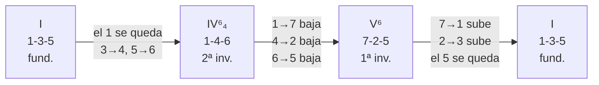

| Tonalidad | I | IV⁶₄ | V⁶ | I |
|---|---|---|---|---|
| **C** | C E G | C F A | B D G | C E G |
| **G** | G B D | G C E | F♯ A D | G B D |
| **D** | D F♯ A | D G B | C♯ E A | D F♯ A |
| **A** | A C♯ E | A D F♯ | G♯ B E | A C♯ E |
| **E** | E G♯ B | E A C♯ | D♯ F♯ B | E G♯ B |
| **B** | B D♯ F♯ | B E G♯ | A♯ C♯ F♯ | B D♯ F♯ |
| **F♯** | F♯ A♯ C♯ | F♯ B D♯ | E♯ G♯ C♯ | F♯ A♯ C♯ |
| **D♭** | D♭ F A♭ | D♭ G♭ B♭ | C E♭ A♭ | D♭ F A♭ |
| **A♭** | A♭ C E♭ | A♭ D♭ F | G B♭ E♭ | A♭ C E♭ |
| **E♭** | E♭ G B♭ | E♭ A♭ C | D F B♭ | E♭ G B♭ |
| **B♭** | B♭ D F | B♭ E♭ G | A C F | B♭ D F |
| **F** | F A C | F B♭ D | E G C | F A C |

```abc
X:1
T:Cadencia I – IV⁶₄ – V⁶ – I en C (y la variante con V⁶₅)
M:4/4
L:1/4
K:C
V:1 clef=treble name="MD"
V:2 clef=bass name="MI"
[V:1] "^1-3-5""C"[CEG] "^1-3-5""F/C"[CFA] "^1-2-5""G/B"[B,DG] "^1-3-5""C"[CEG] | "^1-3-5""C"[CEG] "^1-3-5""F/C"[CFA] "^1-2-4-5""G7/B"[B,DFG] "^1-3-5""C"[CEG] |]
[V:2] "_5-1"[C,,C,] "_5-1"[F,,F,] "_5-1"[G,,G,] "_5-1"[C,,C,] | "_5-1"[C,,C,] "_5-1"[F,,F,] "_5-1"[G,,G,] "_5-1"[C,,C,] |]
```

```strudel
setcpm(60/4)
let tono = "C4:major"   // ← cambia la tonalidad aquí
stack(
  n("<[0,2,4] [0,3,5] [-1,1,4] [0,2,4]>").scale(tono),   // MD: I · IV64 · V6 · I
  n("<-14 -11 -10 -14>").scale(tono),                     // MI: raíces dos octavas abajo
).s("piano")
```

### 8.2 Los 12 acordes por el círculo de quintas, sin saltar

Empezando en C fundamental y buscando siempre la inversión más cercana, la MD recorre los 12 acordes
**sin salir de una octava** (de La3 a La♭4):

| # | Acorde | Posición | MD (de abajo a arriba) | Dedos MD | Bajo MI |
|---:|---|---|---|:-:|---|
| 1 | **C** | fundamental | C4 – E4 – G4 | 1-3-5 | C3 |
| 2 | **G** | 1ª inversión | B3 – D4 – G4 | 1-2-5 | G2 |
| 3 | **D** | 2ª inversión | A3 – D4 – F♯4 | 1-3-5 | D3 |
| 4 | **A** | fundamental | A3 – C♯4 – E4 | 1-3-5 | A2 |
| 5 | **E** | 2ª inversión | B3 – E4 – G♯4 | 1-3-5 | E2 |
| 6 | **B** | fundamental | B3 – D♯4 – F♯4 | 1-3-5 | B2 |
| 7 | **F♯** | 1ª inversión | A♯3 – C♯4 – F♯4 | 1-2-5 | F♯2 |
| 8 | **D♭** | fundamental | D♭4 – F4 – A♭4 | 1-3-5 | D♭3 |
| 9 | **A♭** | 1ª inversión | C4 – E♭4 – A♭4 | 1-2-5 | A♭2 |
| 10 | **E♭** | 2ª inversión | B♭3 – E♭4 – G4 | 1-3-5 | E♭3 |
| 11 | **B♭** | fundamental | B♭3 – D4 – F4 | 1-3-5 | B♭2 |
| 12 | **F** | 1ª inversión | A3 – C4 – F4 | 1-2-5 | F2 |
| 13 | **C** | fundamental | C4 – E4 – G4 | 1-3-5 | C3 |

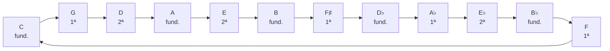

```strudel
setcpm(60/4)
stack(
  note(`<[c4,e4,g4] [b3,d4,g4] [a3,d4,f#4] [a3,c#4,e4] [b3,e4,g#4] [b3,d#4,f#4]
        [a#3,c#4,f#4] [db4,f4,ab4] [c4,eb4,ab4] [bb3,eb4,g4] [bb3,d4,f4] [a3,c4,f4]>`),
  note("<c3 g2 d3 a2 e2 b2 f#2 db3 ab2 eb3 bb2 f2>"),
).s("piano")
```

> [!info] Strudel también sabe hacerlo
> `chord("<C G D A E B F# Db Ab Eb Bb F>").dict('triads').voicing()` elige sola una inversión
> cercana. Compárala con la tabla: no siempre coincide, porque busca otro registro.

---

## 9. La mano izquierda, patrones de acompañamiento

La MD hace el acorde o la melodía; la MI decide **el estilo**. Todos sobre C para ver el dibujo; se
transportan como las tríadas.

| Patrón | Notas en C | Dedos MI | Suena a |
|---|---|---|---|
| **Raíz sola** | C | 5 | balada desnuda, deja todo el espacio |
| **Quinta en bloque** | C + G | 5 – 1 | hueco, folk, Bon Iver |
| **Octava** | C + C | 5 – 1 | peso, coros, finales |
| **1 – 5 – 8** | C · G · C | 5 – 2 – 1 | arpegio abierto, el estándar del pop |
| **1 – 5 – 10** | C · G · E | 5 – 2 – 1 | abierto y cálido: el sonido dream pop |
| **Alberti** | C · G · E · G | 5 – 1 – 3 – 1 | clásico, movimiento continuo |
| **Vals** (3/4) | C bajo · acorde · acorde | 5 · 5-3-1 · 5-3-1 | Lumineers, *chum-pam-pam* |
| **Arpegio largo** | C · G · C · E · C · G | 5 – 3 – 2 – 1 – 2 – 3 | flujo constante; con mano grande |

> [!tip] El vals es tu *Louise*
> El *chum-pam-pam* de [[3. Composiciones/6. louise/0. Intro|Louise]] es el patrón de vals: bajo en
> el 1 con el 5, acorde en el 2 y el 3. Con la inversión más cercana (§8), el acorde de la MI casi
> no se mueve aunque cambie la armonía.

```abc
X:1
T:Patrones de mano izquierda sobre C
M:4/4
L:1/4
K:C
V:1 clef=bass name="MI"
[V:1] "^quinta""_5-1"[C,G,]2 [C,G,]2 | "^octava""_5-1"[C,,C,]2 [C,,C,]2 | "^1-5-8""_5"C,, "_2"G,, "_1"C, "_2"G,, | "^1-5-10""_5"C,, "_2"G,, "_1"E, "_2"G,, | "^Alberti""_5"C,/ "_1"G,/ "_3"E,/ "_1"G,/ C,/ G,/ E,/ G,/ | "^arpegio""_5"C,,/ "_3"G,,/ "_2"C,/ "_1"E,/ "_2"C,/ "_3"G,,/ C,,/ G,,/ |]
```

```abc
X:1
T:Vals (3/4): bajo + acorde
M:3/4
L:1/4
K:C
V:1 clef=bass name="MI"
[V:1] "_5"C,, "_5-3-1"[E,G,C] [E,G,C] | "_5"G,, "_5-2-1"[D,G,B,] [D,G,B,] | "_5"C,, "_5-3-1"[E,G,C] [E,G,C] |]
```

```strudel
setcpm(70/4)
arrange(
  [2, note("[c3,g3]*2")],                   // quinta en bloque
  [2, note("[c2,c3]*2")],                   // octava
  [2, note("c2 g2 c3 g2")],                 // 1-5-8
  [2, note("c2 g2 e3 g2")],                 // 1-5-10
  [2, note("[c3 g3 e3 g3]*2")],             // Alberti
  [2, note("c2 g2 c3 e3 c3 g2 c2 g2")],     // arpegio largo
).s("piano")
```

```strudel
setcpm(120/3)   // vals: 1 ciclo = 1 compás de 3/4
note("<[c2 [e3,g3,c4] [e3,g3,c4]] [g2 [d3,g3,b3] [d3,g3,b3]]>")
  .s("piano")
```

---

## 10. Hanon, técnica de dedos

> [!info] Qué es
> *El pianista virtuoso* de C. L. Hanon (1873): ejercicios de cinco dedos para la **independencia**,
> la **igualdad** y la **fuerza** de los dedos débiles (3, 4 y 5). Esta versión condensada es de
> **dominio público** (Creative Commons Zero).

![[Hanon - Ejercicios 1-30.pdf]]

### Cómo leer la versión condensada

Cada ejercicio se resume en **dos celdas**:

| Parte | Dónde | Qué se hace con ella |
|---|---|---|
| **Celda de subida** | clave de Fa, antes de la doble barra | se toca empezando en C y se repite **subiendo un grado cada vez** (C, D, E, F…) durante dos octavas |
| **Celda de bajada** | clave de Sol, después de la doble barra | arriba del todo, se toca y se repite **bajando un grado cada vez** hasta volver a C |

- **Las dos manos tocan lo mismo, a una octava** de distancia.
- Números de **arriba = MD**, números de **abajo = MI**: la misma convención que esta hoja.
- **1–20** están en 2/4 (8 semicorcheas por celda); **21–30** en 4/4, con celdas más largas.
- Tempo marcado en el PDF: **♩ = 60 a 108**.

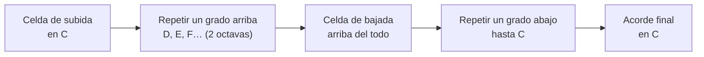

### Hanon 1, escrito completo

La celda de subida es **C E F G A G F E**; la de bajada, su espejo, **G E D C B C D E**.

```abc
X:1
T:Hanon 1: celda de subida, tres repeticiones y celda de bajada
M:2/4
L:1/16
K:C
V:1 clef=treble name="MD"
V:2 clef=bass name="MI"
[V:1] "^1"C"^2"E"^3"F"^4"G "^5"A"^4"G"^3"F"^2"E | DFGA BAGF | EGAB cBAG || "^5"g"^4"e"^3"d"^2"c "^1"B"^2"c"^3"d"^4"e | fdcB ABcd |]
[V:2] "_5"C,"_4"E,"_3"F,"_2"G, "_1"A,"_2"G,"_3"F,"_4"E, | D,F,G,A, B,A,G,F, | E,G,A,B, CB,A,G, || "_1"G"_2"E"_3"D"_4"C "_5"B,"_4"C"_3"D"_2"E | FDCB, A,B,CD |]
```

```strudel
setcpm(60/2)   // ♩ = 60 · un ciclo = un compás de 2/4 = una celda
// Hanon 1 subiendo dos octavas: la misma celda, un grado más arriba en cada ciclo
let celda = "[0 2 3 4 5 4 3 2]"
let grado = "<0 1 2 3 4 5 6 7 8 9 10 11 12 13>"
stack(
  n(grado.add(celda)).scale("C3:major"),   // MI
  n(grado.add(celda)).scale("C4:major"),   // MD, una octava arriba
).s("piano")
```

### Reglas para Hanon

> [!important] Hanon sin tensión o nada
> - **Manos separadas** hasta que salga limpio; después juntas.
> - **Dedos cerca de las teclas** y curvos. La muñeca **quieta y suelta**: el trabajo es de los dedos.
> - **Legato** e **igual**: las 8 semicorcheas con el mismo volumen. El 4 y el 5 son los que delatan.
> - Empieza a **♩ = 60**. Usa la regla del metrónomo (§12): 3 limpias, +4 bpm. El techo es 108.
> - **Si algo duele, para.** Hanon mal hecho lesiona; anótalo en *dolor* de la sesión.

| Cuando ya sale limpio a 80 | Variante |
|---|---|
| Ritmo | con puntillo (larga-corta) y al revés (corta-larga) |
| Toque | staccato con la muñeca suelta |
| Dinámica | crescendo al subir, diminuendo al bajar |
| Tonalidad | la misma celda en G, D o F, con las notas de su escala (fichas de §4) |

---

## 11. Repertorio, Sleep on the Floor

> [!info] La pieza
> **Sleep on the Floor**, The Lumineers. Arreglo de piano de musescore.com.
> La licencia del PDF es de **uso personal**: está en la bóveda para estudiar, pero **no se sube a
> git** (está en `.gitignore`). Por la misma razón, aquí no se transcribe: los ejercicios señalan
> compases de tu PDF.

![[The Lumineers - Sleep on the Floor.pdf]]

### Ficha

| | |
|---|---|
| Compás | 4/4 |
| Tempo | **♩ = 63** en la intro, **♩ = 71** desde el c. 18 |
| Tonalidad | la intro usa sostenidos (F♯, C♯, G♯, D♯); desde el c. 18, **C mayor** sin alteraciones |
| Extensión | 76 compases, unos 4 min 25 s a tempo |
| Por qué esta pieza | es el folk de tu lista (The Lumineers, como *Louise*), con un patrón de MI que ya conoces del vals (§9) |

### Mapa de la pieza

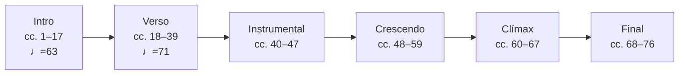

| Sección | Compases | MD | MI | Dificultad | Qué de esta hoja usa |
|---|---|---|---|:-:|---|
| **Intro** | 1–17 | corcheas en pulso, saltando entre una nota aguda y otra grave | tríadas largas con sostenidos | ★★ | fichas de los grupos 2 y 4 (§4) |
| **Verso** | 18–39 | melodía con anacrusas de semicorcheas; entra en el c. 21 | acorde – nota – bajo grave, compás tras compás | ★★ | patrones de MI (§9), cadencias en C (§8.1) |
| **Instrumental** | 40–47 | melodía en negras y corcheas | línea que se mueve con la MD | ★★★ | escala de C (§5) |
| **Crescendo** | 48–59 | acordes con escalas cortas de semicorcheas | semicorcheas continuas | ★★★★ | Hanon (§10), inversiones (§8) |
| **Clímax** | 60–67 | acordes sincopados | semicorcheas continuas | ★★★★★ | todo lo anterior |
| **Final** | 68–76 | vuelve la textura del verso | vuelve el patrón del verso | ★★ | lo mismo que el verso |

> [!tip] Orden de estudio
> **No se aprende de principio a fin.** Primero el verso (es la mitad de la pieza y el final lo
> repite), luego la intro y al final la parte densa. Así, a la semana 2 ya tocas algo que suena a la
> canción.

### Ejercicios preparatorios

Material propio, no de la partitura: preparan las técnicas que la pieza pide.

**1 · El patrón de MI del verso**: acorde abierto en el 1, la raíz en el 2 y la raíz una octava
abajo en el 3. Practícalo así en I–IV–V–I de C antes de leer los compases. El acorde es un 1-5-10
(§9): si no alcanzas la décima, arpégialo de abajo arriba o quita la nota de arriba.

```abc
X:1
T:Preparatorio 1: acorde – raíz – bajo grave
M:4/4
L:1/4
K:C
V:1 clef=bass name="MI"
[V:1] "_5-2-1""C"[C,G,E] "_5"C, "_5 (salto)"C,,2 | "F"[F,CA] F, F,,2 | "G"[G,DB] G, G,,2 | "C"[C,G,E] C, C,,2 |]
```

**2 · Las semicorcheas de la anacrusa**: cuenta en voz alta *1 – e – y – a* con el metrónomo
antes de tocar la melodía del c. 21. Una sola nota; solo el ritmo:

```abc
X:1
T:Preparatorio 2: contar semicorcheas
M:4/4
L:1/16
K:C
V:1 clef=treble name="MD"
[V:1] "^1"B4 "^2"B4 "^3"B2B2 "^4"BBBB | "^1"B4 "^2"B4 "^3"z4 "^4"BBBB | "^1"B8 z8 |]
```

**3 · El pulso de la intro**: corcheas que saltan una octava, con la mano suelta y rebotando, sin
estirar. Sobre C, dedos 5 y 1 (MD):

```abc
X:1
T:Preparatorio 3: octavas quebradas en corcheas
M:4/4
L:1/8
K:C
V:1 clef=treble name="MD"
[V:1] "^5"c"^1"C cC cC cC | dD dD dD dD | eE eE dD dD | c8 |]
```

**4 · Síncopa del clímax**: acordes a contratiempo con la MD mientras la MI marca semicorcheas.
Primero solo la MD contra el metrónomo:

```strudel
setcpm(50/4)   // empieza a 50; la pieza va a 71
stack(
  note("[~ [c4,e4,g4]]*4").s("piano"),                // MD: acorde a contratiempo
  note("c3*16").s("piano").gain(.5),                 // MI: semicorcheas continuas
  s("hh*4").bank("RolandTR909").gain(".8 .3 .3 .3"), // metrónomo
)
```

**Metrónomo para la pieza**, con acento en el 1:

```strudel
let bpm = 40   // ← sube de 4 en 4: la intro va a 63, el resto a 71
setcpm(bpm/4)
s("hh*4").bank("RolandTR909").gain("1 .4 .4 .4")
```

> [!question] Ejercicio de lectura · los acordes de la intro
> La intro (cc. 1–17) tiene la MI en tríadas con sostenidos. Escribe en una tabla qué acorde es cada
> compás, usando las fichas de §4 para reconocerlos. Después compáralo con lo que oyes en la
> grabación original.

---

## 12. Plan de 30 sesiones

Seis semanas, cinco sesiones por semana, **40 minutos** cada una. Cada sesión tiene tres
carriles que avanzan en paralelo: **técnica** (Hanon, §10), **teclado** (acordes, escalas,
arpegios y cadencias de esta hoja) y **repertorio** (*Sleep on the Floor*, §11, y al final tu obra).
Cada semana termina con una grabación (*semana sin audio es semana en blanco*).

El punto de partida es que **las escalas de C, D, E y F ya salen a dos manos**, de arriba abajo, como
un Hanon: no se vuelven a estudiar, se miden el día 1 y desde ahí sirven de ancla (G y A comparten su
digitación). Por eso la semana de escalas solo enseña las ocho que faltan y queda tiempo para tocar
las 12 tonalidades a dos manos en todo. Las tríadas, arpegios y cadencias de C, D, E y F se estudian
como las de las demás.

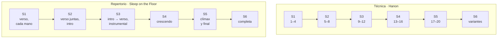

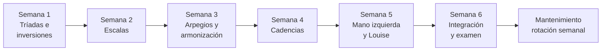

### Cómo es una sesión

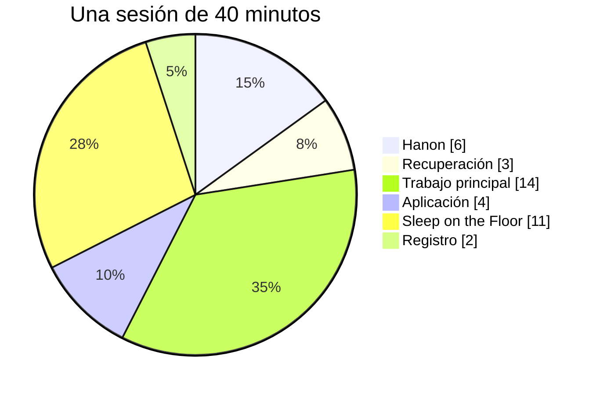

| Bloque | Min | Qué |
|---|---:|---|
| **Hanon** | 6 | técnica: el ejercicio nuevo (manos separadas y luego juntas) y dos de la rotación (§10) |
| **Recuperación** | 3 | lo del día anterior, sin mirar la hoja |
| **Trabajo principal** | 14 | lo nuevo del día, con metrónomo |
| **Aplicación** | 4 | usarlo en algo musical: transportar, al azar, tu pieza |
| **Sleep on the Floor** | 11 | repertorio: los compases del día, con el metrónomo de §11 |
| **Registro** | 2 | anotar los BPM alcanzados y qué falló |

### El metrónomo

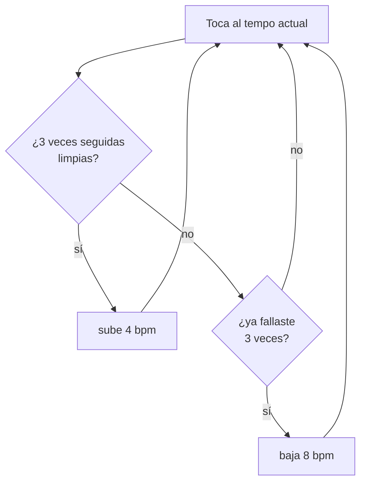

> [!important] Qué significa "limpio"
> Notas correctas, **dedos correctos**, sin pausas antes de los cambios y sin tensión en la muñeca.
> Si los dedos no son los de la hoja, no cuenta aunque suene bien: la digitación es lo que se entrena.

Tempos de partida: **tríadas en bloque a 60** (un acorde por pulso), **quebradas y escalas a 60 en
negras**, luego corcheas al mismo tempo. **Hanon a 60. Sleep on the Floor a 40**, aunque la pieza vaya
a 63 y 71. Las escalas de C, D, E y F empiezan donde las midas el día 1. La meta del programa en *Sleep on the
Floor* es el **80 % del tempo real** (50 y 56); el resto se gana en el mantenimiento.

---

### Las 30 sesiones

Cada sesión tiene **su propia nota**, con las casillas, el material del día y un registro. El
calendario día por día, el progreso (sesiones hechas, BPM, hitos y seguimiento por carril) y el
mantenimiento están en
[[4. Instrumento/1. Piano/1. Programa de 30 sesiones/00. Plan y progreso|Plan y progreso]].

| Semana | Días | Teclado | Hanon | Sleep on the Floor | Se graba |
|:-:|:-:|---|:-:|---|---|
| 1 | 1–5 | tríadas e inversiones en las 12 · la cadena del círculo (§8.2) | 1–4 | verso (cc. 18–39), cada mano | la cadena y la MI del verso |
| 2 | 6–10 | las 8 escalas que faltaban · las 12 a dos manos | 5–8 | verso a dos manos · intro, manos separadas | las 12 escalas y el verso |
| 3 | 11–15 | arpegios de las 12 · armonizar la escala en ocho tonalidades | 9–12 | intro a dos manos · intro → verso · instrumental | tres armonizadas y cc. 1–47 |
| 4 | 16–20 | la cadencia I – IV⁶₄ – V⁶ – I en las 12 y la variante con V⁶₅ | 13–16 | crescendo (cc. 48–59) | las 12 cadencias y cc. 40–59 |
| 5 | 21–25 | los ocho patrones de MI (§9) · *Louise* en el piano | 17–20 | clímax y final (cc. 60–76) | *Louise* y cc. 40–76 |
| 6 | 26–30 | rotación de las 12 · examen en frío | variantes | completa, al 80 % del tempo | la toma final |

---

## 13. Errores comunes

| Error | Qué pasa | Arreglo |
|---|---|---|
| Usar 1-3-5 en todas las inversiones | la 1ª inversión estira el 3 y tensa la mano | la regla del hueco (§3): 1-2-5 en la 1ª |
| Estirar un dedo hacia la negra | tensión, nota floja | mueve **la mano entera** hacia la tapa |
| Pulgar en negra en las escalas | se traba el paso del pulgar | sigue la tabla de §5; pulgar siempre en blanca |
| Subir el tempo antes de estar limpio | se automatiza el error | la regla del metrónomo: 3 limpias, +4 |
| Mirar las manos todo el tiempo | no se construye la geografía | ojos cerrados en la *aplicación* de la semana 1 |
| Saltar de fundamental en fundamental | suena a ejercicio y cansa | la inversión más cercana (§8) |
| Aprender por orden alfabético | 12 formas distintas en la cabeza | por grupos de color (§2): cuatro dibujos |
| Practicar 1 hora el domingo | no se consolida | 40 minutos, cinco días |
| Hanon rápido y tenso | se entrena la tensión, no la independencia | a 60, muñeca suelta; si duele, para (§10) |
| Aprender la pieza de principio a fin | la intro queda perfecta y el resto nunca llega | el orden de §11: verso, intro, parte densa |
| Tocar la pieza siempre desde el c. 1 | los compases difíciles se tocan una vez por sesión | trabaja el compás que falla, no la pieza |

---

## 14. Decisión musical

Saber las 12 tríadas no es la meta: la meta es **elegir el voicing** cuando compones.

1. ¿Qué **nota arriba** quiero en este acorde? Eso decide la inversión de la MD.
2. ¿Cuánto **espacio** necesita la voz? La MI decide: raíz sola, quinta, 1-5-10 o vals.
3. ¿Se **conecta** con el acorde anterior por la nota más cercana? Si salta, ¿el salto es a propósito?
4. ¿La tonalidad de la pieza es cómoda en el piano **y** en la guitarra? Mira los grupos (§2) y la
   tabla de cuerdas al aire de [[Cheat sheet - acordes por tonalidad]].

> La pregunta de fondo: **¿qué nota quiero que suene arriba en cada acorde?**
