# Las guías de IA de Louise

> Archivo derivado: lo genera `_scripts/generar-chatgpt.py` desde la bóveda de música del usuario (Obsidian + git), el 2026-11-04. Cada sección es una nota de la bóveda, con su ruta. La bóveda es la fuente de verdad: si algo de aquí contradice a una conversación más reciente, pregunta.

Recursos de energía y forma (la curva, el inventario de lo gastado, el catálogo de palancas y qué implica cada decisión), los hallazgos abiertos y cerrados, y cada feedback.

Contiene:

- `3. Composiciones/6. louise/AI/0. Recursos de energía y forma - Louise.md`
- `3. Composiciones/6. louise/5. Feedback/00. B2.md`
- `3. Composiciones/6. louise/5. Feedback/01. B2.md`
- `3. Composiciones/6. louise/5. Feedback/02. B2.md`
- `3. Composiciones/6. louise/5. Feedback/03. B2.md`
- `3. Composiciones/6. louise/5. Feedback/04. B2.md`
- `3. Composiciones/6. louise/5. Feedback/05. B2.md`
- `3. Composiciones/6. louise/5. Feedback/06. B2.md`
- `3. Composiciones/6. louise/5. Feedback/07. pieza.md`
- `3. Composiciones/6. louise/5. Feedback/08. pieza.md`
- `3. Composiciones/6. louise/5. Feedback/09. C1.guitarra.voicing.md`
- `3. Composiciones/6. louise/5. Feedback/10. violin.md`
- `3. Composiciones/6. louise/5. Feedback/11. violin.md`
- `3. Composiciones/6. louise/5. Feedback/12. pieza.md`
- `3. Composiciones/6. louise/5. Feedback/13. pieza.md`
- `3. Composiciones/6. louise/5. Feedback/14. pieza.md`
- `3. Composiciones/6. louise/5. Feedback/15. energia.md`
- `3. Composiciones/6. louise/5. Feedback/16. energia.md`

---

## Archivo: `3. Composiciones/6. louise/AI/0. Recursos de energía y forma - Louise.md`

```yaml
tipo: guia-ai
estado: vigente
area: 5. Forma
concepto: "[[2. Composición binaria — contraste, intro y puente]]"
```

# Recursos de energía y forma, aplicados a Louise

Para cada decisión de [[3. Composiciones/6. louise/2. Decisiones|Louise]]: qué implica y con qué
recursos se puede mover. Primero la idea de fondo (§0), después qué se ha gastado ya (§1), luego el
catálogo de recursos (§2) y al final cada decisión con sus implicaciones (§3).

> [!important] Esto no decide nada
> Aquí están las palancas y sus consecuencias. **Qué palanca usas y con qué notas lo decides tú.**
> Lo que elijas va como una línea a `## Decisiones` de Louise.

---

## 0. La idea: la energía es un presupuesto

Cada recurso funciona como una moneda. Si una sección lo gasta, la siguiente solo puede sonar "más"
de dos maneras: gastando un recurso distinto, o gastando más del mismo. Por eso el C1 tiene que
bajar: hoy gasta toda la batería y ya no queda a dónde subir.

La regla de oro de tu nota de concepto vale aquí sección por sección: **cambia de 1 a 3 parámetros,
no 7** → [[2. Composición binaria — contraste, intro y puente#Qué significa “contraste” en binaria (sin perder unidad)|contraste sin perder unidad]].

### La curva acordada (13 oct)

```
            energía      compases          duración
Intro    ██░░░   2       c.1–10            11 s
V1       ███░░   3       c.11–26           18 s
C1       ███░░   3       c.27–42           18 s   ← más plano
B1       █░░░░   1       c.43–50            9 s   ← valle, piano solo
V2       ███░░   3       c.51–66           18 s
C2       ███▓░   3→4     c.67–82           18 s   ← sube, no cierra
B2       █████   5       c.83–             9–18 s ← pico, estrena lo nuevo
C3       ██░░░   2       —                 9–18 s ← despedida, cierra A7→D
Outro    █░░░░   1–2     —                 6–11 s
```

A ♩=160 en 3/4, cada compás dura 1.125 s. 8 compases son 9 s, 16 son 18 s.

---

## 1. Inventario: qué ya gastó Louise

| Recurso              | Dónde suena hoy                                                                                                           | Margen que queda                                     |
| -------------------- | ------------------------------------------------------------------------------------------------------------------------- | ---------------------------------------------------- |
| **Capas**            | piano solo (c.1, B1); piano + batería (intro); + guitarra (verso y coro)                                                  | Choir (aahs) y Voz: **pentagramas vacíos**           |
| **Batería**          | verso: bombo en 1, shaker, cencerro, pandereta, fill cada 8. Coro: bombo en 1 y 3, hi-hat abierto, crash, toms **cada 4** | hoy **ninguno por arriba**: el coro lo usa todo      |
| **Dinámica**         | **ninguna marca** en piano ni guitarra; solo la batería tiene velocidades                                                 | **todo**                                             |
| **Registro**         | piano: D2 a **G5** (c.14/22). Guitarra: hasta F♯5 real                                                                    | por encima de G5; octavas; el bajo en D2 se usa poco |
| **Densidad rítmica** | guitarra con un acorde por compás entero casi siempre; piano en negras en el coro; anticipaciones en c.48–50              | **guitarra rasgueada o arpegiada**; corcheas         |
| **Ritmo armónico**   | un acorde por compás en toda la pieza (a veces dos: A→A7, G→G6)                                                           | más rápido, más lento, pedal                         |
| **Cromatismo**       | **solo el G♯ del c.45**                                                                                                   | todo lo demás                                        |
| **Cadencias**        | rota V7→vi (verso), abierta en Bm y cerrada en D (coro), plagal G→D (c.10→11, 50→51)                                      | semicadencia, corte sin resolver                     |
| **Silencio**         | ningún corte en toda la pieza                                                                                             | break, corte                                         |
| **Motivo**           | c.1–2, 6–7 y 46–47: **siempre igual y siempre sobre D**                                                                   | cualquier transformación es nueva para el oído       |
| **Tempo**            | ♩=160 fijo                                                                                                                | rit. final                                           |

---

## 2. Catálogo de recursos

Cada recurso con: cómo **sube**, cómo **baja**, cómo se hace en **MuseScore** y qué **cuidar**.

### 2.1 Dinámica

- **Sube:** *mf* → *f* → *ff*. Un regulador `<` de 4 a 8 compases antes de una llegada. Un acento en el
  primer tiempo de la sección.
- **Baja:** *p*, *pp*. Regulador `>`. *Subito p* (bajar de golpe) funciona como un corte sin silencio.
- **MuseScore:** paleta *Dinámicas*, con la nota o el compás seleccionado. Los reguladores se ponen
  seleccionando el rango y pulsando `<` o `>`. **La marca afecta solo a su pentagrama:** ponla en
  piano y en guitarra por separado.
- **Cuidado:** la batería ya tiene velocidades nota por nota. Escucha cómo se combina con una marca
  antes de ponerla en todas las secciones.

Para traducir la curva a dinámicas: energía 1 = *p* · 2 = *mp* · 3 = *mf* · 4 = *f* · 5 = *ff*.

### 2.2 Capas (densidad de textura)

- **Sube:** entra un instrumento; el mismo instrumento duplica en octavas; los voicings ganan notas.
- **Baja:** sale un instrumento, o toca menos notas (dos en lugar del acorde de seis).
- **El orden importa:** lo decorativo (shaker, cencerro, pandereta) es lo primero en irse y lo último
  en volver. Lo que define la armonía (el bajo y el acorde) es lo último en irse.
- **Louise:** la guitarra con acordes de 6 notas en redonda es una capa muy pesada. Quitarle notas
  baja la energía sin sacar el instrumento.
- **MuseScore:** prueba en el *Mezclador* (silenciar) antes de borrar. Los pentagramas que no uses se
  ocultan en el panel *Instrumentos* (el ojo).

### 2.3 Registro

- **Sube:** la voz superior una octava arriba; voicing más abierto (más distancia entre el bajo y la voz
  de arriba); el bajo más grave.
- **Baja:** el voicing cerrado en el registro medio; quitar los extremos.
- **Louise:** el piano nunca pasa de G5. **Lo que suene por encima se oye como novedad.**
- **Cuidado:** las terceras por debajo de C3 se embarran. Y **el bajo real es la nota más grave de todos
  los instrumentos juntos**, no solo la del piano: eso es lo que pasa en el c.51.

### 2.4 Densidad rítmica

- **Sube:** más ataques por compás (redonda → negras → corcheas); la guitarra rasgueada en el vals;
  anticipaciones, como las de c.49–50.
- **Baja:** notas largas, acordes que se sostienen, solo el tiempo 1.
- **Louise:** la guitarra casi siempre toca un acorde por compás entero. **Rasguearla es la palanca
  más grande que tienes sin usar.**
- **Un punto medio:** el vals repartido (piano en el 1, guitarra en el 2 y el 3), que ya usas en los cierres.

### 2.5 Batería

| Elemento | Qué hace | Más energía | Menos energía |
|---|---|---|---|
| Bombo | peso | en 1 y 3 empuja hacia el compás siguiente (como en el coro) | solo en 1 es vals ligero; uno cada dos compases es *half-time* |
| Hi-hat abierto | brillo, aire | más seguido | cerrado o fuera |
| Crash | marca el **inicio** de una sección | uno por sección; más lo gasta | sin crash, la sección entra "de lado" |
| Toms (fill) | marca el **final** de una frase | fill más largo (de 1 tiempo a 1 compás) | cada 8 compases respira; cada 4 da urgencia |
| Shaker, pandereta, cencerro | movimiento continuo | corcheas | lo primero en salir |
| Toda la batería | — | — | **break**: calla un tiempo o un compás antes de una llegada |

- **Diferenciar cierres:** que el fill de los cierres abiertos (en Bm: c.30, 38, 70, 78) sea más corto,
  o no exista, y el de los cerrados (en D: c.34, 42, 74, 82) sea completo. Así la batería dice lo
  mismo que la armonía.

### 2.6 Armonía

**Ritmo armónico.** Más acordes por compás dan urgencia; un acorde cada dos compases da amplitud y
deja respirar.

**Pedal.** El bajo se queda en una nota mientras los acordes cambian arriba.
- Pedal en el V (A): la máxima expectativa de llegada.
- Pedal en el I (D): reposo. Sirve para outros.

**Cadencias** → [[0. Cadencias, progresiones y líneas melódicas]]

| Tipo                           | Cómo suena                               | En Louise              |
| ------------------------------ | ---------------------------------------- | ---------------------- |
| Perfecta, V–I (A7→D)           | fin, cierre                              | coro, c.33–34 y 41–42  |
| Rota, V–vi (A7→Bm)             | llega y se escapa: **tu firma**          | verso, c.14→15 y 22→23 |
| Semicadencia (termina en el V) | pregunta, deja colgado                   | **sin usar**           |
| Plagal, IV–I (G→D)             | suave                                    | c.10→11, 24→25, 50→51  |
| Corte                          | la frase se interrumpe antes de resolver | **sin usar**           |

**Cromatismo, lo que no has gastado:**
- **Dominantes secundarias** → [[9. Dominantes en progresiones]]. En Re: V/ii = B7 (→Em), V/iii = C♯7
  (→F♯m), V/IV = D7 (→G), V/V = E7 (→A), V/vi = F♯7 (→Bm). El E/A del c.45 ya es un V/V suave.
- **Intercambio modal**, acordes prestados de Re menor → [[3. Intercambios modales]]: Gm (iv),
  B♭ (♭VI), C (♭VII), F (♭III).
  - Un dato: **tu acorde favorito, B♭** (lo cuentas en *Origen*), **es el ♭VI de Re**. En toda Louise
    no suena ni una vez.
- **Tensiones** (maj7, 9, ♯11) → [[8. Tensiones]]. Ya tienes una: el Gmaj7♯11 del c.10.

**Cuidado:** un color nuevo solo pega más que tres juntos. El G♯ del c.45 funciona porque está solo.

### 2.7 Melodía y motivo

→ [[0. Enlaces 2.0 y motivos]]

- **Repetirlo igual** lo convierte en ancla: es lo que hacen la intro y el B1.
- **Transformaciones:**
  - transposición (a otra altura)
  - inversión (los intervalos al revés)
  - aumentación (valores al doble: más lento)
  - disminución (valores a la mitad)
  - fragmentación (solo las primeras notas)
  - **otra armonía debajo:** el mismo motivo sobre otro acorde cambia lo que significa
- **Louise:** el motivo solo suena sobre D. Cualquiera de estas transformaciones es nueva para el oído.

### 2.8 Timbre nuevo

- **Choir (aahs):** el pentagrama está vacío. Es una capa larga y sostenida que no compite en ritmo con
  nadie, así que sirve para estrenarla en un pico.
- **Voz:** si la hay, su registro agudo es la palanca más fuerte para un pico.
- **La guitarra con otro rol:** arpegio, rasgueo, notas agudas sueltas.
- **Cuidado:** en MuseScore los aahs suenan sintéticos. Pruébalos en el render antes de decidir.

### 2.9 Silencio y corte

- Un silencio de un tiempo o un compás antes de una llegada hace que la llegada pese el doble.
- Un corte después del pico es la descarga inmediata.
- La fermata detiene el tiempo. En MuseScore alarga la nota también en la reproducción.

### 2.10 Proporción (longitud)

- **Acortar** una sección da urgencia o despedida (un C3 de 8 compases).
- **Repetir los últimos 2 a 4 compases** (un *tag*) da insistencia. Es típico de picos y finales.
- **Alargar un acorde** (dos compases en lugar de uno) suspende.
- **Louise:** todas las secciones miden 8 o 16 compases, salvo la intro (10). Romper eso una sola vez
  se nota.

### 2.11 Tempo

- **rit. al final:** el cierre clásico de un vals. En MuseScore está en la paleta *Tempo* (línea de
  cambio gradual).
- **Cambiar el tempo a mitad de pieza** sería una dificultad nueva, y la regla es una por proyecto.

---

## 3. Qué implica cada decisión

### 3.1 C1 más plano (c.27–42)

**Implica:**
- Se edita **solo la batería** de c.27–42. Piano y guitarra pueden quedar igual.
- **El C2 deja de ser copia del C1.** A partir de aquí c.67–82 se editan por separado: cuidado al
  copiar y pegar después.
- El C1 tiene que seguir por encima del verso: el cambio de patrón respecto al verso se queda.

**Recursos:** §2.5 (crash del c.27, hi-hat abierto, bombo en el 3, toms de c.30/34/38/42 o solo los de
Bm) · §2.1 (el C1 en *mf*).

**Decides tú:** qué sale.

### 3.2 C2 sube y no cierra (c.67–82)

**Implica:**
- **Recupera lo que perdió el C1.** El oído reconoce el mismo recurso que vuelve como "más".
- Un crescendo, y hay que decidir dónde empieza. La segunda mitad del coro empieza en el c.75.
- **No cerrar en D cambia c.81–82**, que hoy son A7→D más el enlace D–C♯–B.
- **El final del C2 decide cómo arranca el B2:** piénsalos juntos.

**Recursos:** §2.5 · §2.1 · §2.3 (el piano más arriba en la segunda mitad) · §2.4 (guitarra más densa) ·
§2.6 (semicadencia, rota o corte).

**Decides tú:** qué tipo de final abierto.

### 3.3 B2: el pico (desde el c.83)

**Implica:**
- **Es lo único que se compone de cero.**
- Tiene que superar al C2 con al menos un recurso que **nunca sonó** (ver la columna *Margen* del §1).
- **No debería aterrizar en el I:** el reposo le toca al C3.
- **No debe arrancar como el B1** (Bm, piano solo, enlace D–C♯–B), o el oído piensa "otra vez el bridge 1".
- Con 8 compases la pieza crece 9 s; con 16, crece 18 s.

**Recursos:** §2.8 · §2.4 · §2.6 (cromatismo, pedal en el V, ritmo armónico) · §2.7 · §2.3 · §2.1
(*f* o *ff*).

**Recuerda:** de 1 a 3 parámetros, no 7.

### 3.4 La descarga (del B2 al C3)

| Corte | Vaciado |
|---|---|
| silencio, o queda una sola capa | las capas salen una por una |
| *subito p* | diminuendo, quizá rit. |
| el C3 entra de golpe en calma | el C3 llega cuando ya bajó todo |

**Implica:** decide cómo empieza el C3.

**Recursos:** §2.9 · §2.1 · §2.2 · §2.11.

### 3.5 C3 de despedida

**Implica:**
- **Copiar la mitad (8) o el coro entero (16).** Las dos mitades cierran en A7→D, pero solo la segunda
  (c.35–42) tiene el Sol del A7 (c.41), así que su resolución es más fuerte.
- **Quitar capas** hasta lo mínimo que todavía se reconoce como el coro.
- **El último compás no lleva el enlace D4–C♯4**, salvo que lleve hacia el outro.
- La dinámica en *p* o *mp*.

**Recursos:** §2.2 · §2.1 · §2.10 · §2.6 (cadencia perfecta).

### 3.6 Outro

**Implica:**
- **El material:** el motivo (su frase de 5 compases, como en c.1–5) u otra cosa.
- **El último acorde:** D (cerrado) o Gmaj7♯11 (suspendido, como el c.10).
- **La duración:** 5 compases son unos 6 s; 10 compases, unos 11 s, lo mismo que la intro.
- **La batería:** fuera, mínima, o un último golpe.

**Recursos:** §2.7 · §2.6 (pedal en D) · §2.11 (rit.) · §2.9 (fermata).

### 3.7 c.51: ¿el bajo es Mi o Re?

**Implica:** en el c.51 hay D3 en el piano y E2 en la guitarra (la sexta cuerda al aire). Manda la nota
más grave, así que hoy suena a Dmaj9/E y no a D.

**Opciones:**
- D2 en el piano, como en el c.11.
- La guitarra sin el Mi grave en ese compás.
- Dejarlo así, pero escrito como decisión.

**Recursos:** §2.3.

### 3.8 ¿Voz o instrumental?

| Si hay voz | Si es instrumental |
|---|---|
| melodía de verso y coro: 32 compases como mínimo, más la letra | ocultar Voz, y Choir si no se usa |
| abrir espacio en D4–A4, que hoy ocupan la mano derecha y la guitarra | la voz superior del piano es la melodía |
| la voz se vuelve la palanca principal del pico | el motivo es la identidad de la pieza |
| difícil de cerrar el sábado 17 | cabe en la semana |

Hay un punto medio: instrumental ahora, y la voz en una segunda versión.

**Implica:** la respuesta va en `definicion_terminado`.

### 3.9 Mapa de dinámicas

**Implica:**
- Una marca en piano y en guitarra al inicio de cada sección.
- Reguladores en las subidas (C2) y en las bajadas (la descarga).
- Usa la equivalencia del §2.1 (energía 1–5 → *p*…*ff*) sobre la curva del §0.

### 3.10 Guitarra: ¿la grabas tú?

**Si la grabas:** hay que revoicear lo que no se puede tocar:
- c.13/53
- el Em del coro (c.27, 31, 35, 39 y copias)
- las aperturas de c.12, 14, 15, 16 y 18 (y copias)

**El modelo es tu primer voicing,** el del c.11 (0‑0‑0‑2‑2‑2): cuerdas al aire con una forma pequeña.
Además: posiciones abiertas, cejillas, 4 voces en lugar de 6.

**Si no la grabas:** se queda como está. MuseScore la reproduce igual.

---

## 4. Orden de trabajo

0. Commit antes de empezar.
1. C1 (§3.1)
2. C2 (§3.2)
3. **B2 (§3.3)**: lo único que se compone de cero
4. La descarga (§3.4)
5. C3 (§3.5)
6. El outro (§3.6)
7. Dinámicas (§3.9)
8. Exportar el audio y hacer commit.

## 5. Qué podría subir a Teoría

La idea del **presupuesto de energía** (§0 y §1) no tiene nota de concepto en `8. Textura y arreglo/`.
Si después de cerrar Louise la puedes explicar con tus palabras, ahí va. La nota la escribes tú.

---

## Archivo: `3. Composiciones/6. louise/5. Feedback/00. B2.md`

```yaml
tipo: feedback
estado: superseded
numero: 0
fecha: 2026-10-18
alcance: B2
evaluado:
  - archivo: "7. Partituras/2. Composiciones/Louise.mscz"
    commit: f0ad06e
    limpio: false
    blob: 
    guardado: 2026-10-18
contexto: []
anterior: 
siguiente: 
area: 5. Forma
concepto: "[[2. Composición binaria — contraste, intro y puente]]"
nota_conversion: "Era el feedback 10. Convertido el 2026-10-22. La versión evaluada tenía c.89–106 sin commit: f0ad06e es el último commit de ese día, no el contenido exacto, y no hay blob."
```

# Feedback del B2 de Louise (c.82–91)

> [!info] Fuente
> **Claude, 2026-10-18.** Partitura leída nota por nota y un render de MuseScore medido compás por
> compás. Versión evaluada: la del disco ese día, con **c.89–106 sin commit** (el C3 recién escrito).
> Las alturas de guitarra son **reales**: suena una octava abajo de lo escrito.

> [!important] Esto no decide nada
> Aquí está qué falla, qué se puede mejorar y qué recursos quedan sin usar. **Qué cambias y con qué
> notas lo decides tú.** Lo que decidas va como una línea a
> [[3. Composiciones/6. louise/2. Decisiones|Decisiones de Louise]].

Contexto: la curva acordada y el catálogo de recursos están en
[[3. Composiciones/6. louise/AI/0. Recursos de energía y forma - Louise|0. Recursos de energía y forma - Louise]] (§0 la curva, §1 el inventario, §3.3 el B2).

---

## 1. Qué funciona (para no romperlo)

- **A7 → E♭7 (c.81→82).** Sustituto tritonal: el Do♯ del A7 se queda como Re♭ y comparten el tritono
  Sol–Do♯/Re♭; La→Si♭ y Mi→Mi♭ se mueven por semitono en movimiento contrario. Además resuelve el
  pendiente *"que el B2 no arranque como el B1"* → [[9. Dominantes en progresiones]].
- **Novedad armónica real.** Hasta el c.81 todas las notas son de Re mayor, salvo el Sol♯ del c.45. El
  B2 estrena Si♭, Fa♮, Do♮ y Mi♭, y por fin suena tu B♭ → [[3. Intercambios modales]].
- **Registro nuevo.** Piano hasta Fa6 (antes el tope era Sol5, c.14). Guitarra hasta Si♭5 (antes Fa♯5, c.15).
- **La guitarra cambia de rol.** Deja el arpegio y hace línea en corcheas: 2.4 ataques por compás contra
  1.2 en el C2.
- **c.88→89.** Fa3→Mi3 en la mano izquierda (suspensión 4–3), y el Mi3 se queda como séptima del F.

---

## 2. Qué está mal

### 2.1 c.91: el piano sigue en el B2 cuando la guitarra ya está en el C3

- [ ] **Mi2 de guitarra + Fa2 del piano a la vez:** semitono en el bajo, el registro donde más embarra.
- [ ] **Si♭4 contra Em:** tritono con el Mi. Lo que suena en el tiempo 1 es Mi–Fa–Sol–Si♭, no Em.
- [ ] **Falsa relación:** el c.90 (3&) tiene Fa♯3 y Fa♯4, y el c.91 abre con Fa♮2.
- [ ] **Deshace las dos resoluciones del c.90:** Si♭→La vuelve a Si♭ (La4→Si♭4) y Fa→Fa♯ vuelve a Fa.

### 2.2 c.90: el Dm que quieres no llega a sonar

- [ ] Durante 2.5 tiempos suena Re2 La3 Fa4 Re5 Si♭5: **B♭maj7/D** (o Dm con ♭6 arriba), con La3 contra
  Si♭5 a semitono de dos octavas.
- [ ] Un Dm limpio (Re–Fa–La sin Si♭) no suena en ningún momento.
- [ ] El D mayor dura **una corchea** (~0.19 s a ♩=160). Es lo único que suena a "casa" desde el c.81, y
  llega como anticipación.

### 2.3 c.89, tiempo 3&: el cifrado y el bajo no coinciden

- [ ] La mano derecha toca F7 (La–Mi♭–Do), pero la izquierda sigue con Si♭2–Fa3–Si♭3: es lo que había en el
  último commit, cuando ese tiempo era B♭. Suena **F7/B♭**.

### 2.4 c.83: tu acorde favorito llega disfrazado

- [ ] **Cuatro Re contra un Si♭ en el piano** (D2, D3, D4, D6 contra Si♭4): primera inversión con la tercera
  cuadruplicada. Como Re es la tónica de toda la pieza, el oído oye "Re con algo", no "B♭" → [[00. Voicing e inversiones]].
- [ ] **La guitarra toca Mi natural** (con un bemol de armadura no lleva alteración). Queda un tritono
  Mi4–Si♭4 en la base de su acorde, y el Mi4 choca contra el Fa5 del piano a novena menor. Suena **B♭(♯11)/D**.
  - Si querías Mi♭ o Fa, es una nota equivocada.
  - Si es lidio a propósito, es tu tercer color ♯11: ya están el Gmaj7♯11 del c.10 y el F con Si del c.87 → [[8. Tensiones]].
- [ ] La nota más aguda de todo el B2 (Fa6) es una corchea en el 3& de este primer compás.

### 2.5 La batería se apaga justo donde empieza el pico

- [ ] El **c.82 es el compás más denso de toda la pieza**: crash, bombo en 1-2-3, toms, palmas, shaker,
  pandereta, cencerro y hi-hat.
- [ ] **c.83–90: cero.** El B2 tiene la misma batería que el B1: ninguna.
- [ ] El redoble anuncia una llegada y lo que sigue es silencio.

### 2.6 En el render, el B2 suena a valle

| Sección | dB medio |
|---|---|
| Intro (c.1–10) | −17.7 |
| V1 (c.11–26) | −13.2 |
| C1 (c.27–42) | −13.4 |
| B1 (c.43–50) | −19.1 |
| V2 (c.51–66) | −12.8 |
| C2 (c.67–81) | −12.6 |
| **B2 (c.83–90)** | **−16.5** |
| ↳ c.84–86 | ≈ −18 |
| C3 (c.91–106) | −14.3 |

- [ ] El B2 queda **4 dB por debajo del C2**. El tramo c.84–86 está casi al nivel del B1.
- [ ] El **C3**, planeado en energía 2, **suena más fuerte que el B2**: la curva está invertida.
- [ ] Como no hay ninguna marca de dinámica en la pieza, este render es lo único que dice cuánto pesa cada sección.

---

## 3. Qué puede mejorar

### 3.1 El B2 empieza arriba y baja

Nota más aguda de cada compás:

| c. | 83 | 84 | 85 | 86 | 87 | 88 | 89 | 90 |
|---|---|---|---|---|---|---|---|---|
| tope | **Fa6** | Re6 | Do6 | Do6 | La5 | Sol5 | Do6 | Si♭5 |

El punto más alto está en el primer compás y después todo desciende. Esa es la forma de una descarga, no
de una subida: dentro del B2 no hay ningún tramo que trepe.

### 3.2 El B2 se cierra solo, dos compases antes de terminar

El c.87 dice G7, pero **el G7 dura un tiempo**: en los tiempos 2 y 3 suenan Do3–Fa3, La4–Do5 y Fa4–Do5 en la
guitarra, o sea **F/C**. Entonces c.87–89 forman:

> **V/V → I⁶₄ → V⁷ → I en Fa** (G7 → F/C → C7 → F)

Es la cadencia perfecta más completa de toda la pieza, y cae en el c.89. La tensión se libera dentro del
pico, y el c.90 tiene que arrancar de cero para llegar al C3 → [[0. Cadencias, progresiones y líneas melódicas]].

### 3.3 "B2 en B♭" no es lo que dice la partitura

- La armadura de un bemol y la cadencia dicen **Fa mayor, empezando en su IV**.
- Visto desde Re: B♭ (♭VI), Gm (iv), Am (v), C (♭VII), F (♭III) y Dm (i) son todos de **Re menor
  natural**. Solo el E♭7 y el G7 quedan fuera.
- El B2 es Louise en su menor paralelo, y por eso **Dm es su destino natural**.
- El problema es que la cadencia en Fa convierte a Fa en el centro, y entonces el Dm del c.90 suena a vi de
  Fa, no a "casa en menor".

### 3.4 El camino B♭ → Dm → Em

| Par | Notas en común |
|---|---|
| B♭ – Dm | Re, Fa |
| Dm – Em | **ninguna** |
| D – Em | **ninguna** |
| B♭ – Em | ninguna (raíces a tritono) |

- El c.83 (B♭/D) y el c.90 (B♭maj7/D) son casi el mismo acorde sobre el mismo bajo. El B2 entra y sale
  por el mismo punto, como un círculo.
- Sin notas comunes entre Dm y Em, todo el peso del enlace cae en la conducción de voces y en el bajo, que
  hoy es el Fa2 de §2.1.
- **Em es el ii, no la tónica.** Su fuerza como llegada depende de que es el arranque conocido del coro y
  de cómo se prepara.
- Los coros anteriores entraban desde F♯m (c.26 y c.66), un grado arriba de Em. El C3 entra desde D, un
  grado abajo.
- La vuelta a casa después de 8 compases fuera cabe en poco más de un compás, con tres armonías:
  F7/B♭ → B♭maj7/D → D.

Lo que suena hoy en c.89–91 (reducción, armadura neutra y alteraciones escritas):

```abc
X:1
T:Louise c.89–91, como suena hoy
M:3/4
L:1/8
Q:1/4=160
K:C
V:1 clef=treble name="Piano MD"
V:2 clef=bass name="Piano MI"
V:3 clef=bass name="Guitarra (real)"
[V:1] "^F"[Afc']2 [Afc']3 "^F7"[A_ec']1 | "^Dm (suena Bbmaj7/D)"[Fd_b]2 [Fd_b]3 "^D"[^FAa]1 | "^Em"[G_Bg]2 E2 E2 |
[V:2] [F,,E,A,]4 z1 "^bajo Sib"[_B,,F,_B,]1 | [D,,A,]4-[D,,A,]1 [D,,^F,]1 | "^Fa2"[F,,E,]2 z4 |
[V:3] [CAca]6 | z6 | "^Mi2"[E,,G,,E,G,]6 |
```

### 3.5 Ritmo

- En los 8 compases, al menos una mano toca el mismo patrón: **1 · 2 con puntillo · 3&**. Viene de los A7
  del coro y de los c.45 y c.49 del B1, y es buena fuente. Pero si todos los compases empujan, ninguno empuja.
- El piano casi nunca toca el tiempo 3 (solo una vez, en el c.87). El vals lo sostiene únicamente la guitarra.

### 3.6 Piano y guitarra hablan a la vez y en la misma octava

- La guitarra se mueve casi siempre entre Si♭4 y Si♭5, que es justo la zona de la mano derecha del piano.
- **Unísonos:**

| c. | Unísono guitarra–piano |
|---|---|
| 83 | Si♭4 |
| 84 | Re5, Sol5 |
| 85 | La4, Mi5, La5 |
| 86 | Fa5 (dos veces) |
| 87 | Si4, Do5 |
| 88 | Si♭4, Mi5 |
| 89 | La4 |

- En el c.84, dos de las cuatro notas de la guitarra caen dentro del acorde que el piano sostiene, y la línea
  desaparece.
- **Roces de semitono en la misma octava:** Fa5 guitarra contra Mi5 piano (c.85, 3&), Mi5 guitarra contra
  Fa5 piano (c.86, tiempo 3) y Si4 contra Do5 (c.87, 2&).
- Esto es justo lo que escribiste en [[3. Composiciones/6. louise/3. Sesiones/06. Second bridge|06. Second bridge]]: querías que uno armonizara y después cambiaran de
  papel. En el B2 los dos llevan melodía y armonía al mismo tiempo, sin turnos.

### 3.7 El motivo aparece, pero enterrado

En los c.85–86 la guitarra toca **La–Sol–Fa♮ … Re … Fa**: el esqueleto del motivo (La–Sol–Fa♯–Re–Fa♯) en
menor → [[0. Enlaces 2.0 y motivos]].

- Si fue a propósito, es la idea más fuerte del B2.
- Hoy va en la guitarra, en unísono con el piano en La5 y Fa5, sin el ritmo del motivo y en los compases más
  bajos de volumen (−18 dB).

### 3.8 Registro grave

La nota más grave del B2 es Re2, la misma que en el resto de la pieza, y en los c.86 y 88 el bajo sube a Do3.
El B2 solo se abre hacia arriba.

### 3.9 Duración

El B2 tiene 9 compases (c.82–90, unos 10 s), casi lo mismo que el B1 (8 compases, 9 s). **El pico dura lo
que dura el valle.**

### 3.10 Si grabas tú la guitarra

- El c.83 (Mi4–Si♭4–Re5–Si♭5, sostenido) cae en los trastes 14–18 (cuerdas 4 a 1). En nylon es casi intocable.
- El Si♭5 del c.84 está en el traste 18.
- Por encima del traste 12 la nylon pierde proyección y sustain: su registro de pico es su timbre más débil.
  El render no lo muestra.

---

## 4. Qué más puedes agregar (recursos que el B2 no usa)

| Recurso | Cómo está hoy | Catálogo |
|---|---|---|
| Batería | nada en los c.83–90 | §2.5 |
| Dinámica | ninguna marca en toda la pieza | §2.1 |
| Coro (aahs) | pentagrama vacío | §2.8 |
| Voz | vacía, y la decisión sigue pendiente | §3.8 |
| Silencio o corte | ninguno en toda la pieza, ni antes del B2 ni antes del C3 | §2.9 |
| Nota pedal | el bajo cambia en cada compás | §2.6 |
| Guitarra rasgueada | no aparece en toda la pieza | §2.4 |
| Dominantes secundarias | solo el E/A del c.45 y el G7 del c.87 | §2.6 |
| Transformaciones del motivo | solo la de c.85–86, escondida | §2.7 |
| Repetir los últimos 2–4 compases | no se usa | §2.10 |

Los números de la última columna son secciones de [[3. Composiciones/6. louise/AI/0. Recursos de energía y forma - Louise|0. Recursos de energía y forma - Louise]].

---

## 5. Detalles aparte

- [ ] c.67: además de "Coro 2" hay una marca de ensayo vacía.
- [ ] c.89–106 sin commit al momento de esta revisión.

---

## Cómo se midió

- La partitura se exportó a MusicXML con MuseScore y se leyó compás por compás: alturas, duraciones y qué
  suena a la vez en cada corchea.
- El audio es un render de MuseScore por línea de comandos (sin marcas de dinámica, porque la partitura no
  tiene ninguna). El volumen es el RMS de cada compás: a ♩=160 en 3/4, un compás dura 1.125 s.
- Ni la partitura ni el repositorio se modificaron. Todo se hizo sobre copias temporales.

---

## Archivo: `3. Composiciones/6. louise/5. Feedback/01. B2.md`

```yaml
tipo: feedback
estado: superseded
numero: 1
fecha: 2026-10-19
alcance: B2
evaluado:
  - archivo: "7. Partituras/2. Composiciones/Louise-melancolica.mscz"
    commit: e7ed2ff
    limpio: true
    blob: bd34054
    guardado: 2026-10-19 13:09
contexto: []
anterior: "[[3. Composiciones/6. louise/5. Feedback/00. B2|F 00]]"
siguiente: 
area: 5. Forma
concepto: "[[2. Composición binaria — contraste, intro y puente]]"
nota_conversion: "Era el feedback 11."
```

# Entrada del B2 y el motivo en menor (c.81–85)

> [!info] Fuente
> **Claude, 2026-10-19.** Versión evaluada: `Louise-melancolica.mscz` en el commit **`e7ed2ff`** (guardada
> a las 13:09, 110 compases). Se exportó a MusicXML y se leyó nota por nota. El volumen es el RMS por compás
> de un render de MuseScore sin dinámicas. Las alturas de guitarra son **reales**.
>
> Todo "hoy" en esta nota se refiere a esa versión. Para verla: `./_scripts/historial.py melancolica`.

> [!warning] La partitura siguió después de esta nota
> La versión de las **17:32** (el commit que agrega esta nota) cambió cuatro cosas que aquí se discuten:
> - **c.82, el E♭7 vuelve a llevar Sol.** La mano izquierda pasa de Mi♭3–La3–Do4 a **Mi3–Si♭3–Sol3**:
>   vuelve la tercera (§2.1, *c.82*) y aparece un **Mi natural** en el 2&. Si es a propósito, es la ♭9 del
>   E♭7 (suena E♭7♭9) y anticipa el Mi del bajo del c.83. Si querías Mi♭, le falta el bemol.
> - **c.83, el Si♭ resuelve.** El Si♭3 de la mano izquierda pasa a **La3**, que es la decisión de §2.1
>   (*c.83*). El suspiro Si♭→La suena ahora en dos octavas (Si♭3→La3 y Si♭4→La4), y el Sol3 del 3& sube al
>   mismo La3. El bajo sigue en Mi, así que suena Dm/E.
> - **c.84, el Si♭ reaparece un compás después.** El La4 del tiempo 1 pasa a **Si♭4**, sobre Mi2–Fa3–Re4
>   (tritono con el bajo).
> - **Batería.** El c.81 sigue con el groove completo y el c.82 con el redoble, como a las 13:09. El **c.83
>   ya no tiene crash** (lleva hi-hat abierto en su lugar) y suma palmas y pandereta en el 1. El c.84 sigue
>   vacío.
>
> Render de esa versión: c.81 −11.8 · c.82 −18.1 · c.83 −14.4 · c.84 −17.8 dB. Hubo una versión intermedia
> a las 16:58, con el groove cortado desde el c.81, que no quedó en git.

> [!example] Cómo leer los ejemplos
> - **`music-abc`** para conducción de voces y armonía; **Strudel** para ritmo y energía. Cada uno es malo
>   fuera de su terreno.
> - Todos parten de **tus** compases. Cada ejemplo cambia **una sola cosa**, para que se oiga exactamente
>   qué se quiere decir. Son ilustraciones, no propuestas: las notas siguen siendo tuyas.
> - Los Strudel van con tu kit (`AkaiLinn`) y tus velocidades (FUERTE 0.81, NORMAL 0.71, SUAVE 0.54). Un
>   ciclo es un compás. Se verificaron con Strudel local, y el de "hoy" reproduce la partitura golpe por
>   golpe. Los `music-abc` se validaron con abcjs: todos los compases suman 3/4.

> [!important] Esto no decide nada
> Aquí están las opciones y qué cambia cada una. **Qué notas escribes lo decides tú.** Lo que decidas va
> como una línea a [[3. Composiciones/6. louise/2. Decisiones|Decisiones de Louise]].

Viene de [[3. Composiciones/6. louise/5. Feedback/00. B2|10. Feedback del B2 - Louise]] (versión anterior) y usa el catálogo de
[[3. Composiciones/6. louise/AI/0. Recursos de energía y forma - Louise|0. Recursos de energía y forma - Louise]].

---

## 0. El arco del B2, como lo describes

> El B2 es el pico, pero **arranca triste**, la **subida trae un poco de felicidad**, el **pico es el
> contraste entre felicidad y melancolía**, y **resuelve al entrar al Em** del C3.

Ese arco ya está escrito en las notas, pero todavía no se oye:

| Momento | c. | Armonía | Qué tiene de "feliz" | dB |
|---|---|---|---|---|
| Umbral | 82 | E♭7 | — | −18.0 |
| Tristeza | 83–86 | motivo en menor, Gm, Am | nada | −16.3 |
| Subida | 87–90 | C, G7, C7, F | el **Si♮ del c.88** es la primera nota que solo existe en Re mayor desde el c.82, y vienen cuatro acordes mayores seguidos | −16.1 |
| Pico | 91 | Dm → D | el **Fa♯** del 3&, que dura una corchea | −16.9 |
| Coro | 92 | Em | | −12.7 |

- La luz entra por etapas: Si♮ → acordes mayores → Fa♯.
- Lo que falta es **energía**: la subida suena igual que la tristeza, y el compás más fuerte después
  del C2 es el primero del C3.
- En Louise, la felicidad y la melancolía se reducen a **una nota: Fa♯ o Fa** (y, en segundo plano, Si o
  Si♭). El Fa♯ es la 3ª y la 5ª nota del motivo, y la tercera del acorde de Re →
  [[3. Intercambios modales]].

Esta nota trata solo la **costura**: cómo termina el C2, cómo empieza el B2 y cómo entra el motivo. El pico
queda pendiente en §6.

---

## 1. Lo que hay hoy (c.81–85)

| c. | Armonía | Qué pasa | Batería | dB |
|---|---|---|---|---|
| 81 | A7 | cierre del C2, toca todo el grupo | groove completo | −11.8 |
| 82 | E♭7 | piano solo; Si♭4 y Mi♭5 sostenidos 3 tiempos | se corta; redoble de toms | **−18.0** |
| 83 | motivo en menor, **bajo Mi** | piano en sextas | crash, bombo en 1-2-3 | −14.1 |
| 84 | 2º compás del motivo (hemiola) | piano solo | nada | **−18.0** |
| 85 | Gm | entra la guitarra | nada | −15.8 |

La costura queda **hueco – golpe – hueco**: el redoble y el crash prometen algo y después no llega nada.

Reducción de los c.81–84 tal como suenan hoy (armadura neutra, alteraciones escritas):

```music-abc
X:1
T:Louise c.81–84, como suena hoy
M:3/4
L:1/16
Q:1/4=160
K:C
V:1 clef=treble name="Piano MD"
V:2 clef=bass name="Piano MI"
V:3 clef=bass name="Guitarra (real)"
[V:1] "^A7" z4 [G^c]4 [Ae]4 | "^Eb7" [_B_e]12 | "^motivo (suena Em7b5)" [Af]3 [Ge]6 [Fd]3 | "^Dm/E - Dm/A" [DA]6 [Fd]6 |
[V:2] [A,,E,]4 [^C,E,]4 [^C,E,]4 | [_E,,_D,]6 _E,2 A,2 C2 | [E,,D,_B,]12 | [E,,F,]6 [A,,D,]6 |
[V:3] [A,,^C,EAe]12 | z12 | z12 | z12 |
```

Los mismos compases a las 17:32. Compáralos con el de arriba en tres puntos:
- La mano izquierda del c.82 (Mi3–Si♭3–Sol3).
- El La3 del c.83: el Si♭ resolvió.
- El Si♭4 del c.84.

```music-abc
X:1
T:Louise c.81–84, a las 17:32
M:3/4
L:1/16
Q:1/4=160
K:C
V:1 clef=treble name="Piano MD"
V:2 clef=bass name="Piano MI"
V:3 clef=bass name="Guitarra (real)"
[V:1] "^A7" z4 [G^c]4 [Ae]4 | "^Eb7" [_B_e]12 | "^motivo (suena Dm/E)" [Af]3 [Ge]6 [Fd]3 | "^Sib arriba" [D_B]6 [Fd]6 |
[V:2] [A,,E,]4 [^C,E,]4 [^C,E,]4 | [_E,,_D,]6 "_Mi natural" =E,2 _B,2 G,2 | [E,,D,A,]12 | [E,,F,]6 [A,,D,]6 |
[V:3] [A,,^C,EAe]12 | z12 | z12 | z12 |
```

En la versión de las 17:32, el La del motivo queda **encerrado**: en la mano izquierda llega desde arriba
(Si♭3) y desde abajo (Sol3), y en la derecha desde arriba (Si♭4). Las tres flechas apuntan a la primera nota
del motivo.

El motivo en la intro y en el B2 (voz de abajo de las sextas). Además del Fa, cambia el ritmo del
segundo compás: **5 + 7 semicorcheas pasan a 6 + 6**, que es una hemiola, igual que el F♯m que prepara cada
coro (c.26 y c.66) → [[0. Enlaces 2.0 y motivos]].

```music-abc
X:2
T:El motivo - c.1–2 y c.83–84
M:3/4
L:1/16
K:C
"^c.1–2 (Re mayor)" A3 G6 ^F3 | D4-D ^F6-F || "^c.83–84 (Re menor)" A3 G6 =F3 | D6 F6 |]
```

La hemiola se entiende mejor oyéndola. Aquí va contra el pulso del vals: en el segundo compás de la intro, el
Fa♯ cae justo después del tiempo 2; en el B2, el Fa cae **entre** el 2 y el 3, y el bajo se mueve con él.

```strudel
// El segundo compás del motivo, contra el pulso del vals (hi-hat en 1-2-3).
// Ciclos 1–2: c.1–2, la intro (5 + 7 semicorcheas).
// Ciclos 3–4: c.83–84, el B2 (6 + 6: dos negras con puntillo, una hemiola).
setcpm(160 / 3)

stack(
  // el motivo
  note("<[A4@3 G4@6 F#4@3] [D4@5 F#4@7] [A4@3 G4@6 F4@3] [D4@6 F4@6]>").sound("piano"),
  // el bajo: Re3 · Fa#3 · Mi2 · Mi2 → La2
  note("<D3 F#3 E2 [E2 A2]>").sound("piano"),
  // el vals
  s("[hh hh hh]").bank("AkaiLinn").velocity(0.54),
)
```

---

## 2. Decisión 1: cómo cierra el C2 (c.81–82)

| Opción | Qué cambia | Riesgo |
|---|---|---|
| **A7 directo al motivo** | El cambio a menor ocurre en un solo paso; arriba, el Mi5 sube a Fa5. El B2 dura un compás menos. | Pierdes el suspiro Si♭→La y la rima con un F7 a la salida. |
| **A7 → E♭7, y el bajo baja a Re** | Es el sustituto tritonal de libro: todo **cae** en Dm y el motivo queda sobre la tónica menor real. | El Dm se asienta: es tristeza "en casa", no flotante. |
| **A7 → E♭7, y el bajo sube a Mi** (hoy) | Todo el bloque grave sube un semitono: el piso se levanta en vez de caer. Suena Em7♭5. | El E♭7 no resuelve, se desliza. Va contra la idea de *caer* en la tristeza. |

### 2.1 La dirección elegida: A7 → E♭7 → Re en el bajo

> Elegida "mayormente" el 2026-10-19. Queda **por probar en audio** antes de ir a Decisiones.

#### Qué es: Re preparado dos veces

Tu nota [[2. Sustitutos de tritono]] lo dice: *"Doble resolución: tanto el dominante original como su
sustituto resuelven al mismo acorde"* y *"Orden flexible: es posible utilizar primero el dominante o primero
el sustituto"*. Eso es justamente esta opción:

- **A7** empuja a Re desde una quinta arriba (la cadencia de siempre: c.41→42, c.97→98).
- **E♭7** empuja a Re desde un semitono arriba.
- Las dos apuntan a **Re**. Lo que sorprende no es la raíz, es el **modo**: *te prepara Re dos veces y te
  da Re menor*.

Esto matiza lo que se dijo antes en la conversación. Con el bajo en **Mi**, el E♭7 rompe la expectativa de
Re. Con el bajo en **Re**, la **redobla**, y por eso el menor pega más fuerte → [[9. Dominantes en progresiones]].

El mecanismo, en cuatro voces de libro, sin nada de Louise (como el ejemplo G7 → D♭7 → C de tu nota). Se
toca dos veces: hacia **Re menor** y hacia **Re mayor**. Todo es igual salvo una nota del tenor, **Fa o
Fa♯**. Esa es la nota que, en Louise, separa la tristeza de la felicidad.

```music-abc
X:2
T:Re preparado dos veces: A7, Eb7 y Re menor o mayor
M:3/4
L:1/4
K:C
V:1 clef=treble
V:2 clef=bass
[V:1] "^A7" [^CA]3 | "^Eb7" [_D_B]3 | "^Dm" [DA]3 || "^A7" [^CA]3 | "^Eb7" [_D_B]3 | "^D" [DA]3 |]
[V:2] [A,,G,]3 | [_E,,G,]3 | [D,,F,]3 || [A,,G,]3 | [_E,,G,]3 | [D,,^F,]3 |]
```

- Soprano: La → **Si♭ → La**. Es el suspiro, el mismo que lleva a la primera nota de tu motivo.
- Contralto: Do♯ → **Re♭** (la misma tecla) → Re. Es la sensible retenida.
- Tenor: Sol → Sol → **Fa** (o Fa♯). El Sol es la nota que comparten el A7 y el E♭7.
- Bajo: La → **Mi♭ → Re**. Es la caída por semitono.

#### La conducción, voz por voz

**c.81 → c.82 (A7 → E♭7), como está hoy**

| Voz | A7 (c.81) | E♭7 (c.82) | Movimiento |
|---|---|---|---|
| Bajo | La2 | Mi♭2 | tritono abajo |
| Tenor | Do♯3 | Re♭3 | **se queda** (misma tecla) |
| Interior | Mi3 | Mi♭3 (en el 2&) | semitono abajo |
| Alto | La4 | Si♭4 | semitono arriba |
| Soprano | Mi5 | Mi♭5 | semitono abajo |
| — | Sol4 (solo en el tiempo 2) | — | la otra nota común (7ª del A7 = 3ª del E♭7) **no llega** (a las 17:32 sí: Sol3 en el 3&) |

**c.82 → c.83 (E♭7 → Dm), con la opción 2**

| Voz      | E♭7 (c.82)     | Dm (c.83) | Movimiento                                                          |
| -------- | -------------- | --------- | ------------------------------------------------------------------- |
| Bajo     | Mi♭2           | **Re2**   | semitono abajo: la *regla del movimiento cromático* de tu nota      |
| Tenor    | Re♭3           | Re3       | semitono arriba: es el **Do♯ del A7, que resuelve un compás tarde** |
| Alto     | Si♭4           | La4       | semitono abajo: **primera nota del motivo** (el suspiro)            |
| Soprano  | Mi♭5           | Fa5       | un tono arriba (hoy)                                                |
| Interior | La3 (tiempo 3) | La4       | anuncia el motivo una octava abajo                                  |

A las 17:32 el La3 sale del E♭7, que vuelve a Si♭3–Sol3, y **aparece en el c.83**: el Si♭3 baja a La3 y el
Sol3 sube a La3. El suspiro suena en dos octavas (Si♭3→La3 y Si♭4→La4). Para tener esta tabla completa, solo
falta que el bajo sea Re.

- El Re queda **apretado entre dos semitonos**: Mi♭ desde arriba y Re♭/Do♯ desde abajo. Ningún enlace de la
  pieza empuja tanto hacia Re.
- La sensible del A7 (Do♯) no resuelve en el c.82: se queda sostenida como Re♭ y resuelve en el c.83. Es
  una **resolución retenida**, un compás de espera escrito dentro de la armonía.
- El motivo **sale del E♭7**: el Si♭4 se sostiene tres tiempos y cae a La4.

#### Qué cambia compás por compás

**c.81: nada en la armonía.** Lo único por decidir es si el groove del C2 sigue hasta el final del c.82
(ver *Energía*, más abajo). A las 17:32 sigue como a las 13:09: groove completo en el c.81, corte y redoble
en el c.82.

**c.82: dos detalles.**

- [ ] **¿Sol o La–Do en el E♭7?** Tu E♭7 no tiene tercera (Sol). La versión anterior tenía Sol3 en el 3&;
  hoy hay La3 en el 3 y Do4 en el 3&. A las 17:32 volviste al Sol, y apareció un Mi natural en el 2&
  (ver el aviso del principio).

| | Con Sol (3ª) | Con La–Do (hoy) |
|---|---|---|
| Qué suena | dominante completo: comparte con el A7 las dos notas del tritono | dominante lidio: ♯11 y 13, flotante, más dream pop que jazz |
| Hacia el Dm | Sol→Fa: la **tercera menor llega por grado conjunto**, pero **solo si en el c.83 hay un Fa abajo**. Ni a las 13:09 (Mi2–Re3–Si♭3) ni a las 17:32 (Mi2–Re3–La3) lo hay, así que el Sol3 no baja a Fa: a las 17:32 sube a La | el Fa llega arriba (Mi♭5→Fa5) o desde el motivo |
| Hacia el motivo | — | el **La3 anuncia la primera nota del motivo** |

→ [[8. Tensiones]]

> [!tip] Esta casilla y la del Si♭3 (c.83) son la misma decisión
> El E♭7 → Dm de libro mueve las cuatro voces: Mi♭→Re, **Sol→Fa**, **Si♭→La** y Re♭→Re (el ejemplo de
> cuatro voces de arriba). Elegir el Sol y que el Si♭ resuelva es la misma elección: la mano izquierda del
> c.83 queda en Re–Fa–La, un Dm limpio.
>
> A las 17:32 tomaste dos de las cuatro: el Sol está y el Si♭ resuelve. El Sol sube a La en vez de bajar a
> Fa, así que el La queda encerrado y el Fa llega solo arriba, y el bajo sigue en Mi. No está mal: es otra
> conducción, que **apunta al La del motivo** en lugar de completar el acorde de Re menor.

- [ ] **Armadura.** El cambio a un bemol está en el c.82 y la marca B2 en el c.83. Si el E♭7 es el último
  compás del C2, la armadura va con la marca. Es solo de notación.

**c.83: el bajo pasa de Mi2 a Re2, pero eso solo no basta.**

- [ ] **El Si♭3 de la mano izquierda.** Hoy, con el bajo en Mi, ese Si♭ es la 5ª disminuida de Em7♭5. Con el
  bajo en Re y el motivo encima (La4, Fa5), suena **B♭maj7/D**, no Dm: es lo mismo que pasa en el c.91
  (§2.2 de [[3. Composiciones/6. louise/5. Feedback/00. B2|10. Feedback del B2 - Louise]], donde ese compás era el c.90).

| | El Si♭ se queda | El Si♭ resuelve |
|---|---|---|
| Qué suena | **tu B♭ escondido dentro del Dm**: Dm con ♭6, la nota más triste del menor | Dm limpio; el cifrado dice la verdad |
| El suspiro Si♭4→La4 | se debilita: el Si♭ sigue sonando una octava abajo | se oye entero |
| Forma del B2 | entra (c.83) y llega al pico (c.91) con **el mismo color**: un círculo | entrada y pico distintos |

Las tres maneras, con tu c.82 de las 17:32 delante y tu motivo encima. Solo cambia la mano izquierda del
c.83. Arriba de cada una dice lo que suena:
```music-abc
X:1
T:(a) 17:32 - Dm/E
M:3/4
L:1/16
K:C
V:1 clef=treble
V:2 clef=bass
[V:1] "^Eb7" [_B_e]12 | "Dm/E" [Af]3 [Ge]6 [Fd]3 |]
[V:2] [_E,,_D,]6 =E,2 _B,2 G,2 | [E,,D,A,]12 |]
```

```music-abc
X:2
T:(b) Re, Sib a La - Dm
M:3/4
L:1/16
K:C
V:1 clef=treble
V:2 clef=bass
[V:1] "^Eb7" [_B_e]12 | "Dm" [Af]3 [Ge]6 [Fd]3 |]
[V:2] [_E,,_D,]6 =E,2 _B,2 G,2 | [D,,D,A,]12 |]
```

```music-abc
X:3
T:(c) Re, Sib queda - Bbmaj7/D
M:3/4
L:1/16
K:C
V:1 clef=treble
V:2 clef=bass
[V:1] "^Eb7" [_B_e]12 | "Bbmaj7/D" [Af]3 [Ge]6 [Fd]3 |]
[V:2] [_E,,_D,]6 =E,2 _B,2 G,2 | [D,,D,_B,]12 |]
```

- **(a)** es tu c.83 de las 17:32: el Si♭ ya resolvió, pero el bajo sigue en Mi.
- **(b)** es la opción 2 completa, con un solo cambio sobre (a): Mi2 → Re2.
- **(c)** es lo que pasaría si solo cambiaras el bajo de la versión de las 13:09: el Si♭3 sigue sonando y se oye
  B♭maj7/D.

- Con Re en el bajo, el motivo queda **sobre el mismo bajo que en la intro**: c.1, c.6 y c.46 siempre van
  sobre Re. Si además va solo (decisión 3), lo único que cambia es el Fa♮. Es la versión más legible de
  "Louise en menor".

**c.84: el Mi deja de ser piso y se vuelve paso.**

- Hoy el bajo hace Mi2 → La2 (hemiola). Con el c.83 en Re, la línea queda **Re (c.83) – Mi – La (c.84) –
  Sol (c.85)**: el bajo empieza a moverse justo donde empieza la subida.
- La hemiola contrasta más después de un c.83 estable: el c.83 se asienta y el c.84 se tambalea.

```music-abc
X:4
T:La nota más grave de cada compás, c.81–85
M:3/4
L:1/4
K:C
V:1 clef=bass
[V:1] "^A7" A,,3 | "^Eb7" _E,,3 | "^hoy: Mi" E,,3 | E,,3/2 A,,3/2 | "^Gm" G,,3 || "^A7" A,,3 | "^Eb7" _E,,3 | "^opción 2: Re" D,,3 | E,,3/2 A,,3/2 | "^Gm" G,,3 |]
```

Hoy el bajo sube por semitono (Mi♭→Mi) y se queda dos compases en Mi. Con la opción 2 cae (Mi♭→Re), se
queda un compás y después camina: Re–Mi–La–Sol.

- A las 17:32 el c.84 lleva **Si♭4** en el tiempo 1: sobre Mi2–Fa3–Re4 suena Mi–Fa–Re–Si♭, el color de
  Em7♭5. El Si♭ que salió del c.83 vuelve un compás después, en el compás que se tambalea.
- [ ] Sigue el **Mi2 contra Fa3** del tiempo 1 (novena menor entre el bajo y la voz de encima, con piano
  solo). Decide de oído si lo quieres.

**c.85: no cambia.** Es el arranque de la subida (ver §4).

#### Cómo se combina con la energía (decisión 2)

Con la opción 2 hay **dos compases de dominante**, la expectativa más alta de la costura. Dónde cae la
energía decide el efecto:

| Dónde cae                        | Qué se oye                                                                                                                             |
| -------------------------------- | -------------------------------------------------------------------------------------------------------------------------------------- |
| En el c.82 (hoy y a las 17:32)   | el E♭7 suena a hueco: la expectativa se apaga antes de llegar. Es el valle que sentiste.                                               |
| **En el c.83 (corte seco)**      | el C2 a todo groove durante el E♭7 y **silencio en el primer tiempo del Dm**: *te prometí Re dos veces, llegó Re menor y se fue todo*. |
| En ningún lado (golpe sostenido) | el Dm entra con crash: es la lectura más de "pico", pero gasta energía al principio.                                                   |

- **Hueco y corte no son lo mismo.** Un hueco es energía que se apaga sin gesto, como hoy en el c.82: el
  groove se va y queda un redoble. Un corte es parar a plena energía en el tiempo fuerte.
- §2.9 del catálogo: *"un silencio antes de una llegada hace que la llegada pese el doble"*. Aquí el silencio
  **es** la llegada.
- [ ] **El redoble de toms.** Con corte seco, un redoble seguido de silencio vuelve a prometer algo que no
  llega. Con golpe sostenido, el redoble sí tiene sentido.

Las cuatro opciones, para oír, están en §3.

#### Cómo se combina con el motivo (decisión 3)

| Textura | Con la opción 2 |
|---|---|
| **Solo** | El motivo sale del E♭7 en la misma voz (Si♭4 sostenido → La4) y suena sobre Re, como en la intro. |
| **En sextas** (hoy) | Más lleno; el suspiro queda en la voz de abajo y arriba se oye Fa–Mi–Re. |
| **Anticipado** | La cabeza del motivo (La–Sol–Fa) sobre el E♭7 son su ♯11, su 3ª y su 9ª, así que encaja. El primer tiempo del B2 cae en "Re" sobre Re: es la versión con más sensación de llegada. Pero el suspiro Si♭→La pasa dentro del E♭7. |
| **En la guitarra** | La guitarra entraría en el c.83 en lugar del c.85, y la conversación de [[3. Composiciones/6. louise/3. Sesiones/06. Second bridge|06. Second bridge]] empieza antes. |

#### Lo que te llevas a la salida

Si el pico sale por **F7 → Em** (ruta 4 de §6), el B2 queda enmarcado por **dos sustitutos tritonales**:
E♭7 → Dm al entrar y F7 → Em al salir. Es el mismo mecanismo un tono más arriba, y el Mi♭ del E♭7 vuelve
en el F7 como sensible de Mi. Elegir la opción 2 aquí le suma un argumento a esa ruta.

#### Riesgos

- **El Dm se asienta.** Es el piso, así que la subida tiene que generar el movimiento desde el c.85. Si el
  c.85 no se nota, el B2 se queda en el piso.
- **Dos compases de dominante suben la expectativa.** Si el c.83 no es un corte deliberado, vuelve a ser un
  hueco.
- **El sustituto tritonal viene del jazz.** En un vals de nylon es un color exótico. El voicing con La–Do lo
  vuelve más onírico que jazzero, y con Sol suena más a dominante de libro.

#### Cómo probarlo

Renders de los c.79–86, escuchados **después de descansar** (regla 7):

- [ ] **A**: bajo en Mi (hoy)
- [ ] **B**: bajo en Re, con el Si♭3 sostenido
- [ ] **C**: bajo en Re, con el Si♭ resuelto

Preguntas para cada render:

1. ¿El c.83 suena a *"llegué a casa y está oscura"* (Re) o a *"no llegué"* (Mi)?
2. ¿Se oye el suspiro Si♭→La?
3. ¿El Si♭ de abajo ensucia el Dm o lo vuelve más triste?

---

## 3. Decisión 2: energía en la costura (c.82–84)

| Opción | Qué cambia | Riesgo |
|---|---|---|
| **Golpe y vacío** (hoy) | — | Promete y no cumple. |
| **Golpe sin crash y vacío** (17:32) | El crash se guarda para el pico (hi-hat abierto en su lugar), pero el c.83 sigue con bombo en 1-2-3, hi-hat, palmas, pandereta y cencerro, y el c.84 queda vacío. | Es el mismo dibujo, hueco–golpe–hueco, más suave: −18.1 / −14.4 / −17.8 dB. |
| **Corte seco** | El groove sigue hasta el último tiempo del C2 y se detiene de golpe en el primero del B2, sin redoble ni crash. Es el primer corte de toda la pieza (§2.9, recurso sin usar), y el crash queda guardado para el pico. | La caída queda al nivel del B1. Lo que lo distingue es la armonía; ya lo hace, pero solo eso. |
| **Golpe sostenido** | Crash, y algo sigue sonando bajo el motivo (bombo en el 1, la guitarra con el acorde). La tristeza suena fuerte. | Gastas energía al principio, y el pico tiene que superarla. |
| **Sin corte** | Un groove reducido sigue bajo el motivo y solo cambia la armonía. | Hay menos "momento", y la tristeza tiene menos espacio. |

→ §2.1, §2.2, §2.5 y §2.9 de [[3. Composiciones/6. louise/AI/0. Recursos de energía y forma - Louise|0. Recursos de energía y forma - Louise]].

### Para oírlas

Son los mismos c.81–84 de las 17:32: el piano y la guitarra no cambian, solo la batería. Toca cada bloque
y fíjate en **qué pasa en el primer tiempo del c.83** (el tercer ciclo), que es donde empieza el motivo.

**1 · Hoy (17:32): hueco – golpe – hueco.** Es la partitura tal cual, golpe por golpe.

```strudel
// 1 · Hoy (17:32): hueco – golpe – hueco
setcpm(160 / 3)
const FUERTE = 0.81, NORMAL = 0.71, SUAVE = 0.54

// c.81–84 como suenan a las 17:32. Un ciclo = un compás.
let piano = stack(
  note(cat("[~ [G4,C#5] [A4,E5]]", "[Bb4,Eb5]", "[[A4,F5]@3 [G4,E5]@6 [F4,D5]@3]", "[[D4,Bb4] [F4,D5]]")),
  note(cat("[[A2,E3] [C#3,E3] [C#3,E3]]", "[[Eb2,Db3]@3 E3 Bb3 G3]", "[E2,D3,A3]", "[[E2,F3] [A2,D3]]")),
).sound("piano")
let guitarra = note("<[A2,C#3,E4,A4,E5] ~ ~ ~>").sound("gm_acoustic_guitar_nylon")

let bateria = stack(
  s("<[bd bd bd] ~ [bd bd bd] ~>").velocity(FUERTE), // bombo
  s("<[~ sd sd] ~ ~ ~>").velocity(FUERTE), // caja: solo en el C2
  s("<~ [lt mt ht] [ht ~ ~] ~>").velocity(FUERTE), // toms: el redoble del 82
  s("<[~ oh hh] ~ ~ ~>").velocity(SUAVE), // hi-hat del C2
  s("<~ ~ [oh hh hh] ~>").velocity(NORMAL), // hi-hat del 83, sin crash
  s("<[~ tb tb] ~ [tb ~ ~] ~>").velocity(NORMAL), // pandereta
  s("<~ ~ [cp ~ ~] ~>").velocity(NORMAL), // palmas
  s("<[cb ~ ~] [cb ~ ~] [~ ~ cb] ~>").velocity(SUAVE), // cencerro suave
  s("<~ ~ [cb cb ~] ~>").velocity(NORMAL), // cencerro
  s("<[sh ~ ~] ~ ~ ~>").velocity(SUAVE), // shaker del C2
  s("<~ ~ [sh sh ~] ~>").velocity(NORMAL), // shaker del 83
).bank("AkaiLinn")

stack(piano, guitarra, bateria)
```

**2 · Corte seco.** El groove del c.81 sigue igual en el c.82, sin redoble, y todo se detiene en el primer
tiempo del c.83. Ahí el motivo entra al silencio.

```strudel
// 2 · Corte seco: el groove del C2 sigue durante el E♭7, sin redoble,
// y se detiene en el primer tiempo del B2. El silencio es la llegada.
setcpm(160 / 3)
const FUERTE = 0.81, NORMAL = 0.71, SUAVE = 0.54

// c.81–84 como suenan a las 17:32. Un ciclo = un compás.
let piano = stack(
  note(cat("[~ [G4,C#5] [A4,E5]]", "[Bb4,Eb5]", "[[A4,F5]@3 [G4,E5]@6 [F4,D5]@3]", "[[D4,Bb4] [F4,D5]]")),
  note(cat("[[A2,E3] [C#3,E3] [C#3,E3]]", "[[Eb2,Db3]@3 E3 Bb3 G3]", "[E2,D3,A3]", "[[E2,F3] [A2,D3]]")),
).sound("piano")
let guitarra = note("<[A2,C#3,E4,A4,E5] ~ ~ ~>").sound("gm_acoustic_guitar_nylon")

let bateria = stack(
  s("<[bd bd bd]!2 ~ ~>").velocity(FUERTE),
  s("<[~ sd sd]!2 ~ ~>").velocity(FUERTE),
  s("<[~ oh hh]!2 ~ ~>").velocity(SUAVE),
  s("<[~ tb tb]!2 ~ ~>").velocity(NORMAL),
  s("<[cb ~ ~]!2 ~ ~>").velocity(SUAVE),
  s("<[sh ~ ~]!2 ~ ~>").velocity(SUAVE),
).bank("AkaiLinn")

stack(piano, guitarra, bateria)
```

**3 · Golpe sostenido.** El redoble y el golpe del 83 son tuyos (con el crash de las 13:09). La diferencia
está en el c.84: el bombo en el 1 y el shaker siguen, y el compás ya no se vacía.

```strudel
// 3 · Golpe sostenido: el redoble en el 82, el golpe con crash en el 83
// (como a las 13:09) y algo que sigue en el 84: bombo en el 1 y shaker.
setcpm(160 / 3)
const FUERTE = 0.81, NORMAL = 0.71, SUAVE = 0.54

// c.81–84 como suenan a las 17:32. Un ciclo = un compás.
let piano = stack(
  note(cat("[~ [G4,C#5] [A4,E5]]", "[Bb4,Eb5]", "[[A4,F5]@3 [G4,E5]@6 [F4,D5]@3]", "[[D4,Bb4] [F4,D5]]")),
  note(cat("[[A2,E3] [C#3,E3] [C#3,E3]]", "[[Eb2,Db3]@3 E3 Bb3 G3]", "[E2,D3,A3]", "[[E2,F3] [A2,D3]]")),
).sound("piano")
let guitarra = note("<[A2,C#3,E4,A4,E5] ~ ~ ~>").sound("gm_acoustic_guitar_nylon")

let bateria = stack(
  s("<[bd bd bd] ~ [bd bd bd] [bd ~ ~]>").velocity(FUERTE),
  s("<[~ sd sd] ~ ~ ~>").velocity(FUERTE),
  s("<~ [lt mt ht] [ht ~ ~] ~>").velocity(FUERTE),
  s("<~ ~ [cr ~ ~] ~>").velocity(FUERTE),
  s("<[~ oh hh] ~ [~ hh hh] ~>").velocity(SUAVE),
  s("<[~ tb tb] ~ [tb ~ ~] ~>").velocity(NORMAL),
  s("<[cb ~ ~] [cb ~ ~] [cb cb cb] ~>").velocity(SUAVE),
  s("<[sh ~ ~] ~ [sh sh ~] [sh sh sh]>").velocity(SUAVE),
).bank("AkaiLinn")

stack(piano, guitarra, bateria)
```

**4 · Sin corte.** Nada se detiene: desde el 82 queda solo la capa suave del C2 (bombo en el 1, cencerro y
shaker) y sigue debajo del motivo.

```strudel
// 4 · Sin corte: desde el 82 el groove se reduce (bombo en el 1, cencerro y
// shaker) y sigue debajo del motivo. Solo cambia la armonía.
setcpm(160 / 3)
const FUERTE = 0.81, NORMAL = 0.71, SUAVE = 0.54

// c.81–84 como suenan a las 17:32. Un ciclo = un compás.
let piano = stack(
  note(cat("[~ [G4,C#5] [A4,E5]]", "[Bb4,Eb5]", "[[A4,F5]@3 [G4,E5]@6 [F4,D5]@3]", "[[D4,Bb4] [F4,D5]]")),
  note(cat("[[A2,E3] [C#3,E3] [C#3,E3]]", "[[Eb2,Db3]@3 E3 Bb3 G3]", "[E2,D3,A3]", "[[E2,F3] [A2,D3]]")),
).sound("piano")
let guitarra = note("<[A2,C#3,E4,A4,E5] ~ ~ ~>").sound("gm_acoustic_guitar_nylon")

let bateria = stack(
  s("<[bd bd bd] [bd ~ ~]!3>").velocity(FUERTE),
  s("<[~ sd sd] ~ ~ ~>").velocity(FUERTE),
  s("<[~ oh hh] ~ ~ ~>").velocity(SUAVE),
  s("<[~ tb tb] ~ ~ ~>").velocity(NORMAL),
  s("[cb ~ ~]").velocity(SUAVE),
  s("[sh ~ ~]").velocity(SUAVE),
).bank("AkaiLinn")

stack(piano, guitarra, bateria)
```

---

## 4. Decisión 3: cómo entra el motivo (c.83–84)

| Opción | Qué cambia | Riesgo |
|---|---|---|
| **En sextas sobre un acorde** (hoy) | Suena dulce y lleno. Arriba se oye Fa–Mi–Re, y el motivo va en la voz de abajo. | En el c.84 el motivo se va a una voz interior y se reconoce solo por el ritmo. |
| **Solo, como en la intro** | Es la misma textura de los c.1, 6 y 46: se oye "la intro, pero triste". Es el reconocimiento más claro, y las sextas quedan libres para el pico. | Queda desnudo. |
| **En la guitarra** | Es la primera vez que la guitarra lleva el motivo: el material es el mismo y el color es nuevo. Empieza la conversación, y en el c.85 el piano puede tomar la línea. | La nylon lleva toda la pieza acompañando, así que llama menos la atención. |
| **Anticipado (elisión)** | La cabeza del motivo empieza sobre el último acorde del C2. Sobre el A7, el Fa lo vuelve **A7♭13, la dominante de Re menor**: el menor se anuncia antes del B2. Sobre el E♭7 encaja (♯11, 3ª, 9ª). | La costura desaparece: queda más fluido pero hay menos evento, y el motivo empieza fuera de su sección. |

→ §2.7 del catálogo: *"el mismo motivo sobre otro acorde cambia lo que significa"*.

Tres de las cuatro texturas, sobre tu c.82 de las 17:32. La de la guitarra son las mismas notas en otro
instrumento, así que no hace falta escribirla. Para que solo cambie la textura, (b) y (c) llevan el bajo en
Re (opción 2).

```music-abc
X:5
T:Cómo entra el motivo: tres texturas (c.82–84)
M:3/4
L:1/16
K:C
V:1 clef=treble
V:2 clef=bass
[V:1] "^(a) en sextas, hoy" [_B_e]12 | [Af]3 [Ge]6 [Fd]3 | [D_B]6 [Fd]6 || "^(b) solo, como la intro" [_B_e]12 | A3 G6 F3 | D6 F6 || "^(c) anticipado" A3 G6 F3 | D6 F6 | z12 |]
[V:2] [_E,,_D,]6 =E,2 _B,2 G,2 | [E,,D,A,]12 | [E,,F,]6 [A,,D,]6 || [_E,,_D,]6 =E,2 _B,2 G,2 | D,,12 | E,,6 A,,6 || _E,,12 | D,,12 | z12 |]
```

- **(a)** son tus sextas. Arriba se oye Fa–Mi–Re y después Si♭–Re.
- **(b)** es la línea sola sobre el bajo, como en los c.1, 6 y 46. El Si♭4 del E♭7 cae al La4 en la misma
  voz: el motivo **sale** del E♭7.
- **(c)** es el motivo un compás antes. La–Sol–Fa suenan sobre el E♭7 (solo se escribe el bajo; el Si♭4 de
  la mano derecha chocaría con el La4), y el "Re" cae en el primer tiempo del B2. El c.84 queda libre.

**Dos cosas que ya tienes y sirven en cualquier opción:**

- **c.84 es el fondo natural:** la hemiola disuelve el vals.
- **c.85 es el arranque natural de la subida:** vuelve el vals y entra la guitarra. Si ahí regresa la
  primera capa de batería, el arranque se oye.
  - [ ] Hoy la guitarra entra en unísono con el Si♭5 y el Re5 del piano, y se pierde (§3.6 de
    [[3. Composiciones/6. louise/5. Feedback/00. B2|10. Feedback del B2 - Louise]]).

---

## 5. Combinaciones que funcionan

Con la opción 2 elegida, quedan la 1 y la 3. La 2 quita el E♭7.

1. **Caer al fondo.** El E♭7 suena con el groove completo hasta el final del c.82. En el c.83, corte seco,
   y el bajo cae a Re con el motivo solo, sin crash. El c.84 es el fondo. En el c.85 entran la guitarra y
   la primera capa de batería.
   *Qué cambia:* la batería de los c.82–85, el bajo del c.83 y la textura del c.83. Los compases no cambian.
2. ~~**Golpe triste.** Del A7 directo al motivo en sextas, con crash, y algo sostiene el c.83.~~ Descartada,
   porque quita el E♭7.
3. **Sin costura.** La cabeza del motivo entra sobre el E♭7 con un groove reducido que sigue sonando. El
   B2 empieza en "Re".
   *Qué cambia:* la melodía del c.82 y una batería continua. El B2 no "empieza": emerge.

**Opinión de Claude: la 1.** Es la única en la que el B2 de verdad arranca desde el fondo. Guarda el crash
para el pico, estrena el corte, y el E♭7 se justifica con el suspiro y la caída a Re. Su riesgo es que el
valle dura dos compases y la subida tiene que arrancar en el c.85 sin falta.

---

## 6. Pendiente: el pico (c.87–92)

No es tema de esta nota, pero sale de la misma sesión. Son cuatro maneras de hacer chocar Fa y Fa♯ arriba:

| Ruta | Dónde está la luz | ¿El Em resuelve? | Compases | Qué cambias |
|---|---|---|---|---|
| 1 · Relativo: F → Dm | F (c.90) | a medias | igual | solo el arreglo |
| 2 · Picardía: Dm → D con espacio | Re mayor (c.91) | no, arranca | +1–2 | c.91 |
| 3 · El motivo con Fa♯ en el pico (o el motivo en menor sobre F) | el motivo | depende de la salida | igual o +2 | melodía de c.89–91 |
| 4 · F → F7 → Em directo (sustituto de B7) | F, y después el coro | **sí** | −1 o igual | c.90–91 |

Las cuatro necesitan lo mismo antes:

- [ ] que la subida (c.85–90) **crezca** en energía y que el crash esté en el pico
- [ ] limpiar el **Fa2 del c.92** bajo el Em (contra el Mi2 de la guitarra): sin eso, el Em no resuelve

---

## 7. Sobre la sesión con ChatGPT del mismo día

- **ChatGPT lee la versión vieja.** Sus fuentes salen de `Louise.musicxml`, donde está E♭7 → B♭. Para que
  vea la melancólica hay que regenerarlas con `generar-chatgpt.py`, una vez que esté claro cuál archivo
  es el bueno.
- Dijo que *"E♭ desciende medio tono hasta D"*. En la versión evaluada **sube a Mi**. Con la opción 2,
  eso pasa a ser cierto.
- Dijo que el Dm *"da cierta estabilidad"*. Con el bajo en Mi no la da. Con la opción 2 sí, y por eso el
  c.85 tiene que arrancar.

---

## Por decidir

- [ ] Bajo del c.83: Re (opción 2) o Mi
- [ ] E♭7: Sol, o La–Do (a las 17:32: Sol)
- [ ] Si♭3 del c.83: se queda o resuelve (a las 17:32: resuelve a La3; va junto con la anterior, ver el *tip* de §2.1)
- [ ] Mi natural del c.82 (2&, a las 17:32): ¿♭9 a propósito o falta el bemol?
- [ ] Dónde cae la energía: c.82, c.83 o en ningún lado; y si el redoble se queda
- [ ] Textura del motivo: sextas, solo, guitarra o anticipado
- [ ] c.85: que la entrada de la guitarra se oiga
- [ ] Archivo: ¿variante (`Louise - melancólica.mscz`, según la convención) o siguiente versión encima de
  `Louise.mscz`? Ya tiene sync y commit (`e7ed2ff` y el de las 17:32); falta decidir el nombre

Si la prueba en audio confirma la dirección, la línea para Decisiones podría ser algo como:

> 2026-10-19 · **A7 → E♭7 → Dm con el bajo en Re, y el motivo en menor sale del Si♭ del E♭7** · Re
> preparado dos veces y entregado en menor: la tristeza cae, no flota · ____ →
> [[2. Sustitutos de tritono]]

---

## Cómo se midió

- `Louise-melancolica.mscz` y `Louise.mscz` se exportaron a MusicXML con MuseScore y se compararon compás
  por compás: alturas, duraciones y qué suena a la vez.
- El volumen es el RMS por compás de un render de MuseScore sin dinámicas. A ♩=160 en 3/4, un compás dura
  1.125 s.
- La partitura no se modificó: todo se hizo sobre copias temporales.
- La versión analizada (13:09) se guardó en git como **`e7ed2ff`** desde una copia idéntica, sin tocar el
  archivo de trabajo, y quedó fechada a la hora en que se guardó en MuseScore. La versión de las 17:32 va
  en el commit siguiente, junto con esta nota.
- Los Strudel se evaluaron con Strudel local (las mismas versiones de `4. Instrumento/2. Strudel/`): el de
  "hoy" da, ciclo por ciclo, las mismas notas y golpes que la partitura de las 17:32. Los `music-abc` se
  pasaron por abcjs sin advertencias, y todos sus compases suman 3/4.

---

## Archivo: `3. Composiciones/6. louise/5. Feedback/02. B2.md`

```yaml
tipo: feedback
estado: superseded
numero: 2
fecha: 2026-10-20
alcance: B2
evaluado:
  - archivo: "7. Partituras/2. Composiciones/Louise-simple-melancolica.mscz"
    commit: e6f1915
    limpio: false
    blob: 
    guardado: 2026-10-20 15:21
contexto: []
anterior: "[[3. Composiciones/6. louise/5. Feedback/01. B2|F 01]]"
siguiente: 
area: 5. Forma
concepto: "[[2. Composición binaria — contraste, intro y puente]]"
nota_conversion: "Era el feedback 12. Convertido el 2026-10-22. El archivo evaluado no tenía commit; la nota dice que es nota por nota igual a Louise-melancolica.mscz en e6f1915 (blob 72d5161), que es de donde se recupera."
```

# El B2 de Louise: cómo entra, cómo crece y cómo sale (c.81–93)

> [!info] Fuente
> **Claude, 2026-10-20.** Versión evaluada: `Louise-simple-melancolica.mscz`, guardada a las 15:21 y sin
> commit. Es **nota por nota igual** a `Louise-melancolica.mscz` del commit `e6f1915`: el diff musical da
> cero cambios y los dos renders salen idénticos. Se exportó a MusicXML en una copia temporal y se leyó
> corchea por corchea. El volumen es el RMS por compás de un render de MuseScore sin dinámicas. Las alturas
> de guitarra son **reales**.

> [!warning] Hay trabajo sin guardar
> MuseScore dejó un autosave de `Louise-melancolica.mscz` a las **15:50**, más nuevo que lo que está en
> disco. Cambia dos cosas, las dos en la guitarra:
> - **c.82:** quita la cabeza del motivo (La–Sol–Fa–Re–Fa) y deja el compás en silencio.
> - **c.90:** Fa3–Do4 · La3–Fa4 (negra con puntillo) · Mi♭4–La4 en el 3&, con el mismo ritmo que el piano.
>
> Si lo quieres, guárdalo desde MuseScore, porque un autosave no es un commit. Esta nota evalúa lo
> **guardado**, y donde el autosave cambia algo, lo dice.

> [!important] Esto no decide nada
> Aquí está qué funciona, qué choca y qué preguntas quedan. **Qué notas escribes lo decides tú.** Lo que
> decidas va como una línea a [[3. Composiciones/6. louise/2. Decisiones|Decisiones de Louise]].

Viene de [[3. Composiciones/6. louise/5. Feedback/01. B2|11. Entrada del B2 y motivo en menor - Louise]] y de [[3. Composiciones/6. louise/5. Feedback/00. B2|10. Feedback del B2 - Louise]]. Los §
del catálogo son de [[3. Composiciones/6. louise/AI/0. Recursos de energía y forma - Louise|0. Recursos de energía y forma - Louise]].

---

## 0. En corto

| | Veredicto | Lo que más pesa |
|---|---|---|
| **Entra** (c.81–84) | resuelto | Re en el bajo, el suspiro Si♭→La entero y el c.84 como fondo. Queda una duda: la guitarra del c.82 |
| **Crece** (c.85–91) | la forma sí, la energía no | la armonía y la línea suben hasta el Si♭5 del c.91, pero el volumen se queda plano desde el c.85 |
| **Sale** (c.91–93) | tu mejor idea y tu peor compás | B♭→D es tu idea de "una sola nota" hecha sonido; el c.93 abre el C3 con Mi2–Fa2–Sol2 |

---

## 1. Qué cambió desde la nota 11

| Lo que quedó pendiente        | Cómo está ahora                                                                        |
| ----------------------------- | -------------------------------------------------------------------------------------- |
| Bajo del c.83: Re o Mi        | **Re** (Re2–Re3–La3): Dm limpio, y el motivo suena sobre el mismo bajo que en la intro |
| E♭7: con Sol o con La–Do      | **con Sol** (Mi♭2–Re♭3, después Si♭3 y Sol3). El Mi♮ del 2& ya no está                 |
| El Si♭ del c.83               | resuelve a La3, y el Si♭4 del c.84 también pasó a La4                                  |
| La textura del motivo         | sextas en el piano, **y además** la guitarra lo anticipa en el c.82 (§3)               |
| c.85: que la guitarra se oiga | la guitarra bajó al registro de acompañamiento (§4)                                    |
| El Fa2 bajo el Em             | **sigue ahí** (ahora en el c.93, §5)                                                   |

Además, el B2 ganó un compás (el c.91, B♭) y el C3 se corrió al c.93. La pieza tiene 108 compases con
música y tres vacíos al final (c.109–111).

---

## 2. La curva entera

| c. | Armonía | Nota más aguda | Capas | Batería | dB |
|---|---|---|---|---|---|
| 81 | A7 | Mi5 | todo | groove del C2 | −11.9 |
| 82 | E♭7 | Mi♭5 | piano y guitarra (motivo) | redoble: caja y toms | −14.8 |
| 83 | Dm | Fa5 | piano | golpe: bombo 1-2-3, hi-hat, palmas… | −14.5 |
| 84 | Dm (hemiola) | Re5 | piano | — | **−18.1** |
| 85 | Gm | Re5 | piano y guitarra | — | −11.7 |
| 86 | Am | Mi5 | piano y guitarra | — | −11.5 |
| 87 | Csus4 | Fa5 | piano y guitarra | — | −12.0 |
| 88 | G7 | Fa5 | piano y guitarra | — | −12.1 |
| 89 | C7 | Do5 | piano y guitarra (hemiola) | — | −12.4 |
| 90 | F → F7 | La5 | piano y guitarra | — | −13.7 |
| 91 | B♭ | **Si♭5** | todo, 9 notas | — | −12.2 |
| 92 | D | La5 | piano, 2–3 voces | — | **−17.1** |
| 93 | Em (C3) | Sol5 | piano y guitarra | — | −12.4 |

Por sección:

| Sección | Hoy (dB) | 18 oct, nota 10 (dB) |
|---|---|---|
| C2 (c.67–81) | −12.1 | −12.6 |
| B2 (c.83–92) | −13.1 | −16.5 |
| ↳ subida (c.85–90) | −12.2 | |
| C3 (c.93–108) | −13.9 | −14.3 |

- El B2 subió 3.4 dB: ya no suena a valle. Pero sigue **1 dB por debajo** del C2.
- **La batería toca por última vez en el c.83.** Del c.84 al final no hay ni un golpe: la subida, el pico
  y el C3 entero van sin batería.

---

## 3. Cómo entra (c.81–84)

### Qué funciona

- **Re preparado dos veces y entregado en menor.** A7 → E♭7 → Dm con Re en el bajo: es la opción 2 de la
  nota 11, completa → [[2. Sustitutos de tritono]].
- **El suspiro se oye entero.** El Si♭4 se sostiene tres tiempos y cae a La4, la primera nota del motivo.
  Ya no hay un Si♭ abajo que lo ensucie.
- **El redoble ahora cumple.** Antes: redoble y después nada (hueco–golpe–hueco). Ahora: redoble en el 82,
  golpe en el 83 y vacío en el 84. Es la opción "golpe y vacío", y el c.84 queda como fondo (−18.1 dB, el
  compás más bajo desde el B1).
- **La hemiola del c.84** sigue disolviendo el vals justo donde tiene que hacerlo
  → [[0. Enlaces 2.0 y motivos]].

### Lo que falta decidir: la guitarra del c.82

La guitarra toca La3 · Sol3 · Fa3 · Re3 · Fa3 sobre el E♭7: la cabeza del motivo, un compás antes de que
el piano la toque en sextas. Sobre E♭7, el La es la ♯11, el Sol la 3ª y el Fa la 9ª, así que encajan.
**El Re no encaja:**

- El Re♭3 del piano es una blanca que se apaga justo en el tiempo 3, y el Re3 de la guitarra entra en ese
  mismo tiempo y en la misma octava. La sensible resuelve **un tiempo antes**, y en otro instrumento.
- En el tiempo 3 también se apagó el Mi♭2 del bajo, así que suena Re3–Si♭3–Si♭4–Mi♭5: el dominante se
  evapora y el Re llega antes que el c.83.
- El motivo suena dos veces seguidas con ritmos distintos: en corcheas en la guitarra y en 3 + 6 + 3
  semicorcheas en el piano. El que se reconoce es el del piano; el de la guitarra suena a eco adelantado.

El autosave de las 15:50 ya lo quita. Cada versión defiende algo distinto:

| | Con la guitarra (guardado) | Sin la guitarra (autosave) |
|---|---|---|
| Qué gana | empieza la conversación de [[3. Composiciones/6. louise/3. Sesiones/06. Second bridge|06. Second bridge]]: la guitarra propone y el piano contesta | el E♭7 queda puro, y el Re cae de sorpresa en el c.83 |
| Qué pierde | la sorpresa de Re; el motivo pierde su ritmo la primera vez que aparece | la guitarra no dice nada hasta el c.85 |

---

## 4. Cómo crece (c.85–91)

### Qué funciona: la forma ya sube

**Una cadena de dominantes.** Desde el c.88, cada acorde es el V7 del siguiente:

> G7 (c.88) → C7 (c.89) → F → **F7** (c.90, en el 3&) → B♭ (c.91)

Esto arregla lo que la nota 10 llamó *"el B2 se cierra solo"* (§3.2): antes, la cadencia a Fa caía dentro
del pico y lo apagaba. Ahora el Fa dura un tiempo y medio y se vuelve F7: la llegada se convierte en
empujón → [[9. Dominantes en progresiones]] (cadenas de dominantes).

**Un pedal de Do.** El Do3 vuelve en los tres compases c.87–89 (Csus4 → G7 sobre Do → C7), con Si♭2 y Sol2
de paso. Es un pedal de dominante de Fa, el recurso de "máxima expectativa" del §2.6. Hasta ahora ningún
bajo de la pieza se había quedado más de dos compases.

**La línea sube por grados y después salta.**

| c. | 85 | 86 | 87 | 88 | 89 | 90 | 91 |
|---|---|---|---|---|---|---|---|
| nota más aguda | Re5 | Mi5 | Fa5 | Fa5 | Do5 | La5 | **Si♭5** |

- Sube un grado por compás (Re–Mi–Fa), toma aire en el c.89 (Do5 que baja arpegiando hasta Mi4) y salta
  en el c.90: Fa4 → Fa5 → La5, el salto más grande del B2.
- El c.89 es el único compás con hemiola vertical: el piano en negras y la guitarra en dos negras con
  puntillo (3 contra 2). Respirar justo antes del salto está bien pensado.
- **El c.91 junta tres cosas:** la nota más aguda de **toda la pieza** (Si♭5), tu acorde favorito (B♭) y el
  voicing más denso del B2 (9 notas, de Si♭2 a Si♭5). Eso es un pico.

El esqueleto, sin el relleno: arriba, la nota más aguda de cada compás; abajo, el bajo.

```music-abc
X:1
T:Esqueleto del B2: nota más aguda y bajo de cada compás (c.83–93)
M:3/4
L:1/4
K:C
V:1 clef=treble name="Tope"
V:2 clef=bass name="Bajo"
[V:1] "^Dm" f3 | "^Dm" d3 | "^Gm" d3 | "^Am" e3 | "^Csus4" f3 | "^G7" f3 | "^C7" c3 | "^F - F7" a3 | "^Bb" _b3 | "^D" a3 | "^Em (C3)" g3 |]
[V:2] D,,3 | E,,3/2 A,,3/2 | G,,3 | C,1 A,,2 | "_pedal de Do" C,1 _B,,3/2 C,1/2 | G,,1 C,2 | C,3 | F,,2 z/2 _B,,/2 | _B,,3 | D,,3 | "_Mi2 y Fa2" [E,,=F,,]3 |]
```

**Cada instrumento tiene su papel.** La guitarra dejó la zona de la melodía: en los c.85–88 toca en el 2
y en el 3&, y el bajo del piano en el 1. Los unísonos melódicos del §3.6 de la nota 10 desaparecieron. Es
el reparto que decidiste el 8 de octubre.

**La luz entra por una nota.** El Si♮ del c.88 (G7) es la primera nota de Re mayor desde el c.82
→ [[3. Intercambios modales]].

### Qué choca 1: la energía no sube con la forma

| c. | 85 | 86 | 87 | 88 | 89 | 90 | 91 |
|---|---|---|---|---|---|---|---|
| dB | −11.7 | −11.5 | −12.0 | −12.1 | −12.4 | **−13.7** | −12.2 |

- El compás más fuerte de la subida es **el primero**, y el c.90, el que salta hacia el pico, es el más
  bajo.
- El pico (c.91) suena igual de fuerte que el c.85.
- **Por qué:** en los c.85–88 la guitarra y la mano izquierda repiten el mismo patrón (2 con puntillo ·
  3&) cuatro compases seguidos, no hay batería desde el c.84 y no hay ninguna marca de dinámica. Lo único
  que crece es la altura, y en cuatro compases sube una tercera.
- El §3.3 del catálogo pide que el B2 supere al C2 con al menos un recurso que nunca haya sonado. **En
  armonía y en registro ya lo hace; en energía no.**

Recursos que el B2 todavía no usa (el §3.3 dice de 1 a 3, no 7):

- batería que vuelva por capas (§2.5)
- dinámica (§2.1)
- densidad rítmica que crezca compás a compás (§2.4)
- aahs (§2.8)
- el bajo bajando de registro (§2.3)

### Qué choca 2: barro en la octava 3

Al bajar, la guitarra cayó justo en el registro de la mano izquierda. Lo que suena a la vez en el tiempo 2:

| c. | Notas | Problema |
|---|---|---|
| 85 | Sol2 Si♭2 Re3 Sol3 | Sol2–Si♭2, tercera menor muy grave; Sol3 en unísono |
| 86 | La2 Do3 Mi3 La3 | La2–Do3, tercera menor muy grave; La3 en unísono |
| 87 | Si♭2 Do3 Fa3 Sol3 Do4 | **dos segundas**: Si♭2–Do3 y Fa3–Sol3 |
| 88 | Do3 Re3 Fa3 Sol3 Re4 | **dos segundas**: Do3–Re3 y Fa3–Sol3 |

- Los acordes sus son segundas por naturaleza. En la octava 3, con el piano y la nylon juntos, se empastan.
- Pasa justo donde el B2 debería abrirse → [[00. Voicing e inversiones]].
- La pregunta es si la guitarra **dobla** al bajo o es una capa propia. Si es una capa propia, necesita su
  propia octava.

---

## 5. Cómo sale (c.91–93)

### Qué funciona: tu idea de "una sola nota", hecha sonido

B♭ → D (♭VI → I), con el Re como nota común y dos semitonos al mismo tiempo:

- **Fa4 → Fa♯4** en la voz interior: la melancolía se vuelve felicidad.
- **Si♭5 → La5** arriba: el suspiro.
- **Rima con la entrada.** El B2 entra con Si♭4 → La4 (c.82→83) y sale con Si♭5 → La5 (c.91→92), una
  octava más arriba. El mismo suspiro lo enmarca.
- El D mayor ahora dura una negra en el tiempo 1. Antes era una corchea en el 3& (§2.2 de la nota 10).

Lo que suena hoy en los c.90–93 (armadura neutra, alteraciones escritas):

```music-abc
X:2
T:Louise c.90–93, como suena hoy
M:3/4
L:1/8
Q:1/4=160
K:C
V:1 clef=treble name="Piano MD"
V:2 clef=bass name="Piano MI"
V:3 clef=bass name="Guitarra (real)"
[V:1] "^F - F7" F2 [CAf]3 [_EAa]1 | "^Bb" [F_B_b]3 [D_B_b]1 [D_B_b]2 | "^D" [^Fda]2 G1 _B1 d1 "^Fa" =f1 | "^Em (C3)" [Geg]2 E2 E2 |]
[V:2] [F,,F,A,]4 z1 [_B,,F,_B,]1 | [_B,,F,C]6 | [D,,A,]4- [D,,A,]1 "_Fa#" [D,,^F,]1 | "_Fa2" [=F,,E,]2 z4 |]
[V:3] [A,C]2 [CF]2 [_EA]2 | [D,_B,DF_B]6 | z6 | [E,,G,,E,G,]6 |]
```

### Qué choca 1: el D mayor se retracta en el mismo compás

- Después del tiempo 1, la mano derecha arpegia **Sol4–Si♭4–Re5–Fa5** (Gm7) sobre el Re del bajo: el Si♭
  y el Fa♮ vuelven enseguida.
- En el 3& suenan **a la vez el Fa5 (mano derecha) y el Fa♯3 (mano izquierda)**: una falsa relación
  simultánea.
- Si eso es *"el contraste entre felicidad y melancolía"*, es la versión más literal posible. Lo que cuesta
  es que el compás antes del coro termina en Fa♮.

### Qué choca 2: el c.93 (lo más urgente del B2)

- **Fa♮2** (con becuadro explícito) bajo el Em, contra el **Mi2** y el **Sol2** de la guitarra: un racimo
  Mi2–Fa2–Sol2 en la octava más grave.
- Los otros dos coros (c.27 y c.67) llevan solo Mi3 en la mano izquierda.
- Es la tercera vez que sale (§2.1 de la nota 10 y §6 de la nota 11).
- Junto con el Fa5 del c.92, el C3 arranca con Mi–Fa–Sol: suena frigio, no a resolución.

Tú describiste el B2 como algo que **"resuelve al entrar al Em"**. Hoy no resuelve, porque el Fa se mete
en el C3.

| Si el Fa… | Entonces |
|---|---|
| es a propósito (la melancolía no se quiere ir) | es una decisión: va a *Decisiones*, y la resolución queda para el A7→D de los c.107–108 |
| quiere llevar a Mi (Fa→Mi) | tiene que sonar **antes** que el Mi, no con él |
| es un resto de una versión anterior | sobra |

### Qué choca 3: el hueco del c.92

- c.91 −12.2 → **c.92 −17.1** → c.93 −12.4 dB.
- La guitarra calla y el piano pasa de 9 notas a 2 o 3 voces: es un corte (§3.4).
- **El momento de la luz es el compás más callado** de la segunda mitad del B2.

Hay dos maneras de leerlo:

| El c.92 es… | Lo que pide |
|---|---|
| **la inhalación antes del C3** | que el C3 aterrice. Hoy no lo hace: no tiene batería y queda en −13.9 dB, casi igual que el B2 (−13.1) |
| **la llegada, la luz** | que no sea el compás más vacío |

### Qué choca 4: el B2 y el C3 casi no se distinguen en energía

- El plan era B2 = 5 y C3 = 2. Hoy: −13.1 contra −13.9 dB.
- Como ninguno de los dos tiene batería, lo que los separa es casi solo la armonía.

---

## 6. Detalles de partitura

- [ ] No hay marca de ensayo "C3" en el c.93: la partitura dice B2 hasta el c.108.
- [ ] El acorde del c.87 está escrito "C4"; lo que suena es Csus4.
- [ ] `Louise-simple-melancolica.mscz` no tiene `.musicxml` ni commit, y hoy es idéntico a
  `Louise-melancolica.mscz`. Falta decidir con cuál de los dos sigues; la nota 11 dejó la misma pregunta
  sobre el nombre.

---

## Por decidir

- [ ] **c.93:** el Fa♮2 bajo el Em: ¿se queda, se adelanta o sale?
- [ ] **c.92:** ¿el D mayor es inhalación o llegada? ¿Se queda el arpegio de Gm7?
- [ ] **c.85–91:** de 1 a 3 recursos que crezcan junto con la línea (batería, dinámica, densidad, registro
  del bajo).
- [ ] **c.85–88:** ¿la guitarra dobla al bajo o tiene su propia octava?
- [ ] **c.82:** la guitarra con el motivo (guardado) o en silencio (autosave). Guarda una de las dos.
- [ ] **C3:** ¿lleva algo de batería, o el C3 sin batería es la despedida?

Si la subida se queda como está, la línea para *Decisiones* podría ser algo así:

> 2026-10-20 · **La subida del B2 es una cadena de dominantes G7→C7→F7→B♭ sobre un pedal de Do, y el pico
> es el B♭ con la nota más aguda de la pieza** · ____ · ____ → [[9. Dominantes en progresiones]]

---

## Cómo se midió

- `Louise-simple-melancolica.mscz`, `Louise-melancolica.mscz` y su autosave se copiaron a una carpeta
  temporal, se exportaron a MusicXML y a WAV con MuseScore y se compararon con `diff-musical.py`.
- La reducción por compás salió de la misma función que usa `generar-chatgpt.py`, y lo que suena a la vez
  se calculó corchea por corchea entre piano y guitarra (altura real).
- El volumen es el RMS de cada compás. A ♩=160 en 3/4, un compás dura 1.125 s. Los promedios por sección
  se sacaron en potencia, no promediando los dB.
- La versión del 19 oct a las 17:32 (`4a264e9`) se sacó de git para compararla con la de hoy.
- Ni la partitura ni el repositorio se modificaron, salvo esta nota.

---

## Archivo: `3. Composiciones/6. louise/5. Feedback/03. B2.md`

```yaml
tipo: feedback
estado: superseded
numero: 3
fecha: 2026-10-20
alcance: B2
evaluado:
  - archivo: "7. Partituras/2. Composiciones/Louise-simple-melancolica.mscz"
    commit: e6f1915
    limpio: false
    blob: 
    guardado: 2026-10-20 15:21
  - archivo: "7. Partituras/2. Composiciones/Louise-melancolica.mscz"
    commit: 26bc8ca
    limpio: true
    blob: 3a7d292
    guardado: 2026-10-20 17:31
contexto: []
anterior: "[[3. Composiciones/6. louise/5. Feedback/02. B2|F 02]]"
siguiente: 
area: 2. Conducción
concepto: "[[00. Voicing e inversiones]]"
nota_conversion: "Era el feedback 14. Convertido el 2026-10-22. El §2 evalúa la versión de las 15:21 (igual a e6f1915, blob 72d5161); el §0.1, la de las 17:31 (26bc8ca)."
```

# Errores del B2 de Louise, uno por uno (c.82–93)

> [!info] Fuente
> **Claude, 2026-10-20.** Es la misma versión que la de [[3. Composiciones/6. louise/5. Feedback/02. B2|12. Feedback del B2 - entrada, subida y salida - Louise]]:
> `Louise-simple-melancolica.mscz` (15:21), idéntica a `Louise-melancolica.mscz` del commit `e6f1915`.
> Las alturas de guitarra son **reales**. El volumen es el RMS de un render de MuseScore sin dinámicas,
> medido por compás y por tiempo.

> [!warning] La partitura siguió: `26bc8ca`
> Tu versión de las **17:31** quedó en el commit **`26bc8ca`** y arregla varios de estos errores. El §2 en
> adelante explica cada error **tal como estaba en `e6f1915`**; el estado actual de cada uno está en la
> columna *En `26bc8ca`* de la lista y en el §0.1. Para verlo: `./_scripts/historial.py melancolica`.

> [!important] Qué cuenta como error aquí
> Un error es cuando **lo que escribiste dice una cosa y lo que suena dice otra**: el cifrado, lo que
> dijiste que querías o el plan de energía. No quiere decir "prohibido". Cualquiera de estos puede quedarse
> si lo decides; entonces deja de ser un error y pasa a ser una decisión, y va a
> [[3. Composiciones/6. louise/2. Decisiones|Decisiones de Louise]].
>
> Los ejemplos muestran **lo que suena hoy**, o tus propios compases como comparación. No traen
> correcciones: las notas siguen siendo tuyas.

---

## 0. La lista

| # | c. | Qué escribiste | Qué suena (`e6f1915`) | Peso | Familia | En `26bc8ca` |
|---:|---|---|---|---|---|---|
| 1 | 93 | Em, el arranque del C3 | Mi2–Fa2–Sol2: Em con el Fa del B2 en el bajo | **alto** | la tensión llega tarde | ✅ arreglado |
| 2 | 92 (3&) | D | Fa5 y Fa♯3 a la vez: las dos terceras de Re | medio | la tensión llega tarde | ⚠️ cambió de lugar: ahora es la guitarra |
| 3 | 90 (3&) | F7 | F7 sobre Si♭: la sensible suena contra su propia resolución | medio | la resolución llega antes | ◐ la mitad |
| ~~4~~ | 89 | C7 | C7, con un Fa de paso en la mano izquierda | — | **retirado: no era un error** (ver §2) | — |
| 5 | 82 (tiempo 3) | E♭7 | Re3 en la guitarra: el dominante se evapora un tiempo antes | bajo | la resolución llega antes | ✅ arreglado (pero ver §0.1) |
| 6 | 85–88 | — | intervalos cerrados debajo de su límite grave | medio | registro | ◐ c.87–88 sí, c.85–86 no |
| 7 | 85–91 | una subida hacia el pico | volumen plano: el pico pasa al c.85 por 0.2 dB | **alto** | energía | ❌ sigue |
| 8 | 92 | la luz (D mayor) | el compás más callado desde el c.84 | medio | energía | ✅ arreglado |
| 9 | 93–108 | C3 de despedida (energía 2) | casi igual de fuerte que el B2 | medio | energía | ❌ sigue |
| 10 | 93 | — | sin marca de ensayo "C3" | bajo | notación | ❌ sigue |
| 11 | 87 | "C4" | suena Csus4 | bajo | notación | ❌ sigue |

### 0.1 Qué cambió en `26bc8ca` (17:31)

**Arreglado**

- **1 · c.93:** la mano izquierda pasó de Fa2–Mi3 a **Mi2–Mi3**. El Em entra limpio, en unísono con el Mi2
  de la guitarra.
- **5 · c.82:** la guitarra ya no toca el motivo. El E♭7 queda puro hasta el c.83.
- **8 · c.92:** la guitarra entra en el compás de la luz y lo saca del hueco: de −17.1 a **−12.6 dB**.
- **6, a medias:** en el c.87 la guitarra pasó a Si♭2–Fa3–Si♭3 y en el c.88 a Do3–Fa3–Re4. Desaparecen las
  dos segundas graves del tiempo 2 (Si♭2–Do3 y Do3–Re3); queda un octavo de Si♭2–Do3 en el 3& del c.87.
  Las terceras graves de los c.85–86 (Sol2–Si♭2, La2–Do3) siguen.
- **3, a medias:** la guitarra toca el Mi♭4–La4 en el 3&, junto con el piano, y la mano derecha ya no
  lleva Mi♭. Pero la mano izquierda sigue en Si♭2–Fa3–Si♭3 en ese mismo octavo: sigue sonando F7/Si♭.

**Nuevo: el Fa del c.92 pasó a la guitarra**

El arpegio de la mano derecha ahora termina en **Fa♯5** (antes Fa5). Pero la guitarra toca **Re3–La3–Fa♮4**
todo el compás, que es un Re menor debajo del Re mayor del piano:

- en el tiempo 1, **Fa4 de la guitarra contra Fa♯4 del piano**: las dos terceras en **la misma octava**, a un
  semitono. Es la forma más dura de la falsa relación: antes estaban a casi dos octavas (Fa♯3 y Fa5);
- en el 3&, el Fa4 de la guitarra queda **entre** el Fa♯3 y el Fa♯5 del piano.

Si es a propósito (la guitarra en menor y el piano en mayor, la melancolía y la felicidad repartidas entre
los dos instrumentos), es una decisión y va a *Decisiones*. Si la guitarra tenía que tocar el D del
cifrado, a su Fa le falta el sostenido: la armadura del c.92 todavía es de un bemol.

```music-abc
X:8
T:c.92 en 26bc8ca: el Fa de la guitarra entre los Fa sostenidos del piano
M:3/4
L:1/8
K:C
V:1 clef=treble name="Piano MD"
V:2 clef=bass name="Piano MI"
V:3 clef=bass name="Guitarra (real)"
[V:1] "^D" [^Fda]2 G1 _B1 d1 ^f1 |]
[V:2] [D,,A,]4- [D,,A,]1 [D,,^F,]1 |]
[V:3] "_Fa4" [D,A,=F]3 [D,A,=F]3 |]
```

**Nuevo: el c.82 vuelve a ser un hueco**

Sin la guitarra, el c.82 baja de −14.8 a **−18.8 dB**. La entrada queda c.82 −18.8 · c.83 −14.5 · c.84
−18.1: otra vez **hueco – golpe – hueco**, el dibujo que describía el §1 de
[[3. Composiciones/6. louise/5. Feedback/01. B2|11. Entrada del B2 y motivo en menor - Louise]]. Quitar el Re arregló la armonía, pero se llevó la única
capa que llenaba ese compás.

**Sigue igual**

- **7 · la subida:** c.85–91 = −12.2 · −12.9 · −11.2 · −12.5 · −12.3 · −12.7 · −12.1 dB. Ya no es el c.90
  el más bajo, pero la curva sigue plana. El pico da el golpe más fuerte del B2 (−9.5 dB en el tiempo 1),
  apenas 0.3 dB sobre el tiempo 3 del c.87, y se apaga 6 dB dentro del compás.
- **9 · la curva:** C2 −12.1 · B2 −12.8 · C3 −13.9 dB. El B2 sigue debajo del C2.
- **10–11 · notación:** sin marca "C3" y con "C4" en el c.87.

**Fuera del B2:** los c.108–110 tienen un final nuevo (el acorde de D ligado y un bajo Fa♯–Sol–Fa♯–Re). No
se evaluó aquí.

Los errores 1, 2, 3 y 5 son **el mismo error en cuatro lugares**. Por eso empiezan juntos. El 4 se retiró
el 21 oct: el c.89 es C7 y no tiene ninguna suspensión (§2).

---

## 1. El mecanismo de los errores 1, 2, 3 y 5: tensión y resolución a la vez

Una disonancia funciona **en el tiempo**: primero suena la tensión, después la nota a la que va. La
tensión es una promesa y la resolución la cumple. Tu nota [[4. Cuarta especie]] lo dice con tres pasos:
preparación, suspensión, resolución, en ese orden.

Si la tensión y su resolución suenan **al mismo tiempo**, el oído no recibe ninguna de las dos:

- no hay expectativa, porque la nota de llegada ya está ahí;
- no hay alivio, porque la disonancia sigue sonando;
- lo que queda es un roce, que suena a "sucio" o a "desafinado" más que a "tenso".

En el B2 pasa en dos direcciones:

| Dirección | Qué pasa | Dónde |
|---|---|---|
| **La resolución llega antes** | la nota de llegada entra mientras la tensión todavía suena | c.82, c.90 |
| **La tensión llega tarde** | la tensión sigue sonando cuando la resolución ya llegó | c.92, c.93 |

El mecanismo en cuatro voces de libro, sin nada de Louise. Es una suspensión 4–3 en Do: el Fa espera y
luego baja a Mi. En (b), el Mi ya está desde el principio arriba y entra abajo a mitad del compás, contra
el Fa. Fíjate en que en (b) la llegada del segundo compás **no cambia nada**:

```music-abc
X:1
T:Una suspensión 4–3, dos veces (de libro, sin Louise)
M:3/4
L:1/4
K:C
V:1 clef=treble
V:2 clef=bass
[V:1] "^(a) el Mi llega después" [Gc]3 | [Gc]3 || "^(b) el Mi ya está" [EGc]3 | [EGc]3 |]
[V:2] [C,F,]3 | [C,E,]3 || [C,F,]3/2 [C,E,F,]3/2 | [C,E,]3 |]
```

→ [[8. Tensiones]] · [[09. Tonos guía]]

---

## 2. Los errores, uno por uno

### Error 1 · c.93: el Fa2 debajo del Em

**Qué escribiste.** Em, el primer acorde del C3.

**Qué suena.** Mi2 (guitarra) · **Fa2** (piano, con becuadro) · Sol2 (guitarra), y encima Mi3, Sol3, Sol4,
Mi5, Sol5. Son tres notas pegadas en la octava más grave de toda la pieza.

**Qué pasa.**

1. **Batimiento.** Mi2 vibra a unos 82 Hz y Fa2 a unos 87 Hz. Dos notas tan cercanas en el grave no se
   separan en el oído: se suman y su volumen tiembla a la diferencia, **unas 5 veces por segundo**. A
   ♩=160 son casi dos temblores por tiempo. Eso es el "barro": no es una idea de estilo, es física.
2. **Función.** Sobre Mi, el Fa♮ es la ♭9 (la ♭2 del modo frigio). Es el color del B2, de Re menor,
   metido dentro del primer tiempo del C3. El coro arranca con el B2 todavía adentro.
3. **Contra lo que dijiste.** Querías que el B2 *"resuelva al entrar al Em"*. Con el Fa en el bajo, el
   Em no resuelve: es el error 2 que cruza la barra de compás.

**Tu propio compás de comparación.** El C2 arranca con el mismo acorde, la misma guitarra y solo Mi3 en la
mano izquierda:

```music-abc
X:2
T:El arranque del coro: c.67 (C2) y c.93 (C3), como suenan
M:3/4
L:1/8
K:C
V:1 clef=treble name="Piano MD"
V:2 clef=bass name="Piano MI"
V:3 clef=bass name="Guitarra (real)"
[V:1] "^c.67 - Em" z2 E2 E2 || "^c.93 - Em" [Geg]2 E2 E2 |]
[V:2] E,2 z4 || "_Fa2" [=F,,E,]2 z4 |]
[V:3] [E,,G,,E,G,]6 || [E,,G,,E,G,]6 |]
```

Es la tercera vez que sale este Fa (§2.1 de [[3. Composiciones/6. louise/5. Feedback/00. B2|10. Feedback del B2 - Louise]] y §6 de
[[3. Composiciones/6. louise/5. Feedback/01. B2|11. Entrada del B2 y motivo en menor - Louise]]). Las salidas posibles están en el §5 de la nota 12.

### Error 2 · c.92 (3&): Fa y Fa♯ a la vez

**Qué escribiste.** D, en el tiempo 1.

**Qué suena.** El D mayor dura una negra. Después la mano derecha arpegia Sol4–Si♭4–Re5–Fa5 (Gm7) sobre el
Re del bajo, y en el último octavo suenan **juntos el Fa♯3 (mano izquierda) y el Fa5 (mano derecha)**.

**Qué pasa.**

- Son **las dos terceras de Re al mismo tiempo**: la mayor abajo (Fa♯) y la menor arriba (Fa). Ese es el
  sonido del acorde con ♯9, el de Hendrix en *Purple Haze*: un color de blues y de rock, no de vals.
- El oído no puede decidir si es mayor o menor, y gana la nota **más aguda y más tardía**: el Fa5. El
  compás de la luz termina sonando menor.
- Ese Fa5 cae directo en el c.93, donde el bajo vuelve a tener Fa. **Los errores 1 y 2 son el mismo Fa**,
  que atraviesa la barra de compás.

```music-abc
X:3
T:c.92–93: el Fa que cruza la barra, como suena
M:3/4
L:1/8
K:C
V:1 clef=treble name="Piano MD"
V:2 clef=bass name="Piano MI"
V:3 clef=bass name="Guitarra (real)"
[V:1] "^D" [^Fda]2 G1 _B1 d1 "^Fa5" =f1 | "^Em (C3)" [Geg]2 E2 E2 |]
[V:2] [D,,A,]4- [D,,A,]1 "_Fa#3" [D,,^F,]1 | "_Fa2" [=F,,E,]2 z4 |]
[V:3] z6 | [E,,G,,E,G,]6 |]
```

**¿Es un error?** Si es *"el contraste entre felicidad y melancolía"*, es la versión más literal posible y
puede quedarse como decisión. Se vuelve error por lo que viene después: arrastra el Fa al coro.

### Error 3 · c.90 (3&): el F7 sobre Si♭

**Qué escribiste.** F7 en el 3&: es el último eslabón de la cadena G7 → C7 → F7 → B♭.

**Qué suena.** La mano izquierda ya está en **Si♭2–Fa3–Si♭3** en ese mismo octavo. Arriba, el tritono del F7
(La–Mi♭) suena sobre Si♭: **F7/Si♭**.

**Qué pasa.**

- F7 empuja a B♭ porque su La (la sensible) sube a Si♭ y su Mi♭ baja a Re. Aquí el Si♭ ya está en el
  bajo: el **La4 suena contra el Si♭3**, una séptima mayor. La sensible y su destino suenan a la vez.
- El B♭ del c.91 llega **una corchea antes**, y la llegada del pico pierde peso. Justo el pico.
- En `e6f1915`, además, la guitarra toca Mi♭4–La4 en el **tiempo 3**, un octavo antes que el piano: ahí el
  F7 suena sin bajo (la nota más grave es el Do4). En `26bc8ca` pasó al 3&, junto con el piano. Esa mitad
  ya está arreglada; la del bajo, no.
- **Es un reflejo que se repite.** El §2.3 de la nota 10 encontró lo mismo en el c.89 de la versión
  anterior (F7/Si♭). En el resto del B2, el 3& de la mano izquierda repite el acorde del compás (c.81, 85,
  87, 88, 92). Solo en el c.90 se adelanta al bajo del compás siguiente.

```music-abc
X:4
T:c.90–91: el F7 sobre Sib, como suena
M:3/4
L:1/8
K:C
V:1 clef=treble name="Piano MD"
V:2 clef=bass name="Piano MI"
V:3 clef=bass name="Guitarra (real)"
[V:1] "^F" F2 [CAf]3 "^F7" [_EAa]1 | "^Bb" [F_B_b]3 [D_B_b]1 [D_B_b]2 |]
[V:2] [F,,F,A,]4 z1 "_Sib" [_B,,F,_B,]1 | [_B,,F,C]6 |]
[V:3] [A,C]2 [CF]2 "_Mib en el 3" [_EA]2 | [D,_B,DF_B]6 |]
```

→ [[9. Dominantes en progresiones]] · [[1. Acordes dominantes]]

### ~~Error 4~~ · c.89: retirado, es C7

> [!note] Corrección (2026-10-21)
> Esta nota decía que el c.89 era *"C7 con suspensión 4–3"* y que la guitarra la estropeaba. **Estaba
> mal.** Tú lo dijiste: el c.89 siempre fue C7. La etiqueta venía de la nota 10, que describía otra versión
> del compás, y la arrastré sin comprobar si el Fa estaba preparado. No lo está.

**Por qué no es una suspensión.** Una suspensión necesita tres cosas, en este orden ([[4. Cuarta especie]]):
la nota ya suena en el acorde anterior (preparación), **se sostiene** en el tiempo fuerte del acorde nuevo
(suspensión) y después baja por grado (resolución). En el c.89 la mano izquierda hace Sol3 · **Fa3** · Mi3:

- el compás empieza en **Sol3**, no en Fa3: el Fa no viene sostenido del c.88;
- el Fa cae en el **tiempo 2**, que es débil, entre dos notas del acorde;
- baja de Sol a Mi por grado: es una **nota de paso**, la misma bajada que hace la mano derecha (Do5–Sol4–Mi4)
  pero en la voz interior.

Lo que suena es C7 de punta a punta: Do–Mi–Sol en el piano y Do–Mi–Sol–Si♭ en la guitarra.

**Lo único que queda.** En el 2&, durante un octavo, el Fa3 de paso suena contra el **Mi3** de la guitarra:
un semitono en la octava 3, justo en el límite del §3. Es el roce normal de una nota de paso contra el
acorde y dura 0.19 s. No es un error; si te molesta al oído, ya sabes dónde está.

```music-abc
X:5
T:c.89: C7 con una nota de paso, como suena
M:3/4
L:1/8
K:C
V:1 clef=treble name="Piano MD"
V:2 clef=bass name="Piano MI"
V:3 clef=bass name="Guitarra (real)"
[V:1] "^C7" c2 G2 E2 |]
[V:2] [C,G,]2 "_Fa de paso" [C,F,]2 "_Mi" [C,E,]2 |]
[V:3] [C,G,E]3 "_Mi3 en el 2&" [E,_B,E]3 |]
```

### Error 5 · c.82 (tiempo 3): el Re que llega antes

**Qué escribiste.** E♭7, con la cabeza del motivo en la guitarra (La3 · Sol3 · Fa3 · Re3 · Fa3).

**Qué suena.** El Re♭3 del piano es una blanca y se apaga en el tiempo 3. En ese mismo tiempo, y en la
misma octava, entra el **Re3** de la guitarra. El Mi♭2 del bajo también se apagó, así que en el tiempo 3
suena Re3–Si♭3–Si♭4–Mi♭5.

**Qué pasa.**

- El Re♭ es el Do♯ del A7, la sensible retenida, y tiene que resolver a Re **en el c.83**. Aquí resuelve un
  tiempo antes, y en otro instrumento.
- Sin Mi♭ abajo y sin Re♭, en el tiempo 3 ya no hay dominante: suena a B♭ o a Gm. "Re preparado dos veces"
  pierde la segunda preparación justo antes de llegar.
- Las otras cuatro notas del motivo sí encajan en el E♭7 (La = ♯11, Sol = 3ª, Fa = 9ª). La que choca es el
  Re.

```music-abc
X:6
T:c.82–83: el Re que llega antes, como suena
M:3/4
L:1/16
K:C
V:1 clef=treble name="Piano MD"
V:2 clef=bass name="Piano MI"
V:3 clef=bass name="Guitarra (real)"
[V:1] "^Eb7" [_B_e]12 | "^Dm (c.83)" [Af]3 [Ge]6 [Fd]3 |]
[V:2] "_Reb3" [_E,,_D,]8 _B,2 G,2 | [D,,D,A,]12 |]
[V:3] A,4 G,2 F,2 "_Re3" D,2 F,2 | z12 |]
```

**Arreglado en `26bc8ca`:** la guitarra ya no toca en este compás. Lo que eso dejó, un hueco en el c.82,
está en el §0.1.

---

## 3. Error 6 · c.85–88: intervalos cerrados debajo de su límite

Tu nota [[00. Voicing e inversiones]] lo dice: *"En registros graves, es mejor abrir las voces"*. Esto es
por qué, y dónde exactamente.

**Qué pasa en el grave.** Cada nota trae sus armónicos. En el agudo, dos notas a una segunda están lo
bastante lejos en frecuencia como para oírse separadas. En el grave, la misma segunda está a muy pocos Hz:
se suman, tiemblan (el batimiento del error 1) y el acorde pierde definición. Cada intervalo tiene una
altura debajo de la cual empieza a empastarse.

Los límites que usan las guías de orquestación (aproximados; son una guía, no una ley). La nota indicada
es la de **abajo** del intervalo:

| Intervalo | Se empasta debajo de |
|---|---|
| 2ª menor | Mi3 |
| 2ª mayor | Mi♭3 |
| 3ª menor | Do3 |
| 3ª mayor | Si♭2 |
| 5ª justa | Si♭1 |

**Lo que suena en tus compases** (piano MI y guitarra juntos):

| c. | Intervalo | Nota de abajo | Límite | ¿Debajo? |
|---|---|---|---|---|
| 85 | Sol2–Si♭2 (3ª menor) | Sol2 | Do3 | **sí**, una cuarta |
| 86 | La2–Do3 (3ª menor) | La2 | Do3 | **sí**, una tercera |
| 87 | Si♭2–Do3 (2ª mayor) | Si♭2 | Mi♭3 | **sí**, una cuarta |
| 88 | Do3–Re3 (2ª mayor) | Do3 | Mi♭3 | **sí**, una tercera |
| 87–88 | Fa3–Sol3 (2ª mayor) | Fa3 | Mi♭3 | no |
| 89 | Mi3–Fa3 (2ª menor) | Mi3 | Mi3 | en el límite, un octavo (el Fa es de paso) |
| 93 | Mi2–Fa2 (2ª menor) | Mi2 | Mi3 | **sí, una octava entera** (el error 1) |

> [!note] Corrige la nota 12
> La nota 12 contaba el Fa3–Sol3 de los c.87–88 como problema. Con estos límites queda dentro: las
> segundas que empastan son Si♭2–Do3 y Do3–Re3.

Lo que suena en el tiempo 2 de cada compás, sin la mano derecha:

```music-abc
X:7
T:c.85–88: piano MI y guitarra en el tiempo 2
M:3/4
L:1/4
K:C
V:1 clef=bass
[V:1] "^c.85" "_Sol2-Sib2" [G,,_B,,D,G,]3 | "^c.86" "_La2-Do3" [A,,C,E,A,]3 | "^c.87" "_Sib2-Do3" [_B,,C,F,G,C]3 | "^c.88" "_Do3-Re3" [C,D,F,G,D]3 |]
```

**Por qué pasa aquí.** Al dejar la zona de la melodía (lo que pedía la nota 10), la guitarra cayó en la
octava de la mano izquierda: los dos instrumentos comparten Sol2–Sol3 y a veces tocan la misma nota (Sol3
en el c.85, La3 en el c.86).

---

## 4. Errores 7–9: lo que mide el render contra el plan

**Qué mide el render.** Sin marcas de dinámica, MuseScore toca todo a la misma intensidad. El volumen de
un compás depende solo de cuántas notas suenan, en qué registro y cada cuánto se atacan. Y como no hay
batería desde el c.84, en el B2 todo lo ponen el piano y la nylon.

**Lo que no se ve en la partitura:** el piano y la guitarra son **instrumentos que se apagan**. Una nota
sostenida pierde volumen desde el momento en que se ataca, así que un acorde largo pesa menos que el mismo
acorde repetido.

### Error 7 · la subida no sube

Volumen por tiempo, en dB:

| c. | tiempo 1 | tiempo 2 | tiempo 3 |
|---|---|---|---|
| 85 | −17.9 | **−10.3** | −10.3 |
| 86 | −15.8 | −10.3 | −10.3 |
| 87 | −14.7 | −11.5 | −10.6 |
| 88 | −13.6 | −11.5 | −11.4 |
| 89 | −11.1 | −13.4 | −13.0 |
| 90 | −12.9 | −13.0 | **−15.5** |
| 91 | **−10.1** | −13.3 | −14.4 |
| 92 | −16.3 | −18.9 | −16.5 |
| 93 | −10.7 | −13.3 | −14.0 |

**Qué pasa.**

- **El volumen de los c.85–88 está en los tiempos 2 y 3**, que es donde entra la guitarra con el bloque
  grave del error 6. El barro es parte de lo que hace fuerte el arranque de la subida.
- **El tiempo 1 sí crece** compás a compás (−17.9 → −13.6): es lo único que sube. Los tiempos 2 y 3
  bajan un poco.
- **El c.90 se cae en el tiempo 3** (−15.5): la mano izquierda es una blanca y deja ese tiempo vacío, justo
  antes del salto al pico.
- **El pico sí es el golpe más fuerte del B2** (−10.1 en el tiempo 1), pero solo por **0.2 dB** sobre el
  c.85, y es un acorde sostenido: se apaga 4 dB dentro del compás.
- **El primer tiempo del C3** (−10.7) suena casi igual que el pico.

En resumen: la altura sube, pero la textura es la misma de punta a punta. El oído entiende que algo sube,
pero no siente el empuje.

### Error 8 · c.92: la luz es el compás más callado

- −16.3 / −18.9 / −16.5: el compás más bajo desde el c.84.
- La guitarra calla, y el piano pasa de 9 notas (c.91) a 2 o 3 voces.
- Es el D mayor, el momento de *"felicidad"* del arco que describiste. Suena como un hueco.

### Error 9 · el B2 y el C3 casi iguales

| Sección | Plan (13 oct) | Medido hoy |
|---|---|---|
| C2 | 3 → 4 | −12.1 dB |
| B2 | **5** | −13.1 dB |
| C3 | 2 | −13.9 dB |

- El pico de la pieza suena **1 dB por debajo** del C2.
- El C3, que debería ser la despedida, queda a menos de 1 dB del B2.
- La batería explica casi todo: el C2 tiene groove completo, el B2 solo los c.82–83 y el C3 nada.

---

## 5. Errores 10–11: notación

- **c.93 sin marca de ensayo.** La partitura dice B2 desde el c.83 hasta el c.108. Para cualquier
  herramienta que lea la partitura (las fuentes de ChatGPT, por ejemplo), el C3 no existe.
- **c.87 "C4".** El acorde suena Csus4 (Do–Fa–Sol). MuseScore lo guarda como lo escribiste; si un día
  regeneras las fuentes de ChatGPT, va a aparecer "C4".

---

## 6. Para revisar

Estado en `26bc8ca`:

- [x] **1 · c.93:** el Fa2 salió.
- [x] **2 · c.92:** el Fa♮4 de la guitarra contra el Fa♯4 del piano: ¿Re menor a propósito, o le falta el
  sostenido?
- [x] **3 · c.90:** ¿el Si♭ del bajo en el 3& es a propósito? (la guitarra ya está alineada)
- [x] **4 · c.89:** retirado. Es C7 con un Fa de paso, no una suspensión.
- [x] **5 · c.82:** la guitarra salió. Queda decidir si el hueco que dejó (−18.8 dB) es el que quieres.
- [ ] **6 · c.85–86:** las terceras graves Sol2–Si♭2 y La2–Do3. ¿La guitarra dobla al bajo o tiene su
  propia octava?
- [ ] **7 y 9 · energía:** de 1 a 3 recursos (§3.3 de [[3. Composiciones/6. louise/AI/0. Recursos de energía y forma - Louise|0. Recursos de energía y forma - Louise]]). Las
  dinámicas cambian el render de MuseScore; la batería es lo que más separa las secciones.
- [x] **8 · c.92:** ya no es un hueco.
- [x] **10–11 · notación:** marca "C3" en el c.93 y el cifrado del c.87.

---

## Cómo se midió

- La partitura se exportó a MusicXML en una copia temporal y se calculó, corchea por corchea, qué suena a
  la vez entre piano y guitarra, en altura real.
- El volumen es el RMS de un render de MuseScore sin dinámicas, por compás (1.125 s) y por tiempo
  (0.375 s).
- Los batimientos son la diferencia entre las frecuencias fundamentales de las dos notas (La4 = 440 Hz):
  Mi2–Fa2 ≈ 4.9 Hz, Mi3–Fa3 ≈ 9.8 Hz.
- Los límites graves de intervalo son los valores aproximados que usan las guías de orquestación.
- El estado del §0.1 sale de `26bc8ca`: el mismo análisis y un render nuevo de esa versión.
- La partitura no se tocó. Esta nota y la corrección de la nota 12 van en un commit aparte del de
  `26bc8ca`.

---

## Archivo: `3. Composiciones/6. louise/5. Feedback/04. B2.md`

```yaml
tipo: feedback
estado: superseded
numero: 4
fecha: 2026-10-22
alcance: B2
evaluado:
  - archivo: "7. Partituras/2. Composiciones/Louise-melancolica.mscz"
    commit: 45a2c97
    limpio: true
    blob: 5a37107
    guardado: 2026-10-22 07:45
contexto: []
anterior: "[[3. Composiciones/6. louise/5. Feedback/03. B2|F 03]]"
siguiente: 
area: 2. Conducción
concepto: "[[00. Voicing e inversiones]]"
nota_conversion: "Era el feedback 15."
```

# Lo que queda por corregir en el B2 de Louise (c.82–93), segunda ronda

> [!info] Fuente
> **Claude, 2026-10-22.** Versión evaluada: `Louise-melancolica.mscz` en el commit **`45a2c97`** (22 oct, 07:45).
> Es la siguiente a `26bc8ca`, la de [[3. Composiciones/6. louise/5. Feedback/03. B2|14. Errores del B2 - Louise]]. El diff musical entre las dos lista cambios
> en los c.82, 86–90 y 92; **lo que esos cambios arreglaron no se repite aquí**. El autosave de las 07:56 solo
> cambia los c.108–110, fuera del B2.
> Las alturas de guitarra son **reales**. El volumen es el RMS de un render de MuseScore sin dinámicas, por
> compás y por tiempo.

> [!important] Qué cuenta como error aquí
> Igual que en la nota 14: un error es cuando **lo que escribiste dice una cosa y lo que suena dice otra**: el
> cifrado, lo que dijiste que querías o el plan de energía. No quiere decir "prohibido". Cualquiera de estos
> puede quedarse si lo decides; entonces pasa a
> [[3. Composiciones/6. louise/2. Decisiones|Decisiones de Louise]].
>
> Los ejemplos muestran **lo que suena hoy**. No traen correcciones: las notas siguen siendo tuyas.

---

## 0. La lista

|   # | c.     | Qué escribiste              | Qué suena                                                         | Peso     | Familia             | Viene de                                            |
| --: | ------ | --------------------------- | ----------------------------------------------------------------- | -------- | ------------------- | --------------------------------------------------- |
|   1 | 82     | E♭7                         | E♭ mayor: no hay Re♭ en ningún registro                           | medio    | la tensión no llega | **nuevo** (Re♭3 → Mi♭3 desde `26bc8ca`)             |
|   2 | 82     | la entrada del B2           | el compás más callado de la entrada: hueco – golpe – hueco        | medio    | energía             | 14 §0.1, sin decidir                                |
|   3 | 85     | Gm                          | Sol2–Si♭2, tercera menor muy grave, tiempos 2–3                   | medio    | registro            | 14, #6 (la mitad que quedaba)                       |
|   4 | 87–88  | Csus4 y G7                  | tiempos 2–3: Fa–Si♭–Sol sin Do, y Do–Fa–Si♭–Re sin Sol            | medio    | cifrado             | **nuevo** (la mano izquierda de los c.87–88 cambió) |
|   5 | 88     | G7                          | Si♭2–Do3, segunda mayor, desde el tiempo 2 hasta el final         | medio    | registro            | 14, #6 (**cambió de lugar**: antes en el c.87)      |
|   6 | 85–91  | una subida hacia el pico    | el compás más fuerte es el c.87; el pico (c.91) = el c.85         | **alto** | energía             | 14, #7                                              |
|   7 | 93–108 | C3 de despedida (energía 2) | B2 −12.5 dB, C2 −11.9 dB, C3 −13.7 dB                             | medio    | energía             | 14, #9                                              |
|   8 | 93     | —                           | sin marca de ensayo "C3"                                          | bajo     | notación            | 14, #10                                             |
|   9 | 87     | "C4"                        | no suena Csus4: suena C7sus4 en el tiempo 1 y no suena Do en el 2 | bajo     | notación            | 14, #11 (se complicó)                               |

Los errores 1, 4 y 5 son **la misma pregunta en tres compases**: el cifrado dice un acorde y la mano izquierda
o la guitarra tocan otro. Los 2, 6 y 7 son **energía**, y se arreglan con los mismos recursos
(§3 de abajo).

---

## 1. Errores 1 y 2: el c.82

### Error 1 · el E♭7 ya no tiene séptima

**Qué escribiste.** E♭7 en el c.82, entre el A7 del c.81 y el Dm del c.83.

**Qué suena.** Mi♭2 y Mi♭3 en la mano izquierda (una blanca), Si♭4 y Mi♭5 arriba, y en el 3& Si♭3 y Sol3. Son
las notas de un **Mi♭ mayor**. El Re♭ no suena en ningún registro: en `26bc8ca` era el Re♭3 de la mano
izquierda, y hoy es un segundo Mi♭3.

**Qué pasa.**

- Sin la séptima, el acorde deja de ser un dominante. Suena como el **♭II mayor** de Re menor (el acorde
  napolitano), no como un sustituto de tritono → [[2. Sustitutos de tritono]].
- El Re♭ era el Do♯ del A7 del c.81, la sensible retenida. Hoy el Do♯ muere en el c.81 y el Re del c.83 llega sin
  que nada lo haya preparado en el c.82. "Re preparado dos veces" (nota 12, §3) queda en una.
- El bajo no cambia: Mi♭2 → Re2 sigue siendo el semitono que baja. Lo que se perdió está en la voz de arriba.

```music-abc
X:1
T:c.82 como suena hoy: E♭7 sin el Re♭
M:3/4
L:1/8
K:C
V:1 clef=treble name="Piano MD"
V:2 clef=bass name="Piano MI"
[V:1] "^Eb7" [_B_e]6 |]
[V:2] "_sin Reb" [_E,,_E,]4 _B,1 G,1 |]
```

**¿Es un error?** Si cambiaste el Re♭ a propósito (por ejemplo, para que el Re♭ no choque con el Re del c.83),
el cifrado tendría que decir **E♭** y no E♭7, y es una decisión. Si fue un efecto colateral de quitar la guitarra,
el Re♭ falta.

### Error 2 · el c.82 vuelve a ser un hueco

Volumen, en dB:

| c. | compás | tiempo 1 | tiempo 2 | tiempo 3 |
|---:|---:|---:|---:|---:|
| 81 | −11.6 | −11.0 | −11.6 | −12.4 |
| **82** | **−18.3** | −15.1 | **−22.5** | **−20.9** |
| 83 | −13.9 | −12.7 | −15.1 | −14.5 |
| 84 | −17.2 | −16.1 | −16.6 | −20.0 |

- El c.82 baja **7 dB** respecto al c.81, el compás de antes, y sus tiempos 2 y 3 son lo más callado de todo
  el B2 antes del c.84.
- Dibuja **hueco – golpe – hueco** (−18.3 · −13.9 · −17.2): el golpe del c.83 queda aislado.
- La guitarra calla, el redoble de caja y toms ya suena (c.82) y aun así el compás cae. La mano izquierda es una
  blanca más dos octavos, y la derecha una sola nota larga.

→ [[3. Composiciones/6. louise/5. Feedback/01. B2|11. Entrada del B2 y motivo en menor - Louise]] §1 · [[3. Composiciones/6. louise/AI/0. Recursos de energía y forma - Louise|0. Recursos de energía y forma - Louise]] §2.9 (silencio y corte)

Hay dos maneras de leerlo, y solo una es un error:

| El c.82 es… | Lo que pide |
|---|---|
| **la respiración antes del golpe del c.83** | nada: el hueco es el plan. Va a *Decisiones* |
| **parte de la entrada, que ya empezó en el c.81** | que no caiga 7 dB. Algún recurso del §3 |

---

## 2. Errores 3 a 5 y 9: registro y cifrado en los c.85–88

### Error 3 · c.85: Sol2–Si♭2

Tu nota [[00. Voicing e inversiones]] lo dice: *"En registros graves, es mejor abrir las voces"*. El límite de
una **tercera menor** es Do3: por debajo, empasta (los límites completos están en el §3 de la nota 14).

**Qué suena.** En los tiempos 2 y 3, el Si♭2 de la mano izquierda y el **Sol2 de la guitarra**: Sol2–Si♭2, a
una cuarta debajo del límite. Encima, Re3, Sol3, Si♭3 y Re5. La guitarra entra justo donde la mano izquierda
deja el Sol2 del primer tiempo y lo repite, pero ahora con el Si♭ pegado.

```music-abc
X:2
T:c.85: piano MI y guitarra juntos, tiempos 2–3
M:3/4
L:1/4
K:C
V:1 clef=bass
[V:1] "^Gm" [G,,D,]1 "_Sol2-Sib2" [G,,_B,,D,G,_B,]2 |]
```

**Qué pasa.** Una tercera menor es consonante, pero por debajo de su límite los armónicos de Sol2 y de Si♭2 se
enciman y el Gm pierde definición justo donde la subida arranca. Es la pregunta que dejó la nota 14:
¿la guitarra dobla al bajo o es una capa propia? Si es una capa propia, necesita su propia octava.

### Error 4 · c.87–88: lo que suena en los tiempos 2 y 3 no es el cifrado

**Qué escribiste.** Csus4 en el c.87 y G7 en el c.88.

**Qué suena.** El primer tiempo sí es el acorde. En los tiempos 2 y 3 entra la guitarra y el acorde cambia:

| c. | Cifrado | Tiempo 1 | Tiempos 2–3 | Qué falta |
|---:|---|---|---|---|
| 87 | Csus4 | Do3–Fa3 · Do5 | Fa2 · Si♭2 · Fa3 · Si♭3 · Sol4 · Fa5 | **el Do**: hasta el 3& |
| 88 | G7 | Sol2–Sol3 · Sol4 · Re5 | Si♭2 · Do3 · Fa3 · Re4 · Si4 · Fa5 | **el Sol**: no vuelve |

```music-abc
X:3
T:c.87–88: piano MD y, abajo, piano MI con guitarra, como suenan
M:3/4
L:1/8
K:C
V:1 clef=treble name="Piano MD"
V:2 clef=bass name="Piano MI + guitarra (real)"
[V:1] "^C4" c1 F1 [Gf]3 [Fc]1 | "^G7" [Gd]1 [Bf]3 d1 B1 |]
[V:2] [C,F,]2 "_sin Do" [F,,_B,,F,_B,]3 [_B,,C,F,G,_B,]1 | [G,,G,]2 "_sin Sol" [_B,,C,F,D]4 |]
```

**Qué pasa.**

- **c.87, tiempos 2–3: Fa–Si♭–Sol sin Do.** Suena como un **B♭6 / Gm7 sin quinta** sobre Fa. El B♭ que el c.91 usa
  como pico ya asoma en el c.87.
- **c.88, tiempos 2–3: Do–Fa–Si♭–Re sin Sol.** Es un **C9sus4**, con el Si♮ y el Fa del G7 arriba. El tritono
  Si–Fa sigue ahí, y mantiene la función de dominante; lo que se fue es la raíz.
- Las dos guitarras están **cruzadas con el cifrado**: la del c.88 toca el Do–Fa del Csus4 del c.87, y la del
  c.87 toca notas de Gm (Si♭ y Fa, como la del c.85). El resto de la subida (c.85, 86, 89) la guitarra toca el acorde que está
  cifrado.
- La nota 12 describió los c.87–89 como *"un pedal de Do"*. Hoy el pedal tiene un agujero: **el Do no suena en
  los tiempos 2–3 del c.87** y vuelve en el 3&.

**¿Es un error?** Puede ser a propósito: una subida cuyo bajo y cuyas voces ya anticipan el siguiente acorde.
Entonces es una decisión y el cifrado debería decirlo (error 9). Si la guitarra tenía que tocar el cifrado, está
un compás desfasada.

### Error 5 · c.88: Si♭2–Do3

**Qué suena.** La mano izquierda toca **Si♭2** desde el tiempo 2 (una negra con puntillo y un octavo en el 3&)
y la guitarra toca **Do3** a la vez: una **segunda mayor** a una cuarta debajo de su límite (Mi♭3). Dura desde
el tiempo 2 hasta el final del compás. En el 3& del c.87 hay otro (Si♭2 de la guitarra y Do3 de la mano
izquierda), de un octavo.

Es la misma sonoridad que el c.87 tenía en `e6f1915` (la de la nota 14), un compás después. Está en el segundo
compás del ejemplo del error 4.

**Qué pasa.** Do3 ≈ 131 Hz y Si♭2 ≈ 117 Hz: **unas 14 pulsaciones por segundo**, justo en la zona donde el
oído ya no las separa. Es el "barro" del error 1 de la nota 14, con otras notas.

→ [[00. Voicing e inversiones]]

### Error 9 · c.87: "C4"

El cifrado dice "C4"; en el tiempo 1 suena **Do–Fa sin Sol**, y en el 3& **Do–Fa–Sol–Si♭** (C7sus4). Si un
día regeneras las fuentes de ChatGPT, va a aparecer "C4". Lo que sea el cifrado depende de qué decidas en el
error 4.

---

## 3. Errores 6 y 7: la energía

**Qué mide el render.** Sin dinámicas, MuseScore toca todo a la misma intensidad: el volumen depende de
cuántas notas suenan, en qué registro y cada cuánto se atacan. Entre el c.84 y el final no hay batería, así que
todo lo ponen el piano y la nylon, **y los dos son instrumentos que se apagan**: una nota sostenida pierde
volumen desde el ataque.

### Error 6 · la subida no tiene el pico donde lo escribiste

Volumen por tiempo, en dB:

| c. | compás | tiempo 1 | tiempo 2 | tiempo 3 |
|---:|---:|---:|---:|---:|
| 85 | −11.9 | −16.8 | −10.5 | −10.8 |
| 86 | −12.5 | −14.7 | −11.8 | −11.5 |
| **87** | **−10.6** | −14.6 | **−9.4** | **−9.5** |
| 88 | −12.2 | −12.8 | −12.0 | −11.9 |
| 89 | −12.4 | −11.2 | −14.1 | −12.6 |
| 90 | −12.4 | −11.2 | −12.2 | **−14.4** |
| **91** (pico) | **−11.9** | **−9.3** | −13.6 | **−15.0** |
| 92 | −12.3 | −11.0 | −13.2 | −13.1 |
| 93 (C3) | −12.3 | −10.5 | −13.3 | −13.9 |

**Qué pasa.**

- **El compás más fuerte de la subida es el c.87** (−10.6), con los tiempos 2 y 3 en −9.4 y −9.5, que son dos de los
  tres tiempos más fuertes del B2. El pico, el c.91, está en **−11.9, igual que el c.85**.
- **El golpe del c.91 sí es el más fuerte del B2** (−9.3 en el tiempo 1), pero por **0.1 dB** sobre el c.87, y es
  un acorde largo: en el tiempo 3 ya está en −15.0, **5.7 dB más bajo**.
- **El c.90 se cae en el tiempo 3** (−14.4), justo antes del pico: la blanca de la mano izquierda termina en el
  tiempo 3 y el 3& llega solo, sin bajo (en ese octavo suenan La3, Fa4, La4 y Fa5).
- **El c.92 (la luz) y el c.93 (C3) suenan a menos de 0.5 dB del pico**: −12.3, −12.3 y −11.9.
- **Por qué:** en los c.85–88 la guitarra repite el mismo patrón (entra en el 2 y en el 3&) cuatro compases
  seguidos, no hay batería ni una sola marca de dinámica (ninguna entre el c.80 y el c.110), y lo único que
  crece es la altura.

El oído entiende que algo sube, pero el empuje está en el c.87 y no en el c.91.

Recursos que el B2 todavía no usa, del §2 de [[3. Composiciones/6. louise/AI/0. Recursos de energía y forma - Louise|0. Recursos de energía y forma - Louise]] (el §3.3 dice **de 1
a 3, no 7**):

| Recurso | Qué haría en estos compases |
|---|---|
| §2.1 dinámica | cambia el render de MuseScore: es el único que mueve el dB sin tocar una nota |
| §2.5 batería | es lo que más separa las secciones; hoy solo suena en los c.82–83 |
| §2.4 densidad rítmica | el patrón de la guitarra no cambia entre el c.85 y el c.88 |
| §2.3 registro | el bajo de la mano izquierda no baja en toda la subida |
| §2.8 timbre nuevo | el §3.3 pide al menos un recurso que nunca haya sonado |

### Error 7 · B2, C2 y C3

Promedio en potencia por sección, medido con el mismo render:

| Sección | Plan (13 oct) | Hoy | `26bc8ca` |
|---|---|---:|---:|
| C2 (c.67–81) | 3 → 4 | −11.9 dB | −11.9 dB |
| B2 (c.83–92) | **5** | **−12.5 dB** | −12.5 dB |
| C3 (c.93–108) | 2 | −13.7 dB | −13.7 dB |

- **El B2 sigue 0.6 dB debajo del C2**, cuando el plan lo pone como el pico de la pieza.
- **El C3 queda a solo 1.2 dB del B2**: sin batería ni dinámica, lo que los separa es casi solo la armonía.
- La batería explica casi todo: el C2 tiene el groove completo, el B2 solo los c.82–83 y el C3 nada.
- Los cambios de esta versión no movieron ni una de las tres medias.

---

## 4. Error 8: notación

- **c.93 sin marca de ensayo.** La partitura tiene `Intro`, `Verso`, `Coro`, `Bridge`, `Verso`, `Coro 2` y
  `B2` (c.83), y nada más. Para cualquier herramienta que lea la partitura (las fuentes de ChatGPT, por
  ejemplo) el C3 no existe: el B2 dura hasta el c.108.

---

## 5. Para revisar

Todo lo que no aparece aquí está bien en `45a2c97`.

- [ ] **1 · c.82:** ¿el Re♭ se quitó a propósito? Si sí, el cifrado dice E♭.
- [ ] **2 · c.82:** ¿el hueco es la respiración antes del golpe, o es parte de la entrada?
- [ ] **3 · c.85:** Sol2–Si♭2. ¿La guitarra dobla al bajo o tiene su propia octava?
- [ ] **4 · c.87–88:** ¿la guitarra y la mano izquierda anticipan el siguiente acorde a propósito, o tocan el
  cifrado desfasadas?
- [ ] **5 · c.88:** Si♭2–Do3 en los tiempos 2–3.
- [ ] **6 y 7 · energía:** de 1 a 3 recursos del §3. Es la única decisión **alta** que queda en el B2.
- [ ] **8 · notación:** marca "C3" en el c.93.
- [ ] **9 · notación:** el cifrado del c.87, después de decidir el 4.

---
/sync
## Cómo se midió

- `Louise-melancolica.mscz` de `45a2c97`, el de `26bc8ca` y el autosave se copiaron a una carpeta temporal y se
  exportaron con MuseScore 4 a MusicXML y a WAV. La partitura no se tocó.
- Lo que suena a la vez se calculó **octavo por octavo**, entre piano y guitarra, con la altura real de la
  guitarra (una octava debajo de la escrita).
- El volumen es el RMS de cada compás (1.125 s a ♩=160) y de cada tiempo (0.375 s). Los promedios por sección
  se sacaron en potencia, no promediando los dB. Los valores absolutos pueden diferir hasta 1 dB de los de
  la nota 14, por dónde cae la ventana; **las comparaciones de esta nota (hoy contra `26bc8ca`) se midieron
  igual**.
- Los batimientos son la diferencia entre las frecuencias fundamentales (La4 = 440 Hz): Si♭2–Do3 ≈ 14 Hz.
- Los límites graves de intervalo son los de la nota 14 (§3).

---

## Archivo: `3. Composiciones/6. louise/5. Feedback/05. B2.md`

```yaml
tipo: feedback
estado: superseded
numero: 5
fecha: 2026-10-22
alcance: B2
evaluado:
  - archivo: "7. Partituras/2. Composiciones/Louise-melancolica.mscz"
    commit: 45a2c97
    limpio: false
    blob: aa4e108
    guardado: 2026-10-22 09:00
contexto: []
anterior: "[[3. Composiciones/6. louise/5. Feedback/04. B2|F 04]]"
siguiente: 
area: 2. Conducción
concepto: "[[00. Voicing e inversiones]]"
nota_conversion: "Era el feedback 16. Convertido el 2026-10-22. La versión de las 09:00 nunca tuvo commit: el blob la identifica, pero no se puede recuperar."
```

# Lo que queda por corregir en el B2 de Louise (c.82–93), tercera ronda

> [!info] Fuente
> **Claude, 2026-10-22.** Versión evaluada: `Louise-melancolica.mscz` guardado a las **09:00**, **sin commit**
> (el último es `45a2c97`, el de [[3. Composiciones/6. louise/5. Feedback/04. B2|15. Errores pendientes del B2 - Louise]]). El diff musical contra `45a2c97`
> lista cambios en el piano de los c.82, 85, 87 y 88 (y en los c.108–110, fuera del B2). **Lo que esos
> cambios arreglaron no se repite aquí.** El `.musicxml` se regeneró con `sync-partituras.py`.
> Las alturas de guitarra son **reales**. El volumen es el RMS de un render de MuseScore sin dinámicas, por
> compás y por tiempo.

> [!important] Qué cuenta como error aquí
> Igual que en las notas 14 y 15: un error es cuando **lo que escribiste dice una cosa y lo que suena dice otra**:
> el cifrado, lo que dijiste que querías o el plan de energía. No quiere decir "prohibido". Cualquiera de estos
> puede quedarse si lo decides; entonces pasa a
> [[3. Composiciones/6. louise/2. Decisiones|Decisiones de Louise]].
>
> Los ejemplos muestran **lo que suena hoy**. No traen correcciones: las notas siguen siendo tuyas.

---

## 0. La lista

|   # | c.     | Qué escribiste                | Qué suena                                                        | Peso     | Familia   | Viene de                                      |
| --: | ------ | ----------------------------- | ---------------------------------------------------------------- | -------- | --------- | --------------------------------------------- |
|   1 | 87     | Csus4                         | Si♭2–Do3, segunda mayor, en los tiempos 2 y 3                    | medio    | registro  | 15, #5 (**volvió** al c.87, donde estaba en la 14) |
|   2 | 88     | G7                            | desde el tiempo 2 suena Fa–Do–Re–Si–Fa: el Sol no vuelve        | bajo     | cifrado   | 15, #4 (la mitad que queda)                   |
|   3 | 82     | la entrada del B2             | tiempos 2 y 3 en −22.1 y −21.0 dB: hueco – golpe – hueco        | medio    | energía   | 15, #2, sin decidir                           |
|   4 | 85–91  | una subida hacia el pico      | el compás más fuerte es el c.87; el pico (c.91) = el c.85       | **alto** | energía   | 15, #6                                        |
|   5 | 93–108 | C3 de despedida (energía 2)   | B2 −12.4 dB, C2 −11.9 dB, C3 −13.7 dB                           | medio    | energía   | 15, #7                                        |
|   6 | 93     | —                             | sin marca de ensayo "C3"                                         | bajo     | notación  | 15, #8                                        |
|   7 | 87     | "C4"                          | suena C7sus4 (tiempos 2–3); el cifrado dice "C4"                | bajo     | notación  | 15, #9                                        |

El 1 y el 2 son **cómo quedó la subida tras mover la mano izquierda**: ya no hay un acorde cifrado que no suene
(el c.87 está completo), pero el registro grave del c.87 y la raíz del c.88 siguen abiertos. Los 3, 4 y 5 son
**energía**, y se arreglan con los mismos recursos (§2).

---

## 1. Errores 1, 2 y 7: los c.87–88

### Error 1 · c.87: Si♭2–Do3

Tu nota [[00. Voicing e inversiones]] lo dice: *"En registros graves, es mejor abrir las voces"*. El límite de
una **segunda mayor** es Mi♭3; por debajo, empasta (la tabla completa está en el §3 de [[3. Composiciones/6. louise/5. Feedback/03. B2|14. Errores del B2 - Louise]]).

**Qué suena.** En los tiempos 2 y 3, la mano izquierda toca **Do3** (y Fa2) y la guitarra entra con **Si♭2**:
Si♭2–Do3, una cuarta debajo del límite. Dura del tiempo 2 al final del compás, incluido el 3&.

```music-abc
X:1
T:c.87–88: piano MD y, abajo, piano MI con guitarra, como suenan
M:3/4
L:1/8
K:C
V:1 clef=treble name="Piano MD"
V:2 clef=bass name="Piano MI + guitarra (real)"
[V:1] "^C4" c1 F1 [Gf]3 [Fc]1 | "^G7" [Gd]1 [Bf]3 d1 B1 |]
[V:2] [C,F,]2 "_Sib2-Do3" [F,,_B,,C,F,_B,]3 [_B,,C,F,G,_B,]1 | [G,,G,]2 "_sin Sol" [F,,C,F,D]4 |]
```

**Qué pasa.** Do3 ≈ 131 Hz y Si♭2 ≈ 117 Hz: **unas 14 pulsaciones por segundo**, en la zona donde el oído ya no
las separa. Es el mismo roce que tenía este compás en `e6f1915`, y que se había mudado al c.88 en la ronda
anterior: se mueve con la mano izquierda, pero la guitarra sigue tocando Si♭2 en el c.87.

**Pregunta de fondo:** ¿la guitarra tiene su propia octava en los c.87–88 o comparte la de la mano izquierda?
Hoy los dos instrumentos ocupan Fa2–Do3 a la vez.

### Error 2 · c.88: el Sol no vuelve

**Qué escribiste.** G7.

**Qué suena.** El primer tiempo sí es G7 (Sol2–Sol3, Sol4, Re5, y en el 1& Si♮ y Fa5 arriba). Desde el tiempo 2
entra la guitarra y **no queda ningún Sol**: suenan Fa2 · Do3 · Fa3 · Re4 · Si4 · Fa5.

**Qué pasa.**

- El tritono **Si–Fa** sigue ahí y mantiene el dominante; lo que se fue es la raíz, que solo dura el primer
  tiempo. El c.89 (C7) llega a un G7 que ya había dejado de ser G7 la mitad del compás.
- Es un G7 **sin fundamental** con Do y Re debajo: un color de C9sus4 bajo el Si–Fa.

**¿Es un error?** En una cadena de dominantes (G7 → C7 → F7 → B♭) ese Do3 es el pedal que ya quedó escrito
en la nota 12 (*"un pedal de Do"*). Si el Do en el tiempo 2 es el pedal, es una decisión y va a *Decisiones*. Si
la guitarra tenía que tocar el G7, el Sol falta.

→ [[9. Dominantes en progresiones]]

### Error 7 · c.87: "C4"

El cifrado dice "C4". Lo que suena en los tiempos 2 y 3 es **Do–Fa–Sol–Si♭: C7sus4**, y en el tiempo 1, Do–Fa
sin Sol. Si regeneras las fuentes de ChatGPT, va a aparecer "C4".

---

## 2. Errores 3, 4 y 5: la energía

**Qué mide el render.** Sin dinámicas, MuseScore toca todo a la misma intensidad: el volumen depende de
cuántas notas suenan, en qué registro y cada cuánto se atacan. Entre el c.84 y el final no hay batería, así que
todo lo ponen el piano y la nylon, **y los dos se apagan**: una nota sostenida pierde volumen desde el ataque.
No hay ninguna marca de dinámica entre el c.80 y el c.110.

### Error 3 · el c.82 sigue siendo un hueco

| c. | compás | tiempo 1 | tiempo 2 | tiempo 3 |
|---:|---:|---:|---:|---:|
| 81 | −11.6 | −11.0 | −11.6 | −12.4 |
| **82** | **−17.8** | −14.5 | **−22.1** | **−21.0** |
| 83 | −13.9 | −12.7 | −15.1 | −14.5 |
| 84 | −17.2 | −16.1 | −16.6 | −20.0 |

- Baja **6 dB** respecto al c.81 y dibuja **hueco – golpe – hueco** (−17.8 · −13.9 · −17.2): el golpe del c.83
  queda aislado.
- El redoble de caja y toms ya suena aquí y aun así el compás cae: la mano izquierda es una blanca y dos octavos,
  y la derecha una sola nota larga.

Hay dos maneras de leerlo, y solo una es un error:

| El c.82 es… | Lo que pide |
|---|---|
| **la respiración antes del golpe del c.83** | nada: el hueco es el plan. Va a *Decisiones* |
| **parte de la entrada, que ya empezó en el c.81** | que no caiga 6 dB. Algún recurso de la tabla de abajo |

→ [[3. Composiciones/6. louise/AI/0. Recursos de energía y forma - Louise|0. Recursos de energía y forma - Louise]] §2.9 (silencio y corte)

### Error 4 · la subida no tiene el pico donde lo escribiste

Volumen por tiempo, en dB:

| c. | compás | tiempo 1 | tiempo 2 | tiempo 3 |
|---:|---:|---:|---:|---:|
| 85 | −11.8 | −16.8 | −10.4 | −10.7 |
| 86 | −12.5 | −14.7 | −11.8 | −11.5 |
| **87** | **−10.7** | −14.6 | **−9.6** | **−9.6** |
| 88 | −11.9 | −12.8 | −11.6 | −11.5 |
| 89 | −12.4 | −11.1 | −14.1 | −12.6 |
| 90 | −12.4 | −11.2 | −12.2 | **−14.4** |
| **91** (pico) | **−11.9** | **−9.3** | −13.6 | **−15.0** |
| 92 | −12.3 | −11.0 | −13.2 | −13.1 |
| 93 (C3) | −12.3 | −10.5 | −13.3 | −13.9 |

**Qué pasa.**

- **El compás más fuerte de la subida es el c.87** (−10.7), con los tiempos 2 y 3 en −9.6. El pico, el c.91,
  está en **−11.9, igual que el c.85** (−11.8).
- **El golpe del c.91 sí es el más fuerte del B2** (−9.3 en el tiempo 1), pero por **0.3 dB** sobre el c.87, y es
  un acorde largo: en el tiempo 3 ya está en −15.0, **5.7 dB más bajo**.
- **El c.90 se cae en el tiempo 3** (−14.4), justo antes del pico: la blanca de la mano izquierda termina en el
  tiempo 3 y el 3& llega solo, sin bajo.
- **Las notas que cambiaste no movieron la curva**: el c.88 subió 0.3 dB, y el c.87 es el que más empuja porque
  ahí coinciden la guitarra y la mano izquierda en el mismo registro (el error 1).
- **Por qué:** en los c.85–88 la guitarra repite el mismo patrón (entra en el 2 y en el 3&) cuatro compases
  seguidos, no hay batería ni dinámica, y lo único que crece es la altura.

Recursos que el B2 todavía no usa, del §2 de [[3. Composiciones/6. louise/AI/0. Recursos de energía y forma - Louise|0. Recursos de energía y forma - Louise]] (el §3.3 dice **de 1
a 3, no 7**):

| Recurso | Qué haría en estos compases |
|---|---|
| §2.1 dinámica | cambia el render de MuseScore: es el único que mueve el dB sin tocar una nota |
| §2.5 batería | es lo que más separa las secciones; hoy solo suena en los c.82–83 |
| §2.4 densidad rítmica | el patrón de la guitarra no cambia entre el c.85 y el c.88 |
| §2.3 registro | el bajo de la mano izquierda no baja en toda la subida |
| §2.8 timbre nuevo | el §3.3 pide al menos un recurso que nunca haya sonado |

### Error 5 · B2, C2 y C3

Promedio en potencia por sección, con el mismo render:

| Sección | Plan (13 oct) | Hoy | `45a2c97` |
|---|---|---:|---:|
| C2 (c.67–81) | 3 → 4 | −11.9 dB | −11.9 dB |
| B2 (c.83–92) | **5** | **−12.4 dB** | −12.5 dB |
| C3 (c.93–108) | 2 | −13.7 dB | −13.7 dB |

- **El B2 sigue 0.5 dB debajo del C2**, cuando el plan lo pone como el pico de la pieza.
- **El C3 queda a solo 1.3 dB del B2**: sin batería ni dinámica, lo que los separa es casi solo la armonía.
- La batería explica casi todo: el C2 tiene el groove completo, el B2 solo los c.82–83 y el C3 nada.

---

## 3. Error 6: notación

- **c.93 sin marca de ensayo.** La partitura tiene `Intro`, `Verso`, `Coro`, `Bridge`, `Verso`, `Coro 2` y
  `B2` (c.83), y nada más. Para cualquier herramienta que lea la partitura (las fuentes de ChatGPT, por
  ejemplo) el C3 no existe: el B2 dura hasta el c.108.

---

## 4. Para revisar

Todo lo que no aparece aquí está bien en la versión de las 09:00.

- [ ] **1 · c.87:** Si♭2–Do3. ¿La guitarra tiene su propia octava o comparte la de la mano izquierda?
- [ ] **2 · c.88:** ¿el Do3 del tiempo 2 es el pedal a propósito, o falta el Sol?
- [ ] **3 · c.82:** ¿el hueco es la respiración antes del golpe, o es parte de la entrada?
- [ ] **4 y 5 · energía:** de 1 a 3 recursos del §2. Es la única decisión **alta** que queda en el B2.
- [ ] **6 · notación:** marca "C3" en el c.93.
- [ ] **7 · notación:** el cifrado del c.87.

---

## Cómo se midió

- `Louise-melancolica.mscz` de las 09:00 se copió a una carpeta temporal y se exportó con MuseScore 4 a
  MusicXML y a WAV, igual que el de `45a2c97`. La partitura no se tocó.
- Lo que suena a la vez se calculó **octavo por octavo**, entre piano y guitarra, con la altura real de la
  guitarra (una octava debajo de la escrita).
- El volumen es el RMS de cada compás (1.125 s a ♩=160) y de cada tiempo (0.375 s). Los promedios por sección
  se sacaron en potencia, no promediando los dB. Las comparaciones contra `45a2c97` se midieron igual.
- Los batimientos son la diferencia entre las frecuencias fundamentales (La4 = 440 Hz): Si♭2–Do3 ≈ 14 Hz.
- Los límites graves de intervalo son los de la nota 14 (§3).

---

## Archivo: `3. Composiciones/6. louise/5. Feedback/06. B2.md`

```yaml
tipo: feedback
estado: vigente
numero: 6
fecha: 2026-10-22
alcance: B2
evaluado:
  - archivo: "7. Partituras/2. Composiciones/Louise-melancolica.mscz"
    commit: 71a4804
    limpio: false
    blob: 480df3a
    guardado: 2026-10-22 09:26
contexto: []
anterior: "[[3. Composiciones/6. louise/5. Feedback/05. B2|F 05]]"
siguiente: "[[3. Composiciones/6. louise/6. Hallazgos#^h-01|H-01]]"
area: 2. Conducción
concepto: "[[09. Tonos guía]]"
nota_conversion: "Era el feedback 17. Convertido el 2026-10-22. Se evaluó sin commit; ese mismo contenido quedó después en 71a4804 (blob 480df3a), de donde se recupera."
```

# Lo que queda por corregir en el B2 de Louise (c.82–93), cuarta ronda

> [!info] Fuente
> **Claude, 2026-10-22.** Versión evaluada: `Louise-melancolica.mscz` guardado a las **09:26**, **sin commit**
> (el último es `45a2c97`). Viene de [[3. Composiciones/6. louise/5. Feedback/05. B2|16. Errores pendientes del B2, tercera ronda - Louise]]: el diff musical
> contra la versión de las 09:00 lista cambios en la guitarra de los c.87, 88 y 93 y en la mano izquierda del
> c.87. **Lo que esos cambios arreglaron no se repite aquí.** El `.musicxml` se regeneró con
> `sync-partituras.py`.
> Las alturas de guitarra son **reales**. El volumen es el RMS de un render de MuseScore sin dinámicas, por
> compás y por tiempo.

> [!important] Qué cuenta como error aquí
> Igual que en las notas 14 a 16: un error es cuando **lo que escribiste dice una cosa y lo que suena dice
> otra**: el cifrado, lo que dijiste que querías o el plan de energía. No quiere decir "prohibido". Cualquiera
> de estos puede quedarse si lo decides; entonces pasa a
> [[3. Composiciones/6. louise/2. Decisiones|Decisiones de Louise]].
>
> Los ejemplos muestran **lo que suena hoy**. No traen correcciones: las notas siguen siendo tuyas.

---

## 0. La lista

|   # | c.     | Qué escribiste              | Qué suena                                                       | Peso     | Familia     | Viene de                                    |
| --: | ------ | --------------------------- | --------------------------------------------------------------- | -------- | ----------- | ------------------------------------------- |
|   1 | 85–91  | una subida hacia el pico    | siete compases dentro de 0.8 dB; el pico se apaga 5.7 dB        | **alto** | energía     | 16, #4 (el golpe del pico ya destaca)       |
|   2 | 93–108 | C3 de despedida (energía 2) | B2 −12.6 dB, C2 −11.9 dB, C3 −13.7 dB                           | medio    | energía     | 16, #5                                      |
|   3 | 82     | la entrada del B2           | tiempos 2 y 3 en −22.1 y −21.0 dB: hueco – golpe – hueco        | medio    | energía     | 16, #3, sin decidir                         |
|   4 | 88→89  | G7 → C7, cadena de dominantes | G7 con el Fa en el bajo; el Fa salta a Do y no baja a Mi       | bajo     | conducción  | **nuevo** (se lee así desde que volvió el Sol) |
|   5 | 93     | —                           | sin marca de ensayo "C3"                                        | bajo     | notación    | 16, #6                                      |
|   6 | 87     | "C4"                        | Csus4 en el tiempo 1 y C7sus4 en los tiempos 2 y 3              | bajo     | notación    | 16, #7                                      |

Lo que queda en el B2 es, sobre todo, **energía** (1 a 3): las notas de la subida ya dicen lo que el cifrado dice.
Lo único armónico es el 4, y es de conducción, no de acorde.

---

## 1. Errores 1, 2 y 3: la energía

**Qué mide el render.** Sin dinámicas, MuseScore toca todo a la misma intensidad: el volumen depende de cuántas
notas suenan, en qué registro y cada cuánto se atacan. Entre el c.84 y el final no hay batería, y no hay ninguna
marca de dinámica entre el c.80 y el c.110. Todo lo ponen el piano y la nylon, **y los dos se apagan**.

### Error 1 · la subida es plana

Volumen por tiempo, en dB:

| c. | compás | tiempo 1 | tiempo 2 | tiempo 3 |
|---:|---:|---:|---:|---:|
| 85 | −11.8 | −16.8 | −10.4 | −10.7 |
| 86 | −12.5 | −14.7 | −11.8 | −11.5 |
| 87 | −11.7 | −14.7 | −10.9 | −10.6 |
| 88 | −11.8 | −13.0 | −11.4 | −11.3 |
| 89 | −12.5 | −11.3 | −14.1 | −12.6 |
| 90 | −12.4 | −11.2 | −12.2 | **−14.4** |
| **91** (pico) | **−11.9** | **−9.3** | −13.6 | **−15.0** |
| 92 | −12.3 | −11.0 | −13.2 | −13.1 |
| 93 (C3) | −12.2 | −10.4 | −13.3 | −13.9 |

**Qué cambió.** Al abrir el c.87, el compás bajó 1 dB (−10.7 → −11.7). Con eso, **el golpe del c.91 ya es
claramente el más fuerte del B2**: −9.3, **1.1 dB** sobre el siguiente (el tiempo 2 del c.85). En la ronda
anterior le sacaba 0.3.

**Qué sigue.**

- **Los siete compases de la subida caben en 0.8 dB** (de −11.7 a −12.5). El oído no oye una rampa: oye un
  nivel.
- **El pico se apaga dentro de su compás**: −9.3 → −13.6 → −15.0, **5.7 dB**. Es un acorde largo en un
  instrumento que se apaga. Como compás, queda en −11.9, igual que el c.85.
- **El c.90 se cae en el tiempo 3** (−14.4), justo antes del pico: la blanca de la mano izquierda termina en el
  tiempo 3 y el 3& llega solo, sin bajo.
- **Por qué:** la guitarra repite el mismo patrón (entra en el 2 y en el 3&) del c.85 al c.88, no hay batería ni
  dinámica, y lo único que crece es la altura.

Recursos que el B2 todavía no usa, del §2 de [[3. Composiciones/6. louise/AI/0. Recursos de energía y forma - Louise|0. Recursos de energía y forma - Louise]] (el §3.3 dice **de 1
a 3, no 7**):

| Recurso | Qué haría en estos compases |
|---|---|
| §2.1 dinámica | cambia el render de MuseScore: es el único que mueve el dB sin tocar una nota |
| §2.5 batería | es lo que más separa las secciones; hoy solo suena en los c.82–83 |
| §2.4 densidad rítmica | el patrón de la guitarra no cambia entre el c.85 y el c.88; el pico no se vuelve a atacar |
| §2.3 registro | el bajo de la mano izquierda no baja en toda la subida |
| §2.8 timbre nuevo | el §3.3 pide al menos un recurso que nunca haya sonado |

### Error 2 · B2, C2 y C3

Promedio en potencia por sección:

| Sección | Plan (13 oct) | Hoy (09:26) | 09:00 |
|---|---|---:|---:|
| C2 (c.67–81) | 3 → 4 | −11.9 dB | −11.9 dB |
| B2 (c.83–92) | **5** | **−12.6 dB** | −12.4 dB |
| C3 (c.93–108) | 2 | −13.7 dB | −13.7 dB |

- **El B2 está 0.7 dB debajo del C2**, cuando el plan lo pone como el pico de la pieza. Bajó 0.2 dB en esta
  ronda, porque abrir el c.87 le quitó volumen.
- **El C3 queda a 1.1 dB del B2**: sin batería ni dinámica, lo que los separa es casi solo la armonía.
- Corregir el registro no va a subir el B2: **lo limpia**. Lo que lo sube son los recursos de la tabla de
  arriba.

### Error 3 · el c.82 sigue siendo un hueco

| c. | compás | tiempo 1 | tiempo 2 | tiempo 3 |
|---:|---:|---:|---:|---:|
| 81 | −11.6 | −11.0 | −11.6 | −12.4 |
| **82** | **−17.8** | −14.5 | **−22.1** | **−21.0** |
| 83 | −13.9 | −12.7 | −15.1 | −14.5 |
| 84 | −17.2 | −16.1 | −16.6 | −20.0 |

Sin cambios desde la ronda anterior. Baja 6 dB respecto al c.81 y deja el golpe del c.83 entre dos huecos
(−17.8 · −13.9 · −17.2).

| El c.82 es… | Lo que pide |
|---|---|
| **la respiración antes del golpe del c.83** | nada: el hueco es el plan. Va a *Decisiones* |
| **parte de la entrada, que ya empezó en el c.81** | que no caiga 6 dB. Algún recurso de la tabla del error 1 |

→ [[3. Composiciones/6. louise/AI/0. Recursos de energía y forma - Louise|0. Recursos de energía y forma - Louise]] §2.9 (silencio y corte)

---

## 2. Error 4 · c.88→89: el Fa del G7 no baja a Mi

**Qué escribiste.** G7 → C7, un eslabón de la cadena G7 → C7 → F7 → B♭ (nota 12, §4).

**Qué suena.** Con el Sol de vuelta en la guitarra, el c.88 ya es un G7 completo desde el tiempo 2. Pero la mano
izquierda tiene **Fa2 y Fa3**: es un **G7 con la séptima en el bajo** (G7/F). En el c.89, ese Fa2 salta una
quinta hacia arriba, a Do3, y ningún Fa del c.88 baja a Mi.

```music-abc
X:1
T:c.88–89: piano MD y, abajo, piano MI con guitarra, como suenan
M:3/4
L:1/8
K:C
V:1 clef=treble name="Piano MD"
V:2 clef=bass name="Piano MI + guitarra (real)"
[V:1] "^G7" [Gd]1 [Bf]3 d1 B1 | "^C7" c2 G2 E2 |]
[V:2] [G,,G,]2 "_Fa2 en el bajo" [F,,D,F,G,D]4 | "_Do3" [C,G,_B,E]2 [C,G,E]1 [C,E,G,_B,E]1 [C,E,_B,E]2 |]
```

**Qué pasa.**

- En una cadena de dominantes, cada séptima baja un semitono a la tercera del acorde siguiente: es lo que hace
  que la cadena suene a cadena → [[09. Tonos guía]] · [[9. Dominantes en progresiones]].
- **Los otros eslabones lo hacen.** El Si♭ del C7 baja a La en el F (c.89 → c.90), y el Mi♭ del F7 baja a Re en el
  B♭ (c.90 → c.91, en la guitarra y la mano derecha).
- **En el G7 → C7 no.** El Mi del C7 sí llega, pero desde el Re4 de la guitarra (sube), no desde el Fa. Y el Fa
  está justo en la voz que más se oye en una conducción: el bajo.
- El Si → Do sí funciona: el Si4 de la mano derecha sube al Do5.

**¿Es un error?** En pop y en folk, un bajo que salta del Fa al Do es normal, y el oído lo acepta. Es un error
solo si quieres que la cadena G7 → C7 → F7 → B♭ suene igual de encadenada en sus tres pasos. Si no, va a
*Decisiones* como *"el bajo del c.88 es Fa, la séptima, y salta al Do del C7"*.

---

## 3. Errores 5 y 6: notación

- **c.93 sin marca de ensayo.** La partitura tiene `Intro`, `Verso`, `Coro`, `Bridge`, `Verso`, `Coro 2` y `B2`
  (c.83), y nada más. Para cualquier herramienta que lea la partitura (las fuentes de ChatGPT, por ejemplo), el
  C3 no existe: el B2 dura hasta el c.108.
- **c.87 "C4".** Ahora suena Do–Sol–Fa en el tiempo 1 (**Csus4**) y Do–Fa–Sol–Si♭ en los tiempos 2 y 3
  (**C7sus4**). Si regeneras las fuentes de ChatGPT, va a aparecer "C4".

---

## 4. Para revisar

Todo lo que no aparece aquí está bien en la versión de las 09:26.

- [ ] **1 y 2 · energía:** de 1 a 3 recursos del §1. Es la única decisión **alta** que queda en el B2.
- [ ] **3 · c.82:** ¿el hueco es la respiración antes del golpe, o es parte de la entrada?
- [ ] **4 · c.88:** ¿el Fa en el bajo del G7 es a propósito?
- [ ] **5 · notación:** marca "C3" en el c.93.
- [ ] **6 · notación:** el cifrado del c.87.
- [ ] **Commit:** la partitura de las 09:26 y su `.musicxml` todavía no están en git.

---

## Cómo se midió

- `Louise-melancolica.mscz` de las 09:26 se copió a una carpeta temporal y se exportó con MuseScore 4 a
  MusicXML y a WAV, igual que el de las 09:00. La partitura no se tocó.
- Lo que suena a la vez se calculó **octavo por octavo**, entre piano y guitarra, con la altura real de la guitarra
  (una octava debajo de la escrita).
- El volumen es el RMS de cada compás (1.125 s a ♩=160) y de cada tiempo (0.375 s). Los promedios por sección se
  sacaron en potencia, no promediando los dB.
- Los límites graves de intervalo son los de la nota 14 (§3).

---

## Archivo: `3. Composiciones/6. louise/5. Feedback/07. pieza.md`

```yaml
tipo: feedback
estado: vigente
numero: 7
fecha: 2026-10-22
alcance: pieza
evaluado:
  - archivo: "7. Partituras/2. Composiciones/Louise-melancolica.mscz"
    commit: 073b73d
    limpio: true
    blob: 480df3a
    guardado: 2026-10-22 09:26
contexto:
  - "[[3. Composiciones/6. louise/3. Sesiones/00. Adding verse|S 00]]"
  - "[[3. Composiciones/6. louise/3. Sesiones/01. Drums and separation|S 01]]"
  - "[[3. Composiciones/6. louise/3. Sesiones/02. Verse and choruse|S 02]]"
  - "[[3. Composiciones/6. louise/3. Sesiones/03. Adding specific voicing|S 03]]"
  - "[[3. Composiciones/6. louise/3. Sesiones/04. Adding bridge1|S 04]]"
  - "[[3. Composiciones/6. louise/3. Sesiones/05. Second bridge|S 05]]"
  - "[[3. Composiciones/6. louise/3. Sesiones/06. Second bridge|S 06]]"
anterior: "[[3. Composiciones/6. louise/5. Feedback/06. B2|F 06]]"
siguiente: "[[3. Composiciones/6. louise/6. Hallazgos#^h-02|H-02]]"
```

# Feedback 07 · pieza

> [!info] Fuente
> **Claude, 2026-10-22.** Primer feedback de **la pieza entera** (c.1–111): los 00–06 miraban solo el B2. La
> partitura no cambió desde [[3. Composiciones/6. louise/5. Feedback/06. B2|F 06]] (mismo blob, `480df3a`), así
> que lo que ese feedback midió en el B2 sigue igual y no se repite. Se leyeron como contexto las siete sesiones
> (00–06), sobre todo la 05 (la curva de energía) y la 06 (la conversación entre piano y guitarra).
> Se midió nota por nota sobre el `.musicxml` y con el volumen de un render de MuseScore, por compás y por tiempo.
>
> El alcance `pieza` es la palabra que [[6. Práctica/1. Estructura|Estructura]] usa para "toda la pieza" en
> las tomas de Contexto; para el alcance de un feedback no hay una documentada.

> [!abstract] Qué se evaluó, exactamente
> | Archivo | Commit | ¿Limpio? | Blob | Guardado |
> |---|---|---|---|---|
> | `7. Partituras/2. Composiciones/Louise-melancolica.mscz` | `073b73d` | sí | `480df3a` | 2026-10-22 09:26 |
>
> - **Limpio:** se recupera con `git show 71a4804:"7. Partituras/2. Composiciones/Louise-melancolica.mscz"`
>   (el último commit que tocó la partitura; `073b73d` solo cambió notas).
> - **Hay un autosave más nuevo** (`Louise-melancolica.mscz.autosave`, 09:41) con dos cambios que no se
>   guardaron: **c.84**, piano, Mi2 → Re2, y **c.88**, piano, Fa2 → Sol2 (este último toca
>   [[3. Composiciones/6. louise/6. Hallazgos#^h-04|H-04]]). Aquí se evaluó lo guardado. Si esos cambios son
>   tuyos, guárdalos desde MuseScore y haz commit antes de la próxima sesión.

> [!important] Qué cuenta como error
> Un error es cuando **lo que escribiste dice una cosa y lo que suena dice otra**: el cifrado, el
> [[3. Composiciones/6. louise/1. Mapa|Mapa]], las [[3. Composiciones/6. louise/2. Decisiones|Decisiones]] o el
> [[3. Composiciones/6. louise/4. Contexto|Contexto]] (una toma ✅ que no se oye, o una ❌ que se coló). Lo que
> contradice una decisión vigente no se reporta. Los ejemplos muestran **lo que suena hoy**; no traen
> correcciones.

---

## En una pantalla

1. **La forma está completa y la armonía cuenta la historia que escribiste.** Cada vez que llega a D se escapa
   (V7→vi en el verso, E♭7 al final del C2), el coro sí cierra, y el B♭ del que nació la pieza suena por
   primera vez en el pico (c.91), con la nota más aguda de toda la obra.
2. **Lo que no se oye es la curva de energía.** De V1 a C3, seis secciones y 80 compases caben en **1.5 dB**, y
   no hay ni una marca de dinámica en la partitura. El pico (B2) suena por debajo del C2 y pierde la batería al
   segundo compás. Es el hallazgo de más peso: [[3. Composiciones/6. louise/6. Hallazgos#^h-02|H-02]].
3. **El final todavía no suena a final.** El C3 es el C1 nota por nota sin batería, y por eso **sube** en su
   segunda mitad ([[3. Composiciones/6. louise/6. Hallazgos#^h-07|H-07]]); la cadencia A7→D llega sin bajo
   ([[3. Composiciones/6. louise/6. Hallazgos#^h-08|H-08]]); y el outro son dos compases que el Mapa no define.
4. **Para terminar falta algo que no es un hallazgo:** `definicion_terminado` está vacío. Tres preguntas de
   *Por decidir* lo bloquean: ¿voz o instrumental?, ¿la guitarra la grabas tú? y ¿qué es el outro? Sin eso no
   hay línea de meta, y cualquier hallazgo puede alargar la pieza para siempre.
5. **No existe ningún audio de Louise.** No hay carpeta `render/`, la tabla *Grabaciones* de la ficha está
   vacía y `ultimo_audio` también. El bucle ② se da por hecho cuando *existe un `.m4a` y la rúbrica está
   aplicada*.

---

## Qué funciona (para no romperlo)

Lo que escribiste y se oye tal cual:

| Escribiste | Suena | Dónde |
|---|---|---|
| [[3. Composiciones/6. louise/2. Decisiones#^d-02\|D-02]] B1: contraste, piano solo, bajo por quintas | 5.3 dB debajo del C1, sin guitarra ni batería; el bajo baja Si3–Mi3–La2–Re2 | c.43–46 |
| [[3. Composiciones/6. louise/2. Decisiones#^d-06\|D-06]] C1 más plano | sin crash ni fills; caja en el 2 y el 3 como único cambio de patrón | c.27–42 |
| [[3. Composiciones/6. louise/2. Decisiones#^d-07\|D-07]] C2 sube y no cierra | crash (c.67), fills (c.70, 73), bombo de 1–3 a 1–2–3 desde el c.76; la segunda mitad sube 1.9 dB (la del C1, 0.9); A7 → E♭7 en c.81–82 | c.67–82 |
| [[3. Composiciones/6. louise/2. Decisiones#^d-08\|D-08]] el B2 estrena lo que nunca sonó | Re menor, la cadena de dominantes y el B♭ (c.91, con Si♭5, la nota más aguda de la pieza) | c.82–92 |
| [[3. Composiciones/6. louise/2. Decisiones#^d-09\|D-09]] cadencia rota | V7→vi en c.14→15, 22→23, 54→55 y 62→63; el coro cierra en D | verso y coro |
| [[3. Composiciones/6. louise/2. Decisiones#^d-03\|D-03]] unos 100–115 compases | 110 compases, 2:04 | toda la pieza |
| Mapa · Intro: el motivo en una frase de 5 | c.1–5 y c.6–10; el verso entra 4 dB por encima | c.1–10 |

---

## Lista

| ID | Dónde | Qué escribiste | Qué suena | Peso | Contra | Estado |
|---|---|---|---|---|---|---|
| [[3. Composiciones/6. louise/6. Hallazgos#^h-02\|H-02]] | V1–C3 | C2 3→4 · B2 5 · C3 2 | seis secciones en 1.5 dB; el B2 debajo del C2 y sin batería desde el c.84; ninguna dinámica | **alto** (sube) | Mapa · [[3. Composiciones/6. louise/2. Decisiones#^d-08\|D-08]] | abierto, ampliado |
| [[3. Composiciones/6. louise/6. Hallazgos#^h-01\|H-01]] | c.85–91 | una subida hacia el pico | siete compases dentro de 0.8 dB; el pico se apaga 5.7 dB | **alto** | Mapa B2 | abierto, sin cambios |
| [[3. Composiciones/6. louise/6. Hallazgos#^h-07\|H-07]] | c.93–108 | C3 de despedida, energía 2 | sube 1.5 dB en su segunda mitad: es el C1 sin batería | medio | Mapa C3 · [[3. Composiciones/6. louise/2. Decisiones#^d-04\|D-04]] | **nuevo** |
| [[3. Composiciones/6. louise/6. Hallazgos#^h-08\|H-08]] | c.107–110 | "sí cierra en A7→D" | el D del c.108 llega sin bajo; el Re2 aparece dos compases después | medio | [[3. Composiciones/6. louise/2. Decisiones#^d-04\|D-04]] · Mapa C3 | **nuevo** |
| [[3. Composiciones/6. louise/6. Hallazgos#^h-09\|H-09]] | c.11–18, 51–58 | bajo en el 1 y acorde en el 2 y el 3 | piano y guitarra atacan juntos en el 1 y sostienen; en el 2 y el 3 no ataca ninguna nota | medio | [[3. Composiciones/6. louise/2. Decisiones#^d-12\|D-12]] · [[3. Composiciones/6. louise/4. Contexto#^r-01\|R-01]] | **nuevo** |
| [[3. Composiciones/6. louise/6. Hallazgos#^h-03\|H-03]] | c.82 | la entrada del B2 | hueco – golpe – hueco | medio | Mapa B2 | abierto, sin cambios |
| [[3. Composiciones/6. louise/6. Hallazgos#^h-04\|H-04]] | c.88→89 | G7 → C7 | el Fa del bajo salta a Do | bajo | cifrado | abierto (el autosave lo toca) |
| [[3. Composiciones/6. louise/6. Hallazgos#^h-10\|H-10]] | c.7, 44, 45 | "D", "Em", "E" | D/F♯, Em7, E/A | bajo | cifrado · [[3. Composiciones/6. louise/2. Decisiones#^d-02\|D-02]] | **nuevo** |
| [[3. Composiciones/6. louise/6. Hallazgos#^h-05\|H-05]] | c.93 | — | sin marca de ensayo "C3" | bajo | Mapa | abierto, sin cambios |
| [[3. Composiciones/6. louise/6. Hallazgos#^h-06\|H-06]] | c.87 | "C4" | Csus4 y C7sus4 | bajo | cifrado | abierto, sin cambios |

**Cerrados en este feedback:** ninguno (la partitura guardada es la misma que evaluó F 06).

### Por área

Lo que pediste: dónde puedes mejorar. Cada área con su dimensión de la [[Rúbrica - Composición|rúbrica]], para
que al cerrar sepas dónde mirar.

| Área | Dimensión de la rúbrica | Hallazgos | Cómo está |
|---|---|---|---|
| **Energía y trayectoria** | Trayectoria y clímax · Contraste | H-02, H-01, H-03, H-07 | la forma sube y baja en el papel; en el sonido, una meseta |
| **Cierre** | Calidad de cierre | H-08 · outro sin definir | el final se detiene más de lo que termina |
| **Ritmo y roles** | Ritmo y fraseo · Textura y registro | H-09 | el vals está en el coro y el B1; en la primera mitad del verso, no |
| **Conducción** | Conducción de voces · Armonía y bajo | H-04 | la armonía es lo más sólido de la pieza; queda un eslabón |
| **Notación** | — | H-05, H-06, H-10 | minutos de trabajo; importa para cualquier herramienta que lea la partitura |
| **Identidad** | Identidad o memorabilidad · Intención | sin hallazgo | depende de dos cosas sin decidir: voz o instrumental, y si el motivo vuelve en el outro |

---

## Uno por uno

### H-02 · La curva de energía no se oye (ampliado)

**Qué escribiste.** En el Mapa: C2 **3 → 4**, B2 **5** ("lo más alto de la pieza, por encima de todos los
coros"), C3 **2**. En la sesión 05, la curva entera: Intro 2 · V1 3 · C1 3 · B1 1 · V2 3 · C2 3→4 · B2 5 · C3 2 ·
Outro 1–2.

**Qué suena.** Volumen medio de cada sección en el render (promedio en potencia):

| Sección | c. | Plan (S 05) | Mapa | Suena | Capas |
|---|---|:-:|:-:|---:|---|
| Intro | 1–10 | 2 | ____ | −16.7 dB | piano · percusión ligera |
| V1 | 11–26 | 3 | ____ | −12.8 dB | piano · guitarra · batería |
| C1 | 27–42 | 3 | ____ | −12.8 dB | piano · guitarra · batería |
| B1 | 43–50 | 1 | ____ | −18.1 dB | piano |
| V2 | 51–66 | 3 | ____ | −12.4 dB | piano · guitarra · batería |
| C2 | 67–82 | 3→4 | 3→4 | **−12.1 dB** | piano · guitarra · batería (con crash, fills, bombo 1–2–3) |
| **B2** | 83–92 | **5** | **5** | **−12.6 dB** | piano · guitarra · **batería solo en c.82–83** |
| C3 | 93–108 | 2 | 2 | −13.7 dB | piano · guitarra |
| Outro | 109–110 | 1–2 | ____ | −25.7 dB | piano |

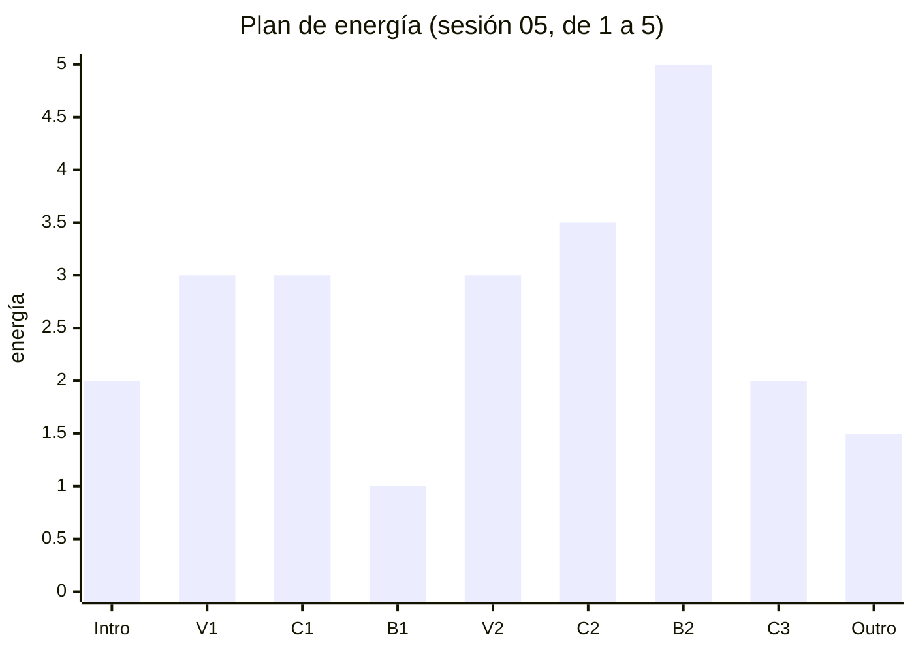

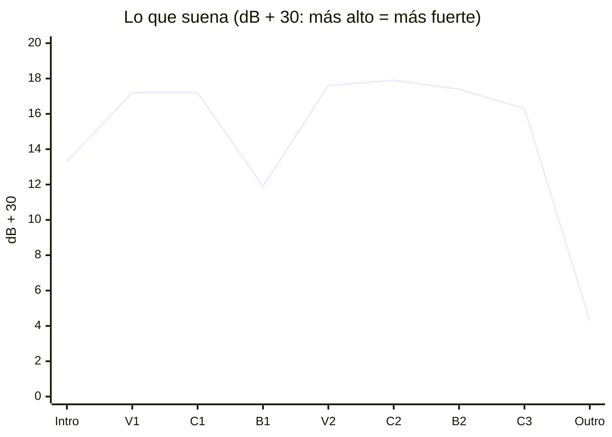

Qué suena en cada sección (el eje es el número de compás menos uno):

```mermaid
gantt
    title Capas por sección
    dateFormat X
    axisFormat %s
    section Forma
    Intro      :s1, 0, 10s
    V1         :s2, 10, 16s
    C1         :s3, 26, 16s
    B1         :s4, 42, 8s
    V2         :s5, 50, 16s
    C2         :s6, 66, 16s
    B2         :crit, s7, 82, 10s
    C3         :s8, 92, 16s
    Outro      :s9, 108, 2s
    section Piano
    c.1–110    :p1, 0, 110s
    section Guitarra
    c.11–41    :g1, 10, 31s
    c.51–81    :g2, 50, 31s
    c.85–107   :g3, 84, 23s
    section Batería
    c.2–42     :b1, 1, 41s
    c.51–83    :b2, 50, 33s
    section Dinámicas
    ninguna    :crit, d1, 0, 110s
```

**Qué pasa.**

- **Seis secciones en 1.5 dB.** De V1 a C3 todo queda entre −12.1 y −13.7. Lo único que se separa son la
  intro, el B1 y el outro: **las tres secciones sin guitarra**. Quitar solo la batería mueve menos de 1 dB (el C3,
  sin batería, queda a 0.9 dB del C1, que tiene las mismas notas con batería).
- **El B2 tiene menos capas que el C2.** La batería se calla en el c.84, al segundo compás del pico, y no vuelve.
  Para el oído, el B2 empieza bajando. Es **más denso** que cualquier otra sección (3.8 ataques por compás contra
  3.0 del coro) y llega más arriba (Si♭5), pero eso no compensa una capa que se va.
- **El B2 y el C3 tienen exactamente las mismas capas** (piano y guitarra). Lo que los separa es la armonía y
  1.1 dB.
- **Ninguna marca de dinámica en 110 compases.** Sin dinámicas, MuseScore toca todo con la misma fuerza; el
  volumen sale solo de cuántas notas suenan. Si la versión final es un export de MuseScore, **esto es lo que
  va a oír quien la escuche**.
- **Lo que sí funciona** (el C2 crece 1.9 dB en su segunda mitad; el C1, con las mismas notas, 0.9) muestra que
  el crecimiento de la batería suma alrededor de un dB. Es lo único que hoy mueve la curva entre V1 y C3, y en el
  B2 desaparece.

**¿Es un error?** Sí: el Mapa pone el B2 por encima de todos los coros y el C3 abajo, y suena al revés en el
primer caso y casi igual en el segundo. Se amplía desde F 06 (que medía C2, B2 y C3) porque a escala de la pieza
es el mismo problema, y los H-01, H-03 y H-07 son casos locales de él. Por eso sube a peso **alto**.

Recursos que ya están catalogados para esto, sin decidir nada por ti:
[[3. Composiciones/6. louise/AI/0. Recursos de energía y forma - Louise|0. Recursos de energía y forma]]
§2.1 (dinámica, con la equivalencia energía → *p*…*ff*), §2.2 (capas), §2.5 (batería) y §3.9 (mapa de
dinámicas).

### H-07 · El C3 sube en su segunda mitad (nuevo)

**Qué escribiste.** Mapa · C3: *"el coro con capas quitadas, que sí cierra en A7→D"*, energía **2**, despedida.
[[3. Composiciones/6. louise/2. Decisiones#^d-04|D-04]]: *"después del pico llega la resolución que el B2
retuvo"*.

**Qué suena.** Piano y guitarra de los c.94–107 son **idénticos nota por nota** a los c.28–41 del C1. Lo único
que cambia es el primer compás (c.93, la llegada desde el B2), el último (c.108) y que no hay batería. Y el C1
sube a la mitad: desde el c.35 el piano dobla en octavas y la mano izquierda toca los tres tiempos.

| | 1.ª mitad | 2.ª mitad (sin el último compás) | Cambio |
|---|---:|---:|---:|
| C1 (c.27–34 · 35–41) | −13.0 dB | −12.1 dB | +0.9 |
| C3 (c.93–100 · 101–107) | −14.2 dB | **−12.7 dB** | **+1.5** |

Sin batería, las octavas del piano pesan más: el C3 sube más que el C1.

```music-abc
X:1
T:c.97 y c.105: el mismo Em en cada mitad del C3, como suenan
M:3/4
L:1/16
K:D
V:1 clef=treble name="Piano MD"
V:2 clef=bass name="Piano MI"
V:3 clef=bass name="Guitarra (real)"
[V:1] "^c.97 · Em"z4 E4 E4 | "^c.105 · Em"z4 G4 G4 |]
[V:2] E,4 z8 | [E,,E,]4 [E,B,]4 [E,B,]4 |]
[V:3] [E,,G,,E,G,]12 | [E,,G,,E,G,E]12 |]
```

**Qué pasa.** El oído reconoce el coro, y lo oye crecer igual que la primera vez: la despedida dice "otra vez el
coro, sin batería". "Capas quitadas" hoy quiere decir una capa, la batería, y las otras dos siguen tocando lo
mismo, incluido el crecimiento de la segunda mitad.

**¿Es un error?** Sí, contra el Mapa: una sección de energía 2 que sube 1.5 dB hacia el final. Se relaciona con
*Por decidir · C3 de 8 o de 16 compases*: hoy son 16, y la segunda mitad es la que sube.

### H-08 · El A7→D del c.107→108 llega sin bajo (nuevo)

**Qué escribiste.** [[3. Composiciones/6. louise/2. Decisiones#^d-04|D-04]] y Mapa · C3: el C3 *"sí cierra en
A7→D"*, la resolución que el B2 retuvo.

**Qué suena.** En el tiempo 1 del c.108 la mano izquierda está en silencio y la guitarra ya no toca: la nota más
grave del acorde de llegada es **Re4**. El bajo vuelve en el tiempo 3 como Fa♯2 (D/F♯), sube a Sol2, baja a
Fa♯2 y llega a **Re2 en el tiempo 3 del c.109**, dos compases después de la cadencia.

```music-abc
X:1
T:c.107–110 como suenan hoy
M:3/4
L:1/16
K:D
V:1 clef=treble name="Piano MD"
V:2 clef=bass name="Piano MI"
V:3 clef=bass name="Guitarra (real)"
[V:1] "^A7"z4 [Ac]6 [Ac]2 | "^D"[DAd]12- | [DAd]4 z8 | z12 |]
[V:2] [A,,G,]4 G,6 G,2 | "_sin bajo"z8 [F,,A,,]3 G,,1- | G,,4- G,,1 F,,3 D,,4- | D,,1 D,8 z3 |]
[V:3] [A,,C,EAe]12 | z12 | z12 | z12 |]
```

| c. | Tiempo 1 | Tiempo 2 | Tiempo 3 | Nota más grave en el tiempo 1 |
|---|---:|---:|---:|---|
| 107 (A7) | −12.0 | −13.6 | −14.3 | La2 |
| **108 (D)** | **−16.8** | **−26.0** | −20.4 | **Re4** |
| 109 | −24.9 | −24.0 | −24.5 | Sol2 |
| 110 | −24.8 | −27.2 | −35.6 | Re2 |

**Qué pasa.** En una cadencia perfecta, lo que la hace sonar a cierre es el bajo que va del V al I (La → Re). Aquí
el La2 del A7 no va a ningún lado: desaparece, y la llegada queda en el registro medio. El tiempo 2 del c.108
(−26.0 dB) es el momento más callado desde el B1. Lo que suena es una resolución suave que se
completa, por el bajo, un compás y medio después → [[0. Cadencias, progresiones y líneas melódicas]].

**¿Es un error?** Solo si quieres que el C3 cierre con la fuerza que el B2 retuvo. Si el bajo que llega tarde y
baja por Fa♯–Sol–Fa♯–Re es la despedida que buscas, va a *Decisiones*.

### H-09 · En la primera mitad del verso nadie toca el 2 ni el 3 (nuevo)

**Qué escribiste.** [[3. Composiciones/6. louise/2. Decisiones#^d-12|D-12]]: *"3/4 en toda la pieza, bajo en el 1
y acorde en el 2 y el 3"*. [[3. Composiciones/6. louise/4. Contexto#^r-01|R-01]] (aplicada) se reconoce así. Y
[[3. Composiciones/6. louise/2. Decisiones#^d-05|D-05]]: *"un rol específico para cada parte"*.

**Qué suena.** En los c.11–18 (y su copia, c.51–58), piano y guitarra atacan **juntos en el 1** y sostienen el
compás entero. En el 2 y el 3 no ataca ninguna nota; solo, en compases alternos, un acorde del piano a
contratiempo (2& o 3e: el balanceo). El vals lo llevan el shaker y el cencerro *ghost* (38 %) y la pandereta en
el 3.

Quién ataca en cada tiempo (P = piano, G = guitarra):

| c. | 1 | 2 | 2& | 3 | 3e |
|---|:-:|:-:|:-:|:-:|:-:|
| 11 · Dmaj7 | P G | | | | |
| 12 · F♯m | P G | | | | P |
| 13 · C♯° | P G | | | | |
| 14 · A→A7 | P G | | P | | |
| 15 · Bm7 | P G | | | | |
| 16 · G→G6 | P G | | | | P |
| 17 · Dmaj7 | P G | | | | |
| 18 · F♯m | P G | | P | | |
| *27 · Em (coro, para comparar)* | *P G* | *P* | | *P* | |

En la segunda mitad del verso (c.19–26) la guitarra ya toca el 2 y el 3 en compases alternos (c.19, 21, 23, 25):
ahí sí está la conversación de D-05.

| Volumen por tiempo | 1 | 2 | 3 | Caída del 1 al 3 |
|---|---:|---:|---:|---:|
| V1, 1.ª mitad (c.11–18) | −10.3 | −14.3 | −15.6 | **5.3 dB** |
| V1, 2.ª mitad (c.19–26) | −11.3 | −13.2 | −14.1 | 2.8 dB |
| C1, 1.ª mitad (c.27–34) | −12.1 | −13.1 | −14.1 | 2.0 dB |

```music-abc
X:1
T:c.11–14 como suenan hoy (la batería no está escrita aquí)
M:3/4
L:1/16
K:D
V:1 clef=treble name="Piano MD"
V:2 clef=bass name="Piano MI"
V:3 clef=bass name="Guitarra (real)"
[V:1] "^Dmaj7"[Fd]12 | "^F#m"[Cc]8- [Cc]1 [CA]3 | "^C#dim"[EG]12 | "^A"[Ec]6 "^A7"[Cg]6 |]
[V:2] [D,,C]12 | F,8- F,1 G,3 | [C,E,]12 | A,6 A,6 |]
[V:3] [E,,A,,D,A,CF]12 | [F,,A,,F,A,Fc]12 | [C,E,CG]12 | [A,,C,A,CAe]12 |]
```

**Qué pasa.** Dos instrumentos con el mismo rol: los dos dicen el acorde completo, en el mismo tiempo y en el
mismo registro (piano de Re2 a Sol5, guitarra de Mi2 a Fa♯5, cinco notas por acorde de media en la guitarra). El
compás se apaga después del 1: es un "UNO . ." más que un "uno-dos-tres". En la sesión 06 lo describiste desde el
otro lado: buscas que piano y guitarra conversen y *"no siento que realmente esté generando mucho"*. En el
coro el reparto sí existe (el piano lleva el vals, la guitarra sostiene), y en los compases de cadencia también.

**¿Es un error?** Contra D-12 y R-01, sí: la toma está marcada como aplicada y en estos ocho compases su señal
(acorde en el 2 y el 3) no está en las notas. Puede ser a propósito: que el verso empiece flotando y el vals se
arme en la segunda mitad. Entonces va a *Decisiones*.

### H-10 · El cifrado no dice lo que suena en c.7, 44 y 45 (nuevo)

| c. | Cifrado | Suena | Nota |
|---|---|---|---|
| 7 | D | **D/F♯**: Fa♯2 en el bajo | el c.2, el mismo compás del motivo, sí dice D/F♯ |
| 44 | Em (en el tiempo 2) | **Em7** desde el tiempo 1: Mi3 en el bajo, Sol, Si y Re arriba | [[3. Composiciones/6. louise/2. Decisiones#^d-02\|D-02]] dice Em7 |
| 45 | E | **E/A**: La2 en el bajo | D-02 dice E/A |

**¿Es un error?** De notación: lo que lea la partitura (las fuentes de ChatGPT, un análisis, tú dentro de seis
meses) va a leer otros acordes. Las notas están bien.

### H-01, H-03, H-04, H-05, H-06 · sin cambios desde F 06

La partitura guardada es la misma, así que los números son los de
[[3. Composiciones/6. louise/5. Feedback/06. B2|F 06]], donde están explicados uno por uno.

| ID | Lo que sigue igual |
|---|---|
| H-01 | c.85–91 entre −11.7 y −12.5 dB; el golpe del c.91 (−9.3) cae a −15.0 en el mismo compás |
| H-03 | c.82: −17.8 dB, entre −11.6 (c.81) y −13.9 (c.83) |
| H-04 | c.88: Fa2 y Fa3 en la mano izquierda bajo el G7. **El autosave de las 09:41 cambia el Fa2 por Sol2**, sin guardar |
| H-05 | marcas de ensayo en la partitura: Intro, Verso, Coro, Bridge, Verso, Coro 2, B2. Nada en el c.93 |
| H-06 | c.87 cifrado "C4" |

---

## Lo que bloquea el cierre y no es un hallazgo

Son preguntas de *Por decidir* en [[3. Composiciones/6. louise/2. Decisiones|Decisiones]]. No describen un error
de la pieza; deciden cuándo está terminada. Así están hoy:

| Por decidir | Cómo está hoy en la partitura |
|---|---|
| **¿Voz o instrumental?** | el pentagrama de Voz tiene 0 notas. Define `definicion_terminado` |
| **Guitarra: ¿la grabas tú?** | 13 compases piden Mi2 y Sol2 a la vez, y los dos solo caben en la 6.ª cuerda: c.27, 31, 35, 39, 53, 67, 71, 75, 79, 93, 97, 101, 105 |
| **Outro** | c.109–110: el piano sostiene Re–La–Re y el bajo baja Sol2 → Fa♯2 → Re2. Dura 2.3 s, 12 dB debajo del C3. El motivo no vuelve después del c.84 |
| **c.51: ¿el bajo es Mi o Re?** | ya no es ninguno: la guitarra dejó el Mi2 y ahora el bajo es **La2** (Dmaj7/A). El V2 entra en segunda inversión |
| **C3 de 8 o de 16** | 16, idéntico al C1 (ver H-07) |
| **La descarga después del B2** | ni corte ni vaciado: c.92 −12.3 dB, c.93 −12.2 dB |
| **Mapa de dinámicas** | ninguna marca (ver H-02) |
| **Qué capa estrena el B2** | ninguna capa nueva: estrena armonía (D-08) y pierde la batería |
| Qué le quito al C1 | **hecho**: se oye D-06 |
| Que el B2 no arranque como el B1 | **hecho**: el c.82 ya no repite el D–C♯–B del c.42; ahora es E♭7 |

---

## Camino al cierre

Lo que pediste: los siguientes pasos. Es el bucle ② de [[6. Práctica/0. Flujos|Flujos]], paso 4 (*Cerrar*), con
la cola de hallazgos en orden de peso. **Una cosa a la vez**: cada sesión ataca un solo hallazgo.

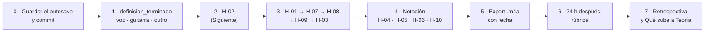

0. **Antes de nada:** decidir si los dos cambios del autosave (c.84 y c.88) se quedan, guardar y hacer commit.
1. **`definicion_terminado`** en [[3. Composiciones/6. louise/0. Obra|0. Obra]]. Depende de las tres preguntas
   de arriba (voz, guitarra, outro). Si entra voz, es una dificultad nueva entera, y la regla 4 dice *una por
   proyecto*: el §3.8 de los
   [[3. Composiciones/6. louise/AI/0. Recursos de energía y forma - Louise|Recursos]] ya compara las dos rutas.
   Si el outro va a existir, el Mapa necesita su *Qué quiero*.
2. **El Siguiente** (abajo).
3. **Los hallazgos por peso**, uno por sesión, pidiendo feedback cuando quieras: H-01, H-07, H-08, H-09, H-03.
   Varios pueden moverse solos al resolver H-02; el feedback siguiente lo dirá.
4. **Notación**: H-04 (si no lo cierra el autosave), H-05, H-06, H-10. Son de minutos.
5. **Exportar** a `3. Composiciones/6. louise/render/` con la fecha delante (`2026-10-22 worktape.m4a`). Hoy no
   hay ninguno; el bounce incondicional dice que se exporta cada vez que paras, aunque no esté terminada.
6. **Descansar 24 h** y aplicar la [[Rúbrica - Composición|rúbrica]]. La tabla *Por área* de arriba dice qué
   hallazgo toca cada dimensión. El cronograma de la ficha cerraba el 17 de octubre: la fecha nueva va en la
   *Decisión de revisión* de la rúbrica.
7. **Cerrar**: retrospectiva de tres líneas y *Qué sube a Teoría*. Candidatos que salieron de Louise, para que
   tú los escribas con tus palabras:
   - la cadencia rota como firma (*cada vez que llega a D se escapa*) → [[0. Cadencias, progresiones y líneas melódicas]];
   - el B2 en Re menor sobre una pieza en Re mayor → [[3. Intercambios modales]];
   - la cadena G7 → C7 → F7 → B♭ → [[9. Dominantes en progresiones]] · [[09. Tonos guía]];
   - la energía como presupuesto y los roles de cada instrumento: `8. Textura y arreglo/` no tiene ninguna nota de
     concepto todavía. Sería la primera.

---

## Siguiente

➡️ **[[3. Composiciones/6. louise/6. Hallazgos#^h-02|H-02]]**: que la curva del Mapa se oiga. Es el que más pesa
en la pieza entera y el que más hallazgos arrastra (H-01, H-03 y H-07 son partes de él). La pregunta de *Por
decidir* que lo ataca de frente es el **mapa de dinámicas**: hoy no hay ninguna, y si la versión final sale de
MuseScore, son la única palanca que mueve el volumen sin tocar una nota.

---

## Propuestas

**Para el Mapa**

- **Energía** de Intro, V1, C1, B1, V2 y Outro: en la sesión 05 escribiste 2 · 3 · 3 · 1 · 3 · 1–2; en el Mapa
  están vacías, y sin ellas el feedback solo puede medir C2, B2 y C3.
- **V2 · Cómo se reconoce:** el comentario de *Por decidir* sobre el c.51 quedó viejo: hoy el bajo es La2.
- **C3 · Cómo se reconoce:** ____ (hoy, lo único que lo distingue del C1 es que no hay batería).
- **Outro · Qué quiero:** ____. Hoy son los c.109–110 (ver *Lo que bloquea el cierre*).

**Para Decisiones**

- **D-10** dice que *el único cromatismo de toda la pieza es el G♯ del c.45*. Desde el B2 ya no (E♭7, Gm, C7, F7,
  B♭ en c.82–92). Tacharla y pasarla a *Reemplazadas*, apuntando a la que la sustituya: `D-NN · … · porque ____`.
- Si H-08 es a propósito: `D-NN · el C3 resuelve sin bajo y el Re2 llega por Fa♯–Sol–Fa♯ · porque ____`.
- Si H-09 es a propósito: `D-NN · en la primera mitad del verso el vals lo lleva la percusión; piano y guitarra sostienen · porque ____`.
- Cerrar en *Por decidir* lo que ya está hecho: *Qué le quito al C1* (D-06) y *Que el B2 no arranque como el B1*.

**Para Contexto**

- `R-02 · Elouise · el riff de la intro vuelve igual al final (c.54–57 del arreglo de Seth Kauffman) · ____ ·
  forma → Outro`. Es la toma que contestaría *¿qué riff para el outro?* desde la canción de la que nació Louise
  (lo describe [[3. Composiciones/6. louise/AI/2. Louise y The Lumineers - gráficas/2. Louise y The Lumineers|2. Louise y The Lumineers]], §2). Si la quieres, lo que tomas y por qué son tuyos.
- *No quiero ❌* sigue vacío: ____.

---

## Cómo se midió

- `Louise-melancolica.mscz` (09:26, blob `480df3a`) se copió a una carpeta temporal y se exportó con MuseScore 4
  a WAV. El `.musicxml` de la bóveda estaba al día (09:27). La partitura no se tocó.
- El autosave de las 09:41 se copió aparte, se exportó a MusicXML y se comparó con `diff-musical.py`.
- **Volumen:** RMS de cada compás (1.125 s a ♩=160) y de cada tiempo (0.375 s). Los promedios por sección y por
  mitad se sacaron en potencia, no promediando los dB. Los números de C2, B2 y C3 coinciden con F 06.
- **Comparación entre secciones:** cada compás de cada pentagrama (alturas, ataques y duraciones) contra su
  compás equivalente en la otra sección: V1 contra V2, C1 contra C2 y C3.
- **Ataques:** inicios de nota de piano y guitarra por compás, sin contar las ligaduras. Las alturas de guitarra
  son **reales** (una octava debajo de lo escrito).
- **Bajo contra cifrado:** la nota más grave que suena (piano y guitarra) en la posición de cada acorde.
- **Guitarra imposible:** acordes con dos notas entre Mi2 y Sol♯2, que solo caben en la 6.ª cuerda.
- **Lo que el render no mide:** el timbre, la densidad y el registro también hacen energía. Por eso el B2, que es
  la sección más densa y más aguda, se lee junto con sus capas y no solo con su volumen.

---

## Archivo: `3. Composiciones/6. louise/5. Feedback/08. pieza.md`

```yaml
tipo: feedback
estado: vigente
numero: 8
fecha: 2026-10-23
alcance: pieza
evaluado:
  - archivo: "7. Partituras/2. Composiciones/Louise-melancolica.mscz"
    commit: a10f3d8
    limpio: false
    blob: 4cba577
    guardado: 2026-10-23 10:00
contexto:
  - "[[3. Composiciones/6. louise/3. Sesiones/00. Adding verse|S 00]]"
  - "[[3. Composiciones/6. louise/3. Sesiones/02. Verse and choruse|S 02]]"
  - "[[3. Composiciones/6. louise/3. Sesiones/03. Adding specific voicing|S 03]]"
  - "[[3. Composiciones/6. louise/3. Sesiones/06. Second bridge|S 06]]"
anterior: "[[3. Composiciones/6. louise/5. Feedback/07. pieza|F 07]]"
siguiente: "[[3. Composiciones/6. louise/6. Hallazgos#^h-11|H-11]]"
```

%%%%
# Feedback 08 · pieza

> [!info] Fuente
> **Claude, 2026-10-23.** Inventario de **la pieza entera** (c.1–111): todo lo que le falta a Louise para estar
> completa. Desde aquí, cada feedback mira **un solo punto** de esta lista; la columna *Alcance* dice con qué
> nombre pedirlo (`melodia`, `guitarra.voicing`, `C3.energia`…).
>
> **Qué cambió desde [[3. Composiciones/6. louise/5. Feedback/07. pieza|F 07]]:** dos notas, las del autosave que
> F 07 había encontrado sin guardar: **c.84**, piano, Mi2 → Re2, y **c.88**, piano, Fa2 → Sol2 en el 3&. No hay
> sesiones nuevas. Se releyeron como contexto las sesiones 00, 02, 03 y 06: lo que querías del verso, del coro y
> del motivo.
>
> F 07 miró sobre todo la energía. Este mira **todos los aspectos** del alcance (forma, armonía, voicing, ritmo,
> melodía, arreglo, energía, notación) sección por sección, sobre el `.musicxml` nota por nota y con el volumen de
> un render de MuseScore.
>
> **Ampliado el mismo día, a pedido tuyo:** cada hallazgo trae ahora sus compases exactos, más ejemplos (abc,
> Strudel, tablas y cuatro gráficas) y un apartado *Para resolverlo*; y hay una sección nueva, *Decidir, a la
> mano*. Un feedback no se reescribe ([[6. Práctica/1. Estructura|Estructura]]); esta ampliación no cambia lo
> evaluado (mismo blob) ni ningún hallazgo: solo agrega material sobre la misma versión.

> [!abstract] Qué se evaluó, exactamente
> | Archivo | Commit | ¿Limpio? | Blob | Guardado |
> |---|---|---|---|---|
> | `7. Partituras/2. Composiciones/Louise-melancolica.mscz` | `a10f3d8` | **no** | `4cba577` | 2026-10-23 10:00 |
>
> - **No limpio:** el `.mscz` tiene los dos cambios de arriba sin commit. El blob identifica esta versión, pero no
>   la guarda: para poder volver a ella hace falta un commit. Se recomienda hacerlo antes de la próxima sesión.
> - El `.musicxml` estaba desactualizado (era del 22 a las 09:27). Se regeneró con `sync-partituras.py`, así que
>   también aparece modificado: va en el mismo commit.
> - No hay autosave más nuevo que el archivo.

> [!important] Qué cuenta como error
> Un error es cuando **lo que escribiste dice una cosa y lo que suena dice otra**: el cifrado, el
> [[3. Composiciones/6. louise/1. Mapa|Mapa]], las [[3. Composiciones/6. louise/2. Decisiones|Decisiones]] o el
> [[3. Composiciones/6. louise/4. Contexto|Contexto]] (una toma ✅ que no se oye, o una ❌ que se coló). Lo que
> contradice una decisión vigente no se reporta. Los ejemplos muestran **lo que suena hoy**; no traen
> correcciones.

---

## En una pantalla

1. **Lo que está:** la forma completa (110 compases, 2:04), una armonía que cuenta la historia que escribiste, y
   un B2 que ya pasó por siete feedback: abierto en el grave, con su cadena de dominantes y el B♭ en el pico. El
   cambio de hoy cierra [[3. Composiciones/6. louise/6. Hallazgos#^h-04|H-04]].
2. **Lo que más falta es una melodía.** Fuera de la intro, el B1 y el B2, ninguna capa lleva una línea: en el
   verso y el coro (80 de 110 compases) lo de arriba es la nota de arriba del acorde. El motivo suena en 8
   compases y el pentagrama de Voz está vacío →
   [[3. Composiciones/6. louise/6. Hallazgos#^h-11|H-11]], **nuevo**.
3. **La energía sigue igual que en F 07:** la curva del Mapa no se oye y no hay ninguna dinámica
   ([[3. Composiciones/6. louise/6. Hallazgos#^h-02|H-02]] y sus casos locales H-01, H-03, H-07).
4. **Lo que arreglaste en el B2 sigue sin arreglar en el resto:** fuera del B2 la guitarra toca terceras en la
   octava 2 en 41 compases, debajo de su límite grave, y dobla al piano en el mismo registro →
   [[3. Composiciones/6. louise/6. Hallazgos#^h-12|H-12]], **nuevo**.
5. **Diez cosas son tuyas de decidir** y no son hallazgos. La primera bloquea a las demás:
   `definicion_terminado` sigue vacío.
6. **Del cierre falta todo:** ni audio, ni rúbrica, ni retrospectiva.

**En números:** 11 hallazgos abiertos (2 nuevos, 2 ampliados), 1 cerrado, 10 decisiones y 7 pasos de cierre.

---

## Qué le falta para estar completa

### Por sección y aspecto

Cada celda es lo que está abierto en esa sección y ese aspecto: el alcance para pedirle feedback. `—` quiere
decir que no hay nada abierto ahí (no que sea perfecto).

| Sección | c. | forma | armonia | voicing | ritmo | melodia | arreglo | energia | notacion |
|---|---|---|---|---|---|---|---|---|---|
| Intro | 1–10 | — | — | — | — | — | — | *vacío* | H-10 |
| V1 | 11–26 | — | — | H-12 | H-09 | **H-11** | 🎸 6 | *vacío* | H-10 |
| C1 | 27–42 | — | — | H-12 | — | **H-11** | 🎸 4 | *vacío* | H-10 |
| B1 | 43–50 | — | — | — | — | — | — | *vacío* | H-10 |
| V2 | 51–66 | — | — | H-12 | H-09 | **H-11** | 🎸 8 | *vacío* | H-10 |
| C2 | 67–82 | — | — | H-12 | — | **H-11** | 🎸 4 | H-03 | H-05 · H-10 |
| B2 | 83–92 | — | — | — | — | — | decidir | H-01 | H-06 · H-10 |
| C3 | 93–108 | decidir | H-08 | H-12 | — | **H-11** | 🎸 4 | H-07 · decidir | H-05 · H-10 |
| Outro | 109–111 | **decidir** | — | — | — | decidir | — | *vacío* | H-05 |

- **[[3. Composiciones/6. louise/6. Hallazgos#^h-02|H-02]]** (la curva entera) cruza todas las secciones de V1 a
  C3; en la tabla solo aparecen los casos locales.
- *vacío*: el Mapa no dice qué energía quieres ahí, así que el feedback no tiene con qué medirla.
- 🎸 *N*: compases con un acorde de guitarra que no cabe en una mano. Solo cuenta si la guitarra la grabas tú
  (*Decidir*, punto 3).
- *decidir*: una pregunta de *Por decidir* (abajo).

### 1 · Decidir

Son tuyas y no son hallazgos: no describen un error, deciden cuándo está terminada. Están en orden: cada una
depende de las de arriba. Lo que necesitas para contestar las que cambian notas (3, 4, 6 y 8) está más abajo, en
*Decidir, a la mano*.

| # | Qué decides | Alcance | Cómo está hoy | Qué desbloquea |
|---|---|---|---|---|
| 1 | **`definicion_terminado`** | — | vacío desde el 2 de octubre | todo: es la línea de meta. Las tres siguientes son su contenido |
| 2 | **¿Voz o instrumental?** | `melodia` | el pentagrama de Voz tiene 0 notas en 111 compases | qué es H-11: escribir la voz, o que una capa lleve la línea |
| 3 | **Guitarra: ¿la grabas tú?** | `guitarra.voicing` | 26 de los 85 compases con guitarra tienen un acorde que no cabe en una mano (F 07 contaba 13: solo buscaba Mi2 con Sol2) | si sí, esos 26 se revoicean, y H-12 se mueve casi entero con ellos |
| 4 | **El outro** | `Outro.forma` | c.109–110, 2.3 s, y el c.111 vacío con la doble barra. Termina en la octava Re2–Re3, sin tercera, sin *rit.* ni calderón. El motivo no vuelve desde el c.84 | el final de la pieza; el Mapa *Outro* está vacío entero |
| 5 | **C3 de 8 o de 16** | `C3.forma` | 16; 14 de ellos son compases del C1 | H-07 |
| 6 | **La descarga después del B2** | `C3.energia` | ni corte ni vaciado: c.92 −12.3 dB, c.93 −12.2 dB | H-02 |
| 7 | **Mapa de dinámicas** | `energia` | ninguna marca en toda la partitura | H-02, H-01, H-07 |
| 8 | **Qué capa estrena el B2** | `B2.arreglo` | ninguna capa nueva; pierde la batería desde el c.84 | H-01, H-02 |
| 9 | **El Mapa, tuyo** | — | `estado: borrador`, lo armó Claude el 22; 17 campos con `____`, entre ellos la energía de seis secciones | la vara de todos los feedback |
| 10 | **El Contexto, tuyo** | — | borrador; *No quiero ❌* vacío; la toma R-02 que propuso F 07 sin contestar | que el feedback pueda decir si algo se coló |

> [!warning] La regla 4
> *Una dificultad nueva por proyecto.* Si la respuesta a la 2 es "voz", es una dificultad entera (melodía para
> voz y letra). El §3.8 de los
> [[3. Composiciones/6. louise/AI/0. Recursos de energía y forma - Louise|Recursos]] compara las dos rutas y
> tiene un punto medio: instrumental ahora y la voz en una segunda versión.

### 2 · Corregir

Los hallazgos: la *Lista*, abajo.

### 3 · Cerrar

El paso 4 del bucle ② de [[6. Práctica/0. Flujos|Flujos]]. Su definición de hecho: *existe un `.m4a` y la
rúbrica está aplicada*.

| Paso | Cómo está hoy |
|---|---|
| Commit de la versión de hoy | `.mscz` y `.musicxml` con cambios sin commit |
| Triage de los hallazgos (bucle ⑦, paso 4) | H-07 a H-12 no tienen destino: ninguno es objetivo de una sesión, decisión ni cambio de Mapa |
| Audio en `render/` | no existe la carpeta; `ultimo_audio` y *Grabaciones* de la ficha, vacíos |
| Rúbrica en frío, 24 h después | sin aplicar |
| Exportación final con fecha | — |
| Retrospectiva y *Qué sube a Teoría* | vacías |
| La ficha | `estado: boceto` y `cierre` vacío; el cronograma terminaba el 17 de octubre; *Problemas abiertos* y *Material* describen la versión de Strudel (ver *Propuestas*) |

---

## Lista

| ID | Dónde | Alcance | Qué escribiste | Qué suena | Peso | Contra | Estado |
|---|---|---|---|---|---|---|---|
| [[3. Composiciones/6. louise/6. Hallazgos#^h-11\|H-11]] | V1, C1, V2, C2, C3 | `melodia` | un vals tipo *Elouise*, con el motivo como identidad | 80 de 110 compases sin línea propia; el motivo en 8; Voz vacía | **alto** | Mapa · Intención y Motivo | **nuevo** |
| [[3. Composiciones/6. louise/6. Hallazgos#^h-02\|H-02]] | V1–C3 | `energia` | C2 3→4 · B2 5 · C3 2 | seis secciones en 1.5 dB; el B2 debajo del C2; ninguna dinámica | **alto** | Mapa · [[3. Composiciones/6. louise/2. Decisiones#^d-08\|D-08]] | sin cambios |
| [[3. Composiciones/6. louise/6. Hallazgos#^h-01\|H-01]] | c.85–91 | `B2.energia` | una subida hacia el pico | siete compases en 0.8 dB; el pico se apaga 5.7 dB | **alto** | Mapa B2 | sin cambios |
| [[3. Composiciones/6. louise/6. Hallazgos#^h-12\|H-12]] | V1, C1, V2, C2, C3 | `guitarra.voicing` | "en registros graves, es mejor abrir las voces"; el B2 ya abierto | terceras en la octava 2 en 41 compases (y 12 en el límite); la guitarra dobla al piano en el grave en 70 de 85 | medio | [[00. Voicing e inversiones]] · [[3. Composiciones/6. louise/2. Decisiones#^d-05\|D-05]] | **nuevo** |
| [[3. Composiciones/6. louise/6. Hallazgos#^h-07\|H-07]] | c.93–108 | `C3.energia` | despedida, energía 2 | sube 1.5 dB en su segunda mitad: es el C1 sin batería | medio | Mapa C3 · [[3. Composiciones/6. louise/2. Decisiones#^d-04\|D-04]] | sin cambios |
| [[3. Composiciones/6. louise/6. Hallazgos#^h-08\|H-08]] | c.107–110 | `C3.armonia` | "sí cierra en A7→D" | el D del c.108 llega sin bajo | medio | [[3. Composiciones/6. louise/2. Decisiones#^d-04\|D-04]] | sin cambios |
| [[3. Composiciones/6. louise/6. Hallazgos#^h-09\|H-09]] | c.11–18, 51–58 | `ritmo` | bajo en el 1 y acorde en el 2 y el 3 | en el 2 y el 3 no ataca ninguna nota | medio | [[3. Composiciones/6. louise/2. Decisiones#^d-12\|D-12]] · [[3. Composiciones/6. louise/4. Contexto#^r-01\|R-01]] | sin cambios |
| [[3. Composiciones/6. louise/6. Hallazgos#^h-03\|H-03]] | c.82 | `B2.energia` | la entrada del B2 | hueco – golpe – hueco | medio | Mapa B2 | sin cambios |
| [[3. Composiciones/6. louise/6. Hallazgos#^h-10\|H-10]] | 35 compases | `notacion` | el cifrado | bajos, notas y tiempos que el cifrado no dice | bajo | cifrado · [[3. Composiciones/6. louise/2. Decisiones#^d-02\|D-02]] | **ampliado** (eran 3 compases) |
| [[3. Composiciones/6. louise/6. Hallazgos#^h-05\|H-05]] | c.67, 93, 109 | `notacion` | las secciones del Mapa | sin marca de C3 ni de Outro; una marca vacía en el c.67 | bajo | Mapa | **ampliado** (era solo el c.93) |
| [[3. Composiciones/6. louise/6. Hallazgos#^h-06\|H-06]] | c.87 | `B2.notacion` | "C4" | Csus4 y C7sus4 | bajo | cifrado | sin cambios |

**Cerrados en este feedback:** [[3. Composiciones/6. louise/6. Hallazgos#^h-04|H-04]], arreglado: el G7 del
c.88 vuelve a Sol2 en el 3&, y de ahí el bajo va a Do3 (Sol → Do, la cadena por cuartas); el Fa2 del tiempo 2
queda como bordado. El Fa3 de arriba de la mano izquierda tampoco baja a Mi (va a Si♭3), pero el Mi llega en la
guitarra (Re4 → Mi4) y nada de lo escrito pide más: no abre hallazgo.

### Por área

Cada área con su dimensión de la [[Rúbrica - Composición|rúbrica]], para que al cerrar sepas dónde mirar.

| Área | Dimensión de la rúbrica | Hallazgos | Cómo está |
|---|---|---|---|
| **Melodía e identidad** | Identidad o memorabilidad · Intención | H-11 | el motivo es claro donde suena, y suena en el 7 % de la pieza |
| **Energía y trayectoria** | Trayectoria y clímax · Contraste | H-02, H-01, H-03, H-07 | la forma sube y baja en el papel; en el sonido, una meseta |
| **Textura y registro** | Textura y registro · Conducción de voces | H-12, H-09 | el B2 está limpio; el resto, grave, cerrado y doblado |
| **Cierre** | Calidad de cierre · Proporción formal | H-08 · outro | se detiene más de lo que termina |
| **Armonía** | Armonía y bajo | ninguno (H-04 cerrado) | lo más sólido de la pieza |
| **Realización** | Interpretación o realización | H-02 · guitarra | sin dinámicas, un export de MuseScore suena con la misma fuerza de principio a fin |
| **Notación** | — | H-05, H-06, H-10 | minutos de trabajo, mejor al final: cada nota que cambie puede cambiar un cifrado |

---

## Uno por uno

Cada hallazgo con lo mismo, en el mismo orden: **qué escribiste**, **qué suena** (con los compases exactos y al
menos un ejemplo), **qué pasa**, **¿es un error?** y **para resolverlo**. Este último no trae notas: trae las
opciones, el compás de tu propia pieza que ya hace eso, cuándo el siguiente feedback lo da por cerrado y con
qué alcance pedirlo. Las opciones salen del catálogo de los
[[3. Composiciones/6. louise/AI/0. Recursos de energía y forma - Louise|Recursos]] (los § son suyos).

### H-11 · Fuera de la intro, el B1 y el B2 no hay melodía (nuevo)

**Qué escribiste.**

- Mapa · *Intención*: un vals tipo *Elouise* de The Lumineers, que es una canción. Mapa · *Motivo*: La–Sol–Fa♯–Re–Fa♯,
  el material que la pieza trae desde `happy_beats`.
- Como contexto, en las sesiones: la 02 se propuso *"Converting the chorus and verse with his own melodies and
  structure"*; la 03, pulir un motivo en el coro y *"give space to the voice"*; la 00, que el motivo *"aún no me
  convence y no sé bien como incluírlo o replicarlo"*.
- En la ficha, *Problemas abiertos* (5 oct), sin marcar: *"Los compases de respuesta no tienen voz. El motivo
  suena una vez y desaparece."*
- Los Recursos §3.8: si es instrumental, *"la voz superior del piano es la melodía"*.

**Qué suena.** La nota más aguda de cada tiempo en toda la pieza, y quién la toca:

![[3. Composiciones/6. louise/5. Feedback/08. pieza - gráficas/2. La línea de arriba.svg]]

Dónde está el motivo y qué hay arriba en cada sección:

| Sección | c. | El motivo | Qué hay arriba | Quién |
|---|---|---|---|---|
| Intro | 1–10 | **c.1–2 y 6–7** | el motivo, y los acordes en el 1a y el 3e | piano |
| V1 | 11–26 | — | una nota larga por compás (1.8 ataques), la de arriba del acorde | piano y guitarra, **la misma nota** en 18 de sus 32 tiempos 2 y 3 |
| C1 | 27–42 | — | en el 1, Sol3, Si3 o La3 de la guitarra; en el 2 y el 3, una nota del acorde en el piano (en la primera mitad, la fundamental) | se alternan: la guitarra tiene la nota de arriba en 12 de los 16 tiempos 1 |
| B1 | 43–50 | **c.46–47** | el motivo, y el bajo que baja por quintas | piano |
| V2 | 51–66 | — | lo mismo que el V1: 11 de sus 16 compases son idénticos | |
| C2 | 67–82 | — | lo mismo que el C1: 13 de 16 idénticos | |
| B2 | 83–92 | **c.83–84**, en Re menor | una línea propia: 3.5 ataques por compás, hasta Si♭5 | piano |
| C3 | 93–108 | — | lo mismo que el C1: 14 de 16 idénticos | |
| Outro | 109–111 | — | Re4–La4–Re5 sostenido | piano |

La nota más aguda de cada tiempo en la primera mitad del coro:

| c. | Acorde | Tiempo 1 | Tiempo 2 | Tiempo 3 |
|---|---|---|---|---|
| 27 | Em | Sol3 · guitarra | Mi4 · piano | Mi4 · piano |
| 28 | G | Si3 · guitarra | Sol4 · piano | Sol4 · piano |
| 29 | F♯m7 | La3 · guitarra | Fa♯4 · piano | Fa♯4 · piano |
| 30 | Bm | Si3 · piano | Fa♯5 · guitarra | Fa♯5 · guitarra |
| 31 | Em | Sol3 · guitarra | Mi4 · piano | Mi4 · piano |
| 32 | G | Si3 · guitarra | Sol4 · piano | Sol4 · piano |
| 33 | A7 | Mi5 · guitarra | (sostenido) | (sostenido) |
| 34 | D | Re3 · piano | La4 · guitarra | La4 · guitarra |

```music-abc
X:1
T:c.27–30 como suenan hoy (la batería no está escrita aquí)
M:3/4
L:1/4
K:D
V:1 clef=treble name="Piano MD"
V:2 clef=bass name="Piano MI"
V:3 clef=bass name="Guitarra (real)"
[V:1] "^Em"z E E | "^G"z G G | "^F#m7"z F F | "^Bm"z3 |]
[V:2] E, z z | G, z z | F, z z | [B,,B,-] B,2 |]
[V:3] [E,,G,,E,G,]3 | [G,,B,,G,B,]3 | [F,,A,,F,A,]3 | z [B,DBf] [B,DBf] |]
```

Los c.11–14, la primera frase del verso, como suenan hoy: la nota de arriba cambia una vez por compás, y en
c.12 y c.13 piano y guitarra tocan la misma (Do♯5, Sol4).

```music-abc
X:2
T:c.11–14 como suenan hoy: las dos notas de arriba de cada capa
M:3/4
L:1/16
K:D
V:1 clef=treble name="Piano MD"
V:2 clef=treble name="Guitarra (real)"
[V:1] "^Dmaj7"[Fd]12 | "^F#m"[Cc]9 [CA]3 | "^C#dim"[EG]12 | "^A"[Ec]6 "^A7"[Cg]6 |]
[V:2] [CF]12 | [Fc]12 | [CG]12 | [Ae]12 |]
```

Dónde hay espacio hoy para una línea. Re4–La4 es el registro que el §3.8 dice que habría que abrir para una
voz:

| Sección | Mano derecha | Mano izquierda | Guitarra | Tiempo con alguna nota en Re4–La4 |
|---|---|---|---|---:|
| V1 | Si3–Sol5 · 71 % del tiempo en Re4–La4 | Re2–Do♯4 · 0 % | Mi2–Fa♯5 · **92 %** | **100 %** |
| C1 | Re4–Mi5 · 62 % | Re2–Re4 · 1 % | Mi2–Fa♯5 · 31 % | 77 % |
| B2 (para comparar) | Re4–Si♭5 · 72 % | Re2–Do4 · 0 % | Sol2–Si♭4 · 43 % | 87 % |

Dónde suena el motivo, y dónde hay una línea que no es el acorde (el eje es el número de compás menos uno):

```mermaid
gantt
    title Motivo y línea propia
    dateFormat X
    axisFormat %s
    section Forma
    Intro      :s1, 0, 10s
    V1         :s2, 10, 16s
    C1         :s3, 26, 16s
    B1         :s4, 42, 8s
    V2         :s5, 50, 16s
    C2         :s6, 66, 16s
    B2         :s7, 82, 10s
    C3         :s8, 92, 16s
    Outro      :s9, 108, 3s
    section Motivo
    c.1–2      :m1, 0, 2s
    c.6–7      :m2, 5, 2s
    c.46–47    :m3, 45, 2s
    c.83–84    :m4, 82, 2s
    section Línea propia
    c.85–92    :l1, 84, 8s
    section Sin línea
    V1 y C1    :crit, n1, 10, 32s
    V2 y C2    :crit, n2, 50, 32s
    C3         :crit, n3, 92, 16s
```

**Qué pasa.** En el coro, el "uno-dos-tres" del vals está repartido: la guitarra sostiene el acorde en el 1 y el
piano repite una nota del acorde en el 2 y el 3. Es un buen acompañamiento, y por eso mismo no es una línea: la
nota de arriba salta de Sol3 a Mi4 y de vuelta en cada compás, y cambia solo cuando cambia el acorde. En el verso
pasa lo contrario: una nota larga por compás que piano y guitarra tocan a la vez. Lo que el oído puede seguir, el
motivo, aparece cuatro veces de dos compases: entre el c.7 y el c.46 pasan **38 compases** (43 s) sin él; entre el
c.47 y el c.83, otros 35 (39 s); y después del c.84 no vuelve. Con V2, C2 y C3 copiados casi enteros de V1 y C1,
esos compases no traen nada nuevo encima del acompañamiento. Se relaciona con H-02: sin una línea que suba, lo que
puede crecer es la densidad y el volumen, y el B2 (la única sección con línea propia) es también la más densa.

**¿Es un error?** Depende de la pregunta 2 de *Decidir*, y en las dos rutas falta lo mismo:

- **Si hay voz**, el verso y el coro son el acompañamiento de una voz que no está escrita.
- **Si es instrumental**, la "voz superior del piano" del §3.8 no es una melodía: es la nota de arriba del acorde.

Si lo quieres así (el verso y el coro como acompañamiento, y la identidad solo en el motivo de la intro, el B1 y el
B2), va a *Decisiones*. Es el hallazgo de más peso de la pieza: toca 80 de 110 compases y la dimensión de la
rúbrica que contesta *¿qué material reconoce el oyente como identidad de la pieza?* →
[[0. Enlaces 2.0 y motivos]].

#### Para resolverlo

Primero, la pregunta 2 de *Decidir*. Cada respuesta abre una ruta distinta:

| Ruta | Qué haces | Dónde, hoy | Modelo en tu pieza | Recurso |
|---|---|---|---|---|
| **Voz** | escribir la línea del verso y del coro, y sacar a piano y guitarra del registro donde va a cantar | Re4–La4 está ocupado el 100 % del verso y el 77 % del coro | — | §3.8 · §2.8 |
| **Una capa canta** | una sola capa (la mano derecha o la guitarra) lleva una línea con ritmo propio, y las otras dejan de doblarla | V1: piano y guitarra en la misma nota en 18 de 32 tiempos | **c.85–92**: la mano derecha lleva la línea (3.5 ataques por compás) y la guitarra entra debajo, en el 2 | §3.8 · §2.3 |
| **Desde el motivo** | el motivo vuelve en el verso o el coro, transformado: transpuesto, aumentado, fragmentado o con otra armonía debajo | los 38 compases entre c.7 y c.46, y los 35 entre c.47 y c.83 | **c.83–84**: el mismo motivo, en Re menor y en sextas | §2.7 · [[0. Enlaces 2.0 y motivos]] |
| **A propósito** | una línea en *Decisiones* | — | — | *Propuestas* |

- **Una sección primero.** El V2, el C2 y el C3 copian al V1 y al C1: lo que resuelvas en una sección se puede
  llevar a sus copias.
- **Cuándo queda:** en la sección que trabajes, el siguiente feedback mide cuántos ataques por compás tiene la
  línea de arriba, si otra capa la dobla y dónde suena el motivo. Si es a propósito, queda con una D-NN.
- **Pídelo así:** `V1.melodia` o `C1.melodia`.

### H-02 · La curva del Mapa no se oye (sin cambios)

**Qué escribiste.** En el Mapa: C2 **3 → 4**, B2 **5** (*"lo más alto de la pieza, por encima de todos los
coros"*, [[3. Composiciones/6. louise/2. Decisiones#^d-08|D-08]]), C3 **2**. En la sesión 05, la curva entera:
Intro 2 · V1 3 · C1 3 · B1 1 · V2 3 · C2 3→4 · B2 5 · C3 2 · Outro 1–2.

**Qué suena.** Arriba el plan, abajo el volumen de cada compás del render:

![[3. Composiciones/6. louise/5. Feedback/08. pieza - gráficas/1. Energía compás por compás.svg]]

| Sección | c. | Plan | Suena | Capas | Batería |
|---|---|:-:|---:|---|---|
| Intro | 1–10 | 2 | −16.7 dB | piano | bombo, pandereta, shaker; crash en el c.6; toms en c.5 y 10 |
| V1 | 11–26 | 3 | −12.8 dB | piano · guitarra | cencerro, pandereta y shaker en los 16; bombo en 14; hi-hat en c.11 y 19; toms en c.18 y 26 |
| C1 | 27–42 | 3 | −12.8 dB | piano · guitarra | caja y pandereta en los 16; bombo en 12; palmas en c.30, 34, 38 y 42 |
| B1 | 43–50 | 1 | −18.1 dB | piano | — |
| V2 | 51–66 | 3 | −12.4 dB | piano · guitarra | lo mismo que el V1 |
| C2 | 67–82 | 3→4 | **−12.1 dB** | piano · guitarra | caja y cencerro en los 16; hi-hat en 10; crash en el c.67; toms en c.70, 73 y 82; bombo en 1-2-3 desde el c.76 |
| **B2** | 83–92 | **5** | **−12.6 dB** | piano · guitarra | **solo el c.83** |
| C3 | 93–108 | 2 | −13.7 dB | piano · guitarra | — |
| Outro | 109–111 | 1–2 | −25.7 dB | piano | — |

**Qué pasa.** De V1 a C3, seis secciones y 80 compases caben en **1.5 dB**. Lo que se separa son las tres secciones
sin guitarra (intro, B1, outro). El B2 suena por debajo del C2 y tiene las mismas capas que el C3; el C3 queda a
0.9 dB del C1. Sin ninguna marca de dinámica, MuseScore toca todo con la misma fuerza: el volumen sale solo de
cuántas notas suenan. Lo único que hoy mueve la curva entre V1 y C3 es la batería del C2 (+1.9 dB en su segunda
mitad), y en el B2 desaparece.

**¿Es un error?** Sí: el Mapa pone el B2 arriba de todos los coros y el C3 abajo, y suena al revés en el primer
caso y casi igual en el segundo. H-01, H-03 y H-07 son casos locales de este.

#### Para resolverlo

De la palanca más barata a la más cara:

| Palanca | Qué haces | Dónde | Modelo en tu pieza | Recurso |
|---|---|---|---|---|
| **Dinámicas** | una marca al inicio de cada sección, en piano y en guitarra por separado, siguiendo la energía del Mapa; reguladores donde sube y donde baja | las 9 secciones; hoy hay 0 marcas | — | §2.1 (energía 1–5 → *p*…*ff*) · §3.9 |
| **Capas** | que el pico no pierda capas, y que la despedida tenga menos que el coro | B2, c.84–92 (sin batería) · C3 | **c.75–81**: el bombo pasa a 1-2-3 y la segunda mitad del C2 sube 1.9 dB | §2.2 · §2.5 |
| **Registro y densidad** | lo que el B2 ya tiene, sumado a lo de arriba | B2 | **c.85–91**: Si♭5 y 3.5 ataques por compás, lo más alto y lo más denso de la pieza | §2.3 · §2.4 |

- **En MuseScore** las dinámicas y los reguladores sí cambian la reproducción: un export los oye.
- **Antes de marcar:** la energía de Intro, V1, C1, B1, V2 y Outro está vacía en el Mapa (*Decidir*, punto 9).
- **Cuándo queda:** en el render, el orden de las secciones por volumen sigue el de la energía del Mapa: el B2
  arriba de todas y el C3 debajo del C1 y del C2.
- **Pídelo así:** `energia`.

### H-01 · La subida del B2 es plana (sin cambios)

**Qué escribiste.** Mapa · B2: *"lo más alto de la pieza"*, energía 5. La subida de c.85–91 lleva al B♭ del c.91.

**Qué suena.** La mano derecha de la subida, con el volumen de cada compás debajo:

```music-abc
X:3
T:c.85–91, mano derecha, como suena hoy
M:3/4
L:1/8
K:D
V:1 clef=treble name="Piano MD"
[V:1] "^Gm""_-11.8 dB"G _B d3 d | "^Am""_-12.5 dB"e A3 =F A | "^C4""_-11.7 dB"=c =F [G=f]3 [=F=c] | "^G7""_-11.8 dB"[Gd] [B=f]3 d B | "^C7""_-12.6 dB"=c2 G2 E2 | "^F""_-12.4 dB"=F2 [A=f]3 [Aa] | "^Bb""_-11.9 dB"[D_B_b]3 [=F_B_b] [=F_B_b]2 |]
```

| c. | 83 | 84 | 85 | 86 | 87 | 88 | 89 | 90 | **91** | 92 |
|---|---|---|---|---|---|---|---|---|---|---|
| Compás (dB) | −13.9 | −17.2 | −11.8 | −12.5 | −11.7 | −11.8 | −12.6 | −12.4 | **−11.9** | −12.3 |
| Tiempo 1 | −12.7 | −16.0 | −16.8 | −14.7 | −14.7 | −13.0 | −11.4 | −11.2 | **−9.3** | −11.0 |
| Tiempo 2 | −15.1 | −16.6 | −10.4 | −11.8 | −10.9 | −11.4 | −14.1 | −12.2 | −13.6 | −13.2 |
| Tiempo 3 | −14.5 | −20.0 | −10.7 | −11.5 | −10.6 | −11.4 | −12.6 | −14.4 | **−15.0** | −13.1 |

**Qué pasa.** Siete compases dentro de **0.8 dB**: la línea sube de Sol4 a Si♭5, el volumen no. El golpe del c.91
es el ataque más fuerte del B2 (−9.3 en el tiempo 1), pero es un acorde sostenido y se apaga 5.7 dB dentro del
mismo compás. Lo que sí crece es el tiempo 1 (de −16.8 a −9.3, compás a compás): los tiempos 2 y 3 bajan.

**¿Es un error?** Sí, contra el Mapa: una subida a energía 5 que no sube.

#### Para resolverlo

| Opción | Qué haces | Dónde | Modelo en tu pieza | Recurso |
|---|---|---|---|---|
| **Regulador** | un crescendo que cruce la subida y termine en el pico | c.85–90 → c.91 | — | §2.1 |
| **Una capa que entra por partes** | que algo se sume compás a compás, en lugar de estar entero desde el c.85 | c.85–90 | **c.75–81**: el bombo pasa a 1-2-3 a mitad del C2 | §2.2 · §2.5 |
| **Que el pico no se apague** | que en el c.91 algo ataque después del tiempo 1 | c.91, tiempos 2 y 3 | — | §3.3 · §2.4 |

- **Cuándo queda:** c.85 → c.90 sube compás a compás en el render, y el c.91 es el compás más fuerte del B2 sin
  caer dentro del compás como hoy (−9.3 → −15.0).
- **Pídelo así:** `B2.energia`.

### H-12 · Fuera del B2, la guitarra toca terceras debajo de su límite grave (nuevo)

**Qué escribiste.** Tu nota [[00. Voicing e inversiones]]: *"En registros graves, es mejor abrir las voces"*. En
el B2 lo hiciste: después de [[3. Composiciones/6. louise/5. Feedback/03. B2|F 03]] abriste los graves de los
c.85–88, y hoy el B2 no tiene ningún intervalo cerrado debajo de su límite. Y
[[3. Composiciones/6. louise/2. Decisiones#^d-05|D-05]]: *"un rol específico para cada parte"*.

**Qué suena.** Debajo de Do4, el coro contra tu B2:

![[3. Composiciones/6. louise/5. Feedback/08. pieza - gráficas/3. El grave, coro contra B2.svg]]

Intervalos entre dos notas vecinas (piano y guitarra juntos) debajo del límite que usó F 03. Todos menos dos son
de la guitarra:

| Intervalo | Límite | ¿Cuánto debajo? | Acorde | Compases |
|---|---|---|---|---|
| Re2–Mi2 (2ª mayor, piano y guitarra) | Mi♭3 | más de una octava | Dmaj7 | 11 |
| Mi2–Sol2 (3ª menor) | Do3 | una sexta menor | Em y el C♯° del c.53 | 27, 31, 35, 39, 53, 67, 71, 75, 79, 93, 97, 101, 105 |
| Fa♯2–La2 (3ª menor) | Do3 | un tritono | F♯m | 12, 20, 29, 37, 52, 57, 58, 60, 69, 77, 95, 103, 108 (el 108, en el piano) |
| Sol2–Si2 (3ª mayor) | Si♭2 | una tercera menor | G | 16, 28, 32, 36, 40, 56, 68, 72, 76, 80, 94, 98, 102, 106 |
| La2–Do♯3 (3ª mayor) | Si♭2 | un semitono: **en el límite** | A y A7 | 14, 22, 33, 41, 54, 62, 73, 81, 99, 107 |
| Si2–Re3 (3ª menor) | Do3 | un semitono: **en el límite** | Bm7 | 15, 55 |

| Sección | Claramente debajo | En el límite |
|---|---:|---:|
| V1 | 4 | 3 |
| C1 | 10 | 2 |
| V2 | 6 | 3 |
| C2 | 10 | 2 |
| B2 | **0** | **0** |
| C3 | 11 | 2 |

Encima, la guitarra y el piano tocan **la misma nota debajo de Do4** en 70 de los 85 compases con guitarra (en el
coro, Mi2 y Mi3, Sol2 y Sol3, Fa♯2 y Fa♯3 en los dos a la vez).

Lo que suena en el tiempo 2 sin la mano derecha: el coro de hoy, y para comparar tu B2:

```music-abc
X:4
T:Tiempo 2, sin la mano derecha: el coro hoy (c.27–29) y tu B2 (c.85–87)
M:3/4
L:1/4
K:D
V:1 clef=bass name="Grave (real)"
[V:1] "^c.27 Em"[E,,G,,E,G,]3 | "^c.28 G"[G,,B,,G,B,]3 | "^c.29 F#m7"[F,,A,,F,A,]3 || "^c.85 Gm"[G,,D,G,_B,]3 | "^c.86 Am"[A,,E,A,=C]3 | "^c.87 C"[=F,,=C,=F,_B,]3 |]
```

El c.11, el único donde el roce es entre piano y guitarra: el Re2 de la mano izquierda y el Mi2 de la sexta cuerda
al aire, a un tono, sostenidos todo el compás.

```music-abc
X:5
T:c.11 como suena hoy, sin la mano derecha
M:3/4
L:1/4
K:D
V:1 clef=bass name="Piano MI"
V:2 clef=bass name="Guitarra (real)"
[V:1] "^Dmaj7"[D,,C]3 |]
[V:2] [E,,A,,D,A,CF]3 |]
```

**Qué pasa.** En el B2, la nota de abajo tiene una quinta encima (Sol2–Re3, La2–Mi3, Fa2–Do3). En el coro tiene
una tercera, en la octava donde ya está el bajo del piano: es el barro que F 03 explicó en el B2 (los armónicos de
dos notas tan graves y tan juntas se rozan, y el acorde pierde definición). En el coro, además, piano y guitarra
dicen las mismas notas en el mismo registro: la guitarra no tiene un rol propio en el grave, lo engrosa.

Un matiz: Sol2–Si2 es la forma del Sol abierto de guitarra (3-2-0-0-0-3) y por sí sola suena normal en una
nylon. Lo que la empasta es sumarle el Sol3 del piano (y en la segunda mitad del coro, también el Sol2).
Mi2–Sol2, en cambio, ni siquiera se puede tocar: las dos notas solo caben en la sexta cuerda.

**¿Es un error?** Sí, contra tu nota de voicing, y contra lo que tú mismo hiciste en el B2. Los 12 compases *en el
límite* pesan menos. Si quieres ese grave grueso en el coro a propósito, va a *Decisiones*. Si la respuesta a
*¿la grabas tú?* es sí, buena parte de estos compases se revoicea de todas formas: los 26 que no se pueden tocar
están todos en esta tabla.

#### Para resolverlo

| Opción | Qué haces | Dónde | Modelo en tu pieza | Recurso |
|---|---|---|---|---|
| **Abrir la nota de abajo** | que encima de la nota más grave haya una quinta o una octava, no una tercera | los 41 compases *claramente debajo* | **c.85–87**: Sol2–Re3, La2–Mi3, Fa2–Do3 | [[00. Voicing e inversiones]] · F 03 §3 |
| **Dejarle el grave al piano** | la guitarra sin sus notas de la octava 2: el bajo lo dice la mano izquierda | Em, G y F♯m del coro (c.27–29, 31–32, 35–37, 39–40 y copias) | [[3. Composiciones/6. louise/2. Decisiones#^d-05\|D-05]]: un rol por parte | §2.2 (*"quitarle notas baja la energía sin sacar el instrumento"*) · §3.10 (4 voces en lugar de 6) |
| **No doblar** | de cada nota que tocan los dos debajo de Do4, que la toque uno | 70 compases | — | §2.2 |
| **A propósito** | una línea en *Decisiones* | — | — | *Propuestas* |

- **Un orden posible:** el coro primero (C1, 12 compases); el C2 y el C3 lo copian.
- **Si grabas la guitarra**, esta sesión y la de *¿la grabas tú?* son la misma: abajo, en *Decidir, a la mano*,
  están los 26 acordes que no se pueden tocar.
- **Cuándo queda:** el siguiente feedback vuelve a contar las dos cosas de la tabla: intervalos cerrados debajo
  del límite (hoy 41 y 12 en el límite) y unísonos piano–guitarra debajo de Do4 (hoy 70 compases).
- **Pídelo así:** `guitarra.voicing`, o una sección: `C1.guitarra.voicing`.

### H-07 · El C3 sube en su segunda mitad (sin cambios)

**Qué escribiste.** Mapa · C3: *"el coro con capas quitadas, que sí cierra en A7→D"*, energía **2**, despedida.
[[3. Composiciones/6. louise/2. Decisiones#^d-04|D-04]]: *"después del pico llega la resolución que el B2
retuvo"*.

**Qué suena.** El C3 compás por compás, contra el C1 (las mismas notas: 14 de los 16 compases son idénticos):

| Compás del coro | 1 | 2 | 3 | 4 | 5 | 6 | 7 | 8 | 9 | 10 | 11 | 12 | 13 | 14 | 15 | 16 |
|---|---|---|---|---|---|---|---|---|---|---|---|---|---|---|---|---|
| C1 (c.27–42) | −11.7 | −14.5 | −11.5 | −16.8 | −11.7 | −12.0 | −13.3 | −15.3 | −10.7 | −11.3 | −11.5 | −14.6 | −11.9 | −13.5 | −12.6 | −17.6 |
| C3 (c.93–108) | −12.2 | −16.2 | −12.1 | −17.4 | −13.2 | −15.7 | −14.0 | −15.9 | −11.8 | −14.5 | −11.2 | −15.4 | −12.7 | **−11.8** | −13.2 | −19.6 |

| | 1.ª mitad | 2.ª mitad (sin el último compás) | Cambio |
|---|---:|---:|---:|
| C1 (c.27–34 · 35–41) | −13.0 dB | −12.1 dB | +0.9 |
| C3 (c.93–100 · 101–107) | −14.2 dB | **−12.7 dB** | **+1.5** |

Dónde empieza a subir: el paso de la primera a la segunda mitad del C3, como suena hoy. En el c.101 la mano
derecha pasa a octavas y la izquierda toca los tres tiempos:

```music-abc
X:6
T:c.99–102 como suenan hoy
M:3/4
L:1/8
K:D
V:1 clef=treble name="Piano MD"
V:2 clef=bass name="Piano MI"
V:3 clef=bass name="Guitarra (real)"
[V:1] "^A7"z2 A3 A | "^D"z6 | "^Em"z2 [Ee]2 [Ee]2 | "^G"z2 [DB]2 [DB]2 |]
[V:2] A,,2 E,3 E, | [D,,D,-]2 D,4 | [E,,E,]2 E,2 E,2 | [G,,G,]2 G,2 G,2 |]
[V:3] [A,,C,EAe]6 | z2 [A,DFA]2 [A,DFA]2 | [E,,G,,E,G,]6 | [G,,B,,G,B,]6 |]
```

**Qué pasa.** El oído reconoce el coro, y lo oye crecer igual que la primera vez: "capas quitadas" hoy quiere decir
una capa, la batería, y las otras dos siguen tocando lo mismo, incluido el crecimiento de la segunda mitad. Sin
batería, las octavas del piano pesan más: el C3 sube más que el C1.

**¿Es un error?** Sí, contra el Mapa: una sección de energía 2 que sube 1.5 dB hacia el final.

#### Para resolverlo

| Opción | Qué haces | Dónde | Modelo en tu pieza | Recurso |
|---|---|---|---|---|
| **C3 de 8** | quedarte con una mitad del coro (es la pregunta 5 de *Decidir*) | c.93–100 o c.101–108 | — | §3.5 (*solo la segunda mitad tiene el Sol del A7, en el c.41*) · §2.10 |
| **Quitar lo que sube** | sacar lo que hace crecer la segunda mitad: las octavas de la mano derecha y la izquierda en los tres tiempos | c.101–107 | — | §2.2 · §3.5 |
| **Dinámica** | *p* o *mp*, y un decrescendo hacia el final | C3 | — | §2.1 · §3.5 |

- **Lo más bajo que ya escribiste** es el B1: piano solo, −18.1 dB. Sirve de referencia para la despedida.
- **Cuándo queda:** la segunda mitad del C3 no suena más fuerte que la primera, y el C3 suena debajo del C1.
- **Pídelo así:** `C3.energia`.

### H-08 · El A7→D del c.107→108 llega sin bajo (sin cambios)

**Qué escribiste.** [[3. Composiciones/6. louise/2. Decisiones#^d-04|D-04]] y Mapa · C3: el C3 *"sí cierra en
A7→D"*, la resolución que el B2 retuvo.

**Qué suena.** Las dos llegadas del coro a D, la del C1 y la del C3. El c.107 es idéntico al c.41; lo que cambia es
el compás de llegada:

```music-abc
X:7
T:c.41–42 (C1) y c.107–108 (C3), como suenan hoy
M:3/4
L:1/16
K:D
V:1 clef=treble name="Piano MD"
V:2 clef=bass name="Piano MI"
V:3 clef=bass name="Guitarra (real)"
[V:1] "^c.41 A7"z4 [Ac]6 [Ac]2 | "^c.42 D"[Dd]12 || "^c.107 A7"z4 [Ac]6 [Ac]2 | "^c.108 D"[DAd]12 |]
[V:2] [A,,G,]4 G,6 G,2 | "_Re2 en el 1"[D,,F,]8 D2 C2 || [A,,G,]4 G,6 G,2 | "_sin bajo"z8 [F,,A,,]3 G,,1 |]
[V:3] [A,,C,EAe]12 | z12 || [A,,C,EAe]12 | z12 |]
```

| c. | Tiempo 1 | Tiempo 2 | Tiempo 3 | Nota más grave en el tiempo 1 |
|---|---:|---:|---:|---|
| 42 (C1) | −15.4 | −21.0 | −18.2 | **Re2** |
| 107 (A7) | −12.0 | −13.6 | −14.3 | La2 |
| **108 (D)** | **−16.8** | **−26.0** | −20.4 | **Re4** |
| 109 | −24.9 | −24.0 | −24.5 | Sol2 |
| 110 | −24.8 | −27.2 | −35.6 | Re2 |

**Qué pasa.** En una cadencia perfecta, lo que la hace sonar a cierre es el bajo que va del V al I. En el c.42 eso
pasa: La2 → Re2 en el 1. En el c.108 el La2 del A7 no va a ningún lado, y la llegada queda en el registro medio.
El bajo vuelve en el tiempo 3 como Fa♯2 y llega a Re2 en el tiempo 3 del c.109, un compás y medio después →
[[0. Cadencias, progresiones y líneas melódicas]].

**¿Es un error?** Solo si quieres que el C3 cierre con la fuerza que el B2 retuvo. Si el bajo que llega tarde y
baja por Fa♯–Sol–Fa♯–Re es la despedida que buscas, va a *Decisiones*.

#### Para resolverlo

| Opción | Qué haces | Dónde | Modelo en tu pieza | Recurso |
|---|---|---|---|---|
| **El bajo en la llegada** | que la fundamental suene en el tiempo 1 del acorde de llegada | c.108, tiempo 1 | **c.42**: el mismo A7→D, con Re2 en el 1 | [[0. Cadencias, progresiones y líneas melódicas]] · §2.6 |
| **A propósito** | el bajo que llega tarde como despedida, en *Decisiones* | c.108–109 | — | *Propuestas* de F 07 |

- **Va con el outro:** lo que decidas que pasa desde el c.109 cambia cómo tiene que llegar el c.108. Mejor
  resolverlos en la misma sesión, o el outro primero.
- **Cuándo queda:** en el tiempo 1 del c.108 la nota más grave es un Re, o hay una D-NN.
- **Pídelo así:** `C3.armonia`.

### H-09 · En la primera mitad del verso nadie toca el 2 ni el 3 (sin cambios)

**Qué escribiste.** [[3. Composiciones/6. louise/2. Decisiones#^d-12|D-12]]: *"3/4 en toda la pieza, bajo en el 1
y acorde en el 2 y el 3"*. [[3. Composiciones/6. louise/4. Contexto#^r-01|R-01]] (aplicada) se reconoce así. Y
[[3. Composiciones/6. louise/2. Decisiones#^d-05|D-05]]: *"un rol específico para cada parte"*.

**Qué suena.** Quién ataca en cada semicorchea, del c.11 al c.34:

![[3. Composiciones/6. louise/5. Feedback/08. pieza - gráficas/4. Ataques por tiempo.svg]]

| Volumen por tiempo | 1 | 2 | 3 | Caída del 1 al 3 |
|---|---:|---:|---:|---:|
| V1, 1.ª mitad (c.11–18) | −10.3 | −14.3 | −15.6 | **5.3 dB** |
| V1, 2.ª mitad (c.19–26) | −11.3 | −13.2 | −14.1 | 2.8 dB |
| V2, 1.ª mitad (c.51–58) | −9.8 | −13.3 | −14.7 | **4.9 dB** |
| C1, 1.ª mitad (c.27–34) | −12.1 | −13.1 | −14.1 | 2.0 dB |

Los c.11–14 tal como suenan, con la batería, para oírlo (un ciclo = un compás; las velocidades siguen las de la
partitura: 114 % → 0.81, 100 % → 0.71, 38 % → 0.27):

```strudel
// H-09 · c.11–14 como suenan hoy. Un ciclo = un compás.
setcpm(160 / 3)
const FUERTE = 0.81, NORMAL = 0.71, GHOST = 0.27

let piano = stack(
  note("<[F#4,D5] [[C#4,C#5]@9 [C#4,A4]@3] [E4,G4] [[E4,C#5] [C#4,G5]]>"), // mano derecha
  note("<[D2,C#4] [F#3@9 G3@3] [C#3,E3] [A3 A3]>"),                        // mano izquierda
).sound("piano")

let guitarra = note("<[E2,A2,D3,A3,C#4,F#4] [F#2,A2,F#3,A3,F#4,C#5] [C#3,E3,C#4,G4] [A2,C#3,A3,C#4,A4,E5]>")
  .sound("gm_acoustic_guitar_nylon")

let bateria = stack(
  s("bd ~ ~").velocity(FUERTE),            // bombo en el 1
  s("<[oh hh ~] ~ ~ ~>").velocity(FUERTE), // hi-hat, solo en el c.11
  s("~ cb ~").velocity(GHOST),             // cencerro en el 2
  s("~ ~ tb").velocity(NORMAL),            // pandereta en el 3
  s("~ sh sh").velocity(GHOST),            // shaker en el 2 y el 3
).bank("AkaiLinn")

stack(piano, guitarra, bateria)
```

**Qué pasa.** Dos instrumentos con el mismo rol: los dos dicen el acorde completo, en el mismo tiempo y en el
mismo registro. El compás se apaga después del 1: es un "UNO . ." más que un "uno-dos-tres". El vals lo llevan el
cencerro y el shaker *ghost* (38 % de velocidad en la partitura) y la pandereta en el 3. En la segunda mitad del verso (c.19–26) la
guitarra ya toca el 2 y el 3 en compases alternos: ahí sí está la conversación que buscabas en la sesión 06
(*"no siento que realmente esté generando mucho"*).

**¿Es un error?** Contra D-12 y R-01, sí: la toma está marcada como aplicada y en estos ocho compases (y sus
copias, c.51–58) su señal no está en las notas. Puede ser a propósito: que el verso empiece flotando y el vals se
arme en la segunda mitad. Entonces va a *Decisiones*.

#### Para resolverlo

| Opción | Qué haces | Dónde | Modelo en tu pieza | Recurso |
|---|---|---|---|---|
| **El reparto de la 2.ª mitad** | una capa toma el 2 y el 3, en cada compás o en compases alternos | c.11–18 y c.51–58 | **c.19–26**: la guitarra en el 2 y el 3 de c.19, 21, 23 y 25 | [[3. Composiciones/6. louise/2. Decisiones#^d-05\|D-05]] · §2.4 (*el vals repartido*) |
| **El reparto del coro** | el piano en el 2 y el 3, y la guitarra sostiene | c.11–18 | **c.27–34** | D-12 |
| **Movimiento dentro del acorde** | que una capa no sostenga el compás entero: arpegio o rasgueo | c.11–18 | el rasgueo con `late()` del Strudel de origen (`4. Louise.strudel.js`) | §2.4 (*"rasguearla es la palanca más grande que tienes sin usar"*) |
| **A propósito** | el verso empieza flotando, en *Decisiones* | — | — | *Propuestas* de F 07 |

- **Cuándo queda:** en c.11–18 algo ataca en el 2 y el 3 (en cada compás o en compases alternos, como en c.19–26),
  y la caída del tiempo 1 al 3 se parece a la de c.19–26 (2.8 dB). O hay una D-NN.
- **Pídelo así:** `V1.ritmo`.

### H-03 · El c.82 es un hueco (sin cambios)

**Qué escribiste.** Mapa · B2: el pico, y en *Por decidir* que el B2 no arranque como el B1. Hoy el c.82 es el E♭7
que cierra el C2 y abre el B2.

**Qué suena.** Volumen por tiempo, del c.80 al c.84:

| c. | Acorde | Compás | Tiempo 1 | Tiempo 2 | Tiempo 3 | Qué toca |
|---|---|---:|---:|---:|---:|---|
| 80 | Gmaj13 | −11.9 | −11.3 | −11.8 | −12.8 | todo el groove del C2 |
| 81 | A7 | −11.6 | −11.0 | −11.6 | −12.4 | todo el groove del C2 |
| **82** | **E♭7** | **−17.8** | −14.5 | **−22.1** | **−21.0** | piano sostenido, sin guitarra; tom grave en el 1, caja en el 2 y el 2&, tom medio en el 3 |
| 83 | Dm | −13.9 | −12.7 | −15.1 | −14.5 | el motivo en Re menor; bombo en 1-2-3, hi-hat, palmas, pandereta, cencerro, shaker |
| 84 | Dm | −17.2 | −16.0 | −16.6 | −20.0 | piano solo; ni guitarra ni batería |

Los c.81–84 tal como suenan:

```strudel
// H-03 · c.81–84 como suenan hoy: lleno – hueco – golpe – hueco. Un ciclo = un compás.
setcpm(160 / 3)
const FUERTE = 0.81, NORMAL = 0.71, SUAVE = 0.54

let piano = stack(
  note("<[~ ~ [G4,C#5]@3 [A4,E5]] [Bb4,Eb5] [[A4,F5]@3 [G4,E5]@6 [F4,D5]@3] [[D4,A4] [F4,D5]]>"), // mano derecha
  note("<[[A2,E3]@2 [C#3,E3]@3 [C#3,E3]] [[Eb2,Db3]@4 Bb3 G3] [D2,D3,A3] [[D2,F3] [A2,D3]]>"),     // mano izquierda
).sound("piano")

let guitarra = note("<[A2,C#3,E4,A4,E5] ~ ~ ~>").sound("gm_acoustic_guitar_nylon")

let bateria = stack(
  s("<[bd bd bd] ~ [bd bd bd] ~>").velocity(FUERTE),  // bombo
  s("<[~ sd sd] ~ ~ ~>").velocity(FUERTE),            // caja del C2
  s("<~ [~ ~ sd sd ~ ~] ~ ~>").velocity(NORMAL),      // caja del 82
  s("<~ [lt ~ ~] [ht ~ ~] ~>").velocity(FUERTE),      // tom grave (82) y tom agudo (83)
  s("<~ [~ ~ mt] ~ ~>").velocity(NORMAL),             // tom medio (82)
  s("<[~ oh hh] ~ ~ ~>").velocity(SUAVE),             // hi-hat del C2
  s("<~ ~ [oh hh hh] ~>").velocity(NORMAL),           // hi-hat del 83
  s("<[~ tb tb] ~ [tb ~ ~] ~>").velocity(NORMAL),     // pandereta
  s("<~ ~ [cp ~ ~] ~>").velocity(NORMAL),             // palmas
  s("<[cb ~ ~] [cb ~ ~] [~ ~ cb] ~>").velocity(SUAVE), // cencerro suave
  s("<~ ~ [cb cb ~] ~>").velocity(NORMAL),            // cencerro
  s("<[sh ~ ~] ~ ~ ~>").velocity(SUAVE),              // shaker del C2
  s("<~ ~ [sh sh ~] ~>").velocity(NORMAL),            // shaker del 83
).bank("AkaiLinn")

stack(piano, guitarra, bateria)
```

**Qué pasa.** Lleno – hueco – golpe – hueco. El c.82 cae 6.2 dB debajo del c.81: se va la guitarra, el piano
sostiene un acorde y el redoble es corto y suave. El tiempo 2 (−22.1) es el más callado entre el B1 y el c.108,
y el 3 (−21.0) no se queda lejos. Después del golpe del c.83, el c.84 vuelve a vaciarse.

**¿Es un error?** Sin decidir: puede ser la respiración antes del golpe (§2.9: *"un silencio de un tiempo o un
compás antes de una llegada hace que la llegada pese el doble"*). Hoy no es un silencio: es un compás que baja.

#### Para resolverlo

| Opción | Qué haces | Dónde | Modelo en tu pieza | Recurso |
|---|---|---|---|---|
| **Respiración a propósito** | dejar el hueco y escribirlo como decisión; si es un silencio, que se oiga como corte y no como bajón | c.82 | — | §2.9 · §2.5 (*break*) |
| **Que el hueco tenga algo** | que algo sostenga o empuje los tiempos 2 y 3 hacia el c.83 | c.82, tiempos 2 y 3 | **c.70 y c.73**: los fills del C2, con toms en 1-2-3 sobre el groove | §2.5 |
| **Que el c.84 no vuelva a vaciar** | es parte de H-02: el B2 pierde la batería al segundo compás | c.84 | — | §2.2 · §3.3 |

- **Cuándo queda:** o hay una D-NN, o el c.82 deja de ser un valle entre el c.81 y el c.83.
- **Pídelo así:** `B2.energia`.

### H-10 · El cifrado no dice lo que suena (ampliado)

F 07 encontró tres compases (c.7, 44, 45). Revisado el cifrado entero, son 35. Las notas están bien; lo que leen el
análisis, las fuentes de ChatGPT o tú dentro de seis meses son otros acordes. No se cuentan las quintas que faltan
ni las notas de paso de menos de un tiempo.

**Bajos que el cifrado no escribe**

| c. | Cifrado | Suena |
|---|---|---|
| 7 | D | D/F♯: Fa♯2 (el c.2, el mismo compás del motivo, sí dice D/F♯) |
| 19, 59 | Dmaj7 | Dmaj7/A en el tiempo 1: La2 en la mano izquierda |
| 26, 66 | F♯m | F♯m/C♯: el Do♯3 de la guitarra queda debajo del Fa♯3 del piano |
| 45 | E | E/A: La2 ([[3. Composiciones/6. louise/2. Decisiones#^d-02\|D-02]] dice E/A) |
| 47 | D | D/A: La2 |
| 51 | Dmaj7 | Dmaj7/A: el La2 de la guitarra |
| 53 | C♯dim | C♯°/E: el Mi2 de la guitarra (el c.13, el mismo acorde, está en estado fundamental) |
| 57 | Dmaj7 | Dmaj7/F♯: el Fa♯2 de la guitarra (el c.17 tiene Re3) |
| 90, en el 3& | F7 | La–Mi♭, sin Fa ni Do: F7/A sin fundamental |

**Notas que el cifrado dice y no suenan, o al revés**

| c. | Cifrado | Suena |
|---|---|---|
| 10 | Gmaj7 | Gmaj7♯11 sin Si: Do♯4 en la mano izquierda |
| 12, en el 3& | D | ningún Re: Sol3, Do♯4 y La4 sobre el F♯m de la guitarra |
| 15, 23, 55, 63 | Bm7 | Bm: no suena La |
| 25, 65 | D6 | D: no suena Si |
| 29, 69, 95 | F♯m7 | solo Fa♯ y La: ni Do♯ ni Mi |
| 33, 73, 99 | A7 | A: no suena Sol (los c.41, 81 y 107 sí lo tienen) |
| 44 | Em, en el tiempo 2 | Em7 desde el tiempo 1 (D-02 dice Em7) |
| 50 | Gmaj7 | G: no suena Fa♯ |
| 52, en el 3 | F♯m7 | F♯m: no suena Mi |
| 91 | B♭ | B♭add9: Do4 en la mano izquierda |

**Cifrados en otro tiempo**

| c. | Dónde está | Dónde empieza el acorde |
|---|---|---|
| 5, 10, 50 | en el 1& | en el 1, con el bajo |
| 35, 75, 101 | Em, en el 2 | en el 1: hasta el 2, el cifrado sigue diciendo D |
| 86 | Am, en el 2 | en el 1 (Do3–La3 y Mi5): hasta ahí dice Gm |
| 90 | F, en el 2 | en el 1 (Fa2–Fa3–La3): hasta ahí dice C7 |
| 12, 20, 26, 52, 66 | F♯m escrito dos o tres veces en el mismo compás | — |

El caso más audible, los dos "A7" del coro: el de la primera mitad no tiene séptima.

```music-abc
X:8
T:c.33 y c.41: los dos cifrados dicen A7
M:3/4
L:1/8
K:D
V:1 clef=treble name="Piano MD"
V:2 clef=bass name="Piano MI"
V:3 clef=bass name="Guitarra (real)"
[V:1] "^c.33 A7"z2 A3 A | "^c.41 A7"z2 [Ac]3 [Ac] |]
[V:2] "_sin Sol"A,,2 E,3 E, | "_Sol3"[A,,G,]2 G,3 G, |]
[V:3] [A,,C,EAe]6 | [A,,C,EAe]6 |]
```

El c.87 ("C4") sigue aparte, como H-06.

**¿Es un error?** De notación. Peso bajo, y mejor al final: cada nota que cambie por H-11 o H-12 puede cambiar
un cifrado.

#### Para resolverlo

1. En MuseScore, doble clic en el cifrado y escribe lo de la columna *Suena*. El bajo va con barra: `D/F#`.
2. Un cifrado en otro tiempo se borra y se vuelve a escribir sobre la nota del tiempo correcto (selecciona la
   nota y `Ctrl+K`).
3. Los repetidos (c.12, 20, 26, 52, 66): borra los que sobran.
4. `sync-partituras.py`, commit, y pide el feedback.

- **Cuándo queda:** la revisión de cifrado contra notas no encuentra nada, salvo quintas omitidas y notas de paso.
- **Pídelo así:** `notacion`. Mejor después de H-11 y H-12.

### H-05 · Las marcas de ensayo no siguen el Mapa (ampliado)

| c. | En la partitura | En el Mapa |
|---|---|---|
| 1 | Intro | Intro |
| 11 | Verso | V1 |
| 27 | Coro | C1 |
| 43 | Bridge | B1 |
| 51 | Verso | V2 |
| 67 | "Coro 2" (con un salto de línea dentro) **y una segunda marca vacía** | C2 |
| 83 | B2 | B2 |
| 93 | **—** | C3 |
| 109 | **—** | Outro |

**¿Es un error?** Contra el Mapa: para la partitura, el B2 dura hasta el final. Los nombres largos (*Verso*,
*Coro*) no son un error; usar los del Mapa hace que la partitura y los alcances hablen igual.

#### Para resolverlo

1. Selecciona la primera nota del c.93 y `Ctrl+M`: "C3". Lo mismo en el c.109: "Outro".
2. En el c.67, selecciona la marca vacía y bórrala; en "Coro 2", quita el salto de línea.
3. Opcional: renombra las demás como en el Mapa (V1, C1, B1, V2, C2).

- **Cuándo queda:** cada sección del Mapa empieza con su marca, y no hay marcas vacías.
- **Pídelo así:** `notacion`, junto con H-10 y H-06.

### H-06 · El c.87 está cifrado "C4" (sin cambios)

**Qué suena.** Csus4 en el tiempo 1; en el 2 y el 3, C7sus4 (el Si♭ de la guitarra), con el Fa2 en el bajo del 2
al 3&.

```music-abc
X:9
T:c.87 como suena hoy
M:3/4
L:1/8
K:D
V:1 clef=treble name="Piano MD"
V:2 clef=bass name="Piano MI"
V:3 clef=bass name="Guitarra (real)"
[V:1] "^Csus4"=c =F "^C7sus4"[G=f]3 [=F=c] |]
[V:2] [=C,G,]2 [=F,,=C,]3 [=C,G,] |]
[V:3] z2 [=C,=F,_B,]3 [=C,=F,_B,] |]
```

**¿Es un error?** De notación: "C4" no es un cifrado que lea nadie.

#### Para resolverlo

- Dos cifrados, `Csus4` en el 1 y `C7sus4` en el 2, o uno solo, `C7sus4`, si lo que importa es el Si♭.
- **Pídelo así:** `B2.notacion`, o junto con H-10.

---

## Decidir, a la mano

Lo que necesitas tener enfrente para contestar las preguntas de *Decidir* que cambian notas. No son hallazgos:
las opciones son las del catálogo, y la decisión va a [[3. Composiciones/6. louise/2. Decisiones|Decisiones]].

### Guitarra: ¿la grabas tú? (punto 3)

Los 26 compases con un acorde que no cabe en una mano, agrupados por forma:

| Acorde (altura real) | Por qué no se puede | Compases |
|---|---|---|
| Mi2 · Sol2 · Mi3 · Sol3 (Em) | Mi2 y Sol2 solo caben en la 6.ª cuerda | 27, 31, 35, 67, 71, 75, 97, 101 |
| Mi2 · Sol2 · Mi3 · Sol3 · Mi4 (Em) | lo mismo | 39, 79, 105 |
| Mi2 · Sol2 · Mi3 · Sol3 · Sol4 (Em) | lo mismo | 93 |
| Mi2 · Sol2 · Do♯3 · Mi3 · Do♯4 · Sol4 (C♯°) | lo mismo | 53 |
| Fa♯2 · La2 · Fa♯3 · La3 · Fa♯4 · Do♯5 (F♯m) | pide una abertura de 8 trastes | 12, 20, 52, 60 |
| Fa♯2 · La2 · Do♯4 · Fa♯4 · La4 · Do♯5 (F♯m) | pide una abertura de 10 trastes | 58 |
| La2 · Do♯3 · La3 · Do♯4 · La4 · Mi5 (A) | pide una abertura de 7 trastes | 14, 22, 54, 62 |
| Si2 · Re3 · Fa♯4 · Si4 · Fa♯5 (Bm7) | pide una abertura de 8 trastes | 15, 55 |
| Sol2 · Si2 · Re4 · Sol4 · Re5 (G) | pide una abertura de 9 trastes | 16, 56 |

- **Si la grabas:** §3.10 (posiciones abiertas, cejillas, 4 voces en lugar de 6). La forma del c.11 (0-0-0-2-2-2:
  cuerdas al aire con una forma pequeña) es tuya y se toca; lo que choca ahí es el Mi2 contra el Re2 del piano
  (H-12). Va en la misma sesión que H-12.
- **Si no la grabas:** se queda como está, y una línea en *Decisiones* (*Propuestas*).
- **Pídelo así:** `guitarra.voicing`.

### El outro (punto 4)

Lo que hay hoy, al lado de tu intro:

| | Intro (c.1–10) | Outro, hoy (c.109–111) |
|---|---|---|
| Duración | 10 compases, 11 s | 2 compases y uno vacío: 2.3 s de música |
| Material | el motivo dos veces, en frases de 5 | el Re–La–Re sostenido del c.108 y el bajo que baja Sol2–Fa♯2–Re2 |
| Último acorde | Gmaj7♯11 (c.10), suspendido | la octava Re2–Re3, sin tercera |
| Batería | desde el c.2 | ninguna |
| Tempo | ♩=160 | ♩=160, sin *rit.* ni calderón |
| Volumen | −16.7 dB | −25.7 dB |

```music-abc
X:10
T:c.108–111 como suenan hoy
M:3/4
L:1/16
K:D
V:1 clef=treble name="Piano MD"
V:2 clef=bass name="Piano MI"
[V:1] "^D"[DAd]12- | [DAd]4 z8 | z12 | z12 |]
[V:2] z8 [F,,A,,]3 G,,1- | G,,5 F,,3 D,,4- | D,,1 D,8 z3 | z12 |]
```

- **Las preguntas del §3.6:** el material (el motivo, en su frase de 5, u otra cosa), el último acorde (D,
  cerrado, o el Gmaj7♯11 del c.10, suspendido), la duración (5 compases son unos 6 s; 10, unos 11 s, lo mismo que
  la intro), la batería, y si hay *rit.* o calderón (§2.11, §2.9).
- **Desde la canción de origen:** la toma R-02 que propuso F 07 (en *Elouise*, el riff de la intro vuelve al
  final) contestaría la primera pregunta, si la quieres.
- **Antes:** el Mapa *Outro* (nombre, *Qué quiero*, energía, cómo se reconoce). Va con H-08.
- **Pídelo así:** `Outro.forma`.

### La descarga después del B2 (punto 6)

| c. | Acorde | Compás | Tiempo 1 | Tiempo 2 | Tiempo 3 |
|---|---|---:|---:|---:|---:|
| 89 | C7 | −12.6 | −11.4 | −14.1 | −12.6 |
| 90 | F → F7 | −12.4 | −11.2 | −12.2 | −14.4 |
| **91** | **B♭** (el pico) | −11.9 | **−9.3** | −13.6 | −15.0 |
| 92 | D | −12.3 | −11.0 | −13.2 | −13.1 |
| **93** | **Em** (entra el C3) | −12.2 | **−10.4** | −13.3 | −13.9 |
| 94 | G | −16.2 | −13.2 | −18.2 | −20.7 |
| 95 | F♯m7 | −12.1 | −11.3 | −11.4 | −13.9 |

- **Hoy:** el primer tiempo del C3 (−10.4) suena casi como el pico (−9.3): no hay ni corte ni vaciado.
- **Las dos rutas del §3.4:** *corte* (silencio o una sola capa, *subito p*, el C3 entra de golpe en calma) o
  *vaciado* (las capas salen una por una, diminuendo, quizá *rit.*).
- **Pídelo así:** `C3.energia`, junto con H-07.

### Qué capa estrena el B2 (punto 8)

| | Intro | V1 | C1 | B1 | V2 | C2 | **B2** | C3 | Outro |
|---|---|---|---|---|---|---|---|---|---|
| Piano | ✓ | ✓ | ✓ | ✓ | ✓ | ✓ | ✓ | ✓ | ✓ |
| Guitarra | | ✓ | ✓ | | ✓ | ✓ | ✓ (desde el c.85) | ✓ | |
| Batería, compases con algo | 9 de 10 | 16 de 16 | 16 de 16 | | 16 de 16 | 16 de 16 | **1 de 10** | | |
| Crash | c.6 | | | | | c.67 | | | |

- **Hoy:** el B2 estrena armonía (Re menor, la cadena de dominantes, el B♭) y ninguna capa; es la sección con
  menos batería después de las que no tienen.
- **Las candidatas de *Por decidir*:** aahs, guitarra rasgueada, *ff*, cromatismo. El §3.3: *"de 1 a 3
  parámetros, no 7"*, y que supere al C2 con al menos uno que nunca sonó.
- **Pídelo así:** `B2.arreglo`.

---

## Lo que ya está (para no romperlo)

Lo que escribiste y se oye tal cual. Detalle en F 07, *Qué funciona*.

| Escribiste | Suena |
|---|---|
| [[3. Composiciones/6. louise/2. Decisiones#^d-03\|D-03]] la forma, unos 100–115 compases | 110 compases, 2:04 |
| [[3. Composiciones/6. louise/2. Decisiones#^d-09\|D-09]] cadencia rota | V7→vi en c.14→15, 22→23, 54→55, 62→63; el coro cierra en D |
| [[3. Composiciones/6. louise/2. Decisiones#^d-02\|D-02]] B1 de contraste | piano solo, 5.3 dB debajo del C1, el bajo por quintas |
| [[3. Composiciones/6. louise/2. Decisiones#^d-05\|D-05]] el vals repartido en la cadencia | piano en el 1 y guitarra en el 2 y el 3 en c.19, 21, 23, 25, 30, 34, 38 y sus copias |
| [[3. Composiciones/6. louise/2. Decisiones#^d-06\|D-06]] y [[3. Composiciones/6. louise/2. Decisiones#^d-07\|D-07]] | C1 sin crash ni fills; el C2 sube 1.9 dB en su segunda mitad y termina en E♭7 |
| [[3. Composiciones/6. louise/2. Decisiones#^d-08\|D-08]] el B2 estrena lo que nunca sonó | Re menor, la cadena G7–C7–F7–B♭ y el Si♭5, la nota más aguda de la pieza |
| [[3. Composiciones/6. louise/2. Decisiones#^d-11\|D-11]] el bajo de F♯m en c.12 y c.52 | Fa♯3, con el Sol3 al final del c.12 |
| [[00. Voicing e inversiones]], en el B2 | ningún intervalo cerrado debajo de su límite en c.83–92 |

---

## Camino al cierre

**Una cosa a la vez**: cada sesión ataca un punto. El orden va de lo que cambia notas a lo que solo las marca,
porque cada paso puede mover al siguiente.

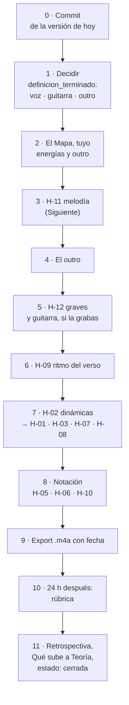

- **0–2** no tocan la partitura: son la línea de meta y la vara. Sin ellas, cualquier hallazgo puede alargar la
  pieza para siempre.
- **3–4** son las únicas que componen material nuevo. H-11 va antes que la energía porque la energía depende de
  qué capa lleve la línea.
- **5–6** cambian cómo suenan los acordes que ya están. Si la guitarra no la grabas, el 5 es solo H-12.
- **7** es sobre todo dinámicas: con lo de arriba resuelto, se marca lo que ya existe. Varios de sus hallazgos
  pueden moverse solos con el 3.
- **8** al final, por lo que dice H-10.
- **Bounce incondicional:** un audio a `render/` al terminar cada sesión, no solo en el 9.

---

## Siguiente

➡️ **[[3. Composiciones/6. louise/6. Hallazgos#^h-11|H-11]]**: que el verso y el coro tengan una línea. Cambia
respecto a F 07, que recomendaba H-02: H-02 se arregla sobre todo con dinámicas, y qué dinámica lleva cada
sección depende de qué capa cante. H-11 lo decide, y toca 80 de los 110 compases.

Empieza por la pregunta 2 de *Decidir* (*¿voz o instrumental?*), porque decide qué es la sesión: escribir la voz,
o hacer que el piano o la guitarra lleven la línea, o anotar en *Decisiones* que el verso y el coro son
acompañamiento a propósito. Para el feedback de esa sesión, el alcance es la sección que trabajes:
`V1.melodia` o `C1.melodia`.

---

## Propuestas

**Para la ficha** ([[3. Composiciones/6. louise/0. Obra|0. Obra]])

- `definicion_terminado`, con la forma que pide [[6. Práctica/0. Flujos|Flujos]]:
  `____ s · forma ____ · ____ (voz / instrumental) · guitarra ____ (MuseScore / grabada) · un .m4a exportado con fecha`.
- *Problemas abiertos* (5 oct) describe la versión de Strudel. Cómo está cada uno en la partitura:

| Problema | Hoy |
|---|---|
| La guitarra pisa al bajo | sigue en parte: la guitarra queda debajo del piano en c.26, 51, 53 y 57 (H-10), y en el grave cerrado (H-12) |
| La melodía no cae en los tiempos del vals | era de Strudel; ya no aplica |
| El kick dura 4 compases y la frase 5 | era de Strudel; ya no aplica |
| La frase dura 5 compases | [[3. Composiciones/6. louise/2. Decisiones#^d-02\|D-02]] la conserva en la intro y en el B1 |
| Los compases de respuesta no tienen voz | **sigue siendo cierto**, a escala de la pieza: H-11 |
| No hay forma | resuelto: [[3. Composiciones/6. louise/2. Decisiones#^d-03\|D-03]] |

- El cronograma terminó el 17 de octubre. La fecha nueva puede ir en la *Decisión de revisión* de la rúbrica.

**Para el Mapa** (las de F 07 siguen sin contestar, y se suman dos)

- **Energía** de Intro, V1, C1, B1, V2 y Outro. En la sesión 05 escribiste 2 · 3 · 3 · 1 · 3 · 1–2.
- **V2 · Cómo se reconoce:** el comentario sobre el c.51 quedó viejo: hoy el bajo es La2.
- **C3 · Cómo se reconoce:** ____ (hoy lo único que lo distingue del C1 es que no hay batería).
- **Outro:** nombre, *Qué quiero*, energía y cómo se reconoce. Hoy son los c.109–110.
- **Nuevo · Roles:** `____ lleva la línea en el verso y el coro` (o "nadie, a propósito").
- **Nuevo · Motivo:** dónde quieres que suene. Hoy: c.1–2, 6–7, 46–47 y 83–84. ____

**Para Decisiones**

- **D-10** dice que *el único cromatismo de toda la pieza es el G♯ del c.45*; desde el B2 ya no lo es (F 07).
  Tacharla y pasarla a *Reemplazadas*: `D-NN · … · porque ____`.
- Cerrar en *Por decidir* lo que ya está hecho: *Qué le quito al C1* y *Que el B2 no arranque como el B1*.
- *c.51: ¿el bajo es Mi o Re?* ya no es ninguno: es La2 (Dmaj7/A). Si lo quieres así:
  `D-NN · el V2 entra en Dmaj7/A · porque ____`.
- Si H-11 es a propósito: `D-NN · el verso y el coro son acompañamiento; la identidad es el motivo de la intro, el B1 y el B2 · porque ____`.
- Si H-12 es a propósito: `D-NN · en el coro la guitarra engrosa el grave del piano · porque ____`.
- Si la guitarra la toca MuseScore: `D-NN · la guitarra no se graba: los voicings no tienen que caber en una mano · porque ____`.
- Las de F 07 para H-08 y H-09, si son a propósito, siguen abiertas.

**Para Contexto**

- La toma `R-02` de F 07 (el riff de la intro vuelve al final de *Elouise*, para el outro) sigue sin contestar:
  lo que tomas y por qué son tuyos.
- *No quiero ❌* sigue vacío: ____.

---

## Cómo se midió

- **Qué cambió:** `diff-musical.py` entre el `.musicxml` de `a10f3d8` y el regenerado hoy: dos cambios (c.84 y
  c.88, piano).
- **Volumen:** una copia del `.mscz` (10:00, blob `4cba577`) en una carpeta temporal, exportada a WAV con
  MuseScore 4.7.5. RMS de cada compás (1.125 s a ♩=160) y de cada tiempo (0.375 s); promedios por sección en
  potencia, no promediando los dB. Coinciden con F 07 a 0.1 dB.
- **Notas:** el `.musicxml` leído nota por nota, con las ligaduras unidas y la guitarra en su **altura real** (una
  octava debajo de lo escrito).
- **Graves:** en cada ataque, todas las notas que suenan de piano y guitarra; cada par de notas vecinas contra la
  tabla de límites de [[3. Composiciones/6. louise/5. Feedback/03. B2|F 03]] (2ª menor Mi3, 2ª mayor Mi♭3, 3ª
  menor Do3, 3ª mayor Si♭2). *En el límite* = un semitono debajo.
- **Guitarra que no se puede tocar:** cada acorde repartido en cuerdas distintas de la afinación estándar
  (Mi2 La2 Re3 Sol3 Si3 Mi4), trastes 0–15, con las notas pisadas dentro de cuatro trastes y cuerdas apagadas
  permitidas. Es una aproximación: no sabe de cejillas ni de estiramientos.
- **Cifrado:** por cada cifrado, las notas que suenan hasta el siguiente y la nota más grave al entrar. No se
  cuentan las quintas que faltan ni las notas de menos de un tiempo.
- **Motivo:** el patrón de intervalos (2ª, 2ª menor, 3ª mayor hacia abajo y la 3ª de vuelta) en la voz de arriba
  de la mano derecha, y su forma en menor, revisada a mano.
- **Compases idénticos:** mismo ataque, duración y altura en piano y guitarra que un compás anterior.
- **Registro libre (H-11):** por semicorchea, qué porcentaje del tiempo cada capa tiene alguna nota en Re4–La4.
- **Gráficas:** generadas desde los mismos datos, en `08. pieza - gráficas/`, con la paleta de las gráficas de
  `AI/1. Análisis estadístico` (azul piano, naranja guitarra, verde los dos).
- **Bloques Strudel:** transcriben las notas y la batería de la partitura tal como están; las velocidades de la
  batería se pasan de su porcentaje en MuseScore a la escala de Strudel (114 % → 0.81, 100 % → 0.71, 76 % → 0.54,
  38 % → 0.27). Suenan con los samples de Strudel, no con los de MuseScore.
- **Lo que esto no mide:** el timbre, ni cómo suena una melodía que todavía no existe. H-11 describe que falta una
  línea, no cómo tendría que ser.

---

## Archivo: `3. Composiciones/6. louise/5. Feedback/09. C1.guitarra.voicing.md`

```yaml
tipo: feedback
estado: vigente
numero: 9
fecha: 2026-10-23
alcance: C1.guitarra.voicing
evaluado:
  - archivo: "7. Partituras/2. Composiciones/Louise-melancolica.mscz"
    commit: eca2c4f
    limpio: true
    blob: 4cba577
    guardado: 2026-10-23 10:00
contexto: []
anterior: "[[3. Composiciones/6. louise/5. Feedback/08. pieza|F 08]]"
siguiente: "[[3. Composiciones/6. louise/6. Hallazgos#^h-13|H-13]]"
```

# Feedback 09 · C1.guitarra.voicing

> [!info] Fuente
> **Claude, 2026-10-23.** Primer feedback de este alcance: **la guitarra del C1 (c.27–42), solo el voicing**.
> Lo pediste después de decidir, en conversación, que quieres arreglar la guitarra y probar un violín en lugar de
> voz. Ninguna de las dos cosas está todavía en [[3. Composiciones/6. louise/2. Decisiones|Decisiones]], así que
> aquí son contexto, no la vara.
>
> **Qué cambió desde [[3. Composiciones/6. louise/5. Feedback/08. pieza|F 08]]:** nada en la partitura (mismo
> blob, `4cba577`); solo se hizo commit. No hay sesiones nuevas.
>
> **Va por bloques.** Cada bloque es un acorde (o una pareja) del coro, con lo suyo y nada más: se puede leer y
> trabajar uno por sesión. El detalle de cómo se midió está al final.

> [!abstract] Qué se evaluó, exactamente
> | Archivo | Commit | ¿Limpio? | Blob | Guardado |
> |---|---|---|---|---|
> | `7. Partituras/2. Composiciones/Louise-melancolica.mscz` | `eca2c4f` | sí | `4cba577` | 2026-10-23 10:00 |
>
> - **Limpio:** se recupera con `git show eca2c4f:"7. Partituras/2. Composiciones/Louise-melancolica.mscz"`.
> - No hay autosave de `Louise-melancolica.mscz`. Hay uno de hoy a las 15:11, pero es de `Louise.mscz`, otro
>   archivo: si trabajaste ahí, eso no es la fuente y no se evaluó.

> [!important] Qué cuenta como error
> Un error es cuando **lo que escribiste dice una cosa y lo que suena dice otra**: el cifrado, el
> [[3. Composiciones/6. louise/1. Mapa|Mapa]], las [[3. Composiciones/6. louise/2. Decisiones|Decisiones]] o el
> [[3. Composiciones/6. louise/4. Contexto|Contexto]]. Aquí la vara es sobre todo tu nota
> [[00. Voicing e inversiones]]. Lo que contradice una decisión vigente no se reporta. Los ejemplos muestran
> **lo que suena hoy**; no traen correcciones.

---

## En una pantalla

1. **La guitarra hace dos cosas en el coro.** En 12 compases, un acorde sostenido desde el 1 con una tercera
   abajo, en la octava 2 (Em, G, F♯m7, A7). En 3, acordes agudos en el 2 y el 3 de los compases de cadencia
   (Bm, D). Lo segundo es tu [[3. Composiciones/6. louise/2. Decisiones#^d-05|D-05]] y está bien.
2. **El grave sigue como en F 08.** 10 compases con una tercera debajo de su límite y 2 en el límite; en 14 de
   los 15 compases con guitarra, el piano toca la misma nota en la misma altura →
   [[3. Composiciones/6. louise/6. Hallazgos#^h-12|H-12]], sin cambios.
3. **Solo 7 de los 15 compases caben cómodos en la mano.** El Em no existe en la guitarra (4 compases); el A7 y
   el Bm solo caben del traste 9 al 14, con una cuerda apagada en medio y saltos de unos diez trastes
   (4 compases) → [[3. Composiciones/6. louise/6. Hallazgos#^h-13|H-13]], **nuevo**.
4. **Lo que arregles aquí se copia.** La guitarra del C2 es la del C1 nota por nota (16 de 16 compases), y la
   del C3 casi (15 de 16; cambia el c.93).

**En números:** 2 hallazgos abiertos en el alcance (1 nuevo), ninguno cerrado.

---

## El coro en un vistazo

Cada compás del C1, con lo que toca la guitarra en **altura real** (una octava debajo de lo escrito):

| c. | Acorde | Guitarra | ¿Cabe en la mano? | Grave (H-12) | El piano toca lo mismo |
|---|---|---|---|---|---|
| 27 | Em | Mi2 Sol2 Mi3 Sol3 | ❌ no existe | 3ª menor, una 6ª menor debajo del límite | Mi3 |
| 28 | G | Sol2 Si2 Sol3 Si3 | ✅ | 3ª mayor, una 3ª menor debajo | Sol3 |
| 29 | F♯m7 | Fa♯2 La2 Fa♯3 La3 | ✅ | 3ª menor, un tritono debajo | Fa♯3 |
| 30 | Bm, en el 2 y el 3 | Si3 Re4 Si4 Fa♯5 | ⚠️ trastes 12–14 | — | Si3 |
| 31 | Em | = c.27 | ❌ | = c.27 | Mi3 |
| 32 | G | = c.28 | ✅ | = c.28 | Sol3 |
| 33 | A7 | La2 Do♯3 Mi4 La4 Mi5 | ⚠️ trastes 9–12 | 3ª mayor, **en el límite** | La2 |
| 34 | D, en el 2 y el 3 | La3 Re4 Fa♯4 La4 | ✅ trastes 5–7 | — | — |
| 35 | Em | = c.27 | ❌ | = c.27 | Mi2 y Mi3 |
| 36 | G | = c.28 | ✅ | = c.28 | Sol2 y Sol3 |
| 37 | F♯m7 | = c.29 | ✅ | = c.29 | Fa♯2 y Fa♯3 |
| 38 | Bm, en el 2 y el 3 | = c.30 | ⚠️ | — | Si3 |
| 39 | Em | Mi2 Sol2 Mi3 Sol3 **Mi4** | ❌ | = c.27 | Mi2 y Mi3 |
| 40 | G | = c.28 | ✅ | = c.28 | Sol2 y Sol3 |
| 41 | A7 | = c.33 | ⚠️ | en el límite | La2 |
| 42 | D | *en silencio* | — | — | — |

**Total:** ❌ 4 · ⚠️ 4 · ✅ 7. Grave debajo del límite 10, en el límite 2. Mismo tono que el piano: 14 de 15.

---

## Lista

| ID | Dónde | Qué escribiste | Qué suena | Peso | Contra | Estado |
|---|---|---|---|---|---|---|
| [[3. Composiciones/6. louise/6. Hallazgos#^h-12\|H-12]] | c.27–29, 31–33, 35–37, 39–41 | *"En registros graves, es mejor abrir las voces"*; un rol por parte | 10 compases con una tercera debajo del límite, 2 en el límite; 14 de 15 con el piano en la misma nota | medio | [[00. Voicing e inversiones]] · [[3. Composiciones/6. louise/2. Decisiones#^d-05\|D-05]] | abierto, sin cambios |
| [[3. Composiciones/6. louise/6. Hallazgos#^h-13\|H-13]] | c.27, 30, 31, 33, 35, 38, 39, 41 | *"Adaptación de voicings a las posibilidades del instrumento"*; el instrumento es una guitarra nylon | el Em no existe en la guitarra; A7 y Bm solo del traste 9 al 14, con una cuerda apagada en medio y saltos de unos diez trastes | medio | [[00. Voicing e inversiones]] · `instrumentos` de la ficha | **nuevo** |

**Cerrados en este feedback:** ninguno.

---

## Uno por uno, en bloques

Cada bloque sigue el mismo orden: **qué escribiste**, **qué suena**, **qué pasa**, **¿es un error?** y **para
resolverlo** (opciones, no notas).

### Bloque 1 · El Em (c.27, 31, 35, 39) · H-13 y H-12

Es el único acorde del coro que está en los dos hallazgos.

**Qué escribiste.** En tu nota de voicing, para guitarra: *"Adaptación de voicings a las posibilidades del
instrumento"*. Y en la misma nota: *"En registros graves, es mejor abrir las voces"*. En *Por decidir* ya lo
tenías apuntado: *"el Em del coro (c.27, 31, 35, 39 y copias)"*.

**Qué suena.**

```music-abc
X:1
T:El Em del coro como suena hoy (c.27, c.35, c.39)
M:3/4
L:1/4
K:D
V:1 clef=treble name="Piano MD"
V:2 clef=bass name="Piano MI"
V:3 clef=bass name="Guitarra (real)"
[V:1] "^c.27"z E E | "^c.35"z [Ee] [Ee] | "^c.39"z G G |]
[V:2] E, z z | [E,,E,] E, E, | [E,,E,] [E,B,] [E,B,] |]
[V:3] [E,,G,,E,G,]3 | [E,,G,,E,G,]3 | [E,,G,,E,G,E]3 |]
```

| Nota | Dónde existe en la guitarra |
|---|---|
| Mi2 | solo en la 6.ª cuerda, al aire |
| Sol2 | solo en la 6.ª cuerda, traste 3 |
| Mi3 · Sol3 | en varias cuerdas |

La 5.ª cuerda empieza en La2: debajo de La2, todo sale de la 6.ª, y una cuerda da una sola nota a la vez.

**Qué pasa.** Dos cosas a la vez:

- **No existe en la guitarra.** Mi2 y Sol2 piden la misma cuerda. No es una digitación difícil: no hay ninguna.
- **Es el grave más cerrado del coro.** Mi2–Sol2 es una tercera menor una sexta debajo de su límite (Do3). Y el
  acorde son dos notas, Mi y Sol, repetidas en cuatro alturas; en c.35 y c.39 la mano izquierda del piano dice
  además Mi2 y Mi3, las mismas de la guitarra.

**¿Es un error?** Sí, contra tu nota, mientras la guitarra sea una guitarra. Si decides que solo suena en
MuseScore, lo de la mano deja de ser un error (ver *Propuestas*), pero el grave sigue: H-12 no depende de eso.

**Para resolverlo.**

| Opción | Qué haces | Modelo en tu pieza | Recurso |
|---|---|---|---|
| **Una forma abierta** | cuerdas al aire con una forma pequeña, sin dos notas en la 6.ª | tu c.11 (0-0-0-2-2-2) | [[3. Composiciones/6. louise/AI/0. Recursos de energía y forma - Louise\|Recursos]] §3.10 |
| **Abrir la nota de abajo** | que encima de la nota más grave haya una quinta o una octava, no una tercera | **c.85–87**: Sol2–Re3, La2–Mi3, Do3–Fa3 | [[00. Voicing e inversiones]] · [[3. Composiciones/6. louise/5. Feedback/03. B2\|F 03]] |
| **Dejarle el grave al piano** | la guitarra sin la octava 2: el bajo lo dice la mano izquierda | [[3. Composiciones/6. louise/2. Decisiones#^d-05\|D-05]]: un rol por parte | Recursos §2.2 |
| **Menos notas** | tres en lugar de cuatro o cinco | **c.85–89**: la guitarra del B2 toca tres notas y no sale de los trastes 0–5 | Recursos §2.2 · §3.10 |

- **Cuándo queda:** cuando el Em de c.27, 31, 35 y 39 tenga al menos una digitación en afinación estándar y
  ningún intervalo debajo de su límite.
- **Pídelo así:** `C1.guitarra.voicing`.

---

### Bloque 2 · G y F♯m7 (c.28, 32, 36, 40 · c.29, 37) · H-12

Se tocan bien. Lo único es el grave.

**Qué escribiste.** *"En registros graves, es mejor abrir las voces"*, y
[[3. Composiciones/6. louise/2. Decisiones#^d-05|D-05]]: *"un rol específico para cada parte"*.

**Qué suena.**

```music-abc
X:2
T:G y F#m7 como suenan hoy (c.28–29 y c.36–37)
M:3/4
L:1/4
K:D
V:1 clef=treble name="Piano MD"
V:2 clef=bass name="Piano MI"
V:3 clef=bass name="Guitarra (real)"
[V:1] "^c.28 G"z G G | "^c.29 F#m7"z F F || "^c.36 G"z [DB] [DB] | "^c.37 F#m7"z [EA] [EA] |]
[V:2] G, z z | F, z z || [G,,G,] G, G, | [F,,F,] F, F, |]
[V:3] [G,,B,,G,B,]3 | [F,,A,,F,A,]3 || [G,,B,,G,B,]3 | [F,,A,,F,A,]3 |]
```

| Acorde | Guitarra | Cómo se toca hoy | Intervalo de abajo | Límite | ¿Cuánto debajo? |
|---|---|---|---|---|---|
| G | Sol2 Si2 Sol3 Si3 | 3-2-x-0-0-x (el Sol abierto, sin el Re) | 3ª mayor | Si♭2 | una 3ª menor |
| F♯m7 | Fa♯2 La2 Fa♯3 La3 | 2-0-4-2-x-x | 3ª menor | Do3 | un tritono |

**Qué pasa.** Igual que el Em: dos notas en cuatro alturas, con la tercera abajo. En la segunda mitad del coro
(c.36, 37) la mano izquierda baja una octava y dobla **las dos** octavas graves de la guitarra: Sol2 y Sol3,
Fa♯2 y Fa♯3. Ahí el grave pesa más que en la primera mitad.

**¿Es un error?** Sí, contra tu nota de voicing y contra tu propio B2. Con un matiz que ya daba F 08: Sol2–Si2 es
la forma del Sol abierto y, sola, suena normal en una nylon. Lo que la empasta es el Sol del piano encima. El
F♯m7 pesa más: su tercera está un tritono debajo del límite.

**Para resolverlo.** Las mismas opciones del bloque 1, menos *una forma abierta* (estas ya caben en la mano).
Lo nuevo aquí:

- **No doblar.** De cada nota que tocan los dos debajo de Do4, que la toque uno. Hoy: Sol3 y Fa♯3 en la primera
  mitad; Sol2, Sol3, Fa♯2 y Fa♯3 en la segunda (bloque 4).
- **Cuándo queda:** ninguna tercera debajo de su límite en c.28, 29, 32, 36, 37 y 40.

---

### Bloque 3 · A7 y Bm, arriba del mástil (c.30, 33, 38, 41) · H-13

Caben en la mano, pero solo de una manera, y lejos de los acordes que los rodean.

**Qué escribiste.** *"Adaptación de voicings a las posibilidades del instrumento"*. Los
[[3. Composiciones/6. louise/AI/0. Recursos de energía y forma - Louise|Recursos]] §3.10 contaban solo el Em como
intocable en el coro; estos cuatro compases son nuevos.

**Qué suena.** La guitarra de c.29 a c.34, partida en dos pentagramas para que se lea, con los trastes donde cae
cada acorde:

```music-abc
X:3
T:La guitarra de c.29 a c.34 (altura real) y los trastes donde cae
M:3/4
L:1/4
K:D
V:1 clef=treble name="Guitarra, desde Do4"
V:2 clef=bass name="Guitarra, debajo de Do4"
[V:1] "^c.29 · 2–4"z3 | "^c.30 · 12–14"z [DBf] [DBf] | "^c.31 · no existe"z3 | "^c.32 · 0–3"z3 | "^c.33 · 9–12"[EAe]3 | "^c.34 · 5–7"z [DFA] [DFA] |]
[V:2] [F,,A,,F,A,]3 | z B, B, | [E,,G,,E,G,]3 | [G,,B,,G,B,]3 | [A,,C,]3 | z A, A, |]
```

| Acorde | Guitarra | Digitaciones posibles | La más baja |
|---|---|---|---|
| Bm (c.30, 38) | Si3 Re4 Si4 Fa♯5 | 3, todas del traste 12 para arriba y con una cuerda apagada en medio | x-14-12-x-12-14 |
| A7 (c.33, 41) | La2 Do♯3 Mi4 La4 Mi5 | **una sola** | 9-0-x-9-10-12: la 6.ª en el traste 9 (Do♯3) encima de la 5.ª al aire (La2), y la 4.ª apagada |

Los saltos, a ♩=160 (un tiempo = 0.375 s):

| Paso | De | A | Tiempo para moverse |
|---|---|---|---|
| c.29 → 30 | F♯m7, trastes 2–4 | Bm, trastes 12–14 | 1 tiempo (0.375 s) |
| c.30 → 31 | Bm, 12–14 | Em (no existe) | en la barra |
| c.32 → 33 | G, trastes 0–3 | A7, trastes 9–12 | en la barra |
| c.33 → 34 | A7, 9–12 | D, trastes 5–7 | 1 tiempo |
| c.37 → 38 | F♯m7, 2–4 | Bm, 12–14 | 1 tiempo |
| c.40 → 41 | G, 0–3 | A7, 9–12 | en la barra |

**Qué pasa.**

- **Se puntean, no se rasguean.** Con una cuerda apagada entre las que suenan, un rasgueo la toca o la salta mal.
- **El Bm cae donde empieza la caja.** En una guitarra de nylon el mástil se une al cuerpo en el traste 12; del
  12 al 14 la mano trabaja contra la caja.
- **La mano viaja unos diez trastes, cuatro veces por coro:** dos con un tiempo para moverse y dos en la barra,
  sin tiempo. Y vuelve.
- **El registro salta con ella.** La nota de arriba de la guitarra va de La3 (c.29) a Fa♯5 (c.30) y de vuelta a
  Sol3 (c.31): casi dos octavas arriba y abajo en dos compases.

> [!note] Del violín (contexto, no se evalúa)
> En el C1, la guitarra solo pasa de Re5 en estos cuatro compases (Fa♯5 en c.30 y 38, Mi5 en c.33 y 41). En el
> resto su nota de arriba está entre Sol3 y La4 (el D del c.34). Si el violín entra en el C1, lo que la guitarra le ocupa arriba
> es justo este bloque.

**¿Es un error?** Sí, contra tu nota, si la guitarra se va a tocar. Pesa menos que el Em: estos acordes existen,
pero a ♩=160 son difíciles de enlazar con lo que tienen alrededor.

**Para resolverlo.**

| Opción | Qué haces | Modelo en tu pieza | Recurso |
|---|---|---|---|
| **Quedarse en una zona** | que el acorde caiga cerca de los trastes del compás anterior | **c.85–89**: la guitarra del B2 no sale de los trastes 0–5 | Recursos §3.10 |
| **Menos notas** | tres o cuatro, sin la cuerda apagada en medio | el B2, tres notas por acorde | Recursos §2.2 |
| **Nota común** | la nota de arriba cerca de la del compás anterior | tu nota de voicing: *"Mantener notas comunes"*, *"movimiento por grado conjunto"* | [[00. Voicing e inversiones]] |

- **Cuándo queda:** el A7 y el Bm con una digitación sin cuerdas apagadas en medio, y a menos de cinco trastes
  del acorde anterior.

---

### Bloque 4 · El piano dice lo mismo que la guitarra (14 de 15 compases) · H-12

**Qué escribiste.** [[3. Composiciones/6. louise/2. Decisiones#^d-05|D-05]]: *"un rol específico para cada
parte"*.

**Qué suena.** Las notas que piano y guitarra tocan a la vez, en la misma altura, debajo de Do4:

| c. | Las dos tocan | | c. | Las dos tocan |
|---|---|---|---|---|
| 27 | Mi3 | | 35 | Mi2 · Mi3 |
| 28 | Sol3 | | 36 | Sol2 · Sol3 |
| 29 | Fa♯3 | | 37 | Fa♯2 · Fa♯3 |
| 30 | Si3 | | 38 | Si3 |
| 31 | Mi3 | | 39 | Mi2 · Mi3 |
| 32 | Sol3 | | 40 | Sol2 · Sol3 |
| 33 | La2 | | 41 | La2 |
| 34 | — | | 42 | *(guitarra en silencio)* |

El grave del coro contra tu B2 (la misma versión que midió F 08):

![[3. Composiciones/6. louise/5. Feedback/08. pieza - gráficas/3. El grave, coro contra B2.svg]]

| | c.27 · tiempo 1 | c.85 · tiempo 2 (B2) |
|---|---|---|
| Alturas debajo de Do4 | Mi2 Sol2 Mi3 Sol3 | Sol2 Re3 Sol3 Si♭3 |
| Notas distintas | 2 (Mi, Sol) | 3 (Sol, Re, Si♭) |
| Intervalo de abajo | 3ª menor | 5ª justa |

**Qué pasa.** En el grave, la guitarra no tiene un papel propio: engrosa la mano izquierda. En la segunda mitad
del coro lo hace en las dos octavas.

**¿Es un error?** Sí, contra D-05. Va con el bloque 1 y el 2: cualquier cambio de grave en esos acordes cambia
también esta tabla.

**Para resolverlo.**

- **No doblar:** de cada nota de la tabla, que la toque uno.
- **Dejarle el grave al piano**, como en los bloques 1 y 2.
- Va a favor del [[3. Composiciones/6. louise/1. Mapa|Mapa]]: quitarle notas a la guitarra *"baja la energía sin
  sacar el instrumento"* (Recursos §2.2), y el C1 está pensado plano
  ([[3. Composiciones/6. louise/2. Decisiones#^d-06|D-06]]).
- **Cuándo queda:** el siguiente feedback vuelve a contar esta tabla. Hoy: 14 de 15.

---

### Bloque 5 · Lo que ya está (para no romperlo)

- **Los roles de la cadencia.** En c.30, 34 y 38 el piano toca el 1 y la guitarra el 2 y el 3, como dice
  [[3. Composiciones/6. louise/2. Decisiones#^d-05|D-05]].
- **El D del c.34** cae en los trastes 5–7, sin grave y sin doblar al piano.
- **El G y el F♯m7** caben en la mano en posición abierta.
- **El c.42** deja la guitarra en silencio y cierra el coro en el piano solo.

**Copias.** La guitarra del C2 es la del C1 compás por compás (16 de 16) y la del C3 casi (15 de 16; el c.93
lleva además un Sol4, y sigue siendo el mismo Em). Lo que arregles aquí se lleva allá. Una advertencia que no se
evaluó, porque es de otro alcance (`C2.arreglo`): [[3. Composiciones/6. louise/2. Decisiones#^d-07|D-07]] quiere
que el C2 deje de ser copia exacta del coro.

---

## Siguiente

➡️ **[[3. Composiciones/6. louise/6. Hallazgos#^h-13|H-13]], empezando por el Em** (bloque 1: c.27, 31, 35, 39).
Es el único acorde del coro que está en los dos hallazgos: arreglado, cambia cuatro compases del C1 y sus copias
en el C2 y el C3, y quita también la tercera más grave de H-12.

Si decides que la guitarra no se toca (*Propuestas*), el siguiente es H-12, y empieza por el mismo Em.

---

## Propuestas

- **Para Decisiones**, una de las dos:
  - `D-NN · La guitarra se escribe para tocarse: cada acorde cabe en una mano, en afinación estándar · porque ____`
  - `D-NN · La guitarra es de MuseScore: no hace falta que se pueda tocar · porque ____ · H-13 pasa a decisión`
- **Para el Mapa:** ninguna.
- **Para Contexto:** ninguna.

---

## Cómo se midió

- **Notas:** el `.musicxml` (regenerado a las 10:11 desde el `.mscz` de las 10:00, mismo blob) leído nota por
  nota, con las ligaduras unidas y la guitarra en **altura real**.
- **Grave:** en cada ataque de la guitarra, todas las notas que suenan de piano y guitarra; cada par de notas
  vecinas contra los límites de [[3. Composiciones/6. louise/5. Feedback/03. B2|F 03]] (2ª menor Mi3, 2ª mayor
  Mi♭3, 3ª menor Do3, 3ª mayor Si♭2). *En el límite* = un semitono debajo.
- **¿Cabe en la mano?:** cada acorde repartido en cuerdas distintas de la afinación estándar (Mi2 La2 Re3 Sol3
  Si3 Mi4), trastes 0–19, con las notas pisadas dentro de cuatro trastes. ⚠️ = solo cabe del traste 9 para
  arriba o con una cuerda apagada entre las que suenan. Es una aproximación: no sabe de cejillas, estiramientos
  ni técnica, y *cabe* no quiere decir *es cómodo a ♩=160*.
- **Saltos:** el tiempo entre el final del acorde anterior y el ataque del siguiente, a ♩=160.
- **Doblajes:** notas que piano y guitarra tocan a la vez en la misma altura, debajo de Do4.
- **Copias:** mismos ataques, duraciones y alturas de guitarra que el compás del C1.
- **Lo que esto no mide:** el timbre de la nylon en el render, ni cómo te queda a ti en la mano.

---

## Archivo: `3. Composiciones/6. louise/5. Feedback/10. violin.md`

```yaml
tipo: feedback
estado: vigente
numero: 10
fecha: 2026-10-23
alcance: violin
evaluado:
  - archivo: "7. Partituras/2. Composiciones/Louise-melancolica.mscz"
    commit: eca2c4f
    limpio: false
    blob: 4cc453b
    guardado: 2026-10-23 18:25
contexto:
  - "[[3. Composiciones/6. louise/3. Sesiones/07. violin.melodia|S 07]]"
anterior: "[[3. Composiciones/6. louise/5. Feedback/08. pieza|F 08]]"
siguiente: "[[3. Composiciones/6. louise/6. Hallazgos#^h-15|H-15]]"
```

# Feedback 10 · violin

> [!tldr] En corto
> **Lo que quedó bien:** el violín ya toca en toda la pieza y se puede tocar en un violín de verdad. Lo mejor está
> en el B2: sube hasta la nota más aguda de la canción justo en el B♭ del c.91. El final (c.107→108) también
> cierra bien.
>
> **Lo que falla:**
> 1. **En el coro, el violín toca lo mismo que el bajo, solo que más agudo.** Por eso no suena a melodía. → H-15
> 2. **El volumen va al revés.** El violín suena más fuerte en los coros que en el B2, que debería ser lo más
>    intenso de la pieza. → H-17
> 3. **En los versos, el pizzicato acompaña y no canta.** Queda escondido debajo del piano. → H-14
>
> Lo demás es menor: el C2 repite el C1 tal cual, el B1 ya no es piano solo, y hay cosas de notación (dice
> *"open"* en vez de *arco*, y faltan dinámicas y ligaduras).
>
> **Qué hacer ahora:** reescribir la línea del violín en el coro (c.27–34) para que no siga al bajo. Ya lo hiciste
> bien en el C3; úsalo de modelo.

> [!info] Fuente
> **Claude, 2026-10-23.** Primer feedback del violín: **todo lo que toca, de la primera nota (c.11) a la última
> (c.108)**: melodía, ritmo, registro, energía, conducción, notación y si se puede tocar. Lo pediste al terminar
> la [[3. Composiciones/6. louise/3. Sesiones/07. violin.melodia|S 07]], en la que el pentagrama de Voz pasó a ser
> Violín y se escribió de punta a punta.
>
> **Qué cambió desde [[3. Composiciones/6. louise/5. Feedback/09. C1.guitarra.voicing|F 09]]:** el pentagrama
> *Voz* (vacío) es ahora *Violin*, con 220 notas que suenan en 95 compases (c.11–47 y c.51–108). Y en el final, el
> piano movió el bajo de los c.108–111 (6 notas). Nada más: guitarra y batería están idénticas.
>
> **Cómo se midió, en una línea:** el `.musicxml` nota por nota contra piano y guitarra, y tres renders de
> MuseScore (la mezcla, el violín solo y todo menos el violín) medidos compás por compás. El detalle, al final.

> [!abstract] Qué se evaluó, exactamente
> | Archivo | Commit | ¿Limpio? | Blob | Guardado |
> |---|---|---|---|---|
> | `7. Partituras/2. Composiciones/Louise-melancolica.mscz` | `eca2c4f` | **no** | `4cc453b` | 2026-10-23 18:25 |
>
> - **No limpio:** el violín todavía no tiene commit. El blob identifica el contenido exacto, pero no lo guarda:
>   para poder volver a esta versión hace falta el commit.
> - El `.musicxml` se regeneró hoy a las 18:27 con `sync-partituras.py`, desde ese `.mscz`.
> - MuseScore estaba cerrado y no hay autosave más nuevo. `Louise.mscz` (otro archivo) también cambió hoy, a las
>   17:07: no es la fuente y no se evaluó.

> [!important] Qué cuenta como error
> Un error es cuando **lo que escribiste dice una cosa y lo que suena dice otra**: el cifrado, el
> [[3. Composiciones/6. louise/1. Mapa|Mapa]], las [[3. Composiciones/6. louise/2. Decisiones|Decisiones]] o el
> [[3. Composiciones/6. louise/4. Contexto|Contexto]]. Para el violín la vara es sobre todo D-13 (*"el violín
> lleva la línea"*), la energía y lo que *reconoce* cada sección en el Mapa, D-02, D-07, D-08, y tus notas
> [[00. Voicing e inversiones]] y [[1. Composición melódica]]. Lo que la S 07 planeó y no está en Decisiones
> (D-14, D-15) es contexto, no vara. Los ejemplos muestran **lo que suena hoy**; no traen correcciones.

> [!warning] Antes de seguir · fuera de la partitura
> - **D-13 sigue terminando en `^d-13` y una comilla invertida.** Obsidian no reconoce el ID y ningún enlace a D-13
>   llega; por eso aquí se nombra sin enlace.
> - **D-14 y D-15 están marcadas ✓ en la S 07, pero no existen en Decisiones.** Ojo con D-15 (*"B2 sin violín"*):
>   la partitura tiene violín en todo el B2. Ver *Propuestas*.
> - `instrumentos` en [[3. Composiciones/6. louise/0. Obra|0. Obra]] sigue sin `violin`.
> - El sync ya está hecho. Falta el commit del `.mscz` y del `.musicxml`.

---

## En una pantalla

1. **Quedó entero, y en su sitio.** *pizz.* en V1 y V2, arco en C1, C2 y C3, todo dentro del registro del violín
   (Si♭3–Si♭5), 38 de 39 dobles cuerdas tocables, y en Re mayor, con las cuerdas al aire sonando. Lo que planeaste
   en la S 07 está escrito.
2. **Lo mejor está en el B2 y el C3.** En el B2 sube dos octavas en siete compases (Si♭3 → Si♭5) y llega a **la
   nota más aguda de la pieza justo en el B♭ del c.91**, que es exactamente lo que dice el Mapa. Es el único sitio
   donde llega a Sol5 o más arriba. En el C3 tiene línea propia y cierra con la sensible: Do♯5 → Re5 en el A7→D.
3. **Es lo único que separa el coro del verso.** Sin violín, V1 y C1 miden lo mismo (−12.5 y −12.6 dB); con él, el
   C1 sube 1.0 dB. Igual del V2 al C2 (+1.2).
4. **En los versos acompaña, no canta.** El *pizzicato* nunca es la voz de arriba (0 % del tiempo en V1, 2 % en
   V2), el 76–81 % del tiempo toca una nota que ya está sonando, y queda 14–15 dB debajo del resto
   → [[3. Composiciones/6. louise/6. Hallazgos#^h-14|H-14]].
5. **En los coros, la línea es el bajo.** El 65 % del tiempo del C1 el violín está a una o dos octavas exactas
   del bajo; en 12 de los 15 compases donde ataca en el 1, toca la fundamental; y hay 6 paralelas con el bajo
   → [[3. Composiciones/6. louise/6. Hallazgos#^h-15|H-15]]. El C2 es el C1 copiado (15 de 16 compases)
   → [[3. Composiciones/6. louise/6. Hallazgos#^h-16|H-16]].
6. **Su curva va al revés del Mapa.** Lo más fuerte del violín son los coros (−18.3 y −18.7 dB); el B2, el pico, es
   su parte de arco más baja (−26.0), debajo hasta del C3 (−23.0) → [[3. Composiciones/6. louise/6. Hallazgos#^h-17|H-17]].
7. **El B1 ya no es piano solo** → [[3. Composiciones/6. louise/6. Hallazgos#^h-18|H-18]]. Y en la notación:
   *"open"* en lugar de *arco*, un *p* que suena *mp*, una dinámica vacía, cuatro reguladores que no llegan a nada
   y ni una ligadura → [[3. Composiciones/6. louise/6. Hallazgos#^h-19|H-19]].

**En números:** 6 hallazgos nuevos (2 altos, 3 medios, 1 bajo), ninguno cerrado. Los de otros alcances que el
violín toca (H-02, H-03, H-09, H-11) no cambian de estado: ver *Lo que el violín les hace a otros hallazgos*.

---

## El violín en un vistazo

| | V1 | C1 | B1 | V2 | C2 | B2 | C3 |
|---|---|---|---|---|---|---|---|
| Compases | 11–26 | 27–42 | 43–47 | 51–66 | 67–82 | 83–92 | 93–108 |
| Técnica | *pizz.* | arco (*"open"*) | arco | *pizz.* | arco (*"open"*) | arco | arco |
| Dinámica escrita | — | *p* < | *p* < | — | *p* < > | *pp* < | — |
| Ataques | 25 | 24 | 11 | 39 | 24 | 19 | 39 |
| En el tiempo 1 · 2 · 3 | 5 · 11 · 9 | 15 · 5 · 4 | 5 · 2 · 4 | 15 · 12 · 12 | 15 · 5 · 4 | 10 · 3 · 6 | 18 · 11 · 10 |
| Dobles cuerdas | 10 | 0 | 0 | 13 | 1 | 7 | 8 |
| Rango | Do♯4–Do♯5 | Si3–Si4 | Do♯4–Si4 | Do♯4–Do♯5 | Si♭3–Si4 | **Si♭3–Si♭5** | Si3–Mi5 |
| Arriba de todo (% del tiempo) | 0 | 27 | 46 | 2 | 27 | 16 | 34 |
| Toca una nota que ya suena | 76 % | 55 % | 30 % | 81 % | 45 % | 48 % | 46 % |
| A octavas exactas del bajo | 34 % | **65 %** | 36 % | 36 % | **61 %** | 36 % | 39 % |
| Paralelas con el bajo | 3 | **6** | 1 | 4 | **5** | 2 | 1 |
| Nivel del violín (dB) | −27.8 | −18.3 | −20.8 | −26.3 | −18.7 | **−26.0** | −23.0 |
| Violín menos el resto (dB) | −15.3 | −5.6 | −2.1 | −13.7 | −6.4 | −12.9 | −9.1 |

*Ataques en el 2 y el 3 incluyen sus contratiempos. "Toca una nota que ya suena" = la misma altura en piano o
guitarra. Las tres últimas filas, del render.*

![[3. Composiciones/6. louise/5. Feedback/10. violin - gráficas/1. El violín contra todo lo demás.svg]]

![[3. Composiciones/6. louise/5. Feedback/10. violin - gráficas/2. La línea del violín.svg]]

---

## Lo que ya funciona (para no romperlo)

> [!tldr] En corto
> El plan de la sesión está escrito tal cual. El B2 sube a la nota más alta de la pieza en el lugar justo. El
> violín es lo único que hace que el coro suene más que el verso. Y el final cierra bien, con la sensible subiendo a
> la tónica.

1. **El plan está en la partitura.** *pizz.* en el c.11 y el c.51, arco en el c.27 y el c.67: es lo que decidiste
   en conversación y planeó la S 07.
2. **El B2 es la única subida del violín, y llega al sitio exacto.** Del Si♭3 del c.85 al Si♭5 del c.91: dos
   octavas en siete compases. Si♭5 es la nota más aguda de **toda** la pieza (el piano la toca en el mismo tiempo),
   y cae en el B♭, como pide el Mapa: *"el B♭ con la nota más aguda de la pieza"*. Además, el violín solo llega a
   Sol5 o más arriba en el B2 (La5 en c.84 y c.90, Sol5 y Si♭5 en c.91). Los
   [[3. Composiciones/6. louise/AI/0. Recursos de energía y forma - Louise|Recursos]] §2.3 lo dicen así: *"Lo que
   suene por encima se oye como novedad"*. Es lo que pide D-08: el B2 estrena algo.
3. **Es lo único que hace subir los coros.** Sin violín, el resto mide lo mismo en V1 (−12.5 dB) y en C1 (−12.6);
   con violín, la mezcla pasa de −12.4 a −11.4. Del V2 al C2, de −12.4 a −11.2. El paso de *pizz.* a arco se oye:
   el violín va de −24.7 dB en el c.26 a −21.4 en el c.27, y el *p* < del coro lo lleva a −17.1 en el c.31.
4. **Lleva el único cromatismo de la pieza.** c.45→46: Sol♯4 → La4, junto con la mano derecha. Es lo que dice
   [[3. Composiciones/6. louise/2. Decisiones#^d-10|D-10]]: *"el G♯ del c.45, que sube al La del motivo"*.
5. **Cierra como tu nota dice que se cierra.** c.107→108: Do♯5 → Re5, la sensible a la tónica, arriba, en el
   A7→D del C3 (*"La sensible tiende a resolver a la tónica"*, [[00. Voicing e inversiones]]; y
   [[3. Composiciones/6. louise/2. Decisiones#^d-04|D-04]]). Y sostiene la llegada: en los tiempos 2 y 3 del c.108
   el resto cae a −26.5 y −35.8 dB; con el violín, la mezcla se queda en −19.3 y −21.2.
6. **El V2 no es copia del V1.** Solo 4 de 16 compases son iguales; tiene 39 ataques contra 25, y ataca en el 1
   en 15 (el V1, en 5). La pregunta de la S 07 (*"¿copia o variación?"*) quedó contestada: variación.
7. **El C3 es material nuevo.** Ningún compás igual al C1; es la línea más por grado conjunto del violín (16 pasos
   de 38 movimientos; en el C1, 5 de 23) y la que más tiempo está arriba de todo (34 %).
8. **Es idiomático.** Nunca baja de Sol3; 38 de las 39 dobles cuerdas caben en dos cuerdas vecinas con una sola
   posición de la mano, y muchas usan cuerdas al aire: la quinta Re–La al aire en c.19, c.59 (dos veces) y c.83;
   La al aire en c.12, c.52 y c.92; Re al aire en c.23, c.63, c.84 y c.104. Re mayor es la tonalidad donde el
   violín resuena solo.

```music-abc
X:1
T:Lo que funciona: la subida del B2 (c.85–92) y el cierre del C3 (c.105–108), como suenan hoy
M:3/4
L:1/8
K:D
V:1 clef=treble name="Violín"
V:2 clef=treble name="Piano MD"
V:3 clef=bass name="Piano MI"
[V:1] "^c.85 Gm"_B,6 | "^c.86"E6 | "^c.87 C7sus4"=F4 =c2 | "^c.88 G7"G2 D3 B, | "^c.89 C7"=C4 E2 | "^c.90 F7"=F2 =c2 [_ea]2 | "^c.91 B♭"[=f_b]4 g2 | "^c.92 D"[Af]6 || "^c.105 Em"B2 A3 E | "^c.106 G"d2 B2 G2 | "^c.107 A7"E G A2 c2 | "^c.108 D"[Fd]6 |]
[V:2] G _B d3 d | e A3 =F A | =c =F [G=f]3 [=F=c] | [Gd] [B=f]3 d B | =c2 G2 E2 | =F2 [A=f]3 [Aa] | [D_B_b]3 [=F_B_b] [=F_B_b]2 | [Fda]2 G B d f || z2 G2 G2 | z2 [DB]2 [DB]2 | z2 [Ac]3 [Ac] | [DAd]6 |]
[V:3] [G,,D,]2 [D,G,]3 [D,G,] | [=C,A,] [E,A,]3 [A,,E,]2 | [=C,G,]2 [=F,,=C,]3 [=C,G,] | [G,,G,]2 [=F,,=F,]3 [G,,=F,] | [=C,_B,]2 [=C,G,]2 [=C,E,]2 | [=F,,=F,A,]4 z [A,,_E,A,] | [_B,,=F,=C]6 | [D,,A,]5 [D,,F,] || [E,,E,]2 [E,B,]2 [E,B,]2 | [G,,G,]2 G,2 G,2 | [A,,G,]2 G,3 G, | z6 |]
```

---

## Lista

| ID | Dónde | Qué escribiste | Qué suena | Peso | Contra | Estado |
|---|---|---|---|---|---|---|
| [[3. Composiciones/6. louise/6. Hallazgos#^h-15\|H-15]] | C1, c.27–42 (y su copia, c.67–81) | *"el violín lleva la línea"*; *"Melodía y bajo se mueven juntos todo el tiempo → menos independencia"*; *"Evitar quintas y octavas paralelas"* | la línea del coro es el bajo dos octavas arriba: 65 % del tiempo a octavas exactas, la fundamental en 12 de 15 tiempos 1, 6 paralelas | alto | D-13 · [[1. Composición melódica]] · [[00. Voicing e inversiones]] | **nuevo** |
| [[3. Composiciones/6. louise/6. Hallazgos#^h-17\|H-17]] | toda la pieza; sobre todo B2 y C3 | B2 *"lo más alto de la pieza"*, energía 5; C3, 2; C2, 3 → 4; *"el pico tiene que superar a todos los coros"* | el B2 es la parte de arco más baja del violín (−26.0 dB contra −18.3 y −18.7 de los coros), arranca *pp* y su crescendo no llega a nada; el C3 queda 3 dB arriba | alto | Mapa · [[3. Composiciones/6. louise/2. Decisiones#^d-08\|D-08]] | **nuevo** |
| [[3. Composiciones/6. louise/6. Hallazgos#^h-14\|H-14]] | V1, c.11–26 (y el V2, c.51–66) | *"el violín lleva la línea"* | el *pizzicato* es una voz interior: 0 % del tiempo arriba de todo (2 % en el V2), 76–81 % doblando una nota que ya suena, 14–15 dB debajo del resto | medio | D-13 | **nuevo** |
| [[3. Composiciones/6. louise/6. Hallazgos#^h-16\|H-16]] | C2, c.67–82 | *"c.67–82 dejan de ser copia exacta del coro"*; *"hace crescendo"* | 15 de 16 compases iguales al C1, la misma dinámica, y un diminuendo al final; el violín del C2 suena 0.4 dB más bajo que el del C1 | medio | [[3. Composiciones/6. louise/2. Decisiones#^d-07\|D-07]] · Mapa | **nuevo** |
| [[3. Composiciones/6. louise/6. Hallazgos#^h-18\|H-18]] | B1, c.43–47 | *"suena el piano solo"* | el violín toca cinco compases y en c.45–47 es lo más fuerte (+0.7 a +4.8 dB sobre el resto) | medio | [[3. Composiciones/6. louise/2. Decisiones#^d-02\|D-02]] · Mapa | **nuevo** |
| [[3. Composiciones/6. louise/6. Hallazgos#^h-19\|H-19]] | c.11, 27, 43, 51, 67, 89 y los reguladores | *"open"*; *p* en el c.43; una dinámica en el c.89 | *"open"* no es *arco*; el *p* suena *mp*; la dinámica del c.89 está vacía; 4 reguladores sin llegada; el verso sin dinámica; 0 ligaduras | bajo | la propia notación | **nuevo** |

**Cerrados en este feedback:** ninguno.

---

## Uno por uno, en bloques

Cada bloque sigue el mismo orden: **qué escribiste**, **qué suena**, **qué pasa**, **¿es un error?** y **para
resolverlo** (opciones, no notas). Van por peso.

### Bloque 1 · El coro: la línea es el bajo (C1, y su copia en el C2) · H-15

> [!tldr] En corto
> En el coro, el violín toca casi siempre la misma nota que el bajo, al mismo tiempo, dos octavas más arriba. El
> oído no lo oye como una melodía sino como el bajo repetido. Le faltan notas y ritmo propios.

**Qué escribiste.** D-13: *"Instrumental: el violín lleva la línea, sin voz"*. En [[1. Composición melódica]]:
*"Melodía y bajo se mueven juntos todo el tiempo → menos independencia"*, y una buena melodía tiene *"Identidad:
tiene un gesto reconocible"*. En [[00. Voicing e inversiones]]: *"Evitar quintas y octavas paralelas: No mover
dos voces en quintas u octavas paralelas"*. Y la S 07, como meta del C1: *"la línea tiene ritmo propio (no cambia
solo cuando cambia el acorde) y nadie la dobla"*.

**Qué suena.** La primera mitad del coro: el violín, la mano derecha y el bajo (lo más grave que suena, de piano o
guitarra). Debajo de cada compás, la distancia entre el violín y el bajo en el tiempo 1:

```music-abc
X:2
T:El C1 como suena hoy (c.27–34): el violín y el bajo
M:3/4
L:1/8
K:D
V:1 clef=treble name="Violín"
V:2 clef=treble name="Piano MD"
V:3 clef=bass name="Bajo"
[V:1] "^c.27 Em""_2 8vas"E6- | "^c.28 G""_6ª"E6 | "^c.29 F#m7""_2 8vas"F6 | "^c.30 Bm""_5ª"F3 D3 | "^c.31 Em""_2 8vas"E3 E3 | "^c.32 G""_2 8vas"G4 B2 | "^c.33 A7""_2 8vas"A6 | "^c.34 D""_2 8vas"D3 A3 |]
[V:2] z2 E2 E2 | z2 G2 G2 | z2 F2 F2 | z6 | z2 E2 E2 | z2 G2 G2 | z2 A3 A | z6 |]
[V:3] E,,6 | G,,6 | F,,6 | B,,6 | E,,6 | G,,6 | A,,6 | D,,6 |]
```

| c. | Acorde | Violín en el 1 | Bajo | | c. | Acorde | Violín en el 1 | Bajo |
|---|---|---|---|---|---|---|---|---|
| 27 | Em | **Mi4** | Mi2 | | 35 | Em | **Mi4** | Mi2 |
| 28 | G | (Mi4 sigue) | Sol2 | | 36 | G | **Sol4** | Sol2 |
| 29 | F♯m7 | **Fa♯4** | Fa♯2 | | 37 | F♯m7 | **Fa♯4** | Fa♯2 |
| 30 | Bm | Fa♯4 | Si2 | | 38 | Bm | **Si4** | Si2 |
| 31 | Em | **Mi4** | Mi2 | | 39 | Em | **Mi4** | Mi2 |
| 32 | G | **Sol4** | Sol2 | | 40 | G | Re4 | Sol2 |
| 33 | A7 | **La4** | La2 | | 41 | A7 | Fa♯4 | La2 |
| 34 | D | **Re4** | Re2 | | 42 | D | **Re4** | Re2 |

*En negrita, la misma nota que el bajo: 12 de los 15 compases donde el violín ataca en el 1.*

Las paralelas con el bajo en el C1, contadas entre dos momentos seguidos en que se mueven los dos:

| Paso | Violín | Bajo | |
|---|---|---|---|
| c.31 → 32 | Mi4 → Sol4 | Mi2 → Sol2 | octavas |
| c.33 → 34 | La4 → Re4 | La2 → Re2 | octavas |
| c.36 → 37 | Sol4 → Fa♯4 | Sol2 → Fa♯2 | octavas |
| c.37 → 38 | Fa♯4 → Si4 | Fa♯2 → Si2 | octavas |
| c.39 → 40 | Si3 → Re4 | Mi2 → Sol2 | quintas |
| c.41 → 42 | La4 → Re4 | La2 → Re2 | octavas |

**Qué pasa.**

- **Misma nota, mismo tiempo, mismo ritmo.** El vals pone el bajo en el 1 y el acorde en el 2 y el 3. El violín
  entra con el bajo en el 1 (15 de sus 24 ataques), toca su nota y la sostiene hasta el acorde siguiente. Lo que el
  oído recibe como "la línea del coro" es la progresión: Mi – Sol – Fa♯ – Si – Mi – Sol – La – Re.
- **En el 2 y el 3 lo tapa la mano derecha.** Su registro (Si3–Si4) es el de la mano derecha, que en la primera
  mitad repite Mi4, Sol4, Fa♯4 justo encima o en la misma nota: en el c.27 y el c.31 los dos tocan Mi4. Por eso
  está arriba de todo solo el 27 % del tiempo, y sobre todo en el tiempo 1, cuando la mano derecha calla.
- **Las metas de la S 07, medidas:** *"ritmo propio"*: cambia con el acorde en 12 de 15 compases. *"Nadie la
  dobla"*: el 55 % del tiempo alguien toca su misma nota.
- **Tu propio contraste:** en el C3 el violín está a octavas del bajo el 39 % del tiempo, con 1 paralela, y ataca
  en el 2 o el 3 en 21 de sus 39 ataques. Ya escribiste el otro camino; está en la misma pieza.
- **Se copia:** el C2 trae todo esto compás por compás (61 % a octavas, 5 paralelas). Ver bloque 4.

**¿Es un error?** Sí, contra D-13 (lleva *una* línea, pero es la del bajo) y contra tus dos notas. Peso alto: es
el coro, lo que más se repite (32 compases con el C2), y es donde el violín más se oye (−18.3 dB, su sección más
fuerte).

**Para resolverlo.**

| Opción | Qué haces | Modelo en tu pieza | Recurso |
|---|---|---|---|
| **Otra nota del acorde en el 1** | en el tiempo 1, la 3ª, la 5ª o una tensión; la fundamental ya la dice el bajo | c.82: Si♭3 + Sol4 sobre E♭7 (5ª y 3ª) · c.92: Fa♯5, la 3ª del D | [[1. Composición melódica]], *Relación con la armonía* |
| **Movimiento contrario** | cuando el bajo baja, la línea sube, y al revés | tu C3: 1 paralela en 16 compases | [[04. Reglas de voicing]]: *"Preferir movimiento contrario"* |
| **Ritmo propio** | que no ataque solo cuando cambia el acorde: el 2, el 3, una anacrusa al compás siguiente | c.43 (las corcheas del B1) · c.95, c.103, c.105 (atacan en el 2 y el 3&) | [[1. Composición melódica]], *Ritmo* |
| **Desde el motivo** | La–Sol–Fa♯–Re–Fa♯, o solo su cabeza: el violín no lo toca en ningún compás de la pieza | c.83–84: el motivo en Re menor, en el piano | Recursos §2.7 · [[0. Enlaces 2.0 y motivos]] |
| **Encima de la mano derecha** | en el C1 nadie toca por encima de Fa♯5 | c.90–91: el violín en lo más alto de la pieza | Recursos §2.3 |

- **Cuándo queda:** en el C1, el violín a octavas exactas del bajo menos de la mitad del tiempo (hoy 65 %), sin
  octavas paralelas con él, y con un gesto propio que vuelva (la *célula* de tu nota de melodía).
- **Pídelo así:** `C1.violin.melodia`.

---

### Bloque 2 · La curva del violín va al revés del Mapa · H-17

> [!tldr] En corto
> El violín suena más fuerte en los coros que en el B2, que es el pico. La causa son las dinámicas escritas: el
> coro dice *p*, el B2 dice *pp*, y el crescendo del B2 no llega a ninguna dinámica. Hacen falta dinámicas que
> sigan el Mapa.

**Qué escribiste.** En el Mapa: el B2 es *"lo más alto de la pieza, por encima de todos los coros"*, energía 5;
el C2 es *"3 → 4"*; el C3, *"2"*. [[3. Composiciones/6. louise/2. Decisiones#^d-08|D-08]]: *"el pico tiene que
superar a todos los coros, no solo al C2"*.

**Qué suena.**

| Sección | Lo que dice el violín | Violín (dB) | Respecto a su C1 | Energía en el Mapa |
|---|---|---|---|---|
| V1 | *pizz.*, sin dinámica | −27.8 | −9.5 | ____ |
| C1 | *"open"*, *p* < (c.27–30) | **−18.3** | — | ____ (D-06: más plano) |
| B1 | *p* (suena *mp*) < (c.43–44) | −20.8 | −2.5 | ____ |
| V2 | *pizz.*, sin dinámica | −26.3 | −8.0 | ____ |
| C2 | *"open"*, *p* < (c.67–70) y > (c.80–82) | **−18.7** | −0.4 | 3 → 4 |
| B2 | *pp* < (c.83–92), sin dinámica de llegada | **−26.0** | −7.7 | **5** |
| C3 | nada | −23.0 | −4.7 | 2 |

- **El crescendo del B2** va de −27.6 dB (c.83) a −22.0 (c.92): sube 5.6 dB en diez compases y llega 3.7 dB
  debajo de la media del C1. La primera mitad del B2 (c.83–87) es la parte de arco más baja de toda la pieza:
  −28.0 dB.
- **El final del C2** (c.80–82, diminuendo) queda en −19.1 dB; el final del C1 (c.40–42), en −17.2.
- **En la mezcla:** el violín le suma 1.2 dB al C1 y 0.3 dB al B2.

**Qué pasa.**

- Las marcas dibujan una curva: coro *p* que crece → B2 *pp* → C3 sin marca. Para el violín, el pico es el coro
  y el B2 es un valle. El C3 se queda donde llegó el crescendo del B2, así que la despedida suena más que el pico.
- **El registro hace el pico y la dinámica lo desmiente.** La nota más aguda de la pieza (Si♭5, c.91) llega
  dentro del crescendo de un *pp* que no dice a dónde va.
- Con la tabla de los [[3. Composiciones/6. louise/AI/0. Recursos de energía y forma - Louise|Recursos]] §2.1
  (energía 1 = *p* … 5 = *ff*), el coro del violín está en 1 y el B2 por debajo de 1.

**¿Es un error?** Sí, contra el Mapa (B2 5, C3 2, C2 3 → 4) y contra D-08. Peso alto: es el pico de la pieza, y
H-01 (la subida del B2 es plana) y H-02 (la curva del Mapa no se oye) siguen abiertos desde el F 06. El violín es
la palanca nueva para los dos, y hoy empuja en contra.

**Para resolverlo.**

| Opción | Qué haces | Modelo en tu pieza | Recurso |
|---|---|---|---|
| **Una dinámica por sección, desde el Mapa** | traducir la energía de cada sección a una marca del violín | — | Recursos §2.1 y §3.9 |
| **Reguladores con llegada** | que cada < termine en una dinámica escrita | — | Recursos §2.1 |
| **Que el B2 no arranque debajo del coro** | o arranca por encima de donde quedó el C2, o su crescendo llega más arriba que el del coro | el *p* < del C1 sube 3 dB en cuatro compases (c.27 → c.30) | Recursos §3.3 |
| **La descarga** | el C3 por debajo de donde llegó el B2 | D-04: *"después del pico llega la resolución"* | Recursos §3.4 |

- **Cuándo queda:** en el render, el violín del B2 más fuerte que el de los dos coros, y el del C3 más bajo que el
  del B2.
- **Pídelo así:** `violin.energia`, o `B2.violin.energia` si solo tocas el B2.

---

### Bloque 3 · El verso: el *pizzicato* acompaña (V1, y el V2) · H-14

> [!tldr] En corto
> En los versos, el pizzicato queda dentro del acorde, debajo del piano, tocando notas que ya suenan. Acompaña, no
> canta. Si eso es lo que quieres, basta con escribirlo en Decisiones; si no, necesita subir y tener una frase.

**Qué escribiste.** D-13: *"el violín lleva la línea"*. En la S 07 quedó sin marcar la pregunta: *"¿El pizzicato
del verso es la melodía o acompañamiento?"*. Y [[3. Composiciones/6. louise/6. Hallazgos#^h-11|H-11]]: *"fuera de
Intro, B1 y B2 no hay melodía"*.

**Qué suena.**

```music-abc
X:3
T:El V1 como suena hoy (c.11–14): el pizzicato, dentro del acorde
M:3/4
L:1/8
K:D
V:1 clef=treble name="Violín (pizz.)"
V:2 clef=treble name="Piano MD"
V:3 clef=bass name="Piano MI"
V:4 clef=bass name="Guitarra (real)"
[V:1] "^c.11 Dmaj7"z2 D2 D2 | "^c.12 F#m"z2 [FA]4 | "^c.13 C#°"z2 E2 G2 | "^c.14 A"z2 [FB]4 |]
[V:2] [Fd]6 | [Cc]9/2 [CA]3/2 | [EG]6 | [Ec]3 [Cg]3 |]
[V:3] [D,,C]6 | F,9/2 G,3/2 | [C,E,]6 | A,3 A,3 |]
[V:4] [E,,A,,D,A,CF]6 | [F,,A,,F,A,Fc]6 | [C,E,CG]6 | [A,,C,A,CAe]6 |]
```

| | V1 | V2 |
|---|---|---|
| Ataques (en el 1 · 2 · 3) | 25 (5 · 11 · 9) | 39 (15 · 12 · 12) |
| Rango | Do♯4–Do♯5 | Do♯4–Do♯5 |
| Arriba de todo | 0 % del tiempo | 2 % |
| Debajo de la nota de arriba del piano | 58 de 67 corcheas | 81 de 94 |
| Toca una nota que ya suena | 76 % | 81 % |
| Nivel del violín · respecto al resto | −27.8 · −15.3 dB | −26.3 · −13.7 dB |
| Lo que le suma a la mezcla | +0.1 dB | +0.1 dB |
| Intervalos | 12 terceras y 7 saltos de 4ª o más, en 24 movimientos | 15 terceras y 16 saltos, en 38 |

**Qué pasa.**

- **Vive dentro del acorde.** Entre Do♯4 y Do♯5, casi siempre debajo de la nota de arriba del piano (Re5–Sol5) y
  en la zona de la guitarra. Muchas veces toca lo mismo que ella: en el c.13, el Sol4 está en violín, piano y guitarra;
  en el c.18, las cuatro notas del violín están en la guitarra.
- **El ritmo sí aporta.** En c.11–18 ataca en el 2 y el 3, donde antes no atacaba nadie
  ([[3. Composiciones/6. louise/6. Hallazgos#^h-09|H-09]]). Pero a 12–15 dB debajo, en el registro y la familia de
  la nylon (la S 07 lo advertía), se oye como textura, si se oye.
- **No hay frase.** Terceras y saltos de acorde, sin un gesto que vuelva: es arpegio. Tu nota de melodía lo
  llama *"Arpegiada · más armónica · melodías sobre tríadas"*: no es un defecto, pero no es la línea.

**¿Es un error?** Contra D-13 tal como está escrita, sí: en el verso el violín no lleva la línea. Peso medio,
porque tiene dos salidas y una es solo una decisión. Si el *pizzicato* acompaña a propósito, H-14 pasa a
`decisión`, y el verso sigue sin melodía (H-11).

**Para resolverlo.**

| Opción | Qué haces | Modelo en tu pieza | Recurso |
|---|---|---|---|
| **Decidir que acompaña** | una línea en Decisiones; la melodía del verso queda para otra voz o para después | — | ver *Propuestas* |
| **Que el *pizzicato* sea la línea** | por encima de la mano derecha (o la mano derecha baja), con un gesto que se repita | la Intro: el motivo solo, sin acorde encima | Recursos §2.3 y §2.7 |
| **El V2 con arco** | el verso que vuelve cambia de técnica y gana voz | el V2 ya varía el ritmo del V1 | Recursos §2.8 |
| **Menos piano arriba** | quitarle a la mano derecha la nota de arriba en el verso para dejar sitio | c.85–92: *"una capa canta"* ([[3. Composiciones/6. louise/5. Feedback/08. pieza\|F 08]]) | Recursos §2.2 |

- **Cuándo queda:** una línea en Decisiones que diga que acompaña, o el violín arriba de todo en al menos la mitad
  del verso.
- **Pídelo así:** `V1.violin.melodia`.

---

### Bloque 4 · El C2 es el C1 · H-16

> [!tldr] En corto
> El violín del C2 es el del C1 copiado, y hasta suena un poco más bajo. D-07 pide que el C2 crezca y deje de ser
> copia. Conviene arreglarlo después del coro (bloque 1), porque el C2 parte de ahí.

**Qué escribiste.** [[3. Composiciones/6. louise/2. Decisiones#^d-07|D-07]]: *"C2 sube: recupera lo que perdió el
C1, hace crescendo y no cierra en D · tensión hacia el B2 · c.67–82 dejan de ser copia exacta del coro"*.
El Mapa, en el C2: *"ya no es copia exacta del coro"*.

**Qué suena.**

| | C1 (c.27–42) | C2 (c.67–82) |
|---|---|---|
| Compases iguales nota por nota | — | **15 de 16** (c.67–81 = c.27–41) |
| Lo que cambia | — | c.82: Si♭3 + Sol4 sobre E♭7 (en el c.42, Re4 sobre D) |
| Dinámica | *p* < (c.27–30) | *p* < (c.67–70) y > (c.80–82) |
| Violín, primera · segunda mitad | −18.8 · −17.8 dB | −18.9 · −18.5 dB |
| Violín, últimos tres compases | −17.2 dB | −19.1 dB |
| La mezcla | −11.4 dB | −11.2 dB |

**Qué pasa.** El violín del C2 suena 0.4 dB más bajo que el del C1 y termina en diminuendo. Lo nuevo es la doble
cuerda del c.82, que ya dice el E♭7 (bien hecho: prepara el Re menor del B2), pero llega más bajo que el final del
C1. Lo poco que sube el C2 lo sube el resto, no el violín. Y en el c.80 el acorde pasa a Gmaj13 mientras el violín
repite el Re4 del c.40.

**¿Es un error?** Sí, contra D-07 y el Mapa. Peso medio, y va después de H-15: lo que escribas en el C1 es de donde
parte el C2.

**Para resolverlo.**

| Opción | Qué haces | Modelo en tu pieza | Recurso |
|---|---|---|---|
| **Registro** | el C2 más arriba que el C1, o en dobles cuerdas | el V2 tiene 13 dobles cuerdas; el C1, ninguna | Recursos §2.3 |
| **Densidad** | más ataques que en el C1 | V2 frente a V1: 39 ataques contra 25 | Recursos §2.4 |
| **Dinámica** | que el C2 empiece donde terminó el C1 y siga creciendo | D-07: *"hace crescendo"* | Recursos §2.1 y §3.2 |
| **El final empuja** | los c.80–82 hacia el B2, no hacia el silencio | c.82: la doble cuerda que ya anticipa el E♭7 | Recursos §3.2 |

- **Cuándo queda:** menos de la mitad de los compases del C2 iguales al C1, y el violín del C2 más fuerte que el del
  C1 en el render.
- **Pídelo así:** `C2.violin.arreglo`.

---

### Bloque 5 · El B1 ya no es piano solo · H-18

> [!tldr] En corto
> D-02 dice que el B1 es solo piano, pero ahora el violín toca ahí y es lo que más se oye. O lo quitas, o decides
> que se queda y actualizas D-02.

**Qué escribiste.** [[3. Composiciones/6. louise/2. Decisiones#^d-02|D-02]]: *"contraste después del coro, y que
el verso 2 entre solo · … el bajo baja por quintas B–E–A–D, y suena el piano solo"*. El Mapa, en el B1: *"suena el
piano solo"*.

**Qué suena.**

```music-abc
X:4
T:El B1 como suena hoy (c.43–46)
M:3/4
L:1/8
K:D
V:1 clef=treble name="Violín"
V:2 clef=treble name="Piano MD"
V:3 clef=bass name="Piano MI"
[V:1] "^c.43 Bm"B F C D E F | "^c.44 Em"E4 G2 | "^c.45 E"B4 ^G2 | "^c.46 D"A6 |]
[V:2] [Fd]6 | z2 [Gd]2 [Gd]2 | z2 [EB]3 ^G | A3/2 G3 F3/2 |]
[V:3] B,2 D,3 F, | [E,B,]2 B,2 B,2 | [A,,E,]3 E,3 | [D,,D,]6 |]
```

| c. | 43 | 44 | 45 | 46 | 47 | 48–50 |
|---|---|---|---|---|---|---|
| Violín (dB) | −23.8 | −18.1 | −18.4 | −18.6 | −17.2 | sale |
| Violín menos el resto | −5.6 | −2.0 | **+0.7** | **+2.1** | **+4.8** | — |

**Qué pasa.** El violín sigue del c.42 al c.43 sin respirar, así que el timbre del coro continúa dentro del puente.
En los c.45–47 es lo más fuerte que suena: el La4 del c.46 se sostiene seis tiempos sobre un piano que se va
apagando. El B1 era el valle (energía 1 en la curva acordada de los Recursos §0) y su contraste era quedarse en
piano solo; ahora el contraste es la carrera de corcheas del c.43, la única de seis seguidas en el violín.

**¿Es un error?** Sí, contra D-02 y el Mapa. Peso medio: puede que te guste más así, y entonces es una decisión y
lo de *"piano solo"* de D-02 pasa a *Reemplazadas*.

**Para resolverlo.**

| Opción | Qué haces | Modelo en tu pieza | Recurso |
|---|---|---|---|
| **Decidir que entra** | una línea en Decisiones que reemplace lo de *"piano solo"* | — | ver *Propuestas* |
| **Que el violín se vaya en el c.42** | el B1 vuelve a ser piano solo | D-02 | Recursos §2.9 |
| **Que entre tarde** | solo el Sol♯ → La de los c.45–46, o solo la cola | c.45–46 | Recursos §2.2 |

- **Cuándo queda:** piano solo en el B1, o una decisión que diga que no.
- **Pídelo así:** `B1.violin.arreglo`.

---

### Bloque 6 · Notación · H-19

> [!tldr] En corto
> Arreglos de escritura, no de notas: cambiar *"open"* por *arco*, corregir el *p* del c.43 (suena *mp*), borrar la
> dinámica vacía del c.89, ponerle destino a los crescendos y añadir ligaduras.

| Dónde | Qué dice la partitura | Qué pasa |
|---|---|---|
| c.27 y c.67 | *"open"* | En cuerdas la palabra es *arco*. *"Open"* es quitar la sordina en los metales, o dejar de apagar en la guitarra. MuseScore la toma como fin del *pizz.* (el MusicXML dice `pizzicato="no"`), así que el render suena con arco, pero un violinista no sabría qué hacer. *Arco* está en la misma paleta que *pizz.* |
| c.43 | *p* | Su velocidad es 64, la de *mp* (las otras *p* tienen 49). Se lee *p* y suena *mp*. |
| c.89, tiempo 3 | una dinámica "otra" cuyo texto es un espacio | No se ve ni hace nada; es un resto. |
| c.27–30, c.43–44, c.67–70, c.83–92 | cuatro crescendos sin dinámica al final | La partitura no dice a dónde llegan; MuseScore pone su propio valor. El del B2 dura diez compases. |
| c.11 y c.51 | *pizz.* sin dinámica | Los versos suenan con la dinámica por defecto de MuseScore. Sobre el papel, el coro *p* es más bajo que el verso. |
| las 220 notas | 0 ligaduras de expresión, 0 articulaciones | En arco, cada nota es un golpe de arco nuevo, y el render no liga nada. La S 07 lo tenía como paso 7: *"Sin eso, el violín de MuseScore suena a máquina"*. |

**¿Es un error?** Los tres primeros sí: lo escrito y lo que suena no coinciden. Los otros tres son lo que falta.
Peso bajo: ninguno cambia una nota.

- **Cuándo queda:** *arco* en c.27 y c.67, el *p* del c.43 con su velocidad (o escrito *mp*), sin la dinámica vacía,
  y cada regulador con llegada.
- **Pídelo así:** `violin.notacion`.

---

### Bloque 7 · Para tu oído (no son errores)

> [!tldr] En corto
> Nada de esto está mal. Son detalles para escuchar: algunos roces de semitono, notas largas en pizzicato que se
> apagan enseguida, y una doble cuerda imposible en el c.84 (solo importa si lo va a tocar alguien).

Nada de esto contradice algo que escribiste. Son cosas que se oyen, por si quieres decidir sobre ellas.

**1. Roces de semitono.** Momentos donde el violín queda a un semitono (o a una 9ª menor) de algo que suena:

| c. | Violín | Contra | Qué es |
|---|---|---|---|
| 11 y 51 (cinco ataques) | Re4 (*pizz.*) | el Do♯4 de piano **y** guitarra | la 7ª del Dmaj7 justo debajo de la fundamental: el roce más fuerte del verso |
| 20 | Re4 | Do♯4 del piano | lo mismo, sobre F♯m |
| 54 | Fa♯4 + Si4 | Sol5 del piano | 9ª menor, sobre A7 |
| 94 y 98 | Fa♯4 | el Sol4 del piano, encima | bordadura (Sol – Fa♯ – Sol): correcta por tu nota de melodía, y roza |
| 103 | Sol4, tiempo y medio | Fa♯3 y Fa♯2 (F♯m7) | nota de paso (Fa♯ – Sol – La): correcta por tu regla, pero larga y en el 2 |

```music-abc
X:5
T:c.94 y c.103 como suenan hoy
M:3/4
L:1/8
K:D
V:1 clef=treble name="Violín"
V:2 clef=treble name="Piano MD"
V:3 clef=bass name="Piano MI"
V:4 clef=bass name="Guitarra (real)"
[V:1] "^c.94 G"[Gd]2 F2 G2 || "^c.103 F#m7"F2 G3 A |]
[V:2] z2 G2 G2 || z2 [EA]2 [EA]2 |]
[V:3] G,2 z4 || [F,,F,]2 F,2 F,2 |]
[V:4] [G,,B,,G,B,]6 || [F,,A,,F,A,]6 |]
```

**2. Las notas largas del *pizzicato* no duran.** c.12/52 y c.19/59 (blancas), c.23/63 y c.25/65 (blancas con
puntillo): en *pizz.* la cuerda se apaga enseguida. En el c.25, el tiempo 2 ya está 19 dB debajo del ataque. Lo que
se oye es el ataque y luego hueco, escribas la figura que escribas.

**3. Las paralelas del verso** (3 en V1, 4 en V2): el *pizzicato* va por dentro, así que pesan menos que las del
coro.

**4. La octava del clímax.** c.90 → 91: el violín (La5 → Si♭5) y el bajo (La2 → Si♭2) suben juntos medio tono.
Por tu regla es una paralela; aquí suena a "todos al B♭". Si te gusta, es la única que yo defendería.

**5. Para tus manos: el c.84.** En el tiempo 2&, Fa4 + La5 (una décima más una octava) no cabe en un violín: Fa4
solo existe abajo, en las cuerdas Re o Sol, y La5 pide la cuerda La muy arriba o la Mi; no hay dos cuerdas vecinas
que den las dos en una misma posición. Las otras 38 dobles cuerdas sí caben. Solo importa si el violín lo va a
tocar alguien: ver *Propuestas*.

---

### Lo que el violín les hace a otros hallazgos

> [!tldr] En corto
> El violín ya mejora un poco problemas viejos: llena el hueco del c.82 y pone ataques en el 2 y el 3 del verso.
> Pero no los cierra, y como son de otros alcances, aquí no cambian de estado.

Son de otros alcances, así que **no cambian de estado aquí**. Queda la medición para cuando se pidan.

- [[3. Composiciones/6. louise/6. Hallazgos#^h-09|H-09]] (`ritmo`): *"en el 2 y el 3 no ataca ninguna nota"* ya
  no es cierto en c.11–18 (el violín ataca en el 2 o el 3 en los ocho compases) ni en c.51–58. Pero la caída del 1
  al 3 sigue: 5.2 dB en c.11–18 (5.4 sin violín) y 4.7 en c.51–58 (5.0).
- [[3. Composiciones/6. louise/6. Hallazgos#^h-11|H-11]] (`melodia`): V1 y V2 siguen sin línea (H-14); C1 y C2 la
  tienen, pero es la del bajo (H-15); el C3 tiene línea propia. El motivo no aparece en el violín en ningún
  compás, ni siquiera su cabeza (La–Sol–Fa♯).
- [[3. Composiciones/6. louise/6. Hallazgos#^h-02|H-02]] (`energia`): el violín crea el único escalón entre verso
  y coro (+1.0 y +1.2 dB), pero no el del B2 (H-17).
- [[3. Composiciones/6. louise/6. Hallazgos#^h-03|H-03]] (`B2.energia`): el hueco del c.82 ya no es hueco. Los
  tiempos 2 y 3 pasan de −22.4 y −22.5 dB sin violín a −17.4 y −17.5 con él. Si el hueco era la respiración antes
  del golpe, el violín la tapa.
- [[3. Composiciones/6. louise/6. Hallazgos#^h-08|H-08]] (`C3.armonia`): hoy cambió el bajo del final (el piano en
  c.108–111): ahora entra en el c.109 con Fa♯2 y llega a Re2 en el c.110. En el tiempo 1 del c.108 sigue sin bajo:
  lo más grave es el Re4 del piano, con el Fa♯4 + Re5 del violín encima. No se evaluó.
- [[3. Composiciones/6. louise/6. Hallazgos#^h-05|H-05]] (`notacion`): las marcas de ensayo viven en el pentagrama
  de arriba, que ahora es el del violín: siguen sin *C3* en el c.93 ni *Outro* en el c.109, y la marca vacía del
  c.67 sigue ahí.

---

## Siguiente

➡️ **[[3. Composiciones/6. louise/6. Hallazgos#^h-15|H-15]], empezando por los c.27–34.**

- Es el coro: lo que más se repite y donde el violín más se oye. Lo que cambies ahí se nota en 16 compases y se
  lleva al C2 (H-16 parte de ahí).
- Es donde D-13 se puede cumplir: en arco la nota se sostiene, cosa que el *pizzicato* del verso no puede.
- Ya sabes cómo: el C3 es la prueba. Ahí el violín tiene ritmo propio, se mueve por grado conjunto y casi no
  dobla al bajo.

Si decides que el *pizzicato* del verso acompaña (*Propuestas*), H-14 se cierra como decisión sin tocar la
partitura: es lo más barato que hay en esta lista.

---

## Propuestas

> [!tldr] En corto
> Líneas para que tú las completes en Decisiones, el Mapa y la ficha. La más urgente: decidir si el violín toca en
> el B2 (hoy toca, pero la sesión 07 planeaba que no).

- **Para Decisiones:**
  - Arreglar D-13: quitar la comilla invertida del final.
  - Las dos de la S 07, que siguen sin escribir:
    `D-14 · 2026-10-23 · Violín: pizzicato en los versos, arco en los coros · por qué: ____ · qué cambió: ____ ^d-14`
  - Una de estas dos (H-14):
    - `D-NN · El pizzicato de los versos acompaña: llena el 2 y el 3, y la melodía del verso ____ · porque ____`
    - `D-NN · El pizzicato de los versos es la melodía · porque ____`
  - En lugar del D-15 que planeaba la S 07 (*"B2 sin violín"*):
    `D-NN · El violín toca en el B2 y llega a Si♭5 en el c.91 · porque ____`, y en D-08, que lo que el B2 estrena
    es el registro del violín por encima de Sol5.
  - Si el violín se queda en el B1 (H-18):
    `D-NN · El violín entra en el B1 · porque ____ · reemplaza lo de "piano solo" de D-02`
  - Por el c.84, una de dos:
    `D-NN · El violín se escribe para tocarse: cada doble cuerda cabe en una mano · porque ____` /
    `D-NN · El violín es de MuseScore · porque ____`
- **Para el Mapa:**
  - B2, *Cómo se reconoce*: *"el violín sube de Si♭3 a Si♭5 (c.85–91)"* ____
  - *Roles*: *"violín: pizz. en los versos (____), arco en los coros (la línea)"*
- **Para la ficha:** `violin` en `instrumentos`.
- **Para Contexto:** `R-NN · Andrew Bird · ____ · ____ · el pizzicato como ostinato y el arco como línea encima ·
  arreglo → violin · se reconoce: ____`. Está en tus influencias, y es exactamente la pregunta de H-14.

---

## Cómo se midió

- **Notas:** el `.musicxml` (regenerado a las 18:27 desde el `.mscz` de las 18:25, blob `4cc453b`) leído nota por
  nota, con las ligaduras unidas y la guitarra en altura real.
- **Qué cambió:** `diff-musical.py` contra `eca2c4f`, y las notas de cada parte comparadas una por una.
- **Audio:** tres exportaciones de MuseScore 4 (MuseScore Basic) que solo cambian el silencio del mezclador: la
  mezcla, el violín solo y todo menos el violín. RMS por compás y por tiempo, en dBFS (♩=160: un compás dura
  1.125 s). Las medias por sección se hacen en potencia. El render del violín solo trae un residuo en el c.1 (el
  silencio del mezclador entra tarde): no cuenta.
- **"Arriba de todo", "toca una nota que ya suena", "debajo de la nota de arriba del piano":** por corchea,
  mientras suena el violín, contra todo lo que suena de piano y guitarra.
- **"A octavas exactas del bajo":** por corchea, la nota de arriba del violín y la más grave de piano y guitarra
  con el mismo nombre.
- **Paralelas:** entre dos momentos seguidos en que se mueven el violín y el bajo, en la misma dirección, con el
  mismo intervalo (8ª o 5ª justa, simple o compuesta).
- **Dobles cuerdas:** las dos notas en cuerdas vecinas (Sol3, Re4, La4, Mi5) y en una misma posición de la mano,
  o una de ellas al aire. Es una aproximación: no sabe de digitaciones ni de comodidad a ♩=160.
- **Roces:** semitono, 7ª mayor o 9ª menor contra algo que suena en el ataque del violín.
- **Motivo:** los intervalos −2 −1 −4 +4, y la cabeza La–Sol–Fa♯ en cualquier octava, en la nota de arriba del
  violín.
- **Lo que esto no mide:** el violín de Muse Sounds (otro timbre, otra respuesta a la dinámica), el vibrato, ni cómo
  lo oyes tú.

---

## Archivo: `3. Composiciones/6. louise/5. Feedback/11. violin.md`

```yaml
tipo: feedback
estado: vigente
numero: 11
fecha: 2026-10-24
alcance: violin
evaluado:
  - archivo: "7. Partituras/2. Composiciones/Louise-melancolica.mscz"
    commit: 76af301
    limpio: false
    blob: d6c13e5
    guardado: 2026-10-24 12:29
contexto:
  - "[[3. Composiciones/6. louise/3. Sesiones/08. C1.violin.melodia|S 08]]"
anterior: "[[3. Composiciones/6. louise/5. Feedback/10. violin|F 10]]"
siguiente: "[[3. Composiciones/6. louise/6. Hallazgos#^h-17|H-17]]"
```

# Feedback 11 · violin 

> [!tldr] En corto
> **Lo que quedó bien:**
> - El B1 vuelve a ser piano solo.
> - La primera mitad del coro dejó de copiar al bajo.
> - El V2 tiene, por fin, una línea arriba de todo, con un gesto que vuelve.
> - Por primera vez el violín toca la cabeza del motivo (c.69–70).
>
> **Lo que falla:**
> 1. **El violín más fuerte de la pieza está en el C3**, que el Mapa quiere como despedida. El *mf* < lo sube
>    12 dB, por encima de todo lo demás. Con eso, el C3 suena casi tan fuerte como el B2. → H-17
> 2. **La segunda mitad del coro (c.35–42) sigue siendo el bajo**: no se tocó en la sesión. → H-15
> 3. **El V2 sube más que el B2.** Su Do♯6 (c.66) es ahora la nota más aguda de la pieza, y el Mapa se la da al B♭
>    del c.91. → H-21
> 4. **La línea del V2 está arriba, pero en el render casi no se oye**: suena 15 dB debajo del resto incluso en su
>    propio registro. → H-20
>
> **Qué hacer ahora:** bajar el violín del C3 a lo que pide el Mapa, o cambiar el Mapa si ahora quieres que el C3
> cante.

> [!info] Fuente
> **Claude, 2026-10-24.** Feedback completo del violín, de la primera nota (c.11) a la última (c.108): melodía,
> ritmo, registro, energía, conducción, notación y si se puede tocar. Lo pediste al terminar la
> [[3. Composiciones/6. louise/3. Sesiones/08. C1.violin.melodia|S 08]], en la que cambiaste casi todo el violín
> y pusiste dinámicas con más intención.
>
> **Qué cambió desde el [[3. Composiciones/6. louise/5. Feedback/10. violin|F 10]]:**
> - En el violín: 78 cambios en 44 compases. La primera mitad del C1, el V2 entero, la mitad del C2 y el B2. El B1
>   queda sin violín. Hay dinámicas nuevas en el C3, y salieron las del B1 y el B2.
> - En el piano, solo dinámicas: *f* en el B1 y el B2, > y *mp* < en el V2 y el C2, *mp* y *mf* en el C3.
>   Ninguna nota.
> - Guitarra y batería, igual.
>
> **Cómo se midió, en una línea:** el `.musicxml` nota por nota contra piano y guitarra, y seis renders de
> MuseScore (la mezcla, el violín solo y todo menos el violín, de hoy y de `76af301`), compás por compás y también
> por encima de 500 Hz, que es donde vive el violín. El detalle, al final.

> [!abstract] Qué se evaluó, exactamente
> | Archivo | Commit | ¿Limpio? | Blob | Guardado |
> |---|---|---|---|---|
> | `7. Partituras/2. Composiciones/Louise-melancolica.mscz` | `76af301` | **no** | `d6c13e5` | 2026-10-24 12:29 |
>
> - **No limpio:** lo de la S 08 todavía no tiene commit. El blob identifica el contenido exacto, pero no lo guarda:
>   para poder volver a esta versión hace falta el commit.
> - **Dos guardados:** los renders son de lo guardado a las 12:29 (`d6c13e5`). Las notas se leyeron del `.musicxml`
>   de lo guardado a las 12:17 (`e85ef78`). Entre los dos solo cambian dinámicas del piano: > y *mp* < en el C2, y
>   las del V2 repetidas en la mano izquierda. Las notas son las mismas, así que todo lo de este feedback vale para
>   `d6c13e5`.
> - MuseScore seguía abierto al evaluar, sin autosave. A las 12:37 apareció uno: hay cambios sin guardar que este
>   feedback no vio.

> [!important] Qué cuenta como error
> Un error es cuando **lo que escribiste dice una cosa y lo que suena dice otra**: el cifrado, el
> [[3. Composiciones/6. louise/1. Mapa|Mapa]], las [[3. Composiciones/6. louise/2. Decisiones|Decisiones]] o el
> [[3. Composiciones/6. louise/4. Contexto|Contexto]].
>
> - Para el violín, la vara es sobre todo [[3. Composiciones/6. louise/2. Decisiones#^d-13|D-13]] (*"el violín
>   lleva la línea"*) y [[3. Composiciones/6. louise/2. Decisiones#^d-14|D-14]] (*pizzicato* en los versos, arco
>   en los coros).
> - También la energía y lo que *reconoce* cada sección en el Mapa, D-02, D-04, D-07 y D-08, y tus notas
>   [[00. Voicing e inversiones]] y [[1. Composición melódica]].
> - Lo que dijiste en la S 08 (*"el verso es acompañado por el pizz en V1"*, *"en el V2 se siente ya una
>   melodía"*, *"el B2 queda en puro piano"*) es contexto, no vara: todavía no está en Decisiones.
>
> Los ejemplos muestran **lo que suena hoy**; no traen correcciones.

> [!warning] Antes de seguir · fuera de la partitura
> - **"El B2 queda en puro piano."** El violín sigue tocando todo el B2: 19 ataques en los c.83–92, todos en
>   acordes de dos o tres notas, sin dinámica propia y 12.7 dB por debajo del resto.
>   - Si querías decir que **el B2 lo lleva el piano**, eso es lo que suena.
>   - Si querías decir **sin violín**, todavía está ahí.
>
>   Las dos lecturas tienen su línea en *Propuestas*. D-15 sigue sin estar en Decisiones.
> - **`violin` no está en `instrumentos`** de [[3. Composiciones/6. louise/0. Obra|0. Obra]]: lo marcaste ✓ en la
>   S 08, pero lo que cambió fue la tabla de *Material*. El frontmatter sigue diciendo `[piano, guitarra, bateria]`.
> - Falta el commit de la S 08.

---

## En una pantalla

1. **Cerraste uno.** El B1 vuelve a ser piano solo, como dicen D-02 y el Mapa
   → [[3. Composiciones/6. louise/6. Hallazgos#^h-18|H-18]], arreglado.
2. **El coro va por la mitad.**
   - En los c.27–34, el tiempo 1 pasó a la 3ª del acorde: la fundamental cae en 1 de 7 compases (antes, en 6 de 7).
     La línea va por movimiento contrario y cierra con la sensible (c.33→34).
   - Los c.35–42 no se tocaron: la fundamental cae en 6 de 8, con 3 octavas paralelas y una quinta
     → [[3. Composiciones/6. louise/6. Hallazgos#^h-15|H-15]].
3. **El V2 ahora canta en el papel.**
   - Está arriba de todo el 81 % del tiempo (antes, el 2 %) y repite una célula.
   - Pero en el render queda 15 dB debajo del resto incluso por encima de 500 Hz, y no supera al resto en ninguno
     de sus 40 ataques → [[3. Composiciones/6. louise/6. Hallazgos#^h-20|H-20]].
   - Y sube hasta Do♯6, más alto que el B2 → [[3. Composiciones/6. louise/6. Hallazgos#^h-21|H-21]].
4. **El C3 es ahora el momento más fuerte del violín.**
   - Con *mf* <, pasa de −23.0 a −10.7 dB. Queda 7.7 dB por encima de los coros y 9.9 por encima de su propio B2.
   - Es la única sección donde el violín suena más que todo lo demás
     → [[3. Composiciones/6. louise/6. Hallazgos#^h-17|H-17]].
5. **El C2 dejó de ser copia en la mitad de sus compases.**
   - Tiene más ataques, dobles cuerdas y un empujón al final (c.79–80).
   - Pero sigue al mismo nivel que el C1 y se apaga antes del B2
     → [[3. Composiciones/6. louise/6. Hallazgos#^h-16|H-16]].
6. **El V1 no cambió.** Dijiste que acompaña a propósito, y basta con escribirlo en Decisiones
   → [[3. Composiciones/6. louise/6. Hallazgos#^h-14|H-14]].
7. **Notación:**
   - sigue *"open"*;
   - hay cuatro reguladores sin llegada;
   - el B2 y los versos no tienen dinámica;
   - no hay ninguna ligadura → [[3. Composiciones/6. louise/6. Hallazgos#^h-19|H-19]].

**En números:**
- 2 hallazgos nuevos (H-20 y H-21, medios).
- 5 actualizados: H-15 baja de alto a medio, y H-14 de medio a bajo.
- 1 cerrado (H-18).

---

## El violín en un vistazo

Antes → ahora: la versión de la S 07 (`76af301`) contra la de hoy. Una sola cifra quiere decir que no cambió.

| | V1 | C1 | B1 | V2 | C2 | B2 | C3 |
|---|---|---|---|---|---|---|---|
| Compases | 11–26 | 27–42 | 43–50 | 51–66 | 67–82 | 83–92 | 93–108 |
| Técnica | *pizz.* | arco (*"open"*) | — (antes arco) | *pizz.* | arco (*"open"*) | arco | arco |
| Dinámica escrita | — | *p* < | — | — | *p* < … > | — (antes *pp* <) | *mf* < (antes —) |
| Ataques | 25 | 24 → 25 | 11 → 0 | 39 → 40 | 24 → 32 | 19 | 39 |
| Dobles y triples cuerdas | 10 | 0 | — | 13 → 14 | 1 → 7 | 7 → 19 | 8 |
| Rango | Do♯4–Do♯5 | Si3–Si4 | — | Do♯4–Do♯5 → **La4–Do♯6** | Si♭3–Si4 → Si3–Mi5 | Si♭3–Si♭5 | Si3–Mi5 |
| Arriba de todo (% del tiempo) | 0 | 27 → 40 | — | 2 → **81** | 27 → 47 | 17 → 52 | 34 |
| Toca una nota que ya suena | 76 % | 55 → 39 % | — | 82 → 31 % | 46 → 35 % | 48 → 73 % | 47 % |
| A octavas exactas del bajo | 34 % | 65 → 40 % | — | 36 → 38 % | 61 → 32 % | 37 → 40 % | 40 % |
| Paralelas con el bajo | 4 | 6 → 4 | — | 4 → 5 | 5 → 2 | 2 → 3 | 1 |
| Nivel del violín (dB) | −27.8 | −18.3 → −18.4 | −20.8 → — | −26.3 → −28.2 | −18.7 → −18.3 | −26.0 → −20.6 | −23.0 → **−10.7** |
| Violín menos el resto (dB) | −15.0 | −5.5 → −5.6 | — | −13.6 → −16.6 | −6.3 → −6.8 | −12.6 → −12.7 | −8.9 → **+0.7** |
| Lo mismo, por encima de 500 Hz | −16.4 | −1.9 → −1.6 | — | −14.6 → −15.0 | −1.7 → −2.2 | −9.0 → −10.3 | −4.0 → **+4.3** |

*"Toca una nota que ya suena" = la misma altura en piano o guitarra. "Por encima de 500 Hz" quita el bajo y el
bombo, que pesan mucho en el nivel y poco en si el violín se oye. Las tres últimas filas, del render.*

![[3. Composiciones/6. louise/5. Feedback/11. violin - gráficas/1. El violín compás por compás.svg]]

---

## Lo que ya funciona (para no romperlo)

> [!tldr] En corto
> - El B1 vuelve a ser piano solo.
> - El coro, en su primera mitad, ya no repite al bajo, y cierra con la sensible.
> - El V2 tiene un gesto propio, y comparte ritmo con el C3.
> - El violín toca, por primera vez, la cabeza del motivo.

1. **El B1 vuelve a ser piano solo.**
   - El violín calla del c.44 al c.50. En el c.43 solo queda la cola del Re4 del c.42, a −29 dB.
   - Es lo que dicen [[3. Composiciones/6. louise/2. Decisiones#^d-02|D-02]] y el Mapa: *"suena el piano solo"*.
2. **La primera mitad del coro tiene notas propias.**
   - En los c.27–34, el tiempo 1 toma la 3ª del acorde: Sol sobre Em (c.27 y 31), La sobre F♯m7 (c.29), Si sobre G
     (c.32) y Do♯ sobre A7 (c.33). La fundamental queda solo en el c.34.
   - No hay ninguna paralela con el bajo (antes había 2), y hay movimiento contrario en c.29→30, 30→31 y 33→34.
   - En el c.33→34, el violín sube de Do♯4 a Re4 mientras el bajo baja de La2 a Re2: la sensible resuelve a la
     tónica, como dice tu nota [[00. Voicing e inversiones]] y como pide
     [[3. Composiciones/6. louise/2. Decisiones#^d-09|D-09]] (*el coro sí cierra*).
   - Y hay un gesto que vuelve: el Sol4 largo que lleva al Si4 en c.27–28 regresa, variado, en c.31–32.
3. **El V2 es una línea.**
   - Está arriba de todo el 81 % del tiempo (antes, el 2 %), dobla una nota que ya suena solo el 31 % (antes, el
     82 %) y no repite ni un compás del V1.
   - Tiene una célula de tres negras que va y vuelve: Fa♯–Re–Fa♯ en el c.51 y Mi–Do♯–Mi en el c.53, la misma un
     grado abajo, como una secuencia. En el c.60 aparece invertida: Do♯–Fa♯–Do♯.
   - Usa también el ritmo negra · negra con puntillo · corchea (c.55, 57, 61 y 64), que es la célula del C3
     (c.95, 103 y 105). El violín ya tiene un gesto que cruza secciones: lo que tu nota
     [[1. Composición melódica]] llama *"Identidad: tiene un gesto reconocible"*.
4. **La cabeza del motivo, por primera vez en el violín.**
   - En c.69–70: La4–Sol4 | Fa♯4–Re4, en negras con puntillo. Son las cuatro primeras notas del motivo
     (La–Sol–Fa♯–Re–Fa♯).
   - En el F 10, el violín no las tocaba en ningún compás.
5. **El C2 empuja al final.** Los c.79–80, en dobles y triples cuerdas, son el momento más fuerte del violín antes
   del C3: −14.8 y −13.8 dB. Antes, el C2 no tenía nada nuevo.
6. **El final sigue igual de bien**: el C3 cierra con la sensible, Do♯5 → Re5 en c.107→108.

```music-abc
X:1
T:Lo que funciona, como suena hoy: la cabeza del motivo en el C2 (c.69–70) y la célula del V2 (c.51–53)
M:3/4
L:1/8
K:D
V:1 clef=treble name="Violín"
[V:1] "^c.69 F#m7"A3 G3 | "^70 Bm"F3 D3 || "^c.51 (pizz.)"f2 d2 f2 | "^52"[ca]2 [Af]4 | "^53"e2 c2 e2 |]
```

---

## Lista

| ID | Dónde | Qué escribiste | Qué suena | Peso | Contra | Estado |
|---|---|---|---|---|---|---|
| [[3. Composiciones/6. louise/6. Hallazgos#^h-17\|H-17]] | C3, c.93–108 (y la curva entera) | C3 *"despedida"*, energía 2, *"capas quitadas"*; B2 energía 5, *"por encima de todos los coros"* | el violín del C3 es su sección más fuerte (−10.7 dB), por encima del resto (+0.7, y +4.3 sobre 500 Hz); la mezcla del C3 queda a 0.4 dB del B2 | alto | Mapa · [[3. Composiciones/6. louise/2. Decisiones#^d-04\|D-04]] · [[3. Composiciones/6. louise/2. Decisiones#^d-08\|D-08]] | **actualizado** |
| [[3. Composiciones/6. louise/6. Hallazgos#^h-15\|H-15]] | C1, c.35–42 (y su copia, c.75–78) | *"el violín lleva la línea"*; *"Evitar quintas y octavas paralelas"* | la segunda mitad sigue igual: fundamental en el 1 en 6 de 8 compases, 3 octavas y 1 quinta paralelas | medio (era alto) | D-13 · [[1. Composición melódica]] · [[00. Voicing e inversiones]] | **actualizado** |
| [[3. Composiciones/6. louise/6. Hallazgos#^h-21\|H-21]] | V2, c.52–66 | B2: *"el B♭ con la nota más aguda de la pieza"*; *"estrena lo único que nunca sonó"* | el V2 pasa de Sol5 en 11 compases y llega a Do♯6 (c.66), más arriba que el Si♭5 del c.91 | medio | Mapa · D-08 | **nuevo** |
| [[3. Composiciones/6. louise/6. Hallazgos#^h-20\|H-20]] | V2, c.51–66 | *"el violín lleva la línea"* | arriba de todo en altura, pero 16.6 dB debajo del resto (15.0 sobre 500 Hz); no supera al resto en ninguno de sus 40 ataques | medio | D-13 | **nuevo** |
| [[3. Composiciones/6. louise/6. Hallazgos#^h-16\|H-16]] | C2, c.67–82 | *"hace crescendo"*; *"dejan de ser copia exacta del coro"* | 8 de 16 compases iguales al C1; el mismo nivel que el C1 (+0.1 dB) y un diminuendo hacia el B2 | medio | [[3. Composiciones/6. louise/2. Decisiones#^d-07\|D-07]] | **actualizado** |
| [[3. Composiciones/6. louise/6. Hallazgos#^h-14\|H-14]] | V1, c.11–26 | *"el violín lleva la línea"* | el *pizz.* del V1 acompaña, sin cambios; en la S 08 dijiste que es a propósito | bajo (era medio) | D-13 | **actualizado** |
| [[3. Composiciones/6. louise/6. Hallazgos#^h-19\|H-19]] | c.27, 67, 89 y los reguladores | *"open"*; una dinámica en el c.89 | *"open"* no es *arco*; la dinámica del c.89 está vacía; 4 reguladores sin llegada; B2 y versos sin dinámica; 0 ligaduras | bajo | la propia notación | **actualizado** |

**Cerrados en este feedback:**
[[3. Composiciones/6. louise/6. Hallazgos#^h-18|H-18]], **arreglado**: el B1 vuelve a ser piano solo.

---

## Uno por uno, en bloques

Cada bloque sigue el mismo orden: **qué escribiste**, **qué suena**, **qué pasa**, **¿es un error?** y **para
resolverlo** (opciones, no notas). Van por peso.

### Bloque 1 · El violín más fuerte de la pieza está en la despedida · H-17

> [!tldr] En corto
> El *mf* < del C3 sube al violín 12 dB y lo pone por encima de todo lo demás. Pero el Mapa quiere que el C3 sea
> la despedida (energía 2) y que el pico sea el B2 (energía 5). Hoy el C3 suena casi tan fuerte como el B2, y el
> violín grita justo donde la pieza se despide.

**Qué escribiste.**
- En el Mapa, el C3 es *"despedida"*, energía 2: *"el coro con capas quitadas, que sí cierra en A7→D: la resolución
  que el B2 retuvo"* ([[3. Composiciones/6. louise/2. Decisiones#^d-04|D-04]]).
- El B2 es *"lo más alto de la pieza, por encima de todos los coros"*, energía 5
  ([[3. Composiciones/6. louise/2. Decisiones#^d-08|D-08]]).
- Los [[3. Composiciones/6. louise/AI/0. Recursos de energía y forma - Louise|Recursos]] §3.5, para el C3: *"La
  dinámica en p o mp"*.

**Qué suena.**

| Sección | Lo que dice el violín | Violín (dB) | Violín menos el resto | Sobre 500 Hz | Mezcla (dB) | Energía en el Mapa |
|---|---|---|---|---|---|---|
| C1 | *p* < | −18.4 | −5.6 | −1.6 | −11.5 | ____ (más plano) |
| C2 | *p* < … > | −18.3 | −6.8 | −2.2 | −10.5 | 3 → 4 |
| B2 | nada (antes *pp* <) | −20.6 | −12.7 | −10.3 | **−7.6** | **5** |
| C3 | ***mf* <** | **−10.7** | **+0.7** | **+4.3** | **−8.0** | **2** |

El C3, compás por compás (violín menos el resto, en dB):

| c. | 94 | 95 | 96 | 97 | 98 | 99 | 100 | 101 | 102 | 103 | 104 | 105 | 106 | 107 | 108 |
|---|---|---|---|---|---|---|---|---|---|---|---|---|---|---|---|
| Violín | −14.0 | −13.6 | −11.3 | −9.7 | −12.5 | −12.6 | −12.6 | −8.5 | −11.5 | −12.5 | **−6.3** | −9.7 | −11.1 | −12.1 | −7.8 |
| Violín − resto | −3.1 | −1.6 | **+5.9** | +3.3 | +2.8 | +0.9 | +2.8 | +2.3 | +0.8 | −2.8 | **+5.9** | +0.6 | −1.5 | −2.2 | **+7.3** |

- **El *mf* < del c.94 no llega a nada**: el regulador acaba en el c.105 sin dinámica escrita. El violín sube hasta
  −6.3 dB en el c.104, su compás más fuerte de toda la pieza.
- **En el violín:** el C3 queda 7.7 dB por encima de los coros y 9.9 por encima de su B2. Por encima de 500 Hz,
  supera al resto en 27 de sus 39 ataques. En el resto de la pieza no lo supera en ninguno.
- **En la mezcla:** el C3 (−8.0 dB) queda a 0.4 dB del B2 (−7.6) y 2.5 dB por encima del C2. Ahí también cuenta
  el *mp* < → *mf* < nuevo del piano.

**Qué pasa.**
- **La curva se movió, pero no hacia el Mapa.** En el F 10, lo más fuerte del violín eran los coros. Hoy es la
  despedida. El *mf* del C3 equivale a energía 3 en la tabla de los Recursos §2.1 (1 = *p* … 5 = *ff*), una más
  de lo que pide el Mapa, y encima crece.
- **El B2 lo lleva el piano, y el violín va debajo.** Eso cuadra con *"el B2 queda en puro piano"*, si lo dijiste
  en ese sentido. Así, lo que el F 10 pedía (*el violín del B2 más fuerte que el de los coros*) deja de ser la
  vara: depende de lo que escribas en D-15.
- **Lo que no depende de D-15 es el C3:** con o sin violín en el B2, la despedida no puede sonar como el pico.
  Hoy, después del B2 no hay descarga (Recursos §3.4): el violín sube.

**¿Es un error?** Sí, contra el Mapa (C3 2, B2 5, *"por encima de todos los coros"*) y contra D-04 (*capas
quitadas*). Peso alto: es el final de la pieza, y H-02 (la curva no se oye) sigue abierto. Si lo que cambió es lo
que quieres del C3 (que el violín cante al despedirse), entonces no se corrige la partitura: se edita el Mapa.

**Para resolverlo.**

| Opción | Qué haces | Modelo en tu pieza | Recurso |
|---|---|---|---|
| **Una dinámica desde el Mapa** | el C3 en la marca que corresponde a su energía | el *p* del C1 | Recursos §2.1 y §3.5 |
| **La descarga** | que el C3 arranque por debajo de donde quedó el B2, y que no crezca | D-04: *"después del pico llega la resolución"* | Recursos §3.4 |
| **Reguladores con llegada** | el < del c.94 termina en una dinámica escrita, o se va | — | Recursos §2.1 |
| **Cambiar el Mapa** | si ahora el C3 es el momento del violín, escríbelo: energía y *Qué quiero* del C3 | — | ver *Propuestas* |

- **Cuándo queda:** en el render, el violín del C3 por debajo del de los coros (hoy, 7.7 dB por encima) y la mezcla
  del C3 por debajo de la del B2 con margen. O el Mapa cambiado.
- **Pídelo así:** `C3.violin.energia`.

---

### Bloque 2 · La segunda mitad del coro sigue siendo el bajo · H-15

> [!tldr] En corto
> Arreglaste la primera mitad del coro (c.27–34): ya no repite al bajo y cierra con la sensible. La segunda mitad
> (c.35–42) no se tocó y sigue tocando la misma nota que el bajo, con octavas paralelas. El C2 copia cuatro de
> esos compases.

**Qué escribiste.** D-13: *"el violín lleva la línea"*. En [[1. Composición melódica]]: *"Melodía y bajo se mueven
juntos todo el tiempo → menos independencia"*. En [[00. Voicing e inversiones]]: *"Evitar quintas y octavas
paralelas"*. Y la vara de la S 08: menos de la mitad de fundamentales en el 1, ninguna octava paralela, un gesto
que vuelve.

**Qué suena.** El coro entero, con la relación de cada tiempo 1 con el bajo:

```music-abc
X:2
T:El C1 como suena hoy (c.27–42): la primera mitad nueva y la segunda como estaba
M:3/4
L:1/8
K:D
V:1 clef=treble name="Violín"
V:2 clef=bass name="Bajo"
[V:1] "^c.27 Em""_3ª"G6- | "^28 G"G4 B2 | "^29 F#m7""_3ª"A6 | "^30 Bm""_5ª"F3 D3 | "^31 Em""_3ª"G6 | "^32 G""_3ª"B2 D2 B,2 | "^33 A7""_3ª"C6 | "^34 D""_fund."D3 A3 | "^35 Em""_fund."E4 B,2 | "^36 G""_fund."G6 | "^37 F#m7""_fund."F6 | "^38 Bm""_fund."B3 F3 | "^39 Em""_fund."E4 B,2 | "^40 G""_5ª"D6 | "^41 A7""_13ª"F2 A3 A | "^42 D""_fund."D6 |]
[V:2] E,,6 | G,,6 | F,,6 | B,,6 | E,,6 | G,,6 | A,,6 | D,,6 | E,,6 | G,,6 | F,,6 | B,,6 | E,,6 | G,,6 | A,,6 | D,,6 |]
```

| | Primera mitad (c.27–34) | Segunda mitad (c.35–42) | Vara de la S 08 |
|---|---|---|---|
| Fundamental en el 1 | 1 de 7 (antes 6) | **6 de 8** (igual) | menos de la mitad en el coro: **7 de 15**, apenas ✓ |
| Paralelas con el bajo | 0 (antes 2) | **4**: c.36→37, 37→38 (octavas), 39→40 (quinta), 41→42 (octava) | ninguna octava ✗ |
| Ataques fuera del 1 | 5 de 12 | 5 de 13 | — |
| Compases con una sola nota, en el 1 | c.27, 29, 31, 33 | c.36, 37, 40, 42 | — |
| Gesto que vuelve | c.27–28 → c.31–32 | — | ✓, en la primera mitad |

**Qué pasa.**
- **Las notas cambiaron; el ritmo, poco.** En la primera mitad, el violín todavía pone una nota larga por compás
  en c.27, 29, 31 y 33, justo cuando cambia el acorde. Sobre el bajo va en décimas en c.31→32 (Sol4/Mi2 → Si4/Sol2).
  Eso no es una paralela prohibida, pero sigue siendo moverse con él.
- **La segunda mitad es la del F 10 nota por nota**, y el C2 la copia en c.75–78, con dos octavas paralelas más
  (c.76→77 y 77→78).

**¿Es un error?** Sí, en la segunda mitad, contra D-13 y tus dos notas. Peso medio, antes alto: la mitad ya no.

**Para resolverlo.** El modelo ya no está solo en el C3: está en tu propia primera mitad.

| Opción | Qué haces | Modelo en tu pieza | Recurso |
|---|---|---|---|
| **Otra nota del acorde en el 1** | en c.35–39 y c.42, la 3ª, la 5ª o una tensión | c.27–33: la 3ª en cada tiempo 1 | [[1. Composición melódica]], *Relación con la armonía* |
| **Movimiento contrario** | la línea va al revés del bajo (Mi ↑ Sol ↓ Fa♯ ↑ Si ↓ Mi ↑ Sol ↑ La ↓ Re) | c.29→30, 30→31, 33→34 | [[04. Reglas de voicing]]: *"Preferir movimiento contrario"* |
| **Ritmo propio** | menos notas largas en el 1 | V2: negra · negra con puntillo · corchea | [[1. Composición melódica]], *Ritmo* |
| **El gesto, variado** | que el gesto de c.27–28 vuelva en la segunda mitad, cambiado | c.31–32 ya lo hace una vez | [[1. Composición melódica]], *Qué significa componer melódicamente en forma AB* |

- **Cuándo queda:** en c.35–42, la fundamental en el 1 en menos de la mitad de los compases y ninguna octava
  paralela con el bajo.
- **Pídelo así:** `C1.violin.melodia`.

---

### Bloque 3 · El V2 sube más que el B2 · H-21

> [!tldr] En corto
> El Mapa dice que el B2 tiene la nota más aguda de la pieza: el Si♭5 del c.91. Hoy el V2 llega a Do♯6 (c.66) y pasa
> 11 compases por encima de Sol5. Cuando llega el B2, ese registro ya sonó.

**Qué escribiste.**
- En el Mapa, el B2 se reconoce por *"el B♭ con la nota más aguda de la pieza"*.
- [[3. Composiciones/6. louise/2. Decisiones#^d-08|D-08]]: *"El B2 estrena lo único que nunca sonó"*.
- Los Recursos §2.3: *"Lo que suene por encima se oye como novedad"*.

**Qué suena.**

| | Antes (S 07) | Hoy |
|---|---|---|
| La nota más aguda de la pieza | Si♭5, c.91 (violín y piano, en el B2) | **Do♯6, c.66 (violín, en el V2)** |
| Compases del violín en Sol5 o más arriba | 3, todos en el B2 (c.84, 90, 91) | **11 en el V2** (c.52, 54–56, 58, 59, 61–64, 66) y 5 en el B2 |
| Lo más agudo del piano | Si♭5, c.91 | Si♭5, c.91 |

```music-abc
X:3
T:Lo más agudo del violín, como suena hoy: el V2 (c.63–66, pizz.) y el B2 (c.90–91, arco)
M:3/4
L:1/8
K:D
V:1 clef=treble name="Violín"
[V:1] "^c.63 (pizz.)"[db]6 | "^64"d2 g3 b | "^65"f6 | "^66"[Aa]2 [fc']2 [ca]2 || "^c.90 F7"[=F=c=f]2 [Gd=f]2 [A_ea]2 | "^91 B♭"[_B=f_b]4 [=Fg]2 |]
```

**Qué pasa.**
- **El B2 llega a un registro ya gastado.** Antes, el violín solo pasaba de Sol5 en el B2: era el *"lo que suene
  por encima"* de los Recursos. Hoy el V2 pasa 11 compases ahí arriba, y el Do♯6 del c.66 queda tres semitonos
  por encima del Si♭5 que el Mapa reserva para el c.91.
- **Pesa menos de lo que se ve.** El V2 es *pizz.* y suena bajo (H-20), así que en el render ese registro se oye
  poco. Pero se oye, y lo que el oído ya conoce deja de ser estreno.

**¿Es un error?** Sí, contra el Mapa (B2: *"el B♭ con la nota más aguda de la pieza"*) y contra D-08. Peso medio:
en *pizz.* y a ese volumen pesa menos, y una de las salidas es solo editar el Mapa.

**Para resolverlo.**

| Opción | Qué haces | Modelo en tu pieza | Recurso |
|---|---|---|---|
| **Un techo para el V2** | lo que pasa de Sol5, una octava abajo o hacia otra nota del acorde | el V1 nunca pasa de Do♯5 | Recursos §2.3 |
| **El B2 más arriba** | que el B2 vuelva a tener la nota más aguda | c.90–91: la subida que ya existe | Recursos §2.3 · §3.3 |
| **Cambiar el Mapa** | que el B2 se reconozca por otra cosa (el *f* del piano, los acordes del violín) | — | ver *Propuestas* |

- **Cuándo queda:** la nota más aguda de la pieza vuelve a estar en el B2, o el Mapa dice otra cosa.
- **Pídelo así:** `V2.violin.melodia`.

---

### Bloque 4 · La línea del V2 está arriba, pero no se oye · H-20

> [!tldr] En corto
> En el papel, el V2 ya es una melodía: está arriba de todo y tiene un gesto propio. Pero en el render el *pizz.*
> suena 15 dB por debajo del resto, incluso en su propio registro. Además, el piano crece debajo (*mp* <) y el
> violín no tiene ninguna dinámica.

**Qué escribiste.** D-13: *"el violín lleva la línea"*. D-14: *pizzicato* en los versos. Y en la S 08, como
contexto: *"en el V2 se siente ya una melodía"*.

**Qué suena.**

```music-abc
X:4
T:El V2 como suena hoy (c.51–54): el pizz. arriba de todo
M:3/4
L:1/8
K:D
V:1 clef=treble name="Violín (pizz.)"
V:2 clef=treble name="Piano MD"
[V:1] "^c.51"f2 d2 f2 | "^52"[ca]2 [Af]4 | "^53"e2 c2 e2 | "^54"c3 [ea] [ea]2 |]
[V:2] F6 | [Cc]9/2 [CA]3/2 | [EG]6 | [Ec]3 [Cg]3 |]
```

| | V1 (acompaña) | V2, S 07 | V2, hoy | Coros, con arco (C1 · C2) |
|---|---|---|---|---|
| Arriba de todo | 0 % | 2 % | **81 %** | 40 % · 47 % |
| Violín menos el resto | −15.0 dB | −13.6 dB | **−16.6 dB** | −5.6 · −6.8 dB |
| Lo mismo, por encima de 500 Hz | −16.4 dB | −14.6 dB | **−15.0 dB** | −1.6 · −2.2 dB |
| Ataques que superan al resto, sobre 500 Hz | 0 de 25 | 0 de 39 | **0 de 40** | 0 de 25 · 0 de 32 |
| Lo que el violín le suma a la mezcla | +0.2 dB | +0.1 dB | **+0.1 dB** | +1.3 · +1.0 dB |
| Dinámica del violín | ninguna | ninguna | ninguna | *p* < |
| Dinámica del piano | ninguna | ninguna | **> y *mp* < (c.51–66)** | ninguna |

**Qué pasa.**
- **Está arriba en altura, no en volumen.** En los coros, el arco queda a 2 dB del resto en su registro, y eso ya
  basta para oírlo como línea. El *pizz.* del V2 queda a 15: casi lo mismo que el V1, que acompaña.
- **El piano crece debajo.** El *mp* < de los c.52–66 es nuevo; el resto del V2 subió 1.1 dB, y el violín, que no
  tiene dinámica, se quedó donde estaba.
- **El *pizz.* se apaga enseguida**, y la línea tiene notas largas (c.59, 63, 65): lo que queda es el ataque y luego
  un hueco (ver bloque 8).

**¿Es un error?** Contra D-13, sí: la línea está escrita, pero en el render se oye como textura. Peso medio. Esto
no mide cómo lo oyes tú, ni otro sonido de violín que no sea el de MuseScore Basic. Si en tu escucha sí sobresale,
dilo, y este hallazgo se revisa con eso.

**Para resolverlo.**

| Opción | Qué haces | Modelo en tu pieza | Recurso |
|---|---|---|---|
| **Una dinámica para el *pizz.*** | el verso del violín con su propia marca, por encima de la del piano | el *p* < del coro le da al arco su sitio | Recursos §2.1 |
| **Una capa canta** | menos piano arriba mientras canta el violín, o el *mp* < más tarde | c.85–92 del F 08: *"una capa canta"* | Recursos §2.2 |
| **Arco en el V2** | el verso que vuelve cambia de técnica y gana voz; cambia D-14 | el arco de los coros | Recursos §2.8 |

- **Cuándo queda:** en el render, el violín del V2 a no más de 3 dB del resto por encima de 500 Hz, como el de los
  coros (hoy, 15).
- **Pídelo así:** `V2.violin.energia`.

---

### Bloque 5 · El C2 empuja al final, pero no crece · H-16

> [!tldr] En corto
> El C2 ya no es una copia del C1: la mitad de los compases es nueva, y los c.79–80 empujan hacia el B2. Pero en
> conjunto suena igual que el C1, y el diminuendo del final lo apaga justo antes del B2.

**Qué escribiste.** [[3. Composiciones/6. louise/2. Decisiones#^d-07|D-07]]: *"C2 sube: recupera lo que perdió el
C1, hace crescendo y no cierra en D · tensión hacia el B2 · c.67–82 dejan de ser copia exacta del coro"*. Mapa:
energía 3 → 4.

**Qué suena.**

| | C1 (c.27–42) | C2, S 07 | C2, hoy |
|---|---|---|---|
| Compases iguales al C1 | — | 15 de 16 | **8 de 16** (c.67, 70, 72, 74–78) |
| Ataques · dobles y triples cuerdas | 25 · 0 | 24 · 1 | 32 · 7 |
| Dinámica | *p* < | *p* < y > | *p* < y > (c.80–82) |
| Violín, sección entera | −18.4 dB | −18.7 dB | −18.3 dB |
| Violín, c.79–80 | −17.7 · −16.6 dB | −17.1 · −16.9 dB | **−14.8 · −13.8 dB** |
| Violín, c.81–82 | −18.9 · −16.5 dB | −21.6 · −20.1 dB | −18.7 · −20.4 dB |
| Violín, c.83 (entra el B2) | — | −27.6 dB | −20.6 dB |

**Qué pasa.**
- **Lo nuevo está bien puesto:** la cabeza del motivo en c.69–70, más ataques en c.68, 71 y 73, y los acordes de
  c.79–80, que suben 3 dB sobre el mismo punto del C1.
- **No crece como sección.** El violín del C2 suena 0.1 dB por encima del C1, con la misma marca (*p* <). El
  diminuendo de c.80–82 lo baja a −20.4 dB, y el B2 empieza en ese mismo nivel: la tensión hacia el B2 se apaga
  en el último compás.
- **Los c.75–78 son la segunda mitad del C1**, con sus octavas paralelas (H-15).
- **El piano sí tiene ahora un crescendo en el C2** (> en c.67–73, *mp* < en c.73–82). La mezcla del C2 sube 1 dB
  sobre el C1, pero lo sube el piano, no el violín.

**¿Es un error?** Sí, contra D-07 (*"hace crescendo"*, *"dejan de ser copia exacta"*: hoy es exactamente la mitad).
Peso medio, y mejor después de H-15: lo que cambies en c.35–42 decide qué copia el C2 en c.75–78.

**Para resolverlo.**

| Opción | Qué haces | Modelo en tu pieza | Recurso |
|---|---|---|---|
| **Dinámica** | el C2 arranca donde terminó el C1 y no se apaga al final | D-07: *"hace crescendo"* | Recursos §2.1 y §3.2 |
| **El final empuja hasta el final** | los c.80–82 hacia el B2, no hacia el silencio | c.79–80: el empujón que ya existe | Recursos §3.2 |
| **La segunda mitad, nueva** | c.74–78 con lo que escribas para el C1 (o distinto) | c.68–73 | Recursos §2.4 |

- **Cuándo queda:** menos de la mitad de los compases del C2 iguales al C1 (hoy, exactamente la mitad), y el
  violín del C2 más fuerte que el del C1 en el render (hoy, +0.1 dB).
- **Pídelo así:** `C2.violin.arreglo`.

---

### Bloque 6 · El V1 acompaña: falta escribirlo · H-14

> [!tldr] En corto
> El V1 no cambió: el *pizz.* sigue siendo acompañamiento. Dijiste que es a propósito. Con escribirlo en
> Decisiones, este hallazgo se cierra sin tocar la partitura.

**Qué suena.** El V1 es el mismo de la S 07: 25 ataques, nunca arriba de todo, el 76 % del tiempo doblando una
nota que ya suena y 15 dB debajo del resto. La parte del V2 que tenía este hallazgo ya no aplica: el V2 es una
línea (bloques 3 y 4).

**¿Es un error?** Contra D-13 tal como está escrita, sí: en el verso el violín no lleva la línea. Peso bajo, antes
medio: en la S 08 dijiste que el *pizz.* del V1 acompaña, y [[3. Composiciones/6. louise/2. Decisiones#^d-14|D-14]]
ya dice por qué hay *pizzicato* (*"Se escucha mejor y da contraste"*). Solo falta la línea, en *Propuestas*.

- **Cuándo queda:** una línea en Decisiones; el hallazgo pasa a `decisión`.

---

### Bloque 7 · Notación · H-19

> [!tldr] En corto
> Siguen los arreglos de escritura del F 10: cambiar *"open"* por *arco*, borrar la dinámica vacía del c.89 y
> ponerle llegada a cada regulador. Ahora además el B2 y los versos no tienen dinámica propia. El *p* que sonaba
> *mp* (c.43) ya no existe.

| Dónde | Qué dice la partitura | Qué pasa |
|---|---|---|
| c.27 y c.67 | *"open"* | Sigue: en cuerdas la palabra es *arco*. MuseScore la toma como fin del *pizz.*, pero un violinista no sabría qué hacer. |
| c.89, tiempo 3 | una dinámica "otra", cuyo texto es un espacio | Sigue: no se ve ni hace nada. |
| c.27–30, c.67–70, c.80–82, c.94–105 | cuatro reguladores sin dinámica de llegada | El del C3 dura doce compases y lleva al violín a su compás más fuerte (c.104). |
| c.11, c.51 y c.83 | *pizz.* sin dinámica en los dos versos; el B2 sin marca, porque salió el *pp* | Suenan con lo que haya quedado antes. El V2 lo sufre (bloque 4). |
| las 251 notas | 0 ligaduras de expresión, 0 articulaciones | En arco, cada nota es un golpe de arco nuevo. |

**¿Es un error?** Los dos primeros sí; lo demás es lo que falta. Peso bajo: ninguno cambia una nota.

- **Cuándo queda:** *arco* en c.27 y c.67, sin la dinámica vacía, y cada regulador con llegada.
- **Pídelo así:** `violin.notacion`.

---

### Bloque 8 · Para tus manos y tu oído (no son errores)

> [!tldr] En corto
> Nada de esto contradice algo que escribiste. Tres acordes del B2 no caben en una mano, los acordes de tres notas
> no se pueden sostener con arco, y las notas largas del *pizz.* se apagan enseguida. Solo importa si lo va a tocar
> un violinista de verdad, cosa que sigue sin decidirse desde el F 10.

**1. Acordes que no caben.** De las dobles y triples cuerdas nuevas, casi todas caben en cuerdas vecinas y en una
posición. Estas no:

| c. | Acorde | Por qué |
|---|---|---|
| 84, tiempo 2& | Fa4 + La5 | ya estaba en el F 10: una décima en posición baja |
| 85 | Si♭3 + Si♭4 + Sol5 | el Si♭3 solo existe en la cuerda Sol, y las otras dos piden más de una posición de distancia |
| 91, tiempo 3 | Fa4 + Sol5 | una novena entre cuerdas vecinas |

**2. Acordes de tres notas sostenidos.** c.80 y c.85–86 (blancas con puntillo), c.87 y c.91 (blancas). El arco
sostiene dos cuerdas: con tres, la de abajo suena un instante y queda el par de arriba. MuseScore las sostiene las
tres.

**3. El *pizz.* largo no dura.** c.56 (blanca), c.59 (Re5 + La5, blanca), c.63 (Re5 + Si5, blanca con puntillo) y
c.65 (Fa♯5, blanca con puntillo): se oye el ataque y luego un hueco, escribas la figura que escribas.

**4. El violín del B2 dobla al piano.** El 73 % del tiempo toca una nota que ya suena (antes, el 48 %), en acordes
y 12.7 dB por debajo del resto. Si el B2 lo lleva el piano, es un refuerzo de timbre más que una voz, y eso está
bien. Las octavas paralelas con el bajo (c.84→85, dentro del c.90 y c.90→91) pesan poco a ese volumen. La de
c.90→91 ya la defendía el F 10.

---

### Lo que el violín les hace a otros hallazgos

> [!tldr] En corto
> El violín y las dinámicas nuevas del piano mueven varios hallazgos de otros alcances. Como no son de este
> alcance, aquí no cambian de estado: queda la medición para cuando se pidan.

- [[3. Composiciones/6. louise/6. Hallazgos#^h-11|H-11]] (`melodia`): el V2 ya tiene línea, la primera mitad del
  C1 tiene notas propias y la cabeza del motivo aparece en el violín (c.69–70). El V1 sigue sin melodía, a
  propósito.
- [[3. Composiciones/6. louise/6. Hallazgos#^h-02|H-02]] (`energia`): la mezcla por sección queda así.
  - V1 −12.6 · C1 −11.5 · B1 −10.6 · V2 −11.5 · C2 −10.5 · B2 −7.6 · C3 −8.0 dB.
  - El B2 es ahora la sección más fuerte, por 0.4 dB.
  - El B1, que era el valle, suena más que el C1, por el *f* < nuevo del piano.
- [[3. Composiciones/6. louise/6. Hallazgos#^h-03|H-03]] (`B2.energia`): el c.82 sigue sin hueco. En la mezcla,
  los tiempos 2 y 3 quedan en −16.5 y −15.1 dB.
- [[3. Composiciones/6. louise/6. Hallazgos#^h-09|H-09]] (`ritmo`): el V1 no cambió. En el V2, el violín ataca en
  el 2 y el 3 en casi todos los compases.

---

## Siguiente

➡️ **[[3. Composiciones/6. louise/6. Hallazgos#^h-17|H-17]], empezando por el C3 (c.93–108).**

- Es el único hallazgo alto, y es el final de la pieza: lo último que se oye es el violín en su punto más fuerte,
  donde el Mapa pide una despedida.
- Es dinámica, que es justo lo que dijiste que ibas a trabajar con más detalle. Y se resuelve sin cambiar ni una
  nota.
- Antes de tocarla, decide una cosa: si el C3 sigue siendo despedida o si ahora quieres que el violín cante ahí.
  Si es lo segundo, el cambio va en el Mapa, no en la partitura.

La salida más barata de la lista es H-14: una línea en Decisiones la cierra.

---

## Propuestas

> [!tldr] En corto
> Líneas para que tú las completes en Decisiones, el Mapa y la ficha. La más urgente: escribir D-15 con lo que
> quisiste decir con *"el B2 queda en puro piano"*.

- **Para Decisiones:**
  - Por H-14:
    `D-NN · El pizzicato del V1 acompaña: llena el 2 y el 3, y la melodía del verso entra en el V2 · porque ____`
  - D-15, una de estas dos:
    - `D-15 · El B2 lo lleva el piano; el violín acompaña debajo, en acordes · porque ____`. Y en D-08: lo que el B2
      estrena es ____ (hoy no es el registro: ver H-21).
    - `D-15 · El B2 sin violín · porque ____`. Así lo planeaba la S 07, pero hoy el violín toca los c.83–92.
  - Si el C3 es ahora el momento del violín, por H-17:
    `D-NN · El violín canta en el C3 (mf <) · porque ____`. Reemplaza lo de *"capas quitadas"* de D-04.
  - Sigue pendiente desde el F 10 (por el bloque 8):
    `D-NN · El violín se escribe para tocarse: cada acorde cabe en una mano · porque ____` /
    `D-NN · El violín es de MuseScore · porque ____`
- **Para el Mapa:**
  - *Roles*: *"violín: pizz. que acompaña en el V1, pizz. que canta en el V2, arco en los coros y el C3; en el B2,
    debajo del piano"* ____
  - V2, *Cómo se reconoce*: *"el violín en pizz., arriba de todo"* ____
  - C3, *Energía*: ____ (hoy, el violín la lleva a lo que el Mapa le da al B2)
- **Para la ficha:** `violin` en `instrumentos`.

---

## Cómo se midió

- **Notas:** el `.musicxml` regenerado hoy desde el `.mscz` de las 12:17 (blob `e85ef78`), y el de `76af301` para
  el antes. Leídos nota por nota, con la guitarra en altura real. El de las 12:29 (`d6c13e5`, el de los renders)
  tiene las mismas notas: `diff-musical.py` no encuentra cambios.
- **Qué cambió:** `diff-musical.py` contra `76af301` (solo ve notas). Las dinámicas y los reguladores de cada parte
  se compararon aparte.
- **Audio:** seis exportaciones de MuseScore 4 (MuseScore Basic), tres de hoy y tres de `76af301`. Solo cambia el
  mezclador: la mezcla, el violín solo y todo menos el violín.
  - RMS por compás en dBFS (♩=160: un compás dura 1.125 s). Las medias por sección se hacen en potencia.
  - El render del violín solo trae un residuo en el c.1 (el silencio del mezclador entra tarde): no cuenta.
- **Por encima de 500 Hz:** las dos señales (violín y todo menos el violín) pasan por un filtro paso alto de segundo
  orden a 500 Hz antes de medir. Así el bajo y el bombo, que dominan el RMS, no tapan la comparación en el registro
  del violín.
- **Ataques:** los primeros 150 ms de cada ataque del violín, con el mismo filtro, contra los mismos 150 ms de todo
  lo demás.
- **"Arriba de todo", "toca una nota que ya suena", "a octavas exactas del bajo" y paralelas:** igual que en el
  F 10, por corchea, contra piano y guitarra.
  - Medida con este método, la versión de la S 07 da los mismos números que el F 10 (por ejemplo, las mismas 6
    paralelas del C1).
  - La única diferencia es una paralela más en el V1 (c.15→16, una quinta).
- **Acordes que caben:** las notas en cuerdas vecinas (Sol3, Re4, La4, Mi5), con las pisadas dentro de cinco
  semitonos (la octava con dedos 1 y 4 cabe), o al aire. Es una aproximación: no sabe de digitaciones ni de
  comodidad a ♩=160.
- **Motivo:** la cabeza La–Sol–Fa♯ (y el motivo entero, −2 −1 −4 +4) en la nota de arriba del violín.
- **Lo que esto no mide:** el violín de Muse Sounds (otro timbre, otra respuesta a la dinámica), el vibrato, ni
  cómo lo oyes tú.

---

## Archivo: `3. Composiciones/6. louise/5. Feedback/12. pieza.md`

```yaml
tipo: feedback
estado: vigente
numero: 12
fecha: 2026-10-25
alcance: pieza
evaluado:
  - archivo: "7. Partituras/2. Composiciones/Louise-melancolica.mscz"
    commit: d1d1f8d
    limpio: true
    blob: f43d5af
    guardado: 2026-10-25 12:23
contexto:
  - "[[3. Composiciones/6. louise/3. Sesiones/09. Violin.melodia|S 09]]"
anterior: "[[3. Composiciones/6. louise/5. Feedback/11. violin|F 11]]"
siguiente: "[[3. Composiciones/6. louise/6. Hallazgos#^h-08|H-08]]"
```

# Feedback 12 · pieza, por instrumento

> [!tldr] En corto
> **Para cerrar MuseScore te faltan pocas cosas, y casi todas son puntuales.**
>
> - 🎻 **Violín:** cerraste la melodía de la pieza y la copia del C2. Quedan:
>   - dos notas que contradicen el cifrado del B2: el Fa del c.86 sobre Am y el Si♭ del c.88 sobre G7 → H-22;
>   - la cadencia c.41→42, que sigue en octavas con el bajo → H-15;
>   - tres Si5 del V2, que suenan más agudos que el B♭ del B2 → H-21.
> - 🎹 **Piano:** el final no tiene bajo. El A7→D del c.107→108 llega con Re4 como nota más grave, y el bajo
>   no entra hasta el c.109 → H-08. **Es lo primero.**
> - 🎸 **Guitarra:** no cambió desde el F 09. Siguen abiertos el Em del coro, que no cabe en la mano (H-13), y las
>   terceras en el grave (H-12).
> - 🎼 **Entre instrumentos:** en los coros, la mano derecha y la guitarra suben por encima del violín en 12 de los
>   16 compases del C1 → H-23.
>
> **Qué hacer ahora:** poner bajo en el tiempo 1 del c.108.

> [!info] Fuente
> **Claude, 2026-10-25.** Feedback de **violín, piano y guitarra en toda la pieza**, uno por uno, para cerrar
> MuseScore. Lo pediste después de la [[3. Composiciones/6. louise/3. Sesiones/09. Violin.melodia|S 09]].
>
> **Fuera de este feedback:** la batería, la energía y las dinámicas. Sus hallazgos (H-01, H-02, H-03, H-07,
> H-17 y H-20) no se tocaron.
>
> **Qué cambió desde el [[3. Composiciones/6. louise/5. Feedback/11. violin|F 11]]:**
> - Siete compases del violín: c.34–36, 38, 66, 76 y 79.
> - D-16: el *pizz.* del V1 acompaña a propósito.
>
> Piano y guitarra no cambiaron ni una nota. El piano tampoco desde la S 07 (solo el bajo del final), y la guitarra
> desde el [[3. Composiciones/6. louise/5. Feedback/09. C1.guitarra.voicing|F 09]].
>
> **Cómo se midió, en una línea:** el `.musicxml` nota por nota, las tres partes juntas y por corchea, con la
> guitarra en altura real. Sin audio.

> [!abstract] Qué se evaluó, exactamente
> | Archivo | Commit | ¿Limpio? | Blob | Guardado |
> |---|---|---|---|---|
> | `7. Partituras/2. Composiciones/Louise-melancolica.mscz` | `d1d1f8d` | **sí** | `f43d5af` | 2026-10-25 12:23 |
>
> - **Limpio:** es exactamente lo que está en el commit `d1d1f8d`, y se puede volver a él.
> - MuseScore estaba abierto, pero no hay ningún autosave.

> [!important] Qué cuenta como error
> Un error es cuando **lo que escribiste dice una cosa y lo que suena dice otra**: el cifrado, el
> [[3. Composiciones/6. louise/1. Mapa|Mapa]], las [[3. Composiciones/6. louise/2. Decisiones|Decisiones]] o el
> [[3. Composiciones/6. louise/4. Contexto|Contexto]].
>
> Aquí pesan sobre todo:
> - [[3. Composiciones/6. louise/2. Decisiones#^d-13|D-13]] (*el violín lleva la línea*) y
>   [[3. Composiciones/6. louise/2. Decisiones#^d-16|D-16]] (*el V1 acompaña*);
> - [[3. Composiciones/6. louise/2. Decisiones#^d-04|D-04]] (*el C3 sí cierra en A7→D*) y
>   [[3. Composiciones/6. louise/2. Decisiones#^d-05|D-05]] (*piano en el 1, guitarra en el 2 y el 3*);
> - el cifrado, y el B2 del Mapa (*la cadena de dominantes*, *el B♭ con la nota más aguda*).
>
> Los ejemplos muestran **lo que suena hoy**. El *cómo* son opciones con su lugar exacto, no notas nuevas.

> [!warning] Antes de seguir · fuera de la partitura
> - **La S 09 apunta a los commits de la S 08:** dice `commit_inicio: 76af301` y `commit_fin: 2f1566c`. Por lo que
>   cambió, serían `2f1566c` y `d1d1f8d`.
> - **`violin` sigue sin estar en `instrumentos`** de [[3. Composiciones/6. louise/0. Obra|0. Obra]].
> - **D-15 sigue sin escribir:** el violín toca todo el B2, y la S 07 planeaba que no.

---

## En una pantalla

| | Lo que quedó bien | Lo que falta (abierto o nuevo) |
|---|---|---|
| 🎻 **Violín** | la melodía de la pieza (H-11) y el C2 que ya no es copia (H-16), los dos cerrados; el 2 y el 3 del verso tienen ataques (H-09, cerrado) | H-22 · c.86 y c.88 contra el cifrado · H-15 · c.39→42 · H-21 · Si5 en c.56, 63, 64 · H-19 · ninguna ligadura |
| 🎹 **Piano** | nada cambió; D-05 se cumple en c.19, 30, 34 y 38 | **H-08 · el c.108 sin bajo** · H-06 y H-10 · cifrado |
| 🎸 **Guitarra** | nada cambió | H-13 · el Em del coro · H-12 · terceras en el grave |
| 🎼 **Entre todos** | la marca *C3* ya está en el c.93 | H-23 · piano y guitarra encima del violín en los coros · H-05 · falta *Outro*, sobran dos marcas vacías |

**En números:**
- 2 hallazgos nuevos (H-22 y H-23, medios).
- 5 actualizados: H-08 sube a alto, y H-15 y H-21 bajan a bajo.
- 3 cerrados: H-09, H-11 y H-16.

### Quién toca dónde

```mermaid
gantt
    title Louise, compás por compás (sin batería)
    dateFormat X
    axisFormat %s
    section Violín
    V1 pizz que acompaña : 11, 27
    C1 arco : 27, 43
    V2 pizz que canta : 51, 67
    C2 arco : 67, 83
    B2 arco en acordes : 83, 93
    C3 arco : 93, 109
    section Piano
    De la Intro al Outro : 1, 112
    section Guitarra
    V1 y C1 : 11, 42
    V2 y C2 : 51, 82
    B2 : 85, 93
    C3 : 93, 108
```

La voz de arriba, por sección (% de las corcheas en que suena algo; si dos empatan, cuentan los dos):

| | V1 | C1 | V2 | C2 | B2 | C3 |
|---|---|---|---|---|---|---|
| 🎻 Violín | 5 % | **44 %** | **93 %** | 65 % | 73 % | **54 %** |
| 🎹 Piano | 79 % | 35 % | 17 % | 29 % | 48 % | 36 % |
| 🎸 Guitarra | 67 % | 27 % | 17 % | 25 % | 0 % | 29 % |

*En el V1, que el violín no esté arriba es D-16. En el V2 el violín manda; en los coros, no tanto (H-23).*

---

## Lista

| ID                                                      | Instrumento · dónde    | Qué escribiste                                                 | Qué suena                                                                                                  | Peso                 | Contra                                                          | Estado          |
| ------------------------------------------------------- | ---------------------- | -------------------------------------------------------------- | ---------------------------------------------------------------------------------------------------------- | -------------------- | --------------------------------------------------------------- | --------------- |
| [[3. Composiciones/6. louise/6. Hallazgos#^h-08\|H-08]] | 🎹 c.107–110           | *"el C3 sí cierra en A7→D"*                                    | el c.108 no tiene bajo: lo más grave es Re4; el bajo entra en el c.109 como Fa♯2 y llega a Re2 en el c.110 | **alto** (era medio) | [[3. Composiciones/6. louise/2. Decisiones#^d-04\|D-04]] · Mapa | Ready           |
| [[3. Composiciones/6. louise/6. Hallazgos#^h-22\|H-22]] | 🎻 B2, c.86 y c.88     | cifrado Am y G7; *"la cadena de dominantes"*                   | Fa5 sostenido sobre Am; Si♭4 contra el Si4 del piano sobre G7                                              | medio                | cifrado · Mapa                                                  | Ready           |
| [[3. Composiciones/6. louise/6. Hallazgos#^h-23\|H-23]] | 🎹🎸 coros: C1, C2, C3 | *"el violín lleva la línea"*                                   | algo suena por encima del violín en 12 de 16 compases del C1, 9 del C2 y 13 del C3                         | medio                | D-13                                                            | Ready           |
| [[3. Composiciones/6. louise/6. Hallazgos#^h-13\|H-13]] | 🎸 c.27–41 y copias    | *"adaptación de voicings a las posibilidades del instrumento"* | el Em no cabe en la mano; Bm y A7 arriba del mástil                                                        | medio                | F 09                                                            | sin cambios     |
| [[3. Composiciones/6. louise/6. Hallazgos#^h-12\|H-12]] | 🎸 V1, C1, V2, C2, C3  | *"las terceras por debajo de C3 se embarran"*                  | terceras en la octava 2                                                                                    | medio                | Recursos §2.3                                                   | sin cambios     |
| [[3. Composiciones/6. louise/6. Hallazgos#^h-15\|H-15]] | 🎻 c.39–42 y copias    | *"Evitar quintas y octavas paralelas"*                         | quintas en c.39→40, octavas en c.41→42; la fundamental en 5 de 8 tiempos 1                                 | **bajo** (era medio) | [[00. Voicing e inversiones]]                                   | Ready           |
| [[3. Composiciones/6. louise/6. Hallazgos#^h-21\|H-21]] | 🎻 V2, c.56, 63, 64    | *"el B♭ con la nota más aguda de la pieza"*                    | Si5, un semitono por encima del Si♭5 del c.91                                                              | **bajo** (era medio) | Mapa · D-08                                                     | Ready           |
| [[3. Composiciones/6. louise/6. Hallazgos#^h-05\|H-05]] | 🎼 c.43, 67, 109       | las secciones del Mapa                                         | falta *Outro* en el c.109; marcas vacías en c.43 y c.67                                                    | bajo                 | Mapa                                                            | **actualizado** |
| [[3. Composiciones/6. louise/6. Hallazgos#^h-06\|H-06]] | 🎹🎸 c.87              | *"C4"*                                                         | Csus4 y luego C7sus4                                                                                       | bajo                 | cifrado                                                         | sin cambios     |
| [[3. Composiciones/6. louise/6. Hallazgos#^h-10\|H-10]] | 🎹🎸 35 compases       | el cifrado                                                     | bajos, notas y tiempos que no dice                                                                         | bajo                 | cifrado                                                         | sin cambios     |
| [[3. Composiciones/6. louise/6. Hallazgos#^h-19\|H-19]] | 🎻 todo el violín      | —                                                              | ya dice *arco*; sigue sin ligaduras ni articulaciones                                                      | bajo                 | la propia notación                                              | **actualizado** |

**Cerrados en este feedback:**
- [[3. Composiciones/6. louise/6. Hallazgos#^h-09|H-09]], **arreglado**: el 2 y el 3 de c.11–18 y c.51–58 tienen
  ataques, del violín.
- [[3. Composiciones/6. louise/6. Hallazgos#^h-11|H-11]], **arreglado**: hay melodía en C1, V2, C2 y C3, y el V1
  va sin ella por D-16.
- [[3. Composiciones/6. louise/6. Hallazgos#^h-16|H-16]], **arreglado**: el C2 repite 5 de 16 compases del C1
  (tenía 15).

---

## 🎻 Violín

> [!tldr] En corto
> El violín ya es la línea de la pieza. Quedan dos notas del B2 que contradicen el cifrado (c.86 y c.88), una
> cadencia en octavas con el bajo (c.41→42) y tres Si5 del V2 que pisan el pico del B2. Y en la notación, ninguna
> ligadura.

**Lo que quedó bien (para no romperlo):**
- **H-11 se cierra.** El violín lleva la línea en el C1, el V2, el C2 y el C3, y el V1 va sin ella a propósito
  ([[3. Composiciones/6. louise/2. Decisiones#^d-16|D-16]]). En el F 08, fuera de Intro, B1 y B2 no había melodía
  en 80 compases.
- **H-16 se cierra (la copia).** El C2 repite 5 de los 16 compases del C1 (c.67, 70, 72, 76, 77). Tenía 15.
- **H-09 se cierra.** En c.11–18 y c.51–58, todos los compases tienen ataques en el 2 o el 3, del violín.
- **El coro es menos bajo.** La fundamental en el tiempo 1 cae en 6 de 15 compases (en el F 10, 12), y el violín va
  a octavas exactas del bajo el 35 % del tiempo (en el F 10, el 65 %).

### H-22 · Dos notas del B2 contra su acorde (c.86 y c.88) · nuevo

> [!tldr] En corto
> En el c.86, el violín sostiene un Fa sobre Am. En el c.88, toca Si♭ mientras el piano toca Si natural en el
> G7. El cifrado dice Am y G7, y el Mapa quiere *"la cadena de dominantes"*: un G7 con Si♭ deja de ser dominante.

**Qué escribiste.** El cifrado: **Am** en el c.86 y **G7** en el c.88. El Mapa, en el B2: *"la cadena de
dominantes"* (G7 → C7 → F7 → B♭, en c.88–91).

**Qué suena.**

```music-abc
X:1
T:c.86 y c.88 como suenan hoy (B2, armadura de Fa)
M:3/4
L:1/8
K:F
V:1 clef=treble name="Violín"
V:2 clef=treble name="Piano MD"
V:3 clef=bass name="Piano MI"
[V:1] "^c.86 Am"[CA=f]6 || "^c.88 G7"[G=d]2 [D_B]3 [=B,G] |]
[V:2] e A3 F A || [G=d] [=Bf]3 =d =B |]
[V:3] [C,A,] [E,A,]3 [A,,E,]2 || [G,,G,]2 [F,,F,]3 [G,,F,] |]
```

| c. | Tiempo | Violín | Contra | Qué pasa |
|---|---|---|---|---|
| 86 | 1 (todo el compás) | Do4 + La4 + **Fa5** | el Mi5 de la mano derecha en el 1; el acorde es Am | Fa sobre Am: la nota de arriba dice F (o Fmaj7/A), no Am. El Fa no resuelve a Mi: sigue a Sol en el c.87. |
| 88 | 2 a 3& | Re4 + **Si♭4** | el **Si4** de la mano derecha (1&, que suena hasta el 2&) y otra vez en el 3& | Si♭ contra Si en el mismo registro, a medio tono: el violín dice Gm, el piano dice G7 |

**¿Es un error?** Sí, contra el cifrado y contra la cadena de dominantes del Mapa. Antes de la S 08 los dos
compases tenían notas del acorde (Mi4 en el c.86; Sol, Re y Si natural en el c.88). Peso medio: son dos compases, pero
el Si♭ contra el Si está en el mismo registro y se oye.

**Dónde y cómo.**

| c. | Nota | Cómo, en MuseScore | Opciones |
|---|---|---|---|
| 86 | Fa5 del acorde de tres notas | selecciona solo el Fa5 (clic en la cabeza de la nota) | una nota de Am (La, Do, Mi), o que el Fa baje a Mi dentro del compás (apoyatura que resuelve) |
| 88, tiempo 2 | Si♭4 | selecciona el Si♭4 y pulsa ↑ para el Si natural, o cámbialo por otra nota del G7 | si lo que querías es Gm, entonces el cifrado y el piano dicen otra cosa: cambia el cifrado (doble clic en *G7*) y decide qué hace el Si4 del piano |

- **Cuándo queda:** en c.86 y c.88, el violín solo con notas del acorde cifrado (o el cifrado cambiado a lo que
  suena).
- **Pídelo así:** `B2.violin.armonia`.

### H-15 · La cadencia del coro sigue en octavas con el bajo (c.39–42) · actualizado

> [!tldr] En corto
> Quedan dos paralelas, las dos en el final del coro. Además, el C2 tiene otras dos donde copia el C1 viejo.

**Qué escribiste.** [[00. Voicing e inversiones]]: *"Evitar quintas y octavas paralelas"*. La vara del F 11 para
c.35–42: la fundamental en el tiempo 1 en menos de la mitad de los compases, y ninguna octava paralela.

**Qué suena.**

```music-abc
X:2
T:c.39–42 como suenan hoy: el final del C1
M:3/4
L:1/8
K:D
V:1 clef=treble name="Violín"
V:2 clef=bass name="Bajo"
[V:1] "^c.39 Em""_fund."E4 "_quintas →"B,2 | "^40 G""_5ª"D6 | "^41 A7""_13ª"F2 A3 "_octavas →"A | "^42 D""_fund."D6 |]
[V:2] E,,6 | G,,6 | A,,6 | D,,6 |]
```

| Dónde | Violín | Bajo | Qué es |
|---|---|---|---|
| c.39, tiempo 3 → c.40, tiempo 1 | Si3 → Re4 | Mi2 → Sol2 | quintas paralelas (suben los dos) |
| c.41, tiempo 3& → c.42, tiempo 1 | La4 → Re4 | La2 → Re2 | octavas paralelas, en la cadencia V→I |
| c.75, tiempo 3 → c.76, tiempo 1 (C2) | Si3 → Re4 | Mi2 → Sol2 | quintas: el c.75 sigue siendo el c.35 de antes |
| c.77 → c.78, tiempo 1 (C2) | Fa♯4 → Si4 | Fa♯2 → Si2 | octavas: el c.78 sigue siendo el c.38 de antes |

- **Fundamental en el tiempo 1, c.35–42:** 5 de 8 (c.35, 37, 38, 39 y 42). En todo el coro, 6 de 15.
- Lo que cambiaste en la S 09 quitó dos paralelas (c.36→37 y 37→38) y una fundamental: el c.36 ahora es la 5ª.

**¿Es un error?** Sí, contra tu nota. Peso bajo, antes medio: el coro ya no suena a bajo doblado. Lo que queda es
la cadencia y dos compases del C2.

**Dónde y cómo.**

| Dónde | Cómo, en MuseScore | Opciones |
|---|---|---|
| c.41, tiempo 3& (La4) o c.42 (Re4) | selecciona la nota y muévela con ↑/↓ | que el violín llegue al Re por grado (Do♯ → Re, como hace en el c.33→34) o que llegue a otra nota del D (Fa♯, La) |
| c.39, tiempo 3 (Si3) o c.40 (Re4) | igual | que una de las dos sea otra nota del acorde, o ir al revés del bajo |
| c.75 y c.78 (C2) | copia el c.35 y el c.38 nuevos encima (selecciona el compás, Ctrl+C; el destino, Ctrl+V) o escríbelos distintos | decide si el C2 sigue al C1 nuevo |

- **Cuándo queda:** ninguna octava paralela con el bajo en el C1 ni en el C2.
- **Pídelo así:** `C1.violin.melodia`.

### H-21 · Tres Si5 del V2 pasan por encima del pico (c.56, 63 y 64) · actualizado

> [!tldr] En corto
> Quitaste el Do♯6 del c.66. Pero el Si5 del V2 sigue un semitono por encima del Si♭5 del B2, que según el Mapa es
> la nota más aguda de la pieza.

```music-abc
X:3
T:Lo más agudo del violín hoy: el V2 (pizz.) y el B♭ del B2
M:3/4
L:1/8
K:D
V:1 clef=treble name="Violín"
[V:1] "^c.56"d4 [eb]2 | "^c.63"[db]6 | "^64"d2 g3 b || "^c.91 B♭"[_B=f_b]4 [=Fg]2 |]
```

| c. | Tiempo | Nota | Cómo, en MuseScore | Opciones |
|---|---|---|---|---|
| 56 | 3 | Si5 (con Mi5) | selecciona el Si5 y pulsa Ctrl+↓ para bajarlo una octava | Si4, u otra nota del acorde por debajo de Si♭5 |
| 63 | 1 (todo el compás) | Si5 (con Re5) | igual | igual |
| 64 | 3& | Si5 | igual | igual |

- **O cambia el Mapa:** que el B2 se reconozca por otra cosa (por ejemplo, los acordes del violín).
- **¿Es un error?** Sí, contra el Mapa y D-08. Peso bajo: es un semitono, en *pizz.* y en tres compases.
- **Cuándo queda:** la nota más aguda de la pieza en el B2, o el Mapa cambiado.
- **Pídelo así:** `V2.violin.melodia`.

### H-19 · Notación del violín · actualizado

- ✓ **c.27 y c.67 ya dicen *arco*.**
- **Ninguna ligadura ni articulación en 251 notas.** En arco, cada nota sin ligadura es un golpe de arco nuevo, y
  MuseScore las toca así.
  - **Cómo:** selecciona las notas de una frase y pulsa `S`.
  - **Dónde primero:** las frases por grado conjunto del C3 (c.100: Fa♯–Mi–Re; c.103: Fa♯–Sol–La; c.107: Mi–Sol–
    La–Do♯) y las negras con puntillo del C1 y el C2 (c.69–70).

### Para tus manos (violín, no son errores)

Solo importa si lo va a tocar un violinista; sigue sin decidirse (ver *Propuestas*).

| Qué | Dónde | Por qué |
|---|---|---|
| Acordes que no caben | c.84, 2& (Fa4 + La5) · c.85 (Si♭3 + Si♭4 + Sol5) · c.91, tiempo 3 (Fa4 + Sol5) | no hay cuerdas vecinas que den esas notas en una posición |
| Tres notas sostenidas | c.80, 85, 86 (blancas con puntillo) · c.87, 91 (blancas) | el arco sostiene dos cuerdas; la tercera suena un instante |
| *Pizz.* largo | c.52 (tiempo 2, La4 + Fa♯5) · c.56 (Re5) · c.59 (Re5 + La5) · c.63 (Re5 + Si5) · c.65 (Fa♯5) | el *pizz.* se apaga enseguida: se oye el ataque y luego un hueco |

---

## 🎹 Piano

> [!tldr] En corto
> Lo único importante: **el final no tiene bajo.** En el c.108, donde llega el D de la última cadencia, la mano
> izquierda calla. El resto es cifrado y, para tus manos, varios acordes demasiado abiertos para una mano.

### H-08 · La última cadencia llega sin bajo (c.107→110) · actualizado y subido a alto

> [!tldr] En corto
> El C3 existe para cerrar en A7→D, y es el único sitio de la pieza donde la canción por fin llega a D. En el
> c.108, que es esa llegada, no hay bajo. El bajo entra un compás tarde (c.109), y entra como Fa♯, no como Re.

**Qué escribiste.** [[3. Composiciones/6. louise/2. Decisiones#^d-04|D-04]]: *"C3 de despedida: el coro con capas
quitadas, que sí cierra en A7→D · después del pico llega la resolución que el B2 retuvo"*. El Mapa, en la
*Intención*: *"cada vez que llega a D se escapa"*. El C3 es donde deja de escaparse.

**Qué suena.**

```music-abc
X:4
T:c.107–110 como suenan hoy: el A7→D y el bajo que llega tarde
M:3/4
L:1/8
K:D
V:1 clef=treble name="Violín"
V:2 clef=treble name="Piano MD"
V:3 clef=bass name="Piano MI"
[V:1] "^c.107 A7"E G A2 c2 | "^108 D"[Fd]6 | "^109"z6 | "^110"z6 |]
[V:2] z2 [Ac]3 [Ac] | [DAd]6 | [DAd]2 z4 | z6 |]
[V:3] [A,,G,]2 G,3 G, | "_sin bajo"z6 | [F,,A,,]3/2 G,,/ G,,2 G,,/ F,,/ F,, | D,,2 D,,/ D,7/2 |]
```

| c. | Lo más grave en el tiempo 1 | Qué es |
|---|---|---|
| 107 | La2 (guitarra y piano) | el V: bien |
| **108** | **Re4** (piano, mano derecha) | la llegada al I, sin bajo: dos octavas por encima de donde cae el bajo en el resto de la pieza |
| 109 | Fa♯2 (piano) | el bajo entra un compás tarde, y en primera inversión (D/F♯) |
| 110 | Re2 (piano) | la fundamental, dos compases después de la cadencia |

- **Qué cambió:** en el F 07 el bajo entraba en el tiempo 3 del c.108. En la S 07 la figura se movió un tiempo, y
  ahora el c.108 no tiene ni una nota en la mano izquierda.
- **La guitarra** termina en el c.107: tampoco da el bajo del c.108.

**¿Es un error?** Sí, contra D-04 y la *Intención* del Mapa. **Peso alto**, antes medio: es la cadencia para la
que está hecha la forma. Si el D llega sin su bajo, el final se escapa otra vez.

**Dónde y cómo.**

| Opción | Dónde | Cómo, en MuseScore |
|---|---|---|
| **El Re en el 1** | c.108, tiempo 1, pentagrama de abajo del piano | selecciona el silencio, entra en modo de escritura (`N`) y escribe un Re (`D`) en la octava del bajo de la pieza (Re2, como en el c.42); la duración, a tu gusto |
| **Adelantar la figura** | la figura de c.109–110 (Fa♯2 + La2 … Re2) | selecciónala y llévala al c.108 (Ctrl+X / Ctrl+V), para que el Re2 caiga cerca de la llegada |
| **Que la guitarra lo dé** | c.108, tiempo 1 | un acorde de D con Re en el grave, que la guitarra tiene libre ese compás |

- **Cuándo queda:** en el tiempo 1 del c.108, la nota más grave es un Re en la octava 2 o 3.
- **Pídelo así:** `C3.armonia`, o `C3.piano.armonia`.

### H-06 y H-10 · El cifrado · sin cambios

- **H-06:** el c.87 dice *"C4"*. Suena Csus4 en el tiempo 1 y C7sus4 en el 2 y el 3.
  - **Cómo:** doble clic en el cifrado y escribe *C7sus4* (o *Csus4* en el 1 y *C7sus4* en el 2, con Ctrl+K en el
    tiempo 2).
- **H-10:** 35 compases cuyo cifrado no dice lo que suena. La lista exacta está en el hallazgo.
  - Por ejemplo: bajos sin escribir en c.7, 19, 45, 47, 51, 53, 57 y 90; Em7 en el c.44; B♭add9 en el c.91.
  - **Cómo:** doble clic en cada cifrado; para el bajo, una barra (*F♯m/C♯*).
  - Lo único que cambió: en el c.26 se borró un F♯m repetido.
- Peso bajo los dos: no cambian ni una nota, pero el cifrado es la vara de todos los feedback de armonía.

### Para tus manos (piano, no son errores)

Eres pianista. Si alguna vez lo tocas, estos acordes no caben en una mano (a partir de una décima):

| Mano | Dónde | Qué | Cómo, si lo vas a tocar |
|---|---|---|---|
| Derecha | c.14, 22, 54, 62 (tiempo 2&) | Do♯4–Sol5, una 11ª aumentada | arpegiado (paleta *Arpegios y glissandos*), o el Do♯4 a la izquierda (Ctrl+Mayús+↓) |
| Derecha | c.15, 23, 55, 63 (tiempo 1) | Re4–Fa♯5, décima | arpegiado, o quitar una nota |
| Derecha | c.16, 24, 56, 64 (tiempo 1) | Si3–Re5, décima | igual |
| Derecha | c.91 (tiempos 1, 2& y 3) | Re4–Si♭5 y Fa4–Si♭5 | la izquierda ya va llena (Si♭2–Do4): hay que soltar una nota |
| Derecha | c.92 (tiempo 1) | Fa♯4–La5, décima | arpegiado |
| Izquierda | c.6, 83, 92 (tiempo 1) | Re2–La3, 12ª | el bajo antes y el acorde después, o arpegiado |
| Izquierda | c.11 (tiempo 1) | Re2–Do♯4, casi dos octavas | igual |
| Izquierda | c.42, 84, 90, 92 (3&) | Re2–Fa♯3, Re2–Fa3, Fa2–La3, Re2–Fa♯3 | igual |

Tampoco hay ninguna marca de pedal. En un vals con el bajo en el 1 y el acorde en el 2 y el 3, tocándolo de verdad
lo vas a necesitar. MuseScore no.

---

## 🎸 Guitarra

> [!tldr] En corto
> La guitarra no cambió desde el F 09, así que sus dos hallazgos siguen igual. Si no la vas a grabar tú (*Por
> decidir*), no hace falta tocarlos. Pero el Em y los acordes agudos del coro también tapan al violín (H-23), y eso
> sí importa en MuseScore.

### H-13 · El coro no cabe en la mano (c.27–41 y sus copias) · sin cambios

| Acorde | Compases (C1 · C2 · C3) | Qué toca hoy (altura real) | Qué pasa |
|---|---|---|---|
| Em | c.27, 31, 35, 39 · 67, 71, 75, 79 · 93, 97, 101, 105 | Mi2 + Sol2 + Mi3 + Sol3 (c.39, + Mi4; c.93, + Sol4) | Mi2 y Sol2 solo existen en la 6.ª cuerda: no se pueden tocar a la vez |
| Bm | c.30, 38 · 70, 78 · 96, 104 (tiempos 2 y 3) | Si3 + Re4 + Si4 + **Fa♯5** | solo cabe del traste 9 al 14, y queda **por encima del violín** (H-23) |
| A7 | c.33, 41 · 73, 81 · 99, 107 | La2 + Do♯3 + Mi4 + La4 + **Mi5** | arriba del mástil, con una cuerda apagada en medio; también por encima del violín |

**Dónde y cómo.** Las opciones del F 09: *una forma abierta* (tu c.11, 0-0-0-2-2-2), *abrir la nota de abajo*
(quinta u octava encima del bajo, no tercera), *dejarle el grave al piano* o *menos notas* (como en el B2: tres
notas, trastes 0–5). En MuseScore: selecciona el acorde y borra o mueve notas con ↑/↓ y Ctrl+↓. Los voicings
abiertos de Bm y A7 quedan más abajo, y así resuelven también H-23 en esos compases.

- **Cuándo queda:** el Em con una digitación posible, y Bm y A7 cerca de los trastes del compás anterior.
- **Pídelo así:** `C1.guitarra.voicing`.

### H-12 · Terceras en el grave · sin cambios

Terceras con la nota de abajo en Sol2 o más grave. Con este criterio de corte salen 39 compases; el F 08 contó 41.

> c.12, 16, 20 · 27–29, 31, 32, 35–37, 39, 40 · 52, 53, 56–58, 60 · 67–69, 71, 72, 75–77, 79, 80 · 93–95, 97, 98,
> 101–103, 105, 106

Y 12 más con la nota de abajo en La2–Si2: c.14, 15, 22, 33, 41, 54, 55, 62, 73, 81, 99 y 107.

- **Cómo:** quita la nota de abajo (selecciona y Supr) o súbela una octava (Ctrl+↑). Empieza por donde el piano ya
  toca ese mismo grave: en 31 compases, la guitarra toca debajo de Re3 la misma nota que la mano izquierda.
- **Pídelo así:** `guitarra.voicing`.

### D-05 se cumple

En c.19, 30, 34 y 38, el piano ataca en el 1 y la guitarra en el 2 y el 3, como dice
[[3. Composiciones/6. louise/2. Decisiones#^d-05|D-05]]. Si arreglas el Bm de c.30 y c.38 (H-13), conserva ese
reparto.

---

## 🎼 Entre instrumentos

### H-23 · En los coros, el acompañamiento sube por encima de la línea · nuevo

> [!tldr] En corto
> El violín lleva la línea del coro, pero en la mayoría de los compases la mano derecha o la guitarra tocan más
> agudo que él. La línea está, pero no es lo más agudo, y el oído tiende a seguir lo más agudo.

**Qué escribiste.** [[3. Composiciones/6. louise/2. Decisiones#^d-13|D-13]]: *"el violín lleva la línea"*. En el V2
lo cumple: arriba de todo el 79 % del tiempo.

**Qué suena.**

```music-abc
X:5
T:c.35–37 como suenan hoy: la mano derecha encima del violín
M:3/4
L:1/8
K:D
V:1 clef=treble name="Violín"
V:2 clef=treble name="Piano MD"
[V:1] "^c.35 Em"E6 | "^36 G"D6 | "^37 F#m7"F6 |]
[V:2] z2 [Ee]2 [Ee]2 | z2 [DB]2 [DB]2 | z2 [EA]2 [EA]2 |]
```

```music-abc
X:6
T:c.30 y c.33 como suenan hoy: la guitarra encima del violín (solo sus notas de arriba)
M:3/4
L:1/8
K:D
V:1 clef=treble name="Violín"
V:2 clef=treble name="Guitarra (real)"
[V:1] "^c.30 Bm"F3 D3 | "^c.33 A7"C6 |]
[V:2] z2 [B,DBf]2 [B,DBf]2 | [EAe]6 |]
```

| Sección | Violín arriba de todo | Compases con algo por encima del violín | Quién |
|---|---|---|---|
| C1 | 38 % del tiempo | **12 de 16:** c.30, 32–42 | la mano derecha en c.32, 33, 35–42 (Mi5 en el c.35, Re5 en el c.42); la guitarra en c.30 y 38 (Fa♯5), c.33 y 41 (Mi5), c.34 y 39 |
| C2 | 47 % | 9 de 16: c.70, 72–78, 81 | lo mismo, en las copias; la guitarra en c.70 y 78 (Fa♯5) y c.73 y 81 (Mi5) |
| C3 | 34 % | 13 de 16: c.93–96, 98–101, 103–107 | la mano derecha (Mi5 y Sol5 en el c.93); la guitarra en c.96 y 104 (Fa♯5), c.99 y 107 (Mi5) |
| V2 (para comparar) | 79 % | 3 de 16 | — |

*"Arriba de todo" = por encima de todo lo que suena de piano y guitarra.*

**¿Es un error?** Contra D-13, sí: la línea está, pero no manda en el registro. Peso medio: el timbre del arco
ayuda a distinguirla.

**Dónde y cómo.** Hay tres palancas, y se pueden combinar:

| Opción | Dónde | Cómo, en MuseScore | Ojo |
|---|---|---|---|
| **La mano derecha más abajo** | c.35–42 (y c.75–82, c.101–108) | selecciona las notas de arriba de la mano derecha y Ctrl+↓, o bórralas (el acorde queda en la nota de abajo) | el acorde queda más cerrado, debajo del violín |
| **La guitarra en voicings abiertos** | c.30, 33, 38, 41 y copias | H-13: los mismos compases | arregla dos hallazgos a la vez |
| **El violín una octava arriba** | el coro entero, o la segunda mitad | selecciona los compases del violín y Ctrl+↑; en el C1 nadie toca por encima de Fa♯5 | el violín pasa a vivir entre Si4 y Si5, como en el V2 |

- **Cuándo queda:** el violín arriba de todo en más de la mitad del tiempo en el C1 (hoy, 38 %).
- **Pídelo así:** `C1.arreglo`.

### H-05 · Marcas de ensayo · actualizado

| Dónde | Qué hay | Cómo, en MuseScore |
|---|---|---|
| c.93 | ✓ *C3* | ya está |
| c.109 | nada | selecciona el compás y Ctrl+M; escribe *Outro* |
| c.43 | *B1* y una segunda marca vacía | selecciona la vacía y Supr |
| c.67 | *C2* y una segunda marca vacía | igual |

### Para tu oído (no son errores)

Momentos en que el violín roza a medio tono algo que suena. Todos son notas del acorde o de paso; los únicos
contra el cifrado son los de H-22.

| Dónde | Violín | Contra | Qué es |
|---|---|---|---|
| c.11 y c.20 (2 y 3) | Re4 | Do♯4 de piano y guitarra | la 7ª del Dmaj7 debajo de la fundamental (ya en el F 10) |
| c.51, 57 y 59 | Re5 | Do♯4 o Do♯5 del piano | lo mismo, en el V2: el color del Dmaj7 |
| c.69 (2&) | Sol4 | Fa♯ de piano y guitarra | nota de paso en el F♯m7 |
| c.80 | Sol4 | Fa♯3 del piano | la 7ª del Gmaj13 |
| c.94, 98 (2) | Fa♯4 | Sol4 del piano, encima | bordadura (ya en el F 10) |
| c.103 (2) | Sol4 | Fa♯3 | nota de paso (ya en el F 10) |

---

## Para cerrar MuseScore

El orden importa poco. Lo único es empezar por lo que cambia la armonía y dejar la notación para el final.

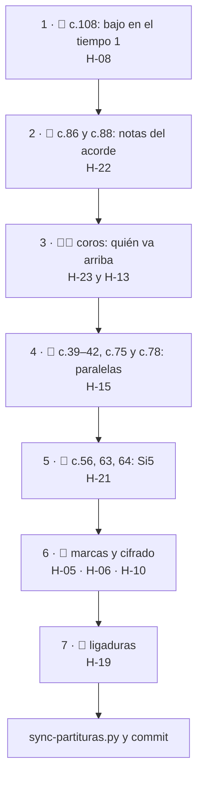

- [ ] 🎹 **c.108, tiempo 1:** un bajo en Re (H-08)
- [ ] 🎻 **c.86:** el Fa5, una nota de Am, o que resuelva (H-22)
- [ ] 🎻 **c.88, tiempo 2:** el Si♭4, una nota del G7, o cambiar el cifrado (H-22)
- [ ] 🎹🎸 **coros:** la mano derecha de c.35–42 más abajo, o la guitarra abierta en c.30, 33, 38, 41, o el violín
  arriba (H-23 y H-13), y lo mismo en las copias
- [ ] 🎻 **c.39→40 y c.41→42:** romper las paralelas; **c.75 y c.78:** seguir al C1 nuevo (H-15)
- [ ] 🎻 **c.56, 63, 64:** los Si5, una octava abajo (H-21), o cambiar el Mapa
- [ ] 🎼 **c.109:** *Outro*; **c.43 y c.67:** borrar la marca vacía (H-05)
- [ ] 🎼 **c.87:** *C7sus4* (H-06); el resto del cifrado, con la lista de H-10
- [ ] 🎻 **ligaduras** en las frases de arco (H-19)
- [ ] `./_scripts/sync-partituras.py` y commit

---

## Siguiente

➡️ **[[3. Composiciones/6. louise/6. Hallazgos#^h-08|H-08]]: el bajo del c.108.**

- Es el único alto de este feedback, y es una sola nota.
- Es la cadencia para la que existe el C3 (D-04): la única vez que la canción llega a D sin escaparse. Sin bajo, se
  escapa también ahí.
- Hazlo antes de pasar a Strudel: la transcripción se lleva el final tal como esté.

---

## Propuestas

> [!tldr] En corto
> Líneas para que tú las completes. La que más ayuda a cerrar: decidir si alguien va a tocar esto de verdad. Eso
> convierte los *para tus manos* en hallazgos o los descarta para siempre.

- **Para Decisiones:**
  - `D-NN · La partitura es para MuseScore y Strudel: no se escribe para tocarse · porque ____` /
    `D-NN · La partitura se escribe para tocarse (violín, piano, guitarra) · porque ____`. Decide los tres
    *Para tus manos* de una vez, y el *Por decidir* de la guitarra.
  - D-15, con lo que hace el violín en el B2: `D-15 · El B2 lo lleva el piano; el violín acompaña en acordes ·
    porque ____`.
  - Si el c.88 quiere Gm (H-22): `D-NN · El c.88 es Gm, no G7: la cadena de dominantes empieza en el C7 ·
    porque ____`.
  - Si el V2 se queda con su Si5 (H-21), es una línea para el Mapa, no para Decisiones.
- **Para el Mapa:**
  - *Roles*: *"violín: pizz. que acompaña en el V1 (D-16), pizz. que canta en el V2, arco en los coros y el C3;
    en el B2, acordes"* ____
  - *Outro*: todavía sin *Qué quiero* ni *Cómo se reconoce*. Hoy son tres compases de piano (c.109–111).
- **Para la ficha:** `violin` en `instrumentos`.
- **Para la S 09:** `commit_inicio: 2f1566c` y `commit_fin: d1d1f8d`.

---

## Cómo se midió

- **Notas:** el `.musicxml` del commit `d1d1f8d` (blob `f43d5af`), leído nota por nota. Las tres partes se
  comparan por corchea, con la guitarra en altura real (una octava debajo de lo escrito).
- **Qué cambió:** `diff-musical.py` contra `2f1566c` (la versión del F 11). Piano y guitarra se compararon contra
  `eca2c4f`, que es lo que evaluó el F 09.
- **"Arriba de todo" y "algo por encima del violín":** por corchea, mientras suena el violín, contra todo lo que
  suena de piano y guitarra.
- **Paralelas:** como en el F 10 y el F 11. Entre dos momentos seguidos en que se mueven el violín y el bajo (lo más
  grave de piano y guitarra), en la misma dirección y con el mismo intervalo: 8ª o 5ª justa, simple o compuesta.
- **Roces:** 2ª o 9ª menor entre una nota del violín, en su ataque, y algo que suena en piano o guitarra.
- **Acordes que caben (violín):** notas en cuerdas vecinas, con las pisadas dentro de cinco semitonos, o al aire.
  **Aperturas (piano):** notas de una misma mano que atacan juntas a 15 semitonos o más (una décima menor).
- **Terceras de la guitarra (H-12):** dos notas a 3 o 4 semitonos, con la de abajo en Sol2 o más grave (o en
  La2–Si2, "en el límite").
- **Lo que esto no mide:** cómo lo oyes tú.

---

## Archivo: `3. Composiciones/6. louise/5. Feedback/13. pieza.md`

```yaml
tipo: feedback
estado: vigente
numero: 13
fecha: 2026-10-25
alcance: pieza
evaluado:
  - archivo: "7. Partituras/2. Composiciones/Louise-melancolica.mscz"
    commit: db3d9ca
    limpio: false
    blob: 1af0255
    guardado: 2026-10-25 15:50
contexto: []
anterior: "[[3. Composiciones/6. louise/5. Feedback/12. pieza|F 12]]"
siguiente: "[[3. Composiciones/6. louise/6. Hallazgos#^h-24|H-24]]"
```

# Feedback 13 · pieza, por instrumento

> [!tldr] En corto
> **Cerraste cuatro: el bajo del final, los coros sin paralelas, el V2 por debajo del B♭ y las dos notas del B2.**
> Lo que queda:
>
> - 🎻 **Violín:** quintas y octavas con el bajo **fuera de los coros**: 14 (3 en el V1, 5 en el V2, 4 en el B2 y
>   2 en el C3). La más importante es la última cadencia (c.107→108) → H-24.
> - 🎹 **Piano:** un Si5 en el c.106, más agudo que el B♭ del B2 → H-25.
> - 🎸 **Guitarra:** lo de siempre (H-12 y H-13). Se cierra o se queda según decidas si la vas a grabar tú.
> - 🎼 **C3:** la segunda mitad ya la cierra el piano, como querías. En la primera mitad, el violín todavía tiene
>   algo encima en c.93, 96, 99 y 100 → H-23.
>
> **Qué hacer ahora:** la octava de la última cadencia, c.107→108.

> [!info] Fuente
> **Claude, 2026-10-25.** Violín, piano y guitarra en toda la pieza, igual que el
> [[3. Composiciones/6. louise/5. Feedback/12. pieza|F 12]]. Fuera de este feedback: la batería, la energía y las
> dinámicas. Sus hallazgos no se tocaron.
>
> **Qué cambió desde el F 12:**
> - **Violín** (10 compases): c.39 y c.75 (Do♯4 en el tiempo 3), c.56, 63 y 64 (sin Si5), c.77, c.86 (Mi5),
>   c.88 (Si4), c.93 y c.96.
> - **Piano** (7 compases): el bajo en c.42 (Fa♯2), c.76 (Si2) y c.108 (Re2); la mano derecha entra en el c.96 y
>   sube una octava en c.105–107.
> - **Guitarra:** sale del c.96, y en el c.93 pierde el Sol4. Ahora se llama *Classical Guitar*. Exporta en altura
>   real en lugar de escrita, pero las notas son las mismas.
> - **Partitura:** la marca *Outro* en el c.109.
>
> **Cómo se midió, en una línea:** el `.musicxml` nota por nota, las tres partes juntas y por corchea, con la
> guitarra en altura real. Sin audio.

> [!abstract] Qué se evaluó, exactamente
> | Archivo | Commit | ¿Limpio? | Blob | Guardado |
> |---|---|---|---|---|
> | `7. Partituras/2. Composiciones/Louise-melancolica.mscz` | `db3d9ca` | **no** | `1af0255` | 2026-10-25 15:50 |
>
> - **No limpio:** lo de hoy, desde el F 12, todavía no tiene commit. El blob identifica el contenido exacto, pero no
>   lo guarda: para volver a esta versión hace falta el commit.
> - No hay ningún autosave más nuevo que el archivo.

> [!important] Qué cuenta como error
> Lo mismo que en el F 12: lo que escribiste (el cifrado, el Mapa, las Decisiones, tus notas de Teoría) contra lo
> que suena. Desde el F 12 hay una decisión nueva:
> [[3. Composiciones/6. louise/2. Decisiones#^d-17|D-17]]. En el C1 y el C2, el violín va dentro de la textura, así
> que ahí lo que suena por encima de él ya no se reporta.

---

## En una pantalla

| | Cerrado hoy | Queda abierto |
|---|---|---|
| 🎻 **Violín** | H-15 (los coros, sin paralelas) · H-21 (el V2 ya no pasa de La5) · H-22 (c.86 y c.88) | **H-24 · 14 paralelas fuera de los coros** · H-19 · ligaduras |
| 🎹 **Piano** | H-08 (Re2 en el c.108) | H-25 · Si5 en el c.106 · H-06 y H-10 · cifrado |
| 🎸 **Guitarra** | — | H-12 · H-13 |
| 🎼 **Entre todos** | parte de H-05 (*Outro*) | H-23 · la 1.ª mitad del C3 · H-05 · dos marcas vacías |

**En números:**
- 4 cerrados: H-08, H-15, H-21 y H-22.
- 2 nuevos: H-24 (medio) y H-25 (bajo).
- 3 actualizados: H-05, H-13 y H-23.

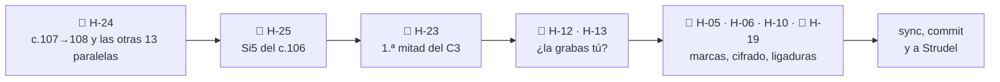

---

## Lista

| ID                                                      | Instrumento · dónde   | Qué escribiste                                                 | Qué suena                                                                              | Peso  | Contra                                                          | Estado                         |
| ------------------------------------------------------- | --------------------- | -------------------------------------------------------------- | -------------------------------------------------------------------------------------- | ----- | --------------------------------------------------------------- | ------------------------------ |
| [[3. Composiciones/6. louise/6. Hallazgos#^h-24\|H-24]] | 🎻 V1, V2, B2, C3     | *"Evitar quintas y octavas paralelas"*                         | 14 paralelas del violín con el bajo; la última, en la cadencia final (c.107→108)       | medio | [[00. Voicing e inversiones]]                                   | **nuevo**                      |
| [[3. Composiciones/6. louise/6. Hallazgos#^h-23\|H-23]] | 🎹🎸 C3, 1.ª mitad    | *"el violín lleva la línea"*                                   | en c.93, 96, 99 y 100 algo suena por encima del violín; solo arriba el 42 % del tiempo | medio | [[3. Composiciones/6. louise/2. Decisiones#^d-13\|D-13]]        | ready                          |
| [[3. Composiciones/6. louise/6. Hallazgos#^h-13\|H-13]] | 🎸 c.27–41 y copias   | *"adaptación de voicings a las posibilidades del instrumento"* | el Em no cabe en la mano; Bm y A7 arriba del mástil                                    | medio | F 09                                                            | **actualizado** (sale el c.96) |
| [[3. Composiciones/6. louise/6. Hallazgos#^h-12\|H-12]] | 🎸 V1, C1, V2, C2, C3 | *"las terceras por debajo de C3 se embarran"*                  | terceras en la octava 2                                                                | medio | Recursos §2.3                                                   | sin cambios                    |
| [[3. Composiciones/6. louise/6. Hallazgos#^h-25\|H-25]] | 🎹 c.106              | *"el B♭ con la nota más aguda de la pieza"*                    | la mano derecha toca Si5, un semitono por encima del Si♭5 del c.91                     | bajo  | Mapa · [[3. Composiciones/6. louise/2. Decisiones#^d-08\|D-08]] | ready                          |
| [[3. Composiciones/6. louise/6. Hallazgos#^h-05\|H-05]] | 🎼 c.43, 67           | —                                                              | dos marcas de ensayo vacías                                                            | bajo  | Mapa                                                            | **actualizado**                |
| [[3. Composiciones/6. louise/6. Hallazgos#^h-06\|H-06]] | 🎹🎸 c.87             | *"C4"*                                                         | Csus4 y luego C7sus4                                                                   | bajo  | cifrado                                                         | sin cambios                    |
| [[3. Composiciones/6. louise/6. Hallazgos#^h-10\|H-10]] | 🎹🎸 35 compases      | el cifrado                                                     | bajos, notas y tiempos que no dice                                                     | bajo  | cifrado                                                         | sin cambios                    |
| [[3. Composiciones/6. louise/6. Hallazgos#^h-19\|H-19]] | 🎻 todo el violín     | —                                                              | ninguna ligadura ni articulación                                                       | bajo  | la propia notación                                              | sin cambios                    |

**Cerrados en este feedback:**
- [[3. Composiciones/6. louise/6. Hallazgos#^h-08|H-08]], **arreglado**: el c.108 tiene Re2 en el tiempo 1.
- [[3. Composiciones/6. louise/6. Hallazgos#^h-15|H-15]], **arreglado**: el C1 y el C2 no tienen ni una paralela con
  el bajo. La fundamental cae en el tiempo 1 en 5 de 15 compases del C1 (en el F 10, 12).
- [[3. Composiciones/6. louise/6. Hallazgos#^h-21|H-21]], **arreglado**: lo más agudo del V2 es La5 (c.52, 54, 55,
  58, 59, 62 y 66). Bajaste los tres Si5.
- [[3. Composiciones/6. louise/6. Hallazgos#^h-22|H-22]], **arreglado**: Mi5 sobre Am en el c.86, y Si4 sobre G7 en
  el c.88. El B2 ya no tiene ningún roce de medio tono.

---

## 🎻 Violín

> [!tldr] En corto
> Los coros quedaron limpios. Las paralelas que quedan están fuera de ellos, y casi todas caen en el cambio de
> compás: la última corchea del violín (3&) y el tiempo 1 siguiente se mueven igual que el bajo.

### H-24 · Quintas y octavas con el bajo fuera de los coros · nuevo

**Qué escribiste.** [[00. Voicing e inversiones]]: *"Evitar quintas y octavas paralelas"*. Y que *"La sensible tiende
a resolver a la tónica"*: aquí resuelve, pero doblada.

**Qué suena.** La última cadencia: la sensible está en tres voces a la vez y las tres suben a Re.

```music-abc
X:1
T:c.107–108 como suenan hoy: Do♯ → Re en el violín, la mano derecha y el bajo
M:3/4
L:1/8
K:D
V:1 clef=treble name="Violín"
V:2 clef=treble name="Piano MD"
V:3 clef=bass name="Piano MI"
[V:1] "^c.107 A7"E G A2 "_Do♯5 →"c2 | "^108 D""_Re5"[Fd]6 |]
[V:2] z2 [Aca]3 [Aca] | [DAd]6 |]
[V:3] [A,,G,]2 G,3 "_Do♯2 →"[C,,G,] | "_Re2"[D,,A,]6 |]
```

Y una del V2, la sección donde el violín canta:

```music-abc
X:2
T:c.52–53 como suenan hoy (V2, pizz.): el violín y el bajo bajan juntos de Fa♯ a Mi
M:3/4
L:1/8
K:D
V:1 clef=treble name="Violín"
V:2 clef=bass name="Bajo"
[V:1] "^c.52"[ca]2 "_Fa♯5 →"[Af]4 | "^53""_Mi5"e2 c2 e2 |]
[V:2] "_Fa♯2 →"F,,6 | "_Mi2"E,,6 |]
```

**Dónde.** Las 14, en orden:

| Sección               | Dónde                      | Violín     | Bajo       | Qué                                                |                                 |
| --------------------- | -------------------------- | ---------- | ---------- | -------------------------------------------------- | ------------------------------- |
| V1 *(D-16: acompaña)* | c.15 (3&) → c.16 (1)       | Fa♯4 → Re4 | Si2 → Sol2 | quintas                                            | D                               |
|                       | c.18 (3&) → c.19 (1)       | Fa♯4 → La4 | Fa♯2 → La2 | octavas                                            | D                               |
|                       | c.22 (3&) → c.23 (1)       | La4 → Si4  | La2 → Si3  | octavas                                            | D                               |
| V2                    | **c.52 (3&) → c.53 (1)**   | Fa♯5 → Mi5 | Fa♯2 → Mi2 | octavas                                            | d                               |
|                       | c.55 (3&) → c.56 (1)       | Fa♯5 → Re5 | Si2 → Sol2 | quintas                                            | d                               |
|                       | c.58 (3&) → c.59 (1)       | Fa♯5 → La5 | Fa♯2 → La2 | octavas                                            | d                               |
|                       | c.59 (3&) → c.60 (1)       | La5 → Do♯5 | Re3 → Fa♯2 | quintas                                            | d                               |
|                       | c.63 (3&) → c.64 (1)       | Fa♯5 → Re5 | Si3 → Sol3 | quintas                                            | d                               |
| B2                    | c.84 (3&) → c.85 (1)       | La5 → Sol5 | La2 → Sol2 | octavas                                            | d                               |
|                       | c.86 (3&) → c.87 (1)       | Mi5 → Sol5 | La2 → Do3  | quintas                                            | d                               |
|                       | c.90 (2&) → c.90 (3)       | Fa5 → La5  | Fa2 → La3  | octavas                                            | se queda, anotalo como decision |
|                       | c.90 (3&) → c.91 (1)       | La5 → Si♭5 | La2 → Si♭2 | octavas (la que el F 10 defendía: *"todos al B♭"*) | se queda, anotalo como decision |
| C3                    | c.98 (3&) → c.99 (1)       | Sol4 → La4 | Sol2 → La2 | octavas                                            | se queda, anotalo como decision |
|                       | **c.107 (3&) → c.108 (1)** | Do♯5 → Re5 | Do♯2 → Re2 | octavas, con la sensible doblada                   | se queda, anotalo como decision |

- **El patrón:** 13 de las 14 caen en la barra. La última corchea del violín (3&) está a la octava o la quinta del
  bajo, y en el tiempo 1 siguiente los dos se mueven igual.
- **El V1** va por dentro, como acompañamiento (D-16): esas tres pesan menos. Las del V2 y el C3 son de la voz
  que canta.

**¿Es un error?** Sí, contra tu nota. Peso medio: son puntuales, pero dos caen en la línea principal (V2 y C3), y una
es la última cadencia de la pieza.

**Cómo, en MuseScore.** En cada par, cambia **una** de las dos notas del violín, la del 3& o la del tiempo 1:
selecciona la nota y súbela o bájala con ↑/↓.

| Opción | Qué haces | Modelo en tu pieza |
|---|---|---|
| **Otra nota del acorde en el 1** | que el violín no llegue a la nota del bajo (ni a su quinta) | c.39 y c.75: el Do♯4 que pusiste hoy |
| **Ir al revés del bajo** | si el bajo sube, el violín baja o se queda | c.33→34: Do♯4 → Re4 contra La2 → Re2 |
| **Quedarse** | repetir la nota del 3& en el tiempo 1 (movimiento oblicuo) | — |
| **En la cadencia final** | que la sensible esté solo en una voz: el bajo llega desde La2 (como antes), o el violín llega a Fa♯ o La | c.108: el violín ya tiene Fa♯4 debajo del Re5 |

- **Cuándo queda:** ninguna paralela con el bajo en el V2 ni en el C3. Las del V1 y la del c.90→91, si las dejas,
  mejor como decisión.
- **Pídelo así:** `violin.melodia`.

### H-19 · Ligaduras · sin cambios

Ninguna ligadura ni articulación en el violín. **Cómo:** selecciona las notas de una frase y pulsa `S`. Las frases
por grado conjunto del C3 son un buen comienzo: c.100, c.103 y c.107.

### Para tu oído (no son errores)

- **c.42: el C1 cierra en D/F♯.** Desde que el bajo del c.42 es Fa♯2, la cadencia A7→D del coro llega en primera
  inversión. Sigue llegando al I, como dice [[3. Composiciones/6. louise/2. Decisiones#^d-09|D-09]], pero cierra
  más abierto que el c.34, que tiene Re2. Si es a propósito, que es lo que parece, no hay nada que hacer.
- **c.77 (tiempo 2): Sol4 contra Fa♯3** del piano y la guitarra. Es nota de paso (Fa♯–Sol–La), como la del c.103.
- **Para tus manos:** siguen los acordes del B2 que no caben en una mano (c.84, 2&; c.85; c.91, tiempo 3), los
  mismos del F 12.

---

## 🎹 Piano

> [!tldr] En corto
> El final ya tiene su bajo. Queda un Si5 en el c.106, que vuelve a pasar por encima del B♭ del B2.

### H-25 · Un Si5 en el C3 (c.106) · nuevo

**Qué escribiste.** El Mapa, en el B2: *"el B♭ con la nota más aguda de la pieza"*. Y
[[3. Composiciones/6. louise/2. Decisiones#^d-08|D-08]]: *"El B2 estrena lo único que nunca sonó"*.

| Lo más agudo de la pieza, hoy | Dónde |
|---|---|
| **Si5** | piano, c.106 (tiempos 2 y 3: Re4 + Si4 + **Si5**) |
| Si♭5 | piano y violín, c.91 (el B♭) |
| La5 | piano en c.90, 92 y 107; violín en c.84, 90 y el V2 |

- El Si5 del c.96 ya no está (la mano derecha llega a Fa♯5), y el V2 no pasa de La5. **Queda solo este.**
- **¿Es un error?** Sí, contra el Mapa. Peso bajo: es una nota, doblando el Si4 una octava arriba.
- **Cómo:** selecciona el Si5 de los dos acordes del c.106 y bórralo (Supr), o bájalo a otra nota del G por debajo
  de Si♭5 (Sol5 está libre, y es la del c.105).
- **Cuándo queda:** nada por encima de Si♭5 fuera del B2.
- **Pídelo así:** `C3.piano.voicing`.

### H-06 y H-10 · El cifrado · sin cambios

Nada cambió en el cifrado. La lista exacta sigue en los dos hallazgos. Lo más rápido es el c.87: doble clic en
*"C4"* y escribe *C7sus4*.

### Para tus manos (piano, no son errores)

Lo nuevo de hoy, más allá de lo del F 12:

| Mano | Dónde | Qué | Cómo, si lo tocas |
|---|---|---|---|
| Derecha | c.106 (tiempos 2 y 3) | Re4 + Si4 + Si5: una 13ª (octava y sexta) | se resuelve solo si quitas el Si5 (H-25) |
| Izquierda | c.107 (3&) | Do♯2 + Sol3, una 11ª aumentada | arpegiado, o el Sol3 a la derecha |
| Izquierda | c.108 (tiempo 1) | Re2 + La3, una 12ª | arpegiado, o el bajo antes y el La3 después |

---

## 🎸 Guitarra

> [!tldr] En corto
> Sin cambios desde el F 09, salvo que el c.96 ya no tiene guitarra. Lo que queda depende de una decisión: **¿la
> grabas tú?**

- **H-13 (el coro no cabe en la mano):** el Em de c.27, 31, 35 y 39 (y copias), y el Bm y el A7 arriba del mástil.
  El c.96, que era el Bm del C3, ya no tiene guitarra. Si decides que **la guitarra es de MuseScore**, H-13 se
  cierra como decisión: es un hallazgo de manos, no de sonido.
- **H-12 (terceras en el grave):** no depende de quién la toque, porque es cómo suena el grave. Sigue igual: 39
  compases con la nota de abajo en Sol2 o más grave (la lista está en el F 12).
- **Herramienta:** una tablatura vinculada te marca en rojo las notas que caen en la misma cuerda. Es la forma
  más rápida de ver H-13 compás por compás.

---

## 🎼 Entre instrumentos

### H-23 · La primera mitad del C3 · actualizado

> [!tldr] En corto
> El C1 y el C2 ya son decisión (D-17). En el C3 querías que el violín cante la primera mitad y que el piano cierre
> la segunda. La segunda ya está. En la primera, todavía hay cuatro compases con algo encima del violín.

| C3 | Violín solo arriba | Mano derecha arriba (o empata) | Lo que quieres |
|---|---|---|---|
| 1.ª mitad (c.93–100) | 42 % | 38 % | el violín canta |
| 2.ª mitad (c.101–108) | 29 % | **58 %** | el piano cierra ✓ |

**Dónde, en la primera mitad, y cómo:**

| c. | Qué está por encima del violín | Cómo, en MuseScore |
|---|---|---|
| 93 (tiempo 1) | el Sol5 de la mano derecha, sobre el Mi5 nuevo del violín | quita el Sol5 o bájalo (Ctrl+↓) |
| 96 (tiempos 2 y 3&) | el Fa♯5 de la mano derecha, sobre Re5 y Si4 | igual: quita o baja el Fa♯5 |
| 99 | la guitarra, con Mi5 (el A7 arriba del mástil, de H-13) | un A7 abierto, como en H-13 |
| 100 | la guitarra, con La4 y Fa♯4 sobre el Re4 del violín | quita las notas de arriba, o que el violín suba |

En c.94, 95 y 98 la mano derecha queda encima solo un instante, cuando el violín baja a sus notas graves. No hace
falta tocarlo.

- **Cuándo queda:** el violín arriba de todo en más de la mitad del tiempo en c.93–100. O una decisión para el C3,
  como la de D-17 (ver *Propuestas*).
- **Pídelo así:** `C3.arreglo`.

### H-05 · Marcas de ensayo · actualizado

✓ *Outro* ya está en el c.109. Quedan las dos marcas vacías: la que está junto a *B1* en el c.43 y la que está junto a
*C2* en el c.67. **Cómo:** selecciónalas y Supr.

---

## Siguiente

➡️ **[[3. Composiciones/6. louise/6. Hallazgos#^h-24|H-24]], empezando por c.107→108.**

- Es lo que dijiste que quedaba, y de los hallazgos medios es el único que no espera una decisión. La guitarra y el
  C3 sí la esperan.
- La última cadencia es lo último que se oye de la pieza, y hoy lleva la sensible en tres voces en octavas.
- Después, el V2: cinco pares, todos en el cambio de compás.

---

## Propuestas

- **Para Decisiones:**
  - Por H-23, para cerrar el C3 igual que el C1 y el C2:
    ```
    | D-18 | 2026-10-25 | **C3: el violín canta la primera mitad y el piano cierra la segunda** | ____ | ____ | nace de [[3. Composiciones/6. louise/6. Hallazgos#^h-23\|H-23]] |
    ^d-18
    ```
    (en su propia tabla, con el encabezado de columnas).
  - Por H-12 y H-13, la del *Por decidir*: *"Guitarra: ¿la grabas tú?"*.
    `D-NN · La guitarra es de MuseScore: no se escribe para tocarse · porque ____` (cierra H-13) /
    `D-NN · La guitarra la grabo yo · porque ____` (H-13 se queda y hay que revoicear).
  - Si dejas alguna paralela del V1 (acompaña) o la del c.90→91 (*"todos al B♭"*), una línea que lo diga.
- **Para la ficha:** `violin` en `instrumentos` (sigue faltando).

---

## Cómo se midió

- **Notas:** el `.musicxml` regenerado desde el `.mscz` de las 15:50 (blob `1af0255`), comparado con el de `d1d1f8d`
  (lo que evaluó el F 12).
- **La guitarra en altura real:** antes se exportaba en altura escrita, con la indicación de una octava abajo; desde
  que se llama *Classical Guitar*, se exporta ya en altura real. Este feedback lee esa indicación en cada versión,
  así que las dos se comparan bien: cambian solo c.93 y c.96.
- **Paralelas:** entre dos momentos seguidos en que se mueven el violín (su nota de arriba) y el bajo (lo más grave
  de piano y guitarra), en la misma dirección y con el mismo intervalo: 8ª o 5ª justa, simple o compuesta.
- **"Arriba de todo":** por corchea, mientras suena el violín, contra todo lo que suena de piano y guitarra.
- **Lo que esto no mide:** cómo lo oyes tú.

---

## Archivo: `3. Composiciones/6. louise/5. Feedback/14. pieza.md`

```yaml
tipo: feedback
estado: vigente
numero: 14
fecha: 2026-10-25
alcance: pieza
evaluado:
  - archivo: "7. Partituras/2. Composiciones/Louise-melancolica.mscz"
    commit: d3e1899
    limpio: true
    blob: a4af38f
    guardado: 2026-10-25 18:02
contexto: []
anterior: "[[3. Composiciones/6. louise/5. Feedback/13. pieza|F 13]]"
siguiente: "[[3. Composiciones/6. louise/6. Hallazgos#^h-12|H-12]]"
```

# Feedback 14 · pieza, por instrumento

> [!tldr] En corto
> **MuseScore queda cerrado.** De las 14 paralelas, arreglaste 10; las otras 4 se quedan a propósito
> (D-18). El Si5 del c.106 bajó, y el B♭ del c.91 vuelve a ser lo más agudo de la pieza.
>
> - 🎻 **Violín:** nada abierto, salvo las ligaduras (H-19).
> - 🎹 **Piano:** nada abierto, salvo el cifrado (H-06 y H-10).
> - 🎸 **Guitarra:** H-12 (terceras en el grave) y H-13 (lo que no cabe en la mano), sin cambios.
> - 🎼 **C3:** la primera mitad no cambió. Lo marcaste *ready*: si es *"así se queda"*, falta escribirlo como
>   decisión (H-23).
>
> **Qué hacer ahora:** las terceras graves de la guitarra (H-12). Es lo único abierto que es de sonido y no espera
> una decisión.

> [!info] Fuente
> **Claude, 2026-10-25.** Violín, piano y guitarra en toda la pieza, igual que el F 12 y el F 13. Fuera: la batería,
> la energía y las dinámicas.
>
> **Contexto:** lo que marcaste en el [[3. Composiciones/6. louise/5. Feedback/13. pieza|F 13]]:
> - las paralelas del V1, el V2 y el B2 (c.84 y c.86), hechas;
> - las de c.90, c.90→91, c.98→99 y c.107→108: *"se queda, anótalo como decisión"*;
> - H-23 y H-25: *ready*.
>
> **Qué cambió desde el F 13:**
> - **Violín** (10 compases): c.15, 19, 21, 23, 53, 56, 59, 64, 84 y 87.
> - **Piano:** el bajo en c.59 (Re2) y c.98 (Sol2), y en el c.106 el Si5 pasa a Sol5.
> - **Guitarra:** nada.

> [!abstract] Qué se evaluó, exactamente
> | Archivo | Commit | ¿Limpio? | Blob | Guardado |
> |---|---|---|---|---|
> | `7. Partituras/2. Composiciones/Louise-melancolica.mscz` | `d3e1899` | **sí** | `a4af38f` | 2026-10-25 18:02 |
>
> Es la partitura con la que se cerró MuseScore, y la que tiene el Strudel
> (`4. Instrumento/2. Strudel/10. Folk/Louise/6.melancolica.strudel.js`), comprobado compás por compás.

---

## En una pantalla

| | Cerrado hoy | Queda |
|---|---|---|
| 🎻 **Violín** | H-24: 10 arreglados, 4 por decisión (D-18) | H-19 · ligaduras |
| 🎹 **Piano** | H-25 (el Si5 del c.106) | H-06 y H-10 · cifrado |
| 🎸 **Guitarra** | — | **H-12** · H-13 |
| 🎼 **Entre todos** | — | H-23 (falta la decisión) · H-05 · dos marcas vacías |

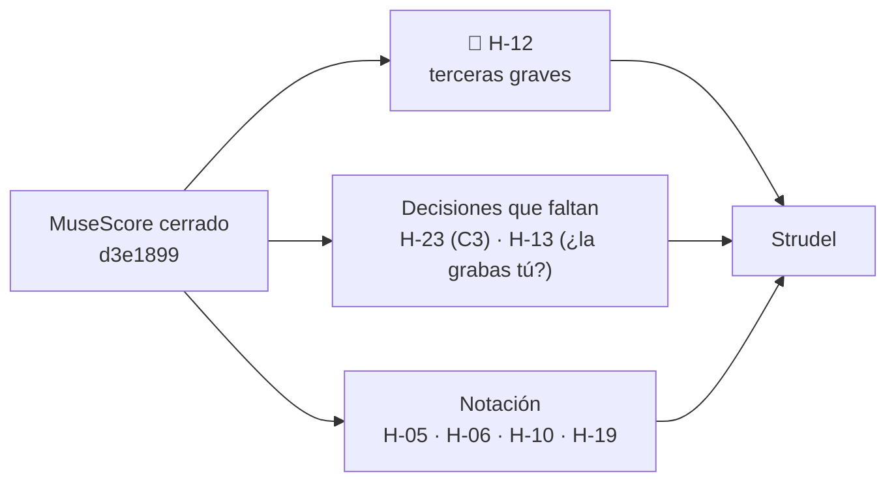

---

## Lista

| ID | Instrumento · dónde | Qué escribiste | Qué suena | Peso | Contra | Estado |
|---|---|---|---|---|---|---|
| [[3. Composiciones/6. louise/6. Hallazgos#^h-12\|H-12]] | 🎸 V1, C1, V2, C2, C3 | *"las terceras por debajo de C3 se embarran"* | terceras con la nota de abajo en Sol2 o más grave, en 39 compases | medio | Recursos §2.3 | sin cambios |
| [[3. Composiciones/6. louise/6. Hallazgos#^h-13\|H-13]] | 🎸 c.27–41 y copias | *"adaptación de voicings a las posibilidades del instrumento"* | el Em no cabe en la mano; Bm y A7 arriba del mástil | medio | F 09 | sin cambios |
| [[3. Composiciones/6. louise/6. Hallazgos#^h-23\|H-23]] | 🎹🎸 C3, c.93–100 | *"el violín lleva la línea"* | el violín va solo arriba el 42 % del tiempo; encima de él, c.93, 96, 99 y 100 | medio | [[3. Composiciones/6. louise/2. Decisiones#^d-13\|D-13]] | sin cambios en la partitura · *ready* |
| [[3. Composiciones/6. louise/6. Hallazgos#^h-05\|H-05]] | 🎼 c.43, 67 | — | dos marcas de ensayo vacías | bajo | Mapa | sin cambios |
| [[3. Composiciones/6. louise/6. Hallazgos#^h-06\|H-06]] | 🎹🎸 c.87 | *"C4"* | Csus4 y luego C7sus4 | bajo | cifrado | sin cambios |
| [[3. Composiciones/6. louise/6. Hallazgos#^h-10\|H-10]] | 🎹🎸 35 compases | el cifrado | bajos, notas y tiempos que no dice | bajo | cifrado | sin cambios |
| [[3. Composiciones/6. louise/6. Hallazgos#^h-19\|H-19]] | 🎻 todo el violín | — | ninguna ligadura ni articulación | bajo | la propia notación | sin cambios |

**Cerrados en este feedback:**
- [[3. Composiciones/6. louise/6. Hallazgos#^h-24|H-24]], **decisión**: 10 de las 14 paralelas se arreglaron, y las
  4 que quedan se quedan a propósito, en [[3. Composiciones/6. louise/2. Decisiones#^d-18|D-18]].
- [[3. Composiciones/6. louise/6. Hallazgos#^h-25|H-25]], **arreglado**: el c.106 toca Sol5. Lo más agudo de la
  pieza es el Si♭5 del c.91.

---

## 🎻 Violín

### H-24 · Las paralelas, una por una · cerrado

| Dónde | Antes (F 13) | Ahora | Cómo se resolvió |
|---|---|---|---|
| c.15 → 16 (V1) | Fa♯4 → Re4 sobre Si2 → Sol2, quintas | el 3& del c.15 es Si3 | el violín llega desde la octava del bajo, no desde su quinta |
| c.18 → 19 (V1) | Fa♯4 → La4 sobre Fa♯2 → La2, octavas | el c.19 es Re4 + Do♯5 | arriba, la 7ª del Dmaj7 |
| c.22 → 23 (V1) | La4 → Si4 sobre La2 → Si3, octavas | el c.23 es Re4 + Do♯5 | arriba, la 9ª del Bm7 |
| c.52 → 53 (V2) | Fa♯5 → Mi5 sobre Fa♯2 → Mi2, octavas | el c.53 empieza en Sol5 | movimiento contrario |
| c.55 → 56 (V2) | Fa♯5 → Re5 sobre Si2 → Sol2, quintas | el c.56 empieza en Si4 | arriba, la 3ª |
| c.58 → 59 (V2) | Fa♯5 → La5 sobre Fa♯2 → La2, octavas | el bajo del c.59 es Re2 | el bajo baja mientras el violín sube |
| c.59 → 60 (V2) | La5 → Do♯5 sobre Re3 → Fa♯2, quintas | el 3 del c.59 es Re5 + Fa♯5 | ya no hay quinta en el 3 |
| c.63 → 64 (V2) | Fa♯5 → Re5 sobre Si3 → Sol3, quintas | el c.64 empieza en Si4 | arriba, la 3ª |
| c.84 → 85 (B2) | La5 → Sol5 sobre La2 → Sol2, octavas | el 2& del c.84 es Fa4 + Re5 | movimiento contrario; y el acorde ahora cabe en la mano |
| c.86 → 87 (B2) | Mi5 → Sol5 sobre La2 → Do3, quintas | el c.87 empieza en Fa5 | la sus4 del Csus4 |
| dentro del c.90, c.90 → 91 (B2) · c.98 → 99, c.107 → 108 (C3) | octavas | igual | **se quedan: D-18** |

Ninguno de estos cambios trajo un roce nuevo con piano o guitarra: los roces de medio tono son los mismos del
F 13, todos notas del acorde o de paso.

### H-19 · Ligaduras · sin cambios

Ninguna ligadura ni articulación en el violín. Si sigues en Strudel, aquí no aplica tal cual: en Strudel una ligadura
es `legato` o `clip` sobre la frase. Queda como hallazgo de la partitura.

### Para tus manos (no son errores)

- **Siguen sin caber en una mano** el c.85 (Si♭3 + Si♭4 + Sol5) y el c.91, tiempo 3 (Fa4 + Sol5).
- **El c.84 ya cabe:** Fa4 + Re5 en lugar de Fa4 + La5.

---

## 🎹 Piano

- **H-25 se cierra:** el c.106 toca Re4 + Si4 + Sol5.
- **H-06 y H-10, sin cambios:** el cifrado, con la lista en cada hallazgo.
- **Para tus manos:** el c.106 sigue siendo una 11ª para la mano derecha (Re4–Sol5). Las demás aperturas, como en el
  F 12 y el F 13.

---

## 🎸 Guitarra

### H-12 · Terceras en el grave · sin cambios

Terceras con la nota de abajo en Sol2 o más grave, en estos 39 compases:

| Sección | Compases |
|---|---|
| V1 | c.12, 16, 20 |
| C1 | c.27, 28, 29, 31, 32, 35, 36, 37, 39, 40 |
| V2 | c.52, 53, 56, 57, 58, 60 |
| C2 | c.67, 68, 69, 71, 72, 75, 76, 77, 79, 80 |
| C3 | c.93, 94, 95, 97, 98, 101, 102, 103, 105, 106 |

Y 12 más con la nota de abajo en La2–Si2: c.14, 15, 22, 33, 41, 54, 55, 62, 73, 81, 99 y 107.

- **¿Es un error?** Sí, contra los Recursos §2.3 (*"las terceras por debajo de C3 se embarran"*). Peso medio: es
  cómo suena el grave en cinco secciones, la toque quien la toque.
- **Cómo:** quita la nota de abajo de la tercera, o súbela una octava, sobre todo donde el piano ya toca ese grave.
  Se puede hacer en MuseScore o directo en las líneas de `guitarra` del Strudel. Si lo haces en el Strudel,
  la partitura deja de ser igual a él.
- **Pídelo así:** `guitarra.voicing`.

### H-13 · Lo que no cabe en la mano · sin cambios

Solo importa si la guitarra la va a tocar alguien. Con la línea del *Por decidir* (*"Guitarra: ¿la grabas tú?"*)
se cierra como decisión, o se queda.

---

## 🎼 Entre instrumentos

### H-23 · La primera mitad del C3 · sin cambios en la partitura

| C3 | Violín solo arriba | Encima del violín |
|---|---|---|
| 1.ª mitad (c.93–100) | 42 % | c.93 (Sol5 de la mano derecha), c.96 (Fa♯5 de la mano derecha), c.99 (Mi5 de la guitarra), c.100 (La4 y Fa♯4 de la guitarra) |
| 2.ª mitad (c.101–108) | 29 % | el piano cierra, como querías |

En el F 13 lo marcaste *ready*. Si quiere decir *"así se queda"*, la línea está en *Propuestas* y H-23 pasa a
`decisión`. Si quiere decir que lo cambiaste, la partitura de las 18:02 no lo tiene.

### H-05 · Marcas de ensayo · sin cambios

Las dos marcas vacías, junto a *B1* (c.43) y junto a *C2* (c.67).

---

## Siguiente

➡️ **[[3. Composiciones/6. louise/6. Hallazgos#^h-12|H-12]], las terceras graves de la guitarra.**

- Es el único hallazgo medio que es de sonido y no espera una decisión. H-13 y H-23 se cierran con una línea cada
  uno.
- Tienes 39 compases, pero son pocos acordes que se repiten: el Em, el G y el F♯m7 de los coros, y sus copias.

---

## Propuestas

- **Para Decisiones:**
  - Por H-23, si *ready* quiere decir *"así se queda"*:
    ```
    | D-19 | 2026-10-25 | **C3: el violín canta la primera mitad, con el piano y la guitarra por encima en c.93, 96, 99 y 100, y el piano cierra la segunda** | ____ | ninguna nota | nace de [[3. Composiciones/6. louise/6. Hallazgos#^h-23\|H-23]] |
    ^d-19
    ```
  - Por H-13: `La guitarra es de MuseScore y Strudel: no se escribe para tocarse · porque ____`, o `La guitarra la
    grabo yo · porque ____`.
- **Para D-18:** el *por qué* está en `____`. El F 10 decía de la del c.90→91 que suena a *"todos al B♭"*. Si
  es eso, dilo con tus palabras.
- **Para la ficha:** `violin` en `instrumentos`.

---

## Cómo se midió

- **Notas:** el `.musicxml` de `d3e1899` (blob `a4af38f`), comparado con el de `94d11ba` (lo que evaluó el F 13).
  Las tres partes por corchea, con la guitarra en altura real.
- **Paralelas:** como en el F 13. Entre dos momentos seguidos en que se mueven el violín (su nota de arriba) y el
  bajo (lo más grave de piano y guitarra), en la misma dirección y con el mismo intervalo: 8ª o 5ª justa, simple o
  compuesta.
- **Lo que esto no mide:** cómo lo oyes tú.

---

## Archivo: `3. Composiciones/6. louise/5. Feedback/15. energia.md`

```yaml
tipo: feedback
estado: vigente
numero: 15
fecha: 2026-11-02
alcance: energia
evaluado:
  - archivo: "4. Instrumento/2. Strudel/10. Folk/Louise/9.produccion/0.intro.strudel.js"
    commit: 2fa0e6b
    limpio: true
    blob: 8a755e5
    guardado: 2026-11-02 19:16
  - archivo: "4. Instrumento/2. Strudel/10. Folk/Louise/9.produccion/1.v1.strudel.js"
    commit: 2fa0e6b
    limpio: true
    blob: aa7c7e0
    guardado: 2026-11-01 15:14
  - archivo: "4. Instrumento/2. Strudel/10. Folk/Louise/9.produccion/2.c1.strudel.js"
    commit: 2fa0e6b
    limpio: true
    blob: 6ef8d79
    guardado: 2026-11-02 18:36
  - archivo: "4. Instrumento/2. Strudel/10. Folk/Louise/9.produccion/3.b1.strudel.js"
    commit: 2fa0e6b
    limpio: true
    blob: d27d9ae
    guardado: 2026-11-02 19:05
  - archivo: "4. Instrumento/2. Strudel/10. Folk/Louise/9.produccion/4.v2.strudel.js"
    commit: 2fa0e6b
    limpio: true
    blob: 665e519
    guardado: 2026-11-02 19:15
  - archivo: "4. Instrumento/2. Strudel/10. Folk/Louise/9.produccion/5.c2.strudel.js"
    commit: 2fa0e6b
    limpio: true
    blob: 3b027e2
    guardado: 2026-11-02 20:16
  - archivo: "4. Instrumento/2. Strudel/10. Folk/Louise/9.produccion/6.b2.strudel.js"
    commit: 2fa0e6b
    limpio: true
    blob: 607a82c
    guardado: 2026-11-02 20:44
  - archivo: "4. Instrumento/2. Strudel/10. Folk/Louise/9.produccion/7.c3.strudel.js"
    commit: 2fa0e6b
    limpio: true
    blob: e18d35d
    guardado: 2026-11-02 20:27
contexto:
  - "[[3. Composiciones/6. louise/3. Sesiones/10. energia|S 10]]"
anterior: "[[3. Composiciones/6. louise/5. Feedback/14. pieza|F 14]]"
siguiente: "[[3. Composiciones/6. louise/6. Hallazgos#^h-02|H-02]]"
```

# Feedback 15 · energia

> [!tldr] En corto
> **El pico ya es el pico.** En la producción en Strudel, el B2 queda 3.8 dB por encima del C2, y el C2 crece de una
> mitad a la otra (+1.8 dB). Lo que no sigue el Mapa es la despedida: **el C3 es la segunda sección más fuerte de la
> pieza.**
>
> - 🎼 **C3** (H-02): 1.3 dB por encima del C2 y 2.6 por encima del C1, con el piano en 96 (*f*) y las cuatro capas.
> - 📈 **B2** (H-01): la subida no sube. El violín baja de 102 a 50 mientras el piano sube de 112 a 127.
> - 🎻 **Violín** (H-17): el B2 ya es su sección más fuerte; en el C3 sigue por encima de los dos coros. Baja a medio.
> - ✅ **H-07 se cierra:** las dos mitades del C3 quedan a 0.1 dB.
>
> **Qué hacer ahora:** el C3 (H-02).

> [!info] Fuente
> **Claude, 2026-11-02.** La energía de la pieza entera (c.1–111) en la producción de Strudel
> (`4. Instrumento/2. Strudel/10. Folk/Louise/9.produccion/`), con cada sección tomada de su propio archivo. El alcance
> es el de tu última sesión, la [[3. Composiciones/6. louise/3. Sesiones/10. energia|S 10]].
>
> **Contexto:** la S 10 (V1 y C1) y los commits de la S 11, que todavía no tiene nota (`b78ebb2` a `2fa0e6b`: B1, V2,
> C2, B2 y C3). Se leyeron para saber qué quisiste; no se evalúan.
>
> **Qué cambió desde el último feedback de energía** ([[3. Composiciones/6. louise/5. Feedback/07. pieza|F 07]] para
> la pieza, [[3. Composiciones/6. louise/5. Feedback/11. violin|F 11]] para el violín): las dinámicas de violín y piano
> (S 08–09), la batería que crece del C1 al Outro (`fa80a73`) y la producción en Strudel, sección por sección:
> velocidades, batería, reverb y paneo.
>
> **Esto mide lo escrito, no el audio.** No hay audio de la producción, y Strudel no se puede renderizar aquí. Los
> números son la *intensidad escrita* (ver *Cómo se midió*): sirven para comparar secciones y para comparar un
> instrumento consigo mismo; entre instrumentos distintos no dicen cuánto suena cada uno.

> [!abstract] Qué se evaluó, exactamente
> | Archivo (`…/9.produccion/`) | Commit | ¿Limpio? | Blob | Guardado |
> |---|---|---|---|---|
> | `0.intro.strudel.js` | `2fa0e6b` | sí | `8a755e5` | 2026-11-02 19:16 |
> | `1.v1.strudel.js` | `2fa0e6b` | sí | `aa7c7e0` | 2026-11-01 15:14 |
> | `2.c1.strudel.js` | `2fa0e6b` | sí | `6ef8d79` | 2026-11-02 18:36 |
> | `3.b1.strudel.js` | `2fa0e6b` | sí | `d27d9ae` | 2026-11-02 19:05 |
> | `4.v2.strudel.js` | `2fa0e6b` | sí | `665e519` | 2026-11-02 19:15 |
> | `5.c2.strudel.js` | `2fa0e6b` | sí | `3b027e2` | 2026-11-02 20:16 |
> | `6.b2.strudel.js` | `2fa0e6b` | sí | `607a82c` | 2026-11-02 20:44 |
> | `7.c3.strudel.js` | `2fa0e6b` | sí | `e18d35d` | 2026-11-02 20:27 |
>
> - **Limpios:** cada uno se recupera con `git show 2fa0e6b:"<archivo>"`.
> - **La partitura no se evaluó.** `Louise-melancolica.mscz` tiene cambios sin commit (guardado a las 19:37); el
>   alcance es la producción, que vive en Strudel.

> [!important] Qué cuenta como error
> Un error es cuando **lo que escribiste dice una cosa y lo que suena dice otra**: el cifrado, el
> [[3. Composiciones/6. louise/1. Mapa|Mapa]], las [[3. Composiciones/6. louise/2. Decisiones|Decisiones]] o el
> [[3. Composiciones/6. louise/4. Contexto|Contexto]] (una toma ✅ que no se oye, o una ❌ que se coló). Lo que
> contradice una decisión vigente no se reporta. Los ejemplos muestran **lo que suena hoy**; no traen
> correcciones.

---

## En una pantalla

Lo que hay hoy en cada sección. Velocidades de 0 a 127, como en MuseScore (64 *mp*, 80 *mf*, 96 *f*, 112 *ff*).
El Mapa solo da energía al C2, al B2 y al C3; la columna *S 05* es el plan de la
[[3. Composiciones/6. louise/3. Sesiones/05. Second bridge|S 05]], que es contexto y no vara.

| Sección | Mapa | S 05 | Intensidad | Piano | Violín | Guitarra | Batería (golpes/compás · vel.) | Reverb |
|---|:-:|:-:|---:|---|---|---|---|---|
| Intro · c.1–10 | ____ | 2 | 6.5 dB | 80–100 | — | — | 4.0 · 80 | piano, con eco |
| V1 · c.11–26 | ____ | 3 | 7.8 dB | 80 | 127 *pizz.* | 90 | 6.0 · 53 | piano |
| C1 · c.27–42 | ____ | 3 | 6.3 dB | 80 → 64 | 49 → 85 | 100 | 4.4 · 71 | piano |
| B1 · c.43–50 | ____ | 1 | 7.0 dB | 96 → 112 | — | — | 2.5 · 77 | — |
| V2 · c.51–66 | ____ | 3 | 7.4 dB | 64 → 79 | 100 *pizz.* | 100 | 6.1 · 53 | piano |
| C2 · c.67–82 | 3 → 4 | 3 → 4 | 7.6 dB | 80 → 64 → 79 | 49 → 90 | 80 | 8.6 · 67 | violín (c.67–78) |
| **B2** · c.83–92 | **5** | 5 | **11.4 dB** | 103 → 127 | 112 → 49 | 80 | 10.9 · 66 | piano |
| C3 · c.93–108 | **2** | 2 | **8.9 dB** | 127, luego 96 | 82 → 96 → 42 | 80 | 9.1 · 59 | piano |
| Outro · c.109–111 | ____ | 1–2 | 2.5 dB | 96 | — | — | 1.7 · 78 | — |

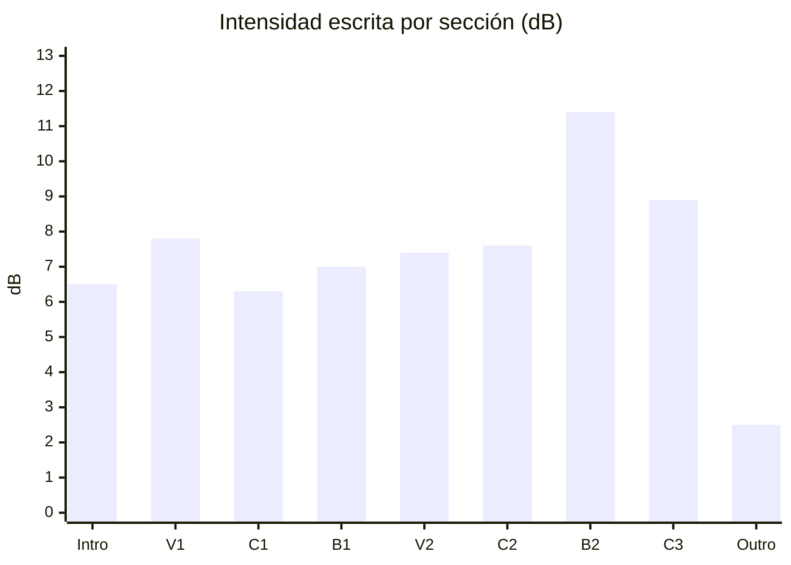

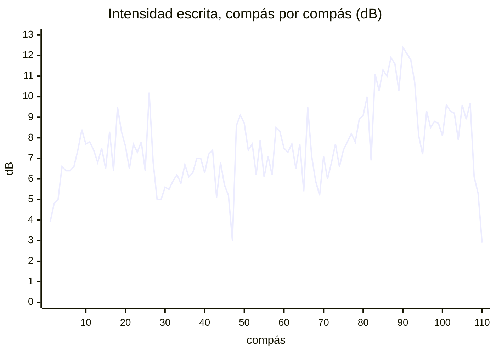

- **Lo que ya cumple el Mapa:** el C2 crece (6.6 → 8.4 dB de una mitad a la otra) y el B2 es lo más alto de la pieza,
  3.8 dB sobre el C2 y 2.5 sobre la siguiente sección.
- **Lo que no:** después del B2, la curva no baja a la despedida. El C3 queda debajo del B2 y por encima de todo lo
  demás.

---

## Lista

| ID | Dónde | Qué escribiste | Qué suena | Peso | Contra | Estado |
|---|---|---|---|---|---|---|
| [[3. Composiciones/6. louise/6. Hallazgos#^h-02\|H-02]] | 🎼 C3 · c.93–108 | Mapa: C3 *"Energía: 2"*; D-04: *"el coro con capas quitadas"* | la segunda sección más fuerte: +1.3 dB sobre el C2, +2.6 sobre el C1; piano en 96, cuatro capas | alto | Mapa · [[3. Composiciones/6. louise/2. Decisiones#^d-04\|D-04]] | abierto · el C2 y el B2 ya cumplen |
| [[3. Composiciones/6. louise/6. Hallazgos#^h-01\|H-01]] | 📈 B2 · c.85–91 | Mapa: B2 *"el pico"*, *"Energía: 5"* | siete compases en 2.1 dB, sin subir; el violín baja mientras el piano sube | alto | Mapa | abierto · números nuevos |
| [[3. Composiciones/6. louise/6. Hallazgos#^h-17\|H-17]] | 🎻 violín · C3 | Mapa: C3 *"Energía: 2"* | el violín del C3, por encima de los dos coros (+1.5 y +3.7 dB) | medio | Mapa · [[3. Composiciones/6. louise/2. Decisiones#^d-04\|D-04]] | abierto · baja de alto: el B2 ya es su sección más fuerte |
| [[3. Composiciones/6. louise/6. Hallazgos#^h-03\|H-03]] | 📉 c.82 | Mapa: C2 *"hacer crescendo"*, *"tensión hacia el B2"* | 3.1 dB debajo del c.81 y 4.2 debajo del c.83; en el 2 y el 3, casi nada ataca | medio | Mapa | abierto · espera tu decisión |
| [[3. Composiciones/6. louise/6. Hallazgos#^h-20\|H-20]] | 🎻 V2 · c.52–66 | D-13: *"el violín lleva la línea"* | *pizz.* a 100, a la izquierda; piano a la derecha, creciendo debajo | medio | [[3. Composiciones/6. louise/2. Decisiones#^d-13\|D-13]] | abierto · sin medir: hace falta audio |

**Cerrados en este feedback:** [[3. Composiciones/6. louise/6. Hallazgos#^h-07|H-07]], **arreglado**: la segunda
mitad del C3 ya no sube (8.8 y 8.9 dB). El violín baja de 96 a 42 y el piano cierra, como dice
[[3. Composiciones/6. louise/2. Decisiones#^d-19|D-19]]. El C3 entero sigue alto: eso es H-02.

---

## Uno por uno

### H-02 · El C3 no se despide

**Qué escribiste.** En el Mapa, C2 *"Energía: 3 → 4"*, B2 *"Energía: 5"* y C3 *"Energía: 2"*: la despedida por
debajo de los coros. En [[3. Composiciones/6. louise/2. Decisiones#^d-04|D-04]]: *"C3 de despedida: el coro con capas
quitadas"*.

**Qué suena.** Los tres coros, por instrumento:

| | C1 | C2 | C3 | C3 − C2 |
|---|---:|---:|---:|---:|
| **Toda la sección** | 6.3 dB | 7.6 dB | **8.9 dB** | **+1.3** |
| Piano | 1.9 dB · 80 → 64 | 2.5 dB · 80 → 64 → 79 | **5.8 dB · 96** (127 en el c.93) | **+3.3** |
| Violín | −2.7 dB · 49 → 85 | −0.5 dB · 49 → 90 | 1.0 dB · 82 → 96 → 42 | +1.5 |
| Guitarra | −1.0 dB · 100 | −2.9 dB · 80 | −3.4 dB · 80 | −0.5 |
| Batería | 1.4 dB · 4.4 golpes · 71 | 4.0 dB · 8.6 golpes · 67 | 3.3 dB · 9.1 golpes · 59 | −0.7 |
| Compases con las cuatro capas | 15 de 16 | 15 de 16 | 14 de 16 | |

**Qué pasa.**

- **El piano hace casi toda la diferencia.** En los coros va entre *mp* y *mf* (64–80); en el C3, en *f* (96) de
  c.96 a c.108, y en 127 en el c.93. El piano del C3 suena 3.3 dB por encima del piano del C2.
- **No se quitó ninguna capa.** Suenan las cuatro en 14 de 16 compases (sin guitarra solo en c.96 y c.108). La
  batería es más suave que la del C2, pero tiene más golpes por compás, el bombo en NORMAL (90) donde el C2 lo tiene
  en MEDIO (80), y toms en FUERTE (103) en c.97, 99 y 107.
- **El c.93 arranca al nivel del B2** (10.7 dB): el piano en 127, crash y tres bombos.
- **La producción lo acentuó.** Con las velocidades de MuseScore (los archivos de `62b82c6`), el C3 quedaba 0.7 dB
  sobre el C2. La batería bajó en las dos, pero más en el C2, y ahora son 1.3.

**¿Es un error?** Sí, contra el Mapa (el C3 en 2, por debajo de un C2 en 3 → 4) y contra D-04. Peso alto: es la
despedida, y hoy suena como la segunda sección más fuerte de la pieza. Si lo que quieres ahora es un C3 que cierre
fuerte, lo que cambia es el Mapa: la línea está en *Propuestas*.

**Dónde se mueve:** en `7.c3`, `C3.dinamica` y la batería del C3. `6.b2` lleva una copia de c.93–100.

### H-01 · La subida del B2 no sube

**Qué escribiste.** En el Mapa, el B2 es *"el pico"*, *"lo más alto de la pieza"*, *"Energía: 5"*, y se reconoce por
*"el B♭ con la nota más aguda de la pieza"*.

**Qué suena.** Compás por compás:

| c. | Intensidad | Violín | Piano | Batería |
|---|---:|---|---|---|
| 83 | 11.1 dB | 101 · 112 | 96 · 112 | 14 golpes |
| 84 | 10.3 dB | 111 · 107 | 112 | 6 |
| **85** | **11.3 dB** | 102 | 112 | 12 |
| 86 | 11.0 dB | 94 | 112 | 10 |
| 87 | 11.9 dB | 85 | 112 | 11 |
| 88 | 11.6 dB | 77 | 112 | 10 |
| 89 | **10.3 dB** | 68 | 112 | 8 |
| 90 | **12.4 dB** | 54 | 112 → 122 | **17** |
| **91** | **12.1 dB** | **50** | 124 · 127 | 12 |
| 92 | 11.8 dB | 49 | 127 | 9 |

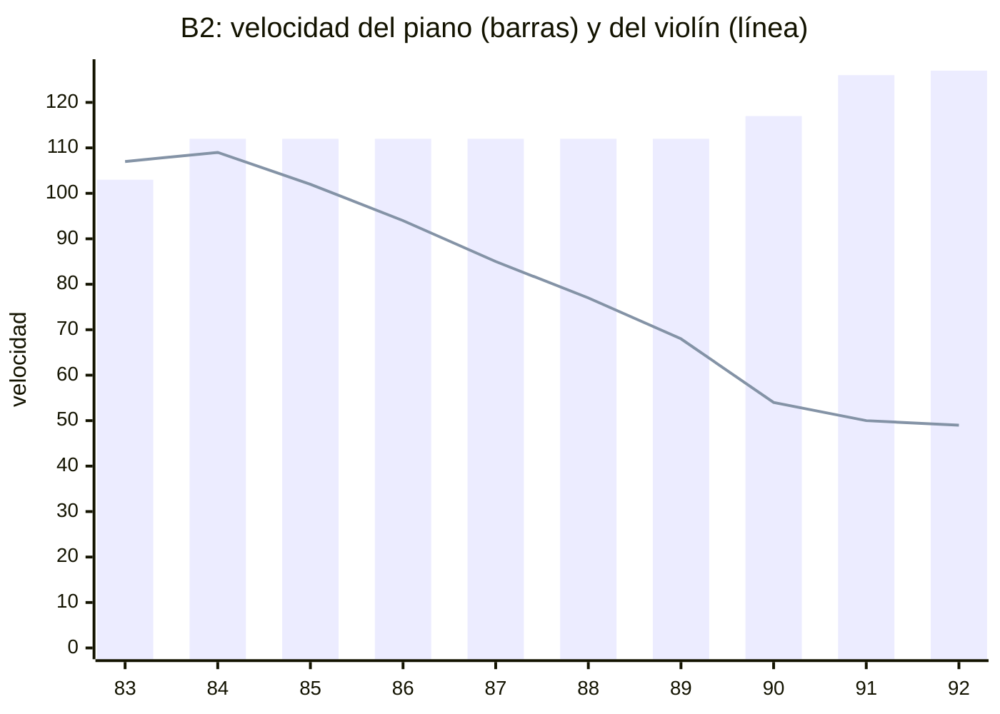

**Qué pasa.**

- **Siete compases en 2.1 dB, sin dirección.** Del c.85 al c.91 se gana 0.8 dB. El más bajo es el c.89, justo antes
  de los dos más altos.
- **Violín y piano se cancelan.** El violín baja de 102 a 50: es el regulador de MuseScore (*f* en el c.83, > hasta el
  91), que el Strudel conserva; solo el c.87 cambió, a 85. El piano se queda en 112 hasta el c.89 y sube a 127 solo en
  c.90–92.
- **El B♭5 del c.91**, la nota más aguda de la pieza, lo tocan el violín a 50 y la mano derecha a 124.
- **El c.90 es el compás con más golpes de la pieza** (17). El pico de la batería cae un compás antes que el B♭.

**¿Es un error?** Sí, contra el Mapa: el pico existe como sección (H-02), pero dentro no sube hacia el B♭. Peso alto.
Si el violín que se retira es a propósito, escríbelo como decisión: el hallazgo se queda con lo demás.

### H-17 · El violín del C3

**Qué escribiste.** En el Mapa, el C3 en *"Energía: 2"* y el B2 como *"lo más alto de la pieza"*.

**Qué suena.** El violín con arco, por sección:

| | Velocidad | Intensidad |
|---|---|---:|
| C1 | 49 → 85 | −2.7 dB |
| C2 | 49 → 90 | −0.5 dB |
| **B2** | 101 → 112 → 49 | **2.6 dB** |
| C3 | 82 → **96** (c.94–98) → 42 | 1.0 dB |

El C3, compás por compás: 82 · 96 · 96 · 96 · 96 · 95 · 89 · 84 · 80 · 73 · 67 · 64 · 57 · 51 · 46 · 42.

**Qué pasa.**

- **El B2 ya es la sección más fuerte del violín**, 1.6 dB sobre el C3. En el render del F 11, el C3 quedaba 9.9 dB
  por encima del B2.
- **El C3 sigue sobre los dos coros:** 1.5 dB sobre el C2 y 3.7 sobre el C1. Los cinco compases en 96 (c.94–98) son
  el escalón más alto del arco fuera del B2.
- El *pizz.* del V1 (127) y del V2 (100) no entra en esta comparación: es otra muestra.

**¿Es un error?** Sí, contra el Mapa. Baja de alto a medio: lo del B2 ya está, y lo que queda es el mismo C3 de H-02,
visto desde el violín.

### H-03 · El c.82

**Qué escribiste.** En el Mapa, el C2 tiene que *"hacer crescendo"*, con *"tensión hacia el B2"*. Si el c.82 es la
respiración antes del golpe, no está escrito en ningún lado.

**Qué suena.** Intensidad por tiempo, contando solo lo que ataca en cada uno:

| c. | Tiempo 1 | Tiempo 2 | Tiempo 3 | Compás |
|---|---:|---:|---:|---:|
| 81 (C2) | 4.1 | 5.6 | 5.7 | 10.0 dB |
| **82 (C2)** | 5.2 | **−2.4** | **0.3** | **6.9 dB** |
| 83 (B2) | 9.0 | −0.1 | 6.1 | 11.1 dB |
| 84 (B2) | 7.1 | 7.0 | −2.9 | 10.3 dB |

**Qué pasa.**

- **El c.82 (E♭7) ataca en el 1 y sostiene.** En el 1 entran el violín (Sol4 + Mi♭5, 90), la mano derecha (Si♭4 +
  Mi♭5), la izquierda (Mi♭2 + Re♭3, 79) y el tom grave en FUERTE. En el 2 solo ataca la caja (dos golpes, 68); en el 3, el tom
  medio (68) y dos notas sueltas de la mano izquierda (Si♭3, Sol3).
- **La guitarra calla de c.82 a c.84.**
- **El c.84 ya no hace hueco:** queda 0.8 dB debajo del c.83. El hueco es solo el c.82.

**¿Es un error?** Depende de ti. Si es la respiración antes del golpe, es una decisión (la línea está en
*Propuestas*). Si no, va contra el crescendo del C2 que pide el Mapa. Peso medio.

### H-20 · La línea del V2

**Qué escribiste.** [[3. Composiciones/6. louise/2. Decisiones#^d-13|D-13]]: *"el violín lleva la línea"*.

**Qué suena.**

| V2 · c.51–66 | Velocidad | Paneo | Reverb |
|---|---|---|---|
| Violín *pizz.* | 70 en el c.51, 100 de c.52 a c.66 | 0.1, a la izquierda | no |
| Piano | 112 en el c.51, 64 → 79 | 0.8, a la derecha | sí (room 1, roomsize 0.5) |
| Guitarra | 100, y 80 en c.65–66 (a la mitad en la mezcla) | centro | no |
| Batería | 6.1 golpes por compás · 53 | centro | no |

**Qué pasa.** Casi todo lo que cambió en la S 11 va a favor de la línea: más velocidad, el violín separado del piano
en el paneo y el piano con reverb, detrás. La guitarra también subió (80 → 100). Pero el hallazgo es cuánto suena el violín contra el resto, y eso no se puede
medir sin audio: la velocidad de una muestra de *pizz.* y la de un piano no dicen cuánto suena cada una. El piano
sigue creciendo debajo (64 → 79).

**¿Es un error?** Sigue abierto, sin medir. Para cerrarlo o confirmarlo, hace falta un audio del V2.

---

## Siguiente

➡️ **[[3. Composiciones/6. louise/6. Hallazgos#^h-02|H-02]], el C3.**

- Es alto, y es el único lugar donde la curva va contra el Mapa: la despedida suena como la segunda sección más fuerte.
- Se resuelve en un archivo (`7.c3`), o con una línea en el Mapa si el C3 que quieres ahora es otro.
- Lo que muevas en el C3 también mueve a H-17, que es el mismo C3 desde el violín.
- **Pídelo así:** `C3.energia`.

---

## Propuestas

- **Para el Mapa:**
  - **C3**, si ahora quieres que cierre fuerte: `**Energía:** ____ <!-- hoy suena entre el C2 y el B2 -->`, y D-04
    pasaría a *Reemplazadas*. Si no, el Mapa se queda y lo que cambia es el C3.
  - **La energía de Intro, V1, C1, B1, V2 y Outro** está en blanco. La S 05 tenía un plan: Intro 2 · V1 3 · C1 3 ·
    B1 1 · V2 3 · Outro 1–2. Si sigue valiendo, cópialo. Ojo con el B1: el plan decía *"valle, piano solo"*, y hoy,
    en lo escrito, queda por encima del C1 y del Intro (7.0 contra 6.3 y 6.5 dB), con el piano en 96 → 112.
- **Para Decisiones**, por H-03, si el c.82 es la respiración antes del golpe:
  ```
  | ID | Fecha | Qué | Por qué | Qué cambió | Enlaces |
  |---|---|---|---|---|---|
  | D-20 | 2026-11-02 | **c.82: el hueco antes del B2 se queda, como la respiración antes del golpe** | ____ | ninguna nota | nace de [[3. Composiciones/6. louise/6. Hallazgos#^h-03\|H-03]] |
  ^d-20
  ```
- **Para la ficha:** `ultimo_audio` está vacío, y la S 10 dice *"Audio: no hay"*. Con un audio de la producción, el
  próximo feedback puede medir lo que suena, y H-20 lo necesita.

---

## Cómo se midió

- **Las notas:** cada archivo se evaluó en Node con el mismo Strudel que usa `.motor/exportar.js` (1.2.6): todas
  las notas y golpes de cada sección, con su velocidad, `gain`, `room` y `pan`.
- **La pieza:** cada sección sale de su propio archivo (el Intro de `0.intro`, el V1 de `1.v1`… el C3 y el Outro de
  `7.c3`). Los compases que comparten varios archivos (c.6–100) son iguales en todos: comprobado golpe por golpe, sin
  ninguna diferencia.
- **Intensidad escrita:** en cada compás, la suma de (velocidad/127 × `gain`)² de todo lo que ataca, en dB; 0 dB es
  un solo ataque a 127. El `gain` lleva la mezcla (la guitarra a 0.5) y el KIT (el shaker a 0.29). Las secciones se
  promedian en potencia. Por tiempo, igual, contando solo lo que empieza en ese tiempo.
- **Velocidad y volumen:** Strudel multiplica el `gain` por la velocidad, con su curva por defecto (lineal); ningún
  archivo la cambia.
- **La línea base** (*"con las velocidades de MuseScore"*): la misma medida sobre los archivos de `62b82c6`, de C1 a
  C3. Ahí el Intro y el V1 ya estaban en producción, así que no tienen línea base.
- **Lo que esto no mide:** cuánto suena cada muestra (el *pizz.*, el arco, el piano y el kit no suenan igual a la
  misma velocidad), cuánto dura cada nota y cuánto suma la reverb. Un instrumento contra sí mismo, o una sección
  contra otra con las mismas capas, se puede comparar; un instrumento contra otro, no. Los números del F 07 y el F 11
  salen de un render de MuseScore y no se comparan uno a uno con estos.

---

## Archivo: `3. Composiciones/6. louise/5. Feedback/16. energia.md`

```yaml
tipo: feedback
estado: vigente
numero: 16
fecha: 2026-11-03
alcance: energia
evaluado:
  - archivo: "4. Instrumento/2. Strudel/10. Folk/Louise/9.produccion/0.intro.strudel.js"
    commit: ce608ea
    limpio: true
    blob: 8a755e5
    guardado: 2026-11-02 19:16
  - archivo: "4. Instrumento/2. Strudel/10. Folk/Louise/9.produccion/1.v1.strudel.js"
    commit: ce608ea
    limpio: true
    blob: aa7c7e0
    guardado: 2026-11-01 15:14
  - archivo: "4. Instrumento/2. Strudel/10. Folk/Louise/9.produccion/2.c1.strudel.js"
    commit: ce608ea
    limpio: true
    blob: 6ef8d79
    guardado: 2026-11-02 18:36
  - archivo: "4. Instrumento/2. Strudel/10. Folk/Louise/9.produccion/3.b1.strudel.js"
    commit: ce608ea
    limpio: true
    blob: d27d9ae
    guardado: 2026-11-02 19:05
  - archivo: "4. Instrumento/2. Strudel/10. Folk/Louise/9.produccion/4.v2.strudel.js"
    commit: ce608ea
    limpio: true
    blob: 0fb2390
    guardado: 2026-11-03 12:00
  - archivo: "4. Instrumento/2. Strudel/10. Folk/Louise/9.produccion/5.c2.strudel.js"
    commit: ce608ea
    limpio: true
    blob: d001d91
    guardado: 2026-11-03 12:11
  - archivo: "4. Instrumento/2. Strudel/10. Folk/Louise/9.produccion/6.b2.strudel.js"
    commit: ce608ea
    limpio: true
    blob: ec7260f
    guardado: 2026-11-03 12:11
  - archivo: "4. Instrumento/2. Strudel/10. Folk/Louise/9.produccion/7.c3.strudel.js"
    commit: ce608ea
    limpio: true
    blob: bdbc39e
    guardado: 2026-11-03 12:11
contexto:
  - "[[3. Composiciones/6. louise/3. Sesiones/12. energia|S 12]]"
anterior: "[[3. Composiciones/6. louise/5. Feedback/15. energia|F 15]]"
siguiente: "[[3. Composiciones/6. louise/6. Hallazgos#^h-02|H-02]]"
```

# Feedback 16 · energia

> [!tldr] En corto
> **El primero sobre audio.** La producción de Strudel se renderizó en strudel.cc, sección por sección. Ahora sí se
> sabe cuánto suena cada instrumento.
>
> - ✅ **El B2 es el pico:** 2.4 LU sobre la siguiente sección (el C2).
> - 🎼 **C3** (H-02): la S 12 lo bajó 1.1 LU y ya queda debajo del C2, pero solo 0.6. Sigue 2.3 LU sobre el C1, y la
>   batería pesa el 59 %.
> - 📉 **C2** (H-26, nuevo): ya no crece. La batería de c.67–74 subió y la de c.75–82 no, así que la primera mitad
>   suena más que la segunda.
> - 📈 **B2** (H-01): el violín ya no se apaga al final, pero en la mezcla no se nota: va 10 LU debajo del resto.
> - 🔊 **Recorte** (H-27, nuevo): 83 de 111 compases pasan de 0 dBFS, sobre todo por la batería.
> - 🎻 **Violín:** en el V2 va 13.9 LU debajo del resto (H-20, ya medido), y el c.93 es su compás más fuerte de
>   toda la pieza (H-17).
>
> **Qué hacer ahora:** el C3 (H-02).

> [!info] Fuente
> **Claude, 2026-11-03.** La energía de la pieza entera (c.1–111) en la producción de Strudel
> (`4. Instrumento/2. Strudel/10. Folk/Louise/9.produccion/`), **medida sobre audio**. El alcance es el de tu última
> sesión, la [[3. Composiciones/6. louise/3. Sesiones/12. energia|S 12]].
>
> **Contexto:** la S 12, que sale del [[3. Composiciones/6. louise/5. Feedback/15. energia|F 15]] y ataca H-02.
> Bajó el C3, levantó el violín del final del B2 y subió la batería del principio del C2. Se leyó para saber qué
> quisiste; no se evalúa.
>
> **Qué cambió desde el F 15:** la S 12 (`ce608ea`), y la medida. El F 15 medía lo escrito; este mide lo que suena.
> Los números de los dos no se comparan uno a uno. Para ver qué movió la S 12, las secciones que tocó se
> renderizaron también como estaban antes (`caf57e6`).
>
> **El audio** está en `4. Instrumento/2. Strudel/10. Folk/Louise/9.produccion/render/` (git no lo guarda): la pieza
> entera y una sección por archivo. Cómo se hizo, en *Cómo se midió*.

> [!abstract] Qué se evaluó, exactamente
> | Archivo (`…/9.produccion/`) | Commit | ¿Limpio? | Blob | Guardado |
> |---|---|---|---|---|
> | `0.intro.strudel.js` | `ce608ea` | sí | `8a755e5` | 2026-11-02 19:16 |
> | `1.v1.strudel.js` | `ce608ea` | sí | `aa7c7e0` | 2026-11-01 15:14 |
> | `2.c1.strudel.js` | `ce608ea` | sí | `6ef8d79` | 2026-11-02 18:36 |
> | `3.b1.strudel.js` | `ce608ea` | sí | `d27d9ae` | 2026-11-02 19:05 |
> | `4.v2.strudel.js` | `ce608ea` | sí | `0fb2390` | 2026-11-03 12:00 |
> | `5.c2.strudel.js` | `ce608ea` | sí | `d001d91` | 2026-11-03 12:11 |
> | `6.b2.strudel.js` | `ce608ea` | sí | `ec7260f` | 2026-11-03 12:11 |
> | `7.c3.strudel.js` | `ce608ea` | sí | `bdbc39e` | 2026-11-03 12:11 |
>
> - **Limpios:** cada uno se recupera con `git show ce608ea:"<archivo>"`. strudel.cc los leyó de GitHub en ese
>   commit, y el texto que evaluó es igual, carácter por carácter, al de cada archivo.
> - **`5.c2`, `6.b2` y `7.c3` a las 12:11** es la sincronización que hizo Claude al cerrar la S 12.
> - **La partitura no se evaluó.** El alcance es la producción, que vive en Strudel.

> [!important] Qué cuenta como error
> Un error es cuando **lo que escribiste dice una cosa y lo que suena dice otra**: el cifrado, el
> [[3. Composiciones/6. louise/1. Mapa|Mapa]], las [[3. Composiciones/6. louise/2. Decisiones|Decisiones]] o el
> [[3. Composiciones/6. louise/4. Contexto|Contexto]] (una toma ✅ que no se oye, o una ❌ que se coló). Lo que
> contradice una decisión vigente no se reporta. Los ejemplos muestran **lo que suena hoy**; no traen
> correcciones.

---

## En una pantalla

La sonoridad de cada sección, en LUFS: más cerca de 0, más fuerte. Una diferencia de 1 LU es más o menos lo mínimo
que se distingue. El Mapa solo da energía al C2, al B2 y al C3; la columna *S 05* es el plan de la
[[3. Composiciones/6. louise/3. Sesiones/05. Second bridge|S 05]], que es contexto y no vara.

| Sección | Mapa | S 05 | Sonoridad | Pico | Compases sobre 0 dBFS | Lo que más pesa |
|---|:-:|:-:|---:|---:|:-:|---|
| Intro · c.1–10 | ____ | 2 | −12.8 | +4.1 dBFS | 9 de 10 | batería, 59 % |
| V1 · c.11–26 | ____ | 3 | −14.3 | +4.4 dBFS | 16 de 16 | batería 49 %, piano 39 % |
| C1 · c.27–42 | ____ | 3 | −14.5 | +4.3 dBFS | 8 de 16 | batería, 55 % |
| B1 · c.43–50 | ____ | 1 | −13.8 | +2.9 dBFS | 3 de 8 | piano, 57 % |
| V2 · c.51–66 | ____ | 3 | −15.3 | +2.6 dBFS | 6 de 16 | batería 49 %, piano 41 % |
| C2 · c.67–82 | 3 → 4 | 3 → 4 | −11.6 | +6.3 dBFS | 16 de 16 | batería, **75 %** |
| **B2** · c.83–92 | **5** | 5 | **−9.2** | **+8.4 dBFS** | 10 de 10 | piano 48 %, batería 42 % |
| C3 · c.93–108 | **2** | 2 | **−12.2** | +4.1 dBFS | 15 de 16 | batería, 59 % |
| Outro · c.109–111 | ____ | 1–2 | −16.6 | −0.5 dBFS | 0 de 3 | piano, 66 % |

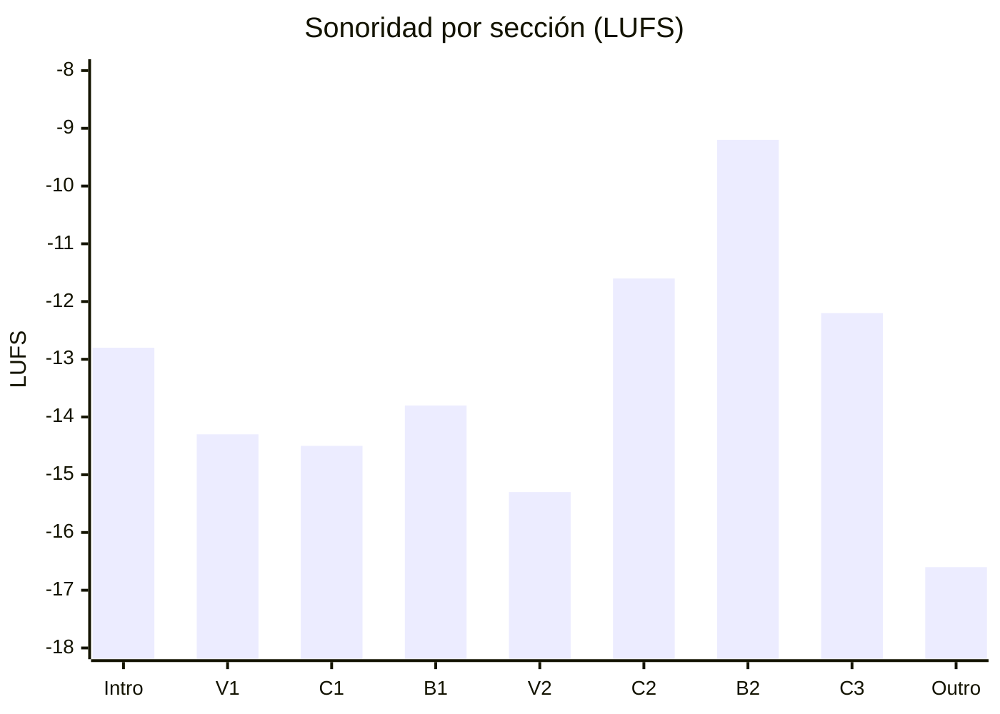

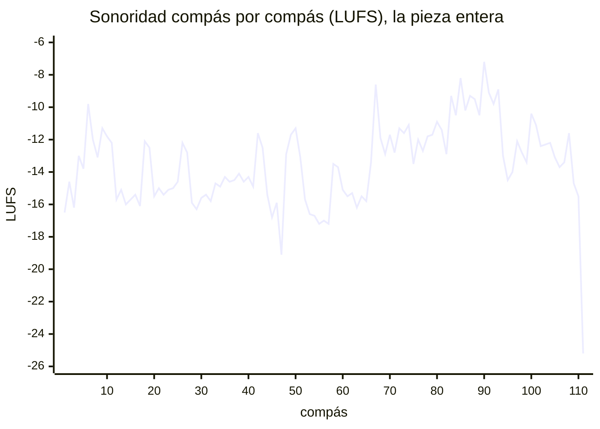

- **Lo que ya cumple el Mapa:** el B2 es lo más fuerte de la pieza, 2.4 LU sobre el C2 y 3.0 sobre el C3. Sus diez
  compases suenan entre −7.2 y −10.5.
- **Lo que no:** el C2 no crece (H-26), y el C3 suena al nivel del C2 y por encima del C1 (H-02).
- **Lo que pesa:** la batería es lo que más suena en seis de las nueve secciones. Casi todo lo que sube y baja de un
  compás a otro es la batería, y casi todo lo que pasa de 0 dBFS también (H-27).

---

## Lista

| ID | Dónde | Qué escribiste | Qué suena | Peso | Contra | Estado |
|---|---|---|---|---|---|---|
| [[3. Composiciones/6. louise/6. Hallazgos#^h-02\|H-02]] | 🎼 C3 · c.93–108 | Mapa: C3 *"Energía: 2"*; D-04: *"el coro con capas quitadas"* | 0.6 LU debajo del C2 y 2.3 sobre el C1; la batería sola suena más que el C1 entero | alto | Mapa · [[3. Composiciones/6. louise/2. Decisiones#^d-04\|D-04]] | abierto · la S 12 lo bajó 1.1 LU |
| [[3. Composiciones/6. louise/6. Hallazgos#^h-01\|H-01]] | 📈 B2 · c.85–91 | Mapa: B2 *"el pico"*, *"el B♭ con la nota más aguda"* | siete compases en 3.3 LU, sin subir; el c.91 suena menos que el c.85; el B♭ es del piano | alto | Mapa | abierto · el violín ya no cae, pero no se oye |
| [[3. Composiciones/6. louise/6. Hallazgos#^h-26\|H-26]] | 📉 C2 · c.67–82 | Mapa: C2 *"Energía: 3 → 4"*; D-07: *"hace crescendo"* | la primera mitad suena 0.7 LU más que la segunda | medio | Mapa · [[3. Composiciones/6. louise/2. Decisiones#^d-07\|D-07]] | **nuevo** |
| [[3. Composiciones/6. louise/6. Hallazgos#^h-27\|H-27]] | 🔊 batería · toda la pieza | las velocidades: FUERTE (103), MEDIO (80), SUAVE (68)… | 83 de 111 compases pasan de 0 dBFS; arriba, todo sale al mismo techo | medio | lo escrito | **nuevo** |
| [[3. Composiciones/6. louise/6. Hallazgos#^h-20\|H-20]] | 🎻 V2 · c.51–66 | D-13: *"el violín lleva la línea"* | 13.9 LU debajo del resto; ninguno de sus 40 ataques lo supera | medio | [[3. Composiciones/6. louise/2. Decisiones#^d-13\|D-13]] | abierto · ya medido |
| [[3. Composiciones/6. louise/6. Hallazgos#^h-17\|H-17]] | 🎻 violín · C3 | Mapa: C3 *"Energía: 2"*; B2 *"lo más alto de la pieza"* | el c.93 es el compás más fuerte del violín en toda la pieza; el C3, sobre los dos coros | medio | Mapa · [[3. Composiciones/6. louise/2. Decisiones#^d-04\|D-04]] | abierto · números nuevos |

**Cerrados en este feedback:** ninguno. [[3. Composiciones/6. louise/6. Hallazgos#^h-03|H-03]] ya había pasado a
decisión con [[3. Composiciones/6. louise/2. Decisiones#^d-20|D-20]] (el c.82 es el respiro antes del B2), así que
no se mira.

---

## Uno por uno

### H-02 · El C3 no se despide

**Qué escribiste.** En el Mapa, C2 *"Energía: 3 → 4"* y C3 *"Energía: 2"*: la despedida, un escalón por debajo del
coro anterior. En [[3. Composiciones/6. louise/2. Decisiones#^d-04|D-04]]: *"C3 de despedida: el coro con capas
quitadas"*.

**Qué suena.** Los tres coros, por instrumento (LUFS; el *%* es la parte de la energía de la sección):

| | C1 | C2 | C3 | C3 − C2 | C3 − C1 |
|---|---:|---:|---:|---:|---:|
| **Toda la sección** | −14.5 | −11.6 | **−12.2** | −0.6 | **+2.3** |
| Piano | −19.8 | −19.4 | −17.4 | +2.0 | +2.4 |
| Violín | −24.7 | −23.7 | −22.9 | +0.8 | +1.8 |
| Guitarra | −26.9 | −28.9 | −29.1 | −0.2 | −2.2 |
| Batería | −17.1 · 55 % | −12.8 · 75 % | **−14.6 · 59 %** | −1.8 | **+2.5** |

Lo que movió la S 12 en el C3, cada sección renderizada sola:

| C3 | Antes (`caf57e6`) | Ahora | |
|---|---:|---:|---:|
| Toda la sección | −11.1 | −12.2 | −1.1 |
| Piano | −15.9 | −17.4 | −1.5 |
| Batería | −13.9 | −14.6 | −0.7 |
| Violín | −22.5 | −22.9 | −0.4 |
| C3 contra el C2 | +1.2 | −0.5 | |

**Qué pasa.**

- **La S 12 lo movió en la dirección del Mapa.** Antes de la sesión, el C3 sonaba 1.2 LU sobre el C2 (lo mismo que
  decía lo escrito en el F 15). Ahora queda 0.5 por debajo, casi todo por el piano.
- **Pero no se oye como un escalón.** 0.6 LU está por debajo de lo que se distingue, y la segunda mitad del C2 y la
  primera del C3 suenan igual (−12.0 las dos).
- **Contra el C1, no se quitó nada: se agregó.** El C3 suena 2.3 LU sobre el C1, por la batería (+2.5) y el piano
  (+2.4). La batería del C3, sola, suena más que el C1 entero (−14.6 contra −14.5).
- **El c.93 arranca al nivel del B2** (−8.9, cuando los compases del B2 van de −7.2 a −10.5). Después, c.94–96 bajan a
  −13.0…−14.5 (el c.95 es el más bajo del C3), y c.97 y c.100 vuelven a subir con los fills.

**¿Es un error?** Sí, contra el Mapa y contra D-04. Sigue en alto: es la despedida, y hoy suena como un coro más.
Si lo que quieres ahora es un C3 que cierre fuerte, lo que cambia es el Mapa (la línea está en *Propuestas* del
[[3. Composiciones/6. louise/5. Feedback/15. energia|F 15]]).

**Dónde se mueve:** en `7.c3`, `C3.dinamica` y la batería del C3. `6.b2` lleva una copia de c.93–100.

### H-01 · La subida del B2 no sube

**Qué escribiste.** En el Mapa, el B2 es *"el pico"*, *"lo más alto de la pieza"*, *"Energía: 5"*, y se reconoce por
*"el B♭ con la nota más aguda de la pieza"*.

**Qué suena.** Compás por compás (LUFS; el violín, con su velocidad y, entre paréntesis, cómo sonaba antes de la
S 12):

| c. | Mezcla | Violín | Piano | Batería |
|---|---:|---|---:|---:|
| 83 | −9.3 | −18.9 · 101 → 112 | −14.7 | −11.5 |
| 84 | −10.6 | −18.0 · 111 → 107 | −13.1 | −16.1 |
| **85** | **−8.2** | −17.7 · 102 | −12.2 | −10.7 |
| 86 | −10.2 | −17.5 · 94 | −12.7 | −14.1 |
| 87 | −9.3 | −18.7 · 85 | −10.9 | −13.5 |
| 88 | −9.5 | −21.5 · 77 | −10.9 | −14.2 |
| 89 | −10.5 | −21.6 · 77 (−22.7 a 68) | −11.6 | −15.1 |
| **90** | **−7.2** | −19.3 · 85 (−23.3 a 54) | −11.8 | **−9.1** |
| **91** | **−9.1** | **−19.5 · 90** (−24.6 a 50) | **−11.9** | −12.6 |
| 92 | −9.8 | −23.1 · 77 (−27.0 a 49) | −11.9 | −14.3 |

**Qué pasa.**

- **El violín subió y la mezcla no se movió.** La S 12 levantó el violín de c.89–92 entre 1.1 y 5.1 LU. La mezcla de
  esos compases quedó igual (el c.91 suena −9.1 antes y ahora). En el B2 el violín va 10 LU debajo del resto: lo que
  suba no se nota en la mezcla.
- **Siete compases en 3.3 LU, sin dirección.** El c.85 suena más que el c.91. Los dos compases más altos (c.85 y
  c.90) son los de la batería más fuerte, y los dos más bajos (c.86 y c.89) están entre los de batería más suave.
- **El B♭5 del c.91 lo lleva el piano:** suena 7.6 LU sobre el violín.
- **De c.85 a c.88 el violín sigue bajando** (102 → 77): el regulador de MuseScore.

**¿Es un error?** Sí, contra el Mapa: el B2 es el pico como sección, pero no sube hacia el B♭. Peso alto.

### H-26 · El C2 ya no crece (nuevo)

**Qué escribiste.** En el Mapa, C2 *"Energía: 3 → 4"*. En
[[3. Composiciones/6. louise/2. Decisiones#^d-07|D-07]]: *"C2 sube: recupera lo que perdió el C1, hace crescendo y no
cierra en D"*.

**Qué suena.** Las dos mitades (LUFS):

| C2 | c.67–74 | c.75–82 | De una mitad a la otra |
|---|---:|---:|---:|
| Toda la sección, antes de la S 12 | −12.8 | −12.0 | +0.8 |
| **Toda la sección, ahora** | **−11.3** | **−12.0** | **−0.7** |
| Batería | −11.9 | −14.1 | −2.2 |
| Piano | −22.6 | −17.6 | +5.0 |
| Violín | −26.8 | −22.0 | +4.8 |
| Guitarra | −28.6 | −29.1 | −0.5 |

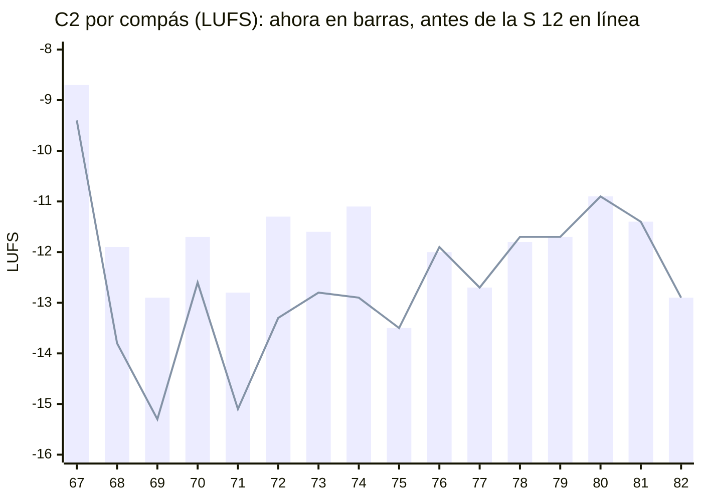

**Qué pasa.**

- **Subió la primera mitad y la segunda quedó igual.** La S 12 subió la batería de c.67–74 (bombo y caja a FUERTE,
  pandereta, cencerro y shaker un escalón). En c.75–82 no la tocó ningún archivo: `5.c2` y `6.b2` la tienen como
  antes. La primera mitad ganó 1.5 LU y la segunda, nada.
- **Lo que crece pesa poco.** El piano (+5.0) y el violín (+4.8) sí hacen crescendo, pero la batería es el 75 % de la
  energía del C2, y baja 2.2 LU.
- **El c.67 es el compás más fuerte del C2** (−8.7), al nivel de los del B2.

**¿Es un error?** Sí, contra el Mapa y D-07. Peso medio: el B2 sigue arriba, 2.4 LU sobre el C2. Si el C2 entra fuerte
a propósito, es una decisión (la línea está en *Propuestas*).

**Dónde se mueve:** la batería del C2 en `5.c2` (c.67–82), con copias en `4.v2` (c.67–74) y `6.b2` (c.75–82).

### H-27 · La mezcla pasa de 0 dBFS (nuevo)

**Qué escribiste.** Las velocidades de la batería: FUERTE (103), NORMAL (90), MEDIO (80), SUAVE (68), GHOST (34).
Cada una dice que un golpe suena más o menos que otro.

**Qué suena.** El pico de cada sección (lo que pasa de 0 dBFS, el WAV lo corta, y strudel.cc también al tocar):

| Sección | Pico de la mezcla | Pico de la batería sola | Compases sobre 0 dBFS | Muestras cortadas |
|---|---:|---:|:-:|---:|
| Intro | +4.1 dBFS | +4.0 | 9 de 10 | 0.05 % |
| V1 | +4.4 | +1.3 | 16 de 16 | 0.06 % |
| C1 | +4.3 | +3.3 | 8 de 16 | 0.01 % |
| B1 | +2.9 | +1.9 | 3 de 8 | 0.05 % |
| V2 | +2.6 | +0.7 | 6 de 16 | 0.01 % |
| C2 | +6.3 | +6.0 | 16 de 16 | **0.39 %** |
| **B2** | **+8.4** | **+7.2** | 10 de 10 | **0.30 %** |
| C3 | +4.1 | +2.6 | 15 de 16 | 0.08 % |
| Outro | −0.5 | −4.3 | 0 de 3 | 0 |

**Qué pasa.**

- **83 de 111 compases pasan de 0 dBFS.** El más alto es el c.83, a +8.4: en el 1 entran juntos el bombo, el tom
  agudo (103), el hi-hat abierto, las palmas, la pandereta, el cencerro y el shaker, con el piano.
- **Es la batería.** Sola pasa de 0 dBFS en todas las secciones menos el Outro. El piano solo pasa en el B2 (+1.3).
- **Son golpes, no la mezcla entera:** se corta el 0.11 % de las muestras de la pieza. Pero se concentra donde la
  energía tiene que ser más alta: el C2 y el B2.
- **Arriba, las velocidades dejan de contar.** En el C2, los compases de c.67–74 (bombo y caja en FUERTE) llegan a
  +3.3…+6.3 dBFS, y los de c.75–82 (MEDIO y SUAVE), a +2.0…+4.1: los dos salen al mismo techo.
- **strudel.cc no tiene limitador:** la salida va del mezclador a una ganancia y de ahí a los altavoces. Lo que suena
  al tocar recorta igual que el WAV.

**¿Es un error?** Sí: lo escrito (velocidades distintas) contra lo que suena (todo lo de arriba al mismo techo). Peso
medio. No va contra el Mapa, pero toca todas las secciones a la vez, y la sonoridad que mide este feedback es de
antes del recorte: en el C2 y el B2, lo que se oye es un poco menos.

**Dónde se mueve:** `MEZCLA` y `KIT` (en 1), igual en los ocho archivos, o las velocidades de la batería.

### H-20 · La línea del V2

**Qué escribiste.** [[3. Composiciones/6. louise/2. Decisiones#^d-13|D-13]]: *"el violín lleva la línea"*.

**Qué suena.**

| V2 · c.51–66 | |
|---|---:|
| Violín *pizz.* | −29.2 LUFS |
| Guitarra | −27.1 LUFS |
| Piano | −19.0 LUFS |
| Batería | −18.2 LUFS |
| Todo menos el violín | −15.3 LUFS |
| **El violín contra el resto** | **−13.9 LU** |
| En el canal izquierdo, donde va el violín (paneo 0.1) | −10.0 dB |
| Ataques del violín que suenan sobre el resto | **0 de 40** (el mejor, −5.5; la mitad, por debajo de −13.1) |
| Lo que el violín le suma a la mezcla | 0.0 LU |

Para comparar, el arco de los coros, que según [[3. Composiciones/6. louise/2. Decisiones#^d-17|D-17]] va dentro de la
textura a propósito: −9.7 LU contra el resto en el C1, −11.8 en el C2 y −10.2 en el C3.

**Qué pasa.** El *pizz.* del V2 va más enterrado que el arco de los coros, que está ahí para no destacar. Ni en su
canal ni en sus ataques supera al resto, y si se quitara, la mezcla del V2 sonaría igual. El paneo lo separa del
piano, pero no alcanza: la batería y la guitarra van al centro y suenan en los dos canales. En el render de
MuseScore del F 11 iba 16.6 dB debajo (otra medida, no se compara uno a uno).

**¿Es un error?** Sí, contra D-13. Sigue en medio; ya no está *sin medir*.

### H-17 · El violín del C3

**Qué escribiste.** En el Mapa, C3 *"Energía: 2"* y B2 *"lo más alto de la pieza"*.

**Qué suena.** El violín con arco, por sección y en sus compases más fuertes (LUFS):

| | Sección | Compás más fuerte |
|---|---:|---|
| C1 | −24.7 | |
| C2 | −23.7 | c.80, −18.4 |
| **B2** | **−19.2** | c.86, −17.5 |
| C3 | −22.9 (−21.4 la primera mitad, −25.2 la segunda) | **c.93, −16.9** |

**Qué pasa.**

- **El c.93 es el compás más fuerte del violín en toda la pieza:** 0.6 LU sobre el más fuerte del B2 y 2.6 sobre el
  B♭ del c.91. La S 12 lo subió de 82 a 96 (antes sonaba −18.3).
- **Como sección, el B2 sigue siendo lo más alto del violín:** 3.7 LU sobre el C3.
- **El C3 queda sobre los dos coros:** 0.8 LU sobre el C2 (no se distingue) y 1.8 sobre el C1.

**¿Es un error?** Sí, contra el Mapa: el violín de la despedida tiene su compás más fuerte justo después del pico.
Sigue en medio. [[3. Composiciones/6. louise/2. Decisiones#^d-19|D-19]] (*"el violín canta la primera mitad"*) dice
quién va arriba, no cuánto suena contra el B2.

---

## Siguiente

➡️ **[[3. Composiciones/6. louise/6. Hallazgos#^h-02|H-02]], el C3.**

- Es alto, y es el que más se aleja del Mapa: la despedida suena al nivel del C2 y 2.3 LU sobre el C1.
- La S 12 ya lo movió en la dirección del Mapa (−1.1 LU). Lo que queda es sobre todo la batería: el 59 % del C3.
- Lo que muevas en el C3 también mueve a H-17 (el c.93 es el mismo C3, visto desde el violín).
- **Pídelo así:** `C3.energia`.

---

## Propuestas

- **Para el Mapa:** la energía de Intro, V1, C1, B1, V2 y Outro sigue en blanco. Con audio, si copias el plan de la
  S 05 (Intro 2 · V1 3 · C1 3 · B1 1 · V2 3 · Outro 1–2), dos secciones quedarían en contra desde el principio:
  - **El Intro** (−12.8) suena más que V1, C1, B1 y V2. Su segunda mitad (−11.5) es tan fuerte como el C2.
  - **El B1**, *"valle, piano solo"* en el plan, suena más que V1, C1 y V2 (−13.8).
  - El comentario del C1 (*"menos que el C2"*) sí se cumple: 2.9 LU debajo.
- **Para Decisiones**, por H-26, si el C2 entra fuerte a propósito y lo que crece son el violín y el piano (en ese
  caso el Mapa del C2 tampoco diría *"3 → 4"*: `**Energía:** ____`):
  
| ID | Fecha | Qué | Por qué | Qué cambió | Enlaces |
|---|---|---|---|---|---|
| D-21 | 2026-11-03 | **C2: entra fuerte en la batería y crece en el violín y el piano** | ____ | ninguna nota | nace de [[3. Composiciones/6. louise/6. Hallazgos#^h-26\|H-26]] |
^d-21
  
- **Para la ficha:** `ultimo_audio` está vacío. El de hoy es
  `"4. Instrumento/2. Strudel/10. Folk/Louise/9.produccion/render/2026-11-03 Louise - pieza.wav"`.

---

## Cómo se midió

- **El audio:** strudel.cc, con su `renderPatternAudio` (el mismo motor que suena al tocar, superdough, con los mismos
  sonidos: General MIDI, el piano y el kit AkaiLinn), a 48 kHz y 128 voces, lo que trae strudel.cc por defecto. Cada archivo se
  leyó de GitHub en `ce608ea` y se evaluó sin tocarlo. Cada sección sale de su propio archivo (el C3 y el Outro de
  `7.c3`), con dos compases de cola para la reverb.
- **La pieza entera:** cada sección en su compás, con su cola sumada al principio de la siguiente. Los números de
  *Toda la sección* y de la mezcla por compás salen de ahí.
- **Por instrumento:** cada sección se renderizó también con un instrumento a la vez (violín, guitarra, piano,
  batería), con sus efectos. Las cuatro pistas suman la mezcla. El *%* es la parte de la energía de cada una.
- **Antes de la S 12:** C2, B2 y C3 renderizados igual desde `caf57e6`, cada sección sola. Las comparaciones de
  antes y ahora usan, en los dos lados, la sección sola.
- **Sonoridad:** K-ponderada (BS.1770, los dos canales), en ventanas de 1/12 de compás, promediada en potencia: por
  compás, por mitad o por sección. Sin compuerta, así que no es el LUFS integrado de una plataforma, pero sirve para
  comparar partes de la misma pieza. Las diferencias van en LU (1 LU = 1 dB).
- **Picos y recorte:** sobre la señal antes de convertirla en WAV. Un compás *recorta* si alguna muestra pasa de 1.0
  (0 dBFS). La sonoridad también es de antes del recorte.
- **El ruido de la medida:** la reverb de superdough genera su respuesta con ruido, distinta en cada render. Una
  misma sección sin cambios varía hasta 0.6 LU en un compás con reverb (el piano del B2). Diferencias menores de 0.5 LU
  en un compás no dicen nada; en una sección entera, la variación llega a 0.3 en un instrumento y a 0.1 en la mezcla.
- **El violín del V2 por canal:** el violín y el resto, renderizados aparte, comparados en cada canal (sin
  ponderar).
- **Lo que no se midió:** frecuencias (cuánto tapa cada instrumento en su registro). Los números del F 15 son *intensidad
  escrita* y los del F 07 y el F 11 salen de un render de MuseScore: ninguno se compara uno a uno con estos.
