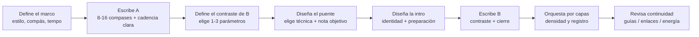
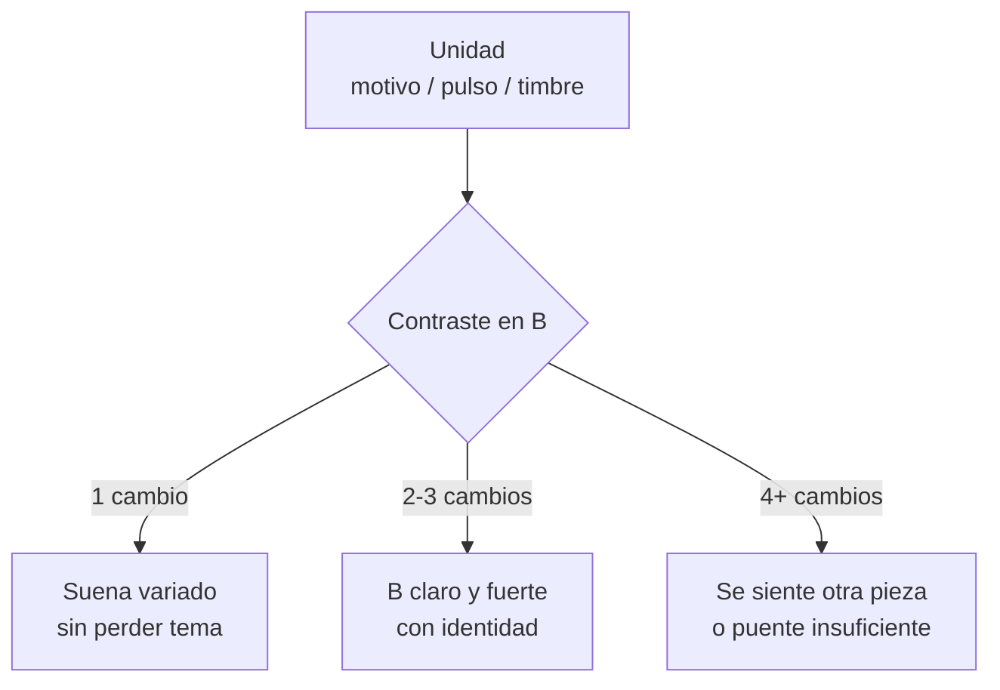
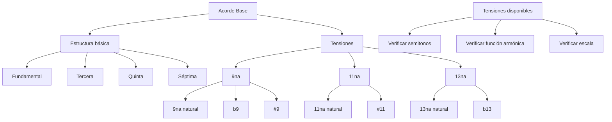

# Los conceptos que usa Louise

> Archivo derivado: lo genera `_scripts/generar-chatgpt.py` desde la bóveda de música del usuario (Obsidian + git), el 2026-10-18. Cada sección es una nota de la bóveda, con su ruta. La bóveda es la fuente de verdad: si algo de aquí contradice a una conversación más reciente, pregunta.

Las notas de concepto (escritas por el usuario) a las que enlazan las decisiones de Louise, la rúbrica de composición, el bloque de decisión y la plantilla de secciones de Strudel.

Contiene:

- `1. Teoría/5. Forma/2. Composición binaria — contraste, intro y puente.md`
- `1. Teoría/5. Forma/0. Cadencias, progresiones y líneas melódicas.md`
- `1. Teoría/4. Melodía/0. Enlaces 2.0 y motivos.md`
- `1. Teoría/0. Fundamentos/2. Armonización de tonalidades mayores.md`
- `1. Teoría/2. Conducción/00. Voicing e inversiones.md`
- `1. Teoría/1. Armonía/9. Dominantes en progresiones.md`
- `1. Teoría/1. Armonía/2. Sustitutos de tritono.md`
- `1. Teoría/1. Armonía/3. Intercambios modales.md`
- `1. Teoría/1. Armonía/8. Tensiones.md`
- `10. System/2. Plantillas/1. Bloques/Rúbrica - Composición.md`
- `10. System/2. Plantillas/1. Bloques/bloque — decisión.md`
- `10. System/2. Plantillas/2. Notación/strudel — secciones.md`
- `10. System/2. Plantillas/0. Notas/Obra.md`

---

## Archivo: `1. Teoría/5. Forma/2. Composición binaria — contraste, intro y puente.md`

# Repaso 25: Composición binaria — **Contraste, Intro y Puente (enlaces)**

> Este repaso nace de `Notas 25. Composición binaria.md` y se integra con las ideas de:
> - `Repaso 24. Composición binaria.md` (forma AB / ABA', plan tonal y cadencial)
> - `Repaso 22. Enlaces 1.0.md` + `Repaso 23. Enlaces 2.0 y motivos.md` (conexiones melódicas/armónicas)
> - `Repaso 21. Tonos guías.md` (3ª y 7ª como brújula de dirección)

## Índice
1. [Qué significa “contraste” en binaria (sin perder unidad)](#qué-significa-contraste-en-binaria-sin-perder-unidad)
2. [Procedimiento ultra-detallado (pipeline)](#procedimiento-ultra-detallado-pipeline)
3. [Intro: funciones, tipos y longitudes](#intro-funciones-tipos-y-longitudes)
4. [Puente/Enlace: el “pegamento” entre secciones](#puenteenlace-el-pegamento-entre-secciones)
5. [Librería de puentes (por técnica) con `music-abc`](#librería-de-puentes-por-técnica-con-music-abc)
6. [Caja de herramientas para crear contraste en la Parte B](#caja-de-herramientas-para-crear-contraste-en-la-parte-b)
7. [Contraste por voces (capas) y textura](#contraste-por-voces-capas-y-textura)
8. [Plantillas completas (con compases y objetivos)](#plantillas-completas-con-compases-y-objetivos)
9. [Ejemplos `music-abc` (A / puente / B)](#ejemplos-music-abc-a--puente--b)
10. [Diagramas Mermaid (mapas de forma y energía)](#diagramas-mermaid-mapas-de-forma-y-energía)
11. [Ejercicios (con reloj) + checklist profesional](#ejercicios-con-reloj--checklist-profesional)
12. [Bibliografía citada](#bibliografía-citada)

---

## Qué significa “contraste” en binaria (sin perder unidad)

En forma binaria (AB o binaria redondeada ABA'), **la Parte B debe sentirse diferente** a la Parte A, pero sin “borrar” la identidad del tema.

### Regla de oro (20 años de aula, composición y arreglos)
**Cambia 1–3 parámetros en B (no 7).**  
Si cambias demasiadas cosas a la vez, el oyente siente “otra canción”; si no cambias nada, B se siente como repetición.

### Unidad vs. variedad (tabla de control)

| Si quieres… | Mantén (unidad) | Cambia (variedad/contraste) |
|---|---|---|
| Que la pieza sea reconocible | **Motivo** (contorno o ritmo), tempo base, “sonido” central | Registro, densidad, armonía, compás, modo |
| Que B sea claramente otra sección | 1 ancla: motivo, guía tonal, patrón rítmico | 2–3 cambios: compás + textura, o modo + armonía, etc. |

### En binaria tonal “clásica”
El contraste suele estar en:
- **Tonalidad/área** (A suele apuntar a V/III; B vuelve a I/i y desarrolla)
- **Desarrollo** (secuencia, fragmentación, dominantes de paso)

En binaria moderna (verso-coro):
- A = verso (menos denso), B = coro (más denso / hook)
- El puente (bridge) se usa para “reiniciar” tensión o cambiar perspectiva

Referencia formal: distinción AB vs. ABA' y rol cadencial/funcional.[^caplin][^green]

---

## Procedimiento ultra-detallado (pipeline)

La forma más rápida de que una binaria “suene compuesta” (y no pegada) es tratar **Intro** y **Puente** como decisiones formales, no como adorno.

### Pipeline (de idea a estructura)



### Hoja de decisiones (tabla)

| Pregunta | Respuesta | Consecuencia compositiva |
|---|---|---|
| ¿Qué hace que esto sea “mi tema”? | motivo / timbre / ritmo | eso **no se rompe** en B |
| ¿Cómo será diferente B? | compás / modo / textura / armonía / registro | elige solo 1–3 |
| ¿Qué nota objetivo “abre” B? | 3ª o 7ª del 1er acorde de B | el puente “apunta” ahí[^guia] |
| ¿Qué tipo de intro necesito? | teaser / pedal / progresión | intro prepara el primer gesto de A |

### Regla de maestro: “si no lo puedes describir, no lo puedes controlar”
Antes de escribir B, completa esta frase:

> **“En B voy a cambiar ____ y ____ (máx. 3) mientras mantengo ____ (unidad).”**

---

## Intro: funciones, tipos y longitudes

La **Intro** no es “relleno”: es la primera decisión de *dirección*. No hay número fijo de compases; lo importante es **a qué punto quieres llegar**.

### Funciones típicas de una Intro

| Función | Qué logra | Señales auditivas |
|---|---|---|
| **Anclar tonalidad** | El oído entiende el “hogar” | pedal, I–V, bordón |
| **Presentar groove/compás** | El cuerpo entiende el pulso | patrón de batería/bajo |
| **Sembrar el motivo** | La mente reconoce identidad | “teaser” del motivo |
| **Crear expectativa** | Hace que A entre con sentido | subida de energía / pausa |

### Tipos de Intro (plantillas)

| Tipo | Longitud común | Material | Ideal para |
|---|---:|---|---|
| **Pick-up / anacrusa** | 1–2 tiempos o 1 compás | fragmento del motivo | temas cantables |
| **Pedal + color** | 1–4 compases | nota pedal + acordes | ambient/dream pop |
| **Progresión mini** | 2–4 compases | I–IV–V (o ii–V) | pop/rock/jazz |
| **Motivo “a contraluz”** | 2–8 compases | ritmo del motivo sin melodía | música cinematográfica |
| **Intro con puente interno** | 4–8 compases | intro modula y aterriza | si A entra en tono “no obvio” |

### Checklist de intro (rápido)
- [ ] ¿Se entiende el pulso y el compás?
- [ ] ¿Presenta 1 identidad (motivo / timbre / pedal)?
- [ ] ¿La última figura “invita” a A (pickup, silencio, dominante, fill)?

### Biblioteca de intros (rápidas) en `music-abc`

#### Intro 1: anacrusa (pickup) con el “cabezal” del motivo

```music-abc
X:3
T:Intro pickup (1 compas) hacia A
M:4/4
L:1/8
Q:1/4=96
K:C
%%score (Mel|Bas)
V:Mel clef=treble name="Mel"
V:Bas clef=bass name="Bas"
V:Bas z6 "G" G,,2 |
V:Mel z6 G A |
```

Idea: el pickup “tira” del oyente hacia el compás 1 de A.

#### Intro 2: pedal + color (2 compases) para atmósfera

```music-abc
X:4
T:Intro pedal (2 compases) + color
M:4/4
L:1/8
Q:1/4=84
K:C
%%score (Top|Bas)
V:Top clef=treble name="Top"
V:Bas clef=bass name="Bas"
V:Bas "C" C,2 z2 "C" C,2 z2 | "C" C,2 z2 "C" C,2 z2 |
V:Top "Cmaj7" E2 G2 B2 G2 | "Cmaj7(#11)" E2 ^F2 G2 B2 |
```

#### Intro 3: mini-progresión (2 compases) que instala función

```music-abc
X:5
T:Intro mini-progresion (I-vi-IV-V)
M:4/4
L:1/8
Q:1/4=96
K:C
%%score (Mel|Bas)
V:Mel clef=treble name="Mel"
V:Bas clef=bass name="Bas"
V:Bas "C" C,2 "Am" A,,2 "F" F,,2 "G" G,,2 |
V:Mel E2 E2 F2 G2 |
```

---

## Puente/Enlace: el “pegamento” entre secciones

En tus notas: **Puente = lo que existe entre partes**. Su objetivo no es “lucirse”: es **unir**.

### Qué hace un buen puente

| Objetivo del puente | Qué cambia | Qué conserva |
|---|---|---|
| **Reencuadrar** (pasar de A a B) | armonía / modo / compás / textura | pulso o motivo |
| **Preparar regreso** (B → A') | tensión → resolución | identidad temática |
| **Evitar el “corte”** | suaviza el salto | continuidad de conducción de voces |

### Técnicas de puente (las de tus notas + cómo decidir)

| Técnica | Cómo suena | Cuándo usar | Regla práctica |
|---|---|---|---|
| **Tonos guía** (3ª/7ª) | línea “inevitable” | cuando hay acordes claros | llega por semitono al destino[^guia] |
| **Movimiento cromático** | tensión controlada | si B cambia de tonalidad o color | cromatismo con objetivo (nota de llegada) |
| **Salto de 4ª** | gesto “heroico”/abierto | para despegar energía | compensa con movimiento contrario después |
| **Acorde de paso** | escalón lógico | para modular o acercar cadencia | úsalo en tiempo débil |
| **Mini-resolución** | micro-cadencia | para “cerrar” A antes de B | HC o IAC antes del cambio |
| **Un nuevo acorde** (pivote) | puerta a otro mundo | cuando B es modal/relativa | que comparta notas con ambos lados |

> Puente “libre” no significa “sin reglas”: significa que **no repite la forma** de A ni B, pero sigue obedeciendo dirección y objetivo.

### Errores comunes de puente
- Puente demasiado largo (olvidas que era transición).
- Cromatismo sin objetivo (tensión sin llegada).
- Cambiar todo (compás + tempo + textura + tonalidad) y perder continuidad.

---

## Librería de puentes (por técnica) con `music-abc`

Esta sección es para cuando estás componiendo y dices: “necesito un puente de 1–2 compases y no sé qué escribir”.

### Plantilla universal (1 compás)
1. Elige la **nota objetivo** (3ª o 7ª del primer acorde de B).[^guia]  
2. Decide cómo llegas: diatónico, cromático, salto (4ª), acorde de paso, mini-cadencia.  
3. Coloca la llegada en un lugar “fuerte” (inicio de B) y el movimiento en lugar “débil”.

### A) Puente con tonos guía (mínimo y elegante)
Ejemplo: de **G7** a **Am** (objetivo: **C** o **E** en Am; aquí apuntamos a **C** por semitono).

```music-abc
X:10
T:Puente por tonos guía (G7 -> Am)
M:4/4
L:1/8
Q:1/4=92
K:C
%%score (Lin|Bas)
V:Lin clef=treble name="Linea"
V:Bas clef=bass name="Bajo"
V:Bas "G7" G,,2 z2 z4 |
V:Lin "G7" B A G ^G | "Am" A2 c2 z2 |
```

Qué escuchar:
- La línea superior hace **G → G# → A** (tensión-resolución clara).

### B) Puente cromático (tensión dirigida)
Ejemplo: de **F** a **G** (cromatismo al V para preparar el regreso).

```music-abc
X:11
T:Puente cromático (F -> G)
M:4/4
L:1/8
Q:1/4=96
K:C
%%score (Lin|Bas)
V:Lin clef=treble name="Linea"
V:Bas clef=bass name="Bajo"
V:Bas "F" F,,2 z2 "G" G,,2 z2 |
V:Lin "F" A G ^G A | "G" B A G z |
```

Regla: cromático sin objetivo = ruido; cromático con objetivo = puente.

### C) Puente con salto de 4ª (gesto que abre espacio)
Ejemplo: salto **D → G** para anunciar cambio de sección; luego aterriza por paso.

```music-abc
X:12
T:Puente con salto de 4a (gesto) + aterrizaje
M:4/4
L:1/8
Q:1/4=92
K:G
%%score (Lin|Bas)
V:Lin clef=treble name="Linea"
V:Bas clef=bass name="Bajo"
V:Bas "D" D,2 z2 "G" G,2 z2 |
V:Lin D2 G2 F# E | "G" D2 B2 z2 |
```

Uso: cuando B necesita “levantar la ceja” sin cambiar todo.

### D) Puente con acorde de paso (escalón armónico)
Ejemplo: **C → C#° → Dm** (paso cromático funcional).

```music-abc
X:13
T:Puente con acorde de paso (C -> C#dim -> Dm)
M:4/4
L:1/8
Q:1/4=88
K:C
%%score (Arp|Bas)
V:Arp clef=treble name="Arpegio"
V:Bas clef=bass name="Bajo"
V:Bas "C" C,2 "C#dim" ^C,2 "Dm" D,2 z2 |
V:Arp "C" E G c z2 | "C#dim" ^C E G z2 | "Dm" D F A z2 |
```

### E) Puente con mini-resolución (micro-cadencia)
Ejemplo: termina A en **HC** (dominante), y B entra como respuesta.

```music-abc
X:14
T:Mini-resolucion (HC) antes de entrar a B
M:4/4
L:1/8
Q:1/4=96
K:C
%%score (Mel|Bas)
V:Mel clef=treble name="Mel"
V:Bas clef=bass name="Bas"
% Fin de A: prepara dominante
V:Bas "Dm" D,2 "G" G,,2 z4 |
V:Mel A G F E | D2 G2 z2 |
% Entrada de B: responde y cierra en I
V:Bas "C" C,2 z2 z4 |
V:Mel E G F E | D2 C2 z2 |
```

### F) Puente con “nuevo acorde” pivote (puerta de color)
Ejemplo: A en C mayor, B entra con color mixolidio usando **Bb** como acorde pivote hacia bVII → I.

```music-abc
X:15
T:Pivote (Bb) para color mixolidio en B
M:4/4
L:1/8
Q:1/4=92
K:C
%%score (Mel|Bas)
V:Mel clef=treble name="Mel"
V:Bas clef=bass name="Bas"
V:Bas "C" C,2 "Bb" _B,,2 "F" F,,2 "C" C,2 |
V:Mel E2 D2 C2 _B2 | A2 G2 F4 |
```

---

## Caja de herramientas para crear contraste en la Parte B

### 1) Contraste por compás (métrica)

| A | B | Efecto | Uso típico |
|---:|---:|---|---|
| 4/4 | 6/8 | “rodar” ternario | coro más cantable, gigue feel |
| 4/4 | 3/4 | danza/elegancia | minuet feel |
| 6/8 | 4/4 | aterrizaje | final más “cuadrado” |

Regla: si cambias compás, **mantén el pulso** (misma negra o misma corchea) para que no parezca cambio de tempo.

### 2) Contraste por modo (modalidad)

| A (mayor) | B (opción) | Color | Ejemplo práctico |
|---|---|---|---|
| Iónico | **Lidio** | brillo (#11) | Imaj7(#11) |
| Iónico | **Mixolidio** | rock/blues | bVII → I |
| Mayor | **Menor relativo** | introspectivo | C → Am |
| Menor | **Dórico** | “menor luminoso” | i con 6 mayor |

### 3) Contraste por ritmo (células)
Usa una célula nueva **pero derivada** (misma densidad o misma acentuación base).

| Técnica | Qué haces | Resultado |
|---|---|---|
| **Desplazamiento** | mueves el inicio 1/8 | groove “adelantado” |
| **Aumentación** | duplicas duraciones | B se siente más grande |
| **Diminución** | mitad de duraciones | B se siente más activo |
| **Sincopa selectiva** | 1–2 ataques fuera de pulso | energía sin caos |

### 4) Contraste por armonía (sin complicarte)

| Contraste | Cómo hacerlo | “Seguro” en pop/tonal |
|---|---|---|
| **Más tensión** | dominantes secundarios | V/V, V/ii |
| **Más color** | intercambio modal | iv en mayor, bVII |
| **Más estabilidad** | pedal + acordes lentos | tónica prolongada |
| **Más dirección** | secuencias | ii–V encadenados |

### 5) Contraste por resolución (tu nota: “resolución diferente”)
Una forma fina de contraste es **cambiar el tipo de cierre**:

| En A cierras con… | En B prueba… | Efecto |
|---|---|---|
| PAC | IAC + coda | final “más hablado” |
| HC | PAC fuerte | B se siente conclusivo |
| auténtica | deceptiva (V→vi) | sorpresa emocional |

---

## Contraste por voces (capas) y textura

Tu nota es clave: **usar otras voces genera contraste** incluso si los acordes siguen parecidos.

### Tabla de “densidad por capas”

| Sección | Capas sugeridas | Sensación |
|---|---|---|
| **Intro** | 1–2 (pad + motivo sombra) | expectativa |
| **A** | 2–3 (bajo + armonía + melodía) | claridad |
| **Puente** | 1–4 (depende: puede desnudar o escalar) | transición |
| **B** | 3–5 (sumar contramelodía o ritmo) | clímax/contraste |

### Dos estrategias profesionales (muy usadas)
- **Estrategia “strip”**: antes de B, quitas capas (dejas solo bajo/pedal) → B entra grande.
- **Estrategia “riser”**: puente suma tensión (cromatismo + densidad + registro) → B aterriza.

---

## Plantillas completas (con compases y objetivos)

### Plantilla A: binaria moderna (Intro + Verso/Coro)
```
Intro (2–4) → A (8–16) → Puente (1–2) → B (8–16) → (A' opcional) → Outro
```

**Objetivos**
- Intro: pulso + identidad
- Puente: unión + preparación (sin robar escena)
- B: contraste claro (1–3 cambios) + hook

### Plantilla B: binaria redondeada (estilo danza)
```
||: A (8) :||: B (8) con regreso de A' (2–4) :||
```
Aquí el “puente” muchas veces está embebido: secuencias → dominante → regreso del motivo.

### Plantilla C: A cambia de tonalidad, B vuelve (clásico tonal)
```
A: I → V (o i → III)
Puente: pivote / dominante de preparación
B: V/III → I/i con cierre fuerte
```

---

## Ejemplos `music-abc` (A / puente / B)

> Nota: los ejemplos son deliberadamente “claros” (no virtuosísticos). Úsalos como plantilla: cambia acordes, registro, ritmo y textura.

### Ejemplo 1: A (C mayor, 4/4) → Puente cromático → B (A menor relativo)

```music-abc
X:1
T:Repaso 25 - A (C) puente cromático B (Am)
M:4/4
L:1/8
Q:1/4=96
K:C
%%score (Mel|Arp|Bas)
V:Mel clef=treble name="Mel"
V:Arp clef=treble name="Arp"
V:Bas clef=bass name="Bas"
% Intro (2): pedal + teaser
V:Bas "C" C,2 z2 "C" C,2 z2 |
V:Arp "Cmaj7" E G B G "Cmaj7" E G B G |
V:Mel z2 E2 z2 G2 |
% A (4): motivo simple + cadencia a G (V)
V:Bas "C" C,2 "Am" A,,2 "F" F,,2 "G" G,,2 |
V:Arp "C" E G c G "Am" E A c A "F" A c e c "G" B d g d |
V:Mel E D E G | A G F E | D E F A | G2 z2 |
% Puente (2): cromatismo dirigido (G -> G# -> A)
V:Bas "G" G,,2 "E7" E,,2 |
V:Arp "G7" B d g f "E7" ^G B e d |
V:Mel G A ^G F | E2 z2 |
% B (4): cambia modo y densidad (Am) + regreso a C al final
V:Bas "Am" A,,2 "Dm" D,,2 "E7" E,,2 "Am" A,,2 |
V:Arp "Am" A c e c "Dm" A d f d "E7" ^G B e d "Am" A c e c |
V:Mel A G E D | F E D C | B ^G A B | A2 z2 |
```

Qué observar:
- Contraste en B: **modo** (Am) + **densidad** (más arpegio) sin cambiar tempo.
- Puente: cromatismo con objetivo (**G#** como guía hacia Am).

### Ejemplo 2: Contraste por compás (A en 4/4 → B en 6/8) con mismo tempo percibido

```music-abc
X:2
T:A 4/4 -> Puente -> B 6/8 (mismo pulso)
M:4/4
L:1/8
Q:1/4=92
K:G
%%score (Mel|Bas)
V:Mel clef=treble name="Mel"
V:Bas clef=bass name="Bas"
% A (2): estable (4/4)
V:Bas "G" G,2 "Em" E,2 "C" C,2 "D" D,2 |
V:Mel B A G F# | E2 z2 |
% Puente (1): mini-resolución (HC) a D
V:Bas "Am" A,2 "D" D,2 |
V:Mel A B c2 |
% B (2): cambia a 6/8 (misma negra ≈ pulso), motivo rítmico nuevo
M:6/8
L:1/8
V:Bas "Em" E,3 "C" C,3 | "D" D,3 "G" G,3 |
V:Mel B A G | A B c | d c B | B3 |
```

---

## Diagramas Mermaid (mapas de forma y energía)

### Mapa de forma (binaria con intro y puente)


### “Perilla de contraste”: cambia 1–3 cosas



### Curva de energía típica (Intro → A → Puente → B)

```mermaid
gantt
title Curva de energia (modelo practico)
dateFormat  X
axisFormat  %L
section Secciones
Intro (identidad)     :a1, 0, 2
A (tema)              :a2, 2, 8
Puente (tension)      :a3, 10, 2
B (contraste/climax)  :a4, 12, 8
```



---

## Ejercicios (con reloj) + checklist profesional

### Ejercicio 1 (15 min): contraste mínimo que funciona
- Escribe A de 8 compases en 4/4 (I–vi–IV–V).
- Escribe B de 8 compases **solo cambiando 1 parámetro**:
  - opción A: cambia **registro** (una octava arriba)
  - opción B: cambia **densidad** (arpegios vs. acordes)
  - opción C: cambia **modo** (relativo menor)

### Ejercicio 0 (10 min): “poco tiempo para crear” (método de emergencia)
Cuando no hay tiempo, tu meta no es “una obra perfecta”, sino un **borrador tocable**.

1. **Min 0–2**: escribe un motivo de 2 compases (solo ritmo + contorno).
2. **Min 2–5**: armoniza A (4 compases) con I–vi–IV–V (o i–VI–III–VII).
3. **Min 5–7**: decide contraste de B (1 cosa): modo *o* densidad *o* registro.
4. **Min 7–9**: escribe puente de 1 compás apuntando a 3ª/7ª del primer acorde de B.[^guia]
5. **Min 9–10**: cierra B con una cadencia clara (PAC o equivalente).

Regla: si al final puedes tocar **Intro–A–Puente–B** sin parar, vas bien.

### Ejercicio 2 (20 min): puente “con objetivo”
Toma tu A y crea un puente de 1–2 compases usando 2 técnicas:
- tonos guía + acorde de paso, o
- cromatismo + mini-resolución

Regla: el puente debe “apuntar” a una nota objetivo (3ª o 7ª del primer acorde de B).[^guia]

### Ejercicio 3 (30 min): intro funcional (no decorativa)
Compón 4 compases de intro con una función clara:
- 2 compases pedal + teaser del motivo
- 1 compás fill o pausa
- 1 compás pickup hacia A

### Checklist profesional (antes de dar por “terminado”)
- [ ] **B se siente diferente** (puedo nombrar 1–3 cambios concretos).
- [ ] Hay **unidad** (motivo/pulso/timbre sigue presente).
- [ ] El **puente une** (no se siente corte; cromatismos tienen llegada).
- [ ] La **intro tiene función** (pulso + identidad + preparación).
- [ ] La conducción de voces en el puente y cadencias apunta a tonos guía (3ª/7ª).[^guia]

### Conexiones con otros repasos (para profundizar)
- Si tu puente suena “cortado”: revisa `Repaso 22. Enlaces 1.0.md` (enlace por paso/vecina/enclosure) y `Repaso 21. Tonos guías.md` (3ª/7ª como objetivo).
- Si B suena “igual” que A: vuelve a `Repaso 24. Composición binaria.md` (plan tonal/cadencial) y aplica la regla de 1–3 cambios.
- Si quieres que el contraste sea rítmico sin perder identidad: toma ideas de tu librería de motivos rítmicos (si estás usando ABC) y plántalas por capas (melodía vs bajo).

---

## Bibliografía citada

[^caplin]: Caplin, William E. *Classical Form: A Theory of Formal Functions for the Instrumental Music of Haydn, Mozart, and Beethoven*. Oxford University Press, 1998.
[^green]: Green, Douglass M. *Form in Tonal Music: An Introduction to Analysis*. 2nd ed., Holt, Rinehart and Winston, 1979.
[^guia]: Sobre tonos guía (3ª/7ª) y su rol en dirección y resolución: ver `Repaso 21. Tonos guías.md` en tu carpeta `Teoría musical/Tema`.
[^schoenberg]: Schoenberg, Arnold. *Fundamentals of Musical Composition*. Faber & Faber, 1967. (Unidad/variedad por motivo y desarrollo).
[^piston]: Piston, Walter. *Harmony*. (Varias ediciones; cadencias, dominantes, acordes de paso y función).

---

## Archivo: `1. Teoría/5. Forma/0. Cadencias, progresiones y líneas melódicas.md`

## 🎯 **OBJETIVO PRINCIPAL**

Dominar el proceso completo desde la comprensión de cadencias básicas hasta la creación de melodías expresivas, aplicando las cadencias desde diferentes grados de la escala y transformándolas en líneas melódicas mediante arpegios y variaciones rítmicas.

---

## 📚 **FUNDAMENTOS: QUÉ SON LAS CADENCIAS**

### **Concepto Esencial**

Como establece el principio fundamental: **"Cadencias en realidad solo son una colección de notas"**. Las cadencias son fórmulas armónicas que funcionan como **arquitectura emocional**, creando patrones específicos de tensión y resolución que el oído reconoce instintivamente.

### **Las Tres Cadencias Fundamentales**

| Cadencia     | Fórmula            | Función Armónica     | Sensación Emocional    | Ejemplo en C mayor | Contexto de Uso        |
| ------------ | ------------------ | -------------------- | ---------------------- | ------------------ | ---------------------- |
| **Perfecta** | **ii-V-I** (2-5-1) | Tensión → Resolución | Conclusión definitiva  | Dm - G - C         | Finales, confirmación  |
| **Rota**     | **V-vi** (5-6)     | Tensión → Evasión    | Sorpresa, continuación | G - Am             | Desarrollo, transición |
| **Plagal**   | **IV-I** (4-1)     | Relajación → Reposo  | Calidez, abrazo        | F - C              | Religiosa, folk        |

### **Principio Fundamental: "La resolución define la escala"**

El acorde hacia el cual resuelve una progresión determina el centro tonal:
- **(G - D) → C** = Estamos en C mayor
- **(G - D) → Am** = Estamos en A menor
- **(E - A) → Dm** = Estamos en D menor

---

## 🏗️ **SISTEMA DE CADENCIAS DESDE DIFERENTES GRADOS**

### **Aplicando Familias Tonales**

Cada cadencia puede aplicarse desde cualquier grado de la escala, creando diferentes colores tonales y modulaciones. Esto multiplica exponencialmente las posibilidades expresivas.

#### **Tabla Completa: Cadencias ii-V-I desde cada grado en C Mayor**

| Grado Base  | Acorde ii | Acorde V | Acorde I | Familia Tonal | Color Resultante | Aplicación Musical      |
| ----------- | --------- | -------- | -------- | ------------- | ---------------- | ----------------------- |
| **I (C)**   | Dm        | G        | C        | SD→D→T        | Clásico, estable | Confirmación tonal      |
| **ii (D)**  | Em        | A        | Dm       | T→SD→SD       | Hacia menor      | Desarrollo melancólico  |
| **iii (E)** | F#m7b5    | B        | Em       | SD→D→T        | Menor relativo   | Expresión introspectiva |
| **IV (F)**  | Gm        | C        | F        | SD→D→SD       | Modal, folk      | Carácter rústico        |
| **V (G)**   | Am        | D        | G        | T→SD→D        | Hacia dominante  | Elevación, brillo       |
| **vi (A)**  | Bm7b5     | E        | Am       | SD→D→T        | Menor natural    | Melancolía profunda     |
|             |           |          |          |               |                  |                         |
|             |           |          |          |               |                  |                         |

#### **Ejemplo Práctico: Cadencia V-vi desde diferentes grados**

```music-abc
X:1
T:Cadencias V-vi desde diferentes grados
M:4/4
L:1/1
K:C
"G→Am" [GBd] [Ace] | "A→Bm" [A^ce] [B^df] | "B→Cm" [B^df] [ceg] | "C→Dm" [CEG] [DFA] |
w: Mayor→menor Modulación Cromático Modal
````

| Desde Grado | V   | vi  | Resultado     | Efecto Emocional   | Uso Estilístico            |
| ----------- | --- | --- | ------------- | ------------------ | -------------------------- |
| **I**       | G   | Am  | Mayor → menor | Melancolía súbita  | Baladas pop, introspección |
| **ii**      | A   | Bm  | Modulación    | Hacia Si menor     | Desarrollo, expansión      |
| **iii**     | B   | Cm  | Cromático     | Exótico, dramático | Cine, música dramática     |
| **IV**      | C   | Dm  | Modal         | Folk, estable      | Música tradicional         |
| **V**       | D   | Em  | Luminoso      | Hacia Mi menor     | Elevación emocional        |
| **vi**      | E   | F#m | Brillante     | Hacia F# menor     | Sofisticación armónica     |

---

## 🎵 **PROCESO SISTEMÁTICO: DE ACORDES A MELODÍAS**

### **Paso 1: Selección de Progresión Base**

**Ejemplo de trabajo:** ii-V-I en C mayor = **Dm7 - G7 - Cmaj7**

#### **Análisis Funcional:**

- **Dm7:** Subdominante (preparación)
- **G7:** Dominante (tensión)
- **Cmaj7:** Tónica (resolución)

### **Paso 2: Conversión a Arpegios Básicos**

#### **Estructura de Arpegios por Acorde:**

```music-abc
X:1
T:Arpegios básicos de la progresión ii-V-I
M:4/4
L:1/4
K:C
% Dm7        G7         Cmaj7
D F A c | G B d f | C E G B |]
w: Subdominante Dominante Tónica
```

| Acorde    | Notas del Arpegio | Intervalos | Función Melódica    | Carácter Emocional   |
| --------- | ----------------- | ---------- | ------------------- | -------------------- |
| **Dm7**   | D - F - A - C     | 1-b3-5-b7  | Preparación suave   | Contemplativo        |
| **G7**    | G - B - D - F     | 1-3-5-b7   | Tensión activa      | Urgente, direccional |
| **Cmaj7** | C - E - G - B     | 1-3-5-7    | Resolución luminosa | Satisfacción, paz    |

### **Paso 3: Aplicación de Variaciones Rítmicas**

#### **Método 1: Simplificación (Quitar Notas)**

```music-abc
X:1
T:Variación por sustracción rítmica
M:4/4
L:1/4
K:C
% Original completo
D F A c | G B d f | C E G B |]
% Versión blues simplificada
D z A z | G z d z | C z G z |]
% Versión minimalista
D z z c | G z z f | C z z B |]
w: Básico Simplificado Minimalista
```

**Aplicaciones por género:**

- **Blues/Rock:** Acentos en tiempos fuertes
- **Minimalismo:** Notas largas, espacios
- **Reggae:** Síncopa en contratiempos

#### **Método 2: Ornamentación (Añadir Notas)**

```music-abc
X:1
T:Variación por ornamentación
M:4/4
L:1/8
K:C
% Versión con notas de paso cromáticas
D ^D E F F ^F G A A ^A B c | G ^G A B B c ^C d d ^d e f | C D E F G A B c |]
w: Cromática ascendente Cromática continua Escala diatónica
```

**Técnicas de ornamentación:**

- **Notas de paso:** Conectan arpegios suavemente
- **Bordaduras:** Embellecen notas principales
- **Anticipaciones:** Adelantan la resolución

#### **Método 3: Transformaciones Rítmicas Avanzadas**

| Patrón Rítmico    | Notación | Aplicación al Arpegio | Género Típico | Efecto Emocional        |
| ----------------- | -------- | --------------------- | ------------- | ----------------------- |
| **Corchea-Negra** | ♪♩ ♪♩    | D(♪) F(♩) A(♪) C(♩)   | Pop, rock     | Pulso dinámico          |
| **Tresillo**      | ♪♪♪      | D-F-A (tresillo)      | Blues, jazz   | Swing, relajación       |
| **Sincopado**     | ♪.♪ ♪.♪  | D.F A.C (síncopa)     | Funk, R&B     | Groove, movimiento      |
| **Puntillo**      | ♩. ♪     | D(♩.) F(♪) A(♩.) C(♪) | Balada, folk  | Elegancia, nostalgia    |
| **Quintillo**     | ♪♪♪♪♪    | D-E-F-G-A (quintillo) | Jazz moderno  | Sofisticación rítmica   |
| **Hemiola**       | 3+3+2    | D-F(3) A-C(3) E-G(2)  | Música latina | Complejidad polirítmica |

---

## 🎸 **EJEMPLOS PRÁCTICOS POR GÉNERO MUSICAL**

### **1. Dream Pop/Ambient (Estilo Beach House)**

**Progresión base:** vi-IV-I-V (Am-F-C-G)

**Características del estilo:**

- Arpegios flotantes con séptimas
- Reverb etéreo
- Ritmos suaves con puntillos
- Octavas saltadas

```music-abc
X:1
T:Dream Pop - Arpegios atmosféricos
M:4/4
L:1/8
K:C
% Am7       Fmaj7     Cmaj7     G7sus4
A c e a | F a c f | C e g b | G c d g |]
w: Etéreo Flotante Luminoso Suspendido
```

**Variaciones melódicas específicas:**

- **Técnica 1:** Saltar octavas dentro del arpegio (A-e-c-a')
- **Técnica 2:** Pedal en nota aguda mientras cambian las graves
- **Técnica 3:** Arpegios descendentes con delay

**Desarrollo rítmico:**

```music-abc
X:1
T:Desarrollo rítmico Dream Pop
M:4/4
L:1/8
K:C
% Patrón base con silencios atmosféricos
A z c z e z a z | F z a z c' z f z | C z e z g z b z | G z c z d z g z |]
w: Espacios para reverb y atmosfera
```

### **2. Folk Melancólico (Estilo Bon Iver/Lumineers)**

**Progresión base:** i-iv-V-i (Am-Dm-G-Am)

**Características del estilo:**

- Arpegios descendentes
- Compás ternario (6/8 o 3/4)
- Técnica fingerpicking
- Dinámicas sutiles

```music-abc
X:1
T:Folk melancólico - Fingerpicking pattern
M:3/4
L:1/4
K:Am
% Am        Dm        G         Am
a e c | f d A | g d B | a e c |]
w: Descendente Preparación Tensión Resolución
```

**Patrón fingerpicking típico:**

```music-abc
X:1
T:Patrón fingerpicking expandido
M:6/8
L:1/8
K:Am
% Bajo-medio-agudo-medio-agudo-medio
A c e c e c | D f a f a f | G b d' b d' b | A c e c e c |]
w: Pulgar-índice-medio patrón clásico
```

**Variaciones emocionales:**

- **Intro:** Solo arpegio básico
- **Verso:** Añadir bajos caminantes
- **Coro:** Duplicar en octavas
- **Puente:** Arpegios rotos con silencios

### **3. Sad Music Experimental (Estilo Thom Yorke/Radiohead)**

**Progresión base:** i-bVI-bIII-bVII (Am-F-C-G)

**Características del estilo:**

- Arpegios fragmentados irregularmente
- Silencios expresivos
- Alteraciones cromáticas
- Ritmos asimétricos

```music-abc
X:1
T:Sad experimental - Arpegios rotos
M:4/4
L:1/8
K:Am
% Fragmentación rítmica irregular y disonante
A z c z ^F z z | F z z c =B z z | C z z g ^F z z | G z d z ^F z z |]
w: Alteraciones cromáticas y espacios expresivos
```

**Técnicas de fragmentación:**

- **Temporal:** Cambiar velocidades dentro del arpegio
- **Espacial:** Saltos de registro inesperados
- **Armónica:** Añadir notas ajenas al acorde
- **Dinámica:** Contrastes súbitos de volumen

**Desarrollo de tensión:**

```music-abc
X:1
T:Escalada de tensión progresiva
M:7/8
L:1/8
K:Am
% Compás irregular con cromatismos crecientes
A c e | ^F a c' | F b ^d' g | G ^c' ^f' b |]
w: Simple Cromática Disonante Climax
```

### **4. Jazz Modal (Estilo Bill Evans)**

**Progresión base:** iim7-V7-Imaj7 con extensiones

**Características del estilo:**

- Voicings con tensiones (9, 11, 13)
- Arpegios con alteraciones
- Sustituciones armónicas
- Contrapunto interno

```music-abc
X:1
T:Jazz modal - Arpegios con tensiones
M:4/4
L:1/4
K:C
% Dm9       G13       Cmaj7#11
D F A E | G B F A | C E ^F B |]
w: 9na 13va #11va
```

**Sustituciones avanzadas:**

- **Tritono:** Db7 por G7
- **Relativos:** Em7b5 por Dm7
- **Cromática:** C#dim por Dm7

---

## 🔄 **TÉCNICAS DE COMBINACIÓN Y DESARROLLO**

### **Cadencias Encadenadas**

**Método 1: Concatenación directa**

```
ii-V-vi (rota) + iv-I (plagal) = Dm-G-Am + F-C
```

**Método 2: Modulación por cadencias**

```
ii-V-I en C → ii-V-I en G → ii-V-I en D
Dm-G-C → Am-D-G → Em-A-D
```

**Método 3: Cadencias superpuestas**

```
Dm-G-Am (ii-V-vi) mientras F-C (IV-I) en el bajo
```

### **Desarrollo Melódico de Formas Largas**

#### **Estructura AABA con cadencias:**

| Sección | Cadencias              | Función Formal       | Desarrollo Melódico             |
| ------- | ---------------------- | -------------------- | ------------------------------- |
| **A**   | ii-V-vi (Am-Dm-G-Am)   | Establecimiento      | Arpegio básico                  |
| **A**   | ii-V-vi (Am-Dm-G-Am)   | Confirmación         | Arpegio con ornamentación       |
| **B**   | V/V-V-vi-IV (D-G-Am-F) | Contraste/Desarrollo | Arpegios modulados + cromatismo |
| **A**   | ii-V-I (Dm-G-C)        | Resolución final     | Arpegio expandido + coda        |

### **Técnicas de Variación Progresiva**

**Variación 1: Rítmica**

```music-abc
X:1
T:Variación rítmica progresiva
M:4/4
L:1/8
K:C
% Compás 1: Negras
D2 F2 A2 c2 |
% Compás 2: Corcheas
D F A c d f a c' |
% Compás 3: Tresillos
(3DFA (3dfa (3c'af (3c'ad' |
% Compás 4: Semicorcheas
D F A c d f a c' d' f' a' c'' |]
```

**Variación 2: Armónica (Reharmonización)**

```
Base:     Dm - G - C
Nivel 1:  Dm7 - G7 - Cmaj7
Nivel 2:  Dm9 - G13 - Cmaj7#11
Nivel 3:  Dm9/A - Db7 - Cmaj7#11/E
```

**Variación 3: Contrapuntística**

```music-abc
X:1
T:Contrapunto sobre arpegios
M:4/4
L:1/4
K:C
% Voz superior: arpegio ascendente
D F A c |
% Voz inferior: movimiento contrario
A, F, D, C, |]
w: Movimiento contrario clásico
```

---

## 🎭 **APLICACIÓN EMOCIONAL Y EXPRESIVA**

### **Mapeo Emocional de Cadencias**

| Emoción Objetivo       | Cadencia Recomendada | Desarrollo del Arpegio    | Técnica Rítmica     | Ejemplo Estilístico |
| ---------------------- | -------------------- | ------------------------- | ------------------- | ------------------- |
| **Nostalgia suave**    | iv-I (Fm-C)          | Descendente con puntillos | Rubato, espaciado   | Balada pop          |
| **Melancolía intensa** | i-bVI-bIII-bVII      | Fragmentado, irregular    | Síncopa, silencios  | Alternative rock    |
| **Esperanza**          | vi-IV-I-V            | Ascendente progresivo     | Acelerando gradual  | Himno, anthem       |
| **Tensión dramática**  | V7/V-V7-i            | Cromático ascendente      | Staccato, agresivo  | Música de cine      |
| **Paz contemplativa**  | I-iii-vi-IV          | Ondulante, legato         | Largo, sostenido    | New age, meditación |
| **Alegría exuberante** | I-V-vi-iii-IV-I      | Saltos amplios, octavas   | Allegro, marcato    | Pop optimista       |
| **Misterio**           | i-bII-bVII-i         | Descendente cromático     | Staccato pianissimo | Música de suspense  |

### **Técnicas de Intensidad Dinámica**

**Crescendo Armónico:**

1. **Inicio:** Arpegio simple en registro medio
2. **Desarrollo:** Añadir tensiones y expandir registro
3. **Clímax:** Arpegios rotos en toda la extensión
4. **Resolución:** Vuelta al material simple

**Diminuendo Textural:**

1. **Inicio:** Arpegios complejos con muchas notas
2. **Desarrollo:** Ir eliminando notas gradualmente
3. **Final:** Solo las notas esenciales del acorde

---

## 📊 **GUÍAS DE REFERENCIA RÁPIDA**

### **Tabla de Cadencias por Tonalidad**

| Tonalidad | ii-V-I  | V-vi (Rota) | IV-I (Plagal) | i-iv-V-i (Menor) |
| --------- | ------- | ----------- | ------------- | ---------------- |
| **C/Am**  | Dm-G-C  | G-Am        | F-C           | Am-Dm-G-Am       |
| **G/Em**  | Am-D-G  | D-Em        | C-G           | Em-Am-D-Em       |
| **F/Dm**  | Gm-C-F  | C-Dm        | Bb-F          | Dm-Gm-C-Dm       |
| **D/Bm**  | Em-A-D  | A-Bm        | G-D           | Bm-Em-A-Bm       |
| **A/F#m** | Bm-E-A  | E-F#m       | D-A           | F#m-Bm-E-F#m     |
| **E/C#m** | F#m-B-E | B-C#m       | A-E           | C#m-F#m-B-C#m    |

### **Checklist de Desarrollo Melódico**

**✓ Fase 1: Preparación**

- [ ] Elegir progresión de acordes base
- [ ] Determinar tempo y compás
- [ ] Seleccionar registro y extensión
- [ ] Definir carácter emocional objetivo

**✓ Fase 2: Construcción**

- [ ] Crear arpegios básicos de cada acorde
- [ ] Aplicar primera variación rítmica
- [ ] Añadir ornamentación melódica
- [ ] Desarrollar contornos expresivos

**✓ Fase 3: Refinamiento**

- [ ] Ajustar dinámicas y articulación
- [ ] Añadir variaciones de intensidad
- [ ] Crear transiciones suaves
- [ ] Pulir detalles interpretativos

**✓ Fase 4: Integración**

- [ ] Conectar con otras secciones
- [ ] Balancear repetición y variación
- [ ] Verificar coherencia estilística
- [ ] Preparar versiones alternativas

---

## 🎯 **EJERCICIOS PRÁCTICOS PROGRESIVOS**

### **Ejercicio 1: Dominio de Cadencias Básicas**

**Objetivo:** Internalizar las tres cadencias en todas las tonalidades

**Método:**

1. Tocar ii-V-I en C, luego en G, luego en F (ciclo de quintas)
2. Repetir con V-vi en las mismas tonalidades
3. Finalizar con IV-I en progresión descendente

**Tempo sugerido:** ♩ = 60 BPM, incrementar gradualmente

### **Ejercicio 2: Transformación de Arpegios**

**Secuencia de desarrollo:**

```music-abc
X:1
T:Ejercicio progresivo de arpegios
M:4/4
L:1/4
K:C
% Nivel 1: Básico
D F A c |
% Nivel 2: Inversión
F A c d |
% Nivel 3: Salto de octava
D f A c' |
% Nivel 4: Ornamentación
D E F ^F G A ^A B c |]
```

### **Ejercicio 3: Aplicación Estilística**

**Reto:** Tomar la progresión Am-F-C-G y crear 5 versiones:

1. **Folk fingerpicking** (6/8, arpegios descendentes)
2. **Dream pop** (4/4, arpegios flotantes con delay)
3. **Jazz ballad** (4/4, arpegios con tensiones)
4. **Indie rock** (4/4, arpegios staccato)
5. **Classical** (3/4, arpegios legato con dinámicas)

---

## 🏆 **PRINCIPIOS MAESTROS PARA LA COMPOSICIÓN**

### **Las 7 Leyes Fundamentales**

1. **Ley de la Dirección:** Toda progresión debe tener un destino tonal claro
2. **Ley del Equilibrio:** Balancear repetición con variación
3. **Ley de la Economía:** Máximo impacto con mínimos recursos
4. **Ley del Contraste:** Variar registro, ritmo y dinámica
5. **Ley de la Coherencia:** Mantener unidad estilística
6. **Ley del Desarrollo:** Evolucionar el material gradualmente
7. **Ley de la Resolución:** Proveer conclusión satisfactoria

### **Metodología de Trabajo Compositivo**

**Enfoque "Cadencia-Céntrico":**

1. **Seleccionar cadencia** base según emoción objetivo
2. **Aplicar desde diferentes grados** para crear modulaciones
3. **Convertir a arpegios** manteniendo conducción de voces
4. **Aplicar variaciones rítmicas** según estilo deseado
5. **Desarrollar contrapunto** y ornamentación
6. **Integrar en forma musical** completa

**Flujo de trabajo sugerido:**

```
Emoción → Cadencia → Tonalidad → Arpegios → Ritmo → Ornamentación → Forma
```

---

## 📚 **CONEXIONES CON OTROS TEMAS MUSICALES**

### **Relación con Voicing Coral** [[memoria:4888487]]

- Los arpegios siguen las mismas reglas de conducción de voces
- Evitar paralelismos de quinta y octava en arpegios melódicos
- Preferir movimiento por grados conjuntos entre acordes

### **Integración con Contrapunto**

- Los arpegios pueden funcionar como una voz en textura polifónica
- Aplicar especies de contrapunto sobre progresiones de acordes
- Desarrollar líneas melódicas independientes desde cada arpegio

### **Aplicación de Tensiones y Alteraciones**

- Incorporar 9nas, 11nas y 13nas en arpegios jazz
- Usar alteraciones cromáticas para conectar acordes
- Aplicar sustitutos de tritono en progresiones ii-V-I

### **Modalidad y Escalas**

- Adaptar arpegios a modos específicos (dórico, mixolidio, etc.)
- Usar escalas pentatónicas sobre progresiones tonales
- Incorporar escalas sintéticas (diminuida, por tonos enteros)

---

## 🎼 **CONCLUSIÓN: HACIA LA MAESTRÍA MELÓDICA**

El dominio de la creación melódica a partir de cadencias es un proceso sistemático que conecta la comprensión armónica profunda con la expresión musical intuitiva. [[memoria:4888487]] El proceso que hemos desarrollado - desde cadencias hasta melodías a través de familias tonales y arpegios rítmicamente variados - proporciona un marco sólido para la composición musical en cualquier estilo.

**Recordatorio del flujo de trabajo maestro:**

1. **Cadencias** (estructura armónica)
2. **Familias tonales** (aplicación desde diferentes grados)
3. **Arpegios** (conversión melódica)
4. **Variaciones rítmicas** (personalización estilística)
5. **Desarrollo expresivo** (arte interpretativo)

Este enfoque sistemático transforma la composición de algo misterioso en un proceso comprensible y reproducible, manteniendo siempre el espacio para la creatividad y la expresión personal.

La música surge cuando la técnica se vuelve tan natural que puede servir transparentemente a la emoción. En tus propias palabras: **"Todo depende de las cadencias"** - y ahora sabes cómo transformar esa dependencia en libertad creativa.

---

## Archivo: `1. Teoría/4. Melodía/0. Enlaces 2.0 y motivos.md`

# The Rhythm–Motif Playbook — **ABC Notation Edition**

_A practical, musician-to-musician guide to building, transforming, and planting rhythmic motifs—with ready‑to‑paste **ABC notation** examples._

> **How to use this:** Every concept below includes a tiny **ABC** snippet. Copy any block into an ABC player (e.g., abcjs in the browser or abcm2ps/abc2midi locally) to **hear** the rhythm. I keep pitches simple (often all “C”) so the **rhythm** is the focus. Swap pitches however you like.

---

## 0) ABC **cheat sheet** for rhythm

- **Headers:**  
    `X:` index · `T:` title · `M:` meter · `L:` default note length · `Q:` tempo · `K:` key
    
- **Notes & rests:** Letters A–G (lowercase = higher octave). `z` = rest. `z2` = a rest twice the **L:** value.
    
- **Durations:** Append numbers (e.g., with `L:1/8`, `C` = 1/8, `C2` = 1/4, `C3` = 3/8, `C/2` = 1/16).
    
- **Bars & ties:** `|` barline. Same‑pitch tie with a hyphen: `C- C`.
    
- **Tuplets:** `(3 CDE` = three notes in the time of two of the next value; `(5 abcde` = five in the time of four.
    
- **Dotted pairs:** `A>B` makes A longer and B shorter (dot‑sixteenth feel with `L:1/8`). `A<B` inverses it.
    
- **Voices (polyphony):**
    
    ```
    V:1 name=Top
    V:2 name=Bottom
    %%score (V1 V2)
    ```
    

> **Tip:** For pure rhythm, set `K:C` and keep a single pitch like `C` for attacks; use `z` for rests.

---

## 1) What is a **rhythmic motif**? (with a first ABC)

A **rhythmic motif** is a short, distinct pattern of **attack times** that you can apply to any notes, chords, or timbral events.

**A 1‑bar 4/4 motif (tresillo 3‑3‑2) as rests+hits, `L:1/8`:**

```abc
X:1
T:Tresillo (3-3-2) as Rhythm
M:4/4
L:1/8
Q:1/4=96
K:C
C z2 C z2 C z |
```

- Reads as: **hit** + two rests, **hit** + two rests, **hit** + rest.
    

---

## 2) Five **seed cells** you can use anywhere

> All examples below use `M:4/4, L:1/8, K:C` unless noted.

### 2.1 Backbeat (snare on 2 & 4)

```abc
X:2
T:Backbeat skeleton
M:4/4   
L:1/8
Q:1/4=100
K:C
z2 C2 z2 C2 |
```

### 2.2 Tresillo (3‑3‑2)

```abc
X:3
T:Tresillo seed
M:4/4
L:1/8
Q:1/4=100
K:C
C z2 C z2 C z |
```

### 2.3 Anticipations (off‑beat 8ths)

```abc
X:4
T:Off-beat 8ths
M:4/4
L:1/8
Q:1/4=108
K:C
z C z C z C z C |
```

### 2.4 Long–Short–Short (q + 2 eighths)

```abc
X:5
T:Long-Short-Short
M:4/4
L:1/8
Q:1/4=88
K:C
C2 C C z2 C2 z |
```

### 2.5 Sync‑pair (two off‑beats grouped)

```abc
X:6
T:Sync-pair
M:4/4
L:1/8
Q:1/4=110
K:C
z C z z z C z z |
```

---

## 3) Core transformations (each with ABC)

### 3.1 **Diminution** / **Augmentation**

- Diminution = faster grid; Augmentation = slower grid.
    

**Base motif (quarters) → diminish to 8ths → augment to half‑notes**

```abc
X:7
T:Diminution & Augmentation
M:4/4
L:1/8
Q:1/4=96
K:C
%%text Base (quarters)
C2 C2 C2 C2 |
%%text Diminution (eighths)
C C C C C C C C |
%%text Augmentation (halves) -- change L to 1/4 for clarity
L:1/4
C2 C2 |
```

### 3.2 **Displacement** (shift start without changing spacing)

```abc
X:8
T:Displacement of Tresillo
M:4/4
L:1/8
Q:1/4=96
K:C
%%text Base
C z2 C z2 C z |
%%text Displaced by one 8th
z C z2 C z2 C |
```

### 3.3 **Rotation** (treat a different hit as “home”)

```abc
X:9
T:Rotation of Tresillo (start on last hit)
M:4/4
L:1/8
Q:1/4=96
K:C
C z C z2 C z2 |
```

### 3.4 **Fragmentation** / **Extension**

```abc
X:10
T:Fragment + Extension
M:4/4
L:1/8
Q:1/4=96
K:C
%%text Full motif
C z2 C z2 C z |
%%text Fragment (first 1/2) as "question"
C z2 C z |
%%text Extension: add a syncopated tail
C z2 C z2 C C |
```

### 3.5 **Retrograde** (reverse the on/off pattern)

```abc
X:11
T:Retrograde (reverse of C z2 C z2 C z)
M:4/4
L:1/8
Q:1/4=96
K:C
z C z2 C z2 C |
```

### 3.6 **Invert accent logic** (strong↔weak)

> In ABC we simulate by **re‑accenting** positions while keeping durations. Use `!accent!` or `!tenuto!` on notes:

```abc
X:12
T:Accent inversion demo
M:4/4
L:1/8
Q:1/4=96
K:C
!accent!C z2 !accent!C z2 !accent!C z |
```

### 3.7 **Additive / Subtractive syncopation**

```abc
X:13
T:Additive pickup (insert 16th before a hit)
M:4/4
L:1/16
Q:1/4=96
K:C
z C C3 z3 C C3 z3 |
```

```abc
X:14
T:Subtractive (remove the downbeat)
M:4/4
L:1/8
Q:1/4=96
K:C
z C z2 C z2 C |
```

### 3.8 **Hemiola / cross‑accents** (3s over 2s)

```abc
X:15
T:Hemiola accents in 4/4 (triplet 8ths)
M:4/4
L:1/8
Q:1/4=90
K:C
(3 CDE (3 CDE (3 CDE (3 CDE |
```

### 3.9 **Phase shifting** (à la Reich)

```abc
X:16
T:Phase (two voices; V2 enters displaced)
M:4/4
L:1/8
Q:1/4=100
K:C
V:1 name=Steady
V:2 name=Shifted
%%score (V1 V2)
V:1 C z2 C z2 C z |
V:2 z2 C z2 C z2 C |
```

### 3.10 **Isorhythm** (talea vs color)

```abc
X:17
T:Isorhythm (talea=5, color=7)
M:4/4
L:1/8
Q:1/4=96
K:C
V:1 name=Talea5
V:2 name=Color7
%%score (V1 V2)
%%text V1 repeats 5-slot rhythm: C z C z z
V:1 C z C z z C z C z z |
%%text V2 loops 7 pitches; rhythm stays plain 8ths
V:2 C D E F G A B C D E F G A B |
```

### 3.11 **Euclidean / maximally even** seeds

- **E(3,8)** = `x..x..x.`
    
- **E(5,8)** = `x.x.x.x x` → positions 1,3,5,7,8
    

```abc
X:18
T:Euclidean E(3,8)
M:4/4
L:1/8
Q:1/4=102
K:C
C z2 C z2 C z |
```

```abc
X:19
T:Euclidean E(5,8)
M:4/4
L:1/8
Q:1/4=102
K:C
C z C z C z C C |
```

### 3.12 **Tihai / Mora** (land the downbeat)

- **Formula (16 sixteenths in 4/4):** choose phrase length **P** in 16ths; compute gap **G** so `3P + 2G = 16`.
    

**Example:** `P=4`, `G=2` ⇒ `4+2+4+2+4=16`.

```abc
X:20
T:Tihai P=4, G=2 (lands on next 1)
M:4/4
L:1/16
Q:1/4=92
K:C
C3 C z2 C3 C z2 C3 C |
```

### 3.13 **Metric modulation** (tempo pivot, rhythm identity preserved)

- Declare a subdivision as the **new beat**. Here, triplet‑eighth (old) = straight 8th (new).
    

```abc
X:21
T:Metric Modulation demo
M:4/4
L:1/8
Q:1/4=100
K:C
%%text Old feel: triplet 8ths implying swing
(3 CDE (3 CDE (3 CDE (3 CDE |
%%text New feel: reinterpret triplet 8th as new straight 8th
Q:1/4=150
C C C C C C C C |
```

---

## 4) **Counting & feel** (how to make it groove)

- **Binary grid:** `1 e & a` → use `L:1/16`.
    
- **Triplet grid:** `(3 ...)`.
    
- **Swing:** not standardized in ABC; emulate with **dotted pairs** `A>B` or **triplet‑feel** `(3 A B z` patterns at medium tempos.
    

**16th grid with a swing‑ish pair (dotted 8th + 16th):**

```abc
X:22
T:Dotted-pair swing emulation
M:4/4
L:1/8
Q:1/4=90
K:C
C>D C>D C>D C>D |
```

---

## 5) Planting a motif across layers (same rhythm, different roles)

**Motivic matrix in two voices:** top plays exact tresillo; bottom plays **augmentation** (quarters).

```abc
X:23
T:Motivic Matrix: Melody vs Bass
M:4/4
L:1/8
Q:1/4=96
K:C
V:1 name=Melody
V:2 name=Bass
%%score (V1 V2)
V:1 C z2 C z2 C z |
V:2 C2 z2 C2 z2 |
```

> Try: put the same tresillo on hats (8ths), map the **first** hit to **kick**, the **second** to **snare**, and leave the **third** for a **bass anticipation**.

---

## 6) **Polyrhythm** & **Polymeter** in ABC

### 6.1 3:2 polyrhythm in one bar of 2/4

- Top: six **triplet 8ths** (3 evenly spaced over 2 beats).
    
- Bottom: four straight 8ths (2 beats).
    

```abc
X:24
T:3 against 2 in 2/4
M:2/4
L:1/8
Q:1/4=92
K:C
V:1 name=3s
V:2 name=2s
%%score (V1 V2)
V:1 (3 CDE (3 CDE |
V:2 C C C C |
```

### 6.2 5:4 over a 1‑bar span (tuplet 5s over 4)

```abc
X:25
T:5:4 polyrhythm
M:4/4
L:1/8
Q:1/4=84
K:C
V:1 name=5s
V:2 name=4s
%%score (V1 V2)
V:1 (5 CDEFG (5 CDEFG |
V:2 C2 C2 C2 C2 |
```

### 6.3 **Polymeter** (3/4 against 4/4; align every 3 bars of 4/4 = 4 bars of 3/4)

> We’ll show just 1 bar of each to illustrate; when you loop, they realign after 12 quarter‑notes.

```abc
X:26
T:Polymeter 3/4 vs 4/4 (loop to feel alignment)
M:4/4
L:1/8
Q:1/4=96
K:C
V:1 name=Part-4-4
V:2 name=Part-3-4
%%score (V1 V2)
V:1 C z2 C z2 C z |
V:2 M:3/4 L:1/8 C z C z C z |
```

---

## 7) **Additive meters** (odd‑time cells you’ll actually use)

### 7.1 7/8 as 3+2+2

```abc
X:27
T:7/8 (3+2+2)
M:7/8
L:1/8
Q:1/8=176
K:C
C C C  C C  C C |
```

### 7.2 7/8 as 2+2+3 (contrast phraseology)

```abc
X:28
T:7/8 (2+2+3)
M:7/8
L:1/8
Q:1/8=176
K:C
C C  C C  C C C |
```

### 7.3 5/4 as 3+2

```abc
X:29
T:5/4 (3+2)
M:5/4
L:1/8
Q:1/4=100
K:C
C C C  C C |
```

---

## 8) **Style frames** (insert motif tastefully)

### 8.1 4/4 pop/rock backbeat + tresillo bass

```abc
X:30
T:Pop: backbeat + tresillo bass
M:4/4
L:1/8
Q:1/4=96
K:C
V:1 name=Snare-ish
V:2 name=Bass-ish
%%score (V1 V2)
V:1 z2 C2 z2 C2 |
V:2 C z2 C z2 C z |
```

### 8.2 12/8 shuffle skeleton

```abc
X:31
T:12/8 shuffle
M:12/8
L:1/8
Q:3/8=50
K:C
C z z  C z  C  z  C  z  C  z  z |
```

### 8.3 Afro‑Cuban **son clave** 3‑2 (two bars)

```abc
X:32
T:Son clave 3-2 (rendered on 8th grid over 2 bars)
M:4/4
L:1/8
Q:1/4=96
K:C
%%text Bar 1: 1, & of 2, 4
C z z C z z C z |
%%text Bar 2: & of 2, 3
z z C z C z z z |
```

> Keep clave **orientation** consistent across the section.

---

## 9) **Worked flows** (paste, then adapt)

### 9.1 _Chorus lift_ from a bland 8th groove

- **Idea:** Use tresillo; displace melody by one 8th; drums keep 2 & 4; bass augments.
    

```abc
X:33
T:Chorus Lift (displaced melody + backbeat + aug bass)
M:4/4
L:1/8
Q:1/4=100
K:C
V:1 name=Melody (displaced)
V:2 name=Snare
V:3 name=Bass (aug)
%%score (V1 V2 V3)
V:1 z C z2 C z2 C z |
V:2 z2 C2 z2 C2 |
V:3 C2 z2 C2 z2 |
```

### 9.2 _7/8 film cue pulse_ with polymeter B‑section

```abc
X:34
T:7/8 Pulse, then polymetric contrast
M:7/8
L:1/8
Q:1/8=168
K:C
%%text A: 3+2+2 ostinato
C C C  C C  C C |
%%text B: overlay 3/4 feel against continued 7/8 (loop the next bar)
V:1 name=Seven
V:2 name=Three
%%score (V1 V2)
V:1 M:7/8 L:1/8 C C C  C C  C C |
V:2 M:3/4 L:1/8 C z C z C z |
```

### 9.3 _12/8 phase shimmer_ (E(7,12) rotated)

```abc
X:35
T:12/8 phase shimmer
M:12/8
L:1/8
Q:3/8=56
K:C
V:1 name=Gtr1
V:2 name=Gtr2 (phases)
%%score (V1 V2)
V:1 C z C z C z z C z C z z |
V:2 z C z C z C z C z C z z |
```

---

## 10) **Harmonizing with rhythm** (land the right notes)

**Align motif hits with harmonic functions** (cadences, V→I, color changes). Example: target the **final hit** on the cadence downbeat.

```abc
X:36
T:Cadential target (motif lands on 1)
M:4/4
L:1/8
Q:1/4=92
K:C
%%text Setup bar (dominant area)
z z z z z z z z |
%%text Landing bar (I) - final hit on beat 1
C z2 C z2 C z |
```

---

## 11) **Production tips** (stamp a feel)

- **Consistent swing ratio** within a section (emulate via `A>B` at slower tempos or triplets).
    
- **Microtiming roles:** bass slightly behind, hats on top—stay **consistent by part**.
    
- **Hocketing:** split a motif across voices; the **composite** is the identity.
    

---

## 12) **Practice plan** (ABC‑ready)

**Day 1:** Extract 3 rhythmic motifs from your piece; transcribe each as an ABC bar (rests+hits).  
**Day 2:** For Motif A, produce **diminution** (set `L:1/16`) and **augmentation** (`L:1/4`).  
**Day 3:** Place the motif in **two voices** (melody exact, bass augmented).  
**Day 4:** Build a **tihai** (Section 3.12) that lands your chorus.  
**Day 5:** Add a **3:2 polyrhythm** (Section 6.1) for 1–2 bars.  
**Day 6:** Try **rotation** and **displacement** to vary phrases.  
**Day 7:** Record a 90‑sec sketch using **one** motif and two transformations.

---

## 13) **Appendix: copy‑paste ABC library**

> Each “tune” is one bar unless noted. Replace pitches as needed.

```abc
X:100
T:Backbeat 2&4
M:4/4
L:1/8
Q:1/4=100
K:C
z2 C2 z2 C2 |
```

```abc
X:101
T:Tresillo (3-3-2)
M:4/4
L:1/8
Q:1/4=100
K:C
C z2 C z2 C z |
```

```abc
X:102
T:Euclidean E(5,8)
M:4/4
L:1/8
Q:1/4=102
K:C
C z C z C z C C |
```

```abc
X:103
T:Displaced Tresillo
M:4/4
L:1/8
Q:1/4=96
K:C
z C z2 C z2 C |
```

```abc
X:104
T:Diminution (set L:1/16)
M:4/4
L:1/16
Q:1/4=96
K:C
C z z C z z C z z C z z C z z C |
```

```abc
X:105
T:Augmentation (set L:1/4)
M:4/4
L:1/4
Q:1/4=96
K:C
C z C z |
```

```abc
X:106
T:3:2 in 2/4
M:2/4
L:1/8
Q:1/4=92
K:C
V:1 name=3s
V:2 name=2s
%%score (V1 V2)
V:1 (3 CDE (3 CDE |
V:2 C C C C |
```

```abc
X:107
T:Tihai P=4, G=2 (L:1/16)
M:4/4
L:1/16
Q:1/4=92
K:C
C3 C z2 C3 C z2 C3 C |
```

```abc
X:108
T:12/8 Bell-ish
M:12/8
L:1/8
Q:3/8=50
K:C
C z z  C z  C  z  C  z  C  z  z |
```

```abc
X:109
T:7/8 (3+2+2)
M:7/8
L:1/8
Q:1/8=176
K:C
C C C  C C  C C |
```

```abc
X:110
T:Phase Pair (two bars)
M:4/4
L:1/8
Q:1/4=100
K:C
V:1 name=Steady
V:2 name=Shift+1
%%score (V1 V2)
V:1 C z2 C z2 C z | C z2 C z2 C z |
V:2 z2 C z2 C z2 C | C z2 C z2 C z |
```

---

## 14) Troubleshooting (quick fixes)

- **Motif drift (too many variants):** Limit to **two** transformations per section.
    
- **Grid‑locked feel:** Use dotted pairs or triplet slur groups to imply groove.
    
- **Everyone plays the motif:** Use **negative space**—let one voice sustain while another carries the pattern.
    
- **Cultural mismatch:** Respect frames like **clave** orientation or swing context; don’t flip them casually.
    

---

## 15) Your next 30 minutes

1. Pick one finished section.
    
2. Extract one **rhythmic motif** (just the hit pattern).
    
3. Paste **X:23** (Motivic Matrix) and replace with your motif in V:1; put **augmentation** in V:2.
    
4. Add a **tihai** (`X:20`) to re‑enter your chorus.
    
5. Try a **phase** bar (`X:16` or `X:110`) once—then return to the main groove.
    

---

### Final thought

Great pieces don’t need many ideas—just **one rhythmic motif** used with intent. The ABC blocks here are meant to be _Lego bricks_: paste, hear, rotate, and plant them across your arrangement.

---

## Archivo: `1. Teoría/0. Fundamentos/2. Armonización de tonalidades mayores.md`

## Fórmula Escala Mayor: T-T-S-T-T-T-S

### C mayor (Do mayor)

| Grado | Tónica | Tercera | Conteo | Quinta | Conteo | Nombre              | Séptima | Conteo | Nombre                     | Grado |
| ----- | ------ | ------- | ------ | ------ | ------ | ------------------- | ------- | ------ | -------------------------- | ----- |
| I     | C      | E       | 4      | G      | 7      | C mayor (C)         | B       | 11     | C mayor 7 (Cmaj7)          | I     |
| II    | D      | F       | 3      | A      | 7      | D menor (Dm)        | C       | 10     | D menor 7 (Dm7)            | II    |
| III   | E      | G       | 3      | B      | 7      | E menor (Em)        | D       | 10     | E menor 7 (Em7)            | III   |
| IV    | F      | A       | 4      | C      | 7      | F mayor (F)         | E       | 11     | F mayor 7 (Fmaj7)          | IV    |
| V     | G      | B       | 4      | D      | 7      | G (G)               | F       | 10     | G7 (G7)                    | V     |
| VI    | A      | C       | 3      | E      | 7      | A menor (Am)        | G       | 10     | A menor 7 (Am7)            | VI    |
| VII   | B      | D       | 3      | F      | 6      | B disminuido (Bdim) | A       | 10     | B semidisminuido 7 (Bm7b5) | VII   |
|       |        |         |        |        |        |                     |         |        |                            |       |
|       |        |         |        |        |        |                     |         |        |                            |       |

### G mayor (Sol mayor)

| Tónica | Tercera | Conteo | Quinta | Conteo | Nombre                | Séptima | Conteo | Nombre                       |
| ------ | ------- | ------ | ------ | ------ | --------------------- | ------- | ------ | ---------------------------- |
| G      | B       | 4      | D      | 7      | G mayor (G)           | F#      | 11     | G mayor 7 (Gmaj7)            |
| A      | C       | 3      | E      | 7      | A menor (Am)          | G       | 10     | A menor 7 (Am7)              |
| B      | D       | 3      | F#     | 7      | B menor (Bm)          | A       | 10     | B menor 7 (Bm7)              |
| C      | E       | 4      | G      | 7      | C mayor (C)           | B       | 11     | C mayor 7 (Cmaj7)            |
| D      | F#      | 4      | A      | 7      | D mayor (D)           | C       | 10     | D dominante 7 (D7)           |
| E      | G       | 3      | B      | 7      | E menor (Em)          | D       | 10     | E menor 7 (Em7)              |
| F#     | A       | 3      | C      | 6      | F# disminuido (F#dim) | E       | 10     | F# semidisminuido 7 (F#m7b5) |
|        |         |        |        |        |                       |         |        |                              |
|        |         |        |        |        |                       |         |        |                              |
|        |         |        |        |        |                       |         |        |                              |

### D mayor (Re mayor)


| Tónica | Tercera | Conteo | Quinta | Conteo | Nombre                | Séptima | Conteo | Nombre                       |
| ------ | ------- | ------ | ------ | ------ | --------------------- | ------- | ------ | ---------------------------- |
| D      | F#      | 4      | A      | 7      | D mayor (D)           | C#      | 11     | D mayor 7 (Dmaj7)            |
| E      | G       | 3      | B      | 7      | E menor (Em)          | D       | 10     | E menor 7 (Em7)              |
| F#     | A       | 3      | C#     | 7      | F# menor (F#m)        | E       | 10     | F# menor 7 (F#m7)            |
| G      | B       | 4      | D      | 7      | G mayor (G)           | F#      | 11     | G mayor 7 (Gmaj7)            |
| A      | C#      | 4      | E      | 7      | A mayor (A)           | G       | 10     | A7 (A7)                      |
| B      | D       | 3      | F#     | 7      | B menor (Bm)          | A       | 10     | B menor 7 (Bm7)              |
| C#     | E       | 3      | G      | 6      | C# disminuido (C#dim) | B       | 10     | C# semidisminuido 7 (C#m7b5) |
|        |         |        |        |        |                       |         |        |                              |
/
### A mayor (La mayor)

| Tónica | Tercera | Conteo | Quinta | Conteo | Nombre                | Séptima | Conteo | Nombre                       |
| ------ | ------- | ------ | ------ | ------ | --------------------- | ------- | ------ | ---------------------------- |
| A      | C#      | 4      | E      | 7      | A mayor (A)           | G#      | 11     | A mayor 7 (Amaj7)            |
| B      | D       | 3      | F#     | 7      | B menor (Bm)          | A       | 10     | B menor 7 (Bm7)              |
| C#     | E       | 3      | G#     | 7      | C# menor (C#m)        | B       | 10     | C# menor 7 (C#m7)            |
| D      | F#      | 4      | A      | 7      | D mayor (D)           | C#      | 11     | D mayor 7 (Dmaj7)            |
| E      | G#      | 4      | B      | 7      | E mayor (E)           | D       | 10     | E dominante 7 (E7)           |
| F#     | A       | 3      | C#     | 7      | F# menor (F#m)        | E       | 10     | F# menor 7 (F#m7)            |
| G#     | B       | 3      | D      | 6      | G# disminuido (G#dim) | F#      | 10     | G# semidisminuido 7 (G#m7b5) |
|        |         |        |        |        |                       |         |        |                              |

### E mayor (Mi mayor)

| Tónica | Tercera | Conteo | Quinta | Conteo | Nombre                | Séptima | Conteo | Nombre                       |
| ------ | ------- | ------ | ------ | ------ | --------------------- | ------- | ------ | ---------------------------- |
| E      | G#      | 4      | B      | 7      | E mayor (E)           | D#      | 11     | E mayor 7 (Emaj7)            |
| F#     | A       | 3      | C#     | 7      | F# menor (F#m)        | E       | 10     | F# menor 7 (F#m7)            |
| G#     | B       | 3      | D#     | 7      | G# menor (G#m)        | F#      | 10     | G# menor 7 (G#m7)            |
| A      | C#      | 4      | E      | 7      | A mayor (A)           | G#      | 11     | A mayor 7 (Amaj7)            |
| B      | D#      | 4      | F#     | 7      | B mayor (B)           | A       | 10     | B dominante 7 (B7)           |
| C#     | E       | 3      | G#     | 7      | C# menor (C#m)        | B       | 10     | C# menor 7 (C#m7)            |
| D#     | F#      | 3      | A      | 6      | D# disminuido (D#dim) | C#      | 10     | D# semidisminuido 7 (D#m7b5) |

### B mayor (Si mayor)

| Grado | Tónica | Tercera | Conteo | Quinta | Conteo | Nombre                | Séptima | Conteo | Nombre                       |
| ----- | ------ | ------- | ------ | ------ | ------ | --------------------- | ------- | ------ | ---------------------------- |
| I     | B      | D#      | 4      | F#     | 7      | B mayor (B)           | A#      | 11     | B mayor 7 (Bmaj7)            |
| II    | C#     | E       | 3      | G#     | 7      | C# menor (C#m)        | B       | 10     | C# menor 7 (C#m7)            |
| III   | D#     | F#      | 3      | A#     | 7      | D# menor (D#m)        | C#      | 10     | D# menor 7 (D#m7)            |
| IV    | E      | G#      | 4      | B      | 7      | E mayor (E)           | D#      | 11     | E mayor 7 (Emaj7)            |
| V     | F#     | A#      | 4      | C#     | 7      | F# mayor (F#)         | E       | 10     | F# dominante 7 (F#7)         |
| VI    | G#     | B       | 3      | D#     | 7      | G# menor (G#m)        | F#      | 10     | G# menor 7 (G#m7)            |
| VII   | A#     | C#      | 3      | E      | 6      | A# disminuido (A#dim) | G#      | 10     | A# semidisminuido 7 (A#m7b5) |

### F# mayor (Fa# mayor)

| Tónica | Tercera | Conteo | Quinta | Conteo | Nombre                | Séptima | Conteo | Nombre                       |
| ------ | ------- | ------ | ------ | ------ | --------------------- | ------- | ------ | ---------------------------- |
| F#     | A#      | 4      | C#     | 7      | F# mayor (F#)         | E#      | 11     | F# mayor 7 (F#maj7)          |
| G#     | B       | 3      | D#     | 7      | G# menor (G#m)        | F#      | 10     | G# menor 7 (G#m7)            |
| A#     | C#      | 3      | E#     | 7      | A# menor (A#m)        | G#      | 10     | A# menor 7 (A#m7)            |
| B      | D#      | 4      | F#     | 7      | B mayor (B)           | A#      | 11     | B mayor 7 (Bmaj7)            |
| C#     | E#      | 4      | G#     | 7      | C# mayor (C#)         | B       | 10     | C# dominante 7 (C#7)         |
| D#     | F#      | 3      | A#     | 7      | D# menor (D#m)        | C#      | 10     | D# menor 7 (D#m7)            |
| E#     | G#      | 3      | B      | 6      | E# disminuido (E#dim) | D#      | 10     | E# semidisminuido 7 (E#m7b5) |

### F mayor (Fa mayo r)

| Tónica | Tercera | Conteo | Quinta | Conteo | Nombre              | Séptima | Conteo | Nombre                     |
| ------ | ------- | ------ | ------ | ------ | ------------------- | ------- | ------ | -------------------------- |
| F      | A       | 4      | C      | 7      | F mayor (F)         | E       | 11     | F mayor 7 (Fmaj7)          |
| G      | Bb      | 3      | D      | 7      | G menor (Gm)        | F       | 10     | G menor 7 (Gm7)            |
| A      | C       | 3      | E      | 7      | A menor (Am)        | G       | 10     | A menor 7 (Am7)            |
| Bb     | D       | 4      | F      | 7      | Bb mayor (Bb)       | A       | 11     | Bb mayor 7 (Bbmaj7)        |
| C      | E       | 4      | G      | 7      | C mayor (C)         | Bb      | 10     | C dominante 7 (C7)         |
| D      | F       | 3      | A      | 7      | D menor (Dm)        | C       | 10     | D menor 7 (Dm7)            |
| E      | G       | 3      | Bb     | 6      | E disminuido (Edim) | D       | 10     | E semidisminuido 7 (Em7b5) |
|        |         |        |        |        |                     |         |        |                            |

### Bb mayor (Sib mayor)

| Tónica | Tercera | Conteo | Quinta | Conteo | Nombre              | Séptima | Conteo | Nombre                     |
| ------ | ------- | ------ | ------ | ------ | ------------------- | ------- | ------ | -------------------------- |
| Bb     | D       | 4      | F      | 7      | Bb mayor (Bb)       | A       | 11     | Bb mayor 7 (Bbmaj7)        |
| C      | Eb      | 3      | G      | 7      | C menor (Cm)        | Bb      | 10     | C menor 7 (Cm7)            |
| D      | F       | 3      | A      | 7      | D menor (Dm)        | C       | 10     | D menor 7 (Dm7)            |
| Eb     | G       | 4      | Bb     | 7      | Eb mayor (Eb)       | D       | 11     | Eb mayor 7 (Ebmaj7)        |
| F      | A       | 4      | C      | 7      | F mayor (F)         | Eb      | 10     | F dominante 7 (F7)         |
| G      | Bb      | 3      | D      | 7      | G menor (Gm)        | F       | 10     | G menor 7 (Gm7)            |
| A      | C       | 3      | Eb     | 6      | A disminuido (Adim) | G       | 10     | A semidisminuido 7 (Am7b5) |


### Eb mayor (Mib mayor)

| Tónica | Tercera | Conteo | Quinta | Conteo | Nombre              | Séptima | Conteo | Nombre                     |
| ------ | ------- | ------ | ------ | ------ | ------------------- | ------- | ------ | -------------------------- |
| Eb     | G       | 4      | Bb     | 7      | Eb mayor (Eb)       | D       | 11     | Eb mayor 7 (Ebmaj7)        |
| F      | Ab      | 3      | C      | 7      | F menor (Fm)        | Eb      | 10     | F menor 7 (Fm7)            |
| G      | Bb      | 3      | D      | 7      | G menor (Gm)        | F       | 10     | G menor 7 (Gm7)            |
| Ab     | C       | 4      | Eb     | 7      | Ab mayor (Ab)       | G       | 11     | Ab mayor 7 (Abmaj7)        |
| Bb     | D       | 4      | F      | 7      | Bb mayor (Bb)       | Ab      | 10     | Bb dominante 7 (Bb7)       |
| C      | Eb      | 3      | G      | 7      | C menor (Cm)        | Bb      | 10     | C menor 7 (Cm7)            |
| D      | F       | 3      | Ab     | 6      | D disminuido (Ddim) | C       | 10     | D semidisminuido 7 (Dm7b5) |
|        |         |        |        |        |                     |         |        |                            |
|        |         |        |        |        |                     |         |        |                            |

### Ab mayor (Lab mayor)

| Tónica | Tercera | Conteo | Quinta | Conteo | Nombre              | Séptima | Conteo | Nombre                     |
| ------ | ------- | ------ | ------ | ------ | ------------------- | ------- | ------ | -------------------------- |
| Ab     | C       | 4      | Eb     | 7      | Ab mayor (Ab)       | G       | 11     | Ab mayor 7 (Abmaj7)        |
| Bb     | Db      | 3      | F      | 7      | Bb menor (Bbm)      | Ab      | 10     | Bb menor 7 (Bbm7)          |
| C      | Eb      | 3      | G      | 7      | C menor (Cm)        | Bb      | 10     | C menor 7 (Cm7)            |
| Db     | F       | 4      | Ab     | 7      | Db mayor (Db)       | C       | 11     | Db mayor 7 (Dbmaj7)        |
| Eb     | G       | 4      | Bb     | 7      | Eb mayor (Eb)       | Db      | 10     | Eb dominante 7 (Eb7)       |
| F      | Ab      | 3      | C      | 7      | F menor (Fm)        | Eb      | 10     | F menor 7 (Fm7)            |
| G      | Bb      | 3      | Db     | 6      | G disminuido (Gdim) | F       | 10     | G semidisminuido 7 (Gm7b5) |

### Db mayor (Reb mayor)

| Grado | Tónica | Tercera | Conteo | Quinta | Conteo | Nombre              | Séptima | Conteo | Nombre                     |
| ----- | ------ | ------- | ------ | ------ | ------ | ------------------- | ------- | ------ | -------------------------- |
| I     | Db     | F       | 4      | Ab     | 7      | Db mayor (Db)       | C       | 11     | Db mayor 7 (Dbmaj7)        |
| II    | Eb     | Gb      | 3      | Bb     | 7      | Eb menor (Ebm)      | Db      | 10     | Eb menor 7 (Ebm7)          |
| III   | F      | Ab      | 3      | C      | 7      | F menor (Fm)        | Eb      | 10     | F menor 7 (Fm7)            |
| IV    | Gb     | Bb      | 4      | Db     | 7      | Gb mayor (Gb)       | F       | 11     | Gb mayor 7 (Gbmaj7)        |
| V     | Ab     | C       | 4      | Eb     | 7      | Ab mayor (Ab)       | Gb      | 10     | Ab dominante 7 (Ab7)       |
| VI    | Bb     | Db      | 3      | F      | 7      | Bb menor (Bbm)      | Ab      | 10     | Bb menor 7 (Bbm7)          |
| VII   | C      | Eb      | 3      | Gb     | 6      | C disminuido (Cdim) | Bb      | 10     | C semidisminuido 7 (Cm7b5) |

### Gb mayor (Solb mayor)

| Tónica | Tercera | Conteo | Quinta | Conteo | Nombre              | Séptima | Conteo | Nombre                     |
| ------ | ------- | ------ | ------ | ------ | ------------------- | ------- | ------ | -------------------------- |
| Gb     | Bb      | 4      | Db     | 7      | Gb mayor (Gb)       | F       | 11     | Gb mayor 7 (Gbmaj7)        |
| Ab     | Cb      | 3      | Eb     | 7      | Ab menor (Abm)      | Gb      | 10     | Ab menor 7 (Abm7)          |
| Bb     | Db      | 3      | F      | 7      | Bb menor (Bbm)      | Ab      | 10     | Bb menor 7 (Bbm7)          |
| Cb     | Eb      | 4      | Gb     | 7      | Cb mayor (Cb)       | Bb      | 11     | Cb mayor 7 (Cbmaj7)        |
| Db     | F       | 4      | Ab     | 7      | Db mayor (Db)       | Cb      | 10     | Db dominante 7 (Db7)       |
| Eb     | Gb      | 3      | Bb     | 7      | Eb menor (Ebm)      | Db      | 10     | Eb menor 7 (Ebm7)          |
| F      | Ab      | 3      | Cb     | 6      | F disminuido (Fdim) | Eb      | 10     | F semidisminuido 7 (Fm7b5) |
|        |         |        |        |        |                     |         |        |                            |

---

## Archivo: `1. Teoría/2. Conducción/00. Voicing e inversiones.md`

## 1. Fundamentos de Voicing

### ¿Qué es un Voicing?

Un **voicing** se refiere a la forma específica en que se distribuyen las notas de un acorde. Incluye:

- El orden vertical de las notas (qué notas van arriba o abajo)
- Qué notas se duplican o se omiten
- Qué posición o inversión se utiliza
- Cómo se espacian las notas entre sí

### Principios Básicos

1. **Dirección**: Tradicionalmente, las notas se ordenan de grave a agudo
2. **Espaciado**: En registros graves, es mejor abrir las voces (mayor distancia entre notas)
3. **Número de voces**: Generalmente se trabaja con 4 voces (aunque puede variar según el contexto)
4. **Conducción de voces**: Cómo las voces individuales se mueven de un acorde a otro
5. **Ligaduras**: Mantener notas comunes entre acordes para crear continuidad

## 2. Inversiones: Concepto y Aplicación

### ¿Qué son las Inversiones?

Una **inversión** ocurre cuando cambiamos el bajo (nota más grave) de un acorde, colocando una nota diferente a la fundamental en la posición más baja.

### Tipos de Inversiones

Para un acorde tríada (3 notas):

| Inversión          | Nota en el bajo | Ejemplo en C mayor |
| ------------------ | --------------- | ------------------ |
| Estado fundamental | Fundamental     | C - E - G          |
| Primera inversión  | Tercera         | E - G - C          |
| Segunda inversión  | Quinta          | G - C - E          |

Para un acorde cuatríada (4 notas):

| Inversión          | Nota en el bajo | Ejemplo en Cmaj7 |
| ------------------ | --------------- | ---------------- |
| Estado fundamental | Fundamental     | C - E - G - B    |
| Primera inversión  | Tercera         | E - G - B - C    |
| Segunda inversión  | Quinta          | G - B - C - E    |
| Tercera inversión  | Séptima         | B - C - E - G    |

### Propósito de las Inversiones

1. **Crear líneas de bajo más fluidas y melódicas**
2. **Obtener movimientos de voz más suaves entre acordes**
3. **Evitar saltos grandes en el bajo**
4. **Lograr diferentes colores armónicos con el mismo acorde**

## 3. Voicings en la Escala de C Mayor

### Acordes Tríada con Inversiones

```music-abc
X:1
T:Tríadas en C Mayor con Inversiones
M:4/4
L:1/1
K:C
"C" [CEG] | "C/E (1ª inv)" [EGc] | "C/G (2ª inv)" [Gce] |
"Dm" [DFA] | "Dm/F (1ª inv)" [FAd] | "Dm/A (2ª inv)" [Adf] |
"Em" [EGB] | "Em/G (1ª inv)" [GBe] | "Em/B (2ª inv)" [Beg] |
"F" [FAc] | "F/A (1ª inv)" [Acf] | "F/C (2ª inv)" [Cfa] |
"G" [GBd] | "G/B (1ª inv)" [Bdg] | "G/D (2ª inv)" [Dgb] |
"Am" [Ace] | "Am/C (1ª inv)" [Cea] | "Am/E (2ª inv)" [Eac] |
"Bdim" [Bdf] | "Bdim/D (1ª inv)" [Dfb] | "Bdim/F (2ª inv)" [Fbd] |
```

### Acordes Cuatríada con Inversiones

```music-abc
X:1
T:Cuatríadas en C Mayor con Inversiones
M:4/4
L:1/1
K:C
"Cmaj7" [CEGBc] | "Cmaj7/E (1ª inv)" [EGBcd] | "Cmaj7/G (2ª inv)" [GBceg] | "Cmaj7/B (3ª inv)" [Bcegb] |
"Dm7" [DFAcd] | "Dm7/F (1ª inv)" [FAcdf] | "Dm7/A (2ª inv)" [Acdfa] | "Dm7/C (3ª inv)" [Cdfac'] |
"Em7" [EGBde] | "Em7/G (1ª inv)" [GBdeg] | "Em7/B (2ª inv)" [Bdegb] | "Em7/D (3ª inv)" [Degbd'] |
"Fmaj7" [FAcef] | "Fmaj7/A (1ª inv)" [Acefa] | "Fmaj7/C (2ª inv)" [Cefac'] | "Fmaj7/E (3ª inv)" [Efac'e'] |
"G7" [GBdFg] | "G7/B (1ª inv)" [BdFgb] | "G7/D (2ª inv)" [DFgbd'] | "G7/F (3ª inv)" [Fgbd'f'] |
"Am7" [Aceag] | "Am7/C (1ª inv)" [Ceagc'] | "Am7/E (2ª inv)" [Eagc'e'] | "Am7/G (3ª inv)" [Gagc'e'g'] |
"Bm7b5" [BdFac] | "Bm7b5/D (1ª inv)" [dFacb] | "Bm7b5/F (2ª inv)" [Facbd'] | "Bm7b5/A (3ª inv)" [Acbd'f'] |
```

## 4. Voicings en Escalas Mayores Adicionales

### Escala de G Mayor

| Acorde | Estado Fundamental | 1ª Inversión | 2ª Inversión |
| ------ | ------------------ | ------------ | ------------ |
| G      | G - B - D          | B - D - G    | D - G - B    |
| Am     | A - C - E          | C - E - A    | E - A - C    |
| Bm     | B - D - F#         | D - F# - B   | F# - B - D   |
| C      | C - E - G          | E - G - C    | G - C - E    |
| D      | D - F# - A         | F# - A - D   | A - D - F#   |
| Em     | E - G - B          | G - B - E    | B - E - G    |
| F#dim  | F# - A - C         | A - C - F#   | C - F# - A   |

### Escala de D Mayor

```music-abc
X:1
T:Tríadas en D Mayor con Inversiones
M:4/4
L:1/1
K:D
"D" [DF^A] | "D/F# (1ª inv)" [^FAd] | "D/A (2ª inv)" [Adf] |
"Em" [EGB] | "Em/G (1ª inv)" [GBe] | "Em/B (2ª inv)" [Beg] |
"F#m" [^F^Ac] | "F#m/A (1ª inv)" [^Acf] | "F#m/C# (2ª inv)" [^cfa] |
"G" [GBd] | "G/B (1ª inv)" [Bdg] | "G/D (2ª inv)" [Dgb] |
"A" [^Ace] | "A/C# (1ª inv)" [^cea] | "A/E (2ª inv)" [Eac] |
"Bm" [Bd^f] | "Bm/D (1ª inv)" [Dfb] | "Bm/F# (2ª inv)" [^Fbd] |
"C#dim" [^cd^f] | "C#dim/E (1ª inv)" [Efc] | "C#dim/G (2ª inv)" [Gce] |
```

### Escala de F Mayor

| Acorde | Estado Fundamental | 1ª Inversión | 2ª Inversión |
| ------ | ------------------ | ------------ | ------------ |
| F      | F - A - C          | A - C - F    | C - F - A    |
| Gm     | G - Bb - D         | Bb - D - G   | D - G - Bb   |
| Am     | A - C - E          | C - E - A    | E - A - C    |
| Bb     | Bb - D - F         | D - F - Bb   | F - Bb - D   |
| C      | C - E - G          | E - G - C    | G - C - E    |
| Dm     | D - F - A          | F - A - D    | A - D - F    |
| Edim   | E - G - Bb         | G - Bb - E   | Bb - E - G   |

## 5. Técnicas de Voicing Avanzadas

### Voicing Abierto vs. Cerrado

**Voicing cerrado**: Las notas están dispuestas lo más cerca posible unas de otras.

```music-abc
X:1
T:Voicing Cerrado
M:4/4
L:1/1
K:C
"Cmaj7" [CEGBc] | "Dm7" [DFAcd] | "G7" [GBDFg] |
```

**Voicing abierto**: Las notas están separadas por intervalos más amplios.

```music-abc
X:1
T:Voicing Abierto
M:4/4
L:1/1
K:C
"Cmaj7" [CeGcB] | "Dm7" [DaFcd] | "G7" [GdBgF] |
```

### Voicings con Tensiones

Las tensiones (9, 11, 13) pueden enriquecer los voicings:

```music-abc
X:1
T:Voicing con Tensiones
M:4/4
L:1/1
K:C
"Cmaj9" [CEGBd] | "Dm11" [DFAcg] | "G13" [GBDFe] |
```

### Drop 2 Voicings

Una técnica donde la segunda nota más alta del acorde en posición cerrada se baja una octava:

```music-abc
X:1
T:Drop 2 Voicings
M:4/4
L:1/1
K:C
"Cmaj7 (cerrado)" [CEGBc] | "Cmaj7 (Drop 2)" [CGBec] |
"Dm7 (cerrado)" [DFAcd] | "Dm7 (Drop 2)" [DAcfd] |
"G7 (cerrado)" [GBDFg] | "G7 (Drop 2)" [GDFdg] |
```

## 6. Conducción de Voces

### Principios Básicos

1. **Movimiento por grado conjunto**: Mover las voces por intervalos pequeños (segundas mayores o menores)
2. **Mantener notas comunes**: Conservar las mismas notas cuando sea posible
3. **Evitar quintas y octavas paralelas**: No mover dos voces en quintas u octavas paralelas
4. **Resolución adecuada de notas sensibles**: La sensible (7º grado) tiende a resolver a la tónica

### Ejemplo de Conducción de Voces en una Progresión II-V-I

```music-abc
X:1
T:Conducción de Voces II-V-I
M:4/4
L:1/1
K:C
"Dm7" [D F A c] | "G7" [D F G B] | "Cmaj7" [E G C e] |
```

Observaciones:

- La D y F se mantienen del Dm7 al G7 (notas comunes)
- La A desciende a G (movimiento por grado conjunto)
- La C desciende a B (movimiento por grado conjunto)
- En la resolución a Cmaj7, B resuelve a C y G se mantiene

## 7. Aplicaciones Prácticas

### En Géneros Musicales

#### Metal (mencionado en las notas originales: Evil Dead, Suicidal Angels, Necrophagist, Invocator)

- Predominan las quintas y octavas en posición fundamental
- Voicings abiertos para mayor potencia en registros graves
- Uso de inversiones para crear líneas de bajo más melódicas

```music-abc
X:1
T:Voicings en Metal
M:4/4
L:1/1
K:C
"Em (power chord)" [E,E,B,E] | "C5/G" [G,CG] | "D5/F#" [^F,DdA] |
```

#### Jazz

- Voicings con tensiones (9, 11, 13)
- Uso frecuente de Drop 2 y Drop 3
- Sustituciones de acordes con inversiones creativas

```music-abc
X:1
T:Voicings en Jazz
M:4/4
L:1/1
K:C
"Cmaj9" [CEGBD] | "Dm11" [DFACg] | "G13b9" [GBDFAb] | "Cmaj7#11" [CEGB^f] |
```

#### Pop/Rock

- Voicings simplificados con notas principales
- Inversiones para facilitar transiciones entre acordes
- Uso de suspensiones (sus2, sus4) para crear color

```music-abc
X:1
T:Voicings en Pop/Rock
M:4/4
L:1/1
K:C
"Cadd9" [CEGd] | "G/B" [BDG] | "Am7" [AECG] | "F" [FAC] |
```

### En Diferentes Instrumentos

#### Piano

- Mano izquierda: bajo o inversiones de acordes
- Mano derecha: voicings completos o parciales

#### Guitarra

- Adaptación de voicings a las posibilidades del instrumento
- Uso de cuerdas abiertas para crear voicings únicos
- Inversiones para facilitar cambios de posición

#### Arreglos Orquestales

- Distribución de voicings entre diferentes secciones
- Equilibrio entre registros graves y agudos
- Duplicación selectiva de notas para enfatizar ciertos tonos

## 8. Tabla Completa de Inversiones en C Mayor (Acordes Más Comunes)

| Acorde           | Cifrado | Estructura  | Estado Fundamental | 1ª Inversión | 2ª Inversión | 3ª Inversión |
| ---------------- | ------- | ----------- | ------------------ | ------------ | ------------ | ------------ |
| C Mayor          | C       | 1-3-5       | C-E-G              | E-G-C        | G-C-E        | -            |
| C Mayor 7        | Cmaj7   | 1-3-5-7     | C-E-G-B            | E-G-B-C      | G-B-C-E      | B-C-E-G      |
| C Dominante      | C7      | 1-3-5-b7    | C-E-G-Bb           | E-G-Bb-C     | G-Bb-C-E     | Bb-C-E-G     |
| C Menor          | Cm      | 1-b3-5      | C-Eb-G             | Eb-G-C       | G-C-Eb       | -            |
| C Menor 7        | Cm7     | 1-b3-5-b7   | C-Eb-G-Bb          | Eb-G-Bb-C    | G-Bb-C-Eb    | Bb-C-Eb-G    |
| C Menor Mayor 7  | CmM7    | 1-b3-5-7    | C-Eb-G-B           | Eb-G-B-C     | G-B-C-Eb     | B-C-Eb-G     |
| C Semidisminuido | Cm7b5   | 1-b3-b5-b7  | C-Eb-Gb-Bb         | Eb-Gb-Bb-C   | Gb-Bb-C-Eb   | Bb-C-Eb-Gb   |
| C Disminuido     | Cdim7   | 1-b3-b5-bb7 | C-Eb-Gb-A          | Eb-Gb-A-C    | Gb-A-C-Eb    | A-C-Eb-Gb    |
| C Aumentado      | Caug    | 1-3-#5      | C-E-G#             | E-G#-C       | G#-C-E       | -            |
| C Sus4           | Csus4   | 1-4-5       | C-F-G              | F-G-C        | G-C-F        | -            |
| C Sus2           | Csus2   | 1-2-5       | C-D-G              | D-G-C        | G-C-D        | -            |
| C 6              | C6      | 1-3-5-6     | C-E-G-A            | E-G-A-C      | G-A-C-E      | A-C-E-G      |
| C Menor 6        | Cm6     | 1-b3-5-6    | C-Eb-G-A           | Eb-G-A-C     | G-A-C-Eb     | A-C-Eb-G     |
| C 9              | C9      | 1-3-5-b7-9  | C-E-G-Bb-D         | E-G-Bb-D-C   | G-Bb-D-C-E   | Bb-D-C-E-G   |
| C Mayor 9        | Cmaj9   | 1-3-5-7-9   | C-E-G-B-D          | E-G-B-D-C    | G-B-D-C-E    | B-D-C-E-G    |

## 9. Ejercicios Prácticos

### Ejercicio 1: Identificación de Inversiones

Escucha diferentes inversiones de un mismo acorde y trata de identificarlas.

### Ejercicio 2: Progresión con Conducción de Voces Óptima

Practica la siguiente progresión en C mayor, procurando mantener la mejor conducción de voces posible:
C - Am - F - G7 - C

### Ejercicio 3: Creación de Voicings

Toma una progresión simple y crea tres tipos diferentes de voicings para cada acorde:

- Voicing cerrado
- Voicing abierto
- Voicing con tensiones

### Ejercicio 4: Inversiones para Línea de Bajo Fluida

Practica esta progresión en D mayor usando inversiones para crear una línea de bajo por grados conjuntos:
D - Bm - G - A7 - D

## 10. Conclusión

Los voicings y las inversiones son herramientas fundamentales para:

- Enriquecer la textura armónica
- Facilitar la ejecución técnica
- Crear líneas de bajo más interesantes
- Mejorar la conducción de voces entre acordes
- Añadir color y expresividad a tu música

La práctica constante de diferentes voicings e inversiones ampliará tu vocabulario armónico y te dará mayor flexibilidad como músico, compositor o arreglista.

---

## Archivo: `1. Teoría/1. Armonía/9. Dominantes en progresiones.md`

Te voy a crear una guía completa con más ejemplos prácticos que incluya dominantes, sustitutos de tritono y tensiones, explicando cómo agregar cada elemento paso a paso.
¡Perfecto! He creado una guía completa con muchos ejemplos prácticos que explica paso a paso cómo integrar dominantes secundarios, sustitutos de tritono y tensiones. Te resumo los puntos clave:

## 🎯 **ESTRUCTURA COMPLETA DE LA GUÍA**

### **Parte 1: Fundamentos**

- Progresión base I-vi-IV-V como esqueleto
- Agregando séptimas como primer enriquecimiento

### **Parte 2: Dominantes Secundarios**

- **Concepto**: "Imanes armónicos" que atraen hacia acordes específicos
- **Ejemplos prácticos**: V7/vi, V7/IV, cadenas de dominantes
- **Múltiples tonalidades**: Do, Sol, Fa Mayor

### **Parte 3: Sustitutos de Tritono**

- **La magia**: "Dos llaves para la misma puerta"
- **Ventajas**: Líneas de bajo cromáticas, color sofisticado
- **Estrategias**: Mixta, por contexto, por línea de bajo

### **Parte 4: Tensiones (9, 11, 13)**

- **Regla fundamental**: No formar semitono con nota inferior
- **Tabla completa**: Tensiones disponibles por acorde
- **Efectos emocionales**: 9ª (suavidad), #11 (modernidad), 13ª (calidez)

### **Parte 5: Integración Completa** ⭐

Esta es la sección más importante - muestra cómo juntar todo:

#### **Evolución de 5 Niveles:**

```
Nivel 0: C - Am - F - G                    (Base)
Nivel 1: Cmaj7 - Am7 - Fmaj7 - G7          (+ Séptimas)
Nivel 2: Cmaj7 - E7 - Am7 - C7 - Fmaj7 - D7 - G7 - Cmaj7  (+ Dominantes)
Nivel 3: Cmaj7 - Bb7 - Am7 - Gb7 - Fmaj7 - Ab7 - Db7 - Cmaj7  (+ Sustitutos)
Nivel 4: Cmaj9 - Bb13 - Am11 - Gb7#11 - Fmaj7#11 - Ab13 - Db7alt - Cmaj9  (+ Tensiones)
```

## 🔧 **METODOLOGÍA PRÁCTICA**

### **Proceso Sistemático:**

1. **Esqueleto tonal** → Familias T-SD-D
2. **Séptimas** → Color básico
3. **Dominantes secundarios** → Dirección específica
4. **Sustitutos de tritono** → Fluidez cromática
5. **Tensiones** → Expresión emocional

### **Listas de Verificación:**

- ✅ **Dominantes**: ¿Mejoran dirección? ¿No sobrecargan?
- ✅ **Sustitutos**: ¿Mejoran línea de bajo? ¿Apropiados al estilo?
- ✅ **Tensiones**: ¿Disponibles? ¿Color emocional deseado?

## 🎵 **EJEMPLOS POR GÉNERO**

### **Jazz Estándar**: Máxima sofisticación

```
Bbmaj9 - G7alt - Cm9 - F13 - Dm7b5 - Db7alt - Cm9 - F7alt - Bbmaj9
```

### **Neo-Soul**: Tensiones modernas

```
Dmaj7#11 - Bb13 - Am11 - Eb7#11 - Gmaj9 - C13 - F#7alt - Bm11
```

### **Gospel**: Expresividad máxima

```
Cmaj9 - A7alt - Dm11 - Ab13 - Gmaj7/C - F#7alt - Fmaj9#11 - Bb13#11
```

## 🎯 **ESTRATEGIAS DE APLICACIÓN**

### **Por Secciones:**

- **Intro/Outro**: Niveles 1-2 (simplicidad)
- **Verso**: Niveles 2-3 (desarrollo)
- **Coro**: Niveles 3-4 (expresividad máxima)
- **Puente**: Nivel 4 (sofisticación total)

### **Por Estilo:**

- **Pop/Rock**: Niveles 1-2
- **R&B/Soul**: Niveles 2-3
- **Jazz/Fusion**: Niveles 3-4
- **Neo-Soul**: Nivel 4 completo

## 🏆 **PRINCIPIOS MAESTROS**

1. **Construcción gradual**: Domina cada nivel antes del siguiente
2. **Función antes que forma**: Cada recurso debe servir a la música
3. **Contexto apropiado**: Elige recursos según estilo y momento
4. **Equilibrio**: Sofisticación sin saturación

La guía incluye ejercicios prácticos, análisis inverso, y ejemplos de reharmonización para que puedas aplicar inmediatamente todo lo aprendido. ¡Es tu hoja de ruta completa hacia la maestría armónica!

---

## Archivo: `1. Teoría/1. Armonía/2. Sustitutos de tritono.md`

Un sustituto de tritono es un acorde dominante que puede reemplazar a otro acorde dominante que se encuentra a una distancia de tritono (3 tonos o intervalo de 4ta aumentada/5ta disminuida).

### Propiedades fundamentales

1. **Estructura**: Los sustitutos de tritono deben ser acordes dominantes (con 7ma menor)
2. **Notas compartidas**: Ambos acordes (el original y su sustituto) comparten dos notas importantes:
   - La 3ra del acorde original es la 7ma del sustituto
   - La 7ma del acorde original es la 3ra del sustituto

### Relación interválica

- El sustituto se encuentra a una **4ta aumentada** o **5ta disminuida** del acorde original
- También se puede expresar como una **2da menor descendente** (desde el original hacia donde resuelve)

### Ejemplo básico

```music-abc
X:1
T: G7 → Db7 → C
M:4/4
K:C
|:"G7" [G,B,DF] "Db7" [D,F,AcC] "C" [C,E,G,C]|
w: Dominante Sustituto Tónica
```

En este ejemplo:

- G7 (Sol dominante): G-B-D-F
- Db7 (Re♭ dominante): D♭-F-A♭-C♭
- Notas comunes: B (3ra de G7) = C♭ (7ma de Db7), F (7ma de G7) = F (3ra de Db7)

### Cadencias y resoluciones

- **Doble resolución**: Tanto el dominante original como su sustituto resuelven al mismo acorde
- **Orden flexible**: Es posible utilizar primero el dominante o primero el sustituto
- **Resolución común**: Siempre se resuelve al mismo acorde, normalmente con 7ma o 3ra
- **Tensión armónica**: Los acordes con 7ma generan tensión que busca resolución

### Usos prácticos

1. **Enriquecimiento armónico**: Agregar variedad a progresiones estándar
2. **Línea de bajo cromática**: Crear movimientos de bajo más suaves
   - Ejemplo: | Dm7 | G7 | Cmaj7 | → | Dm7 | Db7 | Cmaj7 |
3. **Reharmonización**: Alterar progresiones existentes manteniendo la función armónica

### Fórmula rápida para encontrar sustitutos

- Para un acorde dominante X7, su sustituto estará a distancia de tritono: X + 6 semitonos
- Ejemplos:
  - G7 → Db7 (G + 6 semitonos = Db)
  - C7 → Gb7 (C + 6 semitonos = Gb)
  - F7 → B7 (F + 6 semitonos = B)
  - A7 → Eb7 (A + 6 semitonos = Eb)

### Cómo obtener y utilizar sustitutos de tritono

#### Método paso a paso

1. **Identificar el dominante**: Determina el acorde dominante que quieres sustituir (por ejemplo, G7 en C mayor)

2. **Encontrar la fundamental del sustituto**:

   - Opción 1: Contar 6 semitonos desde la fundamental del dominante original
     - G → G# → A → Bb → B → C → Db (6 semitonos = tritono)
   - Opción 2: Encontrar la nota que está a distancia de tritono (4ta aumentada o 5ta disminuida)
     - G a Db es una 5ta disminuida descendente
     - G a C# (enarmónico con Db) es una 4ta aumentada ascendente

3. **Construir el acorde sustituto**:
   - Formar un acorde dominante con 7ma menor sobre la nueva fundamental
   - Para Db7: Db (fundamental) - F (3ra mayor) - Ab (5ta justa) - Cb/B (7ma menor)
4. **Verificar las notas comunes**:
   - La 3ra del acorde original (B en G7) debe ser enarmónica con la 7ma del sustituto (Cb en Db7)
   - La 7ma del acorde original (F en G7) debe ser igual a la 3ra del sustituto (F en Db7)

#### Reglas para recordar los sustitutos

1. **Regla de semitonos**: El sustituto está a 6 semitonos (tritono) del acorde original.
2. **Regla del movimiento cromático**: El sustituto resuelve cromáticamente (por semitono descendente) al acorde de destino.
3. **Regla de notas comunes**: La 3ra del acorde original es la 7ma del sustituto (enarmónicamente), y la 7ma del original es la 3ra del sustituto.
4. **Patrón funcional**: Si analizamos la función de los sustitutos en la tonalidad, descubrimos que:
   - El V7 (dominante) se puede sustituir por el ♭II7 (segundo grado bemol)
   - Esto es constante en todas las tonalidades y para todos los dominantes secundarios

| Tonalidad | Grado    | Dominante   | Sustituto | Tipo de sustituto | Resolución |
| --------- | -------- | ----------- | --------- | ----------------- | ---------- |
| C mayor   | I (C)    | G7 (V7)     | Db7       | ♭II7 de C         | C          |
| C mayor   | ii (Dm)  | A7 (V7/ii)  | Eb7       | ♭II7 de Dm        | Dm         |
| C mayor   | iii (Em) | B7 (V7/iii) | F7        | ♭II7 de Em        | Em         |
| C mayor   | IV (F)   | C7 (V7/IV)  | Gb7       | ♭II7 de F         | F          |
| C mayor   | V (G)    | D7 (V7/V)   | Ab7       | ♭II7 de G         | G          |
| C mayor   | vi (Am)  | E7 (V7/vi)  | Bb7       | ♭II7 de Am        | Am         |
|           |          |             |           |                   |            |

## Sustitutos de Tritono en Todas las Tonalidades Mayores

## C Mayor

| Función | Acorde original | Sustituto de tritono | Resuelve a |
| ------- | --------------- | -------------------- | ---------- |
| V7 de C | G7              | Db7 (♭II7)           | C          |
| V7/ii   | A7              | Eb7                  | Dm         |
| V7/iii  | B7              | F7                   | Em         |
| V7/IV   | C7              | Gb7 (F#7)            | F          |
| V7/V    | D7              | Ab7                  | G          |
| V7/vi   | E7              | Bb7                  | Am         |

## G Mayor

| Función | Acorde original | Sustituto de tritono | Resuelve a |
| ------- | --------------- | -------------------- | ---------- |
| V7 de G | D7              | Ab7 (♭II7)           | G          |
| V7/ii   | E7              | Bb7                  | Am         |
| V7/iii  | F#7             | C7                   | Bm         |
| V7/IV   | G7              | Db7                  | C          |
| V7/V    | A7              | Eb7                  | D          |
| V7/vi   | B7              | F7                   | Em         |

## D Mayor

| Función | Acorde original | Sustituto de tritono | Resuelve a |
| ------- | --------------- | -------------------- | ---------- |
| V7 de D | A7              | Eb7 (♭II7)           | D          |
| V7/ii   | B7              | F7                   | Em         |
| V7/iii  | C#7             | G7                   | F#m        |
| V7/IV   | D7              | Ab7                  | G          |
| V7/V    | E7              | Bb7                  | A          |
| V7/vi   | F#7             | C7                   | Bm         |

## A Mayor

| Función | Acorde original | Sustituto de tritono | Resuelve a |
| ------- | --------------- | -------------------- | ---------- |
| V7 de A | E7              | Bb7 (♭II7)           | A          |
| V7/ii   | F#7             | C7                   | Bm         |
| V7/iii  | G#7             | D7                   | C#m        |
| V7/IV   | A7              | Eb7                  | D          |
| V7/V    | B7              | F7                   | E          |
| V7/vi   | C#7             | G7                   | F#m        |

## E Mayor

| Función | Acorde original | Sustituto de tritono | Resuelve a |
| ------- | --------------- | -------------------- | ---------- |
| V7 de E | B7              | F7 (♭II7)            | E          |
| V7/ii   | C#7             | G7                   | F#m        |
| V7/iii  | D#7             | A7                   | G#m        |
| V7/IV   | E7              | Bb7                  | A          |
| V7/V    | F#7             | C7                   | B          |
| V7/vi   | G#7             | D7                   | C#m        |

## B Mayor

| Función | Acorde original | Sustituto de tritono | Resuelve a |
| ------- | --------------- | -------------------- | ---------- |
| V7 de B | F#7             | C7 (♭II7)            | B          |
| V7/ii   | G#7             | D7                   | C#m        |
| V7/iii  | A#7             | E7                   | D#m        |
| V7/IV   | B7              | F7                   | E          |
| V7/V    | C#7             | G7                   | F#         |
| V7/vi   | D#7             | A7                   | G#m        |

## F# Mayor

| Función  | Acorde original | Sustituto de tritono | Resuelve a |
| -------- | --------------- | -------------------- | ---------- |
| V7 de F# | C#7             | G7 (♭II7)            | F#         |
| V7/ii    | D#7             | A7                   | G#m        |
| V7/iii   | E#7             | B7                   | A#m        |
| V7/IV    | F#7             | C7                   | B          |
| V7/V     | G#7             | D7                   | C#         |
| V7/vi    | A#7             | E7                   | G#m        |

## F Mayor

| Función | Acorde original | Sustituto de tritono | Resuelve a |
| ------- | --------------- | -------------------- | ---------- |
| V7 de F | C7              | Gb7 (♭II7)           | F          |
| V7/ii   | D7              | Ab7                  | Gm         |
| V7/iii  | E7              | Bb7                  | Am         |
| V7/IV   | F7              | B7                   | Bb         |
| V7/V    | G7              | Db7                  | C          |
| V7/vi   | A7              | Eb7                  | Dm         |

## Bb Mayor

| Función  | Acorde original | Sustituto de tritono | Resuelve a |
| -------- | --------------- | -------------------- | ---------- |
| V7 de Bb | F7              | B7 (♭II7)            | Bb         |
| V7/ii    | G7              | Db7                  | Cm         |
| V7/iii   | A7              | Eb7                  | Dm         |
| V7/IV    | Bb7             | E7                   | Eb         |
| V7/V     | C7              | Gb7                  | F          |
| V7/vi    | D7              | Ab7                  | Gm         |

## Eb Mayor

| Función  | Acorde original | Sustituto de tritono | Resuelve a |
| -------- | --------------- | -------------------- | ---------- |
| V7 de Eb | Bb7             | E7 (♭II7)            | Eb         |
| V7/ii    | C7              | Gb7                  | Fm         |
| V7/iii   | D7              | Ab7                  | Gm         |
| V7/IV    | Eb7             | A7                   | Ab         |
| V7/V     | F7              | B7                   | Bb         |
| V7/vi    | G7              | Db7                  | Cm         |

## Ab Mayor

| Función  | Acorde original | Sustituto de tritono | Resuelve a |
| -------- | --------------- | -------------------- | ---------- |
| V7 de Ab | Eb7             | A7 (♭II7)            | Ab         |
| V7/ii    | F7              | B7                   | Bbm        |
| V7/iii   | G7              | Db7                  | Cm         |
| V7/IV    | Ab7             | D7                   | Db         |
| V7/V     | Bb7             | E7                   | Eb         |
| V7/vi    | C7              | Gb7                  | Fm         |

## Db Mayor

| Función  | Acorde original | Sustituto de tritono | Resuelve a |
| -------- | --------------- | -------------------- | ---------- |
| V7 de Db | Ab7             | D7 (♭II7)            | Db         |
| V7/ii    | Bb7             | E7                   | Ebm        |
| V7/iii   | C7              | Gb7                  | Fm         |
| V7/IV    | Db7             | G7                   | Gb         |
| V7/V     | Eb7             | A7                   | Ab         |
| V7/vi    | F7              | B7                   | Bbm        |

## A menor

| Función | Acorde original | Sustituto de tritono | Resuelve a |
| ------- | --------------- | -------------------- | ---------- |
| V7 (i)  | E7              | Bb7 (♭II7)           | Am         |
| V7/III  | G7              | Db7                  | C          |
| V7/iv   | A7              | Eb7                  | Dm         |
| V7/v    | B7              | F7                   | Em         |
| V7/VI   | C7              | Gb7                  | F          |


Escala natural: A B C D E F G A

## D menor

| Función | Acorde original | Sustituto de tritono | Resuelve a |
| ------- | --------------- | -------------------- | ---------- |
| V7 (i)  | A7              | Eb7 (♭II7)           | Dm         |
| V7/III  | C7              | Gb7                  | F          |
| V7/iv   | D7              | Ab7                  | Gm         |
| V7/v    | E7              | Bb7                  | Am         |
| V7/VI   | F7              | B7                   | Bb         |

## Cm 

| Dominante Original | Sustituto de Tritono | Resolución | Uso Común       |
| ------------------ | -------------------- | ---------- | --------------- |
| G7 (V7)            | Db7                  | → Cm       | Cadencia final  |
| Bb7 (VII7)         | E7                   | → Ab       | Hacia VI grado  |
| F7 (IV7)           | B7                   | → Bb       | Hacia VII grado |
| C7 (I7)            | Gb7                  | → Fm       | Hacia iv grado  |
| D7 (II7)           | Ab7                  | → Gm       | Hacia v grado   |
| Eb7 (III7)         | A7                   | → Ab       | Modulación      |

Escala natural: D E F G A Bb C D

---

## Archivo: `1. Teoría/1. Armonía/3. Intercambios modales.md`

Los intercambios modales (o préstamos modales) son acordes que se toman "prestados" de la tonalidad paralela o de otros modos que comparten la misma tónica. Esta técnica permite enriquecer la armonía de una progresión, aportando colores y tensiones diferentes a los que ofrece la tonalidad principal.

## Fundamentos teóricos

Cada modo proporciona un conjunto único de acordes diatónicos. El intercambio modal consiste en:

1. Identificar la escala/modo principal en la que estamos trabajando
2. Seleccionar acordes de otros modos con la misma tónica
 - De C Frigio, sería Ab ya que la tónica de Ab Frigio es C
3. Incorporar estos acordes "prestados" en la progresión original
4. Recordar que estos modos, no se modifican

## Tabla de acordes diatónicos por modo

### G como tónica (usando los 7 modos)

| Grado | Jónico (G mayor) | Dórico (F) | Frigio (Eb) | Lidio (D) | Mixolidio (C) | Eólico (Bb) | Locrio (Ab) |
| ----- | ---------------- | ---------- | ----------- | --------- | ------------- | ----------- | ----------- |
| I     | Gmaj7            | Gm7        | Gm7         | Gmaj7     | G7            | Gm7         | Gm7b5       |
| II    | Am7              | Am7        | Abmaj7      | A7        | Am7           | Am7b5       | Abmaj7      |
| III   | Bm7              | Bbmaj7     | Bb7         | Bm7       | Bm7b5         | Bbmaj7      | Bbm7        |
| IV    | Cmaj7            | C7         | Cm7         | C#m7b5    | Cmaj7         | Cm7         | Cm7         |
| V     | D7               | Dm7        | Dm7b5       | Dmaj7     | Dm7           | Dm7         | Dbmaj7      |
| VI    | Em7              | Em7        | Ebmaj7      | Em7       | Em7           | Ebmaj7      | Eb7         |
| VII   | F#m7b5           | Fmaj7      | Fm7         | F#7       | Fmaj7         | F7          | Fm7         |

| Modo      | Tónica | Notas           |
| --------- | ------ | --------------- |
| Jónico    | D      | D E F# G A B C# |
| Dórico    | E      | E F# G A B C# D |
| Frigio    | F#     | F# G A B C# D E |
| Lidio     | G      | G A B C# D E F# |
| Mixolidio | A      | A B C# D E F# G |
| Eólico    | B      | B C# D E F# G A |
| Locrio    | C#     | C# D E F# G A B |

### D como tónica (usando los 7 modos)

| Grado | Jónico (D mayor)             | Dórico (C)                 | Frigio (Bb mayor)          | Lidio (A)                    | Mixolidio (G)                | Eólico (F)                 | Locrio (D locrio)          |
| ----- | ---------------------------- | -------------------------- | -------------------------- | ---------------------------- | ---------------------------- | -------------------------- | -------------------------- |
| I     | D mayor 7 (Dmaj7)            | D menor 7 (Dm7)            | D menor 7 (Dm7)            | D mayor 7 (Dmaj7)            | D dominante 7 (D7)           | D menor 7 (Dm7)            | D semidisminuido 7 (Dm7b5) |
| II    | E menor 7 (Em7)              | E menor 7 (Em7)            | Eb mayor 7 (Ebmaj7)        | E dominante 7 (E7)           | E menor 7 (Em7)              | E semidisminuido 7 (Em7b5) | Eb mayor 7 (Ebmaj7)        |
| III   | F# menor 7 (F#m7)            | F mayor 7 (Fmaj7)          | F dominante 7 (F7)         | F# menor 7 (F#m7)            | F# semidisminuido 7 (F#m7b5) | F mayor 7 (Fmaj7)          | F menor 7 (Fm7)            |
| IV    | G mayor 7 (Gmaj7)            | G7 (G7)                    | G menor 7 (Gm7)            | G# semidisminuido 7 (G#m7b5) | G mayor 7 (Gmaj7)            | G menor 7 (Gm7)            | G menor 7 (Gm7)            |
| V     | A7 (A7)                      | A menor 7 (Am7)            | A semidisminuido 7 (Am7b5) | A mayor 7 (Amaj7)            | A menor 7 (Am7)              | A menor 7 (Am7)            | Ab mayor 7 (Abmaj7)        |
| VI    | B menor 7 (Bm7)              | B semidisminuido 7 (Bm7b5) | Bb mayor 7 (Bbmaj7)        | B menor 7 (Bm7)              | B menor 7 (Bm7)              | Bb mayor 7 (Bbmaj7)        | Bb dominante 7 (Bb7)       |
| VII   | C# semidisminuido 7 (C#m7b5) | C mayor 7 (Cmaj7)          | C menor 7 (Cm7)            | C# menor 7 (C#m7)            | C mayor 7 (Cmaj7)            | C dominante 7 (C7)         | C menor 7 (Cm7)            |

| Modo      | Tónica | Notas           |
| --------- | ------ | --------------- |
| Jónico    | D      | D E F# G A B C# |
| Dórico    | E      | E F# G A B C# D |
| Frigio    | F#     | F# G A B C# D E |
| Lidio     | G      | G A B C# D E F# |
| Mixolidio | A      | A B C# D E F# G |
| Eólico    | B      | B C# D E F# G A |
| Locrio    | C#     | C# D E F# G A B |

---

## Archivo: `1. Teoría/1. Armonía/8. Tensiones.md`

### ¿Qué son las tensiones?

Las tensiones son extensiones de la armonía que corresponden a los grados 9, 11 y 13 de la escala, contados a partir de la fundamental del acorde. Estas notas equivalen a:

- **9**: II una octava arriba (9 grados desde la tónica)
- **11**: IV una octava arriba (11 grados desde la tónica)
- **13**: VI una octava arriba (13 grados desde la fundamental)

```music-abc
X:1
T:Grados sobre C
M:4/4
L:1/4
K:C
"C"[Cc] "D"[dD] "E=3"E "F=11"[fF] "G=5"G "A=13"[Aa] "B=7"B|
w:1o8 2o9 3 4o11 5 6o13 7
```

## Proceso para determinar tensiones disponibles

Para determinar si una tensión está disponible para un acorde:

1. Identificar la tensión deseada (9, 11 o 13)
2. Colocar esta nota mentalmente dentro del acorde
	1. Prácticamente es revisar si la nota inferior tiene o no un semitono
3. Verificar que no forme intervalos de semitono con la nota inferior9119

## Tensiones disponibles por tipo de acorde

| Grado | Tipo de acorde   | Símbolo | 9   | 11  | 13  |
| ----- | ---------------- | ------- | --- | --- | --- |
| I     | Mayor 7          | Cmaj7   | ✓   | ×   | ✓   |
| II    | Menor 7          | Dm7     | ✓   | ✓   | ✓   |
| III   | Menor 7          | Em7     | ×   | ✓   | ×   |
| IV    | Mayor 7          | Fmaj7   | ✓   | ✓#  | ✓   |
| V     | Dominante        | G7      | ✓   | ×   | ✓   |
| VI 7  | Menor 7          | Am7     | ✓   | ✓   | ×   |
| VII 7 | Semidisminuido 7 | Bm7b5   | ×   | ✓   | ✓b  |

## Nomenclatura y notación

Las tensiones se indican en la cifra del acorde de varias maneras:

1. **Tensiones añadidas**: Se usa el término "add" cuando solo se agrega una tensión **==sin incluir la séptima==**
   - Ejemplo: `Cadd9` = C + E + G + **D** (sin la séptima)
1. **Acordes con tensión y séptima**: Se indica el tipo de séptima seguido de la tensión
   - Ejemplo: `Cmaj9`
   - Ejemplo: `G9` 
1. **Alteraciones de tensiones**: Si la tensión está alterada, se indica con # o b
   - Ejemplo: `Fmaj7#11` = la 11 está aumentada
   - Ejemplo: `Bm7b5b13` = la 13 está disminuida

## Mapa conceptual de tensiones




```music-abc
X:1
T:Grados sobre G
M:4/4
L:1/4
K:C
"G"[Gg] "A"[aA] "B"B "C"[Cc] "D"D "E"[eE] "F"F|
w:1o8 2o9 3 4o11 5 6o13 7
```

### G mayor (Sol mayor)

| Tónica | Tercera | Conteo | Quinta | Conteo | Nombre                | Séptima | Conteo | Nombre                       | 9   | 11  | 13  |
| ------ | ------- | ------ | ------ | ------ | --------------------- | ------- | ------ | ---------------------------- | --- | --- | --- |
| G      | B       | 4      | D      | 7      | G mayor (G)           | F#      | 11     | G mayor 7 (Gmaj7)            | A   |     | E   |
| A      | C       | 3      | E      | 7      | A menor (Am)          | G       | 10     | A menor 7 (Am7)              | B   | D   | F#  |
| B      | D       | 3      | F#     | 7      | B menor (Bm)          | A       | 10     | B menor 7 (Bm7)              |     | G   |     |
| C      | E       | 4      | G      | 7      | C mayor (C)           | B       | 11     | C mayor 7 (Cmaj7)            |     | F#  | A   |
| D      | F#      | 4      | A      | 7      | D mayor (D)           | C       | 10     | D dominante 7 (D7)           |     |     |     |
| E      | G       | 3      | B      | 7      | E menor (Em)          | D       | 10     | E menor 7 (Em7)              |     |     |     |
| F#     | A       | 3      | C      | 6      | F# disminuido (F#dim) | E       | 10     | F# semidisminuido 7 (F#m7b5) |     |     |     |

  

```music-abc
X:1
T:Progresión con tensiones en C mayor
M:4/4
L:1/2
K:C
"Cmaj9"[CEGBd] "Dm11"[DFAcg]| "G13"[GBdfae'] "Cmaj13"[CEGBda']|
```


### Funcionalidades

- **Tensión 9 (segunda)**: Para suavidad, aire, amplitud (muy usada en dream pop).
- **Tensión 11 (cuarta)**: Da un color más "etéreo" o misterioso (muy usada en jazz modal).
- **Tensión 13 (sexta)**: Agrega calidez y brillo (ideal en acordes mayores o dominantes).
- **♭13 o ♭9**: Más disonantes, se usan en acordes menores o semidisminuidos, con cuidado.

---

## Archivo: `10. System/2. Plantillas/1. Bloques/Rúbrica - Composición.md`

```yaml
tipo: rubrica
estado: plantilla
tags:
  - curso-musica/rubrica
```

# Rúbrica de composición

## Instrucciones

Evaluar después de una escucha completa, preferiblemente al día siguiente. Puntuar de 1 a 5 y escribir evidencia audible. No modificar durante la primera escucha.

Escala:

- 1 — ausente o accidental.
- 2 — aparece, pero es inconsistente.
- 3 — funciona de forma básica.
- 4 — funciona con claridad e intención.
- 5 — es distintivo, controlado y necesario para la obra.

## Evaluación

| Dimensión | Puntuación | Evidencia audible | Revisión posible |
|---|---:|---|---|
| Intención | | | |
| Identidad o memorabilidad | | | |
| Ritmo y fraseo | | | |
| Coherencia | | | |
| Contraste | | | |
| Trayectoria y clímax | | | |
| Armonía y bajo | | | |
| Conducción de voces | | | |
| Textura y registro | | | |
| Proporción formal | | | |
| Interpretación o realización | | | |
| Calidad de cierre | | | |

## Preguntas estructurales

- ¿Qué material reconoce el oyente como identidad de la pieza?
- ¿Cada sección tiene una función diferente?
- ¿El contraste parece relacionado o arbitrario?
- ¿El punto culminante está preparado?
- ¿Hay compases que solo prolongan por inseguridad?
- ¿La pieza termina cuando debe o simplemente se detiene?

## Preguntas de economía

- ¿Qué puedo eliminar sin perder la intención?
- ¿Qué capa duplica otra sin propósito?
- ¿Estoy solucionando un problema formal con acordes nuevos?
- ¿La complejidad es audible o solamente visible en la partitura?
- ¿Una variación del material existente funcionaría mejor que una idea nueva?

## Decisión de revisión

Elegir una sola prioridad estructural y, como máximo, dos de detalle.

- Prioridad estructural:
- Detalle 1:
- Detalle 2:
- Elementos que no tocaré:
- Fecha de cierre:

## Criterio de salida

Una pieza puede cerrarse aunque tenga puntuaciones bajas si:

- cumplió el experimento;
- produjo un aprendizaje claro;
- recibió una revisión consciente;
- existe una exportación completa.

La siguiente pieza puede entrenar la dimensión más débil.

---

## Archivo: `10. System/2. Plantillas/1. Bloques/bloque — decisión.md`

- **<!-- qué hice -->** · <!-- por qué --> · <!-- qué cambió --> → [[ ]]

---

## Archivo: `10. System/2. Plantillas/2. Notación/strudel — secciones.md`

```strudel
setcpm(90/4)   // 1 ciclo = 1 compás

const A = stack(
  // tema
)

const B = stack(
  // contraste
)

const puente = stack(
  // transición
)

arrange(
  [8,  A],
  [8,  B],
  [4,  puente],
  [8,  A],
)
```

---

## Archivo: `10. System/2. Plantillas/0. Notas/Obra.md`

```yaml
tipo: composicion
estado: boceto
inicio: "{{date:YYYY-MM-DD}}"
cierre:
instrumento:
tonalidad:
metrica:
tempo:
definicion_terminado:
referencias:
conceptos:
ultimo_audio:
tags:
  - curso-musica/obra
```

# {{title}}

> [!important] Antes de la primera nota
> `definicion_terminado` se escribe **hoy**, no cuando la pieza esté avanzada.
> "Que quede bien" no es una definición. "90 s, forma AABA, una toma limpia exportada" sí.

## Origen

<!-- De dónde salió. Qué escuchabas, qué acorde, qué ritmo tenías en la cabeza. -->

## Material

<!-- Compases, capturas, partitura. -->
<!-- ![[nombre.musicxml]] para partitura completa, o un bloque ```abc para un fragmento. -->

## Decisiones

> Una línea por decisión: **qué hice · por qué · qué cambió → enlace al concepto**.
> Sin esto, las decisiones quedan dentro de la narración: valiosas pero irrecuperables.

- <!-- Csus2 → D7 en c. 9 — natural pero con tensión retenida. → [[1. Acordes dominantes]] -->

## Problemas abiertos

> Los bloqueos, formulados como problema y no como queja.
> "A suena como final" es un problema abierto. "No me gusta" no lo es.

- [ ]

## Feedback

> Fechado y con fuente. Incluye el tuyo propio después de 24 h.

### AAAA-MM-DD — *fuente*

-

## Revisiones

- [ ]

## Grabaciones

> Bounce incondicional: cada vez que dejas de trabajar, exportas. Aunque esté feo.
> Van a `render/` con la fecha delante.

| Fecha | Archivo | Qué cambió respecto a la anterior |
|---|---|---|
| | | |

---

## Cierre

- [ ] Se cumple `definicion_terminado`
- [ ] Rúbrica aplicada → [[Rúbrica - Composición]]
- [ ] Escuchada tras 24 h de descanso
- [ ] Exportada con fecha
- [ ] Retrospectiva de tres líneas

### Retrospectiva

- Qué aprendí:
- Qué evitaría la próxima:
- Qué me llevo a la siguiente pieza:

### Qué sube a Teoría

> Una obra no es solo un producto: es una fuente.
> Lo que descubriste aquí pertenece a una nota de concepto, con enlace de vuelta a esta pieza.

- [ ] `[[...]]` ←
