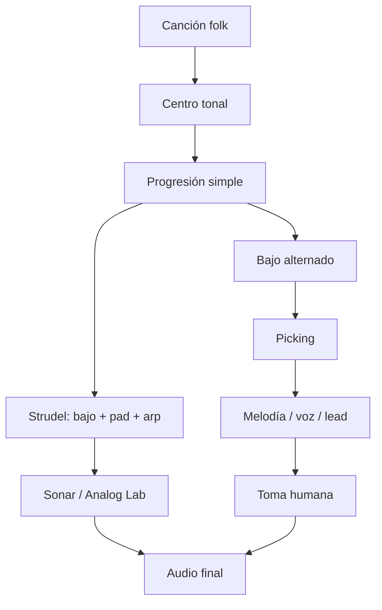
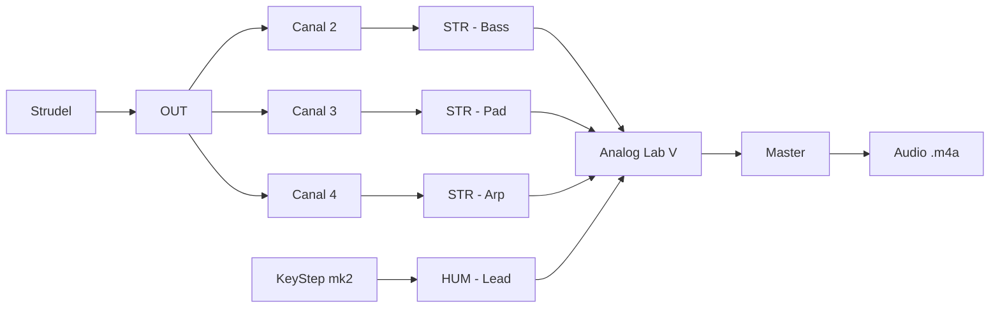
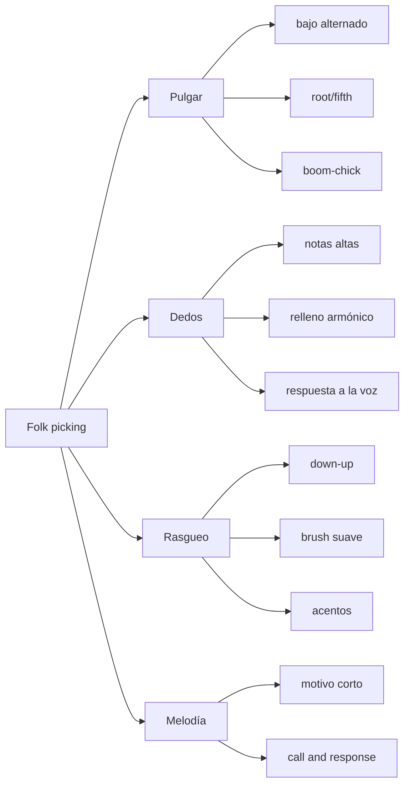
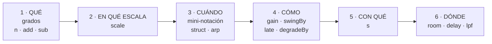
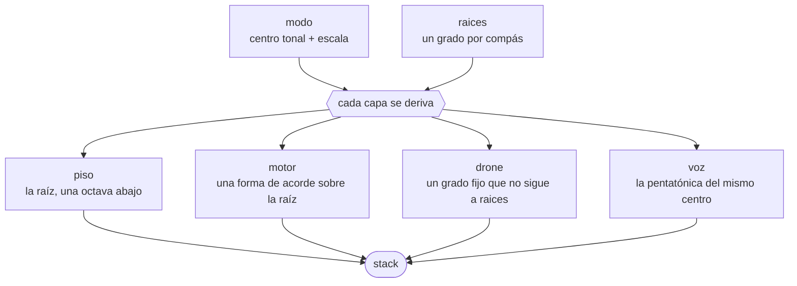
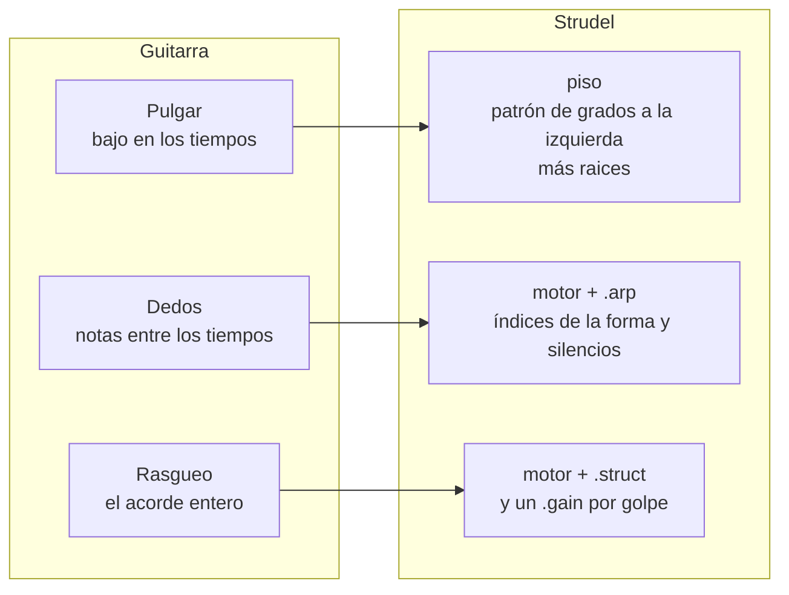
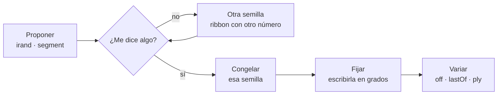
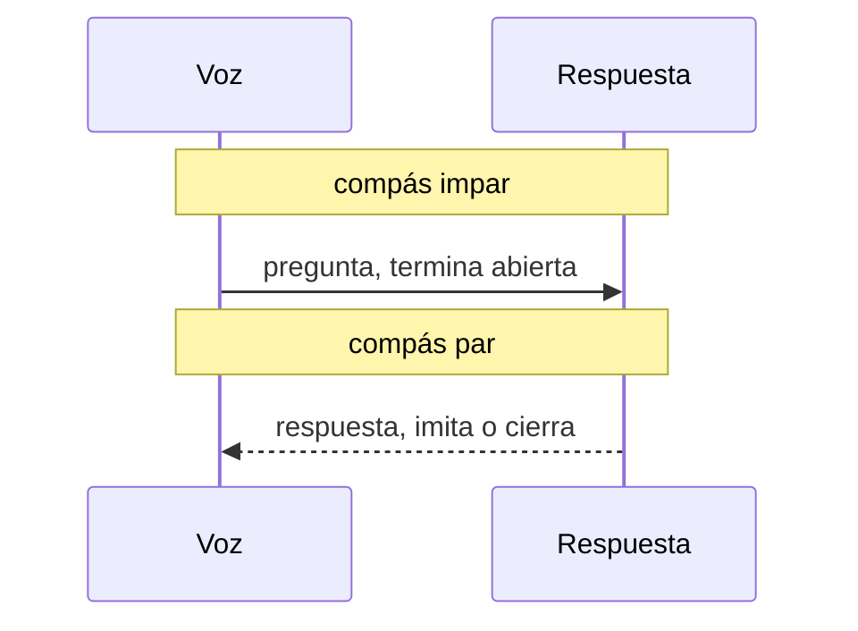
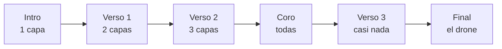
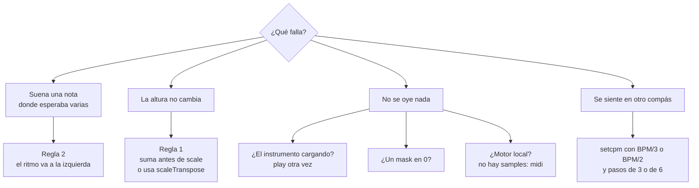

# Cómo se trabaja Louise: partituras, Strudel y flujos

> Archivo derivado: lo genera `_scripts/generar-chatgpt.py` desde la bóveda de música del usuario (Obsidian + git), el 2026-10-18. Cada sección es una nota de la bóveda, con su ruta. La bóveda es la fuente de verdad: si algo de aquí contradice a una conversación más reciente, pregunta.

El ciclo de MuseScore, el sistema de partituras, Strudel (qué es, el motor, el folk) y los flujos de la bóveda.

Contiene:

- `7. Partituras/Sistema de partituras.md`
- `7. Partituras/Cómo usar las partituras.md`
- `4. Instrumento/2. Strudel/0. Qué es y cómo se usa.md`
- `4. Instrumento/2. Strudel/README.md`
- `4. Instrumento/2. Strudel/3. Folk.md`
- `4. Instrumento/2. Strudel/4. Folk desde cero.md`
- `8. Setup/5. Áreas/2. Canción.md`
- `6. Práctica/0. Flujos.md`
- `Inicio.md`

---

## Archivo: `7. Partituras/Sistema de partituras.md`

```yaml
tags: [sistema, partituras, musescore]
```

# Sistema de partituras

Cómo están organizadas, versionadas y renderizadas las partituras de esta
bóveda, y por qué de esta manera. Para el día a día, ve a
[[Cómo usar las partituras]].

Montado el 2026-09-19 sobre 59 partituras que vivían fuera de todo control de
versiones.

---

## El problema que resuelve

Las partituras se editan en MuseScore, que guarda en `.mscz`. Obsidian no sabe
leer ese formato, y ningún plugin lo hace: `.mscz` es un ZIP propietario.
Además, guardar en MuseScore **sobrescribe** — su carpeta `.mscbackup` guarda
exactamente **un** estado anterior por partitura, que es una red contra caídas
del programa, no un historial.

Antes de este sistema, el flujo real era: capturar la pantalla de MuseScore y
pegar el PNG en la nota. Quedaron 76 imágenes así en `9. Assets/`.

## Las tres capas

```
   MuseScore                  el script                   Obsidian
  ┌──────────┐              ┌───────────┐              ┌──────────┐
  │  .mscz   │ ───────────▶ │ .musicxml │ ───────────▶ │ Verovio  │
  └──────────┘              └───────────┘              └──────────┘
   fuente de                 derivado,                  render SVG
   la verdad                 desechable                 + play MIDI
```

Los dos archivos son hermanos, mismo nombre, misma carpeta:

```
7. Partituras/2. Composiciones/Nocturno primer intento.mscz
7. Partituras/2. Composiciones/Nocturno primer intento.musicxml
```

El `.musicxml` **nunca se edita a mano**: el próximo sync lo pisa. Se puede
borrar la colección entera y regenerarla en unos segundos.

## Por qué el `.mscz` manda

MuseScore abre y edita MusicXML sin problema, así que sería tentador trabajar
solo en ese formato y ahorrarse la conversión. Se midió el viaje completo
(`.mscz` → `.musicxml` → `.mscz`) sobre "20 Nocturno", y no conviene.

**La música sobrevive intacta:**

| | Original | Después |
|---|---|---|
| Notas | 378 | 378 |
| Acordes | 309 | 309 |
| Silencios | 1778 | 1778 |
| Compases | 1782 | 1782 |
| Ligaduras | 17 | 17 |

**Lo que se pierde es el entorno.** El mezclador quedó vacío:
`audiosettings.json` pasó de 4.462 a 190 bytes — instrumentos, volúmenes,
cadena de efectos y perfil de sonido, borrados. El archivo de estilo se
reescribió con valores por defecto. Y apareció una articulación que no estaba.

Por eso: `.mscz` fuente, `.musicxml` derivado. Nunca al revés.

## Dónde vive cada cosa

```
7. Partituras/
├── 1. Clases/           27   ejercicios con Fabs
├── 2. Composiciones/     9   piezas propias
├── 3. Referencias/       4   obras de otros
├── 4. Cursos/            3   Cresciente
├── Cómo usar las partituras.md
└── Sistema de partituras.md      ← esta nota

_legacy/partituras/      12   descartes; nada se borra
_scripts/                 6   la herramienta
```

Se eligió **una carpeta central** en vez de repartir cada partitura junto a su
nota, por consistencia con cómo ya funcionaba la bóveda: las 76 imágenes están
en `9. Assets/` y ninguna junto a la nota que la usa.

La carpeta por defecto de MuseScore apunta aquí
(Preferencias · General · Carpetas · Partituras).

## Nomenclatura

El principio: **git guarda las versiones, el nombre identifica la obra.** En
cuanto git versiona, los `19.2`, `21.11` y `3era iteración` sobran.

1. **Sin número de iteración.** Las iteraciones son commits.
2. **Variantes con sufijo descriptivo, no numérico.** `Contrapunto - 3a especie`,
   no `12. Repaso contrapunto 3era`.
3. **Sin `:`** — rompe las rutas de Obsidian. Sin espacios al final.
4. **Todo archivo tiene nombre.** Nada de `Untitled score`.
5. Cuando dos cosas distintas comparten nombre legítimamente, **las separa la
   fecha**: `Voicing - escalas menores - 2025-06-01`.

## El modelo de versionado

Git no versiona archivos por separado: versiona **momentos de la bóveda
entera**. Un commit es una foto con fecha y motivo, y en esa foto entran a la
vez la partitura y la nota que la comenta. Nunca se desincronizan.

```
1. Editas y guardas en MuseScore
2. ./_scripts/sync-partituras.py          regenera el .musicxml
3. git commit -am "qué cambiaste y por qué"    ← esto crea la versión
```

**El paso 3 es el que versiona.** Guardar en MuseScore solo sobrescribe.

### El diff musical

Un `.musicxml` en crudo cambia cientos de líneas cada vez que MuseScore
reacomoda la página. `.gitattributes` registra un filtro `textconv`
(`_scripts/musicxml-limpio.py`) que quita las coordenadas de dibujo antes de
comparar. Medido sobre dos versiones reales de *Enlaces Arpegios*: **137 líneas
de ruido → 5 líneas del único cambio real.**

Encima de eso, `historial.py` traduce ese diff a lenguaje musical:

```
  2026-02-10  f5396f3  [enlaces-v1]
  Enlaces arpegios: el Sol# del c.12 suena forzado, lo subo a La
     c.9    Piano              Sol#4 -> La4
```

Detecta altura, alteración, octava, figura rítmica y puntillos, por compás y
por instrumento. **No** traduce dinámicas, articulaciones, ligaduras ni textos:
git los versiona y los restaura, pero no te los narra.

El filtro vive en `.git/config`, que no se versiona. Una vez por clon:
`./_scripts/configurar-git.sh`.

### Linajes

Cuando una pieza tuvo varias versiones guardadas como archivos distintos, esas
versiones se reprodujeron como **commits fechados sobre el archivo
sobreviviente**, para que el historial sea navegable de verdad. Seis linajes:

| Pieza | Versiones |
|---|---|
| Enlaces - Crystal Silence | 4 |
| Composición binaria | 3 |
| Composición binaria con motivo | 3 |
| Composición binaria - esbozo | 2 |
| Composición binaria - con motivos | 2 |
| Voicing - práctica invertida | 2 |

Para marcar un hito: `git tag -a nocturno-v1 -m "La que le mostré a Fabs"`.

## Qué reveló el inventario

Al comparar las 59 por contenido musical real (no por nombre) aparecieron
cosas que el versionado por nombre de archivo estaba escondiendo.

**Seis partituras eran idénticas nota por nota.** Cuatro de ellas —
`14. Arpegios`, `14.1 … con ritmos`, `14.2 Arpegios con ritmo` y
`16 Enlaces Arpegios` — son **exactamente la misma música**. Lo único distinto
era el título escrito dentro. Los nombres prometían variaciones rítmicas que
no existen. Están en `_legacy/partituras/identicas/`.

**Dos archivos mentían sobre su contenido.** `Untitled score` no estaba sin
nombre: por dentro se titulaba *"10. Ejercicios Contrapunto Variados"*. Y los
dos `ejercico motivos` no eran de motivos — por dentro decían *"16.1 Enlaces
Crystal Silence"*, y pasaron a ese linaje.

**La numeración no correspondía con las clases.** Eran dos contadores
independientes que se separaron: la nota *21. Tonos guías* correspondía a la
partitura *15. Tonos guía*; *23. Motivos* a *20. Motivos random*. El número
parecía un vínculo y no lo era.

**No hay un estilo propio.** Las 42 partituras con estilo incrustado usan 13
variantes, pero al agruparlas por versión de MuseScore (4.10, 4.30, 4.40,
4.50×5, 4.60×5) se ve que es **el mismo estilo de fábrica congelado en cinco
versiones de la aplicación**. Dentro de una misma versión difieren en **un
solo ajuste**. Comparado con el default actual: 13 valores distintos sobre
1.289 en un caso, 4 sobre 1.466 en el otro — y casi todos son cambios que hizo
MuseScore en su propio default, no decisiones.

La excepción es `Contrapunto - 1a especie (Fabs)`, con **38 valores tocados a
mano** (separación de alteraciones, grosor de cejillas, espaciado de trastes,
silencios multicompás). Es el único estilo con criterio de la colección, y es
de Fabs. Si algún día se quiere una identidad visual propia, ese es el punto
de partida, no el default.

El estilo incrustado pesa **616 KB, el 26% del peso total** de los `.mscz`.

## Trampas conocidas

**`.mxl` no funciona.** El plugin Verovio lee los archivos como texto, y el
`.mxl` es un ZIP. Solo `.musicxml` sin comprimir. Los dos `.mxl` que había
están en `_legacy/partituras-mxl/`.

**Las rutas de los bloques `verovio` son relativas a la raíz de la bóveda.**
El plugin resuelve con `getAbstractFileByPath`, que consulta el índice de
Obsidian, no el sistema de archivos: una ruta absoluta (`/Users/…`) existe en
disco pero el plugin no la encuentra y lanza *"file not found"*. Lo mismo al
renombrar o mover una partitura sin actualizar las notas que la citan.
`./_scripts/verificar-bloques.py` revisa los tres casos de golpe.

**Normalización Unicode.** Los `.mscz` bajados del navegador traen los acentos
en NFC y MuseScore escribe la salida en NFD. Para APFS son el mismo archivo,
pero como cadena de texto no coinciden. Todo script que compare rutas normaliza
a NFC antes. Renombrar a NFC en disco no sirve: APFS no cambia la forma
almacenada.

**Git escapa los acentos.** `git ls-files` devuelve `Composici\303\263n` salvo
que se le pase `-c core.quotePath=false`. Sin eso, los scripts se saltan en
silencio la mayoría de estas partituras.

**`with_suffix()` de Python.** Los nombres llevan puntos (`14.1 Arpegios…`), así
que `with_suffix()` se come parte del nombre. Los scripts usan una función
explícita que concatena la extensión.

**El `.mscz` es binario.** Git lo guarda y lo restaura íntegro — verificado byte
a byte — pero no lo compara. El diff musical sale del `.musicxml`; por eso se
versionan los dos.

## Pendiente

- Extraer el estilo de Fabs como `.mss` versionado, si se quiere una identidad
  visual propia.
- El commit del 2026-04-21 en *Composición binaria* dice "tercera iteración"
  pero no cambió ninguna nota: era un par idéntico que entró como versión en
  vez de archivarse. El historial lo dice correctamente ("sin cambios
  musicales"); solo el mensaje promete de más.

---

## Archivo: `7. Partituras/Cómo usar las partituras.md`

# Cómo usar las partituras

Guía del día a día. Para la arquitectura, las decisiones y las trampas
conocidas, ve a [[Sistema de partituras]].

Las partituras viven aquí, dentro de la bóveda, versionadas en git junto a las
notas que las comentan. Cada una son dos archivos hermanos:

```
7. Partituras/2. Composiciones/Nocturno primer intento.mscz      ← editas esto en MuseScore
7. Partituras/2. Composiciones/Nocturno primer intento.musicxml  ← esto lo lee Obsidian
```

El `.mscz` es la **única fuente de verdad**. El `.musicxml` es derivado: se
puede borrar entero y regenerar. Nunca lo edites a mano.

## El ciclo de trabajo

```
1. Editas y guardas en MuseScore
2. ./_scripts/sync-partituras.py        ← regenera el .musicxml
3. git commit -am "qué cambiaste y por qué"   ← guarda la versión
```

El paso 3 es el que crea una versión. Guardar en MuseScore **sobrescribe**;
solo el commit deja un punto al que volver.

## Ver el historial

```
./_scripts/historial.py                 # lo último de todo
./_scripts/historial.py nocturno        # el historial de una partitura
```

Te dice, para cada versión, cuándo fue, qué escribiste como motivo, y **qué
cambió musicalmente**:

```
  2026-02-10  f5396f3  [enlaces-v1]
  Enlaces arpegios: el Sol# del c.12 suena forzado, lo subo a La
     c.9    Piano              Sol#4 -> La4
```

Detecta alturas, alteraciones, octavas, figuras rítmicas y puntillos, por
compás y por instrumento. **No** traduce dinámicas, articulaciones, ligaduras
ni textos — git sí los versiona y los restaura, pero no te los narra.

Para comparar dos archivos sueltos:

```
./_scripts/diff-musical.py vieja.musicxml nueva.musicxml
```

## Marcar un hito

```
git tag -a nocturno-v1 -m "La versión que le mostré a Fabs"
```

La etiqueta aparece luego en el historial junto al commit.

## Recuperar una versión vieja

```
git log --oneline -- "7. Partituras/2. Composiciones/Nocturno primer intento.mscz"
git show <hash>:"7. Partituras/2. Composiciones/Nocturno primer intento.mscz" > /tmp/vieja.mscz
```

Sale byte por byte idéntica al original. Abre en MuseScore tal cual estaba.

## Incrustar una partitura en una nota

Ruta **relativa a la raíz de la bóveda**, dentro de un bloque `verovio`.
No sirve una ruta absoluta (`/Users/...`) ni una relativa a la nota: Verovio
busca en el índice de Obsidian, no en el disco, y devuelve
*"file not found"*.

```verovio
7. Partituras/2. Composiciones/Dawn Chorus - arpegios.musicxml
scale: 40
adjustPageHeight: true
```

Las opciones van **después** de la ruta, una por línea.

| Opción | Qué hace |
|---|---|
| `scale: 40` | Tamaño del grabado (35–45 suele quedar bien dentro de una nota) |
| `measureRange: 12` | Muestra un solo compás |
| `adjustPageHeight: true` | Recorta el alto sobrante |
| `darkMode: true` | Invierte para tema oscuro |

Al hacer clic en el pentagrama se abre el editor de Verovio en el panel
lateral. El botón de play reproduce por MIDI resaltando las notas.

### Un solo compás

```verovio
7. Partituras/2. Composiciones/Nocturno primer intento.musicxml
measureRange: 3
scale: 50
```

### Notación corta, sin MuseScore

Para un ejemplo de dos compases, el mismo bloque acepta ABC directo:

```verovio
X:1
M:4/4
L:1/4
K:G
|: G2 B2 | d4 :|
```

## Tres cosas que se olvidan

- **Solo `.musicxml` sin comprimir.** Los `.mxl` son ZIP y no funcionan.
- **No uses MusicXML como formato de trabajo**, aunque MuseScore lo abra: cada
  ida y vuelta borra el mezclador y reescribe el estilo.
- **Sin `:` en los nombres**, rompe las rutas.

El resto de las trampas —normalización de acentos, cómo git escapa las tildes—
está en [[Sistema de partituras]].

## En otra máquina

El filtro de diff musical vive en `.git/config`, que no se versiona. Una vez
por clon:

```
./_scripts/configurar-git.sh
```

## Todos los comandos

```
./_scripts/sync-partituras.py            # regenera el MusicXML que cambió
./_scripts/sync-partituras.py --dry-run  # qué haría, sin tocar nada
./_scripts/sync-partituras.py --force    # reconvierte todo
./_scripts/historial.py [partitura]      # historial con cambios musicales
./_scripts/diff-musical.py a.xml b.xml   # comparar dos archivos
./_scripts/ordenar-downloads.py          # ordena .mscz sueltos en ~/Downloads
./_scripts/verificar-bloques.py          # revisa que los bloques verovio resuelvan
./_scripts/configurar-git.sh             # activa el diff musical (una vez)
```

---

## Archivo: `4. Instrumento/2. Strudel/0. Qué es y cómo se usa.md`

```yaml
tipo: concepto
estado: vigente
area: 4. Instrumento
tags:
  - curso-musica/strudel
```

# Strudel

Port oficial de **TidalCycles a JavaScript**: un lenguaje de patrones para hacer música escribiendo texto. REPL web en [strudel.cc](https://strudel.cc/), gratis y open source.

> [!tip] Por qué está aquí
> Tu punto más débil documentado es el **ritmo** — la lección 20 nunca se consolidó, `1. Teoría/6. Ritmo/` es el área más delgada, y el [[6. Práctica/3. Diagnóstico]] lo marca como prioridad alta.
>
> Y tu cuello de botella es **producir audio**. Strudel suena desde texto, sin DAW, sin micrófono, sin setup.

## Cómo se usa aquí

Dentro de cualquier nota, un bloque:

````markdown
```strudel
s("bd*4, hh*8").bank("RolandTR909")
```
````

El plugin añade play/stop/reload encima, más un pianoroll. Es el mismo mecanismo que ya usas con ```` ```abc ````, pero para patrones en vez de pentagrama.

## Cuándo Strudel y cuándo MuseScore

Cada uno es malo fuera de su terreno. No los fuerces.

| Área | Herramienta | Por qué |
|---|---|---|
| Armonía · Conducción · Contrapunto | **MuseScore** | necesitas pentagramas para ver conducción de voces |
| **Ritmo** | **Strudel** | es literalmente un lenguaje de patrones |
| Melodía · Forma | cualquiera | |

MuseScore no sabe expresar un groove. Strudel no sabe expresar una resolución de séptima.

## Dónde van los patrones

Strudel es **una notación, no un silo**. Los patrones viven donde diga la pregunta de ruteo de [[Inicio]]:

| Un patrón que… | Va a |
|---|---|
| es prueba de posesión de una lección | `2. Cursos/<fuente>/<lección>/Estudios/` |
| es boceto de una pieza | `3. Composiciones/<obra>/` |
| demuestra un concepto | dentro de la nota de concepto |

Esta carpeta guarda solo la **referencia**: sintaxis, snippets y tropiezos.

Ventaja sobre MuseScore: los patrones son **texto plano**. Van a git, se diferencian, se buscan. Cero binarios.

---

## Mini-notación

Lo esencial para empezar. Todo dentro de comillas.

| Símbolo | Qué hace | Ejemplo |
|---|---|---|
| espacio | secuencia dentro de un ciclo | `"bd sd bd sd"` |
| `*n` | repite n veces | `"hh*8"` |
| `~` | silencio | `"bd ~ sd ~"` |
| `[ ]` | agrupa (subdivide) | `"bd [sd sd]"` |
| `< >` | uno por ciclo (alterna) | `"<c e g>"` |
| `,` | capas simultáneas | `"bd*4, hh*8"` |
| `/n` | estira n ciclos | `"<0 1>/2"` |
| `!n` | replica | `"bd!3 sd"` |
| `?` | aleatorio | `"hh*8?"` |

## Recetas

### Ritmo básico

```strudel
s("bd*4, [~ sd]*2, hh*8")
  .bank("RolandTR909")
```

### Subdivisión — para la lección 20

```strudel
stack(
  s("bd*4").bank("RolandTR909"),
  s("hh*4"),      // negras
  s("hh*8"),      // corcheas
  s("hh*16"),     // semicorcheas
)
```

### Tresillos

```strudel
s("bd*4, hh*12").bank("RolandTR909")
```

### Métrica compuesta (12/8, como tu nocturno)

```strudel
s("bd ~ ~ sd ~ ~ bd ~ ~ sd ~ ~")
  .bank("RolandTR909")
```

### Acordes por grados

```strudel
n("<0 3 4 1>")
  .scale("C:minor")
  .voicing()
  .s("piano")
  .slow(2)
```

### Patrón con bajo

```strudel
stack(
  s("bd*4, hh*8").bank("RolandTR909"),
  note("<c2 as1 f2 g2>").s("sawtooth").lpf(400),
)
```

## Funciones útiles

| | |
|---|---|
| `.slow(n)` / `.fast(n)` | cambia la velocidad |
| `.rev()` | invierte |
| `.every(n, f)` | aplica `f` cada n ciclos |
| `.off(t, f)` | copia desfasada — eco, contrapunto |
| `.gain()` `.lpf()` `.room()` | volumen, filtro, reverb |
| `.scale("C:minor")` | mapea números a grados |
| `.voicing()` | convierte grados en acordes |
| `setcpm(n)` | tempo, en ciclos por minuto |

---

## Advertencias

1. **Ejecuta JavaScript arbitrario.** El autor del plugin lo avisa explícitamente: no pegues patrones de internet sin leerlos.
2. **No funciona en iOS** — limitación del WebView de Safari. Android sí.
3. **El caché de samples** se descarga a una carpeta local. Ya está en `.gitignore`; no lo saques de ahí.
4. **Es música programada, no tocada.** No desarrolla tu guitarra ni tu piano. Produce y enseña ritmo; no sustituye el instrumento.

## Enlaces

- [REPL](https://strudel.cc/) · [Workshop](https://strudel.cc/workshop/getting-started/) · [Mini-notación](https://strudel.cc/learn/mini-notation/)
- [Plugin de Obsidian](https://github.com/dudaanton/obsidian-strudel-plugin)
- Snippets listos: `6. Práctica/2. Plantillas/Snippets/`
- Beats desde cero: [[1. Beats desde cero]]

---

## Archivo: `4. Instrumento/2. Strudel/README.md`

```yaml
tipo: mapa
estado: vigente
area: 4. Instrumento
```

# Strudel local

> [!abstract] Qué es esta carpeta
> Strudel corriendo **en tu máquina**: escribes el patrón en VS Code, guardas, y
> una pestaña de Chrome lo toca y manda **MIDI** a Sonar. El sonido lo pone
> Analog Lab; Strudel solo decide qué notas y cuándo.
>
> Qué es Strudel y cuándo usarlo frente a MuseScore: [[0. Qué es y cómo se usa]].

```text
VS Code  ──guardar──▶  motor (localhost:5173, Chrome)  ──Web MIDI──▶  loopMIDI / IAC
                                                                          │
                                                   Sonar ◀────────────────┘
                                                     └─▶ Analog Lab ─▶ audio
```

## Estructura

```text
4. Instrumento/2. Strudel/
├── README.md                  ← esta nota
├── 0. Qué es y cómo se usa.md ← el concepto: qué es Strudel y cuándo usarlo
├── 1. Beats desde cero.md     ← cómo se arma un beat, con bloques para tocar
├── package.json               ← dependencias y scripts (npm)
├── package-lock.json          ← versiones exactas            git: sí
├── .nvmrc                     ← Node: lts/*
├── vite.config.js             ← servidor local del motor
├── .gitignore                 ← node_modules
├── node_modules/              ←                               git: no
│
├── 1. Acompañamientos/        ← lo que pones a sonar en una sesión
│   ├── 1. Sparse.js              (Fase 1: los escribes tú)
│   ├── 2. Groove.js
│   └── 3. Open.js
│
├── 2. Vocabulario/            ← solo lo que pasó las 4 pruebas
│   └── …                         cada archivo nace con su primera entrada
│
├── 6. Arpegiadores/           ← lo que se convierte en .ARP (Sonar) y .mid
│   ├── README.md                 cómo se usa
│   └── <n>. <estilo>/            cada strudel con sus frase/ritmo .ARP y .mid al lado
│
├── 7. House/                  ← el género entero, capa por capa
│   ├── 0. House desde cero.md    la guía, con bloques para tocar
│   └── _lessons/                 una sesión por bloque de la guía (0–8)
│
├── 8. Dream pop/              ← al estilo de Beach House: del órgano a la coda
│   ├── 0. Dream pop desde cero.md
│   └── _lessons/                 una sesión por bloque de la guía (0–7)
│
├── .motor/                    ← el motor; no se toca para tocar
│   ├── index.html · main.js      la página que evalúa y toca
│   ├── exportar.js               las notas de un patrón, para el arpegiador de Sonar
│   ├── patrones.js               vigila las carpetas y avisa al guardar
│   ├── puertos.js                nombre del puerto MIDI (OUT)
│   └── prueba-midi.js            la prueba de la Fase 2
│
└── .vscode/                   ← extensiones recomendadas y tareas
```

### Por qué así

- **`.motor/` lleva punto.** Obsidian no indexa carpetas que empiezan con punto,
  y el motor no es algo que leas: es la herramienta.
- **Los patrones nunca escriben el nombre del puerto.** Usan `OUT`, que define
  `.motor/puertos.js`. El mismo `.js` suena en Windows y en Mac.
- **Acompañamientos y vocabulario van separados** porque una idea entra al
  vocabulario solo después de haber sido **tocada, escuchada, usada en una
  improvisación y grabada**. Los acompañamientos son donde se prueba; el
  vocabulario, lo que ya se ganó el sitio.
- **El vocabulario se carga antes de cada patrón**, en el mismo bloque: lo que
  un archivo de `2. Vocabulario/` define, cualquier acompañamiento lo puede usar.
  Por eso el vocabulario **define** cosas (`const`) pero **no toca** (`$:`).

> [!warning] Obsidian no muestra archivos `.js`
> Los patrones se ven y se editan en VS Code. En Obsidian solo están las notas `.md`.

## Arrancar

### Una vez por máquina

**Windows**

1. Node LTS con nvm: `nvm install lts` y `nvm use lts`.
   nvm-windows **no lee** `.nvmrc` solo; el archivo documenta qué versión se usa.
2. En la carpeta: `npm install`.
3. **loopMIDI** (ya instalado, arranca con Windows): crea un puerto llamado
   exactamente `Improviser - Strudel Out`. El `loopMIDI Port` que ya existe
   se puede borrar o dejar; el motor busca por nombre.

**macOS**

1. Node LTS con nvm: `nvm install` y `nvm use` (en Mac sí lee `.nvmrc`).
2. En la carpeta: `npm install`.
3. **IAC Driver**: *Configuración de Audio MIDI → Ventana → Mostrar estudio MIDI →
   IAC Driver* → marca *El dispositivo está conectado* y renombra `Bus 1` a
   `Improviser - Strudel Out`.

### Cada sesión

```bash
code "4. Instrumento/2. Strudel"   # abre la carpeta en VS Code
npm run dev                        # o Ctrl+Shift+B: arranca el motor y abre el navegador
```

1. La pestaña tiene que ser **Chrome o Edge**. Safari no tiene Web MIDI y Firefox
   pide un complemento. Si el navegador por defecto es otro, copia
   `http://localhost:5173` en Chrome, o arranca con `BROWSER=chrome`.
2. Chrome pide permiso para **controlar dispositivos MIDI**: acéptalo.
3. La página dice `✓ Puerto encontrado`. Si dice `✗`, mira *Problemas*.
4. Elige el patrón y pulsa **Tocar** una vez (el navegador exige un clic antes de
   arrancar el reloj de audio).
5. Desde ahí: **editas en VS Code, guardas, y cambia lo que suena**, sin recargar
   y sin cortar. En la página, `Ctrl+Enter` toca y `Ctrl+.` para.

`npm run prueba` abre directo la prueba de la Fase 2.

## Configurar Sonar

Detalle del proyecto en [[0. Cakewalk Sonar]]. Para cada pista de Strudel:

| Pista | Entrada | Canal | Instrumento |
|---|---|---:|---|
| `STR - Bass` | Improviser - Strudel Out | 2 | Analog Lab |
| `STR - Pad` | Improviser - Strudel Out | 3 | Analog Lab |
| `STR - Arp` | Improviser - Strudel Out | 4 | Analog Lab |
| `HUM - Lead` | KeyStep mk2 | — | Analog Lab |

1. `Edit → Preferences → MIDI → Devices` → activa `Improviser - Strudel Out` en *Inputs*.
2. Pista **de instrumento** (no de audio) con Analog Lab.
3. Entrada `Improviser - Strudel Out`, canal según la tabla, **Input Echo** encendido.
4. En Analog Lab, *MIDI Channel* en **All**: Sonar ya filtra por canal.

### Sin el motor: tus arpegios como presets de Sonar y MIDI

Lo que pongas en **`6. Arpegiadores/`** se convierte en un preset del **arpegiador de Sonar**
(`.ARP`) y en un **MIDI** (`.mid`), al lado del strudel, para tocarlo desde el KeyStep sin el
motor corriendo. Cómo se organiza: [[6. Arpegiadores/README|Arpegiadores]].

```bash
./_scripts/strudel-a-arp.py --instalar    # desde la raíz de la bóveda
```

Los `.js` de fuera de esa carpeta que usan `.arp(` también se convierten, pero solo en `.ARP`,
en `8. Setup/3. Configuraciones/Cakewalk Sonar/`. Evalúa cada archivo con este mismo Strudel
(`.motor/exportar.js`), así que las notas son las que suenan aquí, con `voicing()`, swing y
velocidades incluidos. Qué sale y cómo se usa en Sonar: [[0. Cakewalk Sonar#Arpegiador]].

## VS Code

`.vscode/` trae:

| Archivo | Qué hace |
|---|---|
| `extensions.json` | recomienda **Error Lens** (errores de sintaxis en la línea) |
| `tasks.json` | `Ctrl+Shift+B` arranca el motor; otra tarea abre la prueba MIDI |
| `settings.json` | oculta `node_modules` y **apaga el formato al guardar** |

Extensiones marcadas como **no recomendadas**, a propósito:

- **Strudel for VS Code** y **strudel-box**: tocan con su propio motor de audio y
  **no mandan MIDI**, así que nunca llegan a Sonar. Su `Ctrl+Enter` sonaría encima
  del motor local.
- **Prettier**: cambia comillas al formatear, y en Strudel **las comillas dobles son
  mini-notación y las simples no**. `.midi('…')` pasado a `.midi("…")` deja de funcionar.

## Problemas

| Síntoma | Causa probable | Qué hacer |
|---|---|---|
| `✗ No encuentro "Improviser - Strudel Out"` | loopMIDI cerrado o puerto con otro nombre | abre loopMIDI, revisa el nombre, **recarga la página** (el navegador solo ve los puertos que existían al cargar) |
| `Sin Web MIDI` | navegador sin Web MIDI, o permiso denegado | Chrome/Edge; candado de la barra → *Dispositivos MIDI* → Permitir |
| La página toca pero Sonar no recibe | puerto no activado en Sonar, o canal equivocado | *Preferences → MIDI → Devices*; entrada y canal de la pista |
| Sonar recibe pero no suena | pista de audio, sin sinte, o Input Echo apagado | pista de instrumento con Input Echo |
| Guardo y no cambia | el motor no está corriendo, o no le diste a Tocar | mira la terminal de `npm run dev`; pulsa Tocar una vez |
| Error con número de línea raro | el vocabulario se evalúa delante del patrón | resta las líneas de `2. Vocabulario/` |
| Notas dobles | dos rutas al mismo sonido (hardware → Sonar y hardware → Strudel → Sonar) | una sola ruta intencional por evento |

## Pendiente

- [ ] Crear el puerto `Improviser - Strudel Out` en loopMIDI
- [ ] Primera prueba real: `npm run prueba` → `STR - Bass` suena en Sonar
- [ ] Escribir los tres acompañamientos de la Fase 1
- [ ] Notas de setup: `8. Setup/1. Software/3. Strudel.md` y `4. loopMIDI.md` (ver [[8. Setup/0. Índice]])
- [ ] Comprobar que Obsidian no indexa `node_modules/`

---

## Archivo: `4. Instrumento/2. Strudel/3. Folk.md`

# Guía full — Folk, picking y Strudel

> [!abstract] Objetivo  
> Construir una canción folk desde cero usando:
> 
> - guitarra acústica / picking;
>     
> - Strudel como acompañante MIDI;
>     
> - bajo, pad y arpegio en Sonar;
>     
> - una toma humana que termine en audio.
>     
> 
> **Definición de hecho:** existe un `.m4a` de 30–60 segundos, aunque suene crudo.

---

## 0. Advertencia útil

Esta guía no transcribe canciones de Bob Dylan ni copia tabs. Trabaja con **gestos generales del folk**: acordes abiertos, bajo alternado, melodía encima, rasgueo imperfecto, voz o lead humano.

El enfoque acústico asociado a Dylan suele moverse entre acordes básicos rasgueados y patrones de fingerpicking en posiciones abiertas, no en armonías densas o voicings complicados.

---

## 1. Mapa general



---

## 2. Qué es folk aquí

Folk no significa “sonar viejo”. En este sistema significa:
			
|Elemento|Función|
|---|---|
|**Acordes abiertos**|claridad, fragilidad, aire|
|**Bajo alternado**|hace que una sola guitarra parezca tener bajo + armonía|
|**Picking repetitivo**|motor íntimo, hipnótico|
|**Melodía simple**|frase cantable, poco virtuosismo|
|**Imperfección rítmica**|humano, narrativo|
|**Forma clara**|verso, verso, coro, puente, verso|

La técnica de Travis picking se basa en que el pulgar mantiene un bajo alternado constante mientras los dedos tocan notas superiores. En folk/americana, ese bajo alternado ayuda a crear la ilusión de más de un instrumento: una línea grave y una melodía arriba.

---

## 3. Rutas posibles

### A. Ruta documentada con Sonar / Strudel



|Capa|Canal|Pista|Papel folk|
|---|---|---|---|
|Bajo|2|`STR - Bass`|raíz / pulso grave|
|Pad|3|`STR - Pad`|acorde largo|
|Arp|4|`STR - Arp`|picking programado|
|Lead humano|—|`HUM - Lead`|melodía tocada|

En Sonar, las pistas que suenan son pistas de instrumento con Analog Lab V; para escuchar MIDI entrante necesitas instrumento e **Input Echo** encendido.

### B. Ruta de guitarra real

> [!warning] Por verificar  
> La ruta de grabación de guitarra no está documentada todavía. Para una sesión real, falta decidir si grabas la guitarra con interfaz, micrófono, teléfono o grabadora.
> 
> Mientras eso no esté documentado, el audio garantizado viene de Sonar/Strudel, y la guitarra funciona como estudio físico.

---

## 4. Vocabulario base



|Palabra|Traducción práctica|
|---|---|
|**Root**|raíz del acorde|
|**Fifth**|quinta del acorde|
|**Alternating bass**|pulgar alterna dos notas graves|
|**Pinch**|pulgar + dedo al mismo tiempo|
|**Brush**|mini-rasgueo con dedos|
|**Boom-chick**|bajo + acorde|
|**Drone**|una cuerda abierta que se repite|
|**Walk-up / walk-down**|bajo que conecta acordes|

---

## 5. Mano derecha: PIMA

|Letra|Dedo|Trabajo principal|
|---|---|---|
|`p`|pulgar|cuerdas graves|
|`i`|índice|tercera cuerda|
|`m`|medio|segunda cuerda|
|`a`|anular|primera cuerda|

### Regla base

```
Pulgar = tiempo
Dedos = historia
```

Si el pulgar se pierde, el picking se cae. Si los dedos se pierden, todavía hay canción.

---

## 6. Patrón 1 — bajo alternado puro

### Idea

El pulgar toca dos notas graves. Todavía no hay melodía.

```music-abc
X:1
T:Bajo alternado sobre C
M:4/4
L:1/4
Q:1/4=80
K:C
V:1 name="Pulgar" clef=bass
[V:1] C,, G,, C,, G,, | C,, G,, C,, G,, |
```

|Cuenta|Acción|
|---|---|
|1|raíz|
|2|quinta|
|3|raíz|
|4|quinta|

### En guitarra

|Acorde|Bajo 1|Bajo 2|
|---|---|---|
|C|raíz en 5ª cuerda|nota en 4ª cuerda|
|G|raíz en 6ª cuerda|nota en 4ª cuerda|
|D|raíz en 4ª cuerda|nota en 5ª cuerda|
|Am|raíz en 5ª cuerda|nota en 4ª cuerda|
|Em|raíz en 6ª cuerda|nota en 4ª cuerda|

> [!tip] Decisión
> 
> - Bajo alternado en acordes abiertos — hace que una sola guitarra sostenga pulso y armonía. → [[fingerpicking]]
>     

---

## 7. Patrón 2 — bajo + nota alta

### Idea

Pulgar mantiene el piso. Un dedo responde arriba.

```music-abc
X:2
T:Bajo + respuesta alta
M:4/4
L:1/8
Q:1/4=80
K:C
V:1 name="Dedos" clef=treble
V:2 name="Pulgar" clef=bass
[V:1] z E z G z E z G |
[V:2] C,,2 G,,2 C,,2 G,,2 |
```

|Tiempo|Pulgar|Dedo|
|---|---|---|
|1|bajo|—|
|&|—|nota alta|
|2|bajo|—|
|&|—|nota alta|

### Ejercicio

```
p   i   p   m   p   i   p   m
1   &   2   &   3   &   4   &
```

No lo hagas rápido. Hazlo **feo pero estable**.

---

## 8. Patrón 3 — Travis simple

### Idea

Pulgar constante + dedos alternados.

```music-abc
X:3
T:Travis simple - ejercicio original
M:4/4
L:1/8
Q:1/4=84
K:C
V:1 name="Dedos" clef=treble
V:2 name="Pulgar" clef=bass
[V:1] E G c G E G c G |
[V:2] C,,2 G,,2 C,,2 G,,2 |
```

### Mano derecha

```
p i p m p i p m
1 & 2 & 3 & 4 &
```

|Nivel|Qué debe pasar|
|---|---|
|1|tocar solo pulgar|
|2|agregar índice|
|3|agregar medio|
|4|cantar o tararear encima|
|5|grabar 30 segundos|

> [!tip] Decisión
> 
> - Travis simple en verso — da movimiento sin meter batería todavía. → [[Travis picking]]
>     

---

## 9. Patrón 4 — pinch folk

### Idea

Pulgar y dedo juntos en el 1, luego respuesta.

```music-abc
X:4
T:Pinch folk
M:4/4
L:1/8
Q:1/4=78
K:C
V:1 name="Dedos" clef=treble
V:2 name="Pulgar" clef=bass
[V:1] E2 z G z E z G |
[V:2] C,,2 G,,2 C,,2 G,,2 |
```

```
1       &   2   &   3   &   4   &
p+i         p   m   p   i   p   m
```

|Sensación|Uso|
|---|---|
|más narrativa|verso|
|menos motor|intro|
|más humana|canción triste|

---

## 10. Patrón 5 — boom-chick

### Idea

Bajo + mini-acorde. Más cercano al rasgueo.

```music-abc
X:5
T:Boom-chick folk
M:4/4
L:1/4
Q:1/4=92
K:C
V:1 name="Acorde" clef=treble
V:2 name="Bajo" clef=bass
[V:1] z [E G c] z [E G c] |
[V:2] C,, z G,, z |
```

|Cuenta|Acción|
|---|---|
|1|bajo|
|2|acorde|
|3|bajo|
|4|acorde|

Esto sirve para folk más directo, stomp-clap, country-folk o canciones que necesitan caminar.

---

## 11. Progresiones folk

No busques progresiones raras al principio. La canción vive en **ritmo, letra, textura y voz**.

|Tipo|Grados|Sensación|
|---|---|---|
|circular|I – V – vi – IV|familiar, abierto|
|triste simple|vi – IV – I – V|melancólico|
|narrativo|I – IV – I – V|tradicional|
|menor|i – VI – III – VII|oscuro, modal|
|drone|I – ♭VII – IV – I|folk-rock, antiguo|
|waltz|I – V – I – IV|canción vieja|

### Plantilla de decisión

```
## Armonía

- Tonalidad/modo: `__________`
- Progresión: `__________`
- Acorde más estable: `__________`
- Acorde que más duele: `__________`
```

---

## 12. Strudel como guitarra fantasma

Strudel no reemplaza la guitarra. Hace una **guitarra fantasma**: bajo, pad y arpegio para que tú toques encima.

> [!note]  
> En esta bóveda se usa la convención de que **un ciclo = un compás**; para 4/4 se usa `setcpm(BPM/4)`.

```strudel
// Folk backing skeleton
const BPM = 84
setcpm(BPM/4)

// TÚ: decide progresión
const PROG = "<D Aadd9 Bm G>"

// TÚ: raíces del bajo
const BASS = "<D2 A2 B2 G1>"

// Picking relativo:
// 0,1,2,3 = notas del voicing, no notas absolutas
const PICK = "0 2 1 3 0 2 1 3"

// Bajo: pulgar imaginario
$: note(BASS)

// Pad: acorde sostenido
$: chord(PROG)
  .voicing()

// Arp: picking imaginario
$: n(PICK)
  .chord(PROG)
  .voicing()
```

---

## 13. Tres modos de folk en Strudel

### A. Folk íntimo

|Capa|Decisión|
|---|---|
|Bajo|raíces largas|
|Pad|acordes sostenidos|
|Arp|lento, con silencios|
|Lead|pocas notas|

```
const PICK = "0 ~ 2 ~ 1 ~ 3 ~"
```

### B. Folk caminando

|Capa|Decisión|
|---|---|
|Bajo|pulso constante|
|Pad|bajo volumen|
|Arp|corcheas estables|
|Lead|frases cortas|

```
const PICK = "0 2 1 3 0 2 1 3"
```

### C. Folk-house / indie electrónico

|Capa|Decisión|
|---|---|
|Bajo|más repetitivo|
|Pad|ancho|
|Arp|pulse constante|
|Beat|después, no ahora|

```
const PICK = "0 1 2 1 0 1 2 3"
```

---

## 14. Picking tipo Dylan, sin copiar Dylan

### Lo que sí vamos a estudiar

|Gesto|Qué entrenas|
|---|---|
|acordes abiertos|claridad|
|bajo alternado|independencia del pulgar|
|hammer-on dentro del acorde|movimiento folk|
|bajo caminante|conexión entre acordes|
|rasgueo irregular|narración humana|
|voz/lead encima|canción, no ejercicio|

### Lo que no vamos a hacer

|No|Por qué|
|---|---|
|copiar tabs exactas|no desarrolla tu vocabulario|
|copiar letras|no hace falta|
|perseguir el sonido exacto|tu sistema es Strudel + Sonar + instrumentos|
|meter demasiados acordes|el folk se rompe si todo cambia todo el tiempo|

---

## 15. Ejercicio Dylan-esque 1 — bajo alternado + melodía mínima

```
X:6
T:Folk picking original 1
M:4/4
L:1/8
Q:1/4=82
K:G
V:1 name="Melodia" clef=treble
V:2 name="Bajo" clef=bass
[V:1] z B z d z B z d | z A z c z A z c |
[V:2] G,,2 D,,2 G,,2 D,,2 | C,,2 G,,2 C,,2 G,,2 |
```

### Práctica

|Minuto|Acción|
|---|---|
|0–2|solo bajo|
|2–5|bajo + una nota alta|
|5–8|bajo + dos notas altas|
|8–10|tararear encima|
|10–12|grabar|

---

## 16. Ejercicio Dylan-esque 2 — walk-up

### Idea

El bajo conecta dos acordes. No cambia la armonía completa: solo el camino.

```
X:7
T:Walk-up folk original
M:4/4
L:1/4
Q:1/4=84
K:G
V:1 name="Acordes" clef=treble
V:2 name="Bajo" clef=bass
[V:1] "G"[B d g]2 "G"[B d g]2 | "C"[c e g]4 |
[V:2] G,, A,, B,, D, | C,2 G,,2 |
```

|Bajo|Función|
|---|---|
|G|estoy en casa|
|A|paso|
|B|paso|
|D|empuje|
|C|llegué al IV|

> [!tip] Decisión
> 
> - Walk-up antes del IV — anuncia cambio sin agregar acordes nuevos. → [[bajo caminante]]
>     

---

## 17. Ejercicio Dylan-esque 3 — 3/4 folk

Muchas canciones narrativas funcionan en 3/4 o 6/8 porque se sienten como balanceo.

```
X:8
T:Folk 3/4 picking
M:3/4
L:1/8
Q:1/4=78
K:D
V:1 name="Dedos" clef=treble
V:2 name="Pulgar" clef=bass
[V:1] z F A z F A | z E A z E A |
[V:2] D,,2 A,,2 D,,2 | G,,2 D,,2 G,,2 |
```

|Cuenta|Acción|
|---|---|
|1|bajo|
|2|nota alta|
|3|nota alta|

---

## 18. Rasgueo folk

El rasgueo no debe ser perfecto como metrónomo. Debe tener **peso**.

|Patrón|Texto|
|---|---|
|básico|`D D U U D U`|
|balada|`D U D U`|
|empuje|`D D U U D U`|
|apagado|`D x U x U D U`|

```
D = downstroke
U = upstroke
x = golpe apagado
```

### Regla

```
Si el rasgueo compite con la voz, toca menos.
Si la canción se cae, marca más el 1.
```

---

## 19. Motivo vocal / lead

No escribas melodía larga. Escribe una célula.

```
X:9
T:Motivo folk minimo
M:4/4
L:1/8
Q:1/4=84
K:G
G2 B2 A4 | G2 E2 D4 |
```

|Compás|Acción|
|---|---|
|1|frase|
|2|respuesta|
|3|repetir con una nota cambiada|
|4|silencio|

> [!tip] Decisión
> 
> - Motivo de dos compases — permite que la guitarra respire entre frases. → [[melodía]]
>     

---

## 20. Forma folk mínima

```
gantt
  title Forma folk de 32 compases
  dateFormat X
  axisFormat %s
  section Intro
  Picking solo        :0, 4
  section Verso 1
  Voz / lead simple   :4, 8
  section Verso 2
  Más bajo            :12, 8
  section Coro
  Rasgueo o arp denso :20, 8
  section Cierre
  Picking solo        :28, 4
```

|Sección|Capas|
|---|---|
|Intro|guitarra o arp solo|
|Verso 1|picking + voz/lead|
|Verso 2|picking + bajo más claro|
|Coro|rasgueo o arpegio más denso|
|Cierre|quitar capas|

---

## 21. Strudel con forma

```
const BPM = 84
setcpm(BPM/4)

const PROG = "<ACORDE_1 ACORDE_2 ACORDE_3 ACORDE_4>"
const BASS = "<BAJO_1 BAJO_2 BAJO_3 BAJO_4>"

const pickIntro = "0 ~ 2 ~ 1 ~ 3 ~"
const pickVerse = "0 2 1 3 0 2 1 3"
const pickChorus = "0 1 2 3 2 1 0 2"

const bass = note(BASS)
  .midichan(2)
  .midi(OUT)

const pad = chord(PROG)
  .voicing()
  .midichan(3)
  .midi(OUT)

const arpIntro = n(pickIntro)
  .chord(PROG)
  .voicing()
  .midichan(4)
  .midi(OUT)

const arpVerse = n(pickVerse)
  .chord(PROG)
  .voicing()
  .midichan(4)
  .midi(OUT)

const arpChorus = n(pickChorus)
  .chord(PROG)
  .voicing()
  .midichan(4)
  .midi(OUT)

// Manual por ahora:
// intro: pad + arpIntro
// verso: pad + bass + arpVerse
// coro: pad + bass + arpChorus

$: pad
$: bass
$: arpVerse
```

---

## 22. Percusión folk mínima

No empieces con batería completa. Primero:

|Sonido|Papel|
|---|---|
|stomp / kick|pie|
|clap / snare|manos|
|shaker / hat|aire|

Tu SMC-PAD ya tiene banco 3 como kit GM: 36 bombo, 38 caja, 42/46 hi-hat, 39 palmas, entre otras notas; ese banco está documentado como el que sirve para ritmo con Strudel o General MIDI Drums.

> [!warning]  
> En Sonar todavía no está documentada una pista de batería GM para el SMC-PAD. En Next sí está documentada una pista `General MIDI Drums`.

### Patrón físico con pads

|Tiempo|Pad|
|---|---|
|1|bombo / stomp|
|2|palma|
|3|bombo / stomp|
|4|palma|

```
1   2   3   4
BD  CP  BD  CP
```

---

## 23. Flujo de sesión — Folk 01

### 1. Objetivo observable

Existe:

```
3. Composiciones/<obra>/render/2026-09-30 folk-picking-01.m4a
```

con:

- progresión folk de 4 compases;
    
- backing en Strudel;
    
- picking practicado en guitarra;
    
- lead humano o guitarra grabada si la ruta está disponible.
    

### 2. Con o sin partitura

**Con mini-partitura** `**music-abc**`**, sin MuseScore completo.**

Razón: hoy no estamos estudiando conducción de voces; estamos estudiando **patrón de mano derecha + audio**.

### 3. Ruta de señal

```
Strudel → OUT → canales 2/3/4 → Sonar / Analog Lab → audio
Guitarra → ruta por verificar → audio
```

### 4. Checklist

- Cerrar Next, MidiSuite y MIDI Control Center.
    
- Abrir Sonar.
    
- Confirmar Input Echo en `STR - Bass`, `STR - Pad`, `STR - Arp`.
    
- Confirmar Analog Lab V en `MIDI Channel = All`.
    
- Elegir una sola progresión.
    
- Elegir un solo patrón de picking.
    

### 5. Pasos con tiempo

|Tiempo|Acción|
|---|---|
|0–5 min|recordar sin apuntes: bajo alternado + dedos arriba|
|5–10 min|elegir progresión|
|10–20 min|practicar solo pulgar|
|20–30 min|agregar dedos|
|30–40 min|montar backing en Strudel|
|40–50 min|grabar toma humana|
|50–52 min|exportar audio|

### 6. Definición de hecho

```
Audio existe.
No se evalúa hasta mañana.
```

---

## 24. Registro de sesión

```
# 2026-09-30 — Folk picking 01

## Objetivo
Grabar 30–60 segundos de una idea folk con bajo alternado, picking y backing en Strudel.

## Decisiones
- Obra activa:
- Tonalidad:
- Progresión:
- Patrón de picking:
- BPM:
- Sonido de Analog Lab:
- ¿Guitarra grabada? sí / no / por verificar

## Evidencia
- `3. Composiciones/<obra>/render/2026-09-30 folk-picking-01.m4a`

## No evaluar hoy
Escuchar después de 24 h.
```

---

## 25. Dónde va cada cosa

|Archivo|Ruta|
|---|---|
|Código Strudel|`3. Composiciones/<obra>/1. Acompañamientos/3. Open/<obra> - folk-picking-01.js`|
|Audio|`3. Composiciones/<obra>/render/2026-09-30 folk-picking-01.m4a`|
|Bitácora|`6. Práctica/4. Bitácora/2026-09-30.md`|
|Si nace de clase|`2. Cursos/<fuente>/<lección>/Estudios/`|

Commit:

```
git add .
git commit -m "Crear estudio folk con bajo alternado y picking"
```

---

## 26. Si falla

|Síntoma|Causa probable|Arreglo|
|---|---|---|
|el picking se rompe|pulgar inestable|tocar solo bajo 3 minutos|
|suena a ejercicio|todas las notas pesan igual|acentuar tiempo 1|
|no hay folk, hay loop electrónico|arp demasiado perfecto|meter silencios en `PICK`|
|la melodía no entra|acompañamiento muy denso|quitar pad o bajar arp|
|guitarra no queda grabada|ruta no documentada|usar backing de Sonar como evidencia y documentar ruta|
|bajo y pad se embarran|registros muy bajos|subir pad o simplificar bajo|

---

## 27. Decisiones para la nota

```
## Decisiones

- Bajo alternado con pulgar — convierte una guitarra en bajo + armonía. → [[fingerpicking]]
- Picking sobre acordes abiertos — deja aire para la voz o lead. → [[folk]]
- Arpegio MIDI como guitarra fantasma — permite practicar forma sin depender de grabar guitarra todavía. → [[Strudel]]
- Walk-up antes del IV — anuncia cambio armónico sin agregar acordes nuevos. → [[bajo caminante]]
- Motivo de dos compases — prioriza canción sobre virtuosismo. → [[melodía]]
```

---

## 28. Camino de 4 sesiones

```
flowchart TD
  S1["Sesión 1: pulgar + bajo alternado"] --> S2["Sesión 2: Travis simple"]
  S2 --> S3["Sesión 3: walk-up + forma"]
  S3 --> S4["Sesión 4: audio con lead humano"]
```

|Sesión|Nueva dificultad|Audio|
|---|---|---|
|1|pulgar estable|bajo alternado|
|2|dedos arriba|Travis simple|
|3|bajo caminante|cambio I → IV|
|4|forma completa|30–60 s|

---

## 29. Siguiente módulo

**Folk 02 — Rasgueo, stomp-clap y forma de canción**

Objetivo:

```
Misma progresión.
Dos versiones:
A = picking íntimo.
B = rasgueo + stomp-clap.
Un audio comparando ambas.
```

No se cambia la canción. Solo se cambia el motor rítmico.

---

## Archivo: `4. Instrumento/2. Strudel/4. Folk desde cero.md`

```yaml
tipo: guia-ai
estado: vigente
area: 4. Instrumento
concepto: "[[4. Instrumento/2. Strudel/0. Qué es y cómo se usa]]"
tags:
  - curso-musica/strudel
  - folk
```

# Folk con Strudel, desde cero

> [!abstract] Qué es esta guía
> Un taller para **armar folk tú mismo** en Strudel, no un cancionero. Cada gesto
> del género (bajo alternado, picking, vals, drone, pregunta y respuesta) se
> descompone en **las piezas de Strudel que lo construyen** y en **los pasos para
> ensamblarlas**.
>
> Casi no hay respuestas. Hay **retos** con un *hecho cuando* para que sepas tú
> solo si lo lograste, y **pistas plegadas**, de menos a más. Los bloques que
> suenan son mecanismos sobre un acorde: la tonalidad, la progresión, el tempo y
> el motivo los pones tú.
>
> Es material de apoyo generado por IA. Complementa a [[3. Folk]] (la guitarra
> real, el picking, Sonar) y a [[1. Beats desde cero]] (rejilla, dinámica y swing,
> que aquí se dan por sabidos).

> [!tip] Cómo usarla
> - **Cada sección va en el mismo orden:** el gesto → las piezas → cómo se arma →
>   reto → qué decide en tu pieza.
> - **Los pentagramas son el objetivo.** Cada bloque `music-abc` es lo que tu código
>   tiene que sonar. Leerlo y escribirlo en mini-notación es la mitad del ejercicio,
>   y entrena justo tu punto débil: el ritmo. La octava del pentagrama es
>   orientativa; lo que cuenta es **dónde cae** cada nota y **qué voz** la toca.
> - **Abre una pista solo después de cinco minutos atascado.** Clic en el título.
> - **Los bloques suenan en Obsidian**, donde cargan los instrumentos `gm_*`. La
>   primera vez que pides uno puede tardar en cargar: si el primer compás sale
>   mudo, dale play otra vez.
> - **Para Sonar:** el motor local no carga samples. Cambia `.s("gm_…")` por
>   `.midichan(n).midi(OUT)`, como en `.motor/prueba-midi.js`
>   ([[4. Instrumento/2. Strudel/README]]).

---

## 0. El método

### 0.1 Las seis preguntas de un patrón

Un patrón de Strudel es una cadena de funciones que contesta seis preguntas, **en
este orden**:



```js
n( GRADOS )          // 1 · qué notas, como números de escala
  .scale( MODO )     // 2 · en qué escala
  .struct( RITMO )   // 3 · cuándo suena (o .arp)
  .gain( MANO )      // 4 · cómo se toca
  .s( SONIDO )       // 5 · con qué instrumento
  .room( ESPACIO )   // 6 · en qué sala
```

**Construye una línea por pregunta y escucha después de cada una.** Si cambias tres
cosas a la vez, no sabes cuál hizo qué.

### 0.2 Dos reglas que te ahorran horas

> [!warning] Regla 1 · Los grados se tocan antes de `.scale()`
> Antes de `.scale()` los valores son **grados** (0, 1, 2…): se suman, se restan, se
> apilan. Después ya son **notas**, y un `.add(n(7))` detrás de `.scale()` no
> cambia la altura.
>
> Para mover algo que ya pasó por la escala: `.scaleTranspose(7)` (dentro de la
> escala) o `.transpose(12)` (en semitonos).

> [!warning] Regla 2 · El ritmo sale del patrón de la izquierda
> En `a.add(b)` los ataques son los de `a`; `b` solo aporta valores. Si quieres el
> ritmo de `b`, ponlo a la izquierda (`b.add(a)`) o usa `a.add.out(b)`.

Escúchala. Mismo material, distinto lado:

```strudel
setcpm(80/4)
let raiz = "<0>"
cat(
  n(raiz.add("0 4 0 4")),   // compás 1: el ritmo sale de raiz → UNA nota
  n("0 4 0 4".add(raiz)),   // compás 2: el ritmo sale de "0 4 0 4" → cuatro
).scale("C2:major").s("gm_acoustic_bass")
```

### 0.3 Herramientas para escuchar

| Quiero… | Hago |
|---|---|
| ver qué suena | el pianoroll del bloque |
| apagar una capa | `//` al principio de su línea |
| comparar dos versiones | `cat(a, b)`: un compás cada una |
| oír un efecto con y sin | `.firstOf(2, x => x.efecto())`: un compás con, otro sin |

---

## 1. La arquitectura: una progresión, muchas capas

El truco que hace fácil todo lo demás: **escribe la progresión una sola vez, en
grados, y deriva de ella cada capa.** Cambiar de tonalidad, de modo o de acordes
pasa a ser cambiar una línea, y toda la banda la sigue.



En una escala de siete notas, **7 grados son una octava** (en una pentatónica, 5).
Por eso `.sub(7)` baja la raíz una octava sin salirse de la escala.

El esqueleto. Suena un solo acorde **a propósito**: la progresión es tuya.

```strudel
setcpm(80/4)
let modo   = "C:major"   // ← tu centro tonal y tu modo
let raices = "<0>"       // ← tu progresión: un grado por compás

let piso  = n(raices.sub(7))           // la raíz, una octava abajo
let motor = n(raices.add("[0,2,4]"))   // la tríada sobre esa raíz

stack(
  piso.scale(modo).s("gm_acoustic_bass"),
  motor.scale(modo).s("gm_acoustic_guitar_steel").gain(.6),
)
```

> [!question] Reto 1 · Tu progresión en el esqueleto
> Copia el esqueleto a tu nota de trabajo y pon en `raices` una progresión de
> cuatro compases: la tuya o una de §2.1.
>
> *Hecho cuando* el pianoroll muestra el piso cambiando una vez por compás y el
> motor siempre con tres notas encima.

> [!hint]- Pista 1
> Un elemento por compás va entre `< >`: `"<a b c d>"` son cuatro compases.

> [!hint]- Pista 2
> De romano a grado: I = 0, ii = 1, iii = 2, IV = 3, V = 4, vi = 5, vii° = 6.
> Se cuenta desde la tónica del modo, empezando en cero.

---

## 2. Armonía: pocos acordes, mucho color

Teoría detrás: [[0. Modos]], [[6. Crear progresiones tonales]],
[[3. Intercambios modales]].

### 2.1 Las familias de progresión

El folk cambia poco de acorde y se queda mucho en cada uno. Casi todo el
repertorio sale de cinco familias:

| Familia                 | Romanos            | Sensación                      | `modo`       | Grados |
| ----------------------- | ------------------ | ------------------------------ | ------------ | ------ |
| Tres acordes            | I · IV · V         | himno, plaza, canción protesta | `major`      |        |
| Los cuatro del pop-folk | I · V · vi · IV    | coro grande, optimista         | `major`      | ?      |
| Balada menor            | i · VII · VI · VII | tradicional, oscura            | `minor`      | ?      |
| Mixolidia               | I · bVII · IV · I  | celta, abierta, de tarde       | `mixolydian` | ?      |
| Dórica                  | i · IV             | antigua y luminosa a la vez    | `dorian`     | ?      |

> [!important] No escribas alteraciones: cambia el modo
> En Strudel la escala ya trae sus alteraciones. El bVII de la mixolidia es,
> simplemente, el grado 6 de `mixolydian`. Por eso la columna **Grados** es tu
> primer reto: traducir romanos a números dentro de cada modo.

> [!question] Reto 2.1 · Traduce la tabla
> Llena la columna *Grados* de las cinco familias y prueba cada una en el
> esqueleto de §1, cambiando solo `raices` y `modo` (`"D:dorian"`, `"G:mixolydian"`…).
>
> *Hecho cuando* puedes nombrar en una palabra la emoción de cada familia, y sabes
> cuál querrías para tu próxima pieza.

> [!hint]- Pista
> Cuenta desde la tónica **del modo**: en `G:mixolydian` el grado 6 es F natural,
> que es exactamente el bVII de G.

### 2.2 La forma del acorde

La progresión dice **dónde** está cada acorde; la forma dice **qué** se monta
encima. Como la forma también son grados, se adapta sola al modo.

| Forma | Grados | Por qué suena a folk |
|---|---|---|
| tríada | `[0,2,4]` | la base |
| vacía, sin tercera | `[0,4,7]` | ni mayor ni menor: celta, antigua |
| sus2 | `[0,1,4]` | cuerdas al aire, suspenso abierto |
| sus4 | `[0,3,4]` | pide resolver a la tríada |
| add9 | `[0,2,4,8]` | la frontera con el dream pop |
| con octava | `[0,2,4,7]` | dobla la raíz, como un acorde abierto de guitarra |

Las seis, una por compás, sobre la misma raíz:

```strudel
setcpm(60/4)
let formas = "<[0,2,4] [0,4,7] [0,1,4] [0,3,4] [0,2,4,8] [0,2,4,7]>"
n("<0>".add(formas)).scale("C:major")
  .s("gm_acoustic_guitar_steel").room(.3)
```

> [!question] Reto 2.2 · Una suspensión que resuelve
> Haz que, dentro de **un mismo compás**, un acorde empiece suspendido y resuelva
> a su tríada.
>
> *Hecho cuando* oyes las dos formas y puedes señalar en el pianoroll la única nota
> que se mueve.

> [!hint]- Pista 1
> Dos formas en un compás se escriben como una secuencia de dos apilados:
> `"[[…] […]]"`.

> [!hint]- Pista 2
> Si solo suena la primera forma, ¿de qué lado del `.add` está saliendo el ritmo?
> (Regla 2.)

### 2.3 El ritmo armónico: cuánto dura cada acorde

| Escribes | Pasa |
|---|---|
| `"<0 0 3 4>"` o `"<0!2 3 4>"` | el I suena dos compases, **atacado dos veces** |
| `"<0@2 3 4>"` | el I es **una sola nota larga** de dos compases |

Sin nada detrás, `@` deja que la guitarra se apague. Con `.struct()` detrás da
igual cuál uses: los ataques los pone el `struct`. Con `.arp()` **no**: el arpegio
toca solo el primer compás de una nota `@2` y deja mudo el segundo. Si vas a
arpegiar, alarga con `!`.

> [!question] Reto 2.3 · Quedarse en casa
> Haz que tu I dure el doble que los demás acordes.
>
> *Hecho cuando* al contar los compases en voz alta, el cambio cae donde lo esperas.

### 2.4 El drone: la cuerda que no se mueve

En la guitarra folk las cuerdas al aire suenan **encima de todos los acordes**.
Esa nota fija choca suave con algunos y crea el sonido "de madera". Es la manera
más rápida de sonar a folk sin tocar la progresión.

```music-abc
X:1
T:Drone: una nota que no se mueve
M:4/4
L:1/1
Q:1/4=66
K:C
V:1 clef=treble name="Drone"
V:2 clef=treble name="Acordes"
[V:1] G | G |
[V:2] [CEG] | [FAc] |
```

```strudel
setcpm(66/4)
let modo   = "C:major"
let raices = "<0 3>"     // dos acordes, solo para oír el roce
let drone  = "4"         // ← un grado fijo: NO sigue a raices

stack(
  n(raices.add("[0,2,4]")).scale(modo).s("gm_acoustic_guitar_steel").gain(.6),
  n(drone).struct("x*4").scale(modo).s("gm_acoustic_guitar_steel").gain(.4),
)
```

> [!question] Reto 2.4 · Busca tu cuerda al aire
> Pon el drone sobre **tu** progresión y pruébalo en cada grado, del 0 al 6.
> Para cada uno, anota contra qué acorde roza y qué intervalo forma.
>
> *Hecho cuando* tienes una tabla *grado → acorde → intervalo* y eliges un drone.
> Los roces que te gusten son tensiones: compáralos con [[8. Tensiones]].

> [!tip] Qué decide en tu pieza
> Tres cosas: la familia de progresión, cuánto dura cada acorde y cuál es tu
> cuerda al aire.

---

## 3. La mano derecha: el ritmo del folk

En el folk la guitarra también es la batería: el pulgar hace de bombo y los dedos
o el rasgueo hacen de caja y hi-hat. En Strudel, **cada parte de la mano es una
capa**.



Todos los retos de esta sección parten del esqueleto de §1.

### 3.1 Boom-chick

Bajo en 1 y 3, acorde en 2 y 4. Lo más antiguo del género.

```music-abc
X:2
T:Boom-chick
M:4/4
L:1/4
Q:1/4=90
K:C
V:1 clef=treble name="Acorde"
V:2 clef=bass name="Bajo"
[V:1] z [CEG] z [CEG] | z [CEG] z [CEG] |
[V:2] C, z C, z | C, z C, z |
```

**Las piezas:** `.struct("…")` impone los ataques: `x` es golpe, `~` es silencio.

**Cómo se arma:**

1. Dale al piso un `struct` con los tiempos del bajo.
2. Dale al motor el `struct` complementario.
3. Escucha cada capa sola, comentando la otra, y luego juntas.

> [!question] Reto 3.1 · Boom-chick
> Reproduce el pentagrama.
>
> *Hecho cuando* puedes decir "BUM-cha-BUM-cha" encima y coincide, y en el
> pianoroll el grave y el acorde nunca caen juntos.

### 3.2 Bajo alternado

El pulgar alterna raíz y quinta. Una sola guitarra parece bajo más armonía.

```music-abc
X:3
T:Bajo alternado: raíz y quinta abajo
M:4/4
L:1/4
Q:1/4=90
K:C
V:1 clef=bass name="Pulgar"
[V:1] "C"C, G,, C, G,, | "F"F, C, F, C, |
```

**Las piezas:** en grados, **la quinta está 4 arriba o 3 abajo** (`+4`, `-3`; es
la quinta de la escala, así que solo sobre el vii° sale disminuida). El patrón de
alternancia tiene que ir **a la izquierda** y `raices` a la derecha (Regla 2).

**Cómo se arma:**

1. Escribe la alternancia como grados relativos a la raíz, uno por tiempo.
2. Súmale `raices`.
3. Ajusta la octava con `.sub(7)` si queda alta.

> [!question] Reto 3.2 · El pulgar
> Reproduce el pentagrama, con la quinta **abajo**.
>
> *Hecho cuando* el pianoroll dibuja un zigzag que se desplaza con cada cambio de
> acorde.

> [!hint]- Pista 1
> Si suena una sola nota por compás, el ritmo está saliendo de `raices`. Regla 2.

> [!hint]- Pista 2
> La forma del código, sin los números:
> ```js
> n("? ? ? ?".add(raices)).scale(modo)
> ```

> [!question] Reto 3.2b · Walk-up
> En el último tiempo antes de un cambio de acorde, haz que el bajo **camine** por
> grados hacia la raíz siguiente.
>
> *Hecho cuando* el cambio de acorde se oye anunciado un tiempo antes.

> [!hint]- Pista 1
> No hay una función de "siguiente acorde". El paso se escribe en el patrón del
> compás que lo necesita, y `< >` deja un patrón distinto por compás.

> [!hint]- Pista 2
> Otra vía: transforma solo el último compás de cada cuatro con
> `.lastOf(4, x => …)`. Ojo: antes de `.scale()` (Regla 1).

### 3.3 Travis: pulgar en los tiempos, dedos entre ellos

El pulgar mantiene el bajo alternado de §3.2; los dedos tocan notas del acorde en
los contratiempos. En el 1, pulgar y dedo a la vez: el *pinch*.

```music-abc
X:4
T:Travis: pulgar en los números, dedos en las y
M:4/4
L:1/8
Q:1/4=84
K:C
V:1 clef=treble name="Dedos"
V:2 clef=bass name="Pulgar"
[V:1] e G z c z G z c | e G z c z G z c |
[V:2] C,2 G,,2 C,2 G,,2 | C,2 G,,2 C,2 G,,2 |
```

**Las piezas:** `.arp("…")` toca la forma del acorde por **índices**, en el orden en
que la escribiste: si la escribes de grave a agudo, `0` es la más grave, `1` la
siguiente… `~` deja un hueco y `[0,4]` toca dos índices a la vez. Así recorre una
forma de cinco notas:

```strudel
setcpm(84/4)
n("<0>".add("[0,2,4,7,9]")).scale("C:major")
  .arp("0 1 2 3 4 3 2 1")    // índices de la forma, de grave a agudo
  .s("gm_acoustic_guitar_nylon")
```

**Cómo se arma:**

1. El pulgar es tu bajo alternado de §3.2, en negras.
2. Los dedos son una forma con suficientes notas agudas y un `arp` con silencios
   donde cae el pulgar.
3. `stack` de las dos.

> [!question] Reto 3.3 · Travis
> Reproduce el pentagrama.
>
> *Hecho cuando* al contar "1 y 2 y 3 y 4 y", el pulgar cae en los números y los
> dedos en las "y", salvo el pinch del 1.

> [!hint]- Pista 1
> Son dos capas. El pinch sale solo: pulgar y dedo coinciden en el 1 porque viven
> en capas distintas.

> [!hint]- Pista 2
> En `[0,2,4,7,9]` los índices son `0 1 2 3 4`, de grave a agudo. Busca qué nota
> del pentagrama es cada uno.

> [!hint]- Pista 3
> ```js
> n(raices.add("[0,2,4,7,9]")).scale(modo).arp("? ? ~ ? ~ ? ~ ?")
> ```

El roll del banjo es el mismo mecanismo con otra agrupación: ocho corcheas en
**3 + 3 + 2**.

```music-abc
X:5
T:Roll hacia delante: 3 + 3 + 2
M:4/4
L:1/8
Q:1/4=100
K:G
!>!GBd !>!GBd !>!GB | !>!GBd !>!GBd !>!GB |
```

> [!question] Reto 3.3b · Roll de banjo
> Reproduce el roll con sus acentos, con `gm_banjo`.
>
> *Hecho cuando* puedes palmear los acentos, 3 + 3 + 2, mientras suena.

> [!hint]- Pista
> `.gain()` con ocho valores, uno por corchea. Acento = valor más alto.

### 3.4 Rasgueo

Abajo en los tiempos, arriba en los contratiempos, y los de abajo pesan más. El
rasgueo de siempre: abajo, abajo-arriba, arriba-abajo-arriba.

```music-abc
X:6
T:Rasgueo: abajo, abajo-arriba, arriba-abajo-arriba
M:4/4
L:1/8
Q:1/4=90
K:C
"C"!downbow!B2 !downbow!B!upbow!B z!upbow!B !downbow!B!upbow!B |
```

**Las piezas:** `.struct()` con ocho pasos (corcheas) para dónde hay golpe, y
`.gain()` con ocho valores para cuánto pesa cada uno.

> [!question] Reto 3.4 · Rasgueo
> Reproduce el pentagrama.
>
> *Hecho cuando* con los ojos cerrados distingues los golpes de abajo de los de
> arriba.

> [!hint]- Pista 1
> El silencio del 3 es un `~`: la mano baja sin tocar las cuerdas.

> [!hint]- Pista 2
> `.gain()` lee su valor en el instante de cada golpe. Si escribes sus ocho valores
> alineados con los del `struct`, cada golpe toma el suyo.

> [!note] Un límite de Strudel
> El acorde suena en bloque. Una guitarra real lo abanica: al bajar entran primero
> los graves y al subir, los agudos.

> [!question] Reto 3.4b · El abanico (avanzado)
> Imita el abanico del rasgueo.
>
> *Hecho cuando* a tempo lento oyes las cuerdas entrar una detrás de otra.

> [!hint]- Pista 1
> Una capa por cuerda, cada una con un `.late()` un poco mayor que la anterior.

> [!hint]- Pista 2
> Una función de JavaScript fabrica las capas:
> ```js
> let cuerda = (grado, retraso) =>
>   n(raices.add(grado)).scale(modo).struct(golpes).late(retraso)
> stack(cuerda(0, 0), cuerda(2, ?), cuerda(4, ?), cuerda(7, ?))
> ```
> El retraso está en fracciones de compás: a 90 BPM en 4/4, `.008` son unos 20 ms.

> [!tip] Qué decide en tu pieza
> Tu mano derecha: boom-chick, alternado, Travis o rasgueo. Una por sección, dos
> como mucho.

---

## 4. El compás: 4/4, vals y 6/8

Media tradición folk va en tres. Cambiar de compás cambia más la emoción que
cambiar de acordes. La regla de siempre: **un ciclo = un compás**
([[1. Beats desde cero#1.1 Un ciclo = un compás]]).

| Compás | Tempo en Strudel | Se cuenta | Sensación |
|---|---|---|---|
| 4/4 | `setcpm(BPM/4)` | 1 2 3 4 | marcha, canción |
| 3/4 | `setcpm(BPM/3)` | 1 2 3 | vals, nana |
| 6/8 | `setcpm(BPM/2)`, con el BPM de la negra con punto | 1 y a 2 y a | mecedora, balada antigua |

Un metrónomo de 3/4. El acento en el 1 es lo que hace oír el compás:

```strudel
setcpm(120/3)          // 3/4: un ciclo = tres negras
n("<0>".add("[0,2,4]")).scale("C:major")
  .struct("x x x")
  .gain("1 .5 .5")
  .s("gm_acoustic_guitar_steel")
```

### 4.1 Vals

En el vals el bajo va en el 1, el acorde en el 2 y el 3, y la alternancia del bajo
pasa **de compás a compás**, no de tiempo a tiempo.

```music-abc
X:7
T:Vals: bajo en 1, acorde en 2 y 3
M:3/4
L:1/4
Q:1/4=120
K:G
V:1 clef=treble name="Acorde"
V:2 clef=bass name="Bajo"
[V:1] z [GBd] [GBd] | z [GBd] [GBd] |
[V:2] G,, z z | D, z z |
```

**Las piezas:** `< >` da un valor por compás, así que una alternancia escrita dentro
de `< >` alterna por compás.

> [!question] Reto 4.1 · Tu progresión en vals
> Pasa tu progresión a 3/4, con el bajo alternando raíz y quinta por compás.
>
> *Hecho cuando* puedes contar "UNO dos tres" y el bajo cambia de nota en cada UNO.

> [!hint]- Pista
> Un acorde de vals suele durar dos compases: uno para la raíz y otro para la
> quinta. Mira §2.3 para alargar los acordes de `raices`.

### 4.2 6/8

Seis corcheas en dos grupos de tres. Se siente en **dos** pulsos grandes.

```music-abc
X:8
T:6/8: dos pulsos de tres corcheas
M:6/8
L:1/8
Q:3/8=60
K:D
V:1 clef=treble name="Dedos"
V:2 clef=bass name="Bajo"
[V:1] DFA dAF | DFA dAF |
[V:2] D,3 A,,3 | D,3 A,,3 |
```

> [!question] Reto 4.2 · Balada en 6/8
> Reproduce el pentagrama sobre tu progresión.
>
> *Hecho cuando* sientes dos pulsos por compás, no seis: te puedes mecer encima.

> [!hint]- Pista
> `setcpm(BPM/2)` con el BPM de la negra con punto. El arpegio son seis índices;
> el bajo, dos pasos. Más contexto: [[1. Beats desde cero#Balada en 6/8]].

> [!tip] Qué decide en tu pieza
> El compás. Antes de cambiar de acordes, prueba la misma progresión en 3/4.

---

## 5. La mano humana: sacar al folk de la rejilla

Strudel es una rejilla perfecta y el folk vive un poco fuera de ella. La técnica
completa está en [[1. Beats desde cero#5.3 Humanizar]] y
[[1. Beats desde cero#6.1 Swing]]; aquí, cómo aplicarla a una guitarra.

| Imperfección               | La pieza                         | Explora entre                        |
| -------------------------- | -------------------------------- | ------------------------------------ |
| acentos de la mano         | `.gain("1 .6 .8 .6")`            | tu propio patrón                     |
| dinámica que respira       | `.gain(perlin.range(a, b))`      | `a` y `b` entre 0 y 1                |
| galope                     | `.swingBy(x, 4)`                 | `0` (recto) y `1/3` (tresillo)       |
| llegar tarde               | `.late("0 .01")`                 | `0` y `.02`, en fracciones de compás |
| notas que se comen         | `.degradeBy(p)`                  | `0` y `.3`                           |
| un adorno de vez en cuando | `.sometimesBy(p, x => x.ply(2))` | `0` y `.2`                           |

El laboratorio: una guitarra perfectamente mecánica, con las imperfecciones
apagadas. Descomenta **una** línea, escucha cuatro compases y vuelve a comentarla.

```strudel
setcpm(84/4)
n("<0>".add("[0,2,4,7]")).scale("C:major")
  .arp("0 2 1 3 0 2 1 3")
   .gain("1 .6 .8 .6 1 .6 .8 .6")
  // .gain(perlin.range(.4, .9))
   //.swingBy(1/3, 4)
   //.late("0 .01")
  // .degradeBy(.1)
  // .sometimesBy(.1, x => x.ply(2))
  .s("gm_acoustic_guitar_steel")
```

> [!note] Cómo funciona `swingBy(x, n)`
> Corta el compás en `n` partes y retrasa la segunda mitad de cada una. Con
> corcheas en 4/4, `n = 4`. Si tu capa solo tiene negras, el swing no tiene nada
> que mover.

> [!question] Reto 5.1 · La escalera de swing
> Cuatro compases, cuatro valores de swing entre `0` y `1/3`, uno por compás
> (`swingBy` acepta `"< >"`).
>
> *Hecho cuando* eliges un valor y puedes decir por qué ese y no el de al lado.

> [!question] Reto 5.2 · Tu mano, como función
> Escribe tu humanización como una función y aplícala a todas las capas:
> ```js
> let mano = p => p.swingBy(?, 4).gain(?)   // …lo que elegiste
> ```
> y luego `mano(motor)`, `mano(piso)`…
>
> *Hecho cuando* quitar y poner `mano` cambia la sensación de la banda entera.
> Cuando pase las cuatro pruebas (tocada, escuchada, usada al improvisar y
> grabada), es candidata a `2. Vocabulario/` ([[4. Instrumento/2. Strudel/README]]).

> [!tip] Qué decide en tu pieza
> Tu mano: qué imperfección te importa más. Casi siempre es la dinámica, no el
> tiempo; compruébalo tú.

---

## 6. Melodía: improvisar dentro de la escala

Teoría detrás: [[1. Composición melódica]], [[0. Enlaces 2.0 y motivos]].

### 6.1 La pentatónica

La mayoría de las melodías folk caben en cinco notas. Casi no tiene semitonos, así
que es difícil chocar con los acordes. La mayor y su relativa menor son **las
mismas cinco notas** con otro centro:

```music-abc
X:9
T:Pentatónica mayor de C y menor de A
M:none
L:1/4
K:C
"^C mayor"C D E G A c | "^A menor"A, C D E G A |]
```

En Strudel: `"C4:major:pentatonic"` y `"A3:minor:pentatonic"`. En la pentatónica,
**5 grados son una octava**. Usa la del mismo centro que tu `modo`.

### 6.2 Strudel como dado: proponer, congelar, fijar

Strudel puede tirar frases al azar dentro de la escala. Tú no improvisas notas:
**improvisas escuchando** y te quedas con lo que te dice algo.



| La pieza | Qué controla |
|---|---|
| `irand(k)` | un grado al azar entre `0` y `k-1`: el **ámbito** |
| `.segment(m)` | `m` notas por compás: el ritmo base |
| `.ribbon(semilla, ciclos)` | repite un trozo fijo del azar: un **motivo** |
| `.add(k)` antes de `.scale()` | mueve el ámbito arriba o abajo |
| `.struct("…")` | un ritmo propio en vez de notas iguales |
| `.degradeBy(p)` | silencios: la voz respira |

El dado, sobre un acorde:

```strudel
setcpm(80/4)
let escala = "C4:major:pentatonic"
stack(
  n("<0>".add("[0,2,4]")).scale("C:major").s("gm_acoustic_guitar_steel").gain(.5),
  n(irand(5).segment(4))
    // .ribbon(0, 2)      // ← descomenta: congela dos compases del azar
    .scale(escala).s("gm_fiddle"),
)
```

> [!question] Reto 6.2a · Tres semillas
> Con `ribbon` activo, cambia la semilla (el primer número) hasta encontrar tres
> que te digan algo.
>
> *Hecho cuando* tienes anotadas tres semillas, con una frase sobre cada una.

> [!question] Reto 6.2b · Fíjala
> Pasa una semilla a grados escritos a mano, sin azar.
>
> *Hecho cuando* tu versión escrita y la congelada suenan igual (compáralas con
> `cat`).

> [!hint]- Pista
> Puedes leerla en el pianoroll. Mejor todavía: sácala de oído en la guitarra o el
> teclado. Es entrenamiento auditivo gratis.

> [!question] Reto 6.2c · Ámbito de habla
> Una línea de solo tres notas con un ritmo irregular, como de alguien hablando.
>
> *Hecho cuando* puedes recitar una frase encima y encaja.

### 6.3 Pregunta y respuesta

La voz dice algo y un instrumento contesta en el hueco: la armónica entre dos
versos.



**Las piezas:** `.mask("<1 0>")` y `.mask("<0 1>")`, dos interruptores
complementarios: uno suena en los compases impares y el otro en los pares. Aquí
con azar, para oír solo el mecanismo:

```strudel
setcpm(80/4)
let escala = "C4:major:pentatonic"
stack(
  n(irand(5).segment(4)).scale(escala).s("gm_voice_oohs").mask("<1 0>"),
  n(irand(5).segment(4).add(5)).scale(escala).s("gm_harmonica").mask("<0 1>"),
)
```

> [!question] Reto 6.3 · Tu diálogo
> Tu motivo fijo de 6.2b como pregunta, y una respuesta que lo imite o lo cierre,
> en otro timbre y otro registro.
>
> *Hecho cuando* en el pianoroll nunca suenan a la vez, y la respuesta termina en
> un grado más estable que la pregunta.

> [!hint]- Pista 1
> `.scaleTranspose(5)` sube una octava **dentro** de la pentatónica, aunque ya
> hayas pasado por `.scale()`.

> [!hint]- Pista 2
> Imitar es el mismo ritmo con otras notas. Cerrar es terminar en el grado 0.

Para variar un motivo ya fijo: `.off(1/8, x => x.scaleTranspose(2))` le pone un eco
dos grados arriba; `.lastOf(4, x => …)` cambia solo el último compás de cada cuatro.

> [!tip] Qué decide en tu pieza
> Un motivo de dos compases, y su papel: pregunta o respuesta.

---

## 7. Arreglo: la banda y la forma

### 7.1 La paleta

| Papel           | Instrumentos que existen en tu plugin                                                                        |
| --------------- | ------------------------------------------------------------------------------------------------------------ |
| motor           | `gm_acoustic_guitar_steel` · `gm_acoustic_guitar_nylon` · `gm_banjo` · `gm_dulcimer` · `gm_orchestral_harp`  |
| piso            | `gm_acoustic_bass` · `gm_contrabass` · `gm_cello`                                                            |
| voz y respuesta | `gm_fiddle` · `gm_violin` · `gm_harmonica` · `gm_recorder` · `gm_whistle` · `gm_pan_flute` · `gm_voice_oohs` |
| colchón         | `gm_accordion` · `gm_bandoneon` · `gm_string_ensemble_1` · `gm_choir_aahs` · `gm_pad_warm`                   |
| textura         | `gm_guitar_fret_noise` · `gm_guitar_harmonics` · `gm_kalimba`                                                |

La percusión folk (pisotón, palmas, pandereta) está armada en
[[1. Beats desde cero#Folk stomp-clap]].

Para audicionar, un instrumento por compás. Cambia la lista:

```strudel
setcpm(70/4)
n("<0>".add("[0,2,4,7]")).scale("C:major").arp("0 1 2 3")
  .s("<gm_acoustic_guitar_steel gm_acoustic_guitar_nylon gm_banjo gm_dulcimer gm_orchestral_harp>")
```

> [!question] Reto 7.1 · Tu trío
> Elige piso, motor y voz.
>
> *Hecho cuando* en el pianoroll las tres capas ocupan franjas de altura distintas
> y ninguna pisa a otra.

### 7.2 La forma por densidad

El folk tradicional repite **la misma música** con letra nueva. El arco no viene de
cambiar acordes, sino de **cuántas capas suenan**, y rara vez hay más de tres a la
vez. Este es el arco típico, no el tuyo:



| La pieza | Qué hace |
|---|---|
| `.mask("<0!4 1!12>")` | el mapa de entradas de una capa: 0 fuera, 1 dentro, un valor por compás |
| `!` | repite: `0!4` son cuatro compases fuera |
| `arrange([n, patrón], …)` | secciones con nombre, como en [[strudel — secciones]] |

Tu partitura de capas, para llenar en papel antes de tocar código:

| Capa | 1–4 | 5–8 | 9–12 | 13–16 |
|---|---|---|---|---|
| piso | | | | |
| motor | | | | |
| voz | | | | |
| drone | | | | |

Cada fila es un `.mask()`.

> [!question] Reto 7.2 · Tu arco
> Dibuja tu arco (en papel o en Mermaid) y escribe un `mask` por capa.
>
> *Hecho cuando* el código suena como tu dibujo, y cada sección añade o quita
> exactamente una capa.

> [!hint]- Pista
> La entrada del bajo en el segundo verso es el clímax más barato del género.

### 7.3 La mesa de mezcla

Aquí se juntan todas las secciones. Cada capa trae un comentario con la sección
que la completa. Arranca con todo en `<1>` y ve escribiendo tus mapas.

```strudel
setcpm(80/4)
let modo   = "C:major"              // §2.1
let raices = "<0>"                  // §2.1 · §2.3
let escala = "C4:major:pentatonic"  // §6.1

let piso  = n(raices.sub(7))                      // §3.1 · §3.2: dale ritmo
              .scale(modo).s("gm_acoustic_bass")
let motor = n(raices.add("[0,2,4]"))              // §2.2 · §3.3 · §3.4: forma y mano
              .scale(modo).s("gm_acoustic_guitar_steel").gain(.6)
let voz   = n(irand(5).segment(4)).ribbon(0, 2)   // §6.2: tu motivo fijo
              .scale(escala).s("gm_fiddle").gain(.6)
let drone = n("4").struct("x*4")                  // §2.4: tu cuerda al aire
              .scale(modo).s("gm_acoustic_guitar_steel").gain(.3)

stack(
  piso .mask("<1>"),    // §7.2: el mapa de entradas de cada capa
  motor.mask("<1>"),
  voz  .mask("<1>"),
  drone.mask("<0>"),
).room(.3)
```

---

## 8. Dream-folk: tu frontera

Entre Bon Iver, Beach House y Harmless hay un punto donde el folk se vuelve dream
pop. Ese punto **se puede medir en código**.

| La pieza | Qué hace |
|---|---|
| `.room(x)` · `.size(x)` | de habitación con gente a recuerdo |
| `.delay(x).delaytime(t).delayfeedback(f)` | ecos: `t` en fracciones de ciclo |
| `.lpf(perlin.range(a, b).slow(8))` | un filtro que respira despacio |
| `gm_acoustic_guitar_nylon` · forma add9 · tempo lento | el resto del color |

```strudel
setcpm(66/4)
n("<0>".add("[0,2,4,8]")).scale("A:minor")
  .arp("0 1 2 3 2 1")
  .s("gm_acoustic_guitar_nylon")
  .room(.2)                                   // ← súbelo de .1 en .1
  // .size(.9)
  // .delay(.3).delaytime(3/8).delayfeedback(.4)
  // .lpf(perlin.range(900, 2500).slow(8))
```

> [!question] Reto 8 · La frontera
> Sube `room` de `.1` en `.1`, y luego descomenta las demás líneas una a una.
>
> *Hecho cuando* anotas en la bitácora el valor exacto en que deja de sonar a
> habitación y empieza a sonar a recuerdo. Ese número es parte de tu sonido.

### Mapa de influencias

No es para copiar: es **qué palanca mover primero** para ir hacia allá.

| Para ir hacia… | Mueve primero | Sección |
|---|---|---|
| Bob Dylan | tres acordes, ámbito corto, armónica en el hueco | §2.1 · §6.2c · §6.3 |
| The Lumineers | boom-chick, palmas, la entrada del bajo | §3.1 · §7.2 |
| Bon Iver | drone, voz una octava arriba, reverb | §2.4 · §6 · §8 |
| Andrew Bird | pregunta y respuesta, ecos con `off` | §6.3 |
| Avi Buffalo | los roces del drone, una mano muy suelta | §2.4 · §5 |
| Harmless · Twin Cabins | nylon, tempo lento, add9 | §2.2 · §8 |
| Beach House | reverb, el filtro que respira, colchón | §7.1 · §8 |

---

## 9. Cuando no suena como esperas



| Síntoma | Causa | Arreglo |
|---|---|---|
| el bajo alternado suena una nota por compás | el ritmo está a la derecha del `.add` | Regla 2 |
| `.add(n(7))` no sube nada | ya pasaste por `.scale()` | Regla 1: `.scaleTranspose(7)` |
| la segunda forma del compás no suena | el ritmo sale de `raices` | Regla 2 |
| el swing no hace nada | la capa no tiene notas entre los pulsos, o `n` no coincide | §5 |
| el acorde de dos compases no se repite | `@2` es una sola nota larga | `!2` repite el ataque |
| el arpegio se calla en el segundo compás de un acorde largo | un `@2` en `raices` con `.arp()` detrás | `!2` en vez de `@2` (§2.3) |
| todo suena una octava arriba o abajo | `scale("C:major")` empieza en la octava 3 | `"C2:major"`, `"C4:major"` o `.sub(7)` |
| el 3/4 suena cojo | el ciclo no mide un compás | `setcpm(BPM/3)` y tres pasos |

---

## 10. Una sesión de exploración

Veinticinco minutos. Cada paso responde **una** pregunta, y no pasas al siguiente
hasta contestarla.

| Min | Qué | § |
|---|---|---|
| 0–3 | modo y familia de progresión, en `raices` | 2 |
| 3–8 | mano derecha y compás | 3 · 4 |
| 8–12 | tu mano humana | 5 |
| 12–18 | dado → semilla → motivo fijo | 6 |
| 18–22 | partitura de capas | 7 |
| 22–25 | **audio** | — |

> [!danger] Semana sin audio es semana en blanco
> Regla dura de [[Inicio]]. Para grabar, pasa el patrón al motor local y a Sonar
> ([[4. Instrumento/2. Strudel/README#Configurar Sonar]]). Treinta segundos
> bastan, aunque estén feos.

### Ejercicios

Son instrucciones, no respuestas: el material lo decides tú.

**1 · Una progresión, cuatro manos.** La misma `raices` con boom-chick, alternado,
Travis y rasgueo, una por sección con `arrange`.
*Hecho cuando* puedes decir qué emoción da cada mano, y cuál usarías en qué sección.

**2 · Tres compases.** Un acompañamiento tuyo en 4/4, 3/4 y 6/8.
*Hecho cuando* eliges uno para una pieza tuya y escribes por qué.

**3 · Folk de dado.** Dieciséis compases con un motivo fijado desde una semilla,
pregunta y respuesta, y tu partitura de capas.
*Hecho cuando* existe el audio.

**4 · De oído.** Una canción folk de tus influencias: su progresión en grados y su
mano derecha.
*Hecho cuando* al sonar junto a la grabación, coincide.

### Dónde va lo que hagas

La regla de ruteo de [[Inicio]]:

| Si el patrón… | Va a |
|---|---|
| nace de una lección | `2. Cursos/<fuente>/<lección>/Estudios/`, dentro de la nota |
| es para una pieza tuya | `3. Composiciones/<obra>/` |
| transcribe o imita a otro | `5. Referencias/` |
| es exploración sin destino | `0. Entrada/`, y se decide en la revisión semanal |
| es un gesto que pasó las cuatro pruebas | `2. Vocabulario/` |

---

## Chuleta

**Intervalos en grados, contados desde la tónica**

| | escala de 7 | pentatónica |
|---|---|---|
| octava | `7` | `5` |
| quinta arriba / abajo | `+4` / `-3` | `+3` / `-2` |
| tercera | `+2` | — |

**Formas de acorde:** `[0,2,4]` tríada · `[0,4,7]` vacía · `[0,1,4]` sus2 ·
`[0,3,4]` sus4 · `[0,2,4,8]` add9 · `[0,2,4,7]` con octava

**Funciones**

| | |
|---|---|
| `setcpm(BPM/4)` · `BPM/3` · `BPM/2` | 4/4 · 3/4 · 6/8 |
| `n("…").scale("C:major")` | grados → notas. Toda la aritmética, antes |
| `raices.add("[0,2,4]")` · `raices.sub(7)` | forma de acorde · bajar una octava |
| `"0 4 0 4".add(raices)` | patrón de grados con el ritmo a la izquierda |
| `.scaleTranspose(k)` · `.transpose(k)` | mover tras `.scale()`: grados · semitonos |
| `.struct("x ~ x ~")` · `.arp("0 ~ [1,3]")` | ataques · recorrer la forma por índices |
| `"<a b>"` · `"a!2"` · `"a@2"` | uno por compás · repetir · alargar |
| `.gain()` · `.velocity()` · `perlin.range(a, b)` | dinámica · señal que respira |
| `.swingBy(x, n)` · `.late("0 .01")` | galope · llegar tarde |
| `.degradeBy(p)` · `.sometimesBy(p, f)` | quitar al azar · variar al azar |
| `irand(k).segment(m)` · `.ribbon(s, c)` | dado · congelar |
| `.mask("<1 0>")` · `.firstOf(n, f)` · `.lastOf(n, f)` | interruptor por compás · primero / último de cada n |
| `.off(t, f)` · `.ply(n)` | eco transformado · repetir cada nota |
| `stack()` · `cat()` · `arrange([n, p], …)` | capas · un compás cada una · secciones |
| `.room()` `.size()` `.delay()` `.lpf()` | espacio |

---

## Enlaces

**En la bóveda**

- Concepto al que sirve: [[4. Instrumento/2. Strudel/0. Qué es y cómo se usa]]
- Guías hermanas: [[3. Folk]] (guitarra real y Sonar) · [[1. Beats desde cero]] ·
  [[1. Componiendo]] (recursos avanzados)
- Plantillas: [[strudel — capas]] · [[strudel — secciones]] · [[strudel — acordes]]
- Armonía: [[0. Modos]] · [[6. Crear progresiones tonales]] ·
  [[3. Intercambios modales]] · [[8. Tensiones]]
- Ritmo y melodía: [[1. Motivos rítmicos]] · [[1. Composición melódica]] ·
  [[0. Enlaces 2.0 y motivos]]

**Fuera**

- [Funciones tonales](https://strudel.cc/learn/tonal/) · [Mini-notación](https://strudel.cc/learn/mini-notation/) ·
  [Azar](https://strudel.cc/learn/random-modifiers/) · [Señales](https://strudel.cc/learn/signals/)

---

## Archivo: `8. Setup/5. Áreas/2. Canción.md`

```yaml
tipo: setup
estado: borrador
ultima_verificacion: 2026-10-02
tags:
  - curso-musica/setup
```

# Canción

> [!info] Nota generada por `_scripts/generar-presets.py` desde el catálogo de `_scripts/presets/`.
> Para cambiar el preset, cambia el catálogo y regenera. Tus apuntes van en **Notas propias**, que se conserva.

> [!abstract] Para qué
> Trabajar la **obra activa**: probar acordes, melodía y arreglo con sonidos que encajan con dream pop y folk.

## Antes de empezar

- [ ] Cierra MidiSuite y MIDI Control Center: ocupan el puerto MIDI de sus aparatos.
- [ ] SMC-PAD: Glob → **Transpose = 0**.
- [ ] Analog Lab, Settings → MIDI: *MIDI Controller* = **Generic 9 Knobs + 9 Faders**, *MIDI Channel* = **All**, *MIDI Config* = **Beat Maker**.
- [ ] En el DAW: pistas de instrumento con Analog Lab, y *Input Echo* encendido solo en la pista que vas a tocar.

## Equipo

| Equipo | Qué preset |
|---|---|
| Casio | piano (pendiente) |
| KeyStep | acordes y melodía (pendiente) |
| SMC-PAD | P4 Teclas (acordes en cuartas, como en la guitarra), P3 Beat Maker (batería sencilla), P2 Bajo |

Presets del SMC-PAD: [[8. Setup/4. Presets/M-VAVE SMC-PAD/4. Teclas|P4 Teclas]], [[8. Setup/4. Presets/M-VAVE SMC-PAD/3. Beat Maker|P3 Beat Maker]], [[8. Setup/4. Presets/M-VAVE SMC-PAD/2. Bajo|P2 Bajo]].

## Sonidos

[[8. Setup/4. Presets/Analog Lab V/2. Teclas|Teclas]], [[8. Setup/4. Presets/Analog Lab V/3. Pads|Pads]], [[8. Setup/4. Presets/Analog Lab V/7. Leads|Leads]], [[8. Setup/4. Presets/Analog Lab V/8. Texturas|Texturas]], [[8. Setup/4. Presets/Analog Lab V/1. Beat Maker|Beat Maker]], [[8. Setup/4. Presets/Analog Lab V/4. Bajo|Bajo]].

## Pistas

| Pista | Entrada | Sonido | Preset del pad |
|---|---|---|---|
| Piano | Casio · USB MIDI | *Teclas* (o el sonido del propio Casio) | — |
| Acordes | KeyStep o SMC-PAD · canal 1 | *Teclas* o *Pads* | P4 |
| Melodía | KeyStep | *Leads* | — |
| Fondo | SMC-PAD · canal 1 | *Texturas* | P4 |
| Batería | SMC-PAD · canal 10 | *Beat Maker In The Air* o *606* | P3 |
| Bajo | SMC-PAD · canal 1 | *Fret Bass* o *Fretless Bass* | P2 |

## Pasos

1. Abre la nota de la obra activa y escribe qué vas a probar hoy.
2. Monta solo las pistas que necesites para eso.
3. Graba cada idea como una toma corta, sin pulirla.
4. Registra en la nota de la obra qué decidiste y por qué (bucle ②).

## Cuándo está hecho

Lo que pide el bucle ② de [[6. Práctica/0. Flujos|Flujos]] para la obra: decisión registrada y su audio.

## Notas propias

*Lo que escribas aquí se conserva cuando se regenera la nota.*

---

## Archivo: `6. Práctica/0. Flujos.md`

```yaml
tipo: mapa
estado: vigente
```

# Flujos

> [!abstract] Qué es un flujo
> Un **bucle**: "cuando pasa X, haz Y". No un temario.
>
> Un temario tiene fechas, y en cuanto te atrasas una semana te deja atrás. Un bucle no se atrasa: si no tomas clase en tres semanas, el flujo de clase simplemente no corre, y no hay nada que recuperar.

Seis bucles. Cada uno tiene **disparador**, **pasos**, **artefactos** y **definición de hecho**.

La definición de hecho es la parte que importa. Sin ella, "estudiar" es un estado difuso que puede durar meses sin producir nada.

---

# ① Clase → concepto

**Disparador:** tomas una clase con Fabs, un módulo de Cresciente o una lección de Udemy.

Este es el bucle que impide que la teoría se acumule sin converger.

## Paso 1 — Captura cruda

Durante la clase, en `2. Cursos/<fuente>/`.

- Sin editar, sin ordenar, sin redactar bonito.
- Es un **registro de lo que pasó**, no un documento de referencia.
- Nunca se reescribe después. Queda como testimonio fechado.

Plantilla: [[Clase]]

## Paso 2 — ¿Ya existe el concepto?

Busca en `1. Teoría/` el concepto que la clase toca.

### Si NO existe

Nace la nota de concepto. **Es la única circunstancia en la que se crea un archivo nuevo en `1. Teoría/`.**

### Si YA existe → prueba de posesión

Aquí es donde se responde a la sensación de "ya vi esto y no avanzo".

> **20 minutos, sin apuntes, sin abrir la bóveda.**
> Produce el concepto como **artefacto sonoro escrito por ti**: 8–16 compases.

### Con qué herramienta

| Área | Herramienta | Por qué |
|---|---|---|
| Armonía · Conducción · Contrapunto | **MuseScore** | necesitas pentagramas para ver conducción de voces |
| **Ritmo** | **Strudel** — bloque ```` ```strudel ```` | es literalmente un lenguaje de patrones |
| Melodía · Forma | cualquiera | |

Cada uno es malo fuera de su terreno: MuseScore no sabe expresar un groove, Strudel no sabe expresar una resolución de séptima. Referencia en [[4. Instrumento/2. Strudel/0. Qué es y cómo se usa]].

Un patrón de Strudel es **texto**, así que vive dentro de la nota del estudio. Una partitura de MuseScore son archivos, y **no viven en `Estudios/`**: van a `7. Partituras/`, porque `_scripts/sync-partituras.py` solo recorre esa carpeta.

```
7. Partituras/4. Cursos/<curso>/2026-09-23 séptimas — 4 especies.mscz       ← fuente editable
7. Partituras/4. Cursos/<curso>/2026-09-23 séptimas — 4 especies.musicxml   ← lo genera el script; es lo que renderiza Verovio
```

En `Estudios/` va **la nota**, que incrusta la partitura con un bloque `verovio`. El
`.m4a` que exporta MuseScore puede quedarse donde sea: git ignora todo el audio.

**Veredicto:**

| | |
|---|---|
| Lo escribiste sin consultar y **suena** | `poseído` → cero apuntes; la clase se usa para aplicarlo |
| Tuviste que consultar | `no poseído` → la repetición estaba justificada, y ahora sí te sirve |

### Por qué partitura y no solo audio

- **Es inspeccionable.** Una grabación tuya tocando séptimas no dice qué elegiste. La partitura sí: se ve el voicing, la duplicación, si evitaste la ♭9 entre bajo y voz contigua.
- **No puedes esconderte.** Rasgueando disimulas; escribiendo decides cada voz.
- **El audio sale gratis.** MuseScore exporta `.m4a` en un paso.
- **Se relee.** En seis meses puedes juzgar tus propias decisiones.
- **No es desechable.** 8 compases de séptimas sobre tu propia melodía son material que puede entrar en una pieza.

### Especificación del estudio

Para que no se convierta en un proyecto:

- **8–16 compases.** No más.
- **Una sola dificultad:** el concepto en cuestión. Nada de estrenar métrica y armonía a la vez.
- **Tiene que sonar**, no solo ser correcto.
- **Sin consultar apuntes.** Eso es lo que lo convierte en prueba.

## Paso 3 — Extracción

Editas la nota de concepto en `1. Teoría/<área>/` con lo que la clase aportó.

**No creas un archivo nuevo. Editas el que existe.**

Ahí es donde ocurre la acumulación: la nota de séptimas ya tenía lo de Fabs, ahora recibe lo de Cresciente, y las dos cosas se sintetizan en un texto tuyo.

## Paso 4 — Enlaces

La nota de concepto declara de dónde viene y qué la prueba:

```yaml
fuentes:
  - "[[Notas 2. 7mas]]"
  - "[[1. Acordes de séptima]]"
estudios:
  - "[[2026-09-23 séptimas — 4 especies.musicxml]]"
```

Y en el cuerpo:

```markdown
## Posesión
2026-09-23 · escrito sin apuntes · veredicto: poseído
```

Y debajo, un bloque `verovio` con la ruta al `.musicxml` — relativa a la raíz de
la bóveda. La sintaxis y las opciones están en
[[7. Partituras/Cómo usar las partituras]].

Verovio lo renderiza y lo reproduce dentro de la nota.

## Definición de hecho

> **Una nota de `1. Teoría/` cambió.**
>
> Si nada cambió en Teoría, la clase no aterrizó — por muy buenos que sean los apuntes.

---

# ② Composición

**Disparador:** una idea, o la decisión de aplicar un concepto bajo restricción.

> **Regla dura: una obra activa a la vez.**

## Paso 1 — Abrir la obra

```
3. Composiciones/<n>. <nombre>/
├── <Nombre>.md          ← la nota
├── render/              ← audio y PDF (derivados, gitignored)
└── ref/                 ← referencias que la inspiraron
```

La partitura **no** va aquí: va a `7. Partituras/2. Composiciones/`, como todas.
Ver [[7. Partituras/Sistema de partituras]].

Plantilla: [[Obra]]

**`definicion_terminado` se escribe el día uno.** No es negociable después. "Que quede bien" no es una definición válida; "90 s, forma AABA, una toma limpia exportada" sí.

## Paso 2 — Trabajar

Cada sesión usa [[Sesión deliberada]].

**Bounce incondicional:** cada vez que dejas de trabajar, exportas audio a `render/`. Aunque esté feo, aunque no esté terminada, aunque no te guste. Grabar no es una recompensa por terminar — es el registro de que pasaste por ahí.

Nombre de los renders, fecha primero:

```
2026-09-23 worktape.m4a
2026-10-02 demo.m4a
```

## Paso 3 — Registrar decisiones

Cada decisión, **una línea** en `## Decisiones`, con enlace al concepto:

```markdown
- Csus2 → D7 en c. 9 — natural pero con tensión retenida. → [[1. Acordes dominantes]]
- 12/8 en vez de 4/4 — el arpegio respira, el tempo queda bajo 70. → [[2. Path completo]]
- Add4 en el cierre de A — rompe la expectativa, da redención al mayor. → [[0. Modos]]
```

Sin esto, tus decisiones quedan dentro de la narración: valiosas, pero irrecuperables y sin enlazar.

## Paso 4 — Cerrar

1. ¿Se cumple `definicion_terminado`? Si no, o la cumples o la cambias conscientemente.
2. Aplicas [[Rúbrica - Composición]].
3. Escuchas **después de descansar** — mínimo 24 h.
4. Exportas la versión final con fecha.
5. Tres líneas de retrospectiva: qué aprendí, qué evitaría, qué me llevo.

## Paso 5 — Extracción de vuelta

Lo que aprendiste componiendo **sube** a `1. Teoría/`.

> *"Me encantan los Add4 porque dan un tono muy esperanzador, que puede servir para romper la expectativa o para darle redención a un acorde mayor."*

Eso es conocimiento real, ganado componiendo. Pertenece a la nota de concepto de armonía, con enlace de vuelta a la pieza que lo probó — no enterrado en un archivo sobre un nocturno.

**Una obra no es solo un producto. Es una fuente.**

## Definición de hecho

> **Existe un `.m4a` y la rúbrica está aplicada.**

---

# ③ Referencia

**Disparador:** escuchas algo que te mueve, o quieres entender cómo funciona una pieza ajena.

## Pasos

1. Nota en `5. Referencias/0. Análisis/`.
2. **Extrae UN principio.** Uno, no cinco: rítmico, formal o textural.
3. Ese principio se escribe en la nota de concepto correspondiente de `1. Teoría/`, citando la referencia como evidencia.
4. *Opcional:* un boceto que use el principio **cambiando** tonalidad, tempo e instrumentación — para que sea transferencia y no copia.

## Por qué solo un principio

Analizar una pieza entera produce un documento que no vuelves a leer. Extraer un principio produce algo que puedes usar el mismo día.

## Definición de hecho

> **Un concepto de `1. Teoría/` ganó un párrafo con esa referencia como evidencia.**

---

# ④ Sesión

**Disparador:** te sientas a trabajar.

Plantilla completa: [[Sesión deliberada]]

| Fase | Duración | Qué |
|---|---|---|
| **Antes** | 2 min | Objetivo observable, punto de partida exacto, cómo sabrás que funcionó |
| **Recuperación** | 5–10 min | Sin consultar apuntes: ¿qué recuerdo de la sesión anterior? |
| **Trabajo** | el resto | Intento → qué ocurrió → cambio de estrategia si no funcionó |
| **Evidencia** | 2 min | Grabar y anotar |

**Los errores se diagnostican, no se repiten sin modificación.** Si un intento falla, cambias la estrategia antes de volver a intentarlo.

## Definición de hecho

> **`evidencia_audio` no está vacío.**

---

# ⑤ Semana

**Disparador:** tu día fijo. Siempre el mismo, o el bucle no ocurre.

Plantilla: [[Semana]]

## Pasos

1. **Vaciar `0. Entrada/`.** Cada nota se rutea con la pregunta de [[Inicio]]. El inbox queda en cero.
2. **Revisar:**
   - ¿Qué audio produje?
   - ¿Qué concepto de `1. Teoría/` cambió?
   - ¿Qué quedó abierto?
   - ¿Dónde repetí sin cambiar de estrategia?
3. **Una línea** en la bitácora: *qué puedo hacer hoy que no podía el lunes.*
4. **Definir** la obra activa y el concepto de la semana. Actualizar [[Inicio]].

## Definición de hecho

> **Hay al menos un audio nuevo.**
>
> Semana sin audio es semana en blanco, por mucho que hayas estudiado.

---

# ⑥ Curso → cobertura

**Disparador:** empiezas un curso nuevo, **y** cada vez que cierras una lección.

Los otros bucles hacen aterrizar una clase. Este responde otra pregunta: **¿qué me dio el curso entero?**

Sin él, un curso que termina simplemente deja de tener lecciones nuevas, su carpeta se queda ahí, y nada dice si sirvió.

## La nota de portada

Cada curso tiene un `00. Curso.md` desde el **primer día**, no al final.

Contiene una **tabla de cobertura** con una fila por lección:

| Lección | Concepto en `1. Teoría/` | Posesión | Estudio |
|---|---|---|---|
| 1B. Séptimas | `1. Armonía/0. Séptimas` *(por crear)* | | |

Se rellena conforme avanzas. **Es un informe de huecos en vivo**: de un vistazo ves qué lecciones no aterrizaron en ningún concepto, y cuáles nunca pasaron la prueba de posesión.

Que exista desde el principio es lo importante. Una tabla que se escribe al final es una autopsia; una que se rellena sobre la marcha es un tablero.

## El rol del curso

La portada declara **qué hace este curso y qué no**. Los tuyos no compiten: hacen cosas distintas.

| Curso | Su trabajo | Lo que no te da |
|---|---|---|
| Profesor | **corregir tu música** | temario sistemático |
| Cresciente | **cubrir el temario** con cadencia externa | opinión sobre tu obra |
| Udemy | lectura rítmica sistemática | aplicación creativa |

Escribirlo evita la trampa de esperar de un curso algo que ese curso no puede dar.

## Al cerrar

1. Completar la tabla: toda lección con su concepto y su veredicto.
2. `estado: cerrado` en el frontmatter, con fecha.
3. **Veredicto** en tres campos:
   - Qué me dio *(conceptos poseídos, estudios escritos, audio producido)*
   - Qué no me dio *(lecciones que nunca aterrizaron)*
   - Qué sigue faltando
4. Una entrada de retrospectiva en `6. Práctica/4. Bitácora/`.
5. La decisión siguiente sale de los huecos, no del catálogo del próximo curso.

## Definición de hecho

> **Cada lección del curso tiene una fila en la tabla con un concepto de `1. Teoría/` y un veredicto de posesión.**
>
> Un curso que no dejó nada en `1. Teoría/` no te dio nada, por muchas horas que le dedicaras.

Plantilla: [[Curso]]

---

# La regla que protege todo

> **La nota de concepto la escribes tú. La IA escribe en `AI/`.**

Si la IA redacta el concepto, desaparece la presión de sintetizar — que es justamente lo que hace que el conocimiento se acumule en vez de dispersarse.

La IA puede generar material de apoyo ilimitado en `1. Teoría/<área>/AI/`. **Tú decides qué de eso sube al concepto**, y lo escribes con tus palabras.

Esto no es purismo. Es la diferencia entre tener 143 notas sobre 26 lecciones y tener 26 conceptos que engordan.

---

# Cadencias

| Bucle | Cuándo |
|---|---|
| Clase | cuando ocurra |
| Sesión | 3–5 por semana |
| Semana | día fijo |
| Composición | una activa, sin fecha límite |
| Retrospectiva | cada 3 meses, o al cerrar la tercera obra |

Sin calendario maestro. Sin semanas numeradas. Nada que recuperar.

# Si hay poco tiempo

El ciclo mínimo, en cinco días de media hora:

| Día | Qué |
|---|---|
| 1 | Escuchar algo y extraer una idea |
| 2 | Tres bocetos de 8 compases |
| 3 | Elegir uno y desarrollarlo |
| 4 | Grabar una toma completa |
| 5 | Escuchar, revisar **una** cosa, exportar |

No intentes recuperar horas perdidas con un maratón. Retomas el ciclo en la siguiente sesión.

---

## Archivo: `Inicio.md`

```yaml
tipo: mapa
estado: vigente
aliases:
```

# Inicio

> [!abstract] Qué es esto
> Una bóveda para aprender música y **terminar piezas**. No es un archivo de teoría: es un sistema donde lo que estudias acaba sonando.

## Estado activo

| | |
|---|---|
| **Obra activa** | [[Intro\|Louise]] |
| **Concepto activo** | |
| **Curso en marcha** | [[2. Cursos/1. Cresciente/00. Curso\|Cresciente]] — módulo 1B Séptimas |
| **Día de revisión semanal** | *(elegir uno fijo)* |
| **Último audio** | |

---

## La regla que lo ordena todo

> **Las carpetas se ordenan por lo que la nota *es*, nunca por el tema del que habla.**

El tema es transversal: séptimas aparecen en una clase, en un ejercicio, en una guía de IA y en una pieza. Si el tema decidiera la carpeta, la misma idea se partiría en cuatro sitios — que es exactamente lo que pasó antes.

Por eso el tema vive en **enlaces**, y la carpeta la decide **una sola pregunta**.

## ¿Dónde va esto?

Bájala hasta el primer sí y detente. *(Esto es para notas. Una partitura de
MuseScore no es una nota: va siempre a `7. Partituras/` — ve
[[7. Partituras/Sistema de partituras|Sistema de partituras]].)*

| | ¿Es…? | Va a |
|---:|---|---|
| 1 | Lo que anoté **durante** una clase, sin editar | `2. Cursos/<fuente>/` |
| 2 | Algo que **escribí o toqué yo** a raíz de una clase | `2. Cursos/<fuente>/<lección>/Estudios/` |
| 3 | Mi explicación consolidada de **un concepto** | `1. Teoría/<área>/` |
| 4 | Material generado por **IA** como apoyo | `1. Teoría/<área>/AI/` |
| 5 | Un ejercicio o rutina con respuesta correcta | `2. Cursos/0. Profesor/1. Rutinas/` |
| 6 | Trabajo sobre **una pieza mía** | `3. Composiciones/<obra>/` |
| 7 | Un registro **fechado** de lo que hice | `6. Práctica/4. Bitácora/` |
| 8 | Sobre música **de otros** | `5. Referencias/` |
| 9 | Sobre técnica de guitarra o piano | `4. Instrumento/` |
| 10 | Instalación o configuración de **equipo o software** | `8. Setup/` |
| 11 | Ninguna de las anteriores | `0. Entrada/` |

> **Todo lo que nace de una lección entra en `Estudios/`** — un estudio, una composición o un análisis, da igual. Mover algo a `3. Composiciones/` o a `5. Referencias/` es una **promoción posterior y explícita**, no el destino por defecto.

Detalle completo en [[6. Práctica/1. Estructura]].

## El mapa

| Carpeta | Qué guarda |
|---|---|
| `0. Entrada/` | Lo que aún no sé dónde va. Se vacía cada semana. |
| `1. Teoría/` | **Lo que sé**, por concepto. Nueve áreas. Se reescribe, no se clona. |
| `2. Cursos/` | **De dónde vino.** Tres fuentes, cada una con su numeración. |
| `3. Composiciones/` | **Lo que hago.** Una carpeta por obra. |
| `4. Instrumento/` | Guitarra y piano: técnica, no teoría. |
| `5. Referencias/` | Música de otros: análisis, inspiración, partituras. |
| `6. Práctica/` | Flujos, plantillas, bitácora y diagnóstico. |
| `7. Partituras/` | **Lo que suena.** Las fuentes de MuseScore, versionadas. |
| `8. Setup/` | **Cómo está montado el equipo.** Hardware y software, Windows y macOS. Ver [[8. Setup/0. Índice]]. |
| `9. Assets/` | Imágenes. |
| `_legacy/` | Archivado. Nunca se borra nada, solo deja de estorbar. |

## El circuito

```
2. Cursos  ──aporta──▶  1. Teoría  ──se aplica en──▶  3. Composiciones
                            ▲                                │
                            └────────evidencia vivida────────┘
```

La flecha de vuelta es la importante: lo que descubres componiendo **sube** a la nota de concepto. Una pieza no es solo un producto, es una fuente.

---

## Los seis flujos

Todo detallado en [[6. Práctica/0. Flujos]].

| | Flujo | Se dispara cuando | Está hecho cuando |
|---:|---|---|---|
| ① | **Clase** | tomas una clase o módulo | una nota de `1. Teoría/` cambió |
| ② | **Composición** | tienes una idea o una restricción | existe un `.m4a` y aplicaste la rúbrica |
| ③ | **Referencia** | escuchas algo que te mueve | un concepto ganó un párrafo con esa evidencia |
| ④ | **Sesión** | te sientas a trabajar | `evidencia_audio` no está vacío |
| ⑤ | **Semana** | tu día fijo | hay al menos un audio nuevo |
| ⑥ | **Curso** | empiezas uno, y al cerrar cada lección | cada lección tiene concepto y veredicto de posesión |

No hay calendario. No hay semanas numeradas. **Nada que recuperar si te atrasas** — un bucle no se atrasa, solo no se dispara.

## Reglas duras

1. **Una obra activa a la vez.**
2. **Semana sin audio es semana en blanco**, por mucho que hayas estudiado.
3. **La nota de concepto la escribes tú.** La IA escribe en `AI/`.
4. **Una dificultad nueva por proyecto.**
5. **Nada se borra.** Lo superado se archiva en `_legacy/`.
6. **Toda teoría termina en una decisión musical.** Si no puedes oírla ni aplicarla, todavía no la aprendiste.
7. **Se evalúa después de descansar.** La escucha inmediata está sesgada por la intención.

## Accesos

- [[6. Práctica/0. Flujos]] — los seis bucles, paso a paso
- [[6. Práctica/1. Estructura]] — por qué está organizado así y dónde va cada cosa
- [[Clase]] · [[Obra]] · [[Semana]] · [[Curso]]
- [[Sesión deliberada]] · [[Rúbrica - Composición]]
- [[6. Práctica/3. Diagnóstico]] — de dónde parte todo esto
- [[6. Práctica/4. Bitácora/00. Índice]]
- [[7. Partituras/Cómo usar las partituras]] — el ciclo diario · [[7. Partituras/Sistema de partituras]] — cómo está montado

## Cursos

- [[2. Cursos/0. Profesor/00. Curso]] — **corrección** · abierto · 3 lecciones sin consolidar
- [[2. Cursos/1. Cresciente/00. Curso]] — **cobertura** · módulo 1B en marcha
- [[2. Cursos/2. Udemy - Lectura rítmica/00. Curso]] — **lectura** · 8 lecciones, finito
