# Strudel: guías de estilo

> Archivo derivado: lo genera `_scripts/generar-chatgpt.py` desde la bóveda de música del usuario (Obsidian + git), el 2026-10-18. Cada sección es una nota de la bóveda, con su ruta. La bóveda es la fuente de verdad: si algo de aquí contradice a una conversación más reciente, pregunta.

Beats, folk, house y dream pop desde cero, capa por capa y con bloques para tocar.

Contiene:

- `4. Instrumento/2. Strudel/3. Beats/1. Beats desde cero.md`
- `4. Instrumento/2. Strudel/3. Folk.md`
- `4. Instrumento/2. Strudel/4. Folk desde cero.md`
- `4. Instrumento/2. Strudel/2. House y todo.md`
- `4. Instrumento/2. Strudel/7. House/0. House desde cero.md`
- `4. Instrumento/2. Strudel/8. Dream pop/0. Dream pop desde cero.md`

---

## Archivo: `4. Instrumento/2. Strudel/3. Beats/1. Beats desde cero.md`

```yaml
tipo: guia-ai
estado: vigente
area: 4. Instrumento
concepto: "[[4. Instrumento/2. Strudel/0. Qué es y cómo se usa]]"
tags:
  - curso-musica/strudel
```

# Beats con Strudel, desde cero

> [!abstract] Qué es esta guía
> Cómo se arma un beat, pieza por pieza: qué hace cada instrumento de la batería,
> dónde cae, con qué fuerza, con qué microtiempo, y cómo se convierte en la forma
> de una canción. Cada idea trae un bloque de Strudel para oírla y termina en
> **la decisión que te deja tomar en una pieza tuya**.
>
> Es material de apoyo generado por IA. La síntesis, o sea qué es un beat *para ti*,
> va en tu nota de concepto [[1. Teoría/6. Ritmo/0. Introducción]], y esa la escribes tú.

> [!tip] Cómo usarla
> - Dale play a cada bloque. Luego **cambia una sola cosa** y vuelve a escuchar. Si cambias tres, no sabes cuál hizo qué.
> - Para silenciar una capa, coméntala con `//` al principio de la línea.
> - Los bloques suenan **en Obsidian**, porque el plugin carga las cajas de ritmo. El motor local de [[4. Instrumento/2. Strudel/README]] no carga samples, solo manda MIDI a Sonar, así que ahí un `s("bd")` no suena.
> - Sintaxis general y mini-notación completa: [[4. Instrumento/2. Strudel/0. Qué es y cómo se usa]].

---

## 0. El mapa

Un beat se reduce a cuatro preguntas: **dónde** caen los golpes, **cómo** caen,
**cuándo** cambian y **a qué** suenan. La guía sigue ese orden.

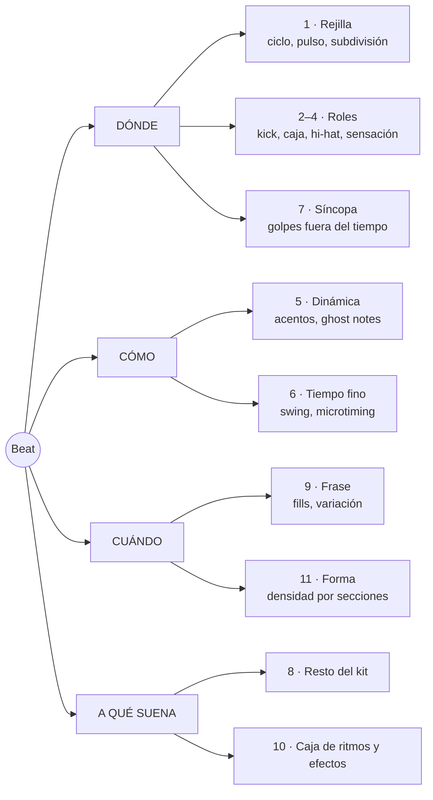

---

## 1. La rejilla: ciclo, pulso y subdivisión

### 1.1 Un ciclo = un compás

Strudel no mide en BPM, mide en **ciclos**. Todo lo que escribas dentro de
unas comillas se reparte a lo largo de un ciclo. La convención de esta guía y
de tus plantillas es **un ciclo = un compás**:

| Métrica | Pulsos por compás | Tempo en Strudel |
|---|---:|---|
| 4/4 | 4 negras | `setcpm(BPM/4)` |
| 3/4 | 3 negras | `setcpm(BPM/3)` |
| 6/8 | 2 negras con punto | `setcpm(BPM/2)`, con el BPM de la negra con punto |
| 12/8 | 4 negras con punto | `setcpm(BPM/4)`, con el BPM de la negra con punto |
| 5/4 | 5 negras | `setcpm(BPM/5)` |

`cpm` significa *cycles per minute*. A 80 BPM en 4/4 caben 20 compases por
minuto, así que `setcpm(80/4)`.

```strudel
setcpm(80/4)     // 80 BPM · 1 ciclo = 1 compás de 4/4
s("hh*4")        // cuatro golpes por ciclo: el pulso, en negras
```

### 1.2 Subdivisión: en cuántas partes cortas el pulso

El **pulso** es donde darías palmas. La **subdivisión** es en cuántos trozos
cortas cada pulso. Es la rejilla sobre la que caen todos los golpes.

```text
negras        1       2       3       4
corcheas      1   &   2   &   3   &   4   &
semicorcheas  1 e & a 2 e & a 3 e & a 4 e & a
tresillos     1 - -   2 - -   3 - -   4 - -
```

`1 e & a` se lee "uno-i-y-a". Es la forma estándar de contar semicorcheas en
batería y la que vas a ver en cualquier transcripción.

Escucha la escalera, con el kick marcando el pulso para no perderte. Cada
compás cambia la subdivisión del hi-hat: negras, corcheas, semicorcheas, tresillos.

```strudel
setcpm(80/4)
s("bd*4, hh*<4 8 16 12>")
  .bank("RolandTR909")
```

El tempo no cambió en ningún momento. Lo que cambió es cuánto **parece** correr.

### 1.3 Escribir en la rejilla: una caja por tiempo

Lo mínimo de mini-notación para beats:

| Escribes | Significa |
|---|---|
| `"bd sd bd sd"` | cuatro pasos iguales en el ciclo |
| `~` | silencio: un paso vacío |
| `[ ]` | mete varios pasos dentro de uno |
| `*n` | repite n veces dentro del paso |
| `,` | capas simultáneas |
| `< >` | uno distinto en cada ciclo, o sea en cada compás |

**La convención que te conviene:** escribe **un grupo `[ ]` por tiempo, con
cuatro posiciones dentro**. Así el texto *es* la rejilla de semicorcheas
(4 × 4 = 16 pasos), y mover un golpe es mover un carácter.

Estos tres compases alternan. Los dos primeros **suenan idéntico**: son el mismo
ritmo escrito corto y escrito en rejilla. El tercero mueve un solo kick a la
"a" del 2.

```strudel
setcpm(80/4)
s(cat(
  "bd ~ bd ~",                                  // corto
  "[bd ~ ~ ~] [~ ~ ~ ~] [bd ~ ~ ~] [~ ~ ~ ~]",  // en rejilla: suena igual
  "[bd ~ ~ ~] [~ ~ ~ bd] [bd ~ ~ ~] [~ ~ ~ ~]", // un kick movido a la "a" del 2
)).bank("RolandTR909")
```

`cat(a, b, c)` toca `a` en el primer ciclo, `b` en el segundo y `c` en el
tercero, y vuelve a empezar. Es la forma más legible de comparar compases.

> [!tip] Qué decide en tu pieza
> La subdivisión más fina que uses fija la **velocidad aparente**. A 70 BPM con
> semicorcheas la pieza corre; a 110 BPM con negras, flota. Antes de mover el
> tempo, prueba a mover la subdivisión.

---

## 2. Los tres roles: kick, caja y hi-hat

Una batería es un coro de tres voces. Igual que en tus corales, cada voz tiene
**registro** y **función**, y si dos hacen lo mismo, sobra una.

| Pieza | En Strudel | Registro | Función | La pregunta que contesta |
|---|---|---|---|---|
| **Kick** (bombo) | `bd` | grave | peso, apoyo | ¿dónde se apoya el cuerpo? |
| **Caja** (snare) | `sd`, o palmas `cp`, o aro `rim` | medio | respuesta, acento | ¿dónde contesta la frase? |
| **Hi-hat** | `hh` cerrado, `oh` abierto | agudo | reloj, subdivisión | ¿a qué velocidad corre el tiempo? |

Construye el beat más básico del pop y el rock capa por capa. Escucha cada
bloque antes de pasar al siguiente.

**Solo kick**, en 1 y 3: ya hay un suelo, pero no hay frase.

```strudel
setcpm(90/4)
s("bd ~ bd ~").bank("RolandTR909")
```

**Más caja**, en 2 y 4: ahora hay pregunta y respuesta.

```strudel
setcpm(90/4)
stack(
  s("bd ~ bd ~"),     // kick: 1 y 3
  s("~ sd ~ sd"),     // caja: 2 y 4
).bank("RolandTR909")
```

**Más hi-hat**, en corcheas: ahora hay un reloj que dice a qué velocidad vive la música.

```strudel
setcpm(90/4)
stack(
  s("bd ~ bd ~"),     // kick: 1 y 3
  s("~ sd ~ sd"),     // caja: 2 y 4
  s("hh*8"),          // hi-hat: corcheas
).bank("RolandTR909")
```

Así se ve en la rejilla. **Aprende a leer y escribir esta tabla**: es como se
anotan los beats en cualquier caja de ritmos, y es lo que vas a transcribir de oído.

```text
        1 e & a 2 e & a 3 e & a 4 e & a
hh      x . x . x . x . x . x . x . x .
caja    . . . . x . . . . . . . x . . .
kick    x . . . . . . . x . . . . . . .
```

> [!note] `stack` o `$:`
> `stack(a, b, c)` es lo mismo que escribir tres líneas que empiecen con `$:`.
> Aquí se usa `stack` porque es lo que usan tus plantillas ([[strudel — capas]]).
> `.bank()` al final del `stack` aplica la misma caja de ritmos a todas las capas.

> [!tip] Qué decide en tu pieza
> Antes de escribir un solo golpe, decide **quién lleva el pulso**. En pop lo
> lleva el hi-hat. En una balada triste puede que no lo lleve nadie, y ese
> vacío también es una decisión.

---

## 3. El backbeat: por qué la caja va en 2 y 4

En 4/4 los tiempos 1 y 3 son **fuertes** y el 2 y el 4 son **débiles** (la
jerarquía fuerte-débil de [[1. Teoría/6. Ritmo/0. Introducción]]). El backbeat
hace algo a propósito contradictorio: pone el golpe más brillante, la caja, en
los tiempos débiles. El kick dice dónde está el suelo y la caja contesta a
contratiempo del peso. Esa contradicción es la que hace que el cuerpo se mueva.

En casi todo el pop, rock y folk **la caja no se mueve y el kick sí**. Estas
son cuatro colocaciones de kick sobre la misma caja, un compás cada una:

```text
        1 e & a 2 e & a 3 e & a 4 e & a
A       x . . . . . . . x . . . . . . .     1 y 3: el básico
B       x . . . . . . . . . x . . . . .     1 y "&" del 3: el más usado en pop
C       x . . . . . x . x . . . . . . .     1, "&" del 2 y 3: empuja hacia el 3
D       x . . x . . . . . . x . . . . .     1, "a" del 1 y "&" del 3: rebota
```

```strudel
setcpm(90/4)
stack(
  s(cat(
    "bd ~ bd ~",               // A
    "bd ~ [~ bd] ~",           // B
    "bd [~ bd] bd ~",          // C
    "[bd ~ ~ bd] ~ [~ bd] ~",  // D
  )),
  s("~ sd ~ sd"),
  s("hh*8"),
).bank("RolandTR909")
```

> [!tip] Qué decide en tu pieza
> Si mueves el kick, cambias de canción. Si mueves la caja fuera de 2 y 4,
> cambias de sensación (siguiente sección). Cuando un beat "no funciona", casi
> siempre es el kick.

---

## 4. La sensación: half-time, normal y double-time

Con **el mismo BPM** puedes hacer que una música se sienta la mitad de lenta o
el doble de rápida. Lo que manda es **cada cuánto cae la caja**.

| Sensación | Caja | Se siente | Dónde vive |
|---|---|---|---|
| **Half-time** | solo en el 3 | pesada, lenta, grande | baladas tristes, dream pop, post-rock, trap |
| **Normal** | 2 y 4 | caminar | casi todo |
| **Double-time** | en cada "&" | urgente, despega | coros que suben sin cambiar de tempo |

```text
half-time
        1 e & a 2 e & a 3 e & a 4 e & a
hh      x . x . x . x . x . x . x . x .
caja    . . . . . . . . x . . . . . . .
kick    x . . . . . . . . . . . . . . .

double-time
hh      x x x x x x x x x x x x x x x x
caja    . . x . . . x . . . x . . . x .
kick    x . . . x . . . x . . . x . . .
```

Dos compases de cada una, sin tocar el tempo:

```strudel
setcpm(84/4)

const normal = stack(s("bd ~ bd ~"), s("~ sd ~ sd"),  s("hh*8"))
const media  = stack(s("bd ~ ~ ~"),  s("~ ~ sd ~"),   s("hh*8"))
const doble  = stack(s("bd*4"),      s("[~ sd]*4"),   s("hh*16"))

arrange(
  [2, normal],
  [2, media],
  [2, doble],
).bank("RolandTR909")
```

`arrange([n, patrón], …)` toca cada patrón durante `n` compases y luego pasa al
siguiente. Vuelve a aparecer en la sección 11 para armar la forma.

> [!tip] Qué decide en tu pieza
> Puedes pasar de verso a coro **sin tocar el BPM**: verso en half-time y coro
> en normal, o al revés. Es la herramienta de contraste más fuerte que tiene la
> batería, y la más barata.

---

## 5. Dinámica: no todos los golpes pesan lo mismo

Una batería real nunca golpea dos veces igual. En Strudel la fuerza de cada
golpe se controla con **`.velocity()`**, de 0 a 1. Usa `velocity` para la fuerza
de cada golpe y `gain` para el volumen de toda la capa.

La clave está en cómo se reparten los valores. `.velocity("1 .5")` sobre ocho
hats **no** alterna: da `1` a la primera mitad del compás y `.5` a la segunda.
Para alternar, el patrón de valores tiene que tener la misma rejilla que los
golpes: `"[1 .5]*4"` son ocho valores para ocho hats.

### 5.1 Acentos

Primer compás, todos los hats iguales. Segundo compás, fuerte en el tiempo y
débil en el "&".

```strudel
setcpm(90/4)
stack(
  s("bd ~ [~ bd] ~"),
  s("~ sd ~ sd"),
  s("hh*8").velocity("<1 [1 .5]*4>"),
).bank("RolandTR909")
```

### 5.2 Ghost notes

Son golpes de caja **casi inaudibles** entre los backbeats. No se escuchan como
notas; se escuchan como *movimiento*. En la rejilla, `X` es fuerte, `x` es medio
y `g` es ghost:

```text
        1 e & a 2 e & a 3 e & a 4 e & a
hh      X . x . X . x . X . x . X . x .
caja    . . . g X . g . . g . . X . . g
kick    X . . . . . . . . . X . . . . .
```

El primer compás va sin ghosts y el segundo con ellos. Escucha que el segundo
"camina" más aunque apenas se oigan.

```strudel
setcpm(88/4)
stack(
  s("bd ~ [~ bd] ~"),
  s("~ sd ~ sd"),
  s("[~ ~ ~ sd] [~ ~ sd ~] [~ sd ~ ~] [~ ~ ~ sd]")
    .velocity(.2)
    .mask("<0 1>"),                        // compás 1 sin ghosts, compás 2 con ghosts
  s("hh*8").velocity("[.9 .5]*4"),
).bank("RolandTR909")
```

`.mask("<0 1>")` deja pasar la capa solo donde hay un `1`. Es un interruptor por
compás, y sirve para cualquier comparación A/B.

### 5.3 Humanizar

`rand.range(a, b)` da un valor al azar entre `a` y `b` en cada golpe:

```strudel
setcpm(90/4)
stack(
  s("bd ~ [~ bd] ~"),
  s("~ sd ~ sd"),
  s("hh*8").velocity(rand.range(.55, .9)),
).bank("RolandTR909")
```

> [!note] El azar de Strudel se repite
> Es determinista: depende de la posición en el tiempo, así que cada vez que le
> das play suena igual. Eso es bueno, porque puedes volver a una versión que te gustó.

> [!tip] Qué decide en tu pieza
> Una batería con todos los golpes iguales suena a máquina aunque el ritmo sea
> bueno. La pregunta es cuál es el golpe importante de cada tiempo. Ese va
> fuerte y el resto no.

---

## 6. Tiempo fino: swing y microtiming

### 6.1 Swing

Swing es **atrasar la segunda corchea de cada par**. En recto, el "&" cae justo
a la mitad del tiempo. Con swing completo, cae en el último tercio, como un
tresillo con el hueco del medio vacío.

```text
un tiempo partido en 6:  | 1 . . . . . | 2 . . . . . |
recto                    | x . . x . . | x . . x . . |   "&" en la mitad
swing de tresillo        | x . . . x . | x . . . x . |   "&" en el último tercio
```

En Strudel: **`.swingBy(cantidad, n)`**

- **cantidad**: `0` es recto y `.33` es tresillo completo (shuffle). Todo lo que
  queda en medio es "algo de swing".
- **n**: cuántos pares hay por compás. `4` hace swing de corcheas y `8` de semicorcheas.
- Atajo: `.swing(4)` es `.swingBy(1/3, 4)`.

Primer compás recto, segundo con swing de tresillo:

```strudel
setcpm(90/4)
stack(
  s("bd ~ [~ bd] ~"),
  s("~ sd ~ sd"),
  s("hh*8").velocity("[.9 .5]*4"),
).bank("RolandTR909")
 .swingBy("<0 .33>", 4)
```

El swing se escribe también **directamente en la rejilla de tresillos**. Este
bloque suena igual que el compás con swing de arriba (`.33` se queda a un milisegundo del tresillo exacto):

```strudel
setcpm(90/4)
stack(
  s("bd ~ [~ bd] ~"),
  s("~ sd ~ sd"),
  s("[hh ~ hh]*4"),       // cada tiempo en 3: golpe, hueco, golpe
).bank("RolandTR909")
```

Si vienes del mundo de los samplers (MPC), el swing se expresa en porcentaje.
La conversión es `cantidad = 2 × (porcentaje − 0.5)`:

| Swing MPC | `swingBy` | Se siente |
|---:|---:|---|
| 50 % | `0` | recto, cuantizado |
| 54 % | `.08` | apenas, pero ya no es máquina |
| 58 % | `.16` | relajado |
| 62 % | `.24` | hip-hop con swing marcado |
| 66 % | `.33` | shuffle, tresillo completo |

### 6.2 Microtiming: tocar detrás del tiempo

No todo es rejilla. Atrasar **una sola capa** unos milisegundos cambia el peso
de todo el beat. Una caja un poco tarde suena perezosa y pesada; es lo que en
hip-hop y neo-soul se llama *tocar detrás del tiempo*.

`.late(x)` atrasa `x` ciclos. Como aquí un ciclo es un compás, en 4/4 la cuenta es:

> **milisegundos = x × 240 000 / BPM**. A 90 BPM, `.late(.012)` ≈ 32 ms.

Primer compás con la caja a tiempo, segundo con la caja atrasada:

```strudel
setcpm(90/4)
stack(
  s("bd ~ [~ bd] ~"),
  s("~ sd ~ sd").late("<0 .012>"),
  s("hh*8").velocity("[.9 .5]*4"),
).bank("RolandTR909")
```

`.early(x)` hace lo contrario: un hi-hat adelantado empuja la música hacia adelante.

> [!tip] Qué decide en tu pieza
> El swing funciona como un dial emocional. En recto suena tenso, moderno,
> mecánico; con swing completo, relajado, bailable, antiguo. Casi todo lo
> que suena humano vive entre los dos. Y una caja atrasada hace que la misma
> canción pese más sin cambiar una sola nota.

---

## 7. Síncopa: el kick fuera del tiempo

Un golpe es **sincopado** cuando cae en una parte débil y no le sigue otro en la
parte fuerte siguiente, así que el acento se adelanta. Es la base de
[[2. Cursos/1. Cresciente/2C. Síncopa y polirritmia/Estudios/0. Actividad 2C — creando música sincopada]].
En batería, casi siempre la síncopa la lleva el kick.

### 7.1 Ritmos euclidianos

`"bd(k,n)"` reparte **k golpes en n pasos, lo más uniforme posible**. Resulta que
esa regla matemática produce muchas de las claves tradicionales del mundo.

```text
bd(3,8)      x . . x . . x .     tresillo, 3+3+2
bd(5,8)      x . x x . x x .     cinquillo
bd(3,8,2)    x . x . . x . .     el tresillo rotado: 2+3+3
```

El tercer número **rota** el patrón. El tresillo es la misma célula de
[[1. Teoría/6. Ritmo/1. Motivos rítmicos]], ahora en el kick y contra un backbeat:

```strudel
setcpm(95/4)
stack(
  s("bd(3,8)"),                        // tresillo en el kick
  s("~ sd ~ sd"),                      // backbeat normal
  s("hh*8").velocity("[.7 .4]*4"),
).bank("RolandTR808")
```

Cambia `(3,8)` por `(5,8)`, por `(3,8,2)` o por `(5,16)` y escucha cómo la misma
caja de fondo aguanta ritmos muy distintos encima.

> [!tip] Qué decide en tu pieza
> La síncopa del kick es el **empuje** de una sección. Un verso con el kick en
> los tiempos y un coro con el kick sincopado se sienten distintos aunque la caja
> y los acordes no cambien.

---

## 8. El resto del kit

| Pieza             | En Strudel     | Su trabajo típico                                                                   |
| ----------------- | -------------- | ----------------------------------------------------------------------------------- |
| Hi-hat abierto    | `oh`           | respiración en los "&"; con `.cut(1)` el cerrado lo corta, como un hi-hat de verdad |
| Palmas            | `cp`           | backbeat alternativo, o doblando la caja                                            |
| Aro / cross-stick | `rim`          | backbeat suave: baladas, versos, intimidad                                          |
| Toms              | `lt` `mt` `ht` | fills; patrones tribales                                                            |
| Crash             | `cr`           | marca el primer tiempo de una sección                                               |
| Ride              | `rd`           | sustituye al hi-hat en los coros: más brillo, más aire                              |
| Shaker, pandereta | `sh`, `tb`     | textura en semicorcheas, bajito y a un lado                                         |
| Cencerro, otros   | `cb`, `perc`   | color                                                                               |
|                   |                |                                                                                     |

No todos los bancos tienen todas las piezas (ver 10.1).

```strudel
setcpm(96/4)
stack(
  s("bd ~ [~ bd] ~").bank("RolandTR808"),
  s("~ rim ~ rim").bank("RolandTR808"),           // aro en vez de caja: backbeat suave
  s("[hh oh]*4").cut(1).bank("RolandTR808"),       // abierto en cada "&"; el cerrado lo corta
  s("shaker_small*16")                             // shaker acústico: sin .bank()
    .velocity("[.5 .2 .35 .2]*4")
    .pan(.7),                                      // 0 izquierda · .5 centro · 1 derecha
)
```

Quita `.cut(1)` y escucha cómo el hat abierto se queda sonando encima de todo.

> [!warning] `.bank()` y los sonidos sueltos
> `.bank("RolandTR808")` solo antepone el nombre del banco: `hh` pasa a ser
> `RolandTR808_hh`. Si lo pones al final de un `stack` que tiene una capa de otro
> sitio (`shaker_small`, un sintetizador…), esa capa busca `RolandTR808_shaker_small`,
> no la encuentra y **no suena**. En ese caso pon el banco capa por capa, como arriba.

> [!tip] Qué decide en tu pieza
> Cada pieza extra tiene que tener un trabajo. Si no puedes decir cuál es, quítala.

---

## 9. La frase: fills y variación

Los beats piensan en **frases de 4 compases**, igual que la melodía (ver
[[1. Teoría/5. Forma/2. Composición binaria — contraste, intro y puente]]).
Tres compases establecen y el cuarto anuncia que algo viene. Ese anuncio es el **fill**.

```text
compás     1          2          3          4
           crash      ·          ·          FILL  →  (compás 1 de la frase siguiente)
           establece  confirma   confirma   anuncia
```

```strudel
setcpm(90/4)
stack(
  s("<cr ~ ~ ~>"),                                  // crash solo en el compás 1 de cada 4
  s("bd ~ [~ bd] ~")
    .lastOf(4, x => x.mask("1 1 0 0")),             // el kick deja sitio al fill
  s(cat(
    "~ sd ~ sd",
    "~ sd ~ sd",
    "~ sd ~ sd",
    "~ sd [ht ht mt mt] [lt lt sd sd]",             // compás 4: el fill en toms
  )),
  s("hh*8").velocity("[.8 .4]*4")
    .lastOf(4, x => x.mask("1 1 0 0")),             // los hats se callan durante el fill
).bank("RolandTR909")
```

| Herramienta                       | Qué hace                                | Para qué                              |
| --------------------------------- | --------------------------------------- | ------------------------------------- |
| `"<a b c d>"` o `cat(a, b, c, d)` | un compás distinto por ciclo            | fills escritos a mano                 |
| `.lastOf(n, f)`                   | aplica `f` al último de cada n compases | fill por transformación               |
| `.firstOf(n, f)` (o `.every`)     | aplica `f` al primero de cada n         | variación al abrir la frase           |
| `.ply(n)`                         | repite cada golpe n veces               | redobles: `.lastOf(4, x => x.ply(2))` |
| `.degradeBy(p)`                   | quita golpes al azar con probabilidad p | hi-hats que respiran                  |
| `.sometimesBy(p, f)`              | aplica `f` a algunos golpes             | variación que no escribiste           |
| `hh*8?`                           | cada golpe tiene 50 % de sonar          | lo mismo, en mini-notación            |


Variación sin escribir un solo compás nuevo:

```strudel
setcpm(90/4)

stack(
	stack(
	  s("bd ~ [~ bd] ~"),
	  s("~ sd ~ sd").lastOf(4, x => x.ply(2)),                    // redoble en el compás 4
	  s("hh*16").velocity("[.7 .3 .5 .3]*4").degradeBy(.25),       // hats que respiran
	).bank("RolandTR909"),
)

```

> [!tip] Qué decide en tu pieza
> El fill es una señal que dice "algo va a cambiar". Si hay fill cada cuatro
> compases y nunca cambia nada, la señal se gasta. **Pon los fills donde la forma
> cambia**, no donde toca por calendario.

---

## 10. El sonido: la caja de ritmos y cómo esculpirla

### 10.1 Elegir la caja

El banco decide **la época y el género** antes que el patrón. Estos son los que
carga tu plugin y que vale la pena conocer:

| Banco | Carácter | Suele vivir en |
|---|---|---|
| *(sin `.bank()`)* | **E-mu SP-12**: sampler de 12 bits, sucio, con pegada | boom bap, hip-hop de los 80–90 |
| `RolandTR808` | kick largo y grave, casi un bajo; caja fina; palmas | hip-hop, trap, R&B lento, pop triste |
| `RolandTR909` | seco, con pegada, hats brillantes | house, techno, pop electrónico |
| `LinnDrum` | caja con cuerpo, sonido de los 80 | pop de los 80, synth-pop |
| `RolandCompurhythm78` | la CR-78: cálida, antigua, casi de juguete | dream pop, indie, electrónica vintage |
| `KorgMinipops` | preset de órgano de los 70: frágil y lejano | dream pop, lo-fi |
| `RhythmAce` | caja de ritmos de los 60 | vintage, lo-fi |
| `CasioVL1` | un juguete | lo-fi extremo, humor |
| *acústicos, sin banco* | `bassdrum2` (bombo de concierto), `clap`, `tambourine`, `shaker_small`, `cajon`, `framedrum`, `snare_rim`, `woodblock` | folk, orgánico |

Hay 71 bancos en total. Las piezas que **faltan** en algunos:

| Banco | No tiene |
|---|---|
| sin banco (SP-12) | `sh`, `tb` |
| `RolandTR909` | `sh`, `tb`, `cb` |
| `RolandCompurhythm78` | `rim`, `cp`, toms, `cr`, `rd`, `sh` |
| `KorgMinipops` | todo salvo `bd` `sd` `hh` `oh` |

Además, **el número después de `:` elige la variante**: el 808 trae 25 cajas
distintas, y `s("~ sd:3 ~ sd:3")` usa la cuarta (se cuenta desde 0).

El mismo beat pasando por seis cajas, dos compases cada una:

```strudel
setcpm(84/4)

const beat = stack(
  s("bd ~ [~ bd] ~"),
  s("~ sd ~ sd"),
  s("hh*8").velocity("[.8 .4]*4"),
)

arrange(
  [2, beat],                                // sin banco: E-mu SP-12
  [2, beat.bank("RolandTR808")],
  [2, beat.bank("RolandTR909")],
  [2, beat.bank("LinnDrum")],
  [2, beat.bank("RolandCompurhythm78")],
  [2, beat.bank("KorgMinipops")],
)
```

Puedes mezclar bancos: cada capa lleva el suyo. Un kick de 808 con una caja de
LinnDrum es un truco de producción muy común.

### 10.2 Esculpir

| Función                       | Qué hace                                 | En un beat                                              |
| ----------------------------- | ---------------------------------------- | ------------------------------------------------------- |
| `.lpf(hz)`                    | pasa-bajos: quita brillo                 | beat oscuro, lejano, tras una pared                     |
| `.hpf(hz)`                    | pasa-altos: quita grave                  | hats finos; beat "de radio"; deja sitio al bajo         |
| `.room(0–1)` y `.roomsize(n)` | reverb: cuánta y qué tan grande          | espacio; dream pop                                      |
| `.delay(0–1)`                 | eco                                      | aro o caja que se repiten a lo lejos                    |
| `.shape(0–1)`                 | saturación                               | pegada, calidez                                         |
| `.crush(bits)`                | menos bits: 16 limpio, 4 destruido       | lo-fi                                                   |
| `.speed(n)`                   | velocidad del sample, y con ella el tono | por debajo de 1 suena más grave y más lento, como cinta |
| `.pan(0–1)`                   | panorama                                 | percusión a los lados                                   |
		
El sonido **dream pop**: caja de ritmos vieja, lenta, con la caja muy lejos.

```strudel
setcpm(72/4)
stack(
  s("bd ~ [~ bd] ~").lpf(900),                            // kick redondo, sin clic
  s("~ sd ~ sd").velocity(.7).room(.8).roomsize(7),       // la caja se va lejos
  s("hh*8").velocity("[.45 .2]*4").hpf(5000),             // hats finos, casi aire
).bank("RolandCompurhythm78")
```

> [!warning] La reverb no va en el kick
> Mucha reverb en el kick convierte el grave en barro. La reverb va arriba (caja,
> aro, hats) y el kick se queda seco y cerca.

> [!tip] Qué decide en tu pieza
> El mismo patrón en 909 es una pista de baile; en CR-78 con la caja lejos es un
> recuerdo. **Elige el sonido al final**: si el patrón no funciona seco, la
> reverb no lo va a arreglar.

---

## 11. El beat dentro de la canción

### 11.1 Kick y bajo: una sola decisión

El kick y el bajo comparten registro. O se **abrazan** (tocan juntos) o se
**turnan** (el bajo en los huecos del kick). Si ninguna de las dos cosas es
deliberada, se pisan.

La forma más limpia de abrazarlos es que compartan **el mismo ritmo**, escrito
una sola vez:

```strudel
setcpm(84/4)

const golpes = "x ~ ~ x ~ ~ x ~"                  // un solo ritmo, compartido

stack(
  stack(
    s("bd").struct(golpes),
    s("~ sd ~ sd"),
    s("hh*8").velocity("[.6 .3]*4"),
  ).bank("RolandTR808"),                          // el banco solo para la batería
  note("a1").struct(golpes)                       // una sola nota: aquí importa el ritmo
    .s("sawtooth").lpf(300),
)
```

`.struct(golpes)` le pone a una capa el ritmo de `golpes` (cada `x` es un golpe).
Cambias `golpes` y el kick y el bajo se mueven juntos.

Es la prueba de tu [[2. Cursos/1. Cresciente/Cierre de módulo 2/Estudios/0. Proyecto 2 — comencemos por el ritmo]]:
**solo el bajo con la percusión deberían bastar para que la música exista.**

### 11.2 La forma por densidad

La batería es lo que más barato cambia la forma. Cada sección tiene un nivel de
densidad, y la canción es la curva que dibujan:

```text
densidad
  alta   │                    ██████████            ██████████
  media  │          ██████████                                   
  baja   │██████████                    ██████████               
         └──────────────────────────────────────────────────────
           intro     verso      coro       puente     coro
           solo hats kick+aro   todo+crash half-time  todo+crash
```

```strudel
setcpm(80/4)

const kick     = s("bd ~ [~ bd] ~")
const caja     = s("~ sd ~ sd")
const aro      = s("~ rim ~ rim")
const hats     = s("hh*8").velocity("[.6 .3]*4")
const abiertos = s("[hh oh]*4").cut(1).velocity(.6)
const crash    = s("<cr ~ ~ ~>")
const media    = stack(s("bd ~ ~ ~"), s("~ ~ sd ~"), hats)

arrange(
  [4, hats],                                   // intro: solo el reloj
  [4, stack(kick, aro, hats)],                 // verso: suave, con aro
  [4, stack(crash, kick, caja, abiertos)],     // coro: todo, hats abiertos
  [4, media],                                  // puente: half-time
  [4, stack(crash, kick, caja, abiertos)],     // coro
).bank("RolandTR909")
```

La plantilla vacía para esto es [[strudel — secciones]].

> [!tip] Qué decide en tu pieza
> Antes de escribir una sección nueva, prueba a **cambiar solo la batería**:
> quitar el kick, pasar a half-time, cambiar caja por aro, abrir los hats. A
> menudo la sección que buscabas ya estaba, solo que con otra batería.

---

## 12. Arquetipos: vocabulario para reconocer

No son plantillas para tu pieza. Sirven para **escuchar qué decisión toma cada
género**: cuando oigas uno en una canción, vas a poder nombrarlo y transcribirlo.

| Arquetipo | Kick | Caja | Hat | Tiempo fino | Banco típico |
|---|---|---|---|---|---|
| Pop / rock | 1 y 3, con variaciones | 2 y 4 | corcheas | recto | cualquiera |
| Half-time | 1 | 3 | corcheas | recto | 808, acústico |
| Four on the floor | los 4 tiempos | palmas 2 y 4 | abierto en los "&" | recto | 909 |
| Boom bap | sincopado | 2 y 4 | semicorcheas | swing de 16 | SP-12 |
| Folk stomp-clap | pisotón 1 y 3 | palmas 2 y 4 | pandereta | recto, humano | acústico |
| Dream pop | escaso | lejana, con reverb | suaves | recto | CR-78, Minipops |
| Balada 6/8 | 1 | aro en el 4 | corcheas | recto | LinnDrum, acústico |
| 5/4 | abre cada grupo | cierra cada grupo | corcheas | recto | cualquiera |

**Pop / rock** y **half-time** están en las secciones 2 y 4. **Dream pop** está en 10.2.

### Four on the floor

El kick en cada tiempo, como un corazón; lo que se mueve está arriba. El género
entero, del groove al arreglo, está en [[4. Instrumento/2. Strudel/7. House/0. House desde cero|House desde cero]].

```strudel
setcpm(120/4)
stack(
  s("bd*4"),
  s("~ cp ~ cp"),
  s("[~ oh]*4").velocity(.6),
).bank("RolandTR909")
```

### Boom bap

Kick sincopado, semicorcheas con swing y el polvo del sampler.

```text
        1 e & a 2 e & a 3 e & a 4 e & a
hh      X x x x X x x x X x x x X x x x
caja    . . . . X . . . . . . . X . . .
kick    X . . . . . . x . . X . . . . .
```

```strudel
setcpm(88/4)
stack(
  s("[bd ~ ~ ~] [~ ~ ~ bd] [~ ~ bd ~] [~ ~ ~ ~]"),
  s("~ sd ~ sd"),
  s("hh*16").velocity("[.7 .25 .45 .25]*4"),
).swingBy(.2, 8)          // swing de semicorcheas, ~60 % de MPC
 .crush(10).lpf(4000)     // el polvo del sampler
```

### Folk stomp-clap

Pisotones, palmas y pandereta, el esqueleto de la escena de The Lumineers. Se
puede tocar con el cuerpo, y por eso suena a gente en una habitación.

```strudel
setcpm(76/4)
stack(
  s("bassdrum2 ~ bassdrum2 ~").velocity(.9),       // pisotón: 1 y 3
  s("~ clap ~ clap"),                              // palmas: 2 y 4
  s("tambourine*8").velocity("[.5 .25]*4"),        // pandereta en corcheas
).room(.2)                                         // una habitación, no un estadio
```

### Dream pop

La caja de ritmos barata, lenta y con mucha reverb que Beach House usó tanto
en sus primeros discos. El bloque está en 10.2. Pruébalo también con
`KorgMinipops` y `RhythmAce`. La canción entera, del órgano a la coda, está en
[[4. Instrumento/2. Strudel/8. Dream pop/0. Dream pop desde cero|Dream pop desde cero]].

### Balada en 6/8

Dos pulsos de tres corcheas por compás. Es el balanceo de las canciones de cuna,
del vals lento y de mucha música triste.

```text
        1 . . 2 . .
hh      x x x x x x
aro     . . . x . .
kick    x . . . . .
```

```strudel
setcpm(52/2)                                   // 6/8 a 52 negras con punto
stack(
  s("bd ~ ~ ~ ~ ~"),
  s("~ ~ ~ rim ~ ~").room(.4),
  s("hh*6").velocity("[.6 .25 .35]*2"),
).bank("LinnDrum")
```

Para **12/8**, que es la métrica de tu nocturno, usa `setcpm(BPM/4)` y 12 pasos por compás.

### 5/4

Cinco tiempos que el oído agrupa en **3+2** o **2+3**. La regla para la batería:
**el kick abre cada grupo y la caja lo cierra**. "15 Step" de Radiohead está en 5/4.

```text
             1 2 3 4 5
3+2   kick   x . . x .
      caja   . . x . x
2+3   kick   x . x . .
      caja   . x . . x
```

```strudel
setcpm(120/5)                                  // 5/4 · 1 ciclo = 1 compás de 5 negras
stack(
  s(cat(
    "bd ~ sd bd sd",                           // 3+2
    "bd sd bd ~ sd",                           // 2+3
  )),                                          // una capa puede mezclar sonidos
  s("hh*10").velocity("[.6 .3]*5"),
).bank("RolandTR909")
```

---

## 13. Cómo componer un beat: el método

En orden. Cada paso responde **una** pregunta, y no pasas al siguiente hasta
contestarla.

| # | Paso | La pregunta | Ver |
|---:|---|---|---|
| 1 | Emoción → tempo y sensación | ¿half, normal o double? ¿qué BPM? | §4 |
| 2 | Kick | ¿dónde se apoya el cuerpo? Empieza en 1 y 3 y mueve **un** golpe | §3, §7 |
| 3 | Caja | ¿dónde contesta? ¿caja, palmas o aro? | §2, §8 |
| 4 | Hi-hat | ¿a qué velocidad corre el tiempo? ¿o no hay reloj? | §1 |
| 5 | Dinámica | ¿cuál es el golpe importante de cada tiempo? | §5 |
| 6 | Tiempo fino | ¿recto o swing? ¿alguna capa detrás del tiempo? | §6 |
| 7 | **Un** adorno | hat abierto, ghost o percusión: uno solo | §8 |
| 8 | Frase | ¿dónde cambia la forma? Ahí va el fill | §9 |
| 9 | Sonido | banco y efectos, **al final** | §10 |
| 10 | La prueba | solo kick y bajo: ¿sostienen la música? | §11 |

El paso 7 es tu regla de **una dificultad nueva por proyecto**, aplicada al beat.

### Errores comunes

| Síntoma | Causa probable | Arreglo |
|---|---|---|
| Suena a máquina | todos los golpes con la misma fuerza | acentos y humanizar (§5) |
| Suena lleno pero no se mueve | demasiadas capas en la misma subdivisión | cada pieza con un trabajo; quita (§8) |
| El grave es un barro | kick y bajo pisándose, o reverb en el kick | mismo `struct` o huecos complementarios; reverb solo arriba (§10, §11) |
| La balada corre | hi-hat en semicorcheas a tempo lento | baja la subdivisión o quita el hat (§1) |
| El coro no despega | la misma batería que el verso | cambia la sensación o la densidad, no el BPM (§4, §11) |
| El fill no sorprende | fill cada cuatro compases sin que cambie nada | fills solo donde la forma cambia (§9) |
| Un golpe no suena | el banco no tiene esa pieza, o `.bank()` cayó sobre una capa de otro origen | tablas de §10.1 y el aviso de §8 |

---

## 14. Ejercicios

Son instrucciones, no respuestas: el tempo, el patrón y el sonido los decides tú.

**1 · De la rejilla al código.** Escoge una de las rejillas de esta guía, tápate
el bloque y escríbela en Strudel.
*Hecho cuando* suena igual que el bloque original.

**2 · Un beat, tres sensaciones.** Escribe un beat tuyo de kick, caja y hat.
Con `arrange`, hazlo sonar en half-time, normal y double-time.
*Hecho cuando* puedes decir en una frase qué emoción sugiere cada uno y cuál
usarías en qué sección de una pieza tuya.

**3 · La escalera de swing.** Tu beat del ejercicio 2, cuatro compases, con
`swingBy` en cuatro valores distintos entre `0` y `.33`, uno por compás (usa `"< >"`).
*Hecho cuando* eliges un valor y escribes por qué es ese y no el de al lado.

**4 · Transcribir de oído.** Una canción de tus influencias. Primero la rejilla
en texto, solo kick, caja y hat; después, Strudel.
*Hecho cuando* al sonar junto a la grabación, los golpes coinciden.

**5 · Frase de cuatro.** Tu beat con crash en el compás 1 y un fill en el 4, y un
cambio real en lo que viene después.
*Hecho cuando* el fill anuncia algo, y ese algo ocurre.

**6 · Kick y bajo.** Un beat y una línea de bajo con el mismo `struct`, o con
huecos deliberadamente complementarios.
*Hecho cuando* bajo y batería solos sostienen la música.

Y el audio: **semana sin audio es semana en blanco.** Graba 30 segundos de lo que
salga, aunque esté feo. Git ignora el audio en cualquier ruta.

### Dónde va lo que hagas

La regla de ruteo de [[Inicio]], aplicada a beats:

| Si el beat… | Va a |
|---|---|
| nace de una lección (la 2C, el Proyecto 2…) | `2. Cursos/<fuente>/<lección>/Estudios/`, dentro de la nota |
| es para una pieza tuya | `3. Composiciones/<obra>/` |
| es la transcripción de una canción de otro | `5. Referencias/` |
| ninguna de las anteriores | `0. Entrada/`, y se decide en la revisión semanal |

---

## Chuleta

**Piezas:** `bd` kick · `sd` caja · `cp` palmas · `rim` aro · `hh` hat cerrado ·
`oh` hat abierto · `lt` `mt` `ht` toms · `cr` crash · `rd` ride · `sh` shaker ·
`tb` pandereta · `cb` cencerro

**Mini-notación para beats**

| | |
|---|---|
| `"[bd ~ ~ ~] [~ ~ ~ ~] …"` | un grupo por tiempo = rejilla de semicorcheas |
| `"bd(3,8)"` · `"bd(3,8,2)"` | euclidiano · rotado |
| `"sd:3"` | variante 3 del sample |
| `"bd@3 sd"` | `bd` ocupa 3 de 4 partes, así que `sd` cae en la última |
| `"bd!3 sd"` | `bd bd bd sd` |
| `"hh*8?"` | cada golpe con 50 % de sonar |
| `"<cr ~ ~ ~>"` | solo en el compás 1 de cada 4 |

**Funciones**

| | |
|---|---|
| `setcpm(BPM/4)` | tempo, con 1 ciclo = 1 compás de 4/4 |
| `stack(a, b)` · `cat(a, b)` · `arrange([n, a], …)` | capas · un compás cada uno · secciones |
| `.bank("…")` | caja de ritmos |
| `.velocity(0–1)` · `.gain()` | fuerza del golpe · volumen de la capa |
| `.swingBy(c, n)` · `.swing(n)` | swing |
| `.late(x)` · `.early(x)` | microtiming, en fracciones de compás |
| `.struct("x ~ x")` · `.mask("<1 0>")` | imponer un ritmo · interruptor por compás |
| `.lastOf(n, f)` · `.firstOf(n, f)` | transformar el último / primero de cada n |
| `.ply(n)` · `.degradeBy(p)` · `.sometimesBy(p, f)` | redoble · quitar al azar · variar al azar |
| `.cut(1)` | grupo de corte: el hat cerrado corta al abierto |
| `.lpf()` `.hpf()` `.room()` `.roomsize()` `.crush()` `.speed()` `.pan()` | esculpir |

---

## Enlaces

**En la bóveda**

- Concepto al que sirve: [[1. Teoría/6. Ritmo/0. Introducción]]
- [[1. Teoría/6. Ritmo/1. Motivos rítmicos]]: células y motivos, el tresillo
- [[1. Teoría/6. Ritmo/2. Path completo]]: el camino largo del ritmo, que termina en percusión
- Guías de ritmo: [[1. Teoría/6. Ritmo/AI/11. AI Ritmos/0. Guía integral - Ritmos y diseño de motivos]] · [[1. Teoría/6. Ritmo/AI/11. AI Ritmos/1. Guía ritmos]]
- Strudel: [[4. Instrumento/2. Strudel/0. Qué es y cómo se usa]] · plantillas [[strudel — ritmo]], [[strudel — capas]], [[strudel — secciones]]
- Donde se usa: [[2. Cursos/1. Cresciente/2C. Síncopa y polirritmia/Estudios/0. Actividad 2C — creando música sincopada]] · [[2. Cursos/1. Cresciente/Cierre de módulo 2/Estudios/0. Proyecto 2 — comencemos por el ritmo]]
- Por qué el ritmo es prioridad: [[6. Práctica/3. Diagnóstico]]

**Fuera**

- [Workshop de Strudel: primeros sonidos](https://strudel.cc/workshop/first-sounds/): el mismo camino, en inglés
- [Samples y bancos](https://strudel.cc/learn/samples/) · [Efectos](https://strudel.cc/learn/effects/) · [Mini-notación](https://strudel.cc/learn/mini-notation/)

---

## Archivo: `4. Instrumento/2. Strudel/3. Folk.md`

# Guía full — Folk, picking y Strudel

> [!abstract] Objetivo  
> Construir una canción folk desde cero usando:
> 
> - guitarra acústica / picking;
>     
> - Strudel como acompañante MIDI;
>     
> - bajo, pad y arpegio en Sonar;
>     
> - una toma humana que termine en audio.
>     
> 
> **Definición de hecho:** existe un `.m4a` de 30–60 segundos, aunque suene crudo.

---

## 0. Advertencia útil

Esta guía no transcribe canciones de Bob Dylan ni copia tabs. Trabaja con **gestos generales del folk**: acordes abiertos, bajo alternado, melodía encima, rasgueo imperfecto, voz o lead humano.

El enfoque acústico asociado a Dylan suele moverse entre acordes básicos rasgueados y patrones de fingerpicking en posiciones abiertas, no en armonías densas o voicings complicados.

---

## 1. Mapa general

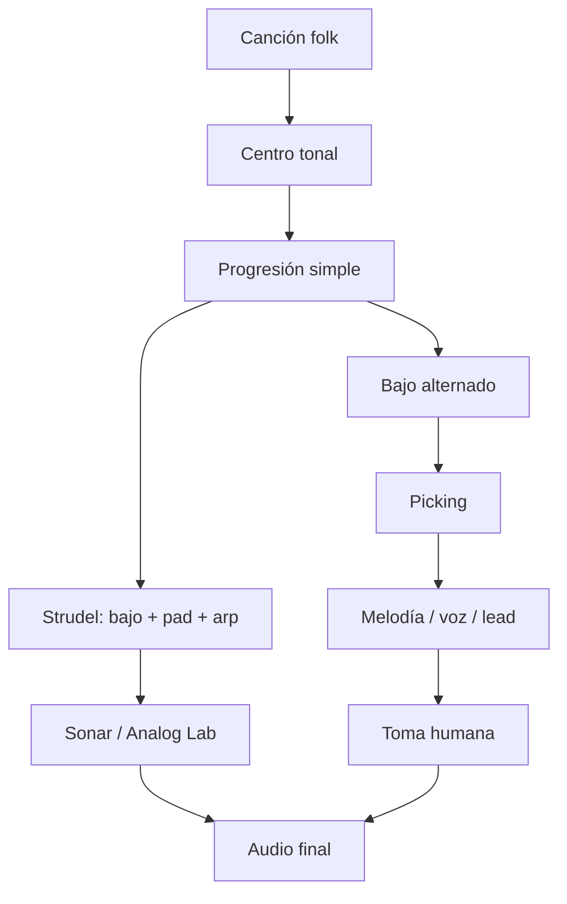

---

## 2. Qué es folk aquí

Folk no significa “sonar viejo”. En este sistema significa:
			
|Elemento|Función|
|---|---|
|**Acordes abiertos**|claridad, fragilidad, aire|
|**Bajo alternado**|hace que una sola guitarra parezca tener bajo + armonía|
|**Picking repetitivo**|motor íntimo, hipnótico|
|**Melodía simple**|frase cantable, poco virtuosismo|
|**Imperfección rítmica**|humano, narrativo|
|**Forma clara**|verso, verso, coro, puente, verso|

La técnica de Travis picking se basa en que el pulgar mantiene un bajo alternado constante mientras los dedos tocan notas superiores. En folk/americana, ese bajo alternado ayuda a crear la ilusión de más de un instrumento: una línea grave y una melodía arriba.

---

## 3. Rutas posibles

### A. Ruta documentada con Sonar / Strudel

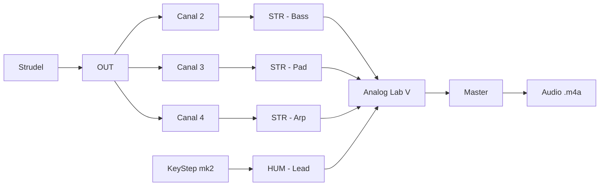

|Capa|Canal|Pista|Papel folk|
|---|---|---|---|
|Bajo|2|`STR - Bass`|raíz / pulso grave|
|Pad|3|`STR - Pad`|acorde largo|
|Arp|4|`STR - Arp`|picking programado|
|Lead humano|—|`HUM - Lead`|melodía tocada|

En Sonar, las pistas que suenan son pistas de instrumento con Analog Lab V; para escuchar MIDI entrante necesitas instrumento e **Input Echo** encendido.

### B. Ruta de guitarra real

> [!warning] Por verificar  
> La ruta de grabación de guitarra no está documentada todavía. Para una sesión real, falta decidir si grabas la guitarra con interfaz, micrófono, teléfono o grabadora.
> 
> Mientras eso no esté documentado, el audio garantizado viene de Sonar/Strudel, y la guitarra funciona como estudio físico.

---

## 4. Vocabulario base

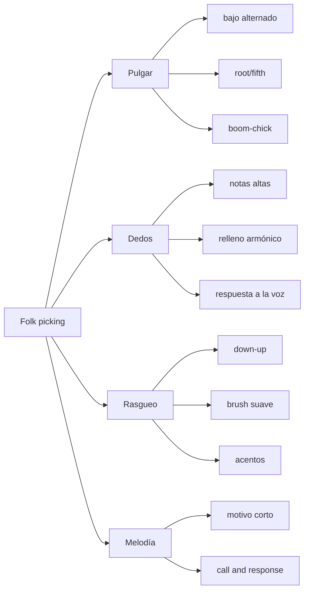

|Palabra|Traducción práctica|
|---|---|
|**Root**|raíz del acorde|
|**Fifth**|quinta del acorde|
|**Alternating bass**|pulgar alterna dos notas graves|
|**Pinch**|pulgar + dedo al mismo tiempo|
|**Brush**|mini-rasgueo con dedos|
|**Boom-chick**|bajo + acorde|
|**Drone**|una cuerda abierta que se repite|
|**Walk-up / walk-down**|bajo que conecta acordes|

---

## 5. Mano derecha: PIMA

|Letra|Dedo|Trabajo principal|
|---|---|---|
|`p`|pulgar|cuerdas graves|
|`i`|índice|tercera cuerda|
|`m`|medio|segunda cuerda|
|`a`|anular|primera cuerda|

### Regla base

```
Pulgar = tiempo
Dedos = historia
```

Si el pulgar se pierde, el picking se cae. Si los dedos se pierden, todavía hay canción.

---

## 6. Patrón 1 — bajo alternado puro

### Idea

El pulgar toca dos notas graves. Todavía no hay melodía.

```music-abc
X:1
T:Bajo alternado sobre C
M:4/4
L:1/4
Q:1/4=80
K:C
V:1 name="Pulgar" clef=bass
[V:1] C,, G,, C,, G,, | C,, G,, C,, G,, |
```

|Cuenta|Acción|
|---|---|
|1|raíz|
|2|quinta|
|3|raíz|
|4|quinta|

### En guitarra

|Acorde|Bajo 1|Bajo 2|
|---|---|---|
|C|raíz en 5ª cuerda|nota en 4ª cuerda|
|G|raíz en 6ª cuerda|nota en 4ª cuerda|
|D|raíz en 4ª cuerda|nota en 5ª cuerda|
|Am|raíz en 5ª cuerda|nota en 4ª cuerda|
|Em|raíz en 6ª cuerda|nota en 4ª cuerda|

> [!tip] Decisión
> 
> - Bajo alternado en acordes abiertos — hace que una sola guitarra sostenga pulso y armonía. → [[fingerpicking]]
>     

---

## 7. Patrón 2 — bajo + nota alta

### Idea

Pulgar mantiene el piso. Un dedo responde arriba.

```music-abc
X:2
T:Bajo + respuesta alta
M:4/4
L:1/8
Q:1/4=80
K:C
V:1 name="Dedos" clef=treble
V:2 name="Pulgar" clef=bass
[V:1] z E z G z E z G |
[V:2] C,,2 G,,2 C,,2 G,,2 |
```

|Tiempo|Pulgar|Dedo|
|---|---|---|
|1|bajo|—|
|&|—|nota alta|
|2|bajo|—|
|&|—|nota alta|

### Ejercicio

```
p   i   p   m   p   i   p   m
1   &   2   &   3   &   4   &
```

No lo hagas rápido. Hazlo **feo pero estable**.

---

## 8. Patrón 3 — Travis simple

### Idea

Pulgar constante + dedos alternados.

```music-abc
X:3
T:Travis simple - ejercicio original
M:4/4
L:1/8
Q:1/4=84
K:C
V:1 name="Dedos" clef=treble
V:2 name="Pulgar" clef=bass
[V:1] E G c G E G c G |
[V:2] C,,2 G,,2 C,,2 G,,2 |
```

### Mano derecha

```
p i p m p i p m
1 & 2 & 3 & 4 &
```

|Nivel|Qué debe pasar|
|---|---|
|1|tocar solo pulgar|
|2|agregar índice|
|3|agregar medio|
|4|cantar o tararear encima|
|5|grabar 30 segundos|

> [!tip] Decisión
> 
> - Travis simple en verso — da movimiento sin meter batería todavía. → [[Travis picking]]
>     

---

## 9. Patrón 4 — pinch folk

### Idea

Pulgar y dedo juntos en el 1, luego respuesta.

```music-abc
X:4
T:Pinch folk
M:4/4
L:1/8
Q:1/4=78
K:C
V:1 name="Dedos" clef=treble
V:2 name="Pulgar" clef=bass
[V:1] E2 z G z E z G |
[V:2] C,,2 G,,2 C,,2 G,,2 |
```

```
1       &   2   &   3   &   4   &
p+i         p   m   p   i   p   m
```

|Sensación|Uso|
|---|---|
|más narrativa|verso|
|menos motor|intro|
|más humana|canción triste|

---

## 10. Patrón 5 — boom-chick

### Idea

Bajo + mini-acorde. Más cercano al rasgueo.

```music-abc
X:5
T:Boom-chick folk
M:4/4
L:1/4
Q:1/4=92
K:C
V:1 name="Acorde" clef=treble
V:2 name="Bajo" clef=bass
[V:1] z [E G c] z [E G c] |
[V:2] C,, z G,, z |
```

|Cuenta|Acción|
|---|---|
|1|bajo|
|2|acorde|
|3|bajo|
|4|acorde|

Esto sirve para folk más directo, stomp-clap, country-folk o canciones que necesitan caminar.

---

## 11. Progresiones folk

No busques progresiones raras al principio. La canción vive en **ritmo, letra, textura y voz**.

|Tipo|Grados|Sensación|
|---|---|---|
|circular|I – V – vi – IV|familiar, abierto|
|triste simple|vi – IV – I – V|melancólico|
|narrativo|I – IV – I – V|tradicional|
|menor|i – VI – III – VII|oscuro, modal|
|drone|I – ♭VII – IV – I|folk-rock, antiguo|
|waltz|I – V – I – IV|canción vieja|

### Plantilla de decisión

```
## Armonía

- Tonalidad/modo: `__________`
- Progresión: `__________`
- Acorde más estable: `__________`
- Acorde que más duele: `__________`
```

---

## 12. Strudel como guitarra fantasma

Strudel no reemplaza la guitarra. Hace una **guitarra fantasma**: bajo, pad y arpegio para que tú toques encima.

> [!note]  
> En esta bóveda se usa la convención de que **un ciclo = un compás**; para 4/4 se usa `setcpm(BPM/4)`.

```strudel
// Folk backing skeleton
const BPM = 84
setcpm(BPM/4)

// TÚ: decide progresión
const PROG = "<D Aadd9 Bm G>"

// TÚ: raíces del bajo
const BASS = "<D2 A2 B2 G1>"

// Picking relativo:
// 0,1,2,3 = notas del voicing, no notas absolutas
const PICK = "0 2 1 3 0 2 1 3"

// Bajo: pulgar imaginario
$: note(BASS)

// Pad: acorde sostenido
$: chord(PROG)
  .voicing()

// Arp: picking imaginario
$: n(PICK)
  .chord(PROG)
  .voicing()
```

---

## 13. Tres modos de folk en Strudel

### A. Folk íntimo

|Capa|Decisión|
|---|---|
|Bajo|raíces largas|
|Pad|acordes sostenidos|
|Arp|lento, con silencios|
|Lead|pocas notas|

```
const PICK = "0 ~ 2 ~ 1 ~ 3 ~"
```

### B. Folk caminando

|Capa|Decisión|
|---|---|
|Bajo|pulso constante|
|Pad|bajo volumen|
|Arp|corcheas estables|
|Lead|frases cortas|

```
const PICK = "0 2 1 3 0 2 1 3"
```

### C. Folk-house / indie electrónico

|Capa|Decisión|
|---|---|
|Bajo|más repetitivo|
|Pad|ancho|
|Arp|pulse constante|
|Beat|después, no ahora|

```
const PICK = "0 1 2 1 0 1 2 3"
```

---

## 14. Picking tipo Dylan, sin copiar Dylan

### Lo que sí vamos a estudiar

|Gesto|Qué entrenas|
|---|---|
|acordes abiertos|claridad|
|bajo alternado|independencia del pulgar|
|hammer-on dentro del acorde|movimiento folk|
|bajo caminante|conexión entre acordes|
|rasgueo irregular|narración humana|
|voz/lead encima|canción, no ejercicio|

### Lo que no vamos a hacer

|No|Por qué|
|---|---|
|copiar tabs exactas|no desarrolla tu vocabulario|
|copiar letras|no hace falta|
|perseguir el sonido exacto|tu sistema es Strudel + Sonar + instrumentos|
|meter demasiados acordes|el folk se rompe si todo cambia todo el tiempo|

---

## 15. Ejercicio Dylan-esque 1 — bajo alternado + melodía mínima

```
X:6
T:Folk picking original 1
M:4/4
L:1/8
Q:1/4=82
K:G
V:1 name="Melodia" clef=treble
V:2 name="Bajo" clef=bass
[V:1] z B z d z B z d | z A z c z A z c |
[V:2] G,,2 D,,2 G,,2 D,,2 | C,,2 G,,2 C,,2 G,,2 |
```

### Práctica

|Minuto|Acción|
|---|---|
|0–2|solo bajo|
|2–5|bajo + una nota alta|
|5–8|bajo + dos notas altas|
|8–10|tararear encima|
|10–12|grabar|

---

## 16. Ejercicio Dylan-esque 2 — walk-up

### Idea

El bajo conecta dos acordes. No cambia la armonía completa: solo el camino.

```
X:7
T:Walk-up folk original
M:4/4
L:1/4
Q:1/4=84
K:G
V:1 name="Acordes" clef=treble
V:2 name="Bajo" clef=bass
[V:1] "G"[B d g]2 "G"[B d g]2 | "C"[c e g]4 |
[V:2] G,, A,, B,, D, | C,2 G,,2 |
```

|Bajo|Función|
|---|---|
|G|estoy en casa|
|A|paso|
|B|paso|
|D|empuje|
|C|llegué al IV|

> [!tip] Decisión
> 
> - Walk-up antes del IV — anuncia cambio sin agregar acordes nuevos. → [[bajo caminante]]
>     

---

## 17. Ejercicio Dylan-esque 3 — 3/4 folk

Muchas canciones narrativas funcionan en 3/4 o 6/8 porque se sienten como balanceo.

```
X:8
T:Folk 3/4 picking
M:3/4
L:1/8
Q:1/4=78
K:D
V:1 name="Dedos" clef=treble
V:2 name="Pulgar" clef=bass
[V:1] z F A z F A | z E A z E A |
[V:2] D,,2 A,,2 D,,2 | G,,2 D,,2 G,,2 |
```

|Cuenta|Acción|
|---|---|
|1|bajo|
|2|nota alta|
|3|nota alta|

---

## 18. Rasgueo folk

El rasgueo no debe ser perfecto como metrónomo. Debe tener **peso**.

|Patrón|Texto|
|---|---|
|básico|`D D U U D U`|
|balada|`D U D U`|
|empuje|`D D U U D U`|
|apagado|`D x U x U D U`|

```
D = downstroke
U = upstroke
x = golpe apagado
```

### Regla

```
Si el rasgueo compite con la voz, toca menos.
Si la canción se cae, marca más el 1.
```

---

## 19. Motivo vocal / lead

No escribas melodía larga. Escribe una célula.

```
X:9
T:Motivo folk minimo
M:4/4
L:1/8
Q:1/4=84
K:G
G2 B2 A4 | G2 E2 D4 |
```

|Compás|Acción|
|---|---|
|1|frase|
|2|respuesta|
|3|repetir con una nota cambiada|
|4|silencio|

> [!tip] Decisión
> 
> - Motivo de dos compases — permite que la guitarra respire entre frases. → [[melodía]]
>     

---

## 20. Forma folk mínima

```
gantt
  title Forma folk de 32 compases
  dateFormat X
  axisFormat %s
  section Intro
  Picking solo        :0, 4
  section Verso 1
  Voz / lead simple   :4, 8
  section Verso 2
  Más bajo            :12, 8
  section Coro
  Rasgueo o arp denso :20, 8
  section Cierre
  Picking solo        :28, 4
```

|Sección|Capas|
|---|---|
|Intro|guitarra o arp solo|
|Verso 1|picking + voz/lead|
|Verso 2|picking + bajo más claro|
|Coro|rasgueo o arpegio más denso|
|Cierre|quitar capas|

---

## 21. Strudel con forma

```
const BPM = 84
setcpm(BPM/4)

const PROG = "<ACORDE_1 ACORDE_2 ACORDE_3 ACORDE_4>"
const BASS = "<BAJO_1 BAJO_2 BAJO_3 BAJO_4>"

const pickIntro = "0 ~ 2 ~ 1 ~ 3 ~"
const pickVerse = "0 2 1 3 0 2 1 3"
const pickChorus = "0 1 2 3 2 1 0 2"

const bass = note(BASS)
  .midichan(2)
  .midi(OUT)

const pad = chord(PROG)
  .voicing()
  .midichan(3)
  .midi(OUT)

const arpIntro = n(pickIntro)
  .chord(PROG)
  .voicing()
  .midichan(4)
  .midi(OUT)

const arpVerse = n(pickVerse)
  .chord(PROG)
  .voicing()
  .midichan(4)
  .midi(OUT)

const arpChorus = n(pickChorus)
  .chord(PROG)
  .voicing()
  .midichan(4)
  .midi(OUT)

// Manual por ahora:
// intro: pad + arpIntro
// verso: pad + bass + arpVerse
// coro: pad + bass + arpChorus

$: pad
$: bass
$: arpVerse
```

---

## 22. Percusión folk mínima

No empieces con batería completa. Primero:

|Sonido|Papel|
|---|---|
|stomp / kick|pie|
|clap / snare|manos|
|shaker / hat|aire|

Tu SMC-PAD ya tiene banco 3 como kit GM: 36 bombo, 38 caja, 42/46 hi-hat, 39 palmas, entre otras notas; ese banco está documentado como el que sirve para ritmo con Strudel o General MIDI Drums.

> [!warning]  
> En Sonar todavía no está documentada una pista de batería GM para el SMC-PAD. En Next sí está documentada una pista `General MIDI Drums`.

### Patrón físico con pads

|Tiempo|Pad|
|---|---|
|1|bombo / stomp|
|2|palma|
|3|bombo / stomp|
|4|palma|

```
1   2   3   4
BD  CP  BD  CP
```

---

## 23. Flujo de sesión — Folk 01

### 1. Objetivo observable

Existe:

```
3. Composiciones/<obra>/render/2026-09-30 folk-picking-01.m4a
```

con:

- progresión folk de 4 compases;
    
- backing en Strudel;
    
- picking practicado en guitarra;
    
- lead humano o guitarra grabada si la ruta está disponible.
    

### 2. Con o sin partitura

**Con mini-partitura** `**music-abc**`**, sin MuseScore completo.**

Razón: hoy no estamos estudiando conducción de voces; estamos estudiando **patrón de mano derecha + audio**.

### 3. Ruta de señal

```
Strudel → OUT → canales 2/3/4 → Sonar / Analog Lab → audio
Guitarra → ruta por verificar → audio
```

### 4. Checklist

- Cerrar Next, MidiSuite y MIDI Control Center.
    
- Abrir Sonar.
    
- Confirmar Input Echo en `STR - Bass`, `STR - Pad`, `STR - Arp`.
    
- Confirmar Analog Lab V en `MIDI Channel = All`.
    
- Elegir una sola progresión.
    
- Elegir un solo patrón de picking.
    

### 5. Pasos con tiempo

|Tiempo|Acción|
|---|---|
|0–5 min|recordar sin apuntes: bajo alternado + dedos arriba|
|5–10 min|elegir progresión|
|10–20 min|practicar solo pulgar|
|20–30 min|agregar dedos|
|30–40 min|montar backing en Strudel|
|40–50 min|grabar toma humana|
|50–52 min|exportar audio|

### 6. Definición de hecho

```
Audio existe.
No se evalúa hasta mañana.
```

---

## 24. Registro de sesión

```
# 2026-09-30 — Folk picking 01

## Objetivo
Grabar 30–60 segundos de una idea folk con bajo alternado, picking y backing en Strudel.

## Decisiones
- Obra activa:
- Tonalidad:
- Progresión:
- Patrón de picking:
- BPM:
- Sonido de Analog Lab:
- ¿Guitarra grabada? sí / no / por verificar

## Evidencia
- `3. Composiciones/<obra>/render/2026-09-30 folk-picking-01.m4a`

## No evaluar hoy
Escuchar después de 24 h.
```

---

## 25. Dónde va cada cosa

|Archivo|Ruta|
|---|---|
|Código Strudel|`3. Composiciones/<obra>/1. Acompañamientos/3. Open/<obra> - folk-picking-01.js`|
|Audio|`3. Composiciones/<obra>/render/2026-09-30 folk-picking-01.m4a`|
|Bitácora|`6. Práctica/4. Bitácora/2026-09-30.md`|
|Si nace de clase|`2. Cursos/<fuente>/<lección>/Estudios/`|

Commit:

```
git add .
git commit -m "Crear estudio folk con bajo alternado y picking"
```

---

## 26. Si falla

|Síntoma|Causa probable|Arreglo|
|---|---|---|
|el picking se rompe|pulgar inestable|tocar solo bajo 3 minutos|
|suena a ejercicio|todas las notas pesan igual|acentuar tiempo 1|
|no hay folk, hay loop electrónico|arp demasiado perfecto|meter silencios en `PICK`|
|la melodía no entra|acompañamiento muy denso|quitar pad o bajar arp|
|guitarra no queda grabada|ruta no documentada|usar backing de Sonar como evidencia y documentar ruta|
|bajo y pad se embarran|registros muy bajos|subir pad o simplificar bajo|

---

## 27. Decisiones para la nota

```
## Decisiones

- Bajo alternado con pulgar — convierte una guitarra en bajo + armonía. → [[fingerpicking]]
- Picking sobre acordes abiertos — deja aire para la voz o lead. → [[folk]]
- Arpegio MIDI como guitarra fantasma — permite practicar forma sin depender de grabar guitarra todavía. → [[Strudel]]
- Walk-up antes del IV — anuncia cambio armónico sin agregar acordes nuevos. → [[bajo caminante]]
- Motivo de dos compases — prioriza canción sobre virtuosismo. → [[melodía]]
```

---

## 28. Camino de 4 sesiones

```
flowchart TD
  S1["Sesión 1: pulgar + bajo alternado"] --> S2["Sesión 2: Travis simple"]
  S2 --> S3["Sesión 3: walk-up + forma"]
  S3 --> S4["Sesión 4: audio con lead humano"]
```

|Sesión|Nueva dificultad|Audio|
|---|---|---|
|1|pulgar estable|bajo alternado|
|2|dedos arriba|Travis simple|
|3|bajo caminante|cambio I → IV|
|4|forma completa|30–60 s|

---

## 29. Siguiente módulo

**Folk 02 — Rasgueo, stomp-clap y forma de canción**

Objetivo:

```
Misma progresión.
Dos versiones:
A = picking íntimo.
B = rasgueo + stomp-clap.
Un audio comparando ambas.
```

No se cambia la canción. Solo se cambia el motor rítmico.

---

## Archivo: `4. Instrumento/2. Strudel/4. Folk desde cero.md`

```yaml
tipo: guia-ai
estado: vigente
area: 4. Instrumento
concepto: "[[4. Instrumento/2. Strudel/0. Qué es y cómo se usa]]"
tags:
  - curso-musica/strudel
  - folk
```

# Folk con Strudel, desde cero

> [!abstract] Qué es esta guía
> Un taller para **armar folk tú mismo** en Strudel, no un cancionero. Cada gesto
> del género (bajo alternado, picking, vals, drone, pregunta y respuesta) se
> descompone en **las piezas de Strudel que lo construyen** y en **los pasos para
> ensamblarlas**.
>
> Casi no hay respuestas. Hay **retos** con un *hecho cuando* para que sepas tú
> solo si lo lograste, y **pistas plegadas**, de menos a más. Los bloques que
> suenan son mecanismos sobre un acorde: la tonalidad, la progresión, el tempo y
> el motivo los pones tú.
>
> Es material de apoyo generado por IA. Complementa a [[3. Folk]] (la guitarra
> real, el picking, Sonar) y a [[1. Beats desde cero]] (rejilla, dinámica y swing,
> que aquí se dan por sabidos).

> [!tip] Cómo usarla
> - **Cada sección va en el mismo orden:** el gesto → las piezas → cómo se arma →
>   reto → qué decide en tu pieza.
> - **Los pentagramas son el objetivo.** Cada bloque `music-abc` es lo que tu código
>   tiene que sonar. Leerlo y escribirlo en mini-notación es la mitad del ejercicio,
>   y entrena justo tu punto débil: el ritmo. La octava del pentagrama es
>   orientativa; lo que cuenta es **dónde cae** cada nota y **qué voz** la toca.
> - **Abre una pista solo después de cinco minutos atascado.** Clic en el título.
> - **Los bloques suenan en Obsidian**, donde cargan los instrumentos `gm_*`. La
>   primera vez que pides uno puede tardar en cargar: si el primer compás sale
>   mudo, dale play otra vez.
> - **Para Sonar:** el motor local no carga samples. Cambia `.s("gm_…")` por
>   `.midichan(n).midi(OUT)`, como en `.motor/prueba-midi.js`
>   ([[4. Instrumento/2. Strudel/README]]).

---

## 0. El método

### 0.1 Las seis preguntas de un patrón

Un patrón de Strudel es una cadena de funciones que contesta seis preguntas, **en
este orden**:

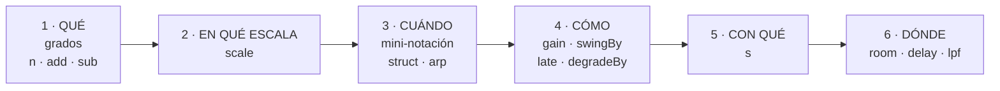

```js
n( GRADOS )          // 1 · qué notas, como números de escala
  .scale( MODO )     // 2 · en qué escala
  .struct( RITMO )   // 3 · cuándo suena (o .arp)
  .gain( MANO )      // 4 · cómo se toca
  .s( SONIDO )       // 5 · con qué instrumento
  .room( ESPACIO )   // 6 · en qué sala
```

**Construye una línea por pregunta y escucha después de cada una.** Si cambias tres
cosas a la vez, no sabes cuál hizo qué.

### 0.2 Dos reglas que te ahorran horas

> [!warning] Regla 1 · Los grados se tocan antes de `.scale()`
> Antes de `.scale()` los valores son **grados** (0, 1, 2…): se suman, se restan, se
> apilan. Después ya son **notas**, y un `.add(n(7))` detrás de `.scale()` no
> cambia la altura.
>
> Para mover algo que ya pasó por la escala: `.scaleTranspose(7)` (dentro de la
> escala) o `.transpose(12)` (en semitonos).

> [!warning] Regla 2 · El ritmo sale del patrón de la izquierda
> En `a.add(b)` los ataques son los de `a`; `b` solo aporta valores. Si quieres el
> ritmo de `b`, ponlo a la izquierda (`b.add(a)`) o usa `a.add.out(b)`.

Escúchala. Mismo material, distinto lado:

```strudel
setcpm(80/4)
let raiz = "<0>"
cat(
  n(raiz.add("0 4 0 4")),   // compás 1: el ritmo sale de raiz → UNA nota
  n("0 4 0 4".add(raiz)),   // compás 2: el ritmo sale de "0 4 0 4" → cuatro
).scale("C2:major").s("gm_acoustic_bass")
```

### 0.3 Herramientas para escuchar

| Quiero… | Hago |
|---|---|
| ver qué suena | el pianoroll del bloque |
| apagar una capa | `//` al principio de su línea |
| comparar dos versiones | `cat(a, b)`: un compás cada una |
| oír un efecto con y sin | `.firstOf(2, x => x.efecto())`: un compás con, otro sin |

---

## 1. La arquitectura: una progresión, muchas capas

El truco que hace fácil todo lo demás: **escribe la progresión una sola vez, en
grados, y deriva de ella cada capa.** Cambiar de tonalidad, de modo o de acordes
pasa a ser cambiar una línea, y toda la banda la sigue.

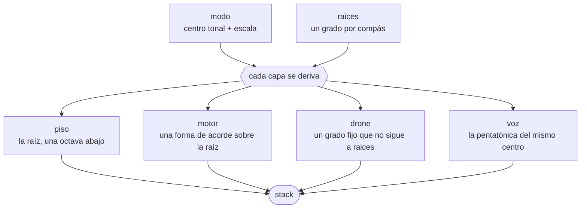

En una escala de siete notas, **7 grados son una octava** (en una pentatónica, 5).
Por eso `.sub(7)` baja la raíz una octava sin salirse de la escala.

El esqueleto. Suena un solo acorde **a propósito**: la progresión es tuya.

```strudel
setcpm(80/4)
let modo   = "C:major"   // ← tu centro tonal y tu modo
let raices = "<0>"       // ← tu progresión: un grado por compás

let piso  = n(raices.sub(7))           // la raíz, una octava abajo
let motor = n(raices.add("[0,2,4]"))   // la tríada sobre esa raíz

stack(
  piso.scale(modo).s("gm_acoustic_bass"),
  motor.scale(modo).s("gm_acoustic_guitar_steel").gain(.6),
)
```

> [!question] Reto 1 · Tu progresión en el esqueleto
> Copia el esqueleto a tu nota de trabajo y pon en `raices` una progresión de
> cuatro compases: la tuya o una de §2.1.
>
> *Hecho cuando* el pianoroll muestra el piso cambiando una vez por compás y el
> motor siempre con tres notas encima.

> [!hint]- Pista 1
> Un elemento por compás va entre `< >`: `"<a b c d>"` son cuatro compases.

> [!hint]- Pista 2
> De romano a grado: I = 0, ii = 1, iii = 2, IV = 3, V = 4, vi = 5, vii° = 6.
> Se cuenta desde la tónica del modo, empezando en cero.

---

## 2. Armonía: pocos acordes, mucho color

Teoría detrás: [[0. Modos]], [[6. Crear progresiones tonales]],
[[3. Intercambios modales]].

### 2.1 Las familias de progresión

El folk cambia poco de acorde y se queda mucho en cada uno. Casi todo el
repertorio sale de cinco familias:

| Familia                 | Romanos            | Sensación                      | `modo`       | Grados |
| ----------------------- | ------------------ | ------------------------------ | ------------ | ------ |
| Tres acordes            | I · IV · V         | himno, plaza, canción protesta | `major`      |        |
| Los cuatro del pop-folk | I · V · vi · IV    | coro grande, optimista         | `major`      | ?      |
| Balada menor            | i · VII · VI · VII | tradicional, oscura            | `minor`      | ?      |
| Mixolidia               | I · bVII · IV · I  | celta, abierta, de tarde       | `mixolydian` | ?      |
| Dórica                  | i · IV             | antigua y luminosa a la vez    | `dorian`     | ?      |

> [!important] No escribas alteraciones: cambia el modo
> En Strudel la escala ya trae sus alteraciones. El bVII de la mixolidia es,
> simplemente, el grado 6 de `mixolydian`. Por eso la columna **Grados** es tu
> primer reto: traducir romanos a números dentro de cada modo.

> [!question] Reto 2.1 · Traduce la tabla
> Llena la columna *Grados* de las cinco familias y prueba cada una en el
> esqueleto de §1, cambiando solo `raices` y `modo` (`"D:dorian"`, `"G:mixolydian"`…).
>
> *Hecho cuando* puedes nombrar en una palabra la emoción de cada familia, y sabes
> cuál querrías para tu próxima pieza.

> [!hint]- Pista
> Cuenta desde la tónica **del modo**: en `G:mixolydian` el grado 6 es F natural,
> que es exactamente el bVII de G.

### 2.2 La forma del acorde

La progresión dice **dónde** está cada acorde; la forma dice **qué** se monta
encima. Como la forma también son grados, se adapta sola al modo.

| Forma | Grados | Por qué suena a folk |
|---|---|---|
| tríada | `[0,2,4]` | la base |
| vacía, sin tercera | `[0,4,7]` | ni mayor ni menor: celta, antigua |
| sus2 | `[0,1,4]` | cuerdas al aire, suspenso abierto |
| sus4 | `[0,3,4]` | pide resolver a la tríada |
| add9 | `[0,2,4,8]` | la frontera con el dream pop |
| con octava | `[0,2,4,7]` | dobla la raíz, como un acorde abierto de guitarra |

Las seis, una por compás, sobre la misma raíz:

```strudel
setcpm(60/4)
let formas = "<[0,2,4] [0,4,7] [0,1,4] [0,3,4] [0,2,4,8] [0,2,4,7]>"
n("<0>".add(formas)).scale("C:major")
  .s("gm_acoustic_guitar_steel").room(.3)
```

> [!question] Reto 2.2 · Una suspensión que resuelve
> Haz que, dentro de **un mismo compás**, un acorde empiece suspendido y resuelva
> a su tríada.
>
> *Hecho cuando* oyes las dos formas y puedes señalar en el pianoroll la única nota
> que se mueve.

> [!hint]- Pista 1
> Dos formas en un compás se escriben como una secuencia de dos apilados:
> `"[[…] […]]"`.

> [!hint]- Pista 2
> Si solo suena la primera forma, ¿de qué lado del `.add` está saliendo el ritmo?
> (Regla 2.)

### 2.3 El ritmo armónico: cuánto dura cada acorde

| Escribes | Pasa |
|---|---|
| `"<0 0 3 4>"` o `"<0!2 3 4>"` | el I suena dos compases, **atacado dos veces** |
| `"<0@2 3 4>"` | el I es **una sola nota larga** de dos compases |

Sin nada detrás, `@` deja que la guitarra se apague. Con `.struct()` detrás da
igual cuál uses: los ataques los pone el `struct`. Con `.arp()` **no**: el arpegio
toca solo el primer compás de una nota `@2` y deja mudo el segundo. Si vas a
arpegiar, alarga con `!`.

> [!question] Reto 2.3 · Quedarse en casa
> Haz que tu I dure el doble que los demás acordes.
>
> *Hecho cuando* al contar los compases en voz alta, el cambio cae donde lo esperas.

### 2.4 El drone: la cuerda que no se mueve

En la guitarra folk las cuerdas al aire suenan **encima de todos los acordes**.
Esa nota fija choca suave con algunos y crea el sonido "de madera". Es la manera
más rápida de sonar a folk sin tocar la progresión.

```music-abc
X:1
T:Drone: una nota que no se mueve
M:4/4
L:1/1
Q:1/4=66
K:C
V:1 clef=treble name="Drone"
V:2 clef=treble name="Acordes"
[V:1] G | G |
[V:2] [CEG] | [FAc] |
```

```strudel
setcpm(66/4)
let modo   = "C:major"
let raices = "<0 3>"     // dos acordes, solo para oír el roce
let drone  = "4"         // ← un grado fijo: NO sigue a raices

stack(
  n(raices.add("[0,2,4]")).scale(modo).s("gm_acoustic_guitar_steel").gain(.6),
  n(drone).struct("x*4").scale(modo).s("gm_acoustic_guitar_steel").gain(.4),
)
```

> [!question] Reto 2.4 · Busca tu cuerda al aire
> Pon el drone sobre **tu** progresión y pruébalo en cada grado, del 0 al 6.
> Para cada uno, anota contra qué acorde roza y qué intervalo forma.
>
> *Hecho cuando* tienes una tabla *grado → acorde → intervalo* y eliges un drone.
> Los roces que te gusten son tensiones: compáralos con [[8. Tensiones]].

> [!tip] Qué decide en tu pieza
> Tres cosas: la familia de progresión, cuánto dura cada acorde y cuál es tu
> cuerda al aire.

---

## 3. La mano derecha: el ritmo del folk

En el folk la guitarra también es la batería: el pulgar hace de bombo y los dedos
o el rasgueo hacen de caja y hi-hat. En Strudel, **cada parte de la mano es una
capa**.

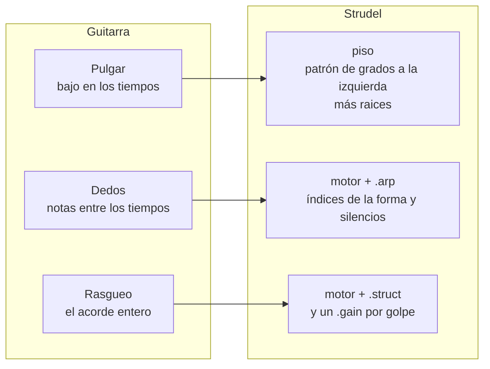

Todos los retos de esta sección parten del esqueleto de §1.

### 3.1 Boom-chick

Bajo en 1 y 3, acorde en 2 y 4. Lo más antiguo del género.

```music-abc
X:2
T:Boom-chick
M:4/4
L:1/4
Q:1/4=90
K:C
V:1 clef=treble name="Acorde"
V:2 clef=bass name="Bajo"
[V:1] z [CEG] z [CEG] | z [CEG] z [CEG] |
[V:2] C, z C, z | C, z C, z |
```

**Las piezas:** `.struct("…")` impone los ataques: `x` es golpe, `~` es silencio.

**Cómo se arma:**

1. Dale al piso un `struct` con los tiempos del bajo.
2. Dale al motor el `struct` complementario.
3. Escucha cada capa sola, comentando la otra, y luego juntas.

> [!question] Reto 3.1 · Boom-chick
> Reproduce el pentagrama.
>
> *Hecho cuando* puedes decir "BUM-cha-BUM-cha" encima y coincide, y en el
> pianoroll el grave y el acorde nunca caen juntos.

### 3.2 Bajo alternado

El pulgar alterna raíz y quinta. Una sola guitarra parece bajo más armonía.

```music-abc
X:3
T:Bajo alternado: raíz y quinta abajo
M:4/4
L:1/4
Q:1/4=90
K:C
V:1 clef=bass name="Pulgar"
[V:1] "C"C, G,, C, G,, | "F"F, C, F, C, |
```

**Las piezas:** en grados, **la quinta está 4 arriba o 3 abajo** (`+4`, `-3`; es
la quinta de la escala, así que solo sobre el vii° sale disminuida). El patrón de
alternancia tiene que ir **a la izquierda** y `raices` a la derecha (Regla 2).

**Cómo se arma:**

1. Escribe la alternancia como grados relativos a la raíz, uno por tiempo.
2. Súmale `raices`.
3. Ajusta la octava con `.sub(7)` si queda alta.

> [!question] Reto 3.2 · El pulgar
> Reproduce el pentagrama, con la quinta **abajo**.
>
> *Hecho cuando* el pianoroll dibuja un zigzag que se desplaza con cada cambio de
> acorde.

> [!hint]- Pista 1
> Si suena una sola nota por compás, el ritmo está saliendo de `raices`. Regla 2.

> [!hint]- Pista 2
> La forma del código, sin los números:
> ```js
> n("? ? ? ?".add(raices)).scale(modo)
> ```

> [!question] Reto 3.2b · Walk-up
> En el último tiempo antes de un cambio de acorde, haz que el bajo **camine** por
> grados hacia la raíz siguiente.
>
> *Hecho cuando* el cambio de acorde se oye anunciado un tiempo antes.

> [!hint]- Pista 1
> No hay una función de "siguiente acorde". El paso se escribe en el patrón del
> compás que lo necesita, y `< >` deja un patrón distinto por compás.

> [!hint]- Pista 2
> Otra vía: transforma solo el último compás de cada cuatro con
> `.lastOf(4, x => …)`. Ojo: antes de `.scale()` (Regla 1).

### 3.3 Travis: pulgar en los tiempos, dedos entre ellos

El pulgar mantiene el bajo alternado de §3.2; los dedos tocan notas del acorde en
los contratiempos. En el 1, pulgar y dedo a la vez: el *pinch*.

```music-abc
X:4
T:Travis: pulgar en los números, dedos en las y
M:4/4
L:1/8
Q:1/4=84
K:C
V:1 clef=treble name="Dedos"
V:2 clef=bass name="Pulgar"
[V:1] e G z c z G z c | e G z c z G z c |
[V:2] C,2 G,,2 C,2 G,,2 | C,2 G,,2 C,2 G,,2 |
```

**Las piezas:** `.arp("…")` toca la forma del acorde por **índices**, en el orden en
que la escribiste: si la escribes de grave a agudo, `0` es la más grave, `1` la
siguiente… `~` deja un hueco y `[0,4]` toca dos índices a la vez. Así recorre una
forma de cinco notas:

```strudel
setcpm(84/4)
n("<0>".add("[0,2,4,7,9]")).scale("C:major")
  .arp("0 1 2 3 4 3 2 1")    // índices de la forma, de grave a agudo
  .s("gm_acoustic_guitar_nylon")
```

**Cómo se arma:**

1. El pulgar es tu bajo alternado de §3.2, en negras.
2. Los dedos son una forma con suficientes notas agudas y un `arp` con silencios
   donde cae el pulgar.
3. `stack` de las dos.

> [!question] Reto 3.3 · Travis
> Reproduce el pentagrama.
>
> *Hecho cuando* al contar "1 y 2 y 3 y 4 y", el pulgar cae en los números y los
> dedos en las "y", salvo el pinch del 1.

> [!hint]- Pista 1
> Son dos capas. El pinch sale solo: pulgar y dedo coinciden en el 1 porque viven
> en capas distintas.

> [!hint]- Pista 2
> En `[0,2,4,7,9]` los índices son `0 1 2 3 4`, de grave a agudo. Busca qué nota
> del pentagrama es cada uno.

> [!hint]- Pista 3
> ```js
> n(raices.add("[0,2,4,7,9]")).scale(modo).arp("? ? ~ ? ~ ? ~ ?")
> ```

El roll del banjo es el mismo mecanismo con otra agrupación: ocho corcheas en
**3 + 3 + 2**.

```music-abc
X:5
T:Roll hacia delante: 3 + 3 + 2
M:4/4
L:1/8
Q:1/4=100
K:G
!>!GBd !>!GBd !>!GB | !>!GBd !>!GBd !>!GB |
```

> [!question] Reto 3.3b · Roll de banjo
> Reproduce el roll con sus acentos, con `gm_banjo`.
>
> *Hecho cuando* puedes palmear los acentos, 3 + 3 + 2, mientras suena.

> [!hint]- Pista
> `.gain()` con ocho valores, uno por corchea. Acento = valor más alto.

### 3.4 Rasgueo

Abajo en los tiempos, arriba en los contratiempos, y los de abajo pesan más. El
rasgueo de siempre: abajo, abajo-arriba, arriba-abajo-arriba.

```music-abc
X:6
T:Rasgueo: abajo, abajo-arriba, arriba-abajo-arriba
M:4/4
L:1/8
Q:1/4=90
K:C
"C"!downbow!B2 !downbow!B!upbow!B z!upbow!B !downbow!B!upbow!B |
```

**Las piezas:** `.struct()` con ocho pasos (corcheas) para dónde hay golpe, y
`.gain()` con ocho valores para cuánto pesa cada uno.

> [!question] Reto 3.4 · Rasgueo
> Reproduce el pentagrama.
>
> *Hecho cuando* con los ojos cerrados distingues los golpes de abajo de los de
> arriba.

> [!hint]- Pista 1
> El silencio del 3 es un `~`: la mano baja sin tocar las cuerdas.

> [!hint]- Pista 2
> `.gain()` lee su valor en el instante de cada golpe. Si escribes sus ocho valores
> alineados con los del `struct`, cada golpe toma el suyo.

> [!note] Un límite de Strudel
> El acorde suena en bloque. Una guitarra real lo abanica: al bajar entran primero
> los graves y al subir, los agudos.

> [!question] Reto 3.4b · El abanico (avanzado)
> Imita el abanico del rasgueo.
>
> *Hecho cuando* a tempo lento oyes las cuerdas entrar una detrás de otra.

> [!hint]- Pista 1
> Una capa por cuerda, cada una con un `.late()` un poco mayor que la anterior.

> [!hint]- Pista 2
> Una función de JavaScript fabrica las capas:
> ```js
> let cuerda = (grado, retraso) =>
>   n(raices.add(grado)).scale(modo).struct(golpes).late(retraso)
> stack(cuerda(0, 0), cuerda(2, ?), cuerda(4, ?), cuerda(7, ?))
> ```
> El retraso está en fracciones de compás: a 90 BPM en 4/4, `.008` son unos 20 ms.

> [!tip] Qué decide en tu pieza
> Tu mano derecha: boom-chick, alternado, Travis o rasgueo. Una por sección, dos
> como mucho.

---

## 4. El compás: 4/4, vals y 6/8

Media tradición folk va en tres. Cambiar de compás cambia más la emoción que
cambiar de acordes. La regla de siempre: **un ciclo = un compás**
([[1. Beats desde cero#1.1 Un ciclo = un compás]]).

| Compás | Tempo en Strudel | Se cuenta | Sensación |
|---|---|---|---|
| 4/4 | `setcpm(BPM/4)` | 1 2 3 4 | marcha, canción |
| 3/4 | `setcpm(BPM/3)` | 1 2 3 | vals, nana |
| 6/8 | `setcpm(BPM/2)`, con el BPM de la negra con punto | 1 y a 2 y a | mecedora, balada antigua |

Un metrónomo de 3/4. El acento en el 1 es lo que hace oír el compás:

```strudel
setcpm(120/3)          // 3/4: un ciclo = tres negras
n("<0>".add("[0,2,4]")).scale("C:major")
  .struct("x x x")
  .gain("1 .5 .5")
  .s("gm_acoustic_guitar_steel")
```

### 4.1 Vals

En el vals el bajo va en el 1, el acorde en el 2 y el 3, y la alternancia del bajo
pasa **de compás a compás**, no de tiempo a tiempo.

```music-abc
X:7
T:Vals: bajo en 1, acorde en 2 y 3
M:3/4
L:1/4
Q:1/4=120
K:G
V:1 clef=treble name="Acorde"
V:2 clef=bass name="Bajo"
[V:1] z [GBd] [GBd] | z [GBd] [GBd] |
[V:2] G,, z z | D, z z |
```

**Las piezas:** `< >` da un valor por compás, así que una alternancia escrita dentro
de `< >` alterna por compás.

> [!question] Reto 4.1 · Tu progresión en vals
> Pasa tu progresión a 3/4, con el bajo alternando raíz y quinta por compás.
>
> *Hecho cuando* puedes contar "UNO dos tres" y el bajo cambia de nota en cada UNO.

> [!hint]- Pista
> Un acorde de vals suele durar dos compases: uno para la raíz y otro para la
> quinta. Mira §2.3 para alargar los acordes de `raices`.

### 4.2 6/8

Seis corcheas en dos grupos de tres. Se siente en **dos** pulsos grandes.

```music-abc
X:8
T:6/8: dos pulsos de tres corcheas
M:6/8
L:1/8
Q:3/8=60
K:D
V:1 clef=treble name="Dedos"
V:2 clef=bass name="Bajo"
[V:1] DFA dAF | DFA dAF |
[V:2] D,3 A,,3 | D,3 A,,3 |
```

> [!question] Reto 4.2 · Balada en 6/8
> Reproduce el pentagrama sobre tu progresión.
>
> *Hecho cuando* sientes dos pulsos por compás, no seis: te puedes mecer encima.

> [!hint]- Pista
> `setcpm(BPM/2)` con el BPM de la negra con punto. El arpegio son seis índices;
> el bajo, dos pasos. Más contexto: [[1. Beats desde cero#Balada en 6/8]].

> [!tip] Qué decide en tu pieza
> El compás. Antes de cambiar de acordes, prueba la misma progresión en 3/4.

---

## 5. La mano humana: sacar al folk de la rejilla

Strudel es una rejilla perfecta y el folk vive un poco fuera de ella. La técnica
completa está en [[1. Beats desde cero#5.3 Humanizar]] y
[[1. Beats desde cero#6.1 Swing]]; aquí, cómo aplicarla a una guitarra.

| Imperfección               | La pieza                         | Explora entre                        |
| -------------------------- | -------------------------------- | ------------------------------------ |
| acentos de la mano         | `.gain("1 .6 .8 .6")`            | tu propio patrón                     |
| dinámica que respira       | `.gain(perlin.range(a, b))`      | `a` y `b` entre 0 y 1                |
| galope                     | `.swingBy(x, 4)`                 | `0` (recto) y `1/3` (tresillo)       |
| llegar tarde               | `.late("0 .01")`                 | `0` y `.02`, en fracciones de compás |
| notas que se comen         | `.degradeBy(p)`                  | `0` y `.3`                           |
| un adorno de vez en cuando | `.sometimesBy(p, x => x.ply(2))` | `0` y `.2`                           |

El laboratorio: una guitarra perfectamente mecánica, con las imperfecciones
apagadas. Descomenta **una** línea, escucha cuatro compases y vuelve a comentarla.

```strudel
setcpm(84/4)
n("<0>".add("[0,2,4,7]")).scale("C:major")
  .arp("0 2 1 3 0 2 1 3")
   .gain("1 .6 .8 .6 1 .6 .8 .6")
  // .gain(perlin.range(.4, .9))
   //.swingBy(1/3, 4)
   //.late("0 .01")
  // .degradeBy(.1)
  // .sometimesBy(.1, x => x.ply(2))
  .s("gm_acoustic_guitar_steel")
```

> [!note] Cómo funciona `swingBy(x, n)`
> Corta el compás en `n` partes y retrasa la segunda mitad de cada una. Con
> corcheas en 4/4, `n = 4`. Si tu capa solo tiene negras, el swing no tiene nada
> que mover.

> [!question] Reto 5.1 · La escalera de swing
> Cuatro compases, cuatro valores de swing entre `0` y `1/3`, uno por compás
> (`swingBy` acepta `"< >"`).
>
> *Hecho cuando* eliges un valor y puedes decir por qué ese y no el de al lado.

> [!question] Reto 5.2 · Tu mano, como función
> Escribe tu humanización como una función y aplícala a todas las capas:
> ```js
> let mano = p => p.swingBy(?, 4).gain(?)   // …lo que elegiste
> ```
> y luego `mano(motor)`, `mano(piso)`…
>
> *Hecho cuando* quitar y poner `mano` cambia la sensación de la banda entera.
> Cuando pase las cuatro pruebas (tocada, escuchada, usada al improvisar y
> grabada), es candidata a `2. Vocabulario/` ([[4. Instrumento/2. Strudel/README]]).

> [!tip] Qué decide en tu pieza
> Tu mano: qué imperfección te importa más. Casi siempre es la dinámica, no el
> tiempo; compruébalo tú.

---

## 6. Melodía: improvisar dentro de la escala

Teoría detrás: [[1. Composición melódica]], [[0. Enlaces 2.0 y motivos]].

### 6.1 La pentatónica

La mayoría de las melodías folk caben en cinco notas. Casi no tiene semitonos, así
que es difícil chocar con los acordes. La mayor y su relativa menor son **las
mismas cinco notas** con otro centro:

```music-abc
X:9
T:Pentatónica mayor de C y menor de A
M:none
L:1/4
K:C
"^C mayor"C D E G A c | "^A menor"A, C D E G A |]
```

En Strudel: `"C4:major:pentatonic"` y `"A3:minor:pentatonic"`. En la pentatónica,
**5 grados son una octava**. Usa la del mismo centro que tu `modo`.

### 6.2 Strudel como dado: proponer, congelar, fijar

Strudel puede tirar frases al azar dentro de la escala. Tú no improvisas notas:
**improvisas escuchando** y te quedas con lo que te dice algo.

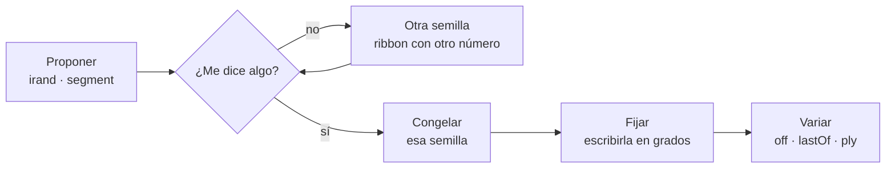

| La pieza | Qué controla |
|---|---|
| `irand(k)` | un grado al azar entre `0` y `k-1`: el **ámbito** |
| `.segment(m)` | `m` notas por compás: el ritmo base |
| `.ribbon(semilla, ciclos)` | repite un trozo fijo del azar: un **motivo** |
| `.add(k)` antes de `.scale()` | mueve el ámbito arriba o abajo |
| `.struct("…")` | un ritmo propio en vez de notas iguales |
| `.degradeBy(p)` | silencios: la voz respira |

El dado, sobre un acorde:

```strudel
setcpm(80/4)
let escala = "C4:major:pentatonic"
stack(
  n("<0>".add("[0,2,4]")).scale("C:major").s("gm_acoustic_guitar_steel").gain(.5),
  n(irand(5).segment(4))
    // .ribbon(0, 2)      // ← descomenta: congela dos compases del azar
    .scale(escala).s("gm_fiddle"),
)
```

> [!question] Reto 6.2a · Tres semillas
> Con `ribbon` activo, cambia la semilla (el primer número) hasta encontrar tres
> que te digan algo.
>
> *Hecho cuando* tienes anotadas tres semillas, con una frase sobre cada una.

> [!question] Reto 6.2b · Fíjala
> Pasa una semilla a grados escritos a mano, sin azar.
>
> *Hecho cuando* tu versión escrita y la congelada suenan igual (compáralas con
> `cat`).

> [!hint]- Pista
> Puedes leerla en el pianoroll. Mejor todavía: sácala de oído en la guitarra o el
> teclado. Es entrenamiento auditivo gratis.

> [!question] Reto 6.2c · Ámbito de habla
> Una línea de solo tres notas con un ritmo irregular, como de alguien hablando.
>
> *Hecho cuando* puedes recitar una frase encima y encaja.

### 6.3 Pregunta y respuesta

La voz dice algo y un instrumento contesta en el hueco: la armónica entre dos
versos.

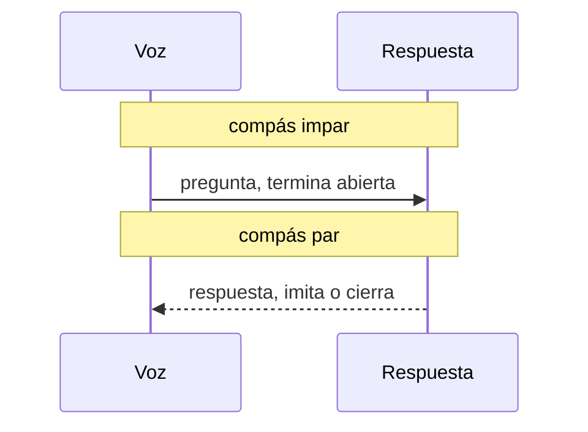

**Las piezas:** `.mask("<1 0>")` y `.mask("<0 1>")`, dos interruptores
complementarios: uno suena en los compases impares y el otro en los pares. Aquí
con azar, para oír solo el mecanismo:

```strudel
setcpm(80/4)
let escala = "C4:major:pentatonic"
stack(
  n(irand(5).segment(4)).scale(escala).s("gm_voice_oohs").mask("<1 0>"),
  n(irand(5).segment(4).add(5)).scale(escala).s("gm_harmonica").mask("<0 1>"),
)
```

> [!question] Reto 6.3 · Tu diálogo
> Tu motivo fijo de 6.2b como pregunta, y una respuesta que lo imite o lo cierre,
> en otro timbre y otro registro.
>
> *Hecho cuando* en el pianoroll nunca suenan a la vez, y la respuesta termina en
> un grado más estable que la pregunta.

> [!hint]- Pista 1
> `.scaleTranspose(5)` sube una octava **dentro** de la pentatónica, aunque ya
> hayas pasado por `.scale()`.

> [!hint]- Pista 2
> Imitar es el mismo ritmo con otras notas. Cerrar es terminar en el grado 0.

Para variar un motivo ya fijo: `.off(1/8, x => x.scaleTranspose(2))` le pone un eco
dos grados arriba; `.lastOf(4, x => …)` cambia solo el último compás de cada cuatro.

> [!tip] Qué decide en tu pieza
> Un motivo de dos compases, y su papel: pregunta o respuesta.

---

## 7. Arreglo: la banda y la forma

### 7.1 La paleta

| Papel           | Instrumentos que existen en tu plugin                                                                        |
| --------------- | ------------------------------------------------------------------------------------------------------------ |
| motor           | `gm_acoustic_guitar_steel` · `gm_acoustic_guitar_nylon` · `gm_banjo` · `gm_dulcimer` · `gm_orchestral_harp`  |
| piso            | `gm_acoustic_bass` · `gm_contrabass` · `gm_cello`                                                            |
| voz y respuesta | `gm_fiddle` · `gm_violin` · `gm_harmonica` · `gm_recorder` · `gm_whistle` · `gm_pan_flute` · `gm_voice_oohs` |
| colchón         | `gm_accordion` · `gm_bandoneon` · `gm_string_ensemble_1` · `gm_choir_aahs` · `gm_pad_warm`                   |
| textura         | `gm_guitar_fret_noise` · `gm_guitar_harmonics` · `gm_kalimba`                                                |

La percusión folk (pisotón, palmas, pandereta) está armada en
[[1. Beats desde cero#Folk stomp-clap]].

Para audicionar, un instrumento por compás. Cambia la lista:

```strudel
setcpm(70/4)
n("<0>".add("[0,2,4,7]")).scale("C:major").arp("0 1 2 3")
  .s("<gm_acoustic_guitar_steel gm_acoustic_guitar_nylon gm_banjo gm_dulcimer gm_orchestral_harp>")
```

> [!question] Reto 7.1 · Tu trío
> Elige piso, motor y voz.
>
> *Hecho cuando* en el pianoroll las tres capas ocupan franjas de altura distintas
> y ninguna pisa a otra.

### 7.2 La forma por densidad

El folk tradicional repite **la misma música** con letra nueva. El arco no viene de
cambiar acordes, sino de **cuántas capas suenan**, y rara vez hay más de tres a la
vez. Este es el arco típico, no el tuyo:

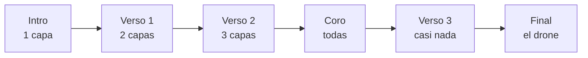

| La pieza | Qué hace |
|---|---|
| `.mask("<0!4 1!12>")` | el mapa de entradas de una capa: 0 fuera, 1 dentro, un valor por compás |
| `!` | repite: `0!4` son cuatro compases fuera |
| `arrange([n, patrón], …)` | secciones con nombre, como en [[strudel — secciones]] |

Tu partitura de capas, para llenar en papel antes de tocar código:

| Capa | 1–4 | 5–8 | 9–12 | 13–16 |
|---|---|---|---|---|
| piso | | | | |
| motor | | | | |
| voz | | | | |
| drone | | | | |

Cada fila es un `.mask()`.

> [!question] Reto 7.2 · Tu arco
> Dibuja tu arco (en papel o en Mermaid) y escribe un `mask` por capa.
>
> *Hecho cuando* el código suena como tu dibujo, y cada sección añade o quita
> exactamente una capa.

> [!hint]- Pista
> La entrada del bajo en el segundo verso es el clímax más barato del género.

### 7.3 La mesa de mezcla

Aquí se juntan todas las secciones. Cada capa trae un comentario con la sección
que la completa. Arranca con todo en `<1>` y ve escribiendo tus mapas.

```strudel
setcpm(80/4)
let modo   = "C:major"              // §2.1
let raices = "<0>"                  // §2.1 · §2.3
let escala = "C4:major:pentatonic"  // §6.1

let piso  = n(raices.sub(7))                      // §3.1 · §3.2: dale ritmo
              .scale(modo).s("gm_acoustic_bass")
let motor = n(raices.add("[0,2,4]"))              // §2.2 · §3.3 · §3.4: forma y mano
              .scale(modo).s("gm_acoustic_guitar_steel").gain(.6)
let voz   = n(irand(5).segment(4)).ribbon(0, 2)   // §6.2: tu motivo fijo
              .scale(escala).s("gm_fiddle").gain(.6)
let drone = n("4").struct("x*4")                  // §2.4: tu cuerda al aire
              .scale(modo).s("gm_acoustic_guitar_steel").gain(.3)

stack(
  piso .mask("<1>"),    // §7.2: el mapa de entradas de cada capa
  motor.mask("<1>"),
  voz  .mask("<1>"),
  drone.mask("<0>"),
).room(.3)
```

---

## 8. Dream-folk: tu frontera

Entre Bon Iver, Beach House y Harmless hay un punto donde el folk se vuelve dream
pop. Ese punto **se puede medir en código**.

| La pieza | Qué hace |
|---|---|
| `.room(x)` · `.size(x)` | de habitación con gente a recuerdo |
| `.delay(x).delaytime(t).delayfeedback(f)` | ecos: `t` en fracciones de ciclo |
| `.lpf(perlin.range(a, b).slow(8))` | un filtro que respira despacio |
| `gm_acoustic_guitar_nylon` · forma add9 · tempo lento | el resto del color |

```strudel
setcpm(66/4)
n("<0>".add("[0,2,4,8]")).scale("A:minor")
  .arp("0 1 2 3 2 1")
  .s("gm_acoustic_guitar_nylon")
  .room(.2)                                   // ← súbelo de .1 en .1
  // .size(.9)
  // .delay(.3).delaytime(3/8).delayfeedback(.4)
  // .lpf(perlin.range(900, 2500).slow(8))
```

> [!question] Reto 8 · La frontera
> Sube `room` de `.1` en `.1`, y luego descomenta las demás líneas una a una.
>
> *Hecho cuando* anotas en la bitácora el valor exacto en que deja de sonar a
> habitación y empieza a sonar a recuerdo. Ese número es parte de tu sonido.

### Mapa de influencias

No es para copiar: es **qué palanca mover primero** para ir hacia allá.

| Para ir hacia… | Mueve primero | Sección |
|---|---|---|
| Bob Dylan | tres acordes, ámbito corto, armónica en el hueco | §2.1 · §6.2c · §6.3 |
| The Lumineers | boom-chick, palmas, la entrada del bajo | §3.1 · §7.2 |
| Bon Iver | drone, voz una octava arriba, reverb | §2.4 · §6 · §8 |
| Andrew Bird | pregunta y respuesta, ecos con `off` | §6.3 |
| Avi Buffalo | los roces del drone, una mano muy suelta | §2.4 · §5 |
| Harmless · Twin Cabins | nylon, tempo lento, add9 | §2.2 · §8 |
| Beach House | reverb, el filtro que respira, colchón | §7.1 · §8 |

---

## 9. Cuando no suena como esperas

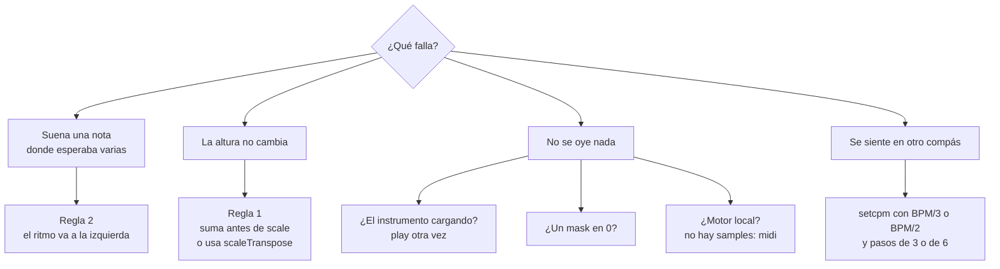

| Síntoma | Causa | Arreglo |
|---|---|---|
| el bajo alternado suena una nota por compás | el ritmo está a la derecha del `.add` | Regla 2 |
| `.add(n(7))` no sube nada | ya pasaste por `.scale()` | Regla 1: `.scaleTranspose(7)` |
| la segunda forma del compás no suena | el ritmo sale de `raices` | Regla 2 |
| el swing no hace nada | la capa no tiene notas entre los pulsos, o `n` no coincide | §5 |
| el acorde de dos compases no se repite | `@2` es una sola nota larga | `!2` repite el ataque |
| el arpegio se calla en el segundo compás de un acorde largo | un `@2` en `raices` con `.arp()` detrás | `!2` en vez de `@2` (§2.3) |
| todo suena una octava arriba o abajo | `scale("C:major")` empieza en la octava 3 | `"C2:major"`, `"C4:major"` o `.sub(7)` |
| el 3/4 suena cojo | el ciclo no mide un compás | `setcpm(BPM/3)` y tres pasos |

---

## 10. Una sesión de exploración

Veinticinco minutos. Cada paso responde **una** pregunta, y no pasas al siguiente
hasta contestarla.

| Min | Qué | § |
|---|---|---|
| 0–3 | modo y familia de progresión, en `raices` | 2 |
| 3–8 | mano derecha y compás | 3 · 4 |
| 8–12 | tu mano humana | 5 |
| 12–18 | dado → semilla → motivo fijo | 6 |
| 18–22 | partitura de capas | 7 |
| 22–25 | **audio** | — |

> [!danger] Semana sin audio es semana en blanco
> Regla dura de [[Inicio]]. Para grabar, pasa el patrón al motor local y a Sonar
> ([[4. Instrumento/2. Strudel/README#Configurar Sonar]]). Treinta segundos
> bastan, aunque estén feos.

### Ejercicios

Son instrucciones, no respuestas: el material lo decides tú.

**1 · Una progresión, cuatro manos.** La misma `raices` con boom-chick, alternado,
Travis y rasgueo, una por sección con `arrange`.
*Hecho cuando* puedes decir qué emoción da cada mano, y cuál usarías en qué sección.

**2 · Tres compases.** Un acompañamiento tuyo en 4/4, 3/4 y 6/8.
*Hecho cuando* eliges uno para una pieza tuya y escribes por qué.

**3 · Folk de dado.** Dieciséis compases con un motivo fijado desde una semilla,
pregunta y respuesta, y tu partitura de capas.
*Hecho cuando* existe el audio.

**4 · De oído.** Una canción folk de tus influencias: su progresión en grados y su
mano derecha.
*Hecho cuando* al sonar junto a la grabación, coincide.

### Dónde va lo que hagas

La regla de ruteo de [[Inicio]]:

| Si el patrón… | Va a |
|---|---|
| nace de una lección | `2. Cursos/<fuente>/<lección>/Estudios/`, dentro de la nota |
| es para una pieza tuya | `3. Composiciones/<obra>/` |
| transcribe o imita a otro | `5. Referencias/` |
| es exploración sin destino | `0. Entrada/`, y se decide en la revisión semanal |
| es un gesto que pasó las cuatro pruebas | `2. Vocabulario/` |

---

## Chuleta

**Intervalos en grados, contados desde la tónica**

| | escala de 7 | pentatónica |
|---|---|---|
| octava | `7` | `5` |
| quinta arriba / abajo | `+4` / `-3` | `+3` / `-2` |
| tercera | `+2` | — |

**Formas de acorde:** `[0,2,4]` tríada · `[0,4,7]` vacía · `[0,1,4]` sus2 ·
`[0,3,4]` sus4 · `[0,2,4,8]` add9 · `[0,2,4,7]` con octava

**Funciones**

| | |
|---|---|
| `setcpm(BPM/4)` · `BPM/3` · `BPM/2` | 4/4 · 3/4 · 6/8 |
| `n("…").scale("C:major")` | grados → notas. Toda la aritmética, antes |
| `raices.add("[0,2,4]")` · `raices.sub(7)` | forma de acorde · bajar una octava |
| `"0 4 0 4".add(raices)` | patrón de grados con el ritmo a la izquierda |
| `.scaleTranspose(k)` · `.transpose(k)` | mover tras `.scale()`: grados · semitonos |
| `.struct("x ~ x ~")` · `.arp("0 ~ [1,3]")` | ataques · recorrer la forma por índices |
| `"<a b>"` · `"a!2"` · `"a@2"` | uno por compás · repetir · alargar |
| `.gain()` · `.velocity()` · `perlin.range(a, b)` | dinámica · señal que respira |
| `.swingBy(x, n)` · `.late("0 .01")` | galope · llegar tarde |
| `.degradeBy(p)` · `.sometimesBy(p, f)` | quitar al azar · variar al azar |
| `irand(k).segment(m)` · `.ribbon(s, c)` | dado · congelar |
| `.mask("<1 0>")` · `.firstOf(n, f)` · `.lastOf(n, f)` | interruptor por compás · primero / último de cada n |
| `.off(t, f)` · `.ply(n)` | eco transformado · repetir cada nota |
| `stack()` · `cat()` · `arrange([n, p], …)` | capas · un compás cada una · secciones |
| `.room()` `.size()` `.delay()` `.lpf()` | espacio |

---

## Enlaces

**En la bóveda**

- Concepto al que sirve: [[4. Instrumento/2. Strudel/0. Qué es y cómo se usa]]
- Guías hermanas: [[3. Folk]] (guitarra real y Sonar) · [[1. Beats desde cero]] ·
  [[1. Componiendo]] (recursos avanzados)
- Plantillas: [[strudel — capas]] · [[strudel — secciones]] · [[strudel — acordes]]
- Armonía: [[0. Modos]] · [[6. Crear progresiones tonales]] ·
  [[3. Intercambios modales]] · [[8. Tensiones]]
- Ritmo y melodía: [[1. Motivos rítmicos]] · [[1. Composición melódica]] ·
  [[0. Enlaces 2.0 y motivos]]

**Fuera**

- [Funciones tonales](https://strudel.cc/learn/tonal/) · [Mini-notación](https://strudel.cc/learn/mini-notation/) ·
  [Azar](https://strudel.cc/learn/random-modifiers/) · [Señales](https://strudel.cc/learn/signals/)

---

## Archivo: `4. Instrumento/2. Strudel/2. House y todo.md`

# Guía Strudel — Armonía, Melodía y Arpegiador

> [!abstract] Objetivo
> Construir una canción desde Strudel empezando por **armonía, bajo, arpegiador y melodía humana**, antes de entrar a beats, house y batería.
>
> La sesión termina en audio: un archivo `.m4a` de 30–60 segundos.

---

## 0. Mapa completo

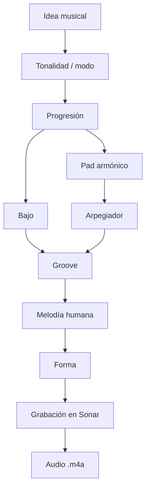

---

## 1. Principio

Strudel no es “la canción entera”. En este sistema, Strudel funciona como **acompañante determinista**:

| Capa        | Quién decide | Quién toca         |
| ----------- | ------------ | ------------------ |
| Tonalidad   | tú           | Strudel la ejecuta |
| Progresión  | tú           | `STR - Pad`        |
| Bajo        | tú           | `STR - Bass`       |
| Arpegiador  | tú           | `STR - Arp`        |
| Melodía     | tú, tocando  | `HUM - Lead`       |
| Audio final | tú grabas    | Sonar              |

> [!important]
> En el motor local, Strudel manda MIDI a Sonar. Los bloques con `s("bd")` sirven para estudiar en Obsidian, pero en el motor local no suenan como samples.

---

## 2. Ruta de señal

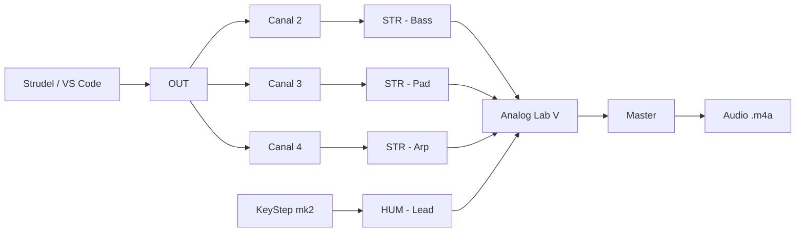

| Voz  | Canal MIDI | Pista en Sonar | Función              |
| ---- | ---------: | -------------- | -------------------- |
| Bajo |          2 | `STR - Bass`   | raíz, suelo, empuje  |
| Pad  |          3 | `STR - Pad`    | color armónico       |
| Arp  |          4 | `STR - Arp`    | movimiento           |
| Lead |          — | `HUM - Lead`   | improvisación humana |

Sonar ya está documentado como el lugar donde los controladores suenan mediante pistas de instrumento con Analog Lab V. Para escuchar MIDI entrante, la pista necesita instrumento e **Input Echo** encendido.

---

## 3. Estructura mental de una canción

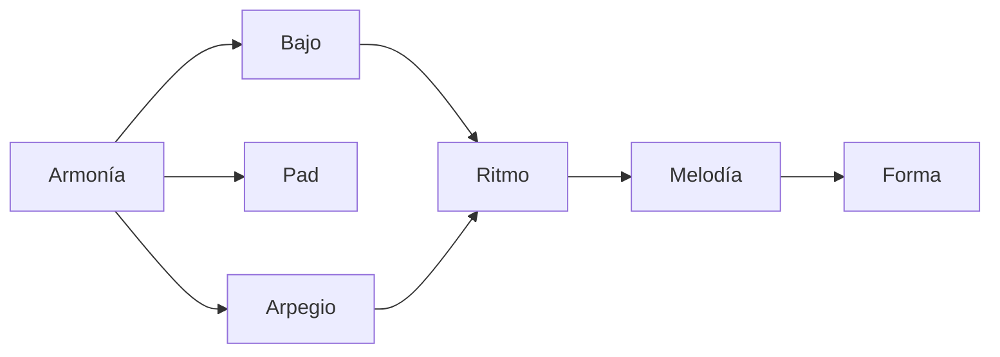

| Pregunta               | Decisión audible |
| ---------------------- | ---------------- |
| ¿Dónde está el centro? | tonalidad/modo   |
| ¿Qué emoción tiene?    | progresión       |
| ¿Dónde pesa el cuerpo? | bajo             |
| ¿Qué se mueve?         | arpegiador       |
| ¿Qué canto encima?     | melodía          |
| ¿Cuándo cambia?        | forma            |

---

## 4. Flujo de sesión

### Objetivo observable

Al final existe:

```text
3. Composiciones/<obra>/render/2026-09-30 armonia-arp-01.m4a
```

con:

- bajo en `STR - Bass`;
- pad en `STR - Pad`;
- arpegio en `STR - Arp`;
- una toma humana en `HUM - Lead`.

---

## 5. Antes de empezar

- [ ] Cerrar Next, MidiSuite y MIDI Control Center.
- [ ] Abrir Sonar.
- [ ] Confirmar que `STR - Bass`, `STR - Pad`, `STR - Arp` tienen Input Echo encendido.
- [ ] Confirmar que Analog Lab V escucha en **MIDI Channel = All**.
- [ ] Hacer Fase 2: `npm run prueba` → debe sonar `STR - Bass`.

---

## 6. Decisiones mínimas

No empieces programando. Primero llena esto:

| Decisión                 | Valor                                           |
| ------------------------ | ----------------------------------------------- |
| Obra activa              | `__________`                                    |
| Tonalidad / modo         | `__________`                                    |
| BPM                      | `__________`                                    |
| Progresión de 4 compases | `__________`                                    |
| Tipo de arpegio          | lento / pulse / broken / house                  |
| Lead humano              | nota larga / motivo corto / improvisación libre |

---

## 7. Partitura mínima de referencia

Esto no es para componer por partitura. Es solo para visualizar la idea: **bajo abajo, acordes arriba, arpegio como movimiento**.

```music-abc
X:1
T:Esqueleto armonia + arp
M:4/4
L:1/4
Q:1/4=120
K:C
V:1 name="Pad"
V:2 name="Bass" clef=bass
[V:1] "I"C2 "vi"Am2 | "IV"F2 "V"G2 |
[V:2] C,,4 | F,,2 G,,2 |
```

> [!note]
> Cambia los acordes. Este bloque solo muestra la relación entre capas.

---

## 8. Esqueleto Strudel

```strudel
// 1 ciclo = 1 compás en 4/4
const BPM = 120 // TÚ: cambia el tempo
setcpm(BPM/4)

// TÚ: progresión de 4 compases.
// Usa símbolos de acorde.
const PROG = "<ACORDE_1 ACORDE_2 ACORDE_3 ACORDE_4>"

// TÚ: raíces o notas de bajo.
const BASS = "<BAJO_1 BAJO_2 BAJO_3 BAJO_4>"

// TÚ: orden relativo del arpegio.
// 0 = primera nota del voicing, 1 = segunda, etc.
const ARP = "0 2 1 3 2 1"

// Bajo
$: note(BASS)
  .midichan(2)
  .midi(OUT)

// Pad
$: chord(PROG)
  .voicing()
  .midichan(3)
  .midi(OUT)

// Arpegio
$: n(ARP)
  .chord(PROG)
  .voicing()
  .midichan(4)
  .midi(OUT)
```

---

## 9. Cómo pensar el arpegiador

Un arpegiador no es solo “Up” o “Down”. Es una decisión musical con cuatro partes:

| Elemento | Pregunta                             |
| -------- | ------------------------------------ |
| Orden    | ¿qué nota del acorde suena primero?  |
| Ritmo    | ¿cada cuánto aparece una nota?       |
| Duración | ¿son notas cortas o ligadas?         |
| Registro | ¿se queda en una octava o sube/baja? |

En Sonar, un patrón de arpegiador puede guardar ritmo, orden relativo, duración y velocity. La ventaja de pensar en grados relativos es que el mismo movimiento puede aplicarse a acordes distintos.

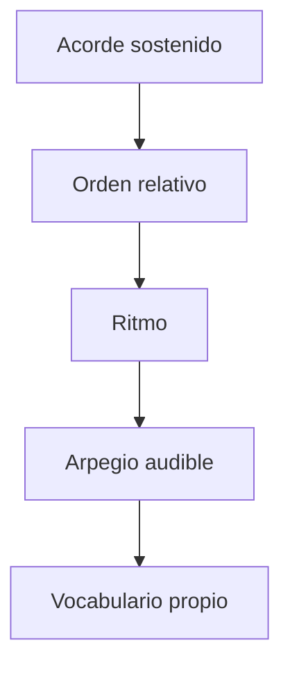

---

## 10. Tres arpegios para probar

### A. Arpegio lento

```strudel
const ARP = "0 ~ 2 ~ 1 ~ 3 ~"
```

| Sensación  | Uso                          |
| ---------- | ---------------------------- |
| abierto    | intro, verso, dream pop      |
| poco denso | deja espacio a la voz        |
| estable    | bueno para improvisar encima |

### B. Pulse

```strudel
const ARP = "0 1 2 1 0 1 2 3"
```

| Sensación | Uso                           |
| --------- | ----------------------------- |
| mecánico  | house, synth-pop              |
| constante | crea motor                    |
| claro     | fácil de seguir con el cuerpo |

### C. Broken chord

```strudel
const ARP = "0 2 1 3 2 1"
```

| Sensación      | Uso                             |
| -------------- | ------------------------------- |
| melódico       | dream pop / indie               |
| menos cuadrado | acompaña sin sonar a ejercicio  |
| reusable       | buen candidato para vocabulario |

---

## 11. Motivo melódico humano

Antes de improvisar mucho, limita el material.

```music-abc
X:2
T:Motivo humano minimo
M:4/4
L:1/8
Q:1/4=120
K:C
C2 E2 G4 | E2 D2 C4 |
```

Regla:

| Compás | Acción           |
| -----: | ---------------- |
|      1 | tocar motivo     |
|      2 | repetir          |
|      3 | cambiar una nota |
|      4 | dejar silencio   |

---

## 12. Forma mínima

```mermaid
gantt
  title Forma de 32 compases
  dateFormat X
  axisFormat %s
  section Intro
  Pad solo           :0, 4
  section A
  Bajo + Pad         :4, 8
  section B
  Bajo + Pad + Arp   :12, 8
  section Toma humana
  Lead improvisado   :20, 8
  section Cierre
  Quitar Arp         :28, 4
```

| Sección | Compases | Capas               |
| ------- | -------: | ------------------- |
| Intro   |      1–4 | pad                 |
| A       |     5–12 | pad + bajo          |
| B       |    13–20 | pad + bajo + arp    |
| Lead    |    21–28 | todo + `HUM - Lead` |
| Cierre  |    29–32 | pad + bajo          |

---

## 13. Versión con forma en Strudel

```strudel
const BPM = 120
setcpm(BPM/4)

const PROG = "<ACORDE_1 ACORDE_2 ACORDE_3 ACORDE_4>"
const BASS = "<BAJO_1 BAJO_2 BAJO_3 BAJO_4>"
const ARP = "0 2 1 3 2 1"

const bass = note(BASS).midichan(2).midi(OUT)

const pad = chord(PROG)
  .voicing()
  .midichan(3)
  .midi(OUT)

const arp = n(ARP)
  .chord(PROG)
  .voicing()
  .midichan(4)
  .midi(OUT)

// Activa por secciones manualmente.
// Primero pad.
// Luego pad + bass.
// Luego pad + bass + arp.

$: pad
$: bass
$: arp
```

---

## 14. Registro de sesión

```markdown
# 2026-09-30 — Armonía
```

---

## Archivo: `4. Instrumento/2. Strudel/7. House/0. House desde cero.md`

```yaml
tipo: guia-ai
estado: vigente
area: 4. Instrumento
concepto: "[[4. Instrumento/2. Strudel/0. Qué es y cómo se usa]]"
tags:
  - curso-musica/strudel
  - house
```

# House con Strudel, desde cero

> [!abstract] Qué es esta guía
> Cómo se arma un track de house completo, capa por capa: el esqueleto de batería,
> el groove, el bajo, el bombeo del sidechain, los acordes, los ganchos, los filtros,
> la tensión y el arreglo de pista de baile. Cada idea trae **pentagrama** cuando hay
> notas, **rejilla** cuando hay golpes y un **bloque de Strudel** para oírla, y
> termina en **la decisión que te deja tomar en una pieza tuya**.
>
> Da por sabido [[4. Instrumento/2. Strudel/3. Beats/1. Beats desde cero|Beats desde cero]]:
> rejilla, `stack`, `velocity`, swing, `cut`, `arrange`. Aquí se usan sin volver a explicarlos.
>
> Es material de apoyo generado por IA. La síntesis, o sea qué es el house *para ti*
> y qué te llevas a tus piezas, va en tus notas de concepto, y esas las escribes tú.

> [!tip] Cómo usarla
> - Dale play a cada bloque. Luego **cambia una sola cosa** y vuelve a escuchar.
> - **Los pentagramas son lo que suena.** Cada bloque `music-abc` está escrito con las
>   mismas notas que toca el bloque de Strudel que lo acompaña. Leer uno y escribir el
>   otro es la mitad del ejercicio.
> - Los bloques suenan **en Obsidian**, donde cargan las cajas de ritmos y los
>   instrumentos `gm_*`. La primera vez que pides un `gm_*` tarda en cargar: si el
>   primer compás sale mudo, dale play otra vez. El motor local
>   ([[4. Instrumento/2. Strudel/README|README]]) no carga samples; para Sonar ver §14.
> - Cada sección tiene su sesión práctica en `_lessons/` (§17). La guía explica; la
>   lección es donde lo escribes tú.
> - El house se oye con graves. Con los parlantes del portátil el bajo y el kick
>   casi desaparecen: usa audífonos.

---

## 0. El mapa

Un track de house contesta cinco preguntas: **qué late** (el groove), **qué
empuja abajo** (el grave), **qué color tiene** (la armonía), **qué se mueve**
(filtros y tensión) y **cuándo cambia** (la forma). La guía sigue ese orden.

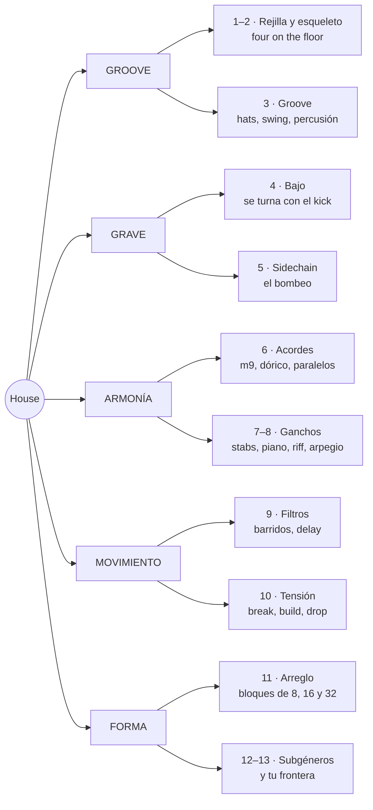

### 0.1 De dónde viene

El house es **disco sin orquesta**. A finales de los 70 los DJs de Chicago y Nueva
York mezclaban disco para que la pista no parara; a mediados de los 80, en Chicago,
empezaron a hacer sus propios tracks con lo que había barato: cajas de ritmos de
Roland (TR-707, TR-909), un sinte de bajo que había fracasado (la TB-303) y un
sampler o un teclado. El nombre viene de **The Warehouse**, el club donde pinchaba
Frankie Knuckles.

| Época | Qué pasó | Para escuchar |
|---|---|---|
| finales de los 70 | disco: kick en negras, hat abierto en el contratiempo | Larry Levan en el Paradise Garage (NY) |
| 1984–86 | Chicago: cajas de ritmos + la idea del disco = house | Jesse Saunders, *On and On* · Marshall Jefferson, *Move Your Body* |
| 1986 | **deep house**: acordes de jazz y soul, menos golpe | Mr. Fingers (Larry Heard), *Can You Feel It* |
| 1987 | **acid**: la TB-303 con el filtro girando | Phuture, *Acid Tracks* |
| los 90 | **garage** de NY y NJ, piano house, **French house** filtrado | Robin S, *Show Me Love* · Stardust, *Music Sounds Better With You* |
| 2000s | el sidechain exagerado se vuelve estilo | Eric Prydz, *Call On Me* |
| 2010s–hoy | tech house, **lo-fi house**, afro house, melodic house | DJ Seinfeld · Black Coffee · Caribou, *Can't Do Without You* |

> [!tip] Qué decide en tu pieza
> El house es un género de **repetición con cambios mínimos**. Si vienes de componer
> canciones, el reto no es inventar más material: es **sostener poco material**
> durante mucho tiempo, cambiando una cosa cada vez. Es lo contrario de una forma
> binaria con contraste, y por eso entrena algo que la canción no entrena.

### 0.2 Cinco cosas que te ahorran horas

> [!warning] 1 · `.bank()` solo en la batería
> `.bank("RolandTR909")` antepone el nombre del banco a **todo** lo que toca. Si lo
> pones al final de un `stack` que también tiene un sinte, el sinte busca
> `RolandTR909_sawtooth`, no existe y **no suena**. Pon el banco capa por capa, o
> agrupa la batería en su propio `stack` (ver el aviso de §8 en Beats).

> [!warning] 2 · Para transponer notas con nombre, `.transpose()`
> `note("a2").add(12)` **no mueve nada**: suena `a2`. Usa `note("a2").transpose(12)`,
> o mete la suma dentro de las comillas: `note("a2".add(12))`.

> [!warning] 3 · Acordes: `F^7`, no `Fmaj7`
> Un símbolo que Strudel no conoce da **silencio sin error**. `Fmaj7`, `Cmaj9` y
> `Am13` no suenan. Los que sí, comprobados: `Am` `Am7` `Am9` `Am11` `Am6` · `D7` `D9`
> `G13` `G7sus` `Asus` · `F^7` (o `FM7`) `C^9` · `C6` `C69` `Cadd9` · `F` `C` `G`.

> [!warning] 4 · Una barra en las comillas no divide
> Dentro de comillas `/` es **ralentizar**: `"3/16"` es el 3 tocado cada 16 ciclos.
> Fuera de comillas es JavaScript: `.delaysync(3/16)` sí es tres dieciseisavos. Para
> un patrón de fracciones escribe decimales: `"<.1875 .125>"`.

> [!warning] 5 · Las señales se leen al empezar cada nota
> `.lpf(sine.range(300, 3000).slow(8))` fija el filtro **al inicio** de cada nota. En
> stabs cortos el barrido suena continuo; en un acorde de un compás entero, el filtro
> salta una vez por compás. Para barrer algo largo, pártelo en notas cortas o usa la
> envolvente del filtro (§9.3).

---

## 1. La rejilla del house

### 1.1 Tempo

El house vive entre **118 y 130 BPM**, casi siempre en 4/4. Con la convención de
siempre (1 ciclo = 1 compás) el tempo es `setcpm(BPM/4)`. La tabla dice cuánto dura
cada bloque de la forma, que es como piensa un track (§11):

| BPM | 1 compás | 8 compases | 32 compases |
|---:|---:|---:|---:|
| 118 | 2,03 s | 16,3 s | 65 s |
| 120 | 2,00 s | 16,0 s | 64 s |
| 122 | 1,97 s | 15,7 s | 63 s |
| 124 | 1,94 s | 15,5 s | 62 s |
| 126 | 1,90 s | 15,2 s | 61 s |
| 128 | 1,88 s | 15,0 s | 60 s |

Qué tempo para qué subgénero está en la tabla de §12.

### 1.2 La rejilla de 16 y `beat()`

Una TR-909 tiene **16 botones por compás**: cada uno es una semicorchea. El house se
programa así, encendiendo pasos. En Strudel hay dos maneras de escribirlo, y suenan
idéntico:

```text
paso    0 1 2 3   4 5 6 7   8 9 10 11   12 13 14 15
cuenta  1 e & a   2 e & a   3 e &  a    4  e  &  a
```

- **Por tiempos**, con un grupo `[ ]` por tiempo (la convención de Beats).
- **Por pasos**, con `.beat("posiciones", 16)`: la lista de botones encendidos,
  contando desde 0. Es la 909 escrita en texto.

| Por pasos | Por tiempos | Qué es |
|---|---|---|
| `s("bd").beat("0,4,8,12", 16)` | `s("bd*4")` | kick en los cuatro tiempos |
| `s("oh").beat("2,6,10,14", 16)` | `s("[~ oh]*4")` | hat abierto en los cuatro "&" |
| `s("cp").beat("4,12", 16)` | `s("~ cp ~ cp")` | palmas en 2 y 4 |
| `s("rim").beat("0,3,6,10,12", 16)` | `s("[rim ~ ~ rim] [~ ~ rim ~] [~ ~ rim ~] [rim ~ ~ ~]")` | clave son 3-2 |

```strudel
setcpm(124/4)
stack(
  s("bd").beat("0,4,8,12", 16),     // los cuatro tiempos
  s("oh").beat("2,6,10,14", 16),    // los cuatro "&"
).bank("RolandTR909")
```

Usa `beat` cuando pienses en **botones** (el kick en el 0, el rim en el 11) y los
grupos cuando pienses en **tiempos**. La última fila de la tabla es la razón para
conocer los dos: una clave se lee mucho mejor por pasos.

### 1.3 La frase: todo cambia en el compás 1 de un bloque de 8

El house piensa en **bloques de 8 compases**, y los bloques se agrupan en 16 y 32.
Un DJ mezcla dos tracks contando esos bloques, así que todo lo que entra o sale lo
hace **en el compás 1 de un bloque**. El compás 8 avisa con un fill o con un hueco.

```text
compás   1   2   3   4   5   6   7   8 │ 9   10 …
         ▲                           ▲ │ ▲
         entra o sale algo     hueco o fill   lo nuevo empieza aquí
```

```strudel
setcpm(124/4)
stack(
  s("<cr ~ ~ ~ ~ ~ ~ ~>"),                       // crash solo en el compás 1 de cada 8
  s("bd*4").lastOf(8, x => x.mask("1 1 1 0")),   // compás 8: el kick calla en el 4
  s("~ cp ~ cp"),
  s("[~ oh]*4"),
).bank("RolandTR909")
```

Dale play y cuenta hasta 8: el silencio del kick en el compás 8 hace que el 1
siguiente **pegue**. Es la herramienta de tensión más barata del género.

> [!tip] Qué decide en tu pieza
> El tempo decide el subgénero antes que cualquier sonido: a 118 es deep, a 128 es
> tech. Y el bloque de 8 decide **cuándo** puedes cambiar algo. Un cambio fuera de
> la rejilla de 8 suena a error, no a sorpresa.

---

## 2. El esqueleto: four on the floor

Cuatro capas, en este orden. Escucha cada bloque antes de pasar al siguiente.

**Solo kick**, en los cuatro tiempos. Es el corazón, y en house **no se mueve**: a
120 BPM un golpe por tiempo es el paso de alguien caminando rápido, y le da al DJ
una referencia constante para cuadrar dos tracks.

```strudel
setcpm(124/4)
s("bd*4").bank("RolandTR909")
```

**Más palmas** en 2 y 4: el backbeat de siempre. En house es más común la palma que
la caja: la palma suena a gente.

```strudel
setcpm(124/4)
stack(
  s("bd*4"),          // kick: los cuatro tiempos
  s("~ cp ~ cp"),     // palmas: 2 y 4
).bank("RolandTR909")
```

**Más hat abierto** en cada "&". Esto es **el** sonido del house: el kick dice
"tum", el hat abierto contesta "tss" justo en medio. Tum-tss-tum-tss. Sin él, un
four on the floor es techno o es una marcha.

```strudel
setcpm(124/4)
stack(
  s("bd*4"),
  s("~ cp ~ cp"),
  s("[~ oh]*4"),      // hat abierto: los cuatro "&"
).bank("RolandTR909")
```

**Más hats cerrados** rellenando las semicorcheas, con el abierto en el "&". Una
sola capa y `.cut(1)`: el cerrado corta la cola del abierto, como un hi-hat de verdad.

```strudel
setcpm(124/4)
stack(
  s("bd*4"),                              // kick: los cuatro tiempos
  s("~ cp ~ cp"),                         // palmas: 2 y 4
  s("[hh hh oh hh]*4").cut(1)             // cerrado, cerrado, ABIERTO, cerrado
    .velocity("[.5 .3 .8 .35]*4"),
).bank("RolandTR909")
```

En el pentagrama de percusión, con las plicas de las manos arriba y las del pie abajo:

```music-abc
X:1
T:Four on the floor
M:4/4
L:1/16
Q:1/4=124
K:C clef=perc
V:1 clef=perc stem=up name="Platos"
V:2 clef=perc stem=down name="Kick y palmas"
[V:1] !style=x!g!style=x!g!open!!style=x!g!style=x!g !style=x!g!style=x!g!open!!style=x!g!style=x!g !style=x!g!style=x!g!open!!style=x!g!style=x!g !style=x!g!style=x!g!open!!style=x!g!style=x!g |
[V:2] F4 [Fc]4 F4 [Fc]4 |
```

| En el pentagrama | Pieza | Strudel |
|---|---|---|
| ✕ encima de la última línea | hat cerrado | `hh` |
| ✕ con un círculo encima | hat abierto | `oh` |
| nota en el tercer espacio | palmas o caja | `cp` · `sd` |
| nota en el primer espacio | kick | `bd` |

Y en la rejilla, que es como lo vas a transcribir de oído:

```text
        1 e & a 2 e & a 3 e & a 4 e & a
oh      . . x . . . x . . . x . . . x .
hh      x x . x x x . x x x . x x x . x
palmas  . . . . x . . . . . . . x . . .
kick    x . . . x . . . x . . . x . . .
```

### 2.1 El backbeat: palmas, caja o las dos

| Backbeat | En Strudel | Carácter | Dónde vive |
|---|---|---|---|
| palmas | `cp` | abierto, humano | Chicago, deep |
| caja | `sd` | seco, con pegada | garage, tech |
| las dos | `[cp,sd]` | gordo | garage, piano house |
| aro | `rim` | íntimo, pequeño | deep, minimal |

```strudel
setcpm(124/4)
stack(
  s("bd*4"),
  s(cat(
    "~ cp ~ cp",               // palmas
    "~ sd ~ sd",               // caja
    "~ [cp,sd] ~ [cp,sd]",     // las dos a la vez: más gorda
    "~ rim ~ rim",             // aro: íntimo
  )),
  s("[~ oh]*4").velocity(.7),
).bank("RolandTR909")
```

La 909 trae 16 cajas y 5 palmas: prueba `sd:3`, `sd:9`, `cp:2` (se cuenta desde 0).

> [!tip] Qué decide en tu pieza
> En house **el kick no se mueve nunca**; lo que decide el subgénero es todo lo que
> pasa encima. Si un track tuyo "no suena a house", antes de tocar acordes revisa
> dos cosas: ¿hay hat abierto en el "&"? ¿el kick cae en los cuatro tiempos?

---

## 3. El groove: lo que pasa encima del kick

### 3.1 Cuatro maneras de tocar los hats

| Patrón       | Por tiempo | En Strudel          | Dónde              |
| ------------ | ---------- | ------------------- | ------------------ |
| solo abierto | `. . x .`  | `[~ oh]*4`          | deep, minimal      |
| corcheas     | `c . a .`  | `[hh oh]*4`         | clásico, disco     |
| galope       | `x x . x`  | `[hh hh ~ hh]*4`    | Chicago, *jackin'* |
| semicorcheas | `x x X x`  | `hh*16` con acentos | tech, garage       |

```strudel
setcpm(124/4)
stack(
  s("bd*4, ~ cp ~ cp"),
  s(cat(
    "[~ oh]*4",               // 1 · solo el abierto
    "[hh oh]*4",              // 2 · cerrado en el tiempo, abierto en el "&"
    "[hh hh ~ hh]*4",         // 3 · galope
    "hh*16",                  // 4 · semicorcheas
  )).cut(1).velocity("[.45 .3 .75 .3]*4"),
).bank("RolandTR909")
```

`.velocity("[.45 .3 .75 .3]*4")` tiene 16 valores, uno por paso, así que sirve para
las cuatro variantes: siempre acentúa el "&".

### 3.2 Swing de semicorcheas

El swing del house es **de semicorcheas** y **poco**: `.swingBy(x, 8)` parte el
compás en 8 pares de semicorcheas y atrasa la segunda de cada par, o sea la "e" y la
"a". Fíjate en lo que eso implica:

```text
paso    0 1 2 3 4 5 6 7 8 9 10 11 12 13 14 15
        1 e & a 2 e & a 3 e &  a  4  e  &  a
se mueve  ↑   ↑   ↑   ↑   ↑    ↑     ↑     ↑      solo los pasos impares
```

El kick, las palmas y el hat abierto caen en pasos pares, así que **no se mueven**.
El swing solo empuja los hats cerrados y la percusión que caen entre medias. Por eso
puedes poner mucho swing sin que el track se tambalee.

| Swing MPC | `swingBy(x, 8)` | Se siente |
|---:|---:|---|
| 50 % | `0` | recto, de máquina |
| 54 % | `.08` | apenas: ya respira |
| 56 % | `.12` | el punto dulce de mucho deep house |
| 58 % | `.16` | relajado, garage |
| 62 % | `.24` | shuffle marcado |
| 66 % | `.33` | tresillo completo |

Un compás por valor: 50 %, 54 %, 58 % y 62 %.

```strudel
setcpm(124/4)
stack(
  s("bd*4, ~ cp ~ cp").bank("RolandTR909"),
  s("[hh hh oh hh]*4").cut(1).velocity("[.45 .3 .75 .3]*4").bank("RolandTR909"),
  s("shaker_small*16").velocity("[.5 .25 .35 .25]*4").pan(.7),
).swingBy("<0 .08 .16 .24>", 8)
```

### 3.3 La percusión: la raíz latina

El house heredó del disco y de la salsa de Nueva York una banda de percusión. Cada
instrumento tiene un trabajo y un sitio en el panorama:

| Instrumento | En Strudel | Dónde cae | Trabajo | Pan |
|---|---|---|---|---|
| shaker | `shaker_small`, `shaker_large` | semicorcheas, bajito | aire, velocidad | a un lado |
| pandereta | `tambourine` | 2 y 4, o en el "&" | brillo, gospel | al otro |
| conga abierta | `conga:4` | síncopas | la conversación | centro-izquierda |
| quinto (aguda) | `conga:14` | pocas, sorpresas | el adorno | izquierda |
| tumba (grave) | `conga:26` | antes del 1 | empuja al tiempo fuerte | centro |
| clave | `clave` | patrón fijo | el reloj latino | centro |
| cencerro | `cb` del `RolandTR808` | uno o dos por compás | color, humor | un lado |
| bongó, cabasa, agogó | `bongo`, `cabasa`, `agogo` | — | color | — |

Sin banco: casi todos vienen de la biblioteca acústica (VCSL), y `.bank()` los
rompería. Las tres congas del mismo instrumento, en la rejilla:

```text
        1 e & a 2 e & a 3 e & a 4 e & a
quinto  . . . x . . . . . . x . . . . .
conga   x . . . . . x . x . . . x . x .
tumba   . . . . . . . . . . . . . . . x
kick    x . . . x . . . x . . . x . . .
```

```strudel
setcpm(124/4)
stack(
  s("bd*4, ~ cp ~ cp").bank("RolandTR909"),
  s("[~ oh]*4").bank("RolandTR909").velocity(.6),
  s("conga:4").beat("0,6,8,12,14", 16).velocity(.6).pan(.35),   // conga abierta
  s("conga:14").beat("3,10", 16).velocity(.5).pan(.25),         // quinto
  s("conga:26").beat("15", 16).velocity(.7).pan(.45),           // tumba: empuja al 1
  s("tambourine").beat("4,12", 16).velocity(.4).pan(.75),       // pandereta con las palmas
  s("shaker_small*16").velocity("[.35 .15 .25 .15]*4").pan(.7),
).swingBy(.12, 8)
```

### 3.4 La clave encima del cuatro

Una clave es un patrón **irregular** que se repite: contra un kick perfectamente
regular, genera la tensión del afro house y del house latino. Las dos más útiles:

```text
                1 e & a 2 e & a 3 e & a 4 e & a
tresillo doble  x . . x . . x . x . . x . . x .     3+3+2 en cada mitad
clave son 3-2   x . . x . . x . . . x . x . . .     tres golpes, luego dos
kick            x . . . x . . . x . . . x . . .
```

El tresillo es la célula de [[1. Teoría/6. Ritmo/1. Motivos rítmicos]], ahora en
semicorcheas. Un compás de cada uno:

```strudel
setcpm(122/4)
stack(
  s("bd*4, [~ oh]*4").bank("RolandTR909"),
  s("clave")
    .beat("<[0,3,6,8,11,14] [0,3,6,10,12]>", 16)   // compás 1 tresillo doble · compás 2 clave 3-2
    .velocity(.7),
)
```

> [!tip] Qué decide en tu pieza
> El groove es **qué se mueve encima de algo que no se mueve**. Elige uno solo de
> estos ejes como protagonista: los hats, el swing o la percusión. Si los tres
> compiten, el oído no sabe a quién seguir y el track se siente nervioso en lugar
> de bailable.

---

## 4. El bajo: el otro corazón

En house el bajo es **el segundo tambor**. Su regla viene de
[[4. Instrumento/2. Strudel/3. Beats/1. Beats desde cero|Beats §11.1]]:
el kick y el bajo comparten registro, así que o se abrazan o **se turnan**. El house
casi siempre elige turnarse:

```text
        1 e & a 2 e & a 3 e & a 4 e & a
kick    x . . . x . . . x . . . x . . .
bajo    . . x . . . x . . . x . . . x .     cada uno en su hueco: el grave nunca choca
```

Todos los ejemplos están en **la menor**, la tonalidad más común del house (y la
más cómoda para leer).

### 4.1 En contratiempo

El bajo más básico del deep y del tech house: una nota en cada "&", exactamente
donde no está el kick. Kick y bajo forman un solo instrumento que hace tum-bom-tum-bom.

```music-abc
X:2
T:Bajo en contratiempo
M:4/4
L:1/8
Q:1/4=124
K:Am
V:1 clef=bass name="Bajo"
[V:1] "Am"z A,, z A,, z A,, z A,, | "Am"z A,, z A,, z A,, z A,, | "F"z F,, z F,, z F,, z F,, | "G"z G,, z G,, z G,, z G,, |
```

```strudel
setcpm(124/4)
stack(
  s("bd*4, [~ oh]*4").bank("RolandTR909"),
  note("<a2 a2 f2 g2>").struct("[~ x]*4")   // una raíz por compás, tocada en cada "&"
    .s("sawtooth").lpf(400)
    .decay(.2).sustain(0),                 // corta: deja el hueco para el kick siguiente
)
```

`.struct("[~ x]*4")` pone el ritmo; `note("<a2 a2 f2 g2>")` pone qué nota suena en
cada compás. Separar **qué** de **cuándo** es la idea que más se repite en esta guía.

### 4.2 De octavas: el bajo del disco

Raíz abajo en el tiempo, la misma nota una octava arriba en el "&". Es el bajo del
disco y del French house: rebota.

```music-abc
X:3
T:Bajo de octavas
M:4/4
L:1/8
Q:1/4=124
K:Am
V:1 clef=bass name="Bajo"
[V:1] "Am"A,,A, A,,A, A,,A, A,,A, | "G"G,,G, G,,G, G,,G, G,,G, |
```

```strudel
setcpm(124/4)
stack(
  s("bd*4, [~ oh]*4").bank("RolandTR909"),
  note("<a2 g2>").struct("x*8")      // la raíz del compás, en corcheas
    .transpose("[0 12]*4")           // abajo, arriba, abajo, arriba
    .s("sawtooth").lpf(700).decay(.15).sustain(0),
)
```

Aquí el bajo **sí** coincide con el kick en cada tiempo: se abrazan. Funciona
porque la nota de abajo es corta y la de arriba ya está en otro registro.

### 4.3 Sincopado

El bajo de Chicago y del garage: la nota del "&" sigue ahí, pero se le suman
anticipaciones en la "a" que empujan hacia el tiempo siguiente.

```text
        1 e & a 2 e & a 3 e & a 4 e & a
kick    x . . . x . . . x . . . x . . .
bajo    . . A . . . A C . . A . . E . G
```

```music-abc
X:4
T:Bajo sincopado
M:4/4
L:1/16
Q:1/4=124
K:Am
V:1 clef=bass name="Bajo"
[V:1] "Am"z2A,,z z2A,,C, z2A,,z zE,,zG,, |
```

```strudel
setcpm(124/4)
stack(
  s("bd*4, ~ cp ~ cp").bank("RolandTR909"),
  note("[~ ~ a2 ~] [~ ~ a2 c3] [~ ~ a2 ~] [~ e2 ~ g2]")
    .s("sawtooth").lpf(500).decay(.15).sustain(0),
)
```

### 4.4 Acid: la 303

La TB-303 era un bajo para guitarristas que nadie compró. En Chicago descubrieron
que si girabas el **filtro** mientras tocaba, chillaba. El acid es eso: una línea de
semicorcheas con saltos de octava, **acentos** que abren el filtro y la perilla de
cutoff moviéndose sola.

```music-abc
X:5
T:Línea acid: acentos en 3+3+3+3+2+2
M:4/4
L:1/16
Q:1/4=126
K:Am
V:1 clef=bass name="303"
[V:1] !>!A,,A,,A,!>!A,, C,A,,!>!G,A,, A,,!>!E,A,,A, !>!G,,A,,!>!C,D, |
```

Los acentos no siguen los tiempos: van en grupos de **3+3+3+3+2+2** y se desplazan
contra el kick. Eso es lo hipnótico del acid.

```strudel
setcpm(126/4)
stack(
  s("bd*4, [~ oh]*4").bank("RolandTR909"),
  note("a2 a2 a3 a2 c3 a2 g3 a2 a2 e3 a2 a3 g2 a2 c3 d3")
    .velocity("1 .6 .6 1 .6 .6 1 .6 .6 1 .6 .6 1 .6 1 .6")   // acentos: más fuerte…
    .lpenv("4 2 2 4 2 2 4 2 2 4 2 2 4 2 4 2")                // …y el filtro abre más
    .s("sawtooth")
    .lpf(sine.range(400, 2400).slow(8))   // la perilla de cutoff, girando sola
    .lpq(16)                              // resonancia alta: el chillido
    .lpdecay(.12)
    .decay(.15).sustain(0)
    .shape(.3),                           // la 303 casi siempre pasa por distorsión
)
```

> [!note] Lo que Strudel no hace
> La 303 tiene **slide**: algunas notas se deslizan hacia la siguiente. Los sintes
> de Strudel no tienen portamento, así que el acid de aquí suena más "picado" que el
> original. En Sonar, con un sinte de verdad, el slide existe.

### 4.5 El sonido del bajo

El mismo ritmo cambia de época según el sonido. La línea de 4.3 pasando por cinco,
dos compases cada uno:

```strudel
setcpm(124/4)
const linea = note("[~ ~ a2 ~] [~ ~ a2 c3] [~ ~ a2 ~] [~ e2 ~ g2]")

stack(
  s("bd*4").bank("RolandTR909"),
  arrange(
    [2, linea.s("sawtooth").lpf(500).decay(.15).sustain(0)],   // deep, tech: redondo
    [2, linea.s("square").lpf(900).decay(.12).sustain(0)],     // Chicago: hueco, nasal
    [2, linea.s("gm_synth_bass_1")],                           // los 90
    [2, linea.s("gm_drawbar_organ")],                          // garage: el bajo de órgano
    [2, linea.s("gm_electric_bass_finger")],                   // disco, soulful: un bajista
  ),
)
```

| Sonido | En Strudel | Dónde vive |
|---|---|---|
| sierra filtrada | `sawtooth` + `lpf(300–700)` | deep, tech, casi todo |
| cuadrada | `square` + `lpf` | Chicago, acid |
| seno | `sine` | sub; lo-fi; deep minimal |
| bajo de sinte | `gm_synth_bass_1`, `gm_synth_bass_2` | 90s |
| órgano | `gm_drawbar_organ` | garage de los 90 (el bajo de *Show Me Love* es un preset de órgano del Korg M1) |
| bajo eléctrico | `gm_electric_bass_finger`, `gm_slap_bass_1` | disco, soulful, nu-disco |

### 4.6 Cuerpo y sub

Un truco de producción: dos capas con el mismo ritmo. Una **sierra** que se oye en
cualquier parlante y un **seno una octava abajo** que se siente en el pecho.

```strudel
setcpm(124/4)
const linea = note("<a2 a2 f2 g2>").struct("[~ x]*4")

stack(
  s("bd*4").bank("RolandTR909"),
  linea.s("sawtooth").lpf(600).decay(.2).sustain(0).gain(.6),   // el cuerpo
  linea.transpose(-12).s("sine").decay(.25).sustain(0),         // el sub: A1 = 55 Hz
)
```

Comenta la segunda capa y vuelve a escucharla con audífonos: el bajo "existe" igual,
pero pierde el peso.

> [!tip] Qué decide en tu pieza
> Kick y bajo deciden el subgénero más que cualquier acorde. La pregunta es una:
> **¿se turnan o se abrazan?** Turnarse da el bombeo del deep y del tech; abrazarse
> da el rebote del disco. Y la prueba de siempre: solo kick y bajo, ¿ya hay track?

---

## 5. Sidechain: el bombeo

Cada golpe del kick **baja el volumen** de todo lo demás durante un instante, y lo
demás vuelve a subir en el hueco. Los pads "respiran" al ritmo del kick. Nació como
un truco de mezcla para que el kick se oyera encima de todo; el French house y
después todo el house de los 2000 lo convirtieron en el sonido mismo.

```text
kick     █       █       █       █
pad      ▁▃▅▇▇▇▇▇▁▃▅▇▇▇▇▇▁▃▅▇▇▇▇▇▁▃▅▇▇▇▇▇
         1   &   2   &   3   &   4   &
```

El pad toca el fondo en cada tiempo y vuelve a estar arriba en el "&", **justo
donde suena el hat abierto**. El bombeo y el hat dicen lo mismo: por eso funcionan juntos.

### 5.1 Cómo se hace en Strudel: orbits

Strudel manda cada sonido a un **orbit**, un bus de mezcla (por defecto, el 1). El
kick puede "agachar" otro orbit entero:

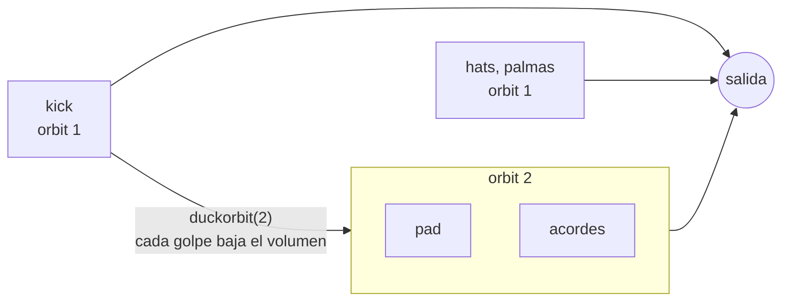

| Función | Va en | Qué hace | Para empezar |
|---|---|---|---|
| `.orbit(2)` | la víctima: pad, acordes | la manda al bus 2 | — |
| `.duckorbit(2)` | el kick | cada golpe baja el volumen del orbit 2 | — |
| `.duckdepth(0–1)` | el kick | cuánto baja: 0 nada, 1 silencio | `.6`–`.8` |
| `.duckattack(s)` | el kick | segundos que tarda en **volver**, pese al nombre | una corchea: `30/BPM` |
| `.duckonset(s)` | el kick | segundos que tarda en **bajar**; con 0 hace clic | `.005` |

La regla de oro: que vuelva **justo a tiempo para el "&"**, o sea en una corchea.

| BPM | Una corchea = `duckattack` |
|---:|---:|
| 118 | `.25` |
| 120 | `.25` |
| 124 | `.24` |
| 128 | `.23` |

Primer compás sin bombeo, segundo con bombeo:

```strudel
setcpm(124/4)
stack(
  s("bd*4").bank("RolandTR909")
    .duckorbit(2).duckattack(.24).duckonset(.005)
    .duckdepth("<0 .8>"),                 // compás 1: no agacha · compás 2: agacha mucho
  chord("<Am9>").voicing()                // un acorde sostenido todo el compás
    .s("sawtooth").lpf(1400).gain(.35)
    .orbit(2),                            // ← la víctima vive en el orbit 2
)
```

### 5.2 Dos víctimas, dos profundidades

Con `:` el kick agacha varios orbits a la vez, cada uno con su profundidad:

```strudel
setcpm(124/4)
stack(
  s("bd*4").bank("RolandTR909")
    .duckorbit("2:3").duckdepth(".8:.3").duckattack(.24),   // pad hondo, bajo apenas
  chord("<Am9 D9>").voicing()
    .s("sawtooth").lpf(1400).gain(.3).orbit(2),
  note("<a2 d2>").struct("[~ x]*4")
    .s("sawtooth").lpf(400).decay(.2).sustain(0).orbit(3),
  s("[~ oh]*4, ~ cp ~ cp").bank("RolandTR909"),             // orbit 1: no se mueve
)
```

Si el bajo ya va en contratiempo, el sidechain casi no lo toca: ya se turnan con el
kick. **El sidechain importa en lo que suena largo**: pads, cuerdas, reverb.

> [!warning] Tres cosas del orbit
> - **"duck target orbit 2 does not exist"** en la consola: el kick sonó antes que
>   nada en el orbit 2. Es inofensivo y desaparece en cuanto la víctima suena.
> - **La reverb y el delay son del orbit.** Las capas que comparten orbit comparten
>   sala (`roomsize`) y tiempo de delay. Si dos capas necesitan espacios distintos,
>   van en orbits distintos.
> - **No agaches los hats.** Se quedan en el orbit 1: son el reloj, y un reloj que
>   bombea marea.

> [!tip] Qué decide en tu pieza
> Cuánto bombea es una decisión de época: el deep clásico casi nada, el French house
> y el house de festival a fondo. Pero también es una decisión emocional: un pad que
> respira con el kick suena **vivo**; uno que no, suena a fondo de pantalla.

---

## 6. Armonía: el color del house

La armonía del house viene del soul, del gospel y del jazz, pasando por el disco:
**acordes con séptima y novena, casi siempre menores, casi siempre pocos**. Un
track puede vivir diez minutos sobre dos acordes. Lo que importa no es adónde va
la progresión sino **qué color tiene** y **cuánto dura** cada acorde.

Las bases están en tus notas: [[1. Teoría/1. Armonía/8. Tensiones]] (qué es una
novena o una oncena) y [[1. Teoría/1. Armonía/0. Modos]] (el dórico, que es el
modo del house).

### 6.1 Séptimas, novenas, oncenas

Misma raíz, cada vez más color. El pentagrama es exactamente el voicing que elige Strudel:

```music-abc
X:6
T:Misma raíz, cada vez más color
M:4/4
L:1/1
Q:1/4=120
K:Am
V:1 clef=treble name="Derecha"
V:2 clef=bass name="Izquierda"
[V:1] "Am"[CEAc] | "Am7"[CEGc] | "Am9"[CEGB] | "Am11"[DGB] |
[V:2] A, | A, | A, | [E,A,] |
```

```strudel
setcpm(120/4)
chord("<Am Am7 Am9 Am11>")      // un compás cada uno
  .voicing().s("gm_epiano1").room(.3)
```

Fíjate en el último: Strudel arma el `Am11` **sin la tercera** (no hay do). Sin
tercera el acorde no es ni del todo menor ni mayor: flota. Es un sonido muy del
deep house.

| Acorde | En Strudel | Notas | Cómo suena |
|---|---|---|---|
| menor | `Am` | A C E | directo |
| m7 | `Am7` | A C E G | soul, nocturno |
| m9 | `Am9` | A C E G B | **el** acorde del deep house: triste y cálido a la vez |
| m11 | `Am11` | A E G B D, sin la C | abierto, flotante |
| 9 | `D9` | D F♯ A C E | el IV del dórico: una luz dentro del menor |
| maj7 | `F^7` | F A C E | nostalgia luminosa |
| maj9 | `C^9` | C E G B D | brillo suave |
| 6/9 | `C69` | C E G A D | garage, soul |
| 13 | `G13` | G B F A E | gospel, garage |
| 7sus | `G7sus` | G C D F | suspendido: no resuelve |

Recuerda la regla 3 de §0.2: `Fmaj7` y `Cmaj9` **no suenan**; se escriben `F^7` y `C^9`.

### 6.2 El dórico: la sexta mayor

La menor natural tiene F; **la menor dórica tiene F♯**. Esa única nota convierte el
iv menor (Dm) en un IV mayor (D), y el par **i9 – IV9** es el vaivén más clásico del
deep house: triste, pero con una ventana abierta.

```music-abc
X:7
T:Dórico: i9 – IV9
M:4/4
L:1/1
Q:1/4=122
K:Am
V:1 clef=treble name="Derecha"
V:2 clef=bass name="Izquierda"
[V:1] "Am9"[CEGB] | "D9"[CE^FA] |
[V:2] A, | D, |
```

Mira la conducción: **C y E se quedan**, G baja a F♯ y B baja a A. Todo se mueve por
grado conjunto. Y los tonos guía ([[1. Teoría/2. Conducción/09. Tonos guía]]): la
tercera de Am9 (C) es la séptima de D9; la séptima de Am9 (G) baja medio tono a la
tercera de D9 (F♯). Dos notas cuentan toda la progresión.

```strudel
setcpm(122/4)
stack(
  s("bd*4, ~ cp ~ cp, [~ oh]*4").bank("RolandTR909"),
  chord("<Am9 D9>").voicing().s("gm_epiano1").gain(.8),
)
```

### 6.3 Seis progresiones de house

Todas en la menor. Los números romanos son respecto a A.

| Nombre | Grados | En Strudel | Carácter |
|---|---|---|---|
| vamp | i9 | `"<Am9>"` | hipnótico: lo mueven el filtro y el ritmo |
| dórico | i9 – IV9 | `"<Am9 D9>"` | deep house clásico |
| menor | i7 – iv9 | `"<Am7 Dm9>"` | oscuro, nocturno |
| descenso | i9 – VII6 – VI^7 – v7 | `"<Am9 G6 F^7 Em7>"` | melancolía que cae: tu terreno |
| soul | iv9 – VII13 – III^7 – VI^7 | `"<Dm9 G13 C^7 F^7>"` | garage, gospel: quintas descendentes |
| himno | i – VI – III – VII | `"<Am F C G>"` | piano house de los 90 |

Una sola batería y las seis progresiones en un objeto: cambias **una palabra** y
escuchas otra.

```strudel
setcpm(122/4)
const prog = {
  vamp:     "<Am9>",
  dorico:   "<Am9 D9>",
  menor:    "<Am7 Dm9>",
  descenso: "<Am9 G6 F^7 Em7>",
  soul:     "<Dm9 G13 C^7 F^7>",
  himno:    "<Am F C G>",
}

stack(
  s("bd*4, ~ cp ~ cp, [~ oh]*4").bank("RolandTR909"),
  chord(prog.descenso)                  // ← cambia solo esta palabra
    .voicing().s("gm_epiano1").gain(.8),
)
```

Más progresiones para robarte: [[1. Teoría/1. Armonía/Progresiones/0. Progresiones melancólicas]].
Cómo construir las tuyas desde un modo: [[1. Teoría/1. Armonía/5. Crear progresiones modales]].

### 6.4 Ritmo armónico: cuánto dura cada acorde

| Cada acorde dura | En Strudel | Efecto |
|---|---|---|
| 1 compás | `"<Am9 D9>"` | inquieto, pop |
| 2 compases | `"<Am9!2 D9!2>"` | el estándar del house |
| 4 compases | `"<Am9!4 D9!4>"` | profundo, hipnótico |
| desigual | `"<Am9!3 D9>"` | el cambio se vuelve un evento |

`!2` repite el elemento: `"<Am9!2 D9!2>"` es `"<Am9 Am9 D9 D9>"`.

```strudel
setcpm(122/4)
stack(
  s("bd*4, ~ cp ~ cp, [~ oh]*4").bank("RolandTR909"),
  chord("<Am9!3 D9>")                   // tres compases en casa, uno fuera
    .voicing().s("gm_epiano1").gain(.8),
)
```

### 6.5 Memoria de acorde: la forma que se mueve entera

Muchos sintes de los 80 tenían **memoria de acorde**: guardabas un acorde y cada
tecla tocaba esa misma forma transportada. El house temprano la usó muchísimo, y de
ahí sale un sonido muy característico: **todos los acordes tienen la misma
calidad** y se mueven en paralelo, aunque no pertenezcan a la tonalidad.

```music-abc
X:8
T:Memoria de acorde: un m9 que se mueve entero
M:4/4
L:1/1
Q:1/4=122
K:Am
V:1 clef=treble name="Derecha"
V:2 clef=bass name="Izquierda"
[V:1] "Am9"[CEGB] | "Gm9"[_B,DFA] | "Fm9"[_A,C_EG] | "Gm9"[_B,DFA] |
[V:2] A, | G, | F, | G, |
```

```strudel
setcpm(122/4)
stack(
  s("bd*4, ~ cp ~ cp, [~ oh]*4").bank("RolandTR909"),
  note("[a3,c4,e4,g4,b4]")              // la forma congelada: un Am9
    .transpose("<0 -2 -4 -2>")          // movida entera: Am9 Gm9 Fm9 Gm9
    .struct("[~ ~ x ~]*4")              // en stabs, como en los 80
    .s("sawtooth").lpf(1600).decay(.18).sustain(0).gain(.35),
)
```

En una coral esto está prohibido: son quintas y octavas paralelas a montones
([[1. Teoría/2. Conducción/04. Reglas de voicing]]). Aquí es el punto. El oído deja
de seguir la **función** y sigue la **forma**, igual que en la armonía no funcional
de [[5. Referencias/3. Cursos/Cresciente/3. Ampliando lenguaje/5B. Armonía no funcional|Cresciente 5B]].

> [!tip] Qué decide en tu pieza
> Dos decisiones, y en este orden: **un color** (m9, dórico, paralelos) y **un ritmo
> armónico** (cuántos compases por acorde). Si dudas entre dos progresiones, quédate
> con la que tiene menos acordes: en house, la repetición hace el trabajo que en una
> canción hace la variedad.

---

## 7. Stabs, piano y teclas: acordes que golpean

En house los acordes rara vez están quietos: **golpean**. Un *stab* es un acorde
corto en un sitio del compás que no es el tiempo. El ritmo del stab es, muchas
veces, el gancho del track.

### 7.1 Cuatro ritmos de stab

```text
                1 e & a 2 e & a 3 e & a 4 e & a
contratiempo    . . x . . . x . . . x . . . x .
charleston      x . . . . . x . . . . . . . . .
tresillo doble  x . . x . . x . x . . x . . x .
deep            . . . x . . x . . . . x . . x .     todo fuera del tiempo
kick            x . . . x . . . x . . . x . . .
```

Un compás de cada uno:

```strudel
setcpm(122/4)
stack(
  s("bd*4, ~ cp ~ cp").bank("RolandTR909"),
  chord("<Am9 D9>")
    .struct(cat(
      "[~ ~ x ~]*4",                                // contratiempo
      "[x ~ ~ ~] [~ ~ x ~] ~ ~",                    // charleston
      "[x ~ ~ x] [~ ~ x ~] [x ~ ~ x] [~ ~ x ~]",    // tresillo doble
      "[~ ~ ~ x] [~ ~ x ~] [~ ~ ~ x] [~ ~ x ~]",    // deep
    ))
    .voicing()
    .s("sawtooth").lpf(1800).decay(.15).sustain(0).gain(.4)
    .room(.3),
)
```

Igual que el bajo de §4.1: `chord()` dice **qué**, `.struct()` dice **cuándo**.

### 7.2 El empujón: el acorde que llega antes

En garage y en piano house, el acorde del compás siguiente **llega en el "&" del 4**,
una corchea antes, y se queda sonando a través de la barra. Se llama anticipación,
y hace que la armonía parezca tener prisa por bailar.

```music-abc
X:9
T:El acorde llega antes: anticipación en el & del 4
M:4/4
L:1/8
Q:1/4=122
K:Am
V:1 clef=treble name="Derecha"
V:2 clef=bass name="Izquierda"
[V:1] "Am9"[CEGB]7 "D9"[CE^FA]- | [CE^FA]7 "Am9"[CEGB] |
[V:2] A,7 D,- | D,7 A, |
```

En Strudel no hace falta escribirlo nota por nota: se adelanta **toda la armonía**
con `.early(1/8)`, y cada acorde empieza una corchea antes de su compás.

```strudel
setcpm(122/4)
stack(
  s("bd*4, ~ cp ~ cp, [~ oh]*4").bank("RolandTR909"),
  chord("<Am9 D9>")
    .early(1/8)                         // toda la armonía, una corchea antes
    .voicing().s("gm_epiano1").gain(.8),
)
```

El primer compás arranca mudo hasta el "&" del 4: el acorde "empezó" antes de que
le dieras play.

Con stabs es lo mismo: `.early()` va **antes** del `.struct()`, así el ritmo se
queda en su sitio y lo que se adelanta es la armonía. Aquí, charleston más empujón:

```strudel
setcpm(122/4)
stack(
  s("bd*4, ~ cp ~ cp, [~ oh]*4").bank("RolandTR909"),
  chord("<Am9 D9>")
    .early(1/8)                                  // la armonía se adelanta…
    .struct("[x ~ ~ ~] [~ ~ x ~] ~ [~ ~ x ~]")   // …y el golpe del & del 4 ya es el acorde nuevo
    .voicing().s("piano"),
)
```

### 7.3 Piano house

El piano de los 90 (house italiano, garage) toca acordes llenos en un ritmo de
**3+3+4+3+3** semicorcheas: casi una clave, con mucho cuerpo.

```music-abc
X:10
T:Piano house: 3+3+4+3+3
M:4/4
L:1/16
Q:1/4=124
K:Am
V:1 clef=treble name="Derecha"
V:2 clef=bass name="Izquierda"
[V:1] "Am"[CEAc]3[CEAc]3[CEAc]4 [CEAc]3[CEAc]3 | "F"[CFAc]3[CFAc]3[CFAc]4 [CFAc]3[CFAc]3 |
[V:2] A,3A,3A,4 A,3A,3 | F,3F,3F,4 F,3F,3 |
[V:1] "C"[CEGc]3[CEGc]3[CEGc]4 [CEGc]3[CEGc]3 | "G"[DGB]3[DGB]3[DGB]4 [DGB]3[DGB]3 |
[V:2] E,3E,3E,4 E,3E,3 | G,3G,3G,4 G,3G,3 |
```

```strudel
setcpm(124/4)
stack(
  s("bd*4, ~ cp ~ cp, [~ oh]*4").bank("RolandTR909"),
  chord("<Am F C G>")
    .struct("x@3 x@3 x@4 x@3 x@3")      // 3+3+4+3+3 semicorcheas
    .voicing().s("piano").gain(.9),
)
```

`x@3` es un golpe que ocupa 3 de los 16 pasos. Fíjate en el C: el voicing lo pone
en primera inversión (mi abajo) porque busca la posición más cercana a los otros.

### 7.4 La paleta de teclas

El mismo stab cambia de época según el sonido, dos compases cada uno:

```strudel
setcpm(124/4)
const stab = chord("<Am9 D9>")
  .struct("[~ ~ ~ x] [~ ~ x ~] [~ ~ ~ x] [~ ~ x ~]")
  .voicing()

stack(
  s("bd*4, ~ cp ~ cp").bank("RolandTR909"),
  arrange(
    [2, stab.s("sawtooth").lpf(1800).decay(.15).sustain(0).gain(.4)],   // sinte: rave, tech
    [2, stab.s("piano")],                                               // piano house
    [2, stab.s("gm_epiano1")],                                          // Rhodes: deep
    [2, stab.s("gm_drawbar_organ").gain(.6)],                           // órgano: garage
    [2, stab.s("gm_string_ensemble_1")],                                // cuerdas: disco
    [2, stab.s("gm_orchestra_hit").gain(.5)],                           // orquesta: hip house
  ),
)
```

| Sonido | En Strudel | Dónde vive |
|---|---|---|
| sierra con filtro | `sawtooth` · `supersaw` (más ancha y más pesada para la CPU) | rave, tech, progressive |
| piano | `piano` · `steinway` | piano house, Italo de los 90 |
| Rhodes | `gm_epiano1` | deep, soulful |
| órgano | `gm_drawbar_organ` · `organ_full` | garage |
| cuerdas | `gm_string_ensemble_1` · `gm_synth_strings_1` | disco, soulful |
| golpe de orquesta | `gm_orchestra_hit` | hip house de los 90 |
| pad | `gm_pad_warm` · `sawtooth` con `.attack()` lento | deep, melodic |

> [!tip] Qué decide en tu pieza
> Con un stab bien colocado ya tienes gancho. La decisión es **el ritmo** (cuál de
> los cuatro, o uno tuyo) y **el sonido** (la época). Elige el ritmo con un sonido
> neutro, y el sonido al final: si el ritmo no funciona con una sierra seca, un
> piano no lo va a arreglar.

---

## 8. Melodía: riffs, arpegios y voces

La melodía del house es **corta y repetida**: un motivo de uno o dos compases que
vuelve cientos de veces y cambia muy poco. Es la teoría de motivos de
[[1. Teoría/4. Melodía/0. Enlaces 2.0 y motivos]] llevada al extremo: el motivo no
se desarrolla, **se repite hasta hipnotizar**, y la variación llega cada 4 u 8 compases.

### 8.1 El riff: pregunta y respuesta

Dos compases, pentatónica menor de A. El primero pregunta (se queda arriba, en mi);
el segundo contesta (sube y vuelve a casa, a la).

```music-abc
X:11
T:Riff de dos compases: pregunta y respuesta
M:4/4
L:1/16
Q:1/4=124
K:Am
"Am"Az2d z2gz zez2 z4 | "Am"Az2d z2gz zagz dzAz |
```

```strudel
setcpm(124/4)
stack(
  s("bd*4, ~ cp ~ cp, [~ oh]*4").bank("RolandTR909"),
  n(cat(
    "[0 ~ ~ 2] [~ ~ 4 ~] [~ 3 ~ ~] ~",           // pregunta: termina en mi
    "[0 ~ ~ 2] [~ ~ 4 ~] [~ 5 4 ~] [2 ~ 0 ~]",   // respuesta: termina en la
  ))
    .scale("A4:minor:pentatonic")
    .s("square").lpf(2500).decay(.2).sustain(0).gain(.5)
    .delay(.3).delayfeedback(.4),                // eco en corchea con punto, el de serie
)
```

Los números son **grados de la escala**, desde 0: en `A4:minor:pentatonic`, 0 = la,
1 = do, 2 = re, 3 = mi, 4 = sol, 5 = la de arriba. Cambiar `.scale()` cambia el modo
sin tocar el ritmo: prueba `A4:dorian`.

### 8.2 El arpegio

El arpegio de house recorre el acorde en corcheas o semicorcheas, como un motor.
Un truco de arreglista: que **no toque la raíz**, porque la raíz es del bajo. Así el
arpegio canta las notas de color (tercera, séptima, novena).

```music-abc
X:12
T:Arpegio sin raíz: la raíz es del bajo
M:4/4
L:1/8
Q:1/4=124
K:Am
"Am9"CEBG CEBG | "D9"CEA^F CEA^F |
```

```strudel
setcpm(124/4)
stack(
  s("bd*4, ~ cp ~ cp, [~ oh]*4").bank("RolandTR909"),
  note("<a2 d2>").struct("[~ x]*4")            // el bajo tiene la raíz
    .s("sawtooth").lpf(400).decay(.2).sustain(0),
  chord("<Am9 D9>").voicing()
    .arp("1 2 4 3 1 2 4 3")                    // índices del voicing; el 0 (la raíz) no se toca
    .s("square").lpf(2200).decay(.12).sustain(0).gain(.4)
    .delay(.25),
)
```

`.arp()` toca las notas del voicing por **índice**, de grave a agudo. En `Am9` el 0 es
la (A3), el 1 do, el 2 mi, el 3 sol y el 4 si. Un strudel con arpegio puesto en
[[4. Instrumento/2. Strudel/6. Arpegiadores/README|6. Arpegiadores/]] se convierte en
un preset del arpegiador de Sonar.

### 8.3 Voces

El house es música de iglesia en la pista de baile: las voces de gospel y soul son
su alma. Los tracks clásicos samplean una frase y la **trocean** en sílabas que
caen sobre la rejilla, como un instrumento de percusión.

Strudel no trae voces sampleadas, pero los coros GM sirven para practicar el gesto:

```strudel
setcpm(124/4)
stack(
  s("bd*4, ~ cp ~ cp, [~ oh]*4").bank("RolandTR909"),
  chord("<Am9 D9>").voicing()
    .struct("[~ ~ x ~] [~ x ~ ~] ~ [x ~ x ~]")   // cortes cortos, como una voz troceada
    .s("gm_voice_oohs").gain(.7).room(.5),
)
```

La versión de verdad es **tu voz**: graba una frase en Sonar, córtala en sílabas y
ponlas en la rejilla. Un "oh" corto en el "&" del 2 ya es un gancho.

> [!tip] Qué decide en tu pieza
> **Un solo gancho.** Stab, piano, riff, arpegio o voz: uno lleva la pieza y los
> demás, si están, acompañan. Es tu regla de *una dificultad nueva por proyecto*,
> aplicada al arreglo.

---

## 9. El filtro es un instrumento

En el house el movimiento no lo hacen nuevas notas: lo hace **el filtro**. Un loop
de ocho compases que se abre poco a poco puede sostener un minuto entero.

### 9.1 Barridos con señales

`.lpf()` acepta una **señal** en lugar de un número. Una señal va de 0 a 1;
`.range(a, b)` la convierte en hercios y `.slow(n)` la estira a `n` compases.

| Señal | Forma | Para qué |
|---|---|---|
| `sine` | sube y baja suave | un barrido que respira |
| `saw` | sube y cae de golpe | abrir durante un build y reiniciar |
| `perlin` | deriva al azar, suave | movimiento que parece una mano |
| `"<400 800 1600 3200>"` | escalones, uno por compás | abrir por compases |

```strudel
setcpm(124/4)
stack(
  s("bd*4, ~ cp ~ cp, [~ oh]*4").bank("RolandTR909"),
  chord("<Am9 D9>").struct("[~ ~ x ~]*4").voicing()
    .s("sawtooth").decay(.2).sustain(0).gain(.4)
    .lpf(sine.range(300, 3000).slow(8))   // 8 compases para abrir y cerrar
    .lpq(8),                              // resonancia: el filtro "canta" en el borde
)
```

Funciona tan bien porque son **stabs**: cada golpe lee el filtro de nuevo (regla 5
de §0.2). Con un acorde sostenido el barrido iría a saltos.

### 9.2 French house: el loop entero detrás de un filtro

El French house de los 90 tomaba un loop de disco y lo pasaba por **un solo
filtro** que el productor abría y cerraba a mano. `.djf()` es ese filtro de DJ: por
debajo de `.5` es pasa-bajos, en `.5` no hace nada, por encima es pasa-altos.

```strudel
setcpm(124/4)
const loop = stack(
  s("~ cp ~ cp, [hh oh]*4").bank("RolandTR909"),
  note("<a2 a2 f2 g2>").struct("x*8").transpose("[0 12]*4")      // octavas de disco
    .s("sawtooth").lpf(700).decay(.15).sustain(0),
  chord("<Am9 Am9 F^7 G6>").struct("[~ ~ x ~]*4").voicing().s("gm_epiano1"),
)

stack(
  s("bd*4").bank("RolandTR909"),                 // el kick nunca pasa por el filtro
  loop.djf(saw.range(.15, .5).slow(8)),          // de cerrado a abierto en 8 compases
)
```

El kick va **fuera** del filtro: es el suelo, y el suelo no se mueve mientras todo
lo de encima se abre. Súmale el bombeo de §5 y tienes medio catálogo del género.

### 9.3 La envolvente del filtro: pluck o swell

La señal mueve el filtro a lo largo de los compases; la **envolvente** lo mueve
dentro de cada nota. Es la solución para barrer algo largo.

| Función | Qué hace |
|---|---|
| `.lpenv(n)` | cuánto abre la envolvente; negativo la invierte |
| `.lpattack(s)` | cuánto tarda en abrir |
| `.lpdecay(s)` | cuánto tarda en volver |
| `.lpsustain(0–1)` | dónde se queda mientras la nota suena |

```strudel
setcpm(124/4)
const acorde = chord("<Am9 D9>").voicing()
  .s("sawtooth").lpf(300).lpq(6).gain(.35)

stack(
  s("bd*4, [~ oh]*4").bank("RolandTR909"),
  arrange(
    [2, acorde.struct("[~ ~ x ~]*4")
          .lpenv(5).lpattack(.005).lpdecay(.15).lpsustain(0)],   // pluck: abre y cierra en cada golpe
    [2, acorde.lpenv(4).lpattack(1.5).lpsustain(1)],             // swell: la nota larga se abre sola
  ),
)
```

### 9.4 Delay en el tiempo

El eco de house está **sincronizado** con el compás. `.delaysync()` lo mide en
ciclos, o sea en fracciones de compás:

| `.delaysync()` | Figura | Para qué |
|---|---|---|
| `1/8` | corchea | eco que rellena |
| `3/16` | corchea con punto | **el de serie**: el eco que cae en contratiempo |
| `1/4` | negra | espacio, dub |
| `1/6` | tresillo de negra | flota contra el cuatro |
| `1/12` | tresillo de corchea | shuffle |

```strudel
setcpm(124/4)
stack(
  s("bd*4").bank("RolandTR909"),
  s("~ cp ~ cp").bank("RolandTR909")
    .delay(.3).delaysync(3/16).delayfeedback(.35),    // las palmas con eco de corchea con punto
  chord("<Am9 D9>").struct("[~ ~ ~ x] ~ [~ ~ x ~] ~").voicing()
    .s("gm_epiano1")
    .delay(.4).delaysync("<.1875 .125 .25 .1667>")    // un tiempo de eco por compás
    .delayfeedback(.45)
    .orbit(2),                                         // otro orbit: otro delay
)
```

En comillas van decimales (regla 4 de §0.2). Y como el delay es del orbit, las
palmas y el piano necesitan orbits distintos para tener ecos distintos.

La reverb, como en Beats: en palmas, stabs y pads; **nunca en el kick**. Ver
[[4. Instrumento/2. Strudel/3. Beats/1. Beats desde cero|Beats §10.2]].

> [!tip] Qué decide en tu pieza
> Antes de escribir material nuevo para una sección, pregúntate si la sección que
> buscas es **la misma con el filtro en otro sitio**. Muchas veces el verso y el
> estribillo de un track de house son el mismo loop, cerrado y abierto.

---

## 10. Tensión: breakdown, build y drop

La gramática emocional del house es un ciclo: el groove se instala, **se quita el
suelo**, la tensión sube, hay un instante de silencio y **todo vuelve** a la vez.

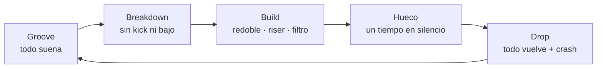

| Herramienta | Qué hace | En Strudel |
|---|---|---|
| quitar el kick | el cuerpo se queda sin suelo | una sección de `arrange` sin `kick` |
| redoble que acelera | 4 → 8 → 16 → 32 golpes por compás | `s("sd*4").ply("<1 2 4 8>")` |
| riser | ruido que se vuelve más brillante | `s("white*16").hpf(saw.range(400, 8000).slow(4))` |
| filtro que abre | el loop sale de detrás de una pared | `.lpf(saw.range(300, 5000).slow(4))` |
| el hueco | un tiempo de silencio antes del 1 | `.mask("1 1 1 0")` en el último compás |
| crash | marca el 1 del drop | `s("cr")` |

El riser es `white*16` y no `white` por la regla 5: dieciséis golpes de ruido por
compás leen el filtro dieciséis veces, y el barrido suena continuo.

Cuatro secciones de cuatro compases: groove, breakdown, build y drop.

```strudel
setcpm(124/4)

const kick    = s("bd*4").bank("RolandTR909")
const palmas  = s("~ cp ~ cp").bank("RolandTR909")
const hats    = s("[hh hh oh hh]*4").cut(1).velocity("[.45 .3 .75 .3]*4").bank("RolandTR909")
const bajo    = note("<a2 a2 d2 d2>").struct("[~ x]*4")
                  .s("sawtooth").lpf(450).decay(.2).sustain(0)
const pad     = chord("<Am9 Am9 D9 D9>").voicing()
                  .s("sawtooth").lpf(1200).gain(.3).attack(.2).release(.5)
const redoble = s("sd*4").ply("<1 2 4 8>").bank("RolandTR909")
                  .velocity(saw.range(.3, 1).slow(4))           // acelera y crece
const riser   = s("white*16").hpf(saw.range(400, 8000).slow(4))
                  .gain(saw.range(.02, .25).slow(4))
const hueco   = x => x.mask("<1 1 1 [1 1 1 0]>")              // compás 4: el último tiempo, en silencio
const crash   = s("<cr ~ ~ ~>").bank("RolandTR909")

arrange(
  [4, stack(kick, palmas, hats, bajo, pad)],                   // groove
  [4, stack(pad.room(.6), hats.hpf(3000))],                    // breakdown: sin kick ni bajo
  [4, hueco(stack(pad, redoble, riser))],                      // build
  [4, stack(crash, kick, palmas, hats, bajo, pad)],            // drop
)
```

`arrange` hace que cada sección empiece desde su propio compás 1: por eso el
redoble del build arranca en `1` y el `saw` del riser arranca abajo, aunque la
sección empiece en el compás 9.

> [!tip] Qué decide en tu pieza
> El drop pega por **contraste**, no por volumen. Si el breakdown no quita el kick y
> el bajo, el drop no tiene de dónde volver. Y el hueco de un tiempo antes del drop
> vale más que cualquier riser: el silencio es lo que hace que el 1 se sienta.

---

## 11. El arreglo: pensar como DJ

### 11.1 Por qué el house se arregla así

Un track de house no se escucha solo: **se mezcla**. El DJ necesita entrar en tu
track mientras el anterior todavía suena, y salir de él mientras entra el
siguiente. De ahí salen tres reglas de forma que no tiene la canción:

1. **Intro y outro de batería sola.** Dieciséis o treinta y dos compases sin
   armonía, para que dos tracks puedan sonar a la vez sin chocar de tonalidad.
2. **Todo en bloques de 8, 16 y 32 compases** (§1.3), para que el DJ cuente.
3. **El contraste es de densidad, no de material.** Las secciones se distinguen
   por qué capas suenan, no por melodías nuevas: es la forma por densidad de
   [[4. Instrumento/2. Strudel/3. Beats/1. Beats desde cero|Beats §11.2]], llevada a un track entero.

### 11.2 El mapa de un track

Un track de unos cinco minutos y medio a 124 BPM (la versión larga, la que tocan
los DJs; la versión de radio quita intro y outro y se queda en tres minutos):

| Sección | Compases | Minuto | Qué suena | Para qué |
|---|---|---:|---|---|
| intro DJ | 1–16 | 0:00 | kick y hats | que el DJ mezcle encima |
| intro 2 | 17–32 | 0:31 | + palmas, percusión, bajo | se arma el groove |
| groove A | 33–64 | 1:02 | + acordes o stabs; algo entra cada 8 | el cuerpo |
| breakdown | 65–80 | 2:04 | sin kick ni bajo: pad, voz, filtro | respirar |
| build | 81–88 | 2:35 | redoble, riser, filtro, hueco | la tensión |
| drop · groove B | 89–120 | 2:50 | todo, más el gancho | el pico |
| bajada | 121–152 | 3:52 | se quita un elemento cada 8 | aterrizar |
| outro DJ | 153–168 | 4:54 | kick y hats | que el DJ salga |

```mermaid
gantt
  title Un track de house · 168 compases a 124 BPM
  dateFormat X
  axisFormat %s
  section Para el DJ
  Intro · kick y hats          :0, 16
  Outro · kick y hats          :152, 168
  section El track
  Intro 2 · palmas y bajo      :16, 32
  Groove A · acordes           :32, 64
  Breakdown · sin kick         :64, 80
  Build                        :80, 88
  Drop · todo y el gancho      :88, 120
  Bajada · se va quitando      :120, 152
```

La curva de energía (cada columna son 4 compases; el build va del 81 al 88 y el
drop empieza en el 89):

```text
  alta  │                      ████████
        │        ████████     █████████████████
  media │    ████████████    ██████████████████
  baja  │██████████████████████████████████████████
        └──────────────────────────────────────────
compás   1   17  33      65  81      121     153
```

### 11.3 La regla de 8

Un loop que no cambia en 16 compases deja de oírse. Un loop que cambia de material
cada 4 deja de ser house. El punto medio es esta tabla:

| Cada… | Pasa | En Strudel |
|---|---|---|
| 8 compases | entra o sale **un** elemento | una sección nueva en `arrange` |
| 8 compases | el compás 8 avisa: fill o hueco | `.lastOf(8, x => …)` |
| 16–32 compases | cambia la sección | otra entrada de `arrange` |
| todo el tiempo | algo se mueve despacio | un filtro con `.slow(16)` o `.slow(32)` |

Diez cambios que **no son material nuevo**, para cuando no sabes qué hacer en el
compás 9:

| | Cambio | | Cambio |
|---:|---|---:|---|
| 1 | entra el hat abierto | 6 | el bajo sube una octava |
| 2 | entra el shaker | 7 | el stab gana delay |
| 3 | palmas → palmas + caja | 8 | los acordes se adelantan (§7.2) |
| 4 | el filtro abre un poco más | 9 | entra el pad |
| 5 | el kick calla un compás | 10 | crash en el 1 |

### 11.4 Un track a escala

El mapa de 11.2, con todo lo de la guía. `L` es el largo de un bloque: con `4` lo
escuchas en minuto y medio; con `16` es un track de verdad.

```strudel
setcpm(124/4)
const L = 4      // compases por bloque · 4 para escuchar, 16 en un track real

const kick    = s("bd*4").bank("RolandTR909")
const palmas  = s("~ cp ~ cp").bank("RolandTR909")
const hats    = s("[hh hh oh hh]*4").cut(1).velocity("[.45 .3 .75 .3]*4").bank("RolandTR909")
const perc    = s("shaker_small*16").velocity("[.35 .15 .25 .15]*4").pan(.7)
const bajo    = note("<a2 a2 f2 g2>").struct("[~ x]*4")
                  .s("sawtooth").lpf(450).decay(.2).sustain(0)
const stabs   = chord("<Am9 Am9 F^7 G6>").struct("[~ ~ ~ x] [~ ~ x ~] [~ ~ ~ x] [~ ~ x ~]")
                  .voicing().s("gm_epiano1").gain(.7)
const pad     = chord("<Am9 Am9 F^7 G6>").voicing()
                  .s("sawtooth").lpf(1000).gain(.25).attack(.3).release(.6)
const gancho  = n("[0 ~ ~ 2] [~ ~ 4 ~] [~ 3 ~ ~] ~")
                  .scale("A4:minor:pentatonic")
                  .s("square").lpf(2500).decay(.2).sustain(0).gain(.4).delay(.3)
const redoble = s("sd*4").ply("<1 2 4 8>").bank("RolandTR909").velocity(saw.range(.3, 1).slow(4))
const riser   = s("white*16").hpf(saw.range(400, 8000).slow(4)).gain(saw.range(.02, .25).slow(4))
const crash   = s("<cr ~ ~ ~>").bank("RolandTR909")

arrange(
  [L,     stack(kick, hats)],                                          // intro DJ
  [L,     stack(kick, hats, palmas, perc, bajo)],                      // intro 2
  [2 * L, stack(kick, hats, palmas, perc, bajo, stabs)],               // groove A
  [L,     stack(pad, stabs.room(.6), hats.hpf(3000))],                 // breakdown
  [4,     stack(pad, redoble, riser).mask("<1 1 1 [1 1 1 0]>")],      // build: siempre 4, con hueco
  [2 * L, stack(crash, kick, hats, palmas, perc, bajo, stabs, gancho)], // drop
  [2 * L, stack(kick, hats, palmas, bajo, stabs)],                     // bajada
  [L,     stack(kick, hats)],                                          // outro DJ
)
```

Le falta el bombeo a propósito: añádelo tú con §5 (kick con `.duckorbit(2)`, pad y
stabs con `.orbit(2)`) y compara.

> [!tip] Qué decide en tu pieza
> La forma de un track de house es **una lista de entradas y salidas**. Antes de
> producir, escríbela en una tabla como la de 11.2: qué capa entra en qué compás.
> Si la tabla no tiene contraste, el track tampoco lo va a tener.

---

## 12. Subgéneros: arquetipos para reconocer

No son plantillas para tu pieza: sirven para **oír qué decisión toma cada uno**.
Cuando reconozcas uno en algo que te gusta, vas a saber qué capa robar.

| Subgénero | BPM | Encima del kick | Bajo | Armonía | Sonido | Para escuchar |
|---|---|---|---|---|---|---|
| Chicago | 120–126 | galope de hats, palmas | sincopado, cuadrado | poca o ninguna | 707/909 crudos | Marshall Jefferson · Frankie Knuckles |
| deep | 118–124 | hat abierto, shaker, swing | contratiempo, redondo | m9, dórico, paralelos | Rhodes, pads, cálido | Larry Heard · Kerri Chandler |
| acid | 120–130 | 909 | la 303 (§4.4) | casi nada | crudo, hipnótico | Phuture |
| garage (NY/NJ) | 120–128 | shuffle, percusión | órgano, sincopado | soul, gospel | órgano, piano, voces | Masters at Work · Robin S |
| French / filter | 120–126 | hats de disco | octavas (§9.2) | un loop de disco | filtro y bombeo | Daft Punk · Stardust |
| tech | 124–128 | semicorcheas secas, percusión | rodante, en los huecos | casi nada | minimal, seco | Fisher |
| lo-fi | 115–125 | hats con ruido | simple | m9, nostalgia | polvo, cinta (§13) | DJ Seinfeld · Ross From Friends |
| afro | 118–124 | clave, congas, toms | profundo | menor, cantos | percusión, voces | Black Coffee |
| melodic / progressive | 120–126 | contenido | sostenido | menor, arpegios largos | pads enormes, builds largos | Lane 8 |
| UK garage 2-step | 130–136 | **sin four on the floor** | sub | soul | shuffle fuerte | MJ Cole · Artful Dodger |

### Chicago

Caja de ritmos cruda, hats al galope, un bajo cuadrado que salta. Pocas notas,
mucho cuerpo.

```strudel
setcpm(122/4)
stack(
  s("bd*4, ~ cp ~ cp").bank("RolandTR707"),
  s("[hh hh ~ hh]*4").bank("RolandTR707").velocity("[.8 .5 .5 .6]*4"),   // galope
  s("[~ ~ ~ cb] ~ [~ ~ cb ~] ~").bank("RolandTR707").velocity(.4),      // cencerro
  note("[a2 ~ ~ a2] [~ ~ a3 ~] [a2 ~ ~ c3] [~ ~ g2 ~]")
    .s("square").lpf(800).decay(.12).sustain(0),
)
```

### Deep

Todo más suave y más lejos: Rhodes en stabs fuera del tiempo, sub en contratiempo,
swing ligero.

```strudel
setcpm(120/4)
stack(
  s("bd*4").bank("RolandTR909"),
  s("~ cp ~ cp").bank("RolandTR909").velocity(.6).room(.3),
  s("[~ oh]*4").bank("RolandTR909").velocity(.5),
  s("shaker_small*16").velocity("[.3 .12 .2 .12]*4").pan(.7),
  note("<a2 a2 d3 d3>").struct("[~ x]*4").s("sine").decay(.3).sustain(0),
  chord("<Am9 Am9 D9 D9>").struct("[~ ~ ~ x] [~ ~ x ~] ~ ~")
    .voicing().s("gm_epiano1").room(.4),
).swingBy(.12, 8)
```

### Garage

Palmas y caja juntas, hats con shuffle marcado, órgano en stabs: el sonido de Nueva
York y Nueva Jersey en los 90.

```strudel
setcpm(124/4)
stack(
  stack(
    s("bd*4"),
    s("~ [cp,sd] ~ [cp,sd]"),
    s("[~ hh oh hh]*4").cut(1).velocity("[0 .35 .7 .4]*4"),
    s("[~ ~ ~ rim] [~ ~ rim ~] ~ [~ rim ~ ~]").velocity(.5),
  ).bank("RolandTR909"),
  chord("<Dm9 G13>").struct("[~ ~ x ~] [~ ~ ~ x] ~ [~ ~ x ~]")
    .voicing().s("gm_drawbar_organ").gain(.5),
).swingBy(.2, 8)          // shuffle: ~60 % de MPC
```

### Tech

Seco, percusivo, casi sin armonía. El bajo rueda en los huecos del kick y todo el
interés está en los detalles de la percusión.

```strudel
setcpm(126/4)
stack(
  stack(
    s("bd*4"),
    s("~ cp ~ cp").velocity(.7),
    s("hh*16").velocity("[.2 .12 .45 .12]*4"),
    s("[~ oh]*4").velocity(.5),
    s("rim").beat("3,6,11", 16).velocity(.4).pan(.3),
  ).bank("RolandTR909"),
  note("[~ a1 a2 a1]*4")                    // rodante: llena los huecos del kick
    .s("sawtooth").lpf(350).decay(.1).sustain(0),
)
```

### Afro

La clave y las congas mandan; el kick es el suelo y los toms dialogan. Encima, un
canto sostenido.

```strudel
setcpm(120/4)
stack(
  s("bd*4, ~ ~ ~ [~ ~ lt ~]").bank("RolandTR909"),
  s("clave").beat("0,3,6,10,12", 16).velocity(.6).pan(.4),     // clave son 3-2
  s("conga:4").beat("2,7,10,14", 16).velocity(.6).pan(.3),
  s("conga:26").beat("5,13,15", 16).velocity(.7).pan(.6),
  s("shaker_large*16").velocity("[.35 .15 .25 .15]*4").pan(.75),
  chord("<Am11>").voicing().s("gm_choir_aahs").gain(.4).room(.6),   // un canto que no se mueve
).swingBy(.1, 8)
```

### UK garage 2-step

El contraejemplo: **el kick salta**. Sin four on the floor deja de ser house y pasa
a ser otra cosa, aunque todo lo demás se parezca. Escúchalo para entender qué hace
el kick en todos los demás.

```strudel
setcpm(132/4)
stack(
  stack(
    s("bd").beat("<[0,10] [0,7,10]>", 16),     // el kick salta: compás 1 y compás 2
    s("~ sd ~ sd"),
    s("hh*16").velocity("[.5 .2 .35 .2]*4"),
  ).bank("RolandTR909"),
  note("[a2 ~ ~ ~] ~ [~ ~ a2 ~] [~ ~ ~ c3]").s("sine").decay(.4).sustain(0),
).swingBy(.28, 8)
```

---

## 13. Tu frontera: house triste

El dream pop y el house comparten más de lo que parece: los dos viven de
**repetición, textura y espacio**, y los dos prefieren un color sostenido a una
progresión que va a algún sitio. La diferencia está en el cuerpo: el house baila.
El cruce existe y tiene nombre (lo-fi house, deep house melancólico, melodic house),
y es un terreno natural para tus acordes. El otro lado del cruce, a fondo:
[[4. Instrumento/2. Strudel/8. Dream pop/0. Dream pop desde cero|Dream pop desde cero]].

| Decisión | Dream pop | House | El cruce |
|---|---|---|---|
| tempo | 60–90 | 118–126 | 118–122; y el breakdown en half-time (Beats §4) |
| armonía | maj7, m9, modal | m9, dórico | m9 y maj7 en paralelo (§6.5) |
| batería | caja de ritmos vieja | 909 | kick de 909 suave, hats de CR-78 |
| espacio | reverb enorme | seco | reverb en palmas y pads; kick seco |
| textura | órgano, guitarras | stabs | pad que bombea (§5) |
| superficie | cinta, saturación | limpia | polvo: `crush`, filtro general |

```strudel
setcpm(118/4)
stack(
  s("bd*4").bank("RolandTR909").lpf(1800)                   // kick redondo, sin clic
    .duckorbit(2).duckattack(.25).duckdepth(.6),
  s("~ cp ~ cp").bank("RolandTR909").velocity(.5)
    .room(.8).roomsize(7),                                  // las palmas, muy lejos
  s("[hh oh]*4").bank("RolandCompurhythm78").cut(1)
    .velocity("[.3 .45]*4"),                                // los hats de la CR-78
  note("[a3,c4,e4,g4,b4]").transpose("<0 0 -4 -2>")          // Am9 Am9 Fm9 Gm9: memoria de acorde
    .s("gm_pad_warm").attack(.5).release(1.5)
    .room(.6).orbit(2),                                     // el pad bombea
  note("<a2 a2 f2 g2>").struct("[~ x]*4")
    .s("sine").decay(.3).sustain(0),                        // sub redondo en contratiempo
).crush(12)                                                 // un poco de polvo
```

Las herramientas del lo-fi house, para ensuciar con intención:

| Herramienta | En Strudel | Qué hace |
|---|---|---|
| menos bits | `.crush(10–12)` al conjunto | el polvo del sampler barato |
| sin brillo | `.lpf(4000)` al conjunto | como oírlo desde la habitación de al lado |
| cinta lenta | `.speed(.97)` en la batería | los golpes un pelo más graves y largos |
| hats que fallan | `.degradeBy(.1)` | una máquina vieja que se salta golpes |
| saturación | `.shape(.2)` en el kick | calidez, pegada |

Puentes desde lo que ya escuchas:

| Si te gusta… | Escucha… | Qué robar |
|---|---|---|
| Beach House: órganos, reverb, lentitud | Caribou, *Can't Do Without You* | una voz en loop que se abre como un pad |
| The Lumineers y el folk | Four Tet | instrumentos acústicos sobre un kick en negras |
| Andrew Bird y su pedal de loops | cualquier deep house | componer por capas que entran y salen: el house es música de loops |
| la música triste | DJ Seinfeld · Bicep, *Glue* (casi house: breakbeat) | acordes tristes sobre un groove que sí baila |

> [!tip] Qué decide en tu pieza
> No tienes que elegir entre tu música y el house: puedes llevar **una sola capa**
> de uno al otro. Un kick en negras con el bombeo debajo de una progresión tuya ya
> es un experimento. Y al revés: una progresión de §6 tocada lenta, en tu guitarra,
> sin batería, ya es dream pop.

---

## 14. Llevarlo a Sonar

En Obsidian todo suena con los samples del plugin. En el estudio, Strudel solo
manda **notas** por MIDI y el sonido lo pone Analog Lab
([[4. Instrumento/2. Strudel/README|README]], [[8. Setup/5. Áreas/4. Jam con Strudel|Jam con Strudel]]):

| Capa de la guía | En el motor local | Pista | Preset sugerido |
|---|---|---|---|
| bajo | `.midichan(2).midi(OUT)` | `STR - Bass` | *Club Sub* o *Bass Bass* ([[8. Setup/4. Presets/Analog Lab V/4. Bajo\|Bajo]]) |
| acordes, pad | `.midichan(3).midi(OUT)` | `STR - Pad` | *Not Love EP* (Rhodes) · *Kids With Marbles* (Juno) · *Air String 1* ([[8. Setup/4. Presets/Analog Lab V/2. Teclas\|Teclas]], [[8. Setup/4. Presets/Analog Lab V/3. Pads\|Pads]]) |
| stabs, arpegio, riff | `.midichan(4).midi(OUT)` | `STR - Arp` | *Teclas* o *Arpegios* |
| batería | no se manda: la tocas | Batería, SMC-PAD canal 10 | *Beat Maker 707*, la caja del primer house de Chicago ([[8. Setup/4. Presets/Analog Lab V/1. Beat Maker\|Beat Maker]]) |

```js
// en 1. Acompañamientos/, para el motor local
setcpm(124/4)

$: note("<a2 a2 f2 g2>").struct("[~ x]*4")
  .midichan(2).midi(OUT)                       // STR - Bass

$: chord("<Am9 Am9 F^7 G6>").voicing()
  .struct("[~ ~ ~ x] [~ ~ x ~] [~ ~ ~ x] [~ ~ x ~]")
  .midichan(4).midi(OUT)                       // STR - Arp: los stabs
```

> [!warning] Lo que no viaja por MIDI
> - **Los efectos de audio** (`.lpf`, `.djf`, `.room`, `.delay`, `.crush`) se quedan
>   en Strudel. En Sonar, el filtro es la macro *Brightness* del preset (perilla A1
>   del SMC-PAD) y el espacio, los efectos de la pista.
> - **El bombeo** (`.duckorbit`) tampoco. En un DAW se hace con un compresor con
>   entrada de sidechain; cómo montarlo en Sonar **no está documentado todavía** en
>   [[8. Setup/1. Software/0. Cakewalk Sonar]].
> - **La batería desde Strudel** tampoco está montada: Beat Maker no es General MIDI
>   (sus zonas empiezan en 36, 42, 48…), así que `s("bd")` no se traduce solo a una
>   nota. Hasta que se documente, la batería se toca con el pad.
> - `.velocity()` **sí** viaja: la dinámica de tus stabs llega al sinte.

---

## 15. Cómo hacer un track: el método

En orden. Cada paso contesta **una** pregunta, y no pasas al siguiente hasta tenerla.

| # | Paso | La pregunta | Ver |
|---:|---|---|---|
| 1 | Tempo y subgénero | ¿qué BPM? ¿qué arquetipo de la tabla? | §1, §12 |
| 2 | Esqueleto | kick, palmas, hat abierto: ¿suena a house? | §2 |
| 3 | Groove | ¿qué se mueve encima? ¿cuánto swing? | §3 |
| 4 | Bajo | ¿se turna o se abraza con el kick? | §4 |
| 5 | **La prueba** | solo kick y bajo: ¿ya hay track? | §4 |
| 6 | Color | ¿qué acorde, qué modo, cuánto dura cada uno? | §6 |
| 7 | **Un** gancho | stab, piano, riff, arpegio o voz: uno solo | §7, §8 |
| 8 | Bombeo | ¿cuánto respiran los pads? | §5 |
| 9 | Movimiento | ¿qué filtro se mueve, y en cuántos compases? | §9 |
| 10 | Tensión | ¿dónde se quita el suelo? ¿dónde está el hueco? | §10 |
| 11 | Forma | la tabla de entradas y salidas, en bloques de 8 | §11 |
| 12 | Audio | graba, aunque sea un loop de 30 segundos | — |

El paso 7 es tu regla de **una dificultad nueva por proyecto**. Y el 5 es la misma
prueba que la de Beats: si kick y bajo solos no sostienen la música, ningún acorde
lo va a arreglar.

### Errores comunes

| Síntoma | Causa probable | Arreglo |
|---|---|---|
| el grave es barro | kick y bajo pisándose | bajo en contratiempo, o sidechain (§4, §5) |
| suena a loop, no a track | nada cambia en 16 compases | la regla de 8 (§11.3) |
| suena a techno | no hay hat abierto en el "&", o no hay swing | §2, §3.2 |
| no bombea | `duckdepth` en 0, o la víctima no está en el orbit | §5.1 |
| bombea con clic | `duckonset` en 0 | `.duckonset(.005)` |
| un acorde no suena | símbolo desconocido (`Fmaj7`, `Am13`) | `F^7`, `C^9`; la lista de §0.2 |
| una capa de sinte no suena | `.bank()` sobre un `stack` que la incluye | banco capa por capa (§0.2) |
| la transposición no hace nada | `note("a2").add(12)` | `.transpose(12)` (§0.2) |
| el barrido va a saltos | señal sobre notas largas | stabs, o la envolvente del filtro (§9.3) |
| dos capas comparten eco o sala sin querer | están en el mismo orbit | orbits distintos (§5, §9.4) |
| el drop no pega | el breakdown no quitó el kick | contraste y hueco (§10) |
| todo compite | más de un gancho | uno solo (§8) |
| "duck target orbit 2 does not exist" | el kick sonó antes que la víctima | inofensivo (§5) |

---

## 16. Ejercicios

Son instrucciones, no respuestas: el tempo, la tonalidad, los acordes y el gancho
los decides tú. Las sesiones guiadas paso a paso están en `_lessons/` (§17); estos
son los proyectos que las juntan.

**1 · Transcribir de oído.** Elige un track de house de la tabla de §12 o de tus
escuchas. Primero la rejilla en texto (kick, palmas, hats abiertos y cerrados);
después el ritmo del bajo; después Strudel.
*Hecho cuando* al sonar encima de la grabación, los golpes coinciden.

**2 · Un acorde, dieciséis compases.** Elige un solo color de §6.1 y sostenlo
dieciséis compases cambiando solo el filtro, el bombeo y la entrada de capas.
*Hecho cuando* lo escuchas entero sin aburrirte, al día siguiente.

**3 · Tu progresión, en house.** Toma una progresión de una pieza tuya y pásala a
groove de house: esqueleto, bajo que se turna y stabs en uno de los ritmos de §7.1.
*Hecho cuando* puedes decir en una frase qué cambió de carácter, y si te gusta más o
menos que la original.

**4 · Break, build y drop.** Ocho compases de groove, cuatro de breakdown, cuatro de
build con hueco y ocho de drop.
*Hecho cuando* el drop pega sin subir el volumen.

**5 · El mapa.** Antes de escribir código, la tabla de entradas y salidas de un track
de 3 minutos (§11.2), en bloques de 8. Después, el `arrange`.
*Hecho cuando* el `arrange` sigue la tabla y cada bloque de 8 cambia algo.

**6 · House triste.** Un loop de 16 compases con lo de §13 que hable tu idioma.
*Hecho cuando* alguien que conoce tu música lo reconoce como tuyo.

Y el audio: **semana sin audio es semana en blanco.** Graba 30 segundos de lo que
salga, aunque esté feo. Git ignora el audio en cualquier ruta.

### Dónde va lo que hagas

La regla de ruteo de [[Inicio]], aplicada al house:

| Si lo que hiciste… | Va a |
|---|---|
| es práctica de esta guía | `4. Instrumento/2. Strudel/7. House/_lessons/` |
| nace de una lección de un curso | `2. Cursos/<fuente>/<lección>/Estudios/`, dentro de la nota |
| es para una pieza tuya | `3. Composiciones/<obra>/` |
| es la transcripción de un track de otro | `5. Referencias/` |
| es un acompañamiento para el motor local | `4. Instrumento/2. Strudel/1. Acompañamientos/` |
| ninguna de las anteriores | `0. Entrada/`, y se decide en la revisión semanal |

---

## 17. Las sesiones de `_lessons/`

Una sesión por bloque de la guía, de 30 a 45 minutos cada una. Cada archivo trae lo
mínimo para empezar sonando, y luego **pasos con huecos** (`____`) que llenas tú,
con su *hecho cuando* y una línea de **decisión** que escribes al final.

| Archivo | Guía | Qué haces | Hecho cuando |
|---|---|---|---|
| `0. four_on_the_floor.strudel.js` | §1–2 | el esqueleto de memoria; por pasos y por tiempos | escribes el pentagrama de §2 sin mirar |
| `1. groove.strudel.js` | §3 | hats, escalera de swing, percusión, clave | eliges un swing y sabes por qué |
| `2. bajo.strudel.js` | §4 | tres bajos sobre el mismo kick | kick y bajo solos ya son track |
| `3. sidechain.strudel.js` | §5 | el bombeo, medido para tu tempo | el pad vuelve justo en el "&" |
| `4. acordes.strudel.js` | §6 | color, dórico, ritmo armónico, memoria de acorde | eliges un color y una duración |
| `5. ganchos.strudel.js` | §7–8 | stabs, empujón, piano, riff o arpegio | tienes **un** gancho |
| `6. filtros.strudel.js` | §9 | barrido, filtro de DJ, envolvente, delay | ocho compases se sostienen solo con el filtro |
| `7. build_y_drop.strudel.js` | §10 | quitar el suelo, subir, hueco, volver | el drop pega sin subir el volumen |
| `8. track.strudel.js` | §11–13 | tu tabla de forma y su `arrange` | un audio de tu track |

Se tocan igual que los de `3. Beats/_lessons/`: el motor local no carga samples, así
que se pegan en un bloque ` ```strudel ` de una nota o en [strudel.cc](https://strudel.cc).
Ábrelos en VS Code con `code "4. Instrumento/2. Strudel"`.

---

## Chuleta

**La rejilla**

```text
paso    0 1 2 3   4 5 6 7   8 9 10 11   12 13 14 15
cuenta  1 e & a   2 e & a   3 e &  a    4  e  &  a
kick    x         x         x           x
palmas            x                     x
oh          x         x         x             x
```

**Lo nuevo de esta guía** (lo de Beats se da por sabido)

| | |
|---|---|
| `s("bd").beat("0,4,8,12", 16)` | golpes por paso, contando desde 0 |
| `note("<a2 f2>").struct("[~ x]*4")` | **qué** a la izquierda, **cuándo** en `struct` |
| `.transpose(12)` | transponer notas con nombre (no `.add`) |
| `chord("<Am9 D9>").voicing()` | acordes; símbolos: `m7 m9 m11 9 13 ^7 ^9 6 69 7sus add9` |
| `"<Am9!2 D9!2>"` | dos compases por acorde |
| `.early(1/8)` | anticipación: la armonía llega una corchea antes |
| `.struct("x@3 x@3 x@4 x@3 x@3")` | el ritmo del piano house |
| `.arp("1 2 4 3")` | arpegio por índices del voicing |
| `n("0 2 4").scale("A4:minor:pentatonic")` | grados de escala |
| `.orbit(2)` · `.duckorbit(2)` | la víctima · el kick que la agacha |
| `.duckdepth(.7)` · `.duckattack(.24)` · `.duckonset(.005)` | cuánto baja · cuánto tarda en volver · en bajar |
| `.lpf(sine.range(300, 3000).slow(8))` | barrido con señal: `sine` `saw` `perlin` |
| `.lpq()` · `.lpenv()` · `.lpattack()` · `.lpdecay()` | resonancia y envolvente del filtro |
| `.djf(0–1)` | filtro de DJ: <.5 pasa-bajos, >.5 pasa-altos |
| `.delay(.3).delaysync(3/16).delayfeedback(.4)` | eco en el tiempo |
| `.ply("<1 2 4 8>")` | redoble que acelera |
| `s("white*16").hpf(saw.range(400, 8000).slow(4))` | riser |
| `.mask("<1 1 1 [1 1 1 0]>")` | el hueco antes del drop |

**Sonidos**

| | |
|---|---|
| batería | `RolandTR909` (el house) · `RolandTR707` (Chicago) · `RolandTR808` (cencerro `cb`) · `RolandCompurhythm78` (dream) |
| percusión, sin banco | `shaker_small` `shaker_large` `tambourine` `conga:4` `conga:14` `conga:26` `bongo` `clave` `cabasa` `agogo` |
| bajos | `sawtooth` `square` `sine` `gm_synth_bass_1` `gm_drawbar_organ` `gm_electric_bass_finger` |
| teclas | `piano` `steinway` `gm_epiano1` `gm_drawbar_organ` `organ_full` |
| pads y cuerdas | `gm_pad_warm` `gm_string_ensemble_1` `gm_synth_strings_1` `supersaw` |
| voces | `gm_voice_oohs` `gm_choir_aahs` |
| ruido | `white` `pink` `brown` |

---

## Enlaces

**En la bóveda**

- Lo que se da por sabido: [[4. Instrumento/2. Strudel/3. Beats/1. Beats desde cero|Beats desde cero]]
- Strudel: [[4. Instrumento/2. Strudel/0. Qué es y cómo se usa]] · [[4. Instrumento/2. Strudel/README|el motor local]] · [[4. Instrumento/2. Strudel/2. House y todo|armonía, bajo y arpegiador en Sonar]] · [[4. Instrumento/2. Strudel/6. Arpegiadores/README|Arpegiadores]]
- Ritmo: [[1. Teoría/6. Ritmo/0. Introducción]] · [[1. Teoría/6. Ritmo/1. Motivos rítmicos]]
- Armonía: [[1. Teoría/1. Armonía/0. Modos]] · [[1. Teoría/1. Armonía/8. Tensiones]] · [[1. Teoría/1. Armonía/5. Crear progresiones modales]] · [[1. Teoría/1. Armonía/Progresiones/0. Progresiones melancólicas]]
- Conducción: [[1. Teoría/2. Conducción/09. Tonos guía]] · [[1. Teoría/2. Conducción/04. Reglas de voicing]]
- Melodía: [[1. Teoría/4. Melodía/0. Enlaces 2.0 y motivos]]
- Armonía no funcional: [[5. Referencias/3. Cursos/Cresciente/3. Ampliando lenguaje/5B. Armonía no funcional|Cresciente 5B]]
- El estudio: [[8. Setup/5. Áreas/1. Beats|Área Beats]] · [[8. Setup/5. Áreas/4. Jam con Strudel|Jam con Strudel]] · [[8. Setup/1. Software/0. Cakewalk Sonar]]
- Plantillas: [[strudel — capas]] · [[strudel — secciones]] · [[strudel — patrón + bajo]]

**Fuera**

- [Efectos de Strudel](https://strudel.cc/learn/effects/): filtros, envolventes, delay, `duckorbit`
- [Señales](https://strudel.cc/learn/signals/) · [Funciones tonales](https://strudel.cc/learn/tonal/) · [Samples y bancos](https://strudel.cc/learn/samples/)

---

## Archivo: `4. Instrumento/2. Strudel/8. Dream pop/0. Dream pop desde cero.md`

```yaml
tipo: guia-ai
estado: vigente
area: 4. Instrumento
concepto: "[[4. Instrumento/2. Strudel/0. Qué es y cómo se usa]]"
tags:
  - curso-musica/strudel
  - dream-pop
```

# Dream pop con Strudel, desde cero

> [!abstract] Qué es esta guía
> Cómo se arma una canción de dream pop al estilo de Beach House, capa por capa: la
> caja de ritmos que no cambia, el órgano que late, los acordes de luz difusa, el
> bajo que ancla, la guitarra que no suena a guitarra, la voz que se queda en la
> séptima, el espacio, la textura y la forma que guarda el clímax para el final.
> Cada idea trae **pentagrama** cuando hay notas, **rejilla** cuando hay golpes y un
> **bloque de Strudel** para oírla, y termina en **la decisión que te deja tomar en
> una pieza tuya**.
>
> Da por sabido [[4. Instrumento/2. Strudel/3. Beats/1. Beats desde cero|Beats desde cero]]
> y usa algunas piezas de [[4. Instrumento/2. Strudel/7. House/0. House desde cero|House desde cero]]
> (orbits, señales, `.transpose()`). No las vuelve a explicar.
>
> Es material de apoyo generado por IA. La síntesis, o sea qué es el dream pop *para
> ti* y qué te llevas a tus piezas, va en tus notas de concepto, y esas las escribes tú.

> [!tip] Cómo usarla
> - Dale play a cada bloque. Luego **cambia una sola cosa** y vuelve a escuchar.
> - **Los pentagramas son lo que suena**: cada bloque `music-abc` tiene las mismas
>   notas que el bloque de Strudel que lo acompaña.
> - Los bloques suenan **en Obsidian**. Los `gm_*` y los samples de órgano y piano
>   tardan en cargar la primera vez: si el primer compás sale mudo, dale play otra vez.
>   El motor local no carga samples; para Sonar ver §13.
> - Casi todo está en **re mayor**: es cómodo en la guitarra y en el teclado, y sus
>   séptimas mayores (do♯ sobre re, fa♯ sobre sol) se ven bien en el pentagrama.
> - Cada sección tiene su sesión práctica en `_lessons/` (§16).
> - El dream pop vive en la reverb. Con los parlantes del portátil se pierde la mitad:
>   usa audífonos.

---

## 0. El mapa

Una canción de dream pop contesta cinco preguntas: **a qué velocidad flota**, **qué
la sostiene**, **qué color tiene**, **qué canta** y **dónde suena**. La guía sigue
ese orden.

```mermaid
flowchart LR
  D((Dream pop)) --> T[TIEMPO]
  D --> S[SOSTÉN]
  D --> C[COLOR]
  D --> V[CANTO]
  D --> E[ESPACIO]
  T --> T1["1 · Tempo que flota<br/>half-time, 6/8, 12/8"]
  T --> T2["2 · La caja de ritmos<br/>el preset que no cambia"]
  S --> S1["3 · El órgano<br/>colchón y latido"]
  S --> S2["5 · El bajo<br/>el ancla"]
  C --> C1["4 · Armonía<br/>maj7, préstamo, pedal"]
  V --> V1["6 · La guitarra<br/>eco, slide, trémolo"]
  V --> V2["7 · La voz<br/>en la séptima"]
  E --> E1["8 · El espacio<br/>reverb, eco, cinta"]
  E --> E2["9–10 · Textura y forma<br/>la coda que explota"]
```

### 0.1 De dónde viene

El nombre se le atribuye a A.R. Kane, un dúo londinense de finales de los 80, y
describe una idea más que un sonido: **pop con la nitidez borrada**. Las canciones
tienen estrofas y estribillos, pero la voz se mezcla dentro de la música en lugar de
encima, los acordes no resuelven del todo y todo suena un poco lejos.

| Época | Qué pasó | Para escuchar |
|---|---|---|
| 80s | guitarras con chorus y eco, cajas de ritmos, la voz como textura | Cocteau Twins |
| 1988–91 | lento, mínimo, guitarras con eco | Galaxie 500 |
| 1989–90 | la televisión se vuelve sueño: sintes lentos y voz susurrada | Julee Cruise y Angelo Badalamenti (*Twin Peaks*) |
| 1990s | el shoegaze: un muro de guitarras; y el slide lentísimo | Slowdive · Mazzy Star |
| 2006 | Beach House graba su primer disco en dos días, en un sótano, en una grabadora de 4 pistas | Beach House, *Beach House* |
| 2010–15 | el sonido se agranda y luego vuelve a la caja de ritmos | Beach House, *Teen Dream*, *Bloom*, *Depression Cherry* |
| 2010s–hoy | minimalismo, guitarra limpia, voz susurrada | Cigarettes After Sex |

### 0.2 Beach House en cinco decisiones

Beach House es un dúo de Baltimore: Victoria Legrand (voz y teclados) y Alex Scally
(guitarra y teclados). Su sonido se puede resumir en cinco decisiones, y cada una es
una sección de esta guía:

| Decisión | Qué hacen | Sección |
|---|---|---|
| teclados baratos | órganos viejos y teclados de juguete; según ellos, todo su equipo junto no valía un Rhodes | §3 |
| ritmos simples | un patrón programado que casi no cambia; en sus primeros discos y en *Depression Cherry*, caja de ritmos | §2 |
| la guitarra disfrazada | slide, eco y chorus; Scally dice que busca que la guitarra no suene a guitarra | §6 |
| la voz grave | una contralto con mucha reverb, dentro de la mezcla | §7 |
| el clímax al final | la canción crece y guarda lo más grande para la coda | §10 |

> [!tip] Qué decide en tu pieza
> El dream pop no es un ritmo ni una progresión: es **una distancia**. La pregunta de
> cada capa es qué tan lejos suena. Si todo está cerca, es pop; si todo está lejos,
> es ambient. El dream pop elige qué se queda cerca (casi siempre la voz y el kick) y
> manda todo lo demás al fondo.

### 0.3 Seis cosas que te ahorran horas

> [!warning] 1 · `.bank()` solo en la batería
> Igual que en House: el banco se antepone a todo lo que toca. Pon la batería en su
> propio `stack` con su `.bank()`, y los sintes fuera.

> [!warning] 2 · Para transponer notas con nombre, `.transpose()`
> `note("d3").add(12)` **no mueve nada**. Usa `.transpose(12)`. Para desafinar un
> poquito (el chorus de §6.4) sí sirve `.add(note(.07))`.

> [!warning] 3 · Acordes: `D^7`, no `Dmaj7`; y sin barra
> `Dmaj7` da **silencio sin error**. `G/D` es peor: **rompe el bloque entero**. Los
> acordes con bajo se escriben en dos capas, el acorde y el bajo aparte (§4.4). Los
> que sí suenan, comprobados: `D` `D6` `Dadd9` `D^7` `D7` `Dsus` · `G^7` `G^9` `G69`
> `Gadd9` `Gm` `Gm6` · `Bm` `Bm7` `Bm9` · `Em7` `Em9` · `A6` `A7sus` `Asus` · `Bb^7` `C` `F#` `F#m7`.

> [!warning] 4 · Strudel escribe en bemoles
> Cuando un voicing de `D^7` sale como `D3 A3 Db4 Gb4 A4`, es re–la–**do♯**–**fa♯**–la.
> El pentagrama de esta guía lo escribe en sostenidos, como se escribe en re mayor.

> [!warning] 5 · La sala es del orbit
> El tamaño de la reverb (`roomsize`), su cola (`roomfade`) y su brillo (`roomlp`,
> `roomdim`) se calculan **una vez por orbit**: las capas que comparten orbit comparten
> sala. Para dos espacios distintos, dos orbits (§8). Y no los cambies en cada nota:
> cada cambio recalcula la reverb.

> [!warning] 6 · Vibrato y slide, en sintes y samples
> `.vib()` y `.penv()` funcionan en los sintes (`triangle`, `square`, `sawtooth`,
> `pulse`) y en los samples (`organ_full`, `piano1`, `vibraphone`…). En los `gm_*` no
> está garantizado: para algo que tiene que temblar, usa un sinte o un sample.

---

## 1. El tempo que flota

### 1.1 Tempo medido y tempo sentido

Una canción de dream pop casi nunca *corre*. Pero ojo: las bases de datos dicen que
*Space Song* va a **147 BPM**, y nadie la siente así. La caja suena una vez por
compás y los acordes duran compases enteros: el cuerpo siente la mitad, **unos 74**.
Es la sensación half-time de [[4. Instrumento/2. Strudel/3. Beats/1. Beats desde cero|Beats §4]],
llevada al extremo.

| Lo que mide el BPM | Lo que siente el cuerpo | Cómo se logra |
|---|---|---|
| 130–150 | 65–75 | caja en el 3, acordes de compás entero |
| 70–90 | 70–90 | caja en 2 y 4 suave, hats en corcheas |
| 50–70 (negra con punto) | balanceo | 6/8 o 12/8: el vaivén de cuna |

En esta guía se escribe el **tempo sentido**: `setcpm(74/4)` es un compás por ciclo a
74 negras. Es lo que vas a contar y lo que vas a tocar.

### 1.2 6/8 y 12/8: el balanceo

Muchas canciones tristes no van en cuatro sino en **dos o cuatro pulsos de tres**. El
pulso se siente como un columpio: fuerte-débil-débil. Las fórmulas de tempo ya están
en Beats §1.1; aquí las tres que vas a usar:

| Métrica | Un ciclo es | Tempo | Rejilla por compás |
|---|---|---|---|
| 4/4 | 4 negras | `setcpm(BPM/4)` | 16 semicorcheas |
| 12/8 | 4 negras con punto | `setcpm(BPM/4)` con el BPM de la negra con punto | 12 corcheas |
| 6/8 | 2 negras con punto | `setcpm(BPM/2)` | 6 corcheas |
| 3/4 | 3 negras | `setcpm(BPM/3)` | 6 corcheas |

El mismo acorde, en cuatro y en doce:

```strudel
setcpm(66/4)
stack(
  s("bd ~ sd ~").bank("KorgMinipops"),
  chord("<D^7>").voicing()
    .struct("<[x x x x x x x x] [x x x x x x x x x x x x]>")   // compás 1: 8 corcheas · compás 2: 12
    .s("organ_full").gain(.5),
)
```

Lo que cambia no es la velocidad del pulso (el kick y la caja caen igual): es
**cuántas notas caben dentro de cada pulso**. Dos por pulso camina; tres por pulso se mece.

> [!tip] Qué decide en tu pieza
> Antes que el BPM, decide **en cuántos se agrupa el pulso**: de a dos (caminar) o de
> a tres (mecerse). Tu Nocturno ya está en 12/8: es dream pop esperando la caja de
> ritmos de §2.

---

## 2. La caja de ritmos que no cambia

### 2.1 El preset

Los órganos domésticos de los 60 y 70 traían una caja de ritmos con botones: *Slow
Rock*, *Waltz*, *Bossa Nova*, *Rock*. Apretabas uno y sonaba igual toda la canción.
Esa caja barata, que nadie usaba en serio, es uno de los sonidos del dream pop. El
primer disco de Beach House usa ritmos programados así de simples, y *Depression
Cherry* vuelve a la caja de ritmos después de dos discos con batería real.

La idea musical es esta: **si el ritmo no cambia, todo el movimiento lo hacen la
armonía y la textura**. El preset es un reloj, no un baterista.

### 2.2 Cuatro presets

**Slow rock en 12/8.** El preset de balada: kick en 1 y 3, caja en 2 y 4, y los
platos en las doce corcheas.

```music-abc
X:1
T:Slow rock: el preset de balada, en 12/8
M:12/8
L:1/8
Q:3/8=66
K:C clef=perc
V:1 clef=perc stem=up name="Platos"
V:2 clef=perc stem=down name="Bombo y caja"
[V:1] !style=x!g!style=x!g!style=x!g !style=x!g!style=x!g!style=x!g !style=x!g!style=x!g!style=x!g !style=x!g!style=x!g!style=x!g |
[V:2] F3 c3 F3 c3 |
```

```strudel
setcpm(66/4)                                    // 12/8 a 66 negras con punto
stack(
  s("bd ~ bd ~"),                               // los pulsos 1 y 3
  s("~ sd ~ sd"),                               // los pulsos 2 y 4
  s("hh*12").velocity("[.6 .3 .4]*4"),          // las doce corcheas, de tres en tres
).bank("KorgMinipops")
```

**Vals en 3/4.** Kick en el 1; caja suave en el 2 y el 3.

```text
        1 . 2 . 3 .
hh      x x x x x x
caja    . . x . x .
kick    x . . . . .
```

```strudel
setcpm(84/3)                                    // 3/4 a 84 negras
stack(
  s("bd ~ ~"),
  s("~ sd sd").velocity(.5),
  s("hh*6").velocity("[.5 .25]*3"),
).bank("RolandCompurhythm78")
```

**Bossa nova.** El preset más elegante del órgano: kick de surdo y aro en la clave.

```text
        1 e & a 2 e & a 3 e & a 4 e & a
aro     x . . x . . x . . . x . . x . .     clave de bossa
hh      x . x . x . x . x . x . x . x .
kick    x . . . . . x . x . . . . . x .     negra con punto + corchea, dos veces
```

```strudel
setcpm(76/4)
stack(
  s("bd").beat("0,6,8,14", 16),
  s("rim").beat("0,3,6,10,13", 16).velocity(.6),
  s("hh*8").velocity("[.5 .25]*4"),
).bank("KorgKR55")
```

**Rock lento, half-time.** El de *Space Song* y de mucho dream pop: kick en el 1,
caja solo en el 3, hats en corcheas. Ver Beats §4.

```strudel
setcpm(74/4)
stack(
  s("[bd ~ ~ ~] ~ [bd ~ ~ bd] ~"),
  s("~ ~ sd ~").velocity(.7),
  s("hh*8").velocity("[.4 .15]*4"),
).bank("RhythmAce")
```

### 2.3 Las cajas viejas

Strudel trae muchas cajas de ritmos antiguas. Estas son las que suenan a órgano de
casa, a radio vieja o a juguete:

| Banco | Qué es | Trae | Carácter |
|---|---|---|---|
| `KorgMinipops` | la caja de los órganos Korg de los 70 | `bd` `sd` `hh` `oh` | frágil, lejana: **el** sonido |
| `RolandCompurhythm78` | la CR-78 | `bd` `sd` `hh` `oh` `cb` `tb` `perc` | cálida, de juguete caro |
| `RhythmAce` | de los 60 | `bd` `sd` `hh` `oh` `lt` `ht` `perc` | antigua, con toms |
| `KorgKR55` | de los 70 | `bd` `sd` `hh` `oh` `rim` `cb` `ht` `cr` | con aro: buena para bossa |
| `RolandCompurhythm1000` | otra Compurhythm | kit completo | más seca |
| `UnivoxMicroRhythmer12` | caja mínima | `bd` `sd` `hh` `oh` | casi un metrónomo |
| `CasioVL1` · `CasioSK1` | teclados de juguete | `bd` `sd` `hh` (y toms en el SK-1) | humor, lo-fi extremo |
| `LinnDrum` | los 80 | kit completo | Cocteau Twins, synth-pop |

El mismo preset (rock lento) pasando por cinco cajas, dos compases cada una:

```strudel
setcpm(74/4)
const preset = stack(
  s("[bd ~ ~ ~] ~ [bd ~ ~ bd] ~"),
  s("~ ~ sd ~").velocity(.7),
  s("hh*8").velocity("[.4 .15]*4"),
)

arrange(
  [2, preset.bank("KorgMinipops")],
  [2, preset.bank("RolandCompurhythm78")],
  [2, preset.bank("RhythmAce")],
  [2, preset.bank("UnivoxMicroRhythmer12")],
  [2, preset.bank("CasioVL1")],
)
```

### 2.4 Batería de verdad: mazas y platos que crecen

Cuando el dream pop usa batería real (como Beach House en *Teen Dream* y *Bloom*),
casi nunca la usa para golpear: **toms con mazas**, platos que crecen y una caja muy
lejos. En la biblioteca acústica (sin banco) hay de eso:

| Sonido | En Strudel | Para qué |
|---|---|---|
| tom con maza | `tom_mallet` · `tom2_mallet` | un latido grave y redondo |
| bombo de concierto | `bassdrum1` · `bassdrum2` | un golpe lejano |
| plato suspendido | `sus_cymbal` | olas de metal |
| plato al revés | `gm_reverse_cymbal` | crece hacia el compás siguiente |
| pandereta, shaker | `tambourine` · `shaker_small` | brillo, aire |

```strudel
setcpm(70/4)
stack(
  s("tom_mallet ~ [~ tom_mallet] ~").velocity(.7).room(.5),   // latido de mazas
  s("~ ~ snare_modern ~").velocity(.4).room(.8).roomsize(8),   // caja muy lejos
  s("tambourine*8").velocity("[.3 .12]*4").pan(.7),
  s("<~ ~ ~ gm_reverse_cymbal>").gain(.6),                     // compás 4: crece hacia el 1
)
```

> [!tip] Qué decide en tu pieza
> Elige **un preset y no lo cambies** durante toda la estrofa. Si sientes que la
> sección necesita otra batería, prueba primero a cambiar los acordes o a sumar una
> capa: es casi siempre lo que el dream pop haría.

---

## 3. El órgano: colchón y latido

El órgano es el instrumento central de Beach House. Hace dos trabajos, a veces a la
vez: **colchón** (el acorde sostenido que llena el fondo) y **latido** (el acorde
repetido que marca el pulso en lugar de la batería).

### 3.1 El colchón

Un acorde de compás entero, con entrada y salida suaves. Le falta algo para ser
dream pop: **que tiemble**. Un órgano viejo nunca está quieto: el altavoz giratorio
(Leslie) o el vibrato del circuito mueven la altura y el volumen.

```strudel
setcpm(70/4)
const organo = chord("<D^7 G^7>").voicing()
  .s("organ_full").attack(.15).release(.8).gain(.6)

arrange(
  [2, organo],                                   // quieto
  [2, organo.vib(5).vibmod(.08)],                // vibrato: la altura tiembla
  [2, organo.vib(5).vibmod(.08)
            .tremolo(6).tremolodepth(.3)],        // más trémolo: el volumen tiembla también
)
```

| Función | Qué hace | Para un órgano viejo |
|---|---|---|
| `.vib(hz)` | velocidad del vibrato | `4`–`6` |
| `.vibmod(semitonos)` | cuánto sube y baja | `.05`–`.15`; con `.5` (el de serie) marea |
| `.tremolo(hz)` | velocidad del trémolo de volumen | `5`–`7` |
| `.tremolodepth(0–1)` | cuánto baja el volumen | `.2`–`.4` |
| `.tremolosync(n)` | trémolo atado al compás: `n` pulsos por compás | `8` = corcheas |

### 3.2 El latido

El mismo acorde, repetido en corcheas, con los tiempos un poco más fuertes. Sustituye
a la batería o va encima de ella. Es el motor de mucho Beach House, y de tu *Dawn Chorus*.

```music-abc
X:2
T:El latido: el acorde repetido en corcheas
M:4/4
L:1/8
Q:1/4=70
K:D
V:1 clef=treble name="Derecha"
V:2 clef=bass name="Izquierda"
[V:1] "Dmaj7"[CFA][CFA][CFA][CFA] [CFA][CFA][CFA][CFA] | "Gmaj7"[FB][FB][FB][FB] [FB][FB][FB][FB] |
[V:2] [D,A,][D,A,][D,A,][D,A,] [D,A,][D,A,][D,A,][D,A,] | [D,G,B,][D,G,B,][D,G,B,][D,G,B,] [D,G,B,][D,G,B,][D,G,B,][D,G,B,] |
```

```strudel
setcpm(70/4)
stack(
  s("bd ~ ~ ~, ~ ~ sd ~").bank("KorgMinipops"),
  chord("<D^7 G^7>").voicing()
    .struct("x*8")                                 // ocho corcheas por compás
    .velocity("[.7 .4]*4")                         // el tiempo más fuerte que el "&"
    .s("organ_8inch").decay(.25).sustain(.3)
    .vib(5).vibmod(.06),
)
```

Fíjate en el `G^7`: Strudel lo arma con **re en el bajo** (re–sol–si–fa♯–si). La
nota re se queda de un acorde al otro, y eso es parte de la suavidad.

### 3.3 Teclados baratos

Cada teclado viejo tiene un sonido que lo hace único. Estos son los de Strudel que
más se acercan a esa paleta:

| Sonido | En Strudel | Carácter |
|---|---|---|
| órgano de iglesia pequeño | `organ_full` · `organ_8inch` · `organ_4inch` | cálido, aireado, con vibrato posible |
| órgano de tubos suave | `pipeorgan_quiet` | catedral lejana |
| órgano eléctrico | `gm_drawbar_organ` · `gm_reed_organ` | más brillante; el de lengüeta suena a armonio |
| órgano "combo" de los 60 | `square` + `.lpf(1500)` + `.vib()` | delgado, nasal, tipo Farfisa |
| cuerdas de sinte | `gm_synth_strings_1` · `gm_synth_strings_2` | las cuerdas de máquina de los 70 |
| arpegio fino | `pulse` con `.pw(.2)` | la línea delgada y brillante |
| piano viejo | `piano1` · `kawai` · `fmpiano` | gastado, cercano |
| piano eléctrico | `gm_epiano1` | suave |
| campanitas | `vibraphone` · `glockenspiel` · `gm_celesta` · `gm_music_box` | la luz de arriba |

```strudel
setcpm(70/4)
const acordes = chord("<D^7 G^7>").voicing().attack(.1).release(1)

arrange(
  [2, acordes.s("organ_full").vib(5).vibmod(.08)],
  [2, acordes.s("pipeorgan_quiet")],
  [2, acordes.s("gm_reed_organ")],
  [2, acordes.s("square").lpf(1500).vib(6).vibmod(.1).gain(.3)],
  [2, acordes.s("gm_synth_strings_2")],
  [2, acordes.s("piano1")],
)
```

> [!tip] Qué decide en tu pieza
> Dos decisiones: **qué teclado** (la época) y **qué trabajo hace** (colchón o latido).
> Si eliges latido, puedes quitar la batería del todo: el órgano ya marca el pulso.

---

## 4. Armonía: luz difusa

La armonía del dream pop **no empuja**. Evita el acorde de dominante con séptima,
que exige resolver, y prefiere acordes que se pueden quedar quietos para siempre:
séptimas mayores, novenas añadidas, sextas, suspensiones. Y le pone sombra a lo
mayor con acordes prestados del menor.

Las bases: [[1. Teoría/1. Armonía/8. Tensiones]] y [[1. Teoría/1. Armonía/3. Intercambios modales]].

### 4.1 Una nota de color

Mismo acorde, una sola nota cambia. El pentagrama es el voicing que elige Strudel:

```music-abc
X:3
T:Re mayor, cuatro colores: solo cambia una nota
M:4/4
L:1/1
Q:1/4=70
K:D
V:1 clef=treble name="Derecha"
V:2 clef=bass name="Izquierda"
[V:1] "D"[DFA] | "D6"[DFB] | "Dadd9"[EFA] | "Dmaj7"[CFA] |
[V:2] [D,A,] | [D,A,] | [D,A,] | [D,A,] |
```

```strudel
setcpm(66/4)
chord("<D D6 Dadd9 D^7>")
  .voicing().s("organ_full").vib(5).vibmod(.06).room(.6)
```

| Acorde | En Strudel | La nota de color | Cómo suena |
|---|---|---|---|
| mayor | `D` | — | claro, firme |
| sexta | `D6` | si (6.ª) | nostalgia de los 50, *doo-wop* |
| novena añadida | `Dadd9` | mi (9.ª) | abierto, aire |
| séptima mayor | `D^7` | do♯ (7.ª mayor) | **el** acorde del dream pop: luz con un roce |
| 6/9 | `G69` | mi y la | brillo suave |
| sus | `Dsus` | sol en lugar de fa♯ | ni mayor ni menor: suspendido |
| 7sus | `A7sus` | re y sol sobre la | la dominante que no exige |

### 4.2 La sombra: el iv menor

El préstamo más útil del dream pop: en re mayor, el IV (sol mayor) se vuelve **iv
menor** (sol menor). Una sola nota baja medio tono, si → si♭, y lo mayor se nubla.

```music-abc
X:4
T:La sombra: IV mayor, iv menor
M:4/4
L:1/1
Q:1/4=66
K:D
V:1 clef=treble name="Derecha"
V:2 clef=bass name="Izquierda"
[V:1] "D"[DFA] | "G"[DGB] | "Gm"[DG_B] | "D"[DFA] |
[V:2] [D,A,] | G, | [G,_B,] | [D,A,] |
```

```strudel
setcpm(66/4)
stack(
  s("bd ~ ~ ~, ~ ~ sd ~").bank("KorgMinipops"),
  chord("<D G Gm D>").voicing().s("organ_full").vib(5).vibmod(.06).gain(.6),
)
```

Escucha el compás 3: es el momento en que la canción "recuerda algo". Otros
préstamos del mismo modo menor: **♭VI^7** (`Bb^7`, luminoso y extraño) y **♭VII** (`C`,
el de la psicodelia y el rock).

### 4.3 La línea que baja por dentro

Un acorde que no cambia, y una voz interior que baja por semitonos: re → do♯ → do♮ → si.
Es un recurso viejísimo (se le llama *line cliché*), y en dream pop hace que un solo
acorde parezca una historia.

```music-abc
X:5
T:Una voz interior que baja: D, Dmaj7, D7, D6
M:4/4
L:1/1
Q:1/4=66
K:D
V:1 clef=treble name="Derecha"
V:2 clef=bass name="Izquierda"
[V:1] "D"[DF] | "Dmaj7"[CF] | "D7"[=CF] | "D6"[B,F] |
[V:2] [D,A,] | [D,A,] | [D,A,] | [D,A,] |
```

Aquí **no** sirve `chord().voicing()`: Strudel elegiría voicings distintos y la línea
se perdería. Se escriben las notas a mano, una forma por compás:

```strudel
setcpm(66/4)
note("<[d3,a3,d4,f#4] [d3,a3,c#4,f#4] [d3,a3,c4,f#4] [d3,a3,b3,f#4]>")
  .s("organ_full").vib(5).vibmod(.06).attack(.1).release(.8)
  .room(.6)
```

La versión menor (la, la con séptima mayor, la con séptima, la con sexta) es la de
mil bandas sonoras de espías. La conducción por grado conjunto es la de tus corales:
[[1. Teoría/2. Conducción/11. Guía de enlaces]].

### 4.4 El pedal y el bajo que baja

**Pedal:** el bajo se queda en re mientras los acordes cambian encima. Los acordes
"flotan" porque el suelo no se mueve. Es el drone de [[4. Instrumento/2. Strudel/4. Folk desde cero|Folk §2.4]].

**Bajo que baja:** el contrario. Los acordes casi no cambian de color, pero el bajo
desciende nota a nota y cada acorde queda en otra inversión. Strudel no acepta
acordes con barra (`A/C#`), así que se escriben **dos capas**: los acordes y el bajo.

```music-abc
X:6
T:El bajo que baja, de re a la
M:4/4
L:1/1
Q:1/4=70
K:D
V:1 clef=bass name="Bajo"
[V:1] "D"D, | "A/C#"C, | "Bm"B,, | "D/A"A,, | "G"G,, | "D/F#"F,, | "Em7"E,, | "A7sus"A,, |
```

```strudel
setcpm(70/4)
stack(
  chord("<D A Bm D G D Em7 A7sus>").voicing()             // los acordes, sin barra
    .s("organ_full").vib(5).vibmod(.06).gain(.5),
  note("<d3 c#3 b2 a2 g2 f#2 e2 a2>")                      // el bajo, aparte: baja por grados
    .s("sawtooth").lpf(400).attack(.05).release(.5),
)
```

```strudel
setcpm(66/4)
stack(
  chord("<D^7 Em7 G^7 D^7>").voicing()                     // los acordes cambian…
    .s("organ_full").vib(5).vibmod(.06).gain(.5),
  note("d2").s("sawtooth").lpf(300).gain(.8),              // …el bajo no: pedal de re
)
```

### 4.5 Progresiones de dream pop

Todas en re mayor.

| Nombre | Grados | En Strudel | Carácter |
|---|---|---|---|
| flotar | I^7 – IV^7 | `"<D^7 G^7>"` | dos luces, ninguna manda |
| pop triste | I^7 – vi7 – IV^7 – Vsus | `"<D^7 Bm7 G^7 A7sus>"` | la dominante que no llega |
| sombra | I – IV – iv – I | `"<D G Gm D>"` | lo mayor que recuerda algo |
| mediante | I^7 – ♭VI^7 | `"<D^7 Bb^7>"` | extraño, cinematográfico |
| mixolidio | I – ♭VII – IV – I | `"<D C G D>"` | psicodelia suave |
| espejo | vi9 – IV^7 | `"<Bm9 G^7>"` | el relativo menor, sin decidir |

```strudel
setcpm(70/4)
const prog = {
  flotar:    "<D^7 G^7>",
  triste:    "<D^7 Bm7 G^7 A7sus>",
  sombra:    "<D G Gm D>",
  mediante:  "<D^7 Bb^7>",
  mixolidio: "<D C G D>",
  espejo:    "<Bm9 G^7>",
}

stack(
  s("[bd ~ ~ ~] ~ [bd ~ ~ bd] ~, ~ ~ sd ~").bank("KorgMinipops"),
  chord(prog.triste)                       // ← cambia solo esta palabra
    .voicing().s("organ_full").vib(5).vibmod(.06).gain(.6),
)
```

Más progresiones tristes: [[1. Teoría/1. Armonía/Progresiones/0. Progresiones melancólicas]].
Cómo se arma un préstamo: [[1. Teoría/1. Armonía/4. Armonización de intercambios modales]].

### 4.6 Ritmo armónico: lento

El dream pop deja que cada acorde **suene hasta gastarse**. Dos compases por acorde es
lo normal; cuatro no es raro. Con `!` (ver House §6.4): `"<D^7!2 G^7!2>"`.

> [!tip] Qué decide en tu pieza
> Tres decisiones: **un color** (la nota que define tu sonido: ¿séptima mayor, sexta,
> novena?), **una sombra** (¿hay préstamo, y en qué compás?) y **un suelo** (¿el bajo
> se queda, baja o sigue la raíz?). La tercera es la que más se olvida y la que más cambia.

---

## 5. El bajo: el ancla

En dream pop el bajo no camina ni hace grooves: **sostiene**. Una nota larga por
acorde, casi siempre la raíz. En muchas canciones de Beach House ni siquiera es un
bajo eléctrico sino un sinte filtrado (así lo recrea el análisis de Reverb Machine
de *Space Song* y *Lazuli*).

El pentagrama del bajo está escrito **una octava arriba de lo que suena**, como se
escribe el bajo eléctrico: así no se llena de líneas adicionales.

```music-abc
X:7
T:Cuatro bajos para la misma progresión
M:4/4
L:1/4
Q:1/4=70
K:D
V:1 clef=bass name="Bajo"
[V:1] "Dmaj7"D,4 | "Bm7"B,,4 | "Gmaj7"G,,4 | "A7sus"A,,4 | "Dmaj7"D,4 | "Bm7"B,,3 A,, | "Gmaj7"G,,4 | "A7sus"A,,3 C, |
```

Los primeros cuatro compases son **raíz larga**; los cuatro siguientes, **con paso**: la
última negra del compás camina hacia la raíz siguiente (la → sol, do♯ → re).

| Tipo | Qué hace | En Strudel | Cuándo |
|---|---|---|---|
| raíz larga | una redonda por acorde | `note("<d2 b1 g1 a1>")` | casi siempre |
| con paso | la última negra camina | `note("<d2 [b1@3 a1] g1 [a1@3 c#2]>")` | para anunciar el cambio |
| pedal | una nota bajo todo | `note("d2")` | intros, estrofas que flotan (§4.4) |
| latido | la raíz en corcheas | `.struct("x*8")` | cuando no hay batería |

```strudel
setcpm(70/4)
const PROG = "<D^7 Bm7 G^7 A7sus>"
const bajo = x => x.s("sawtooth").lpf(350).attack(.03).release(.4).gain(.8)

stack(
  chord(PROG).voicing().s("organ_full").vib(5).vibmod(.06).gain(.45),
  arrange(
    [4, bajo(note("<d2 b1 g1 a1>"))],                             // raíz larga
    [4, bajo(note("<d2 [b1@3 a1] g1 [a1@3 c#2]>"))],              // con paso
    [4, bajo(note("d2"))],                                         // pedal: ojo con el compás 4
    [4, bajo(note("<d2 b1 g1 a1>").struct("x*8")).decay(.2).sustain(.4)],   // latido
  ),
)
```

En el pedal escucha el compás 4: re debajo de `A7sus` roza, y ese roce es justo lo
que hace que el pedal suene a pedal.

| Sonido | En Strudel | Carácter |
|---|---|---|
| sierra filtrada | `sawtooth` + `.lpf(250–450)` | redondo, de Minimoog |
| pulso estrecho | `pulse` + `.pw(.2)` + `.lpf()` | más hueco, más "de máquina" |
| triángulo | `triangle` | suave, casi una voz |
| seno | `sine` | sub: se siente más que se oye |
| bajo sin trastes | `gm_fretless_bass` | cálido, deslizado |

> [!tip] Qué decide en tu pieza
> El bajo decide **cuánto pesa** la canción. Raíz larga: estable. Pedal: suspendida.
> Con paso: con dirección. Elige uno por sección y cambia de tipo cuando cambies de
> sección: es un cambio de forma que casi no cuesta.

---

## 6. La guitarra que no suena a guitarra

Alex Scally ha dicho que busca que su guitarra **no suene a guitarra**. Las
herramientas para eso son cuatro: **eco**, **slide**, **trémolo** y **chorus**. Con
ellas una guitarra se vuelve órgano, voz o cuerda.

### 6.1 El arpegio con eco

Un arpegio lento con un eco de corchea con punto: cada nota se repite a contratiempo
y las repeticiones rellenan los huecos. Una línea de ocho notas suena a dieciséis.

```music-abc
X:8
T:Arpegio de guitarra: las notas del voicing, sin la raíz
M:4/4
L:1/8
Q:1/4=70
K:D
"Dmaj7"A,CFA FCA,C | "Gmaj7"G,B,FB FB,G,B, |
```

```strudel
setcpm(70/4)
stack(
  note("<d2 g2>").s("sawtooth").lpf(300).gain(.8),
  chord("<D^7 G^7>").voicing()
    .arp("1 2 3 4 3 2 1 2")                        // índices del voicing; el 0 se lo deja al bajo
    .s("gm_electric_guitar_clean")
    .delay(.45).delaysync(3/16).delayfeedback(.45) // eco en corchea con punto
    .room(.5),
)
```

### 6.2 El slide

Con un slide la nota no empieza en su altura: **llega deslizándose** desde abajo, y
luego tiembla. Strudel no tiene slide de guitarra, pero tiene una **envolvente de
altura**: `.penv(2).pattack(.12)` hace que cada nota empiece dos semitonos abajo y suba
hasta su altura en 0,12 segundos. Con un sinte suave y vibrato, eso es un slide.

```music-abc
X:9
T:Línea de slide: llega desde abajo y se queda
M:4/4
L:1/4
Q:1/4=70
K:D
"Dmaj7"A2 F2 | "Gmaj7"B3 F |
```

```strudel
setcpm(70/4)
stack(
  chord("<D^7 G^7>").voicing().s("organ_full").vib(5).vibmod(.06).gain(.4),
  note("<[a4@2 f#4@2] [b4@3 f#4]>")
    .s("triangle").lpf(1800)
    .penv(2).pattack(.12)                          // cada nota llega desde dos semitonos abajo
    .vib(5).vibmod(.12)                            // y tiembla
    .attack(.05).release(.6)
    .delay(.3).delaysync(1/4).delayfeedback(.4)
    .room(.7),
)
```

| Control | Qué hace | Para un slide |
|---|---|---|
| `.penv(n)` | de cuántos semitonos abajo viene la nota | `1`–`3`; `12` es un efecto de sirena |
| `.pattack(s)` | cuánto tarda en llegar | `.08`–`.2` |
| `.vib(hz)` · `.vibmod(st)` | el temblor al llegar | `5` · `.1` |

### 6.3 El trémolo de amplificador

Un acorde sostenido cuyo volumen late en corcheas: es el trémolo de los
amplificadores viejos. Sustituye al latido del órgano cuando quieres pulso sin ataque.

```strudel
setcpm(70/4)
chord("<D^7 G^7>").voicing()
  .s("gm_electric_guitar_clean").gain(.8)
  .tremolosync(8).tremolodepth(.7)                 // ocho pulsos de volumen por compás
  .room(.6)
```

### 6.4 El chorus: dos guitarras un poco desafinadas

El chorus (y el *ensemble* de las cuerdas de máquina de los 70) es **la misma línea
dos veces, una un poco más grave y otra un poco más aguda**, a los dos lados. Se
escribe así:

```strudel
setcpm(70/4)
const linea = chord("<D^7 G^7>").voicing()
  .arp("1 2 3 4 3 2 1 2")
  .s("triangle").lpf(2000).decay(.4).sustain(0).gain(.6)

arrange(
  [2, linea],                                      // una sola: plana
  [2, stack(
    linea.add(note(-.07)).pan(.2),                 // 7 centésimas de semitono abajo, a la izquierda
    linea.add(note(.07)).pan(.8),                  // 7 arriba, a la derecha
  )],
)
```

Aquí sí sirve `.add(note(…))`: con un número suelto no pasaría nada (§0.3).

| Sonido de "guitarra" | En Strudel | Carácter |
|---|---|---|
| eléctrica limpia | `gm_electric_guitar_clean` | la base |
| jazz | `gm_electric_guitar_jazz` | más oscura, redonda |
| armónicos | `gm_guitar_harmonics` | campanas de vidrio |
| nylon, acero | `gm_acoustic_guitar_nylon` · `gm_acoustic_guitar_steel` | dream folk (Folk §8) |
| "slide" | `triangle` o `sawtooth` + `penv` + `vib` | la guitarra que no suena a guitarra |

> [!tip] Qué decide en tu pieza
> La guitarra en dream pop casi nunca rasguea: **arpegia** o **canta**. Decide cuál de
> las dos, y elige **un** efecto como su firma: eco, slide, trémolo o chorus. Los
> cuatro a la vez son barro.

---

## 7. La voz y la melodía

### 7.1 Quedarse en la séptima

La melodía de dream pop **no resuelve**. Sus notas largas caen en las notas de color
del acorde (la séptima mayor, la novena), no en la raíz. El oído espera que bajen a
casa, y no bajan: esa espera es la melancolía.

```music-abc
X:10
T:La melodía que se queda en la séptima mayor
M:4/4
L:1/4
Q:1/4=66
K:D
"Dmaj7"A2 F2 | E C3 | "Gmaj7"B2 A2 | F4 |
```

| Compás | Nota larga | Sobre | Es la… |
|---:|---|---|---|
| 1 | la, fa♯ | `D^7` | 5.ª y 3.ª: el acorde, firme |
| 2 | **do♯** | `D^7` | **7.ª mayor**: el roce |
| 3 | si, la | `G^7` | 3.ª y 9.ª |
| 4 | **fa♯** | `G^7` | **7.ª mayor**: el roce, otra vez |

```strudel
setcpm(66/4)
stack(
  chord("<D^7!2 G^7!2>").voicing()
    .s("organ_full").vib(5).vibmod(.06).gain(.4),
  note("<d2!2 g2!2>").s("sawtooth").lpf(300).gain(.7),
  note("<[a4 f#4] [e4 c#4@3] [b4 a4] f#4>")
    .s("gm_voice_oohs").gain(.9)
    .room(.6),
)
```

La melodía y la armonía se tocan en la séptima mayor: do♯ de la voz contra re del
bajo, fa♯ contra sol. Es la misma idea de [[1. Teoría/1. Armonía/8. Tensiones]], pero
cantada. Más sobre construir la línea: [[1. Teoría/4. Melodía/1. Composición melódica]].

### 7.2 Grave y estrecha

La voz de Victoria Legrand es una **contralto**: grave, con cuerpo. Las melodías de
dream pop se mueven poco, casi siempre por grado conjunto y dentro de una sexta. No es
falta de ideas: una melodía que no salta deja que la escuches como un instrumento más.

| Decisión | Pop | Dream pop |
|---|---|---|
| ámbito | una octava o más | una sexta, a veces una quinta |
| movimiento | saltos para el gancho | grado conjunto, notas largas |
| final de frase | la tónica | la 7.ª, la 9.ª, la 3.ª |
| lugar en la mezcla | delante, seca | dentro, con reverb |

### 7.3 Doblada, y un poco tarde

Dos recursos de producción: **doblar la voz una octava abajo**, bajito, para darle
cuerpo, y **cantar un pelo detrás del tiempo** (`.late()`, Beats §6.2), que hace que
suene cansada, sin prisa.

```strudel
setcpm(66/4)
const voz = note("<[a4 f#4] [e4 c#4@3] [b4 a4] f#4>").s("gm_voice_oohs")

stack(
  chord("<D^7!2 G^7!2>").voicing().s("organ_full").vib(5).vibmod(.06).gain(.4),
  voz.late("<0 .02>").room(.6),                     // compás 1 a tiempo · compás 2 detrás
  voz.transpose(-12).gain(.4).room(.6)              // la misma, una octava abajo y bajita
    .mask("<0 0 1 1>"),                             // entra en el compás 3
)
```

### 7.4 La voz sin palabras

En dream pop el gancho muchas veces **no tiene letra**: es una melodía de "oh" o un
instrumento que canta. Los coros de Strudel sirven para probar, pero la voz de verdad
es la tuya: grábala en Sonar y súbele la reverb hasta que deje de ser *tu* voz y sea
*una* voz.

| Sonido | En Strudel |
|---|---|
| "oh" | `gm_voice_oohs` |
| coro | `gm_choir_aahs` · `gm_synth_choir` · `gm_pad_choir` |
| voz de sinte | `gm_lead_6_voice` |

> [!tip] Qué decide en tu pieza
> Dónde termina cada frase. Escribe la melodía y marca la última nota larga de cada
> frase: si todas son la tónica, la canción suena cerrada. Mueve **una** a la séptima o
> a la novena y escucha cómo se abre.

---

## 8. El espacio

En el dream pop la reverb no es un efecto: **es el lugar donde ocurre la canción**.

### 8.1 Cuatro salas

| Control | Qué hace | Valores |
|---|---|---|
| `.room(0–1)` | cuánto sonido manda a la sala | `.3` habitación · `.9` catedral |
| `.roomsize(0–10)` | el tamaño de la sala | `2` pequeña · `10` enorme |
| `.roomfade(s)` | cuánto dura la cola, en segundos | `2`–`10` |
| `.roomlp(hz)` | el brillo de la cola al empezar | `2000`–`5000`: oscura |
| `.roomdim(hz)` | el brillo de la cola al apagarse | `300`–`800`: se apaga en grave |

```strudel
setcpm(66/4)
const organo = chord("<D^7 G^7>").voicing()
  .s("organ_full").vib(5).vibmod(.06).gain(.6)

arrange(
  [2, organo],                                               // seco
  [2, organo.room(.4).roomsize(2)],                          // habitación
  [2, organo.room(.7).roomsize(6)],                          // sala
  [2, organo.room(.9).roomsize(10).roomfade(8)
            .roomlp(3000).roomdim(400)],                     // catedral oscura: 8 s de cola
)
```

Una reverb **oscura** (`roomlp` y `roomdim` bajos) es la que no ensucia: la cola queda
en el fondo en lugar de pelear con la voz.

### 8.2 Dos salas, dos orbits

La sala es del orbit (§0.3). Si la voz necesita una habitación y el órgano una
catedral, van en orbits distintos:

```strudel
setcpm(66/4)
stack(
  chord("<D^7 G^7>").voicing().s("organ_full").vib(5).vibmod(.06).gain(.5)
    .room(.9).roomsize(10).roomfade(8).orbit(2),            // el órgano: catedral, orbit 2
  note("<[a4 f#4] [e4 c#4@3]>").s("gm_voice_oohs")
    .room(.35).roomsize(2),                                  // la voz: habitación, orbit 1
  s("~ ~ sd ~").bank("KorgMinipops").velocity(.6)
    .room(.8).roomsize(6).orbit(3),                          // la caja: sala, orbit 3
)
```

### 8.3 El eco

| Eco | `.delaysync()` | `.delayfeedback()` | Para qué |
|---|---|---|---|
| corchea con punto | `3/16` | `.4` | arpegios: rellena los huecos |
| negra | `1/4` | `.5` | slide y voz: una respuesta |
| blanca | `1/2` | `.6` | notas sueltas que flotan |
| casi infinito | cualquiera | `.8` | colas que se acumulan (cuidado) |

### 8.4 La cinta

Lo que suena a recuerdo suena a cinta vieja: un poco desafinado, con poco brillo y
algo de polvo.

| Herramienta | En Strudel | Qué imita |
|---|---|---|
| *wow* | `.vib(.5).vibmod(.08)` | la cinta que gira desigual: la altura ondula despacio |
| poco brillo | `.lpf(3500)` al conjunto | una cinta gastada |
| polvo | `.crush(11)` | pocos bits |
| grano | `.coarse(2)` | menos muestras por segundo |
| lento | `.speed(.97)` en samples de batería | la cinta un pelo más lenta |

```strudel
setcpm(66/4)
stack(
  s("[bd ~ ~ ~] ~ [bd ~ ~ bd] ~, ~ ~ sd ~, hh*8").bank("KorgMinipops")
    .speed(.97).velocity(.6),
  chord("<D^7 G^7>").voicing().s("piano1")
    .vib(.5).vibmod(.08),                                    // la cinta ondula
).lpf(3500).crush(11)                                        // y todo pasa por ella
```

### 8.5 Mezclar por distancia

| Distancia | Qué capas | Cómo |
|---|---|---|
| cerca | voz, kick | poca reverb, sin filtro |
| medio | bajo, órgano que late | reverb media |
| lejos | caja, cuerdas, slide | mucha reverb, algo de `lpf` |
| muy lejos | campanas, texturas | `room(.9)`, `lpf` bajo, poco volumen |

> [!tip] Qué decide en tu pieza
> Antes de subir la reverb de algo, pregúntate **dónde está**: cerca, medio, lejos o
> muy lejos. Y deja seco el kick: si el suelo también flota, la canción se cae.

---

## 9. Textura: el colchón, el motor, la línea y la luz

### 9.1 Cada capa, un trabajo

Una canción de dream pop tiene pocas capas, y cada una tiene un trabajo y un
registro. Si dos capas hacen el mismo trabajo en el mismo registro, sobra una.

```text
registro
 agudo    ✦  ✦     ✦   campanas, armónicos            LUZ      aparece y se va
          ~~~~~~~~~~~   voz, slide                     LÍNEA    lo que se canta
 medio    ▒▒▒▒▒▒▒▒▒▒▒   órgano, cuerdas                COLCHÓN  lo que sostiene
          ⋯⋯⋯⋯⋯⋯⋯⋯⋯⋯⋯   arpegio, latido                MOTOR    lo que se mueve
 grave    ━━━━━━━━━━━   bajo, kick                     SUELO    lo que no se mueve
```

### 9.2 La luz y el aire

La capa de arriba es la que más cambia el carácter y la que menos se oye: unas notas
sueltas de campana que aparecen al azar, y un ruido de fondo que viene de afuera.

| Capa | En Strudel | Cómo |
|---|---|---|
| campanas | `vibraphone` · `glockenspiel` · `gm_celesta` · `gm_music_box` · `gm_guitar_harmonics` | pocas notas, `.degradeBy(.5)` |
| vidrio | `wineglass` · `vibraphone_bowed` | notas larguísimas |
| aire de afuera | `wind` · `insect` · `crow` · `gm_seashore` · `oceandrum` | muy bajo, con filtro |
| atmósfera | `gm_fx_atmosphere` · `gm_pad_halo` · `gm_pad_sweep` | un acorde que casi no se oye |

Las seis capas juntas, cada una en su registro:

```strudel
setcpm(66/4)
const PROG = "<D^7 G^7>"

stack(
  s("[bd ~ ~ ~] ~ [bd ~ ~ bd] ~").bank("KorgMinipops"),                      // SUELO
  note("<d2 g2>").s("sawtooth").lpf(300).gain(.7),                           // SUELO
  chord(PROG).voicing().s("organ_full").vib(5).vibmod(.06)
    .gain(.4).room(.8).roomsize(8).orbit(2),                                 // COLCHÓN
  chord(PROG).voicing().arp("1 2 3 4 3 2 1 2")
    .s("gm_electric_guitar_clean").gain(.5)
    .delay(.4).delaysync(3/16).delayfeedback(.4).orbit(2),                   // MOTOR
  n("[~ 4] [~ 6] ~ [~ 5]").scale("D5:major").degradeBy(.4)
    .s("vibraphone").gain(.35).room(.9).orbit(2),                            // LUZ
  s("wind").lpf(1200).gain(.15).orbit(2),                                    // AIRE
)
```

La línea (voz o slide) falta a propósito: ese hueco en el registro medio-agudo es
donde va lo tuyo.

### 9.3 Una capa por sección

La textura es la forma: cada sección **suma o quita una capa**, como en la forma por
densidad de Beats §11.2 y de House §11. Sobre cómo repartir los materiales entre
instrumentos: [[5. Referencias/3. Cursos/Cresciente/3. Ampliando lenguaje/5C. Distribuyendo los materiales - introducción al arreglo|Cresciente 5C]].

> [!tip] Qué decide en tu pieza
> Haz la tabla de cinco filas (suelo, motor, colchón, línea, luz) y pon **un solo
> instrumento** en cada una. Si una fila tiene dos, quita uno. Si una está vacía, puede
> que esa sea justo la sensación que buscas.

---

## 10. Forma: la coda que explota

### 10.1 Una canción, estirada

El dream pop usa la forma de canción (estrofa, estribillo, puente), pero la estira y
le cambia el centro de gravedad: en muchas canciones de Beach House **lo más grande
no es el estribillo sino la coda**. La canción crece capa a capa y guarda el clímax
para el final, a veces con una melodía que no había sonado antes.

| Sección | Compases | Minuto | Qué suena | Para qué |
|---|---|---:|---|---|
| intro | 1–8 | 0:00 | órgano solo, o órgano y caja | instalar el lugar |
| estrofa 1 | 9–24 | 0:27 | + bajo, + voz | la historia, en voz baja |
| estribillo | 25–32 | 1:22 | + guitarra o cuerdas; el gancho, con o sin letra | el color se abre |
| estrofa 2 | 33–48 | 1:50 | + una capa nueva (batería real, arpegio) | lo mismo, más lleno |
| estribillo | 49–56 | 2:45 | todo lo anterior | — |
| puente | 57–64 | 3:12 | se quita casi todo: órgano y voz | respirar antes del final |
| **coda** | 65–80 | 3:39 | todo, más una línea nueva (slide, voz, cuerdas) | **el clímax** |
| final | 81–84 | 4:34 | se apaga; la reverb es lo último | irse |

A 70 BPM un compás dura 3,4 segundos: 84 compases son unos 4:48.

```mermaid
gantt
  title Una canción de dream pop · 84 compases a 70 BPM
  dateFormat X
  axisFormat %s
  section Canción
  Intro · órgano              :0, 8
  Estrofa 1 · bajo y voz      :8, 24
  Estribillo · el gancho      :24, 32
  Estrofa 2 · una capa más    :32, 48
  Estribillo                  :48, 56
  Puente · casi nada          :56, 64
  section El final
  Coda · todo y una línea nueva :64, 80
  Final · se apaga            :80, 84
```

La curva de energía (cada columna son 4 compases). Compárala con la de House §11.2:
allí el pico está en el medio; aquí, al final.

```text
  alta  │                                ████████
        │            ████        ████    ████████
  media │    ████████████████████████    ████████
  baja  │██████████████████████████████████████████
        └──────────────────────────────────────────
         I   E       C   E       C   P   coda    F
```

I intro · E estrofa · C estribillo · P puente · F final. Lo que importa es la forma:
el puente **baja** justo antes del pico, igual que el breakdown antes del drop en
House §10. El contraste es el que hace subir la coda.

### 10.2 Qué hace grande a una coda

| Recurso | Cómo |
|---|---|
| la capa que faltaba | lo que no sonó en toda la canción entra aquí: el slide, las cuerdas, la batería real |
| una línea nueva | no el estribillo otra vez: una melodía que aparece por primera vez |
| el registro se abre | el bajo baja una octava, la línea sube una |
| la repetición | la misma frase cuatro, ocho veces: la insistencia es el clímax |
| el final que se apaga | todo se va menos la reverb, que se queda sonando |

Sobre intros, puentes y contraste en tus notas: [[1. Teoría/5. Forma/2. Composición binaria — contraste, intro y puente]].

### 10.3 Una canción a escala

El mapa de 10.1 con todo lo de la guía. `L` es el largo de la unidad: con `2` la
escuchas en minuto y medio.

```strudel
setcpm(70/4)
const L = 2      // compases por unidad · 2 para escuchar, 4 en una canción real

const ESTROFA    = "<D^7!2 G^7!2>"
const ESTRIBILLO = "<Bm7 G^7 D^7 A7sus>"

const caja    = s("[bd ~ ~ ~] ~ [bd ~ ~ bd] ~, ~ ~ sd ~, hh*8")
                  .bank("KorgMinipops").velocity(.6)
const organo  = x => chord(x).voicing().s("organ_full")
                  .vib(5).vibmod(.06).gain(.45).room(.8).roomsize(8).orbit(2)
const bajo    = x => chord(x).rootNotes(2).s("sawtooth").lpf(300).gain(.7)
const voz     = note("<[a4 f#4] [e4 c#4@3] [b4 a4] f#4>")
                  .s("gm_voice_oohs").room(.4)
const arpegio = x => chord(x).voicing().arp("1 2 3 4 3 2 1 2")
                  .s("gm_electric_guitar_clean").gain(.5)
                  .delay(.4).delaysync(3/16).delayfeedback(.4).orbit(2)
const slide   = note("<[d5@2 c#5@2] a4 [b4@3 a4] f#4>")                 // la línea nueva de la coda
                  .s("triangle").lpf(1800).penv(2).pattack(.12)
                  .vib(5).vibmod(.12).release(.6)
                  .delay(.3).delaysync(1/4).delayfeedback(.4).room(.6)

arrange(
  [2 * L, organo(ESTROFA)],                                              // intro
  [4 * L, stack(caja, organo(ESTROFA), bajo(ESTROFA), voz)],             // estrofa
  [2 * L, stack(caja, organo(ESTRIBILLO), bajo(ESTRIBILLO),
                arpegio(ESTRIBILLO))],                                    // estribillo
  [2 * L, stack(organo(ESTROFA), voz)],                                   // puente
  [4 * L, stack(caja, organo(ESTROFA), bajo(ESTROFA).transpose(-12),
                arpegio(ESTROFA), slide)],                                // coda
  [L,     organo("<D^7>").gain(saw.range(.45, 0).slow(L))],              // final: se apaga
)
```

`chord(x).rootNotes(2)` saca la raíz de cada acorde en la octava 2: es el bajo de
raíz larga de §5, escrito una sola vez para cualquier progresión. En la coda baja una
octava más (`.transpose(-12)`): el registro se abre.

> [!tip] Qué decide en tu pieza
> **Dónde está tu clímax.** Si es el estribillo, la canción es pop; si es la coda, es
> dream pop. Y la regla que lo hace funcionar: guarda **una** capa sin usar hasta la
> coda. Si todo sonó ya en el segundo estribillo, el final no tiene con qué crecer.

---

## 11. Arquetipos: Beach House y sus vecinos

No son plantillas para tu pieza: sirven para **oír qué decisión toma cada uno**.

### 11.1 Beach House, disco a disco

| Disco | Año | Batería | Lo que lo define |
|---|---|---|---|
| *Beach House* | 2006 | ritmos programados simples | grabado en dos días en un sótano, en 4 pistas: órgano, slide y teclados Casio |
| *Devotion* | 2008 | ritmos programados | la misma paleta; lo que cambia es la composición |
| *Teen Dream* | 2010 | batería real | más grande; producido con Chris Coady |
| *Bloom* | 2012 | batería real y cajas de ritmos | el sonido grande |
| *Depression Cherry* | 2015 | **vuelta a la caja de ritmos** | más simple, arreglos mínimos |
| *7* | 2018 | — | sin productor tradicional; coproducido con Sonic Boom (Spacemen 3) |

**A la manera de los primeros discos.** Caja de órgano, latido de órgano, slide y nada más.

```strudel
setcpm(72/4)
stack(
  s("bd ~ ~ ~, ~ ~ sd ~, hh*8").bank("KorgMinipops").velocity(.6),
  chord("<D^7 Bm7 G^7 A7sus>").voicing()
    .struct("x*8").velocity("[.6 .35]*4")
    .s("organ_8inch").decay(.3).sustain(.3).vib(5).vibmod(.06),
  note("<a4 [f#4@3 e4] d4 [e4@3 c#4]>")
    .s("triangle").lpf(1500).penv(2).pattack(.12).vib(5).vibmod(.12)
    .room(.7).delay(.3).delaysync(1/4),
)
```

**A la manera de *Teen Dream* y *Bloom*.** Batería real con toms, cuerdas, arpegio: más
lleno y más alto.

```strudel
setcpm(74/4)
stack(
  s("bassdrum1 ~ [~ bassdrum1] ~").velocity(.8),
  s("~ snare_modern ~ snare_modern").velocity(.6).room(.5),
  s("hihat*8").velocity("[.35 .15]*4"),
  s("~ ~ ~ [tom_mallet tom_mallet]").velocity(.6),
  chord("<D^7 Bm7 G^7 A7sus>").voicing()
    .s("gm_synth_strings_2").attack(.3).release(1).gain(.5).room(.8).orbit(2),
  chord("<D^7 Bm7 G^7 A7sus>").voicing().arp("1 2 3 4 3 2 1 2")
    .s("pulse").pw(.25).lpf(2500).decay(.25).sustain(0).gain(.35)
    .delay(.35).delaysync(3/16).orbit(2),
  chord("<D^7 Bm7 G^7 A7sus>").rootNotes(2).s("sawtooth").lpf(300).gain(.7),
)
```

**A la manera de *Depression Cherry*.** Un drone de órgano, una caja de ritmos mínima y
casi nada más: el ritmo armónico más lento posible.

```strudel
setcpm(66/4)
stack(
  s("[bd ~ ~ ~] ~ ~ ~, ~ ~ sd ~").bank("RolandCompurhythm78").velocity(.5),
  note("[d3,a3]").s("organ_full").vib(4).vibmod(.05).gain(.4)
    .room(.9).roomsize(10).orbit(2),                         // el drone: no cambia nunca
  chord("<D^7!4 G^7!4>").voicing()
    .s("gm_synth_strings_1").attack(1).release(2).gain(.4)
    .room(.9).orbit(2),                                      // cuatro compases por acorde
)
```

### 11.2 Los vecinos

| Artista | Qué robar | Dónde está en la guía |
|---|---|---|
| Cocteau Twins | guitarras con chorus y ecos que no se acaban; caja de los 80 | §6.4 · §8.3 · `LinnDrum` |
| Julee Cruise · Badalamenti | sintes lentísimos, voz susurrada, reverb oscura | §8.1 |
| Galaxie 500 | lento, mínimo, una guitarra con eco | §6.1 |
| Mazzy Star | slide lentísimo, voz cerca, mucho aire | §6.2 · §7.3 |
| Slowdive | el muro: muchas capas en el mismo registro | §9, al revés |
| Cigarettes After Sex | guitarra limpia, batería mínima, todo despacio | §2.4 · §6.1 |

**A la manera de Cocteau Twins.** Caja de los 80, arpegio con chorus y un eco que se
acumula.

```strudel
setcpm(84/4)
const arpegio = chord("<Bm9 G^7>").voicing().arp("1 2 3 4 3 2")
  .s("triangle").lpf(2500).decay(.3).sustain(0).gain(.45)

stack(
  s("bd ~ [~ bd] ~, ~ sd ~ sd, hh*8").bank("LinnDrum").velocity(.6),
  arpegio.add(note(-.08)).pan(.15).delay(.5).delaysync(3/16).delayfeedback(.6),
  arpegio.add(note(.08)).pan(.85).delay(.5).delaysync(1/4).delayfeedback(.6),
  chord("<Bm9 G^7>").rootNotes(2).s("sawtooth").lpf(400).gain(.6),
)
```

**A la manera de Cigarettes After Sex.** Lentísimo, casi sin batería, una guitarra limpia.

```strudel
setcpm(60/4)
stack(
  s("bd ~ ~ ~, ~ ~ rim ~").bank("KorgKR55").velocity(.4),
  chord("<D^7 F#m7 G^7 G^7>").voicing().arp("1 2 3 4")
    .s("gm_electric_guitar_clean").gain(.6).room(.7),
  chord("<D^7 F#m7 G^7 G^7>").rootNotes(2).s("triangle").gain(.6),
)
```

---

## 12. Tu frontera

El dream pop no es un territorio nuevo para ti: ya está en tus piezas.

**[[3. Composiciones/5. dawn-chorus/Dawn Chorus|Dawn Chorus]].** Tu strudel de *Dawn
Chorus* (`3. Beats/4.dawnchorus.strudel.js`) ya tiene tres de las cinco capas de §9: el
latido (motor), la niebla (colchón) y los pájaros (luz). En los términos de esta guía
le faltan **el suelo** (un preset de §2), **la línea** (un slide de §6.2 o tu voz) y
**la coda** (§10). No hace falta material nuevo para nada de eso.

**[[3. Composiciones/2. nocturno/Nocturno|Nocturno]].** Está en 12/8: el *slow rock*
de §2.2 es su caja de ritmos natural.

Y los puentes hacia los otros géneros de la carpeta:

| Puente | Desde | Mueve primero |
|---|---|---|
| dream folk | [[4. Instrumento/2. Strudel/4. Folk desde cero\|Folk §8]] | nylon, add9, reverb hasta que deje de sonar a habitación |
| dream house | [[4. Instrumento/2. Strudel/7. House/0. House desde cero\|House §13]] | kick en negras, bombeo, memoria de acorde |
| shoegaze | §9, al revés | todas las capas en el mismo registro, con `.distort()` |
| ambient | §8 | quitar el suelo: sin kick y sin bajo |

> [!tip] Qué decide en tu pieza
> Las reglas del sistema siguen valiendo: **una obra activa a la vez** y **una
> dificultad nueva por proyecto**. Si llevas una pieza tuya al dream pop, elige **una**
> capa de esta guía (el preset, el slide, la coda) y quédate con esa.

---

## 13. Llevarlo a Sonar

En Obsidian todo suena con los samples del plugin. En el estudio, Strudel manda
**notas** por MIDI y el sonido lo pone Analog Lab ([[4. Instrumento/2. Strudel/README|README]]).

Un dato útil: el análisis de Reverb Machine recrea los sonidos de Beach House con
instrumentos de Arturia (Solina, Prophet, Mini, un órgano B3), y varios de esos
instrumentos son los que hay detrás de tus presets:

| Capa | En el motor local | Pista | Presets sugeridos |
|---|---|---|---|
| bajo | `.midichan(2).midi(OUT)` | `STR - Bass` | *Fret Bass* o *Club Sub* (Mini V3) · *Mello Bass* ([[8. Setup/4. Presets/Analog Lab V/4. Bajo\|Bajo]]) |
| órgano, cuerdas | `.midichan(3).midi(OUT)` | `STR - Pad` | *Dirt Road* (VOX Continental) · *Cheap But So Good* (Farfisa) · *Air String 1* (Solina) · *Dream Strings* (Mellotron) ([[8. Setup/4. Presets/Analog Lab V/2. Teclas\|Teclas]], [[8. Setup/4. Presets/Analog Lab V/3. Pads\|Pads]]) |
| arpegio, latido | `.midichan(4).midi(OUT)` | `STR - Arp` | *PW Pluck* (pulso fino) · *Lofi Bells* · *Music Box* ([[8. Setup/4. Presets/Analog Lab V/5. Arpegios\|Arpegios]]) |
| slide, línea | la tocas en el KeyStep | `HUM - Lead` | *Lonely Lead* · *Resonant String* · *Kit Lead 2* (Solina) ([[8. Setup/4. Presets/Analog Lab V/7. Leads\|Leads]]) |
| batería | no se manda: la tocas | Batería, SMC-PAD canal 10 | *Beat Maker In The Air*: caja de los 70, suave ([[8. Setup/4. Presets/Analog Lab V/1. Beat Maker\|Beat Maker]]) |
| textura, luz | con *Latch* o *Hold* | ver [[8. Setup/5. Áreas/3. Atmósferas\|Atmósferas]] | *Moon* · *Longtemps* · *I Am a Replicant* ([[8. Setup/4. Presets/Analog Lab V/8. Texturas\|Texturas]]) |

```js
// en 1. Acompañamientos/, para el motor local
setcpm(70/4)

$: chord("<D^7 Bm7 G^7 A7sus>").rootNotes(2)
  .midichan(2).midi(OUT)                       // STR - Bass

$: chord("<D^7 Bm7 G^7 A7sus>").voicing()
  .midichan(3).midi(OUT)                       // STR - Pad: el colchón

$: chord("<D^7 Bm7 G^7 A7sus>").voicing().struct("x*8")
  .velocity("[.6 .35]*4")
  .midichan(4).midi(OUT)                       // STR - Arp: el latido
```

> [!warning] Lo que no viaja por MIDI
> - **La reverb, el eco y la cinta** (`.room`, `.delay`, `.crush`, `.lpf`) se quedan en
>   Strudel. En Sonar son los efectos del preset (perillas A 6 y 7 del SMC-PAD, como en
>   Atmósferas) o de la pista.
> - **El vibrato y el slide** (`.vib`, `.penv`) tampoco: en Analog Lab el vibrato es
>   del preset (la rueda o la macro *Movement*), y el slide lo haces tocando, con la
>   tira de *pitch bend* del KeyStep.
> - **La batería desde Strudel** sigue sin estar montada (ver House §14): se toca con el pad.
> - `.velocity()` **sí** viaja: el latido llega con sus acentos.

---

## 14. Cómo hacer una canción de dream pop: el método

| # | Paso | La pregunta | Ver |
|---:|---|---|---|
| 1 | Tiempo | ¿qué tempo sentido? ¿de a dos o de a tres? | §1 |
| 2 | Suelo | ¿qué preset de caja, o ninguno? | §2 |
| 3 | Órgano | ¿colchón o latido? ¿qué teclado? | §3 |
| 4 | Armonía | ¿qué color, qué sombra, qué suelo? | §4 |
| 5 | Bajo | ¿raíz, pedal o con paso? | §5 |
| 6 | **La prueba** | caja, órgano y bajo solos: ¿ya flota? | — |
| 7 | **Una** línea | voz o slide, que termine fuera de la tónica | §6, §7 |
| 8 | Espacio | ¿a qué distancia está cada capa? | §8 |
| 9 | Luz y aire | ¿qué aparece arriba, y cada cuánto? | §9 |
| 10 | Forma | ¿dónde está el clímax? ¿qué capa guardas para la coda? | §10 |
| 11 | Audio | graba, aunque sean 30 segundos | — |

El paso 7 es tu regla de **una dificultad nueva por proyecto**. Y el 6 es la prueba de
siempre: si lo de abajo no flota solo, la reverb no lo va a hacer flotar.

### Errores comunes

| Síntoma | Causa probable | Arreglo |
|---|---|---|
| suena a demo de teclado | todo seco, todo cerca | mezcla por distancia (§8.5) |
| suena a ambient, no a canción | no hay suelo o no hay línea | un preset y una melodía (§2, §7) |
| barro | reverb grande en todo, mismo orbit, capas en el mismo registro | reverb oscura, orbits, una capa por registro (§8, §9) |
| la melodía suena cerrada | termina en la tónica | una nota larga en la 7.ª o la 9.ª (§7.1) |
| un acorde no suena | `Dmaj7`, `Am13` | `D^7`; la lista de §0.3 |
| el bloque entero falla | un acorde con barra (`G/D`) | acorde y bajo en dos capas (§4.4) |
| el órgano no tiembla | vibrato en un `gm_*` | `organ_full` o un sinte (§0.3) |
| el vibrato marea | `vibmod` en su valor de serie (`.5`) | `.05`–`.15` |
| el slide suena a sirena | `penv` grande o `pattack` largo | `.penv(2).pattack(.12)` |
| la canción no crece | todo entra al principio | guarda una capa para la coda (§10) |
| la caja de ritmos cansa | no es la caja: nada se mueve encima | armonía y textura (§4, §9) |

---

## 15. Ejercicios

Son instrucciones, no respuestas: el tempo, la tonalidad, los acordes y la melodía los
decides tú. Las sesiones guiadas están en `_lessons/` (§16); estos son los proyectos.

**1 · Transcribir de oído.** Una canción de Beach House (o de §11.2). Primero el preset
de batería en rejilla; después los colores de los acordes, con el piano; después el
tipo de bajo. La melodía no.
*Hecho cuando* tu rejilla y tus acordes suenan junto a la grabación sin chocar.

**2 · Un acorde, una historia.** Un solo acorde durante ocho compases, con la línea que
baja por dentro (§4.3) y un pedal.
*Hecho cuando* alguien que lo escucha cree que cambiaron los acordes.

**3 · Tu sombra.** Una progresión tuya con **un** préstamo (§4.2) en un solo compás.
*Hecho cuando* puedes señalar el compás donde la canción "recuerda algo".

**4 · La melodía que no resuelve.** Cuatro compases donde todas las notas largas caen
en la 7.ª o la 9.ª del acorde, menos una.
*Hecho cuando* sabes por qué esa una sí resuelve, y dónde está.

**5 · Las cuatro distancias.** Una mezcla con una capa cerca, una media, una lejos y una
muy lejos (§8.5).
*Hecho cuando* con los ojos cerrados puedes decir dónde está cada una.

**6 · La coda.** Una canción corta que termine más grande que su estribillo.
*Hecho cuando* la coda es lo que recuerdas al día siguiente.

Y el audio: **semana sin audio es semana en blanco.** Graba 30 segundos de lo que
salga. Git ignora el audio en cualquier ruta.

### Dónde va lo que hagas

La regla de ruteo de [[Inicio]], aplicada al dream pop:

| Si lo que hiciste… | Va a |
|---|---|
| es práctica de esta guía | `4. Instrumento/2. Strudel/8. Dream pop/_lessons/` |
| nace de una lección de un curso | `2. Cursos/<fuente>/<lección>/Estudios/`, dentro de la nota |
| es para una pieza tuya (*Dawn Chorus*, *Nocturno*…) | `3. Composiciones/<obra>/` |
| es la transcripción de una canción de otro | `5. Referencias/` |
| es un acompañamiento para el motor local | `4. Instrumento/2. Strudel/1. Acompañamientos/` |
| ninguna de las anteriores | `0. Entrada/`, y se decide en la revisión semanal |

---

## 16. Las sesiones de `_lessons/`

Una sesión por bloque de la guía, de 30 a 45 minutos cada una. Cada archivo empieza
sonando, y luego trae **pasos con huecos** (`____`) que llenas tú, con su *hecho
cuando* y una línea de **decisión**.

| Archivo | Guía | Qué haces | Hecho cuando |
|---|---|---|---|
| `0. tempo_y_caja.strudel.js` | §1–2 | tempo sentido, 4 contra 12, cuatro presets, cajas | eliges un preset para una pieza tuya |
| `1. organo.strudel.js` | §3 | colchón, vibrato, latido, teclados | el órgano tiembla sin marear |
| `2. armonia.strudel.js` | §4 | color, sombra, línea que baja, pedal, bajo que baja | eliges color, sombra y suelo |
| `3. bajo_y_guitarra.strudel.js` | §5–6 | cuatro bajos; eco, slide, trémolo, chorus | la guitarra no suena a guitarra |
| `4. voz.strudel.js` | §7 | la melodía en la séptima, doblada, detrás del tiempo | cuatro compases que no resuelven |
| `5. espacio.strudel.js` | §8 | cuatro salas, dos orbits, eco, cinta, distancias | cada capa a su distancia |
| `6. textura.strudel.js` | §9 | las cinco capas, la luz y el aire | una capa por registro |
| `7. cancion.strudel.js` | §10–12 | tu tabla de forma, su `arrange` y la coda | un audio de tu canción |

Se tocan igual que los de House: pegados en un bloque ` ```strudel ` de una nota o en
[strudel.cc](https://strudel.cc). Ábrelos en VS Code con `code "4. Instrumento/2. Strudel"`.

---

## Chuleta

**Métricas**

| | |
|---|---|
| `setcpm(BPM/4)` | 4/4, o 12/8 con el BPM de la negra con punto |
| `setcpm(BPM/3)` · `setcpm(BPM/2)` | 3/4 · 6/8 |
| `s("hh*12")` · `s("bd ~ sd ~")` | 12/8: doce corcheas, cuatro pulsos |

**Lo nuevo de esta guía** (lo de Beats y House se da por sabido)

| | |
|---|---|
| `.vib(5).vibmod(.08)` | vibrato: velocidad en Hz · profundidad en semitonos |
| `.tremolo(6).tremolodepth(.3)` · `.tremolosync(8)` | trémolo de volumen · atado al compás |
| `.penv(2).pattack(.12)` | slide: la nota llega desde 2 semitonos abajo |
| `.add(note(.07))` | desafinar un poco: dos capas = chorus |
| `note("<[d3,a3,c#4,f#4] …>")` | voicings a mano, cuando importa la voz interior |
| `chord("<D^7 G^7>").rootNotes(2)` | la raíz de cada acorde, para el bajo |
| `"<D^7!2 G^7!2>"` | dos compases por acorde |
| `.room()` `.roomsize()` `.roomfade()` `.roomlp()` `.roomdim()` | la sala: cuánta, tamaño, cola, brillo |
| `.orbit(n)` | una sala por orbit |
| `.delay(.4).delaysync(3/16).delayfeedback(.45)` | eco en el tiempo |
| `.lpf(3500)` `.crush(11)` `.coarse(2)` `.speed(.97)` | la cinta |
| `.degradeBy(.4)` | la luz: notas que aparecen al azar |
| `.late(.02)` | detrás del tiempo |

**Sonidos**

| | |
|---|---|
| cajas de ritmos | `KorgMinipops` `RolandCompurhythm78` `RhythmAce` `KorgKR55` `UnivoxMicroRhythmer12` `CasioVL1` `LinnDrum` |
| batería acústica, sin banco | `bassdrum1` `snare_modern` `hihat` `tom_mallet` `sus_cymbal` `tambourine` `gm_reverse_cymbal` |
| órganos | `organ_full` `organ_8inch` `organ_4inch` `pipeorgan_quiet` `gm_reed_organ` `gm_drawbar_organ` |
| teclas | `piano1` `kawai` `fmpiano` `gm_epiano1` `gm_synth_strings_1` `gm_synth_strings_2` |
| guitarras | `gm_electric_guitar_clean` `gm_electric_guitar_jazz` `gm_guitar_harmonics` |
| sintes | `triangle` `square` `sawtooth` `pulse` (con `.pw()`) `sine` |
| voces | `gm_voice_oohs` `gm_choir_aahs` `gm_synth_choir` `gm_pad_choir` |
| luz | `vibraphone` `glockenspiel` `gm_celesta` `gm_music_box` `wineglass` `vibraphone_bowed` |
| aire | `wind` `insect` `crow` `gm_seashore` `oceandrum` `gm_fx_atmosphere` |

**Acordes que suenan:** `D` `D6` `Dadd9` `D^7` `D7` `Dsus` `G^7` `G^9` `G69` `Gm` `Gm6`
`Bm7` `Bm9` `Em7` `Em9` `A6` `A7sus` `Bb^7` `C` `F#m7`. **Sin barra.**

---

## Enlaces

**En la bóveda**

- Lo que se da por sabido: [[4. Instrumento/2. Strudel/3. Beats/1. Beats desde cero|Beats desde cero]] · [[4. Instrumento/2. Strudel/7. House/0. House desde cero|House desde cero]]
- Strudel: [[4. Instrumento/2. Strudel/0. Qué es y cómo se usa]] · [[4. Instrumento/2. Strudel/README|el motor local]] · [[4. Instrumento/2. Strudel/4. Folk desde cero|Folk desde cero]] (dream folk, §8)
- Armonía: [[1. Teoría/1. Armonía/8. Tensiones]] · [[1. Teoría/1. Armonía/3. Intercambios modales]] · [[1. Teoría/1. Armonía/4. Armonización de intercambios modales]] · [[1. Teoría/1. Armonía/Progresiones/0. Progresiones melancólicas]]
- Conducción: [[1. Teoría/2. Conducción/11. Guía de enlaces]]
- Melodía: [[1. Teoría/4. Melodía/1. Composición melódica]]
- Forma: [[1. Teoría/5. Forma/2. Composición binaria — contraste, intro y puente]]
- Arreglo: [[5. Referencias/3. Cursos/Cresciente/3. Ampliando lenguaje/5C. Distribuyendo los materiales - introducción al arreglo|Cresciente 5C]]
- Tus piezas: [[3. Composiciones/5. dawn-chorus/Dawn Chorus|Dawn Chorus]] · [[3. Composiciones/2. nocturno/Nocturno|Nocturno]]
- El estudio: [[8. Setup/5. Áreas/3. Atmósferas|Atmósferas]] · [[8. Setup/5. Áreas/4. Jam con Strudel|Jam con Strudel]] · [[8. Setup/1. Software/0. Cakewalk Sonar]]

**Fuera**

- [Beach House Synth Sounds](https://reverbmachine.com/blog/beach-house-synth-sounds/), de Reverb Machine: cómo recrear los teclados de *Space Song*, *Lazuli* y *Wishes*
- [*Beach House* (el disco)](https://en.wikipedia.org/wiki/Beach_House_(album)) · [*Depression Cherry*](https://en.wikipedia.org/wiki/Depression_Cherry) · [*7*](https://en.wikipedia.org/wiki/7_(Beach_House_album))
- Strudel: [Efectos](https://strudel.cc/learn/effects/) · [Señales](https://strudel.cc/learn/signals/) · [Funciones tonales](https://strudel.cc/learn/tonal/)
