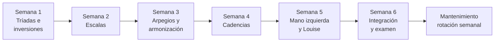
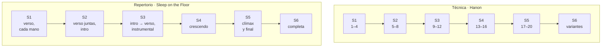

# Piano: el programa de 30 sesiones

> Archivo derivado: lo genera `_scripts/generar-chatgpt.py` desde la bóveda de música del usuario (Obsidian + git), el 2026-10-18. Cada sección es una nota de la bóveda, con su ruta. La bóveda es la fuente de verdad: si algo de aquí contradice a una conversación más reciente, pregunta.

El plan (seis semanas, tres carriles: teclado, Hanon y Sleep on the Floor), el progreso y las 30 sesiones completas. El frontmatter de cada día dice si está hecho y a qué BPM.

Contiene:

- `4. Instrumento/1. Piano/1. Programa de 30 sesiones/00. Plan y progreso.md`
- `4. Instrumento/1. Piano/1. Programa de 30 sesiones/01. Día 1 - Punto de partida y grupos 1 y 2.md`
- `4. Instrumento/1. Piano/1. Programa de 30 sesiones/02. Día 2 - Grupo 3 y los espejos.md`
- `4. Instrumento/1. Piano/1. Programa de 30 sesiones/03. Día 3 - Grupo 4 y el círculo.md`
- `4. Instrumento/1. Piano/1. Programa de 30 sesiones/04. Día 4 - Inversiones con la MI.md`
- `4. Instrumento/1. Piano/1. Programa de 30 sesiones/05. Día 5 - La inversión más cercana.md`
- `4. Instrumento/1. Piano/1. Programa de 30 sesiones/06. Día 6 - Escalas G A y B.md`
- `4. Instrumento/1. Piano/1. Programa de 30 sesiones/07. Día 7 - Escalas Bb y Eb.md`
- `4. Instrumento/1. Piano/1. Programa de 30 sesiones/08. Día 8 - Escalas Ab y Db.md`
- `4. Instrumento/1. Piano/1. Programa de 30 sesiones/09. Día 9 - Escala Gb y bemoles a dos manos.md`
- `4. Instrumento/1. Piano/1. Programa de 30 sesiones/10. Día 10 - Las 12 escalas por el círculo.md`
- `4. Instrumento/1. Piano/1. Programa de 30 sesiones/11. Día 11 - Arpegios, grupos 1 y 2.md`
- `4. Instrumento/1. Piano/1. Programa de 30 sesiones/12. Día 12 - Arpegios, grupos 3 y 4.md`
- `4. Instrumento/1. Piano/1. Programa de 30 sesiones/13. Día 13 - Armonizar en C D F y G.md`
- `4. Instrumento/1. Piano/1. Programa de 30 sesiones/14. Día 14 - Armonizar en A E Bb y Eb.md`
- `4. Instrumento/1. Piano/1. Programa de 30 sesiones/15. Día 15 - Armonizar al azar.md`
- `4. Instrumento/1. Piano/1. Programa de 30 sesiones/16. Día 16 - Cadencia en C G D A E.md`
- `4. Instrumento/1. Piano/1. Programa de 30 sesiones/17. Día 17 - Cadencia en F Bb Eb Ab.md`
- `4. Instrumento/1. Piano/1. Programa de 30 sesiones/18. Día 18 - Cadencia en B Gb Db y las 12.md`
- `4. Instrumento/1. Piano/1. Programa de 30 sesiones/19. Día 19 - La cadencia con V7.md`
- `4. Instrumento/1. Piano/1. Programa de 30 sesiones/20. Día 20 - Las 12 cadencias.md`
- `4. Instrumento/1. Piano/1. Programa de 30 sesiones/21. Día 21 - Patrones de MI, los abiertos.md`
- `4. Instrumento/1. Piano/1. Programa de 30 sesiones/22. Día 22 - Patrones de MI, los que se mueven.md`
- `4. Instrumento/1. Piano/1. Programa de 30 sesiones/23. Día 23 - Patrones transportados.md`
- `4. Instrumento/1. Piano/1. Programa de 30 sesiones/24. Día 24 - Louise en el piano.md`
- `4. Instrumento/1. Piano/1. Programa de 30 sesiones/25. Día 25 - Louise, qué nota va arriba.md`
- `4. Instrumento/1. Piano/1. Programa de 30 sesiones/26. Día 26 - Rotación, lado de sostenidos.md`
- `4. Instrumento/1. Piano/1. Programa de 30 sesiones/27. Día 27 - Rotación, lado de bemoles.md`
- `4. Instrumento/1. Piano/1. Programa de 30 sesiones/28. Día 28 - Examen de teclado.md`
- `4. Instrumento/1. Piano/1. Programa de 30 sesiones/29. Día 29 - Ensayo general.md`
- `4. Instrumento/1. Piano/1. Programa de 30 sesiones/30. Día 30 - La toma final.md`
- `4. Instrumento/1. Piano/1 y2.md`

---

## Archivo: `4. Instrumento/1. Piano/1. Programa de 30 sesiones/00. Plan y progreso.md`

```yaml
tipo: mapa
estado: vigente
```

# Programa de piano · 30 sesiones

> [!abstract] Qué es
> Seis semanas, cinco sesiones de **40 minutos**, tres carriles en paralelo:
> - **Teclado**: las 12 tríadas, inversiones, escalas, arpegios, armonización, cadencias y patrones de mano izquierda.
> - **Técnica**: Hanon 1–20 ([[Hanon - Ejercicios 1-30.pdf|partitura]]).
> - **Repertorio**: *Sleep on the Floor*, de The Lumineers ([[The Lumineers - Sleep on the Floor.pdf|partitura]]), y al final tu *Louise*.
>
> **Punto de partida:** las escalas de C, D, E y F ya salen a dos manos, de arriba abajo, como un
> Hanon. El programa no las vuelve a enseñar: el día 1 las mide, y desde ahí sirven de ancla (G y A
> usan su misma digitación) y de estiramiento (más tempo). Sus tríadas, arpegios y cadencias se
> estudian como las de las demás.
>
> La teoría y los ejercicios están en [[Cheat sheet - acordes mayores]]. Aquí está **qué toca cada día y cómo vas**.

## El plan en una página

| Semana | Tema | Teclado: al terminar la semana… | Hanon | Sleep on the Floor | Se graba |
|:-:|---|---|:-:|---|---|
| **1** | Tríadas e inversiones | las 12 tríadas en tres posiciones, cada mano; la cadena del círculo sin tabla | 1–4 | verso (cc. 18–39), cada mano | la cadena y la MI del verso |
| **2** | Escalas | las 8 que faltaban; las 12 a dos manos por el círculo | 5–8 | verso a dos manos · intro, manos separadas | las 12 escalas y el verso |
| **3** | Arpegios y armonización | arpegios de las 12 en dos octavas; ocho tonalidades armonizadas | 9–12 | intro a dos manos, intro → verso, instrumental | tres armonizadas al azar y cc. 1–47 |
| **4** | Cadencias | I – IV⁶₄ – V⁶ – I en las 12, y la variante con V⁶₅ | 13–16 | crescendo (cc. 48–59) | las 12 cadencias y cc. 40–59 |
| **5** | Mano izquierda y Louise | los ocho patrones de MI; *Louise* en el piano con voicings tuyos | 17–20 | clímax y final (cc. 60–76) | *Louise* y cc. 40–76 |
| **6** | Integración | rotación de las 12, examen en frío, toma final | variantes de 1–20 | completa, al 80 % del tempo | la toma final |





## Una sesión

| Bloque | Min | Qué |
|---|---:|---|
| **Hanon** | 6 | el ejercicio nuevo (MD, MI y juntas) y dos de la rotación |
| **Recuperación** | 3 | lo del día anterior, sin mirar la hoja |
| **Principal** | 14 | lo nuevo del día, con metrónomo |
| **Aplicación** | 4 | usarlo en algo musical: transportar, al azar, *Louise* |
| **Sleep on the Floor** | 11 | los compases del día |
| **Registro** | 2 | BPM alcanzados y qué falló |

### Qué la hace más exigente

- **Lo que ya sabes no se estudia, se mide** y se estira: las escalas de C, D, E y F solo suben de tempo, y la semana de escalas enseña únicamente las ocho que faltan.
- **Manos juntas desde la primera semana de cada tema**, no al final del programa.
- **Las 12 tonalidades en todo**: escalas, arpegios y cadencias a dos manos, no solo cuatro o cinco.
- **Cada *hecho cuando* es sin mirar la tabla**, y algunos al azar: si solo sale en el orden en que lo estudiaste, todavía no salió.
- **Hanon nuevo cada sesión**, de manos separadas a juntas en el mismo bloque.

### Qué hace que salga bien

- **La regla del metrónomo** ([[Cheat sheet - acordes mayores#El metrónomo|§12]]): 3 limpias, +4 bpm; 3 fallos, −8. Nunca se sube por calendario.
- **Si no llegas al *hecho cuando*, la sesión se repite** al día siguiente y las demás se corren.
- **Si vas tarde, recorta en este orden:** Aplicación → Recuperación. El Hanon calienta y el Registro es la evidencia: esos no se recortan.
- **La semana 6 es colchón:** rotación y examen. Lo que no se consolidó antes se recupera ahí, no a costa de una sesión nueva.
- **Si algo duele, para.** Se anota en *Dolor o tensión* y se baja el tempo al día siguiente.

## Cómo se usa

1. **Antes:** abre la nota del día (calendario de abajo) y lee solo esa.
2. **Durante:** marca las casillas. El metrónomo empieza donde lo dejaste en la sesión anterior.
3. **Al terminar:** llena las propiedades de la nota (`hecho`, `fecha`, BPM, `audio`). La tabla de
   progreso se actualiza sola.
4. **Cuando logres algo:** marca el hito y anótalo en las tablas de seguimiento.
5. **El último día de cada semana:** graba y llena el registro semanal.

## Progreso de las sesiones

```base
filters:
  and:
    - file.inFolder("4. Instrumento/1. Piano/1. Programa de 30 sesiones")
    - 'tipo == "ejercicio"'
views:
  - type: table
    name: Todas
    order:
      - file.name
      - semana
      - hecho
      - fecha
      - teclado_bpm
      - hanon
      - hanon_bpm
      - sotf
      - sotf_bpm
      - audio
    sort:
      - property: dia
        direction: ASC
  - type: table
    name: Pendientes
    filters:
      and:
        - 'hecho != true'
    order:
      - file.name
      - semana
      - hecho
      - fecha
      - teclado_bpm
      - hanon
      - hanon_bpm
      - sotf
      - sotf_bpm
      - audio
    sort:
      - property: dia
        direction: ASC
  - type: table
    name: Hechas
    filters:
      and:
        - 'hecho == true'
    order:
      - file.name
      - semana
      - hecho
      - fecha
      - teclado_bpm
      - hanon
      - hanon_bpm
      - sotf
      - sotf_bpm
      - audio
    sort:
      - property: dia
        direction: ASC
```

## Calendario

🎙 = ese día se graba.

| Semana | Día | Sesión | Teclado | Hanon | Sleep on the Floor |
|:-:|:-:|---|---|:-:|---|
| 1 | 1 | [[01. Día 1 - Punto de partida y grupos 1 y 2\|Día 1]] | Escalas C, D, E, F (se miden) · tríadas de los grupos 1 y 2 · inversiones con la MD | 1 | mapa · cc. 18–23 · MI |
| 1 | 2 | [[02. Día 2 - Grupo 3 y los espejos\|Día 2]] | Grupo 3 (D♭, E♭, A♭) · espejos · inversiones con la MD | 2 | cc. 18–33 · MI |
| 1 | 3 | [[03. Día 3 - Grupo 4 y el círculo\|Día 3]] | Grupo 4 (F♯, B♭, B) · las 12 por el círculo | 3 | cc. 18–39 · MI |
| 1 | 4 | [[04. Día 4 - Inversiones con la MI\|Día 4]] | Inversiones con la MI · las 12 | 4 | cc. 21–25 · MD |
| 1 | 5 | [[05. Día 5 - La inversión más cercana\|Día 5]] 🎙 | La cadena del círculo (§8.2) | 1–4 | cc. 26–39 · MD |
| 2 | 6 | [[06. Día 6 - Escalas G A y B\|Día 6]] | Escalas G, A y B · C, D, E más rápido | 5 | cc. 18–29 · juntas |
| 2 | 7 | [[07. Día 7 - Escalas Bb y Eb\|Día 7]] | Escalas B♭ y E♭ · la regla del 4 en Si♭ | 6 | cc. 30–39 · juntas |
| 2 | 8 | [[08. Día 8 - Escalas Ab y Db\|Día 8]] | Escalas A♭ y D♭ · B♭ y E♭ a dos manos | 7 | cc. 1–17 · lectura · MI 1–9 |
| 2 | 9 | [[09. Día 9 - Escala Gb y bemoles a dos manos\|Día 9]] | Escala F♯/G♭ · A♭ y D♭ a dos manos | 8 | cc. 1–9 · juntas |
| 2 | 10 | [[10. Día 10 - Las 12 escalas por el círculo\|Día 10]] 🎙 | Las 12 escalas a dos manos, por el círculo | 5–8 | cc. 10–17 · verso juntas |
| 3 | 11 | [[11. Día 11 - Arpegios, grupos 1 y 2\|Día 11]] | Arpegios C, F, G · D, E, A, B | 9 | cc. 1–17 · intro juntas |
| 3 | 12 | [[12. Día 12 - Arpegios, grupos 3 y 4\|Día 12]] | Arpegios D♭, E♭, A♭ · B♭ · F♯ | 10 | cc. 1–39 · intro y verso |
| 3 | 13 | [[13. Día 13 - Armonizar en C D F y G\|Día 13]] | Armonizar la escala en C, D, F y G | 11 | cc. 40–47 · separadas |
| 3 | 14 | [[14. Día 14 - Armonizar en A E Bb y Eb\|Día 14]] | Armonizar la escala en A, E, B♭ y E♭ | 12 | cc. 40–51 |
| 3 | 15 | [[15. Día 15 - Armonizar al azar\|Día 15]] 🎙 | Armonizar al azar · B, F♯, D♭, A♭ | 9–12 | cc. 1–47 |
| 4 | 16 | [[16. Día 16 - Cadencia en C G D A E\|Día 16]] | I – IV⁶₄ – V⁶ – I en C, G, D, A y E | 13 | cc. 48–55 · MI |
| 4 | 17 | [[17. Día 17 - Cadencia en F Bb Eb Ab\|Día 17]] | Cadencia en F, B♭, E♭ y A♭ | 14 | cc. 48–55 · MD |
| 4 | 18 | [[18. Día 18 - Cadencia en B Gb Db y las 12\|Día 18]] | Cadencia en B, F♯ y D♭ · las 12 por el círculo | 15 | cc. 56–59 · 48–51 juntas |
| 4 | 19 | [[19. Día 19 - La cadencia con V7\|Día 19]] | La variante con V⁶₅ en ocho tonalidades | 16 | cc. 52–59 · juntas |
| 4 | 20 | [[20. Día 20 - Las 12 cadencias\|Día 20]] 🎙 | Las 12 cadencias por el círculo, sin tabla | 13–16 | cc. 40–59 · juntas |
| 5 | 21 | [[21. Día 21 - Patrones de MI, los abiertos\|Día 21]] | Raíz, quinta, octava, 1-5-8 y 1-5-10 | 17 | cc. 60–67 · MD |
| 5 | 22 | [[22. Día 22 - Patrones de MI, los que se mueven\|Día 22]] | Alberti, vals y arpegio largo | 18 | cc. 60–67 · MI |
| 5 | 23 | [[23. Día 23 - Patrones transportados\|Día 23]] | Tres patrones en F, B♭, E♭ y A | 19 | cc. 60–63 · juntas |
| 5 | 24 | [[24. Día 24 - Louise en el piano\|Día 24]] | Los acordes de Louise: intro y coro | 20 | cc. 64–76 |
| 5 | 25 | [[25. Día 25 - Louise, qué nota va arriba\|Día 25]] 🎙 | Louise: decidir la nota de arriba | 17–20 | cc. 40–76 |
| 6 | 26 | [[26. Día 26 - Rotación, lado de sostenidos\|Día 26]] | G, D, A, E, B, F♯ completas | 1–5 · puntillo | cc. 1–39 · tempo |
| 6 | 27 | [[27. Día 27 - Rotación, lado de bemoles\|Día 27]] | F, B♭, E♭, A♭, D♭ y C completas | 6–10 · staccato | cc. 40–76 · tempo |
| 6 | 28 | [[28. Día 28 - Examen de teclado\|Día 28]] | Examen en frío: seis tonalidades al azar | 11–15 · dinámica | completa |
| 6 | 29 | [[29. Día 29 - Ensayo general\|Día 29]] | Los ✗ del examen · la cadena en vals | 1 en G y F · 16–20 | completa · compases débiles |
| 6 | 30 | [[30. Día 30 - La toma final\|Día 30]] 🎙 | Toma: las 12 escalas y las 12 cadencias | tres al azar | completa |

> [!info] Si se pierde un día
> La sesión pasa al siguiente día libre y las demás se corren. No se recupera con un maratón.
> Si una sesión no llega a su *hecho cuando*, se repite antes de pasar a la siguiente.

## Hitos

Los hitos son la respuesta a "¿estoy avanzando?". Márcalos cuando ocurran, no cuando acabe la semana.

### Semana 1 · Tríadas e inversiones
- [ ] Las escalas de C, D, E y F medidas: BPM de partida anotados en la columna *Escala MJ*.
- [ ] Las 12 tríadas en las tres posiciones, cada mano, **sin mirar**, a 60.
- [ ] La cadena del círculo (§8.2) sin tabla, de ida y de vuelta. 🎙
- [ ] Hanon 1–4 seguidos a 60.
- [ ] La MI del verso de *Sleep on the Floor* (cc. 18–39) sin parar a 48. 🎙

### Semana 2 · Escalas
- [ ] Las 12 escalas a dos manos, una octava, negras a 60. 🎙
- [ ] C, D y E a dos octavas, a dos manos, en corcheas, 8 bpm arriba de tu punto de partida.
- [ ] Hanon 1–8.
- [ ] El verso a dos manos (cc. 18–39) a 48. 🎙

### Semana 3 · Arpegios y armonización
- [ ] Los arpegios de las 12 en dos octavas, cada mano.
- [ ] Ocho tonalidades armonizadas a dos manos; tres sacadas al azar. 🎙
- [ ] Hanon 1–12.
- [ ] *Sleep on the Floor* de la intro al instrumental (cc. 1–47) sin parar. 🎙

### Semana 4 · Cadencias
- [ ] La cadencia I – IV⁶₄ – V⁶ – I en las 12, por el círculo, sin tabla. 🎙
- [ ] La variante con V⁶₅ en ocho tonalidades.
- [ ] Hanon 1–16.
- [ ] El crescendo a dos manos, enlazado desde el instrumental (cc. 40–59). 🎙

### Semana 5 · Mano izquierda y Louise
- [ ] Los ocho patrones de MI sobre la cadencia de C; tres de ellos en cuatro tonalidades.
- [ ] *Louise* (intro y coro) en el piano, con voicings decididos por ti. 🎙
- [ ] Hanon 1–20.
- [ ] Clímax y final a dos manos; cc. 40–76 sin parar. 🎙

### Semana 6 · Integración
- [ ] La tabla de seguimiento de teclado llena en las 12 tonalidades.
- [ ] Las 12 escalas a dos manos, dos octavas, en corcheas a 72.
- [ ] Hanon 1–5 a 88 con las variantes de §10; 6–20 a 72 o más en rotación.
- [ ] *Sleep on the Floor* completa, sin parar, al 80 % del tempo o más. 🎙

## Seguimiento por carril

Pon ✓ cuando salga limpio (dedos correctos, sin parar, sin tensión) y escribe el BPM.

### Teclado · las 12 tonalidades

MS = manos separadas · MJ = manos juntas. **C, D, E y F** (marcadas ★): sus escalas ya salen a dos
manos, de arriba abajo. El día 1 escribes a qué BPM en *Escala MJ*; las demás columnas se llenan como
en cualquier otra tonalidad.

| Tonalidad | Tríada (sin mirar) | Inversiones | Escala MS | Escala MJ | Arpegio | Armonizada | Cadencia | V⁶₅ |
|---|:-:|:-:|:-:|:-:|:-:|:-:|:-:|:-:|
| **C** ★ | | | | | | | | |
| **G** | | | | | | | | |
| **D** ★ | | | | | | | | |
| **A** | | | | | | | | |
| **E** ★ | | | | | | | | |
| **B** | | | | | | | | |
| **F♯/G♭** | | | | | | | | |
| **D♭** | | | | | | | | |
| **A♭** | | | | | | | | |
| **E♭** | | | | | | | | |
| **B♭** | | | | | | | | |
| **F** ★ | | | | | | | | |

### Técnica · Hanon

| Nº | Empecé | Manos separadas | Manos juntas | BPM actual | Meta |
|:-:|---|:-:|:-:|:-:|:-:|
| 1 | | | | | 108 |
| 2 | | | | | 108 |
| 3 | | | | | 108 |
| 4 | | | | | 108 |
| 5 | | | | | 108 |
| 6 | | | | | 108 |
| 7 | | | | | 108 |
| 8 | | | | | 108 |
| 9 | | | | | 108 |
| 10 | | | | | 108 |
| 11 | | | | | 108 |
| 12 | | | | | 108 |
| 13 | | | | | 108 |
| 14 | | | | | 108 |
| 15 | | | | | 108 |
| 16 | | | | | 108 |
| 17 | | | | | 108 |
| 18 | | | | | 108 |
| 19 | | | | | 108 |
| 20 | | | | | 108 |
| 21 | | | | | 108 |
| 22 | | | | | 108 |
| 23 | | | | | 108 |
| 24 | | | | | 108 |
| 25 | | | | | 108 |
| 26 | | | | | 108 |
| 27 | | | | | 108 |
| 28 | | | | | 108 |
| 29 | | | | | 108 |
| 30 | | | | | 108 |

### Repertorio · Sleep on the Floor

La meta del programa es el **80 % del tempo real**; el tempo real queda para el mantenimiento.

| Sección | Compases | Semana | MI | MD | Manos juntas | BPM actual | Meta del programa | Tempo real |
|---|---|:-:|:-:|:-:|:-:|:-:|:-:|:-:|
| **Intro** | 1–17 | 2–3 | | | | | 50 | 63 |
| **Verso** | 18–39 | 1–2 | | | | | 56 | 71 |
| **Instrumental** | 40–47 | 3 | | | | | 56 | 71 |
| **Crescendo** | 48–59 | 4 | | | | | 56 | 71 |
| **Clímax** | 60–67 | 5 | | | | | 56 | 71 |
| **Final** | 68–76 | 5 | | | | | 56 | 71 |

## Registro semanal

| Semana | Fechas | Sesiones | BPM tríadas | BPM escalas | Hanon (último nº · BPM) | Sleep on the Floor (compases · BPM) | Audio |
|---|---|---:|---:|---:|---|---|---|
| 1 · Tríadas e inversiones | | /5 | | — | | | |
| 2 · Escalas | | /5 | | | | | |
| 3 · Arpegios y armonización | | /5 | | | | | |
| 4 · Cadencias | | /5 | | | | | |
| 5 · Mano izquierda y Louise | | /5 | | | | | |
| 6 · Integración | | /5 | | | | | |

## Después de las 30 sesiones · mantenimiento

Después del plan, **20 minutos al día** mantienen todo vivo y siguen sumando: **un Hanon nuevo por
semana** (21, 22… hasta 30), la pieza entera cada viernes y, con la misma regla del metrónomo,
*Sleep on the Floor* del 80 % al tempo real. Lo que salió ✗ en el examen del día 28 va primero.

| Día | Tríadas e inversiones | Escalas y arpegios | Cadencia (con V⁶₅) | Hanon | Sleep on the Floor |
|---|---|---|---|---|---|
| Lunes | grupo 1 (C F G) | C, F, G | C | 1–5 | verso |
| Martes | grupo 2 (D E A) | D, E, A, B | D | 6–10 | intro |
| Miércoles | grupo 3 (D♭ E♭ A♭) | D♭, E♭, A♭ | E♭ | 11–15 | cc. 40–59 |
| Jueves | grupo 4 (F♯ B♭ B) | F♯, B♭ | B♭ | 16–20 | clímax, cc. 60–67 |
| Viernes | el círculo (§8.2) | dos al azar | las 12 | el nuevo de la semana | completa, y se graba |

---

## Archivo: `4. Instrumento/1. Piano/1. Programa de 30 sesiones/01. Día 1 - Punto de partida y grupos 1 y 2.md`

```yaml
tipo: ejercicio
estado: planeada
dia: 1
semana: 1
fecha: 2026-10-13
hecho: true
teclado_bpm: "60"
hanon: "1"
hanon_bpm: "60"
sotf: mapa · cc. 18–23 · MI
sotf_bpm: "60"
audio: "[[2026-10-13 piano día 1.m4a]]"
```

# Día 1 · Punto de partida y grupos 1 y 2
%%+
.6900000000/%%
> [!info] Sem+-
> *ana 1 · Tríadas e inversiones · día 1 de 30
> [[00. Plan y progreso|↑ Plan y progreso]] · [[02. Día 2 - Grupo 3 y los espejos|Día 2 →]]
> Todo lo que tocas hoy está en esta nota, de arriba abajo. No hace falta abrir nada más.

| Carril | Hoy |
|---|---|
| Teclado | Escalas C, D, E, F (se miden) · tríadas de los grupos 1 y 2 · inversiones con la MD |
| Hanon | 1 |
| Sleep on the Floor | mapa · cc. 18–23 · MI |

> [!tip] La clave de hoy
> Las escalas que ya sabes no se estudian: se **miden**. Y te regalan los acordes: la tríada de cada tonalidad es la 1ª, la 3ª y la 5ª nota de la escala que ya tocas.


## Antes de empezar · 1 minuto

- Energía (1–5):
- Dolor o tensión:
- Metrónomo de partida: teclado ___ · Hanon ___ · Sleep on the Floor ___

El metrónomo de toda la sesión (cambia el número y dale play):

```strudel
let bpm = 60   // ← sube de 4 en 4
setcpm(bpm/4)
s("hh*4").bank("RolandTR909").gain("1 .4 .4 .4")
```

## 1 · Hanon 1 · 6 minutos

- [x] **(1')** Mira la partitura de abajo. Es una celda de 8 notas (C E F G A G F E) que se repite **empezando un grado más arriba cada vez** (en D, en E, en F…) durante dos octavas. Arriba del todo cambia a la celda de bajada y baja igual hasta C.
- [x] **(1')** MD sola, a 60, una pasada completa: sube y baja.
- [x] **(1')** MI sola, a 60, igual.
- [ ] **(3')** Las dos manos juntas, a 60, dos pasadas. Si la segunda sale limpia, la última a 64.

> [!warning] Hanon sin tensión o nada
> Dedos curvos y cerca de las teclas, muñeca quieta y suelta, las 8 notas con el mismo volumen (el 4 y el 5 son los que se caen). Si algo duele, para.

> [!info] «A 60» en Hanon son cuatro notas por click
> Hanon va en semicorcheas: con el metrónomo a 60 caben **cuatro notas en cada click** (una celda cada dos clicks). La escalera es: una nota por click (solo para leerlo) → **dos por click** → cuatro por click, que es el «60» de verdad. Sube un escalón cuando salga limpio 3 veces seguidas.
>
> La partitura muestra solo el principio: tres celdas de subida y dos de bajada. La pasada completa sigue el mismo dibujo hasta dos octavas arriba y baja igual hasta C.
 
![[Cheat sheet - acordes mayores#Hanon 1, escrito completo]]

## 2 · Punto de partida · 3 minutos

- [ ] Escala de **C** a dos manos, dos octavas, sube y baja, en corcheas. Empieza a 72.
- [ ] Si sale limpia (notas, dedos y sin pausas) → +4 y otra vez. Al primer fallo, para: el último BPM limpio es tu número.
- [ ] Lo mismo con **D**, **E** y **F**. Unos 40 segundos por escala: es medir, no practicar.
- [ ] Escribe los cuatro números aquí abajo y en la columna *Escala MJ* del [[00. Plan y progreso|Plan]].

| Escala | Último BPM limpio |
|---|:-:|
| C | |
| D | |
| E | |
| F | |

> [!example]- Las cuatro escalas con digitación, por si dudas de un dedo
> ```abc
> X:1
> T:C y D: dos octavas a dos manos
> M:4/4
> L:1/8
> K:C
> V:1 clef=treble name="MD"
> V:2 clef=bass name="MI"
> [V:1] "C""^1"C "^2"D "^3"E "^1"F "^2"G "^3"A "^4"B "^1"c | "^2"d "^3"e "^1"f "^2"g "^3"a "^4"b "^5"c' "^4"b | "^3"a "^2"g "^1"f "^3"e "^2"d "^1"c "^4"B "^3"A | "^2"G "^1"F "^3"E "^2"D "^1"C2 z2 |
> [V:2] "_5"C, "_4"D, "_3"E, "_2"F, "_1"G, "_3"A, "_2"B, "_1"C | "_4"D "_3"E "_2"F "_1"G "_3"A "_2"B "_1"c "_2"B | "_3"A "_1"G "_2"F "_3"E "_4"D "_1"C "_2"B, "_3"A, | "_1"G, "_2"F, "_3"E, "_4"D, "_5"C,2 z2 |
> [V:1] [K:D clef=treble] "D""^1"D "^2"E "^3"F "^1"G "^2"A "^3"B "^4"c "^1"d | "^2"e "^3"f "^1"g "^2"a "^3"b "^4"c' "^5"d' "^4"c' | "^3"b "^2"a "^1"g "^3"f "^2"e "^1"d "^4"c "^3"B | "^2"A "^1"G "^3"F "^2"E "^1"D2 z2 |]
> [V:2] [K:D clef=bass] "_5"D, "_4"E, "_3"F, "_2"G, "_1"A, "_3"B, "_2"C "_1"D | "_4"E "_3"F "_2"G "_1"A "_3"B "_2"c "_1"d "_2"c | "_3"B "_1"A "_2"G "_3"F "_4"E "_1"D "_2"C "_3"B, | "_1"A, "_2"G, "_3"F, "_4"E, "_5"D,2 z2 |]
> ```
>
> ```abc
> X:1
> T:E y F: dos octavas a dos manos
> M:4/4
> L:1/8
> K:E
> V:1 clef=treble name="MD"
> V:2 clef=bass name="MI"
> [V:1] "E""^1"E "^2"F "^3"G "^1"A "^2"B "^3"c "^4"d "^1"e | "^2"f "^3"g "^1"a "^2"b "^3"c' "^4"d' "^5"e' "^4"d' | "^3"c' "^2"b "^1"a "^3"g "^2"f "^1"e "^4"d "^3"c | "^2"B "^1"A "^3"G "^2"F "^1"E2 z2 |
> [V:2] "_5"E, "_4"F, "_3"G, "_2"A, "_1"B, "_3"C "_2"D "_1"E | "_4"F "_3"G "_2"A "_1"B "_3"c "_2"d "_1"e "_2"d | "_3"c "_1"B "_2"A "_3"G "_4"F "_1"E "_2"D "_3"C | "_1"B, "_2"A, "_3"G, "_4"F, "_5"E,2 z2 |
> [V:1] [K:F clef=treble] "F""^1"F "^2"G "^3"A "^4"B "^1"c "^2"d "^3"e "^1"f | "^2"g "^3"a "^4"b "^1"c' "^2"d' "^3"e' "^4"f' "^3"e' | "^2"d' "^1"c' "^4"b "^3"a "^2"g "^1"f "^3"e "^2"d | "^1"c "^4"B "^3"A "^2"G "^1"F2 z2 |]
> [V:2] [K:F clef=bass] "_5"F, "_4"G, "_3"A, "_2"B, "_1"C "_3"D "_2"E "_1"F | "_4"G "_3"A "_2"B "_1"c "_3"d "_2"e "_1"f "_2"e | "_3"d "_1"c "_2"B "_3"A "_4"G "_1"F "_2"E "_3"D | "_1"C "_2"B, "_3"A, "_4"G, "_5"F,2 z2 |]
> ```

## 3 · Principal · 14 minutos

- [ ] **(5')** Bloque y quebrada (1-3-5-3-1), cada mano: C, F y G, luego D, E y A. Primero toda la MD, luego toda la MI. Partituras A y B.
- [ ] **(7')** Inversiones con la MD: cada acorde sube fund. → 1ª → 2ª → fund. arriba y vuelve. Partituras C y D. Despacio: un acorde por pulso a 60.
- [ ] **(2')** La prueba: los seis seguidos (C F G D E A) con las inversiones, MD, a 60, **sin mirar las teclas**. Tres veces.

> [!important] La regla del hueco: el único dedo que cambia
> En la **1ª inversión** la MD usa **1-2-5**, no 1-3-5: entre la 2ª y la 3ª nota hay una cuarta y entre los dedos queda uno sin usar. En fundamental y en 2ª inversión, 1-3-5.
>
> | Posición | Ejemplo en C | MD | MI |
> |---|---|:-:|:-:|
> | Fundamental | C – E – G | 1-3-5 | 5-3-1 |
> | 1ª inversión | E – G – C | **1-2-5** | 5-3-1 |
> | 2ª inversión | G – C – E | 1-3-5 | **5-2-1** |

**A · Grupo 1, bloque y quebrada** (las tres son todas blancas: la mano plana, al borde de las teclas)

```abc
X:1
T:A · C, F y G: bloque y quebrada
M:4/4
L:1/8
K:C
V:1 clef=treble name="MD"
V:2 clef=bass name="MI"
[V:1] "C""^1-3-5"[CEG]4 z4 | "^1"C "^3"E "^5"G "^3"E "^1"C2 z2 |
[V:2] "_5-3-1"[C,E,G,]4 z4 | "_5"C, "_3"E, "_1"G, "_3"E, "_5"C,2 z2 |
[V:1] [K:F clef=treble] "F""^1-3-5"[FAc]4 z4 | "^1"F "^3"A "^5"c "^3"A "^1"F2 z2 |
[V:2] [K:F clef=bass] "_5-3-1"[F,A,C]4 z4 | "_5"F, "_3"A, "_1"C "_3"A, "_5"F,2 z2 |
[V:1] [K:G clef=treble] "G""^1-3-5"[GBd]4 z4 | "^1"G "^3"B "^5"d "^3"B "^1"G2 z2 |]
[V:2] [K:G clef=bass] "_5-3-1"[G,B,D]4 z4 | "_5"G, "_3"B, "_1"D "_3"B, "_5"G,2 z2 |]
```

**B · Grupo 2, bloque y quebrada** (la 3ª es negra: el dedo 3 sube y la mano entra un poco)

```abc
X:1
T:B · D, E y A: bloque y quebrada
M:4/4
L:1/8
K:D
V:1 clef=treble name="MD"
V:2 clef=bass name="MI"
[V:1] "D""^1-3-5"[DFA]4 z4 | "^1"D "^3"F "^5"A "^3"F "^1"D2 z2 |
[V:2] "_5-3-1"[D,F,A,]4 z4 | "_5"D, "_3"F, "_1"A, "_3"F, "_5"D,2 z2 |
[V:1] [K:E clef=treble] "E""^1-3-5"[EGB]4 z4 | "^1"E "^3"G "^5"B "^3"G "^1"E2 z2 |
[V:2] [K:E clef=bass] "_5-3-1"[E,G,B,]4 z4 | "_5"E, "_3"G, "_1"B, "_3"G, "_5"E,2 z2 |
[V:1] [K:A clef=treble] "A""^1-3-5"[A,CE]4 z4 | "^1"A, "^3"C "^5"E "^3"C "^1"A,2 z2 |]
[V:2] [K:A clef=bass] "_5-3-1"[A,,C,E,]4 z4 | "_5"A,, "_3"C, "_1"E, "_3"C, "_5"A,,2 z2 |]
```

**C · Grupo 1, inversiones con la MD**

```abc
X:1
T:C · C, F y G: inversiones
M:4/4
L:1/4
K:C
V:1 clef=treble name="MD"
[V:1] "C""^1-3-5"[CEG] "C/E""^1-2-5"[EGc] "C/G""^1-3-5"[Gce] "C""^1-3-5"[ceg] | "C/G""^1-3-5"[Gce] "C/E""^1-2-5"[EGc] "C""^1-3-5"[CEG]2 |
[V:1] [K:F clef=treble] "F""^1-3-5"[FAc] "F/A""^1-2-5"[Acf] "F/C""^1-3-5"[cfa] "F""^1-3-5"[fac'] | "F/C""^1-3-5"[cfa] "F/A""^1-2-5"[Acf] "F""^1-3-5"[FAc]2 |
[V:1] [K:G clef=treble] "G""^1-3-5"[GBd] "G/B""^1-2-5"[Bdg] "G/D""^1-3-5"[dgb] "G""^1-3-5"[gbd'] | "G/D""^1-3-5"[dgb] "G/B""^1-2-5"[Bdg] "G""^1-3-5"[GBd]2 |]
```

**D · Grupo 2, inversiones con la MD**

```abc
X:1
T:D · D, E y A: inversiones
M:4/4
L:1/4
K:D
V:1 clef=treble name="MD"
[V:1] "D""^1-3-5"[DFA] "D/F#""^1-2-5"[FAd] "D/A""^1-3-5"[Adf] "D""^1-3-5"[dfa] | "D/A""^1-3-5"[Adf] "D/F#""^1-2-5"[FAd] "D""^1-3-5"[DFA]2 |
[V:1] [K:E clef=treble] "E""^1-3-5"[EGB] "E/G#""^1-2-5"[GBe] "E/B""^1-3-5"[Beg] "E""^1-3-5"[egb] | "E/B""^1-3-5"[Beg] "E/G#""^1-2-5"[GBe] "E""^1-3-5"[EGB]2 |
[V:1] [K:A clef=treble] "A""^1-3-5"[A,CE] "A/C#""^1-2-5"[CEA] "A/E""^1-3-5"[EAc] "A""^1-3-5"[Ace] | "A/E""^1-3-5"[EAc] "A/C#""^1-2-5"[CEA] "A""^1-3-5"[A,CE]2 |]
```

```strudel
// Así suenan las inversiones de los seis (un acorde por pulso a 60)
setcpm(60/4)
n("<[0,2,4] [2,4,7] [4,7,9] [7,9,11] [4,7,9] [2,4,7] [0,2,4] ~>")
  .scale("<C4:major F4:major G4:major D4:major E4:major A3:major>/8")
  .s("piano")
```

## 4 · Aplicación · 4 minutos

- [ ] Lee el primero de la lista, **cierra los ojos** y tócalo con la MD en esa posición. Tienes 2 segundos.
- [ ] Abre los ojos, comprueba (notas y dedos), siguiente. Los doce.
- [ ] Los que fallaste, otra vez al final.

| 1–4 | 5–8 | 9–12 |
|---|---|---|
| 1. **F** · 1ª | 5. **C** · 1ª | 9. **F** · 2ª |
| 2. **D** · 1ª | 6. **D** · 2ª | 10. **D** · 1ª |
| 3. **G** · 2ª | 7. **A** · 2ª | 11. **E** · 1ª |
| 4. **C** · fund. | 8. **C** · 2ª | 12. **A** · fund. |

## 5 · Sleep on the Floor · 11 minutos

- [ ] **(5')** Pon la canción original y síguela en la partitura (las tres páginas, abajo). Con un lápiz o un comentario en el PDF, marca dónde empieza cada sección: **c. 1** intro · **c. 18** verso · **c. 40** instrumental · **c. 48** crescendo · **c. 60** clímax · **c. 68** final.
- [ ] **(2')** Preparatorio 1, solo MI: acorde abierto – raíz – raíz una octava abajo, sobre C F G C. Es el dibujo de la MI de todo el verso.
- [ ] **(4')** MI de los **cc. 18–23**: primero sin metrónomo, nota por nota; después con el metrónomo a **40**.

![[Cheat sheet - acordes mayores#Mapa de la pieza]]

**Preparatorio 1** (si no alcanzas la nota de arriba del primer acorde, arpégialo de abajo arriba):

```abc
X:1
T:Preparatorio 1: acorde – raíz – bajo grave
M:4/4
L:1/4
K:C
V:1 clef=bass name="MI"
[V:1] "_5-2-1""C"[C,G,E] "_5"C, "_5 (salto)"C,,2 | "F"[F,CA] F, F,,2 | "G"[G,DB] G, G,,2 | "C"[C,G,E] C, C,,2 |]
```

**Metrónomo para la pieza** (empieza en 40, aunque la pieza vaya a 71):

```strudel
let bpm = 40   // la intro va a 63 y el resto a 71; tú empiezas aquí
setcpm(bpm/4)
s("hh*4").bank("RolandTR909").gain("1 .4 .4 .4")
```

![[The Lumineers - Sleep on the Floor.pdf#page=1]]

![[The Lumineers - Sleep on the Floor.pdf#page=2]]

![[The Lumineers - Sleep on the Floor.pdf#page=3]]

## 6 · Registro · 2 minutos

- **Teclado** · BPM: · qué falló:
- **Hanon** · BPM: · qué falló:
- **Sleep on the Floor** · BPM: · compases que fallan:
- **Qué cambio para la próxima sesión:**

### Grabación

![[2026-10-13 piano día 1.m4a]]

> [!note] Lo que mide la grabación · análisis automático, 13 oct
> No es una escucha: es un análisis de la señal (ataques, notas y volumen). Tu evaluación va después de descansar.
>
> **Qué es:** Hanon 1, el fragmento escrito (tres celdas de subida y dos de bajada), **dos veces seguidas a dos manos**. 85 segundos. Es solo el Hanon: el *hecho cuando* de hoy (las tríadas) no se puede comprobar con esta toma.
>
> | | Medida | Lectura |
> |---|---|---|
> | **Notas** | la secuencia coincide con la partitura en las dos pasadas | sin notas equivocadas detectables, salvo lo de la fila *Saltos* |
> | **Tempo** | una nota cada 1,00 s | es ♩ = 60 **por nota**, o sea ♩ = 15 en semicorcheas: la cuarta parte del «60» del Hanon |
> | **Pulso** | 56 ms de desviación típica entre notas | estable |
> | **Manos juntas** | 15 notas con dos ataques separados ~0,1 s | probablemente las manos no caen juntas en 1 de cada 5 notas; repartido en las dos pasadas, con un grupo al saltar a la celda de bajada en la 2ª (s. 64–67) |
> | **Igualdad** | cada posición de la celda dentro de ±1,1 dB de la media | pareja: el 4 y el 5 no se caen (con las dos manos sonando no se puede separar cada mano) |
> | **Saltos** | una nota de más justo antes de la celda de bajada en la 1ª pasada (s. 25) y el final de la 1ª pasada pegado al inicio de la 2ª (s. 41) | el cambio de posición es donde se pierde |
>
> Los últimos 4 segundos no se distinguen: probablemente es el final de la grabación.
>
> **Siguiente:** el mismo Hanon 1 a **dos notas por click** a 60, con la atención en que las dos manos caigan como una sola. Antes de cada salto a la celda de bajada, prepara la mano durante la última nota de la celda anterior.

> [!check] Hecho cuando
> las seis tríadas (C F G D E A) en las tres posiciones con la MD, dedos correctos, sin mirar, a 60, tres veces seguidas.
> Si no sale, mañana repites este día: no se pasa al siguiente.

> [!tip] Al terminar
> Llena las propiedades de arriba: `hecho`, `fecha`, los tres BPM y `audio` si grabaste.
> Así la sesión aparece al día en [[00. Plan y progreso]].

---

## Archivo: `4. Instrumento/1. Piano/1. Programa de 30 sesiones/02. Día 2 - Grupo 3 y los espejos.md`

```yaml
tipo: ejercicio
estado: planeada
dia: 2
semana: 1
fecha:
hecho: false
teclado_bpm:
hanon: "2"
hanon_bpm:
sotf: "cc. 18–33 · MI"
sotf_bpm:
audio:
```

# Día 2 · Grupo 3 y los espejos

> [!info] Semana 1 · Tríadas e inversiones · día 2 de 30
> [[00. Plan y progreso|↑ Plan y progreso]] · [[01. Día 1 - Punto de partida y grupos 1 y 2|← Día 1]] · [[03. Día 3 - Grupo 4 y el círculo|Día 3 →]]
> Todo lo que tocas hoy está en esta nota, de arriba abajo. No hace falta abrir nada más.

| Carril | Hoy |
|---|---|
| Teclado | Grupo 3 (D♭, E♭, A♭) · espejos · inversiones con la MD |
| Hanon | 2 |
| Sleep on the Floor | cc. 18–33 · MI |

> [!tip] La clave de hoy
> Cada acorde del grupo 3 está un semitono debajo de uno del grupo 2. Si sabes D, E y A, ya tienes D♭, E♭ y A♭: el mismo dibujo con los colores invertidos.

## Antes de empezar · 1 minuto

- Energía (1–5):
- Dolor o tensión:
- Metrónomo de partida: teclado ___ · Hanon ___ · Sleep on the Floor ___

El metrónomo de toda la sesión (cambia el número y dale play):

```strudel
let bpm = 60   // ← sube de 4 en 4
setcpm(bpm/4)
s("hh*4").bank("RolandTR909").gain("1 .4 .4 .4")
```

## 1 · Hanon 2 · 6 minutos

- [ ] **(1')** Busca el **nº 2** en la partitura de abajo. Lee la celda de subida (clave de Fa, antes de la doble barra) y la de bajada (clave de Sol), con sus dedos: números de arriba = MD, de abajo = MI.
- [ ] **(1')** MD sola, una pasada completa (sube dos octavas y baja), en tu escalón de la escalera de abajo.
- [ ] **(1')** MI sola, igual.
- [ ] **(1')** Las dos manos, que caigan como una sola. Si sale limpia, sube un escalón.
- [ ] **(2')** Rotación: Hanon 1 a dos manos, dos pasadas, al BPM de ayer (+4 si sale limpio).

> [!warning] Hanon sin tensión
> Dedos curvos y cerca de las teclas, muñeca quieta y suelta, las 8 notas iguales (el 4 y el 5 son los que se caen). Si algo duele, para.

> [!info] «A 60» son cuatro notas por click
> Hanon va en semicorcheas: con el metrónomo a 60 caben **cuatro notas en cada click**. La escalera es: una nota por click (solo para leer) → dos por click → cuatro por click. Sube un escalón cuando salga limpio 3 veces; con cuatro por click, sigue la regla de siempre (+4 bpm). Anota en el registro en qué escalón vas.

![[Hanon - Ejercicios 1-30.pdf#page=1]]

## 2 · Recuperación · 3 minutos

- [ ] Ojos cerrados, MD: los doce de la lista, 2 segundos cada uno. Son los seis de ayer en posiciones sorteadas.

| 1–4 | 5–8 | 9–12 |
|---|---|---|
| 1. **F** · 2ª | 5. **C** · fund. | 9. **C** · 2ª |
| 2. **F** · fund. | 6. **G** · fund. | 10. **A** · 1ª |
| 3. **E** · 1ª | 7. **A** · 2ª | 11. **F** · 1ª |
| 4. **D** · 1ª | 8. **D** · fund. | 12. **A** · 1ª |

## 3 · Principal · 14 minutos

- [ ] **(5')** D♭, E♭ y A♭ en bloque y quebrada, cada mano (A). Con dos negras **la mano entera entra hacia la tapa**: no estires los dedos.
- [ ] **(7')** Sus inversiones con la MD (B), un acorde por pulso a 60.
- [ ] **(2')** Los nueve en fundamental (C F G D E A D♭ E♭ A♭), MD y luego MI, sin mirar.

```abc
X:1
T:A · D♭, E♭ y A♭: bloque y quebrada
M:4/4
L:1/8
K:Db
V:1 clef=treble name="MD"
V:2 clef=bass name="MI"
[V:1] "Db""^1-3-5"[DFA]4 z4 | "^1"D "^3"F "^5"A "^3"F "^1"D2 z2 |
[V:2] "_5-3-1"[D,F,A,]4 z4 | "_5"D, "_3"F, "_1"A, "_3"F, "_5"D,2 z2 |
[V:1] [K:Eb clef=treble] "Eb""^1-3-5"[EGB]4 z4 | "^1"E "^3"G "^5"B "^3"G "^1"E2 z2 |
[V:2] [K:Eb clef=bass] "_5-3-1"[E,G,B,]4 z4 | "_5"E, "_3"G, "_1"B, "_3"G, "_5"E,2 z2 |
[V:1] [K:Ab clef=treble] "Ab""^1-3-5"[A,CE]4 z4 | "^1"A, "^3"C "^5"E "^3"C "^1"A,2 z2 |]
[V:2] [K:Ab clef=bass] "_5-3-1"[A,,C,E,]4 z4 | "_5"A,, "_3"C, "_1"E, "_3"C, "_5"A,,2 z2 |]
```

```abc
X:1
T:B · D♭, E♭ y A♭: inversiones
M:4/4
L:1/4
K:Db
V:1 clef=treble name="MD"
[V:1] "Db""^1-3-5"[DFA] "Db/F""^1-2-5"[FAd] "Db/Ab""^1-3-5"[Adf] "Db""^1-3-5"[dfa] | "Db/Ab""^1-3-5"[Adf] "Db/F""^1-2-5"[FAd] "Db""^1-3-5"[DFA]2 |
[V:1] [K:Eb clef=treble] "Eb""^1-3-5"[EGB] "Eb/G""^1-2-5"[GBe] "Eb/Bb""^1-3-5"[Beg] "Eb""^1-3-5"[egb] | "Eb/Bb""^1-3-5"[Beg] "Eb/G""^1-2-5"[GBe] "Eb""^1-3-5"[EGB]2 |
[V:1] [K:Ab clef=treble] "Ab""^1-3-5"[A,CE] "Ab/C""^1-2-5"[CEA] "Ab/Eb""^1-3-5"[EAc] "Ab""^1-3-5"[Ace] | "Ab/Eb""^1-3-5"[EAc] "Ab/C""^1-2-5"[CEA] "Ab""^1-3-5"[A,CE]2 |]
```

## 4 · Aplicación · 4 minutos

- [ ] Los espejos (C): D → D♭ en las tres posiciones, sin pausa dentro de cada par. Luego E → E♭ y A → A♭.
- [ ] Fíjate: es el mismo dibujo con todo bajado una tecla.

```abc
X:1
T:C · Los espejos
M:4/4
L:1/4
K:C
V:1 clef=treble name="MD"
[V:1] "D""^1-3-5"[D^FA]2 "Db""^1-3-5"[_D=F_A]2 | "D/F#""^1-2-5"[^FAd]2 "Db/F""^1-2-5"[=F_A_d]2 | "D/A""^1-3-5"[Ad^f]2 "Db/Ab""^1-3-5"[_A_d=f]2 |
[V:1] "E""^1-3-5"[E^GB]2 "Eb""^1-3-5"[_E=G_B]2 | "E/G#""^1-2-5"[^GBe]2 "Eb/G""^1-2-5"[=G_B_e]2 | "E/B""^1-3-5"[Be^g]2 "Eb/Bb""^1-3-5"[_B_e=g]2 |
[V:1] "A""^1-3-5"[A,^CE]2 "Ab""^1-3-5"[_A,=C_E]2 | "A/C#""^1-2-5"[^CEA]2 "Ab/C""^1-2-5"[=C_E_A]2 | "A/E""^1-3-5"[EA^c]2 "Ab/Eb""^1-3-5"[_E_A=c]2 |]
```

## 5 · Sleep on the Floor · 11 minutos

- [ ] **(1')** Repaso: MI de los cc. 18–23 a 40.
- [ ] **(6')** MI de los cc. 24–33 de dos en dos compases (24–25, 26–27, 28–29, 30–31, 32–33). Cada par, 3 veces limpio antes de seguir.
- [ ] **(4')** cc. 18–33 seguidos, solo MI, a 40.

**Metrónomo para la pieza** (cambia el número a tu tempo de trabajo):

```strudel
let bpm = 40   // tu tempo de trabajo
setcpm(bpm/4)
s("hh*4").bank("RolandTR909").gain("1 .4 .4 .4")
```

![[The Lumineers - Sleep on the Floor.pdf#page=1]]

![[The Lumineers - Sleep on the Floor.pdf#page=2]]

## 6 · Registro · 2 minutos

- **Teclado** · BPM: · qué falló:
- **Hanon** · BPM: · qué falló:
- **Sleep on the Floor** · BPM: · compases que fallan:
- **Qué cambio para la próxima sesión:**

> [!check] Hecho cuando
> los nueve acordes de los grupos 1 a 3 en las tres posiciones con la MD, a 60 y sin mirar; el grupo 3 también con la MI en fundamental.
> Si no sale, mañana repites este día: no se pasa al siguiente.

> [!tip] Al terminar
> Llena las propiedades de arriba: `hecho`, `fecha`, los tres BPM y `audio` si grabaste.
> Así la sesión aparece al día en [[00. Plan y progreso]].

---

## Archivo: `4. Instrumento/1. Piano/1. Programa de 30 sesiones/03. Día 3 - Grupo 4 y el círculo.md`

```yaml
tipo: ejercicio
estado: planeada
dia: 3
semana: 1
fecha:
hecho: false
teclado_bpm:
hanon: "3"
hanon_bpm:
sotf: "cc. 18–39 · MI"
sotf_bpm:
audio:
```

# Día 3 · Grupo 4 y el círculo

> [!info] Semana 1 · Tríadas e inversiones · día 3 de 30
> [[00. Plan y progreso|↑ Plan y progreso]] · [[02. Día 2 - Grupo 3 y los espejos|← Día 2]] · [[04. Día 4 - Inversiones con la MI|Día 4 →]]
> Todo lo que tocas hoy está en esta nota, de arriba abajo. No hace falta abrir nada más.

| Carril | Hoy |
|---|---|
| Teclado | Grupo 4 (F♯, B♭, B) · las 12 por el círculo |
| Hanon | 3 |
| Sleep on the Floor | cc. 18–39 · MI |

> [!tip] La clave de hoy
> F♯ es la más fácil al tacto: la mano descansa sobre el grupo de tres negras. B♭ y B son espejos: lo que en uno es negra, en el otro es blanca.

## Antes de empezar · 1 minuto

- Energía (1–5):
- Dolor o tensión:
- Metrónomo de partida: teclado ___ · Hanon ___ · Sleep on the Floor ___

El metrónomo de toda la sesión (cambia el número y dale play):

```strudel
let bpm = 60   // ← sube de 4 en 4
setcpm(bpm/4)
s("hh*4").bank("RolandTR909").gain("1 .4 .4 .4")
```

## 1 · Hanon 3 · 6 minutos

- [ ] **(1')** Busca el **nº 3** en la partitura de abajo. Lee la celda de subida (clave de Fa, antes de la doble barra) y la de bajada (clave de Sol), con sus dedos: números de arriba = MD, de abajo = MI.
- [ ] **(1')** MD sola, una pasada completa (sube dos octavas y baja), en tu escalón de la escalera de abajo.
- [ ] **(1')** MI sola, igual.
- [ ] **(1')** Las dos manos, que caigan como una sola. Si sale limpia, sube un escalón.
- [ ] **(2')** Rotación: Hanon 1 y Hanon 2 a dos manos, al BPM de la última vez (+4 si salen limpios).

> [!warning] Hanon sin tensión
> Dedos curvos y cerca de las teclas, muñeca quieta y suelta, las 8 notas iguales (el 4 y el 5 son los que se caen). Si algo duele, para.

> [!info] «A 60» son cuatro notas por click
> Hanon va en semicorcheas: con el metrónomo a 60 caben **cuatro notas en cada click**. La escalera es: una nota por click (solo para leer) → dos por click → cuatro por click. Sube un escalón cuando salga limpio 3 veces; con cuatro por click, sigue la regla de siempre (+4 bpm). Anota en el registro en qué escalón vas.

![[Hanon - Ejercicios 1-30.pdf#page=1]]

## 2 · Recuperación · 3 minutos

- [ ] Ojos cerrados, MD: los doce de la lista (grupo 3 y sus espejos del grupo 2).

| 1–4 | 5–8 | 9–12 |
|---|---|---|
| 1. **D♭** · 1ª | 5. **A** · fund. | 9. **D** · fund. |
| 2. **E** · 1ª | 6. **D** · fund. | 10. **A** · 2ª |
| 3. **E♭** · fund. | 7. **A** · 1ª | 11. **A** · 1ª |
| 4. **E** · fund. | 8. **E** · 2ª | 12. **A** · fund. |

## 3 · Principal · 14 minutos

- [ ] **(5')** F♯, B♭ y B en bloque y quebrada, cada mano (A). Toca B♭ → B → B♭ para sentir el espejo.
- [ ] **(5')** Sus inversiones con la MD (B).
- [ ] **(4')** Las 12 en fundamental por el círculo de quintas, **manos juntas**, dos pulsos por acorde, a 60 (C).

```abc
X:1
T:A · F♯, B♭ y B: bloque y quebrada
M:4/4
L:1/8
K:F#
V:1 clef=treble name="MD"
V:2 clef=bass name="MI"
[V:1] "F#""^1-3-5"[FAc]4 z4 | "^1"F "^3"A "^5"c "^3"A "^1"F2 z2 |
[V:2] "_5-3-1"[F,A,C]4 z4 | "_5"F, "_3"A, "_1"C "_3"A, "_5"F,2 z2 |
[V:1] [K:Bb clef=treble] "Bb""^1-3-5"[B,DF]4 z4 | "^1"B, "^3"D "^5"F "^3"D "^1"B,2 z2 |
[V:2] [K:Bb clef=bass] "_5-3-1"[B,,D,F,]4 z4 | "_5"B,, "_3"D, "_1"F, "_3"D, "_5"B,,2 z2 |
[V:1] [K:B clef=treble] "B""^1-3-5"[B,DF]4 z4 | "^1"B, "^3"D "^5"F "^3"D "^1"B,2 z2 |]
[V:2] [K:B clef=bass] "_5-3-1"[B,,D,F,]4 z4 | "_5"B,, "_3"D, "_1"F, "_3"D, "_5"B,,2 z2 |]
```

```abc
X:1
T:B · F♯, B♭ y B: inversiones
M:4/4
L:1/4
K:F#
V:1 clef=treble name="MD"
[V:1] "F#""^1-3-5"[FAc] "F#/A#""^1-2-5"[Acf] "F#/C#""^1-3-5"[cfa] "F#""^1-3-5"[fac'] | "F#/C#""^1-3-5"[cfa] "F#/A#""^1-2-5"[Acf] "F#""^1-3-5"[FAc]2 |
[V:1] [K:Bb clef=treble] "Bb""^1-3-5"[B,DF] "Bb/D""^1-2-5"[DFB] "Bb/F""^1-3-5"[FBd] "Bb""^1-3-5"[Bdf] | "Bb/F""^1-3-5"[FBd] "Bb/D""^1-2-5"[DFB] "Bb""^1-3-5"[B,DF]2 |
[V:1] [K:B clef=treble] "B""^1-3-5"[B,DF] "B/D#""^1-2-5"[DFB] "B/F#""^1-3-5"[FBd] "B""^1-3-5"[Bdf] | "B/F#""^1-3-5"[FBd] "B/D#""^1-2-5"[DFB] "B""^1-3-5"[B,DF]2 |]
```

```abc
X:1
T:C · Las 12 por el círculo, en fundamental
M:4/4
L:1/4
K:C
V:1 clef=treble name="MD"
V:2 clef=bass name="MI"
[V:1] "C"[CEG]2 "G"[GBd]2 | "D"[D^FA]2 "A"[A,^CE]2 | "E"[E^GB]2 "B"[B,^D^F]2 | "F#"[^F^A^c]2 "Db"[_D=F_A]2 |
[V:2] [C,E,G,]2 [G,B,D]2 | [D,^F,A,]2 [A,,^C,E,]2 | [E,^G,B,]2 [B,,^D,^F,]2 | [^F,^A,^C]2 [_D,=F,_A,]2 |
[V:1] "Ab"[_A,C_E]2 "Eb"[_EG_B]2 | "Bb"[_B,DF]2 "F"[FAc]2 | "C"[CEG]2 z2 |]
[V:2] [_A,,C,_E,]2 [_E,G,_B,]2 | [_B,,D,F,]2 [F,A,C]2 | [C,E,G,]2 z2 |]
```

## 4 · Aplicación · 4 minutos

- [ ] Ojos cerrados, **manos juntas**, fundamental: los doce de la lista, 2 segundos cada uno.

| 1–4 | 5–8 | 9–12 |
|---|---|---|
| 1. **F♯** · fund. | 5. **B♭** · fund. | 9. **F♯** · fund. |
| 2. **B♭** · fund. | 6. **A** · fund. | 10. **E♭** · fund. |
| 3. **C** · fund. | 7. **E** · fund. | 11. **D♭** · fund. |
| 4. **E** · fund. | 8. **B♭** · fund. | 12. **A♭** · fund. |

## 5 · Sleep on the Floor · 11 minutos

- [ ] **(4')** MI de los cc. 34–39 a 40, de dos en dos compases.
- [ ] **(7')** La MI del verso completo (cc. 18–39) sin parar, a 44. Si te equivocas, sigue desde el compás siguiente: hoy se practica no parar.

**Metrónomo para la pieza** (cambia el número a tu tempo de trabajo):

```strudel
let bpm = 44   // tu tempo de trabajo
setcpm(bpm/4)
s("hh*4").bank("RolandTR909").gain("1 .4 .4 .4")
```

![[The Lumineers - Sleep on the Floor.pdf#page=1]]

![[The Lumineers - Sleep on the Floor.pdf#page=2]]

## 6 · Registro · 2 minutos

- **Teclado** · BPM: · qué falló:
- **Hanon** · BPM: · qué falló:
- **Sleep on the Floor** · BPM: · compases que fallan:
- **Qué cambio para la próxima sesión:**

> [!check] Hecho cuando
> las 12 en fundamental por el círculo, a dos manos, sin parar, a 60; el grupo 4 en las tres posiciones con la MD.
> Si no sale, mañana repites este día: no se pasa al siguiente.

> [!tip] Al terminar
> Llena las propiedades de arriba: `hecho`, `fecha`, los tres BPM y `audio` si grabaste.
> Así la sesión aparece al día en [[00. Plan y progreso]].

---

## Archivo: `4. Instrumento/1. Piano/1. Programa de 30 sesiones/04. Día 4 - Inversiones con la MI.md`

```yaml
tipo: ejercicio
estado: planeada
dia: 4
semana: 1
fecha:
hecho: false
teclado_bpm:
hanon: "4"
hanon_bpm:
sotf: "cc. 21–25 · MD"
sotf_bpm:
audio:
```

# Día 4 · Inversiones con la MI

> [!info] Semana 1 · Tríadas e inversiones · día 4 de 30
> [[00. Plan y progreso|↑ Plan y progreso]] · [[03. Día 3 - Grupo 4 y el círculo|← Día 3]] · [[05. Día 5 - La inversión más cercana|Día 5 →]]
> Todo lo que tocas hoy está en esta nota, de arriba abajo. No hace falta abrir nada más.

| Carril | Hoy |
|---|---|
| Teclado | Inversiones con la MI · las 12 |
| Hanon | 4 |
| Sleep on the Floor | cc. 21–25 · MD |

> [!tip] La clave de hoy
> La regla del hueco se deduce, no se memoriza: **donde hay una cuarta, entre los dedos que la tocan queda un dedo sin usar**. La MD lo deja arriba (1-2-5 en la 1ª); la MI, abajo (5-2-1 en la 2ª).

## Antes de empezar · 1 minuto

- Energía (1–5):
- Dolor o tensión:
- Metrónomo de partida: teclado ___ · Hanon ___ · Sleep on the Floor ___

El metrónomo de toda la sesión (cambia el número y dale play):

```strudel
let bpm = 60   // ← sube de 4 en 4
setcpm(bpm/4)
s("hh*4").bank("RolandTR909").gain("1 .4 .4 .4")
```

## 1 · Hanon 4 · 6 minutos

- [ ] **(1')** Busca el **nº 4** en la partitura de abajo. Lee la celda de subida (clave de Fa, antes de la doble barra) y la de bajada (clave de Sol), con sus dedos: números de arriba = MD, de abajo = MI.
- [ ] **(1')** MD sola, una pasada completa (sube dos octavas y baja), en tu escalón de la escalera de abajo.
- [ ] **(1')** MI sola, igual.
- [ ] **(1')** Las dos manos, que caigan como una sola. Si sale limpia, sube un escalón.
- [ ] **(2')** Rotación: Hanon 2 y Hanon 3 a dos manos, al BPM de la última vez (+4 si salen limpios).

> [!warning] Hanon sin tensión
> Dedos curvos y cerca de las teclas, muñeca quieta y suelta, las 8 notas iguales (el 4 y el 5 son los que se caen). Si algo duele, para.

> [!info] «A 60» son cuatro notas por click
> Hanon va en semicorcheas: con el metrónomo a 60 caben **cuatro notas en cada click**. La escalera es: una nota por click (solo para leer) → dos por click → cuatro por click. Sube un escalón cuando salga limpio 3 veces; con cuatro por click, sigue la regla de siempre (+4 bpm). Anota en el registro en qué escalón vas.

![[Hanon - Ejercicios 1-30.pdf#page=1]]

## 2 · Recuperación · 3 minutos

- [ ] El círculo en fundamental, manos juntas, sin mirar: C G D A E B F♯ D♭ A♭ E♭ B♭ F. Dos pulsos por acorde a 60.

> [!example]- Para comprobar después
> ```abc
> X:1
> T:El círculo en fundamental
> M:4/4
> L:1/4
> K:C
> V:1 clef=treble name="MD"
> V:2 clef=bass name="MI"
> [V:1] "C"[CEG]2 "G"[GBd]2 | "D"[D^FA]2 "A"[A,^CE]2 | "E"[E^GB]2 "B"[B,^D^F]2 | "F#"[^F^A^c]2 "Db"[_D=F_A]2 |
> [V:2] [C,E,G,]2 [G,B,D]2 | [D,^F,A,]2 [A,,^C,E,]2 | [E,^G,B,]2 [B,,^D,^F,]2 | [^F,^A,^C]2 [_D,=F,_A,]2 |
> [V:1] "Ab"[_A,C_E]2 "Eb"[_EG_B]2 | "Bb"[_B,DF]2 "F"[FAc]2 | "C"[CEG]2 z2 |]
> [V:2] [_A,,C,_E,]2 [_E,G,_B,]2 | [_B,,D,F,]2 [F,A,C]2 | [C,E,G,]2 z2 |]
> ```

## 3 · Principal · 14 minutos

- [ ] **(14')** La MI en las tres posiciones, grupo por grupo (A, B, C y D): 5-3-1 · 5-3-1 · **5-2-1**. Un acorde por pulso a 60. Cada grupo, 3 veces limpio antes de pasar al siguiente.

```abc
X:1
T:A · Grupo 1: inversiones con la MI
M:4/4
L:1/4
K:C
V:2 clef=bass name="MI"
[V:2] "C""_5-3-1"[C,E,G,] "C/E""_5-3-1"[E,G,C] "C/G""_5-2-1"[G,CE] "C""_5-3-1"[CEG] | "C/G""_5-2-1"[G,CE] "C/E""_5-3-1"[E,G,C] "C""_5-3-1"[C,E,G,]2 |
[V:2] [K:F clef=bass] "F""_5-3-1"[F,A,C] "F/A""_5-3-1"[A,CF] "F/C""_5-2-1"[CFA] "F""_5-3-1"[FAc] | "F/C""_5-2-1"[CFA] "F/A""_5-3-1"[A,CF] "F""_5-3-1"[F,A,C]2 |
[V:2] [K:G clef=bass] "G""_5-3-1"[G,B,D] "G/B""_5-3-1"[B,DG] "G/D""_5-2-1"[DGB] "G""_5-3-1"[GBd] | "G/D""_5-2-1"[DGB] "G/B""_5-3-1"[B,DG] "G""_5-3-1"[G,B,D]2 |]
```

```abc
X:1
T:B · Grupo 2: inversiones con la MI
M:4/4
L:1/4
K:D
V:2 clef=bass name="MI"
[V:2] "D""_5-3-1"[D,F,A,] "D/F#""_5-3-1"[F,A,D] "D/A""_5-2-1"[A,DF] "D""_5-3-1"[DFA] | "D/A""_5-2-1"[A,DF] "D/F#""_5-3-1"[F,A,D] "D""_5-3-1"[D,F,A,]2 |
[V:2] [K:E clef=bass] "E""_5-3-1"[E,G,B,] "E/G#""_5-3-1"[G,B,E] "E/B""_5-2-1"[B,EG] "E""_5-3-1"[EGB] | "E/B""_5-2-1"[B,EG] "E/G#""_5-3-1"[G,B,E] "E""_5-3-1"[E,G,B,]2 |
[V:2] [K:A clef=bass] "A""_5-3-1"[A,,C,E,] "A/C#""_5-3-1"[C,E,A,] "A/E""_5-2-1"[E,A,C] "A""_5-3-1"[A,CE] | "A/E""_5-2-1"[E,A,C] "A/C#""_5-3-1"[C,E,A,] "A""_5-3-1"[A,,C,E,]2 |]
```

```abc
X:1
T:C · Grupo 3: inversiones con la MI
M:4/4
L:1/4
K:Db
V:2 clef=bass name="MI"
[V:2] "Db""_5-3-1"[D,F,A,] "Db/F""_5-3-1"[F,A,D] "Db/Ab""_5-2-1"[A,DF] "Db""_5-3-1"[DFA] | "Db/Ab""_5-2-1"[A,DF] "Db/F""_5-3-1"[F,A,D] "Db""_5-3-1"[D,F,A,]2 |
[V:2] [K:Eb clef=bass] "Eb""_5-3-1"[E,G,B,] "Eb/G""_5-3-1"[G,B,E] "Eb/Bb""_5-2-1"[B,EG] "Eb""_5-3-1"[EGB] | "Eb/Bb""_5-2-1"[B,EG] "Eb/G""_5-3-1"[G,B,E] "Eb""_5-3-1"[E,G,B,]2 |
[V:2] [K:Ab clef=bass] "Ab""_5-3-1"[A,,C,E,] "Ab/C""_5-3-1"[C,E,A,] "Ab/Eb""_5-2-1"[E,A,C] "Ab""_5-3-1"[A,CE] | "Ab/Eb""_5-2-1"[E,A,C] "Ab/C""_5-3-1"[C,E,A,] "Ab""_5-3-1"[A,,C,E,]2 |]
```

```abc
X:1
T:D · Grupo 4: inversiones con la MI
M:4/4
L:1/4
K:F#
V:2 clef=bass name="MI"
[V:2] "F#""_5-3-1"[F,A,C] "F#/A#""_5-3-1"[A,CF] "F#/C#""_5-2-1"[CFA] "F#""_5-3-1"[FAc] | "F#/C#""_5-2-1"[CFA] "F#/A#""_5-3-1"[A,CF] "F#""_5-3-1"[F,A,C]2 |
[V:2] [K:Bb clef=bass] "Bb""_5-3-1"[B,,D,F,] "Bb/D""_5-3-1"[D,F,B,] "Bb/F""_5-2-1"[F,B,D] "Bb""_5-3-1"[B,DF] | "Bb/F""_5-2-1"[F,B,D] "Bb/D""_5-3-1"[D,F,B,] "Bb""_5-3-1"[B,,D,F,]2 |
[V:2] [K:B clef=bass] "B""_5-3-1"[B,,D,F,] "B/D#""_5-3-1"[D,F,B,] "B/F#""_5-2-1"[F,B,D] "B""_5-3-1"[B,DF] | "B/F#""_5-2-1"[F,B,D] "B/D#""_5-3-1"[D,F,B,] "B""_5-3-1"[B,,D,F,]2 |]
```

## 4 · Aplicación · 4 minutos

- [ ] La MI fija en fundamental y la MD sube por las inversiones y baja: C, D y E (E), luego F y E♭ (F).

```abc
X:1
T:E · MI fija, MD por las inversiones
M:4/4
L:1/4
K:C
V:1 clef=treble name="MD"
V:2 clef=bass name="MI"
[V:1] "C""^1-3-5"[CEG] "C/E""^1-2-5"[EGc] "C/G""^1-3-5"[Gce] "C""^1-3-5"[ceg] | "C/G""^1-3-5"[Gce] "C/E""^1-2-5"[EGc] "C""^1-3-5"[CEG]2 |
[V:2] "_5-3-1"[C,E,G,]4 | "_5-3-1"[C,E,G,]4 |
[V:1] [K:D clef=treble] "D""^1-3-5"[DFA] "D/F#""^1-2-5"[FAd] "D/A""^1-3-5"[Adf] "D""^1-3-5"[dfa] | "D/A""^1-3-5"[Adf] "D/F#""^1-2-5"[FAd] "D""^1-3-5"[DFA]2 |
[V:2] [K:D clef=bass] "_5-3-1"[D,F,A,]4 | "_5-3-1"[D,F,A,]4 |
[V:1] [K:E clef=treble] "E""^1-3-5"[EGB] "E/G#""^1-2-5"[GBe] "E/B""^1-3-5"[Beg] "E""^1-3-5"[egb] | "E/B""^1-3-5"[Beg] "E/G#""^1-2-5"[GBe] "E""^1-3-5"[EGB]2 |]
[V:2] [K:E clef=bass] "_5-3-1"[E,G,B,]4 | "_5-3-1"[E,G,B,]4 |]
```

```abc
X:1
T:F · MI fija, MD por las inversiones
M:4/4
L:1/4
K:F
V:1 clef=treble name="MD"
V:2 clef=bass name="MI"
[V:1] "F""^1-3-5"[FAc] "F/A""^1-2-5"[Acf] "F/C""^1-3-5"[cfa] "F""^1-3-5"[fac'] | "F/C""^1-3-5"[cfa] "F/A""^1-2-5"[Acf] "F""^1-3-5"[FAc]2 |
[V:2] "_5-3-1"[F,A,C]4 | "_5-3-1"[F,A,C]4 |
[V:1] [K:Eb clef=treble] "Eb""^1-3-5"[EGB] "Eb/G""^1-2-5"[GBe] "Eb/Bb""^1-3-5"[Beg] "Eb""^1-3-5"[egb] | "Eb/Bb""^1-3-5"[Beg] "Eb/G""^1-2-5"[GBe] "Eb""^1-3-5"[EGB]2 |]
[V:2] [K:Eb clef=bass] "_5-3-1"[E,G,B,]4 | "_5-3-1"[E,G,B,]4 |]
```

## 5 · Sleep on the Floor · 11 minutos

- [ ] **(3')** Preparatorio 2: una sola nota, contando *1 – e – y – a* en voz alta, metrónomo a 60.
- [ ] **(8')** MD de los cc. 21–25 a 40, contando en voz alta. La melodía entra en el c. 21 con una anacrusa de semicorcheas.

**Preparatorio 2**

```abc
X:1
T:Preparatorio 2: contar semicorcheas
M:4/4
L:1/16
K:C
V:1 clef=treble name="MD"
[V:1] "^1"B4 "^2"B4 "^3"B2B2 "^4"BBBB | "^1"B4 "^2"B4 "^3"z4 "^4"BBBB | "^1"B8 z8 |]
```

**Metrónomo para la pieza** (cambia el número a tu tempo de trabajo):

```strudel
let bpm = 40   // tu tempo de trabajo
setcpm(bpm/4)
s("hh*4").bank("RolandTR909").gain("1 .4 .4 .4")
```

![[The Lumineers - Sleep on the Floor.pdf#page=1]]

![[The Lumineers - Sleep on the Floor.pdf#page=2]]

## 6 · Registro · 2 minutos

- **Teclado** · BPM: · qué falló:
- **Hanon** · BPM: · qué falló:
- **Sleep on the Floor** · BPM: · compases que fallan:
- **Qué cambio para la próxima sesión:**

> [!check] Hecho cuando
> las 12 en las tres posiciones con la MI, dedos correctos, a 60.
> Si no sale, mañana repites este día: no se pasa al siguiente.

> [!tip] Al terminar
> Llena las propiedades de arriba: `hecho`, `fecha`, los tres BPM y `audio` si grabaste.
> Así la sesión aparece al día en [[00. Plan y progreso]].

---

## Archivo: `4. Instrumento/1. Piano/1. Programa de 30 sesiones/05. Día 5 - La inversión más cercana.md`

```yaml
tipo: ejercicio
estado: planeada
dia: 5
semana: 1
fecha:
hecho: false
teclado_bpm:
hanon: "1–4"
hanon_bpm:
sotf: "cc. 26–39 · MD"
sotf_bpm:
audio:
```

# Día 5 · La inversión más cercana · 🎙 grabación

> [!info] Semana 1 · Tríadas e inversiones · día 5 de 30
> [[00. Plan y progreso|↑ Plan y progreso]] · [[04. Día 4 - Inversiones con la MI|← Día 4]] · [[06. Día 6 - Escalas G A y B|Día 6 →]]
> Todo lo que tocas hoy está en esta nota, de arriba abajo. No hace falta abrir nada más.

| Carril | Hoy |
|---|---|
| Teclado | La cadena del círculo (§8.2) |
| Hanon | 1–4 |
| Sleep on the Floor | cc. 26–39 · MD |

> [!important] Hoy se graba
> Última sesión de la semana 1. Ten el celular listo antes de empezar y pon el nombre del archivo en la propiedad `audio`. *Semana sin audio es semana en blanco.*

> [!tip] La clave de hoy
> Deja quietas las notas comunes y mueve las demás a la más cercana. Así la MD recorre los 12 acordes sin salir de una octava.

## Antes de empezar · 1 minuto

- Energía (1–5):
- Dolor o tensión:
- Metrónomo de partida: teclado ___ · Hanon ___ · Sleep on the Floor ___

El metrónomo de toda la sesión (cambia el número y dale play):

```strudel
let bpm = 60   // ← sube de 4 en 4
setcpm(bpm/4)
s("hh*4").bank("RolandTR909").gain("1 .4 .4 .4")
```

## 1 · Hanon 1–4 seguidos · 6 minutos

- [ ] Hanon 1 a 4 seguidos, a dos manos, sin parar entre uno y otro, al BPM del más lento.
- [ ] Si alguno se cae, termina la vuelta y al final repite solo ese.

> [!warning] Hanon sin tensión
> Dedos curvos y cerca de las teclas, muñeca quieta y suelta, las 8 notas iguales (el 4 y el 5 son los que se caen). Si algo duele, para.

> [!info] «A 60» son cuatro notas por click
> Hanon va en semicorcheas: con el metrónomo a 60 caben **cuatro notas en cada click**. La escalera es: una nota por click (solo para leer) → dos por click → cuatro por click. Sube un escalón cuando salga limpio 3 veces; con cuatro por click, sigue la regla de siempre (+4 bpm). Anota en el registro en qué escalón vas.

![[Hanon - Ejercicios 1-30.pdf#page=1]]

## 2 · Recuperación · 3 minutos

- [ ] Las 12 en 2ª inversión con la MI (5-2-1), por el círculo, sin mirar.

> [!example]- Para comprobar después
> ```abc
> X:1
> T:Las 12 en 2ª inversión, MI
> M:4/4
> L:1/4
> K:C
> V:2 clef=bass name="MI"
> [V:2] "C/G""^5-2-1"[G,CE]2 "G/D""^5-2-1"[DGB]2 | "D/A""^5-2-1"[A,D^F]2 "A/E""^5-2-1"[E,A,^C]2 | "E/B""^5-2-1"[B,E^G]2 "B/F#""^5-2-1"[^F,B,^D]2 | "F#/C#""^5-2-1"[^C^F^A]2 "Db/Ab""^5-2-1"[_A,_D=F]2 |
> [V:2] "Ab/Eb""^5-2-1"[_E,_A,C]2 "Eb/Bb""^5-2-1"[_B,_EG]2 | "Bb/F""^5-2-1"[F,_B,D]2 "F/C""^5-2-1"[CFA]2 |]
> ```

## 3 · Principal · 14 minutos

- [ ] **(6')** La cadena con la tabla delante (abajo): MD con la inversión más cercana, MI con la raíz. Dos pulsos por acorde a 60.
- [ ] **(4')** La misma cadena **sin mirar la tabla**, de C a C. **Graba** la última pasada.
- [ ] **(4')** Al revés: C F B♭ E♭ A♭ D♭ F♯ B E A D G C. Busca tú cada inversión; la solución está plegada abajo.

![[Cheat sheet - acordes mayores#8.2 Los 12 acordes por el círculo de quintas, sin saltar]]

> [!example]- Solución: la cadena al revés
> | # | Acorde | Posición | MD (de abajo a arriba) | Dedos MD |
> |---:|---|---|---|:-:|
> | 1 | **C** | fund. | C4 – E4 – G4 | 1-3-5 |
> | 2 | **F** | 1ª inv. | A3 – C4 – F4 | 1-2-5 |
> | 3 | **B♭** | fund. | B♭3 – D4 – F4 | 1-3-5 |
> | 4 | **E♭** | 2ª inv. | B♭3 – E♭4 – G4 | 1-3-5 |
> | 5 | **A♭** | 1ª inv. | C4 – E♭4 – A♭4 | 1-2-5 |
> | 6 | **D♭** | fund. | D♭4 – F4 – A♭4 | 1-3-5 |
> | 7 | **F♯** | 1ª inv. | A♯3 – C♯4 – F♯4 | 1-2-5 |
> | 8 | **B** | fund. | B3 – D♯4 – F♯4 | 1-3-5 |
> | 9 | **E** | 2ª inv. | B3 – E4 – G♯4 | 1-3-5 |
> | 10 | **A** | fund. | A3 – C♯4 – E4 | 1-3-5 |
> | 11 | **D** | 2ª inv. | A3 – D4 – F♯4 | 1-3-5 |
> | 12 | **G** | 1ª inv. | B3 – D4 – G4 | 1-2-5 |
> | 13 | **C** | fund. | C4 – E4 – G4 | 1-3-5 |
>
> ```abc
> X:1
> T:La cadena al revés
> M:4/4
> L:1/4
> K:C
> V:1 clef=treble name="MD"
> V:2 clef=bass name="MI"
> [V:1] "C""^1-3-5"[CEG]2 "F""^1-2-5"[A,CF]2 | "Bb""^1-3-5"[_B,DF]2 "Eb""^1-3-5"[_B,_EG]2 | "Ab""^1-2-5"[C_E_A]2 "Db""^1-3-5"[_DF_A]2 | "F#""^1-2-5"[^A,^C^F]2 "B""^1-3-5"[B,^D^F]2 |
> [V:2] [C,]2 [F,,]2 | [_B,,]2 [_E,]2 | [_A,,]2 [_D,]2 | [^F,,]2 [B,,]2 |
> [V:1] "E""^1-3-5"[B,E^G]2 "A""^1-3-5"[A,^CE]2 | "D""^1-3-5"[A,D^F]2 "G""^1-2-5"[B,DG]2 | "C""^1-3-5"[CEG]2 z2 |]
> [V:2] [E,,]2 [A,,]2 | [D,]2 [G,,]2 | [C,]2 z2 |]
> ```

## 4 · Aplicación · 4 minutos

- [ ] La frase de la intro de [[3. Composiciones/6. louise/0. Intro|Louise]]: D · A · Bm · G. MI en la raíz, MD a la inversión más cercana empezando en D fundamental. Bm es B con el 3 bajado una tecla: B – D – F♯.
- [ ] Cuando la tengas, comprueba con la solución plegada.

> [!example]- Solución
> | # | Acorde | Posición | MD (de abajo a arriba) | Dedos MD |
> |---:|---|---|---|:-:|
> | 1 | **D** | fund. | D4 – F♯4 – A4 | 1-3-5 |
> | 2 | **A** | 1ª inv. | C♯4 – E4 – A4 | 1-2-5 |
> | 3 | **Bm** | 1ª inv. | D4 – F♯4 – B4 | 1-2-5 |
> | 4 | **G** | 2ª inv. | D4 – G4 – B4 | 1-3-5 |
>
> ```abc
> X:1
> T:Louise: D – A – Bm – G
> M:4/4
> L:1/4
> K:C
> V:1 clef=treble name="MD"
> V:2 clef=bass name="MI"
> [V:1] "D""^1-3-5"[D^FA] "A""^1-2-5"[^CEA] "Bm""^1-2-5"[D^FB] "G""^1-3-5"[DGB] |]
> [V:2] [D,] [A,,] [B,,] [G,,] |]
> ```

## 5 · Sleep on the Floor · 11 minutos

- [ ] **(6')** MD de los cc. 26–39 a 40, de dos en dos compases.
- [ ] **(5')** **Graba** la MI del verso completo (cc. 18–39) a 48, sin parar.

**Metrónomo para la pieza** (cambia el número a tu tempo de trabajo):

```strudel
let bpm = 48   // tu tempo de trabajo
setcpm(bpm/4)
s("hh*4").bank("RolandTR909").gain("1 .4 .4 .4")
```

![[The Lumineers - Sleep on the Floor.pdf#page=1]]

![[The Lumineers - Sleep on the Floor.pdf#page=2]]

## 6 · Registro · 2 minutos

- **Teclado** · BPM: · qué falló:
- **Hanon** · BPM: · qué falló:
- **Sleep on the Floor** · BPM: · compases que fallan:
- **Qué cambio para la próxima sesión:**

**Grabación de hoy:** la cadena + la MI del verso → `AAAA-MM-DD piano semana 1.m4a`.

> [!check] Hecho cuando
> la cadena de §8.2 sin tabla, sin parar, a 60, de ida y de vuelta, grabada.
> Si no sale, mañana repites este día: no se pasa al siguiente.

> [!tip] Al terminar
> Llena las propiedades de arriba: `hecho`, `fecha`, los tres BPM y `audio` si grabaste.
> Así la sesión aparece al día en [[00. Plan y progreso]].

---

## Archivo: `4. Instrumento/1. Piano/1. Programa de 30 sesiones/06. Día 6 - Escalas G A y B.md`

```yaml
tipo: ejercicio
estado: planeada
dia: 6
semana: 2
fecha:
hecho: false
teclado_bpm:
hanon: "5"
hanon_bpm:
sotf: "cc. 18–29 · juntas"
sotf_bpm:
audio:
```

# Día 6 · Escalas G, A y B

> [!info] Semana 2 · Escalas · día 6 de 30
> [[00. Plan y progreso|↑ Plan y progreso]] · [[05. Día 5 - La inversión más cercana|← Día 5]] · [[07. Día 7 - Escalas Bb y Eb|Día 7 →]]
> Todo lo que tocas hoy está en esta nota, de arriba abajo. No hace falta abrir nada más.

| Carril | Hoy |
|---|---|
| Teclado | Escalas G, A y B · C, D, E más rápido |
| Hanon | 5 |
| Sleep on the Floor | cc. 18–29 · juntas |

> [!tip] La clave de hoy
> En B los dos pulgares caen juntos en E: úsalo como ancla al tocar a dos manos.

## Antes de empezar · 1 minuto

- Energía (1–5):
- Dolor o tensión:
- Metrónomo de partida: teclado ___ · Hanon ___ · Sleep on the Floor ___

El metrónomo de toda la sesión (cambia el número y dale play):

```strudel
let bpm = 60   // ← sube de 4 en 4
setcpm(bpm/4)
s("hh*4").bank("RolandTR909").gain("1 .4 .4 .4")
```

## 1 · Hanon 5 · 6 minutos

- [ ] **(1')** Busca el **nº 5** en la partitura de abajo. Lee la celda de subida (clave de Fa, antes de la doble barra) y la de bajada (clave de Sol), con sus dedos: números de arriba = MD, de abajo = MI.
- [ ] **(1')** MD sola, una pasada completa (sube dos octavas y baja), en tu escalón de la escalera de abajo.
- [ ] **(1')** MI sola, igual.
- [ ] **(1')** Las dos manos, que caigan como una sola. Si sale limpia, sube un escalón.
- [ ] **(2')** Rotación: Hanon 1 y Hanon 3 a dos manos, al BPM de la última vez (+4 si salen limpios).

> [!warning] Hanon sin tensión
> Dedos curvos y cerca de las teclas, muñeca quieta y suelta, las 8 notas iguales (el 4 y el 5 son los que se caen). Si algo duele, para.

> [!info] «A 60» son cuatro notas por click
> Hanon va en semicorcheas: con el metrónomo a 60 caben **cuatro notas en cada click**. La escalera es: una nota por click (solo para leer) → dos por click → cuatro por click. Sube un escalón cuando salga limpio 3 veces; con cuatro por click, sigue la regla de siempre (+4 bpm). Anota en el registro en qué escalón vas.

![[Hanon - Ejercicios 1-30.pdf#page=1]]

## 2 · Recuperación · 3 minutos

- [ ] La cadena del círculo (§8.2), solo la MD, sin tabla, de C a C.

> [!example]- Para comprobar después
> | # | Acorde | Posición | MD (de abajo a arriba) | Dedos MD |
> |---:|---|---|---|:-:|
> | 1 | **C** | fund. | C4 – E4 – G4 | 1-3-5 |
> | 2 | **G** | 1ª inv. | B3 – D4 – G4 | 1-2-5 |
> | 3 | **D** | 2ª inv. | A3 – D4 – F♯4 | 1-3-5 |
> | 4 | **A** | fund. | A3 – C♯4 – E4 | 1-3-5 |
> | 5 | **E** | 2ª inv. | B3 – E4 – G♯4 | 1-3-5 |
> | 6 | **B** | fund. | B3 – D♯4 – F♯4 | 1-3-5 |
> | 7 | **F♯** | 1ª inv. | A♯3 – C♯4 – F♯4 | 1-2-5 |
> | 8 | **D♭** | fund. | D♭4 – F4 – A♭4 | 1-3-5 |
> | 9 | **A♭** | 1ª inv. | C4 – E♭4 – A♭4 | 1-2-5 |
> | 10 | **E♭** | 2ª inv. | B♭3 – E♭4 – G4 | 1-3-5 |
> | 11 | **B♭** | fund. | B♭3 – D4 – F4 | 1-3-5 |
> | 12 | **F** | 1ª inv. | A3 – C4 – F4 | 1-2-5 |
> | 13 | **C** | fund. | C4 – E4 – G4 | 1-3-5 |

## 3 · Principal · 14 minutos

- [ ] **(6')** G y A tienen la digitación de tus C, D y E: directo a **dos manos, dos octavas** (A). Negras a 60, luego corcheas.
- [ ] **(6')** B: la MD igual; **la MI empieza con el 4** (4-3-2-1 · 4-3-2-1). Una octava, separadas y luego juntas (B).
- [ ] **(2')** G, A y B seguidas a dos manos.

```abc
X:1
T:A · G y A: dos octavas a dos manos
M:4/4
L:1/8
K:G
V:1 clef=treble name="MD"
V:2 clef=bass name="MI"
[V:1] "G""^1"G "^2"A "^3"B "^1"c "^2"d "^3"e "^4"f "^1"g | "^2"a "^3"b "^1"c' "^2"d' "^3"e' "^4"f' "^5"g' "^4"f' | "^3"e' "^2"d' "^1"c' "^3"b "^2"a "^1"g "^4"f "^3"e | "^2"d "^1"c "^3"B "^2"A "^1"G2 z2 |
[V:2] "_5"G, "_4"A, "_3"B, "_2"C "_1"D "_3"E "_2"F "_1"G | "_4"A "_3"B "_2"c "_1"d "_3"e "_2"f "_1"g "_2"f | "_3"e "_1"d "_2"c "_3"B "_4"A "_1"G "_2"F "_3"E | "_1"D "_2"C "_3"B, "_4"A, "_5"G,2 z2 |
[V:1] [K:A clef=treble] "A""^1"A, "^2"B, "^3"C "^1"D "^2"E "^3"F "^4"G "^1"A | "^2"B "^3"c "^1"d "^2"e "^3"f "^4"g "^5"a "^4"g | "^3"f "^2"e "^1"d "^3"c "^2"B "^1"A "^4"G "^3"F | "^2"E "^1"D "^3"C "^2"B, "^1"A,2 z2 |]
[V:2] [K:A clef=bass] "_5"A,, "_4"B,, "_3"C, "_2"D, "_1"E, "_3"F, "_2"G, "_1"A, | "_4"B, "_3"C "_2"D "_1"E "_3"F "_2"G "_1"A "_2"G | "_3"F "_1"E "_2"D "_3"C "_4"B, "_1"A, "_2"G, "_3"F, | "_1"E, "_2"D, "_3"C, "_4"B,, "_5"A,,2 z2 |]
```

```abc
X:1
T:B · B: una octava a dos manos
M:4/4
L:1/8
K:B
V:1 clef=treble name="MD"
V:2 clef=bass name="MI"
[V:1] "B""^1"B, "^2"C "^3"D "^1"E "^2"F "^3"G "^4"A "^5"B | "^4"A "^3"G "^2"F "^1"E "^3"D "^2"C "^1"B,2 |]
[V:2] "_4"B,, "_3"C, "_2"D, "_1"E, "_4"F, "_3"G, "_2"A, "_1"B, | "_2"A, "_3"G, "_4"F, "_1"E, "_2"D, "_3"C, "_4"B,,2 |]
```

## 4 · Aplicación · 4 minutos

- [ ] C, D y E, dos octavas a dos manos, corcheas: empieza en tu BPM del día 1 y sube de 4 en 4 mientras salgan limpias.

| Escala | BPM del día 1 | BPM hoy |
|---|:-:|:-:|
| C | | |
| D | | |
| E | | |

## 5 · Sleep on the Floor · 11 minutos

- [ ] **(11')** Verso a dos manos, cc. 18–29 a 40, de dos en dos compases (18–19, 20–21…). En los cc. 18–20 solo suena la MI; la melodía entra en el 21.

**Metrónomo para la pieza** (cambia el número a tu tempo de trabajo):

```strudel
let bpm = 40   // tu tempo de trabajo
setcpm(bpm/4)
s("hh*4").bank("RolandTR909").gain("1 .4 .4 .4")
```

![[The Lumineers - Sleep on the Floor.pdf#page=1]]

![[The Lumineers - Sleep on the Floor.pdf#page=2]]

## 6 · Registro · 2 minutos

- **Teclado** · BPM: · qué falló:
- **Hanon** · BPM: · qué falló:
- **Sleep on the Floor** · BPM: · compases que fallan:
- **Qué cambio para la próxima sesión:**

> [!check] Hecho cuando
> G y A a dos manos, dos octavas, en corcheas a 60; B a dos manos en negras a 60; dedos correctos.
> Si no sale, mañana repites este día: no se pasa al siguiente.

> [!tip] Al terminar
> Llena las propiedades de arriba: `hecho`, `fecha`, los tres BPM y `audio` si grabaste.
> Así la sesión aparece al día en [[00. Plan y progreso]].

---

## Archivo: `4. Instrumento/1. Piano/1. Programa de 30 sesiones/07. Día 7 - Escalas Bb y Eb.md`

```yaml
tipo: ejercicio
estado: planeada
dia: 7
semana: 2
fecha:
hecho: false
teclado_bpm:
hanon: "6"
hanon_bpm:
sotf: "cc. 30–39 · juntas"
sotf_bpm:
audio:
```

# Día 7 · Escalas B♭ y E♭

> [!info] Semana 2 · Escalas · día 7 de 30
> [[00. Plan y progreso|↑ Plan y progreso]] · [[06. Día 6 - Escalas G A y B|← Día 6]] · [[08. Día 8 - Escalas Ab y Db|Día 8 →]]
> Todo lo que tocas hoy está en esta nota, de arriba abajo. No hace falta abrir nada más.

| Carril | Hoy |
|---|---|
| Teclado | Escalas B♭ y E♭ · la regla del 4 en Si♭ |
| Hanon | 6 |
| Sleep on the Floor | cc. 30–39 · juntas |

> [!tip] La clave de hoy
> En todas las tonalidades con bemoles el 4 de la MD cae en Si♭, y el pulgar nunca toca una negra.

## Antes de empezar · 1 minuto

- Energía (1–5):
- Dolor o tensión:
- Metrónomo de partida: teclado ___ · Hanon ___ · Sleep on the Floor ___

El metrónomo de toda la sesión (cambia el número y dale play):

```strudel
let bpm = 60   // ← sube de 4 en 4
setcpm(bpm/4)
s("hh*4").bank("RolandTR909").gain("1 .4 .4 .4")
```

## 1 · Hanon 6 · 6 minutos

- [ ] **(1')** Busca el **nº 6** en la partitura de abajo. Lee la celda de subida (clave de Fa, antes de la doble barra) y la de bajada (clave de Sol), con sus dedos: números de arriba = MD, de abajo = MI.
- [ ] **(1')** MD sola, una pasada completa (sube dos octavas y baja), en tu escalón de la escalera de abajo.
- [ ] **(1')** MI sola, igual.
- [ ] **(1')** Las dos manos, que caigan como una sola. Si sale limpia, sube un escalón.
- [ ] **(2')** Rotación: Hanon 4 y Hanon 5 a dos manos, al BPM de la última vez (+4 si salen limpios).

> [!warning] Hanon sin tensión
> Dedos curvos y cerca de las teclas, muñeca quieta y suelta, las 8 notas iguales (el 4 y el 5 son los que se caen). Si algo duele, para.

> [!info] «A 60» son cuatro notas por click
> Hanon va en semicorcheas: con el metrónomo a 60 caben **cuatro notas en cada click**. La escalera es: una nota por click (solo para leer) → dos por click → cuatro por click. Sube un escalón cuando salga limpio 3 veces; con cuatro por click, sigue la regla de siempre (+4 bpm). Anota en el registro en qué escalón vas.

![[Hanon - Ejercicios 1-30.pdf#page=1]]

## 2 · Recuperación · 3 minutos

- [ ] G, A y B a dos manos, sin mirar la partitura.

## 3 · Principal · 14 minutos

- [ ] **(1')** Antes de cada escala, pon el **4 de la MD en Si♭** y deja que el resto se acomode.
- [ ] **(9')** B♭ y E♭, manos separadas, negras y luego corcheas (A). La MI es igual en las dos: 3-2-1 · 4-3-2-1 · 3.
- [ ] **(4')** B♭ a dos manos, negras a 60.

```abc
X:1
T:A · B♭ y E♭
M:4/4
L:1/8
K:Bb
V:1 clef=treble name="MD"
V:2 clef=bass name="MI"
[V:1] "Bb""^4"B, "^1"C "^2"D "^3"E "^1"F "^2"G "^3"A "^4"B | "^3"A "^2"G "^1"F "^3"E "^2"D "^1"C "^4"B,2 |
[V:2] "_3"B,, "_2"C, "_1"D, "_4"E, "_3"F, "_2"G, "_1"A, "_3"B, | "_1"A, "_2"G, "_3"F, "_4"E, "_1"D, "_2"C, "_3"B,,2 |
[V:1] [K:Eb clef=treble] "Eb""^3"E "^1"F "^2"G "^3"A "^4"B "^1"c "^2"d "^3"e | "^2"d "^1"c "^4"B "^3"A "^2"G "^1"F "^3"E2 |]
[V:2] [K:Eb clef=bass] "_3"E, "_2"F, "_1"G, "_4"A, "_3"B, "_2"C "_1"D "_3"E | "_1"D "_2"C "_3"B, "_4"A, "_1"G, "_2"F, "_3"E,2 |]
```

## 4 · Aplicación · 4 minutos

- [ ] F → B♭ → E♭ seguidas, solo la MD, una octava (B): las tres ponen el 4 en Si♭.

```abc
X:1
T:B · F, B♭ y E♭, MD
M:4/4
L:1/8
K:F
V:1 clef=treble name="MD"
[V:1] "F""^1"F "^2"G "^3"A "^4"B "^1"c "^2"d "^3"e "^4"f | "^3"e "^2"d "^1"c "^4"B "^3"A "^2"G "^1"F2 |
[V:1] [K:Bb clef=treble] "Bb""^4"B, "^1"C "^2"D "^3"E "^1"F "^2"G "^3"A "^4"B | "^3"A "^2"G "^1"F "^3"E "^2"D "^1"C "^4"B,2 |
[V:1] [K:Eb clef=treble] "Eb""^3"E "^1"F "^2"G "^3"A "^4"B "^1"c "^2"d "^3"e | "^2"d "^1"c "^4"B "^3"A "^2"G "^1"F "^3"E2 |]
```

## 5 · Sleep on the Floor · 11 minutos

- [ ] **(6')** Verso a dos manos, cc. 30–39 a 40.
- [ ] **(5')** cc. 18–39 seguidos a 40, aunque haya paradas. Anota dónde paraste.

**Metrónomo para la pieza** (cambia el número a tu tempo de trabajo):

```strudel
let bpm = 40   // tu tempo de trabajo
setcpm(bpm/4)
s("hh*4").bank("RolandTR909").gain("1 .4 .4 .4")
```

![[The Lumineers - Sleep on the Floor.pdf#page=1]]

![[The Lumineers - Sleep on the Floor.pdf#page=2]]

## 6 · Registro · 2 minutos

- **Teclado** · BPM: · qué falló:
- **Hanon** · BPM: · qué falló:
- **Sleep on the Floor** · BPM: · compases que fallan:
- **Qué cambio para la próxima sesión:**

> [!check] Hecho cuando
> B♭ y E♭ separadas en corcheas a 60; B♭ a dos manos en negras a 60.
> Si no sale, mañana repites este día: no se pasa al siguiente.

> [!tip] Al terminar
> Llena las propiedades de arriba: `hecho`, `fecha`, los tres BPM y `audio` si grabaste.
> Así la sesión aparece al día en [[00. Plan y progreso]].

---

## Archivo: `4. Instrumento/1. Piano/1. Programa de 30 sesiones/08. Día 8 - Escalas Ab y Db.md`

```yaml
tipo: ejercicio
estado: planeada
dia: 8
semana: 2
fecha:
hecho: false
teclado_bpm:
hanon: "7"
hanon_bpm:
sotf: "cc. 1–17 · lectura · MI 1–9"
sotf_bpm:
audio:
```

# Día 8 · Escalas A♭ y D♭

> [!info] Semana 2 · Escalas · día 8 de 30
> [[00. Plan y progreso|↑ Plan y progreso]] · [[07. Día 7 - Escalas Bb y Eb|← Día 7]] · [[09. Día 9 - Escala Gb y bemoles a dos manos|Día 9 →]]
> Todo lo que tocas hoy está en esta nota, de arriba abajo. No hace falta abrir nada más.

| Carril | Hoy |
|---|---|
| Teclado | Escalas A♭ y D♭ · B♭ y E♭ a dos manos |
| Hanon | 7 |
| Sleep on the Floor | cc. 1–17 · lectura · MI 1–9 |

> [!tip] La clave de hoy
> La MI es la misma en B♭, E♭, A♭ y D♭: 3-2-1 · 4-3-2-1 · 3. Una sola digitación para cuatro tonalidades; solo cambia la MD, y su 4 siempre cae en Si♭.

## Antes de empezar · 1 minuto

- Energía (1–5):
- Dolor o tensión:
- Metrónomo de partida: teclado ___ · Hanon ___ · Sleep on the Floor ___

El metrónomo de toda la sesión (cambia el número y dale play):

```strudel
let bpm = 60   // ← sube de 4 en 4
setcpm(bpm/4)
s("hh*4").bank("RolandTR909").gain("1 .4 .4 .4")
```

## 1 · Hanon 7 · 6 minutos

- [ ] **(1')** Busca el **nº 7** en la partitura de abajo. Lee la celda de subida (clave de Fa, antes de la doble barra) y la de bajada (clave de Sol), con sus dedos: números de arriba = MD, de abajo = MI.
- [ ] **(1')** MD sola, una pasada completa (sube dos octavas y baja), en tu escalón de la escalera de abajo.
- [ ] **(1')** MI sola, igual.
- [ ] **(1')** Las dos manos, que caigan como una sola. Si sale limpia, sube un escalón.
- [ ] **(2')** Rotación: Hanon 5 y Hanon 6 a dos manos, al BPM de la última vez (+4 si salen limpios).

> [!warning] Hanon sin tensión
> Dedos curvos y cerca de las teclas, muñeca quieta y suelta, las 8 notas iguales (el 4 y el 5 son los que se caen). Si algo duele, para.

> [!info] «A 60» son cuatro notas por click
> Hanon va en semicorcheas: con el metrónomo a 60 caben **cuatro notas en cada click**. La escalera es: una nota por click (solo para leer) → dos por click → cuatro por click. Sube un escalón cuando salga limpio 3 veces; con cuatro por click, sigue la regla de siempre (+4 bpm). Anota en el registro en qué escalón vas.

![[Hanon - Ejercicios 1-30.pdf#page=1]]

## 2 · Recuperación · 3 minutos

- [ ] B♭ y E♭ manos separadas, sin mirar.

## 3 · Principal · 14 minutos

- [ ] **(9')** A♭ y D♭ manos separadas, negras y luego corcheas (A).
- [ ] **(5')** E♭ a dos manos en negras (B).

```abc
X:1
T:A · A♭ y D♭
M:4/4
L:1/8
K:Ab
V:1 clef=treble name="MD"
V:2 clef=bass name="MI"
[V:1] "Ab""^3"A, "^4"B, "^1"C "^2"D "^3"E "^1"F "^2"G "^3"A | "^2"G "^1"F "^3"E "^2"D "^1"C "^4"B, "^3"A,2 |
[V:2] "_3"A,, "_2"B,, "_1"C, "_4"D, "_3"E, "_2"F, "_1"G, "_3"A, | "_1"G, "_2"F, "_3"E, "_4"D, "_1"C, "_2"B,, "_3"A,,2 |
[V:1] [K:Db clef=treble] "Db""^2"D "^3"E "^1"F "^2"G "^3"A "^4"B "^1"c "^2"d | "^1"c "^4"B "^3"A "^2"G "^1"F "^3"E "^2"D2 |]
[V:2] [K:Db clef=bass] "_3"D, "_2"E, "_1"F, "_4"G, "_3"A, "_2"B, "_1"C "_3"D | "_1"C "_2"B, "_3"A, "_4"G, "_1"F, "_2"E, "_3"D,2 |]
```

```abc
X:1
T:B · E♭ a dos manos
M:4/4
L:1/8
K:Eb
V:1 clef=treble name="MD"
V:2 clef=bass name="MI"
[V:1] "Eb""^3"E "^1"F "^2"G "^3"A "^4"B "^1"c "^2"d "^3"e | "^2"d "^1"c "^4"B "^3"A "^2"G "^1"F "^3"E2 |]
[V:2] "_3"E, "_2"F, "_1"G, "_4"A, "_3"B, "_2"C "_1"D "_3"E | "_1"D "_2"C "_3"B, "_4"A, "_1"G, "_2"F, "_3"E,2 |]
```

## 4 · Aplicación · 4 minutos

- [ ] Las cinco con bemoles por el círculo, solo la MD, una octava, sin parar entre ellas: F B♭ E♭ (C) y A♭ D♭ (D).

```abc
X:1
T:C · F, B♭, E♭
M:4/4
L:1/8
K:F
V:1 clef=treble name="MD"
[V:1] "F""^1"F "^2"G "^3"A "^4"B "^1"c "^2"d "^3"e "^4"f | "^3"e "^2"d "^1"c "^4"B "^3"A "^2"G "^1"F2 |
[V:1] [K:Bb clef=treble] "Bb""^4"B, "^1"C "^2"D "^3"E "^1"F "^2"G "^3"A "^4"B | "^3"A "^2"G "^1"F "^3"E "^2"D "^1"C "^4"B,2 |
[V:1] [K:Eb clef=treble] "Eb""^3"E "^1"F "^2"G "^3"A "^4"B "^1"c "^2"d "^3"e | "^2"d "^1"c "^4"B "^3"A "^2"G "^1"F "^3"E2 |]
```

```abc
X:1
T:D · A♭, D♭
M:4/4
L:1/8
K:Ab
V:1 clef=treble name="MD"
[V:1] "Ab""^3"A, "^4"B, "^1"C "^2"D "^3"E "^1"F "^2"G "^3"A | "^2"G "^1"F "^3"E "^2"D "^1"C "^4"B, "^3"A,2 |
[V:1] [K:Db clef=treble] "Db""^2"D "^3"E "^1"F "^2"G "^3"A "^4"B "^1"c "^2"d | "^1"c "^4"B "^3"A "^2"G "^1"F "^3"E "^2"D2 |]
```

## 5 · Sleep on the Floor · 11 minutos

- [ ] **(6')** Lectura: llena la tabla con el acorde de la MI en cada compás de la intro (cc. 1–17). Reconócelo por sus tres notas: si son D – F♯ – A, es D. Ojo: la intro lleva sostenidos.
- [ ] **(5')** MI de los cc. 1–9 a 40.

| c. | Notas de la MI | Acorde |
|:-:|---|:-:|
| 1 | | |
| 2 | | |
| 3 | | |
| 4 | | |
| 5 | | |
| 6 | | |
| 7 | | |
| 8 | | |
| 9 | | |
| 10 | | |
| 11 | | |
| 12 | | |
| 13 | | |
| 14 | | |
| 15 | | |
| 16 | | |
| 17 | | |

**Metrónomo para la pieza** (cambia el número a tu tempo de trabajo):

```strudel
let bpm = 40   // tu tempo de trabajo
setcpm(bpm/4)
s("hh*4").bank("RolandTR909").gain("1 .4 .4 .4")
```

![[The Lumineers - Sleep on the Floor.pdf#page=1]]

## 6 · Registro · 2 minutos

- **Teclado** · BPM: · qué falló:
- **Hanon** · BPM: · qué falló:
- **Sleep on the Floor** · BPM: · compases que fallan:
- **Qué cambio para la próxima sesión:**

> [!check] Hecho cuando
> A♭ y D♭ separadas en corcheas a 60; B♭ y E♭ a dos manos en negras a 60.
> Si no sale, mañana repites este día: no se pasa al siguiente.

> [!tip] Al terminar
> Llena las propiedades de arriba: `hecho`, `fecha`, los tres BPM y `audio` si grabaste.
> Así la sesión aparece al día en [[00. Plan y progreso]].

---

## Archivo: `4. Instrumento/1. Piano/1. Programa de 30 sesiones/09. Día 9 - Escala Gb y bemoles a dos manos.md`

```yaml
tipo: ejercicio
estado: planeada
dia: 9
semana: 2
fecha:
hecho: false
teclado_bpm:
hanon: "8"
hanon_bpm:
sotf: "cc. 1–9 · juntas"
sotf_bpm:
audio:
```

# Día 9 · Escala F♯/G♭ y bemoles a dos manos

> [!info] Semana 2 · Escalas · día 9 de 30
> [[00. Plan y progreso|↑ Plan y progreso]] · [[08. Día 8 - Escalas Ab y Db|← Día 8]] · [[10. Día 10 - Las 12 escalas por el círculo|Día 10 →]]
> Todo lo que tocas hoy está en esta nota, de arriba abajo. No hace falta abrir nada más.

| Carril | Hoy |
|---|---|
| Teclado | Escala F♯/G♭ · A♭ y D♭ a dos manos |
| Hanon | 8 |
| Sleep on the Floor | cc. 1–9 · juntas |

> [!tip] La clave de hoy
> En F♯ y en D♭ los pulgares de las dos manos caen juntos (B y E♯; F y C). En A♭ solo coinciden en C, y en E♭ y B♭ en ninguna: ahí se cuenta, no se confía en el tacto.

## Antes de empezar · 1 minuto

- Energía (1–5):
- Dolor o tensión:
- Metrónomo de partida: teclado ___ · Hanon ___ · Sleep on the Floor ___

El metrónomo de toda la sesión (cambia el número y dale play):

```strudel
let bpm = 60   // ← sube de 4 en 4
setcpm(bpm/4)
s("hh*4").bank("RolandTR909").gain("1 .4 .4 .4")
```

## 1 · Hanon 8 · 6 minutos

- [ ] **(1')** Busca el **nº 8** en la partitura de abajo. Lee la celda de subida (clave de Fa, antes de la doble barra) y la de bajada (clave de Sol), con sus dedos: números de arriba = MD, de abajo = MI.
- [ ] **(1')** MD sola, una pasada completa (sube dos octavas y baja), en tu escalón de la escalera de abajo.
- [ ] **(1')** MI sola, igual.
- [ ] **(1')** Las dos manos, que caigan como una sola. Si sale limpia, sube un escalón.
- [ ] **(2')** Rotación: Hanon 6 y Hanon 7 a dos manos, al BPM de la última vez (+4 si salen limpios).

> [!warning] Hanon sin tensión
> Dedos curvos y cerca de las teclas, muñeca quieta y suelta, las 8 notas iguales (el 4 y el 5 son los que se caen). Si algo duele, para.

> [!info] «A 60» son cuatro notas por click
> Hanon va en semicorcheas: con el metrónomo a 60 caben **cuatro notas en cada click**. La escalera es: una nota por click (solo para leer) → dos por click → cuatro por click. Sube un escalón cuando salga limpio 3 veces; con cuatro por click, sigue la regla de siempre (+4 bpm). Anota en el registro en qué escalón vas.

![[Hanon - Ejercicios 1-30.pdf#page=1]]

## 2 · Recuperación · 3 minutos

- [ ] A♭ y D♭ manos separadas, sin mirar.

## 3 · Principal · 14 minutos

- [ ] **(6')** F♯ (A): la mano descansa sobre las negras; los pulgares caen juntos en B y en E♯ (la tecla blanca de F). Separadas y luego juntas, negras.
- [ ] **(8')** A♭ y D♭ a dos manos, negras (B).

```abc
X:1
T:A · F♯ a dos manos
M:4/4
L:1/8
K:F#
V:1 clef=treble name="MD"
V:2 clef=bass name="MI"
[V:1] "F#""^2"F "^3"G "^4"A "^1"B "^2"c "^3"d "^1"e "^2"f | "^1"e "^3"d "^2"c "^1"B "^4"A "^3"G "^2"F2 |]
[V:2] "_4"F, "_3"G, "_2"A, "_1"B, "_3"C "_2"D "_1"E "_4"F | "_1"E "_2"D "_3"C "_1"B, "_2"A, "_3"G, "_4"F,2 |]
```

```abc
X:1
T:B · A♭ y D♭ a dos manos
M:4/4
L:1/8
K:Ab
V:1 clef=treble name="MD"
V:2 clef=bass name="MI"
[V:1] "Ab""^3"A, "^4"B, "^1"C "^2"D "^3"E "^1"F "^2"G "^3"A | "^2"G "^1"F "^3"E "^2"D "^1"C "^4"B, "^3"A,2 |
[V:2] "_3"A,, "_2"B,, "_1"C, "_4"D, "_3"E, "_2"F, "_1"G, "_3"A, | "_1"G, "_2"F, "_3"E, "_4"D, "_1"C, "_2"B,, "_3"A,,2 |
[V:1] [K:Db clef=treble] "Db""^2"D "^3"E "^1"F "^2"G "^3"A "^4"B "^1"c "^2"d | "^1"c "^4"B "^3"A "^2"G "^1"F "^3"E "^2"D2 |]
[V:2] [K:Db clef=bass] "_3"D, "_2"E, "_1"F, "_4"G, "_3"A, "_2"B, "_1"C "_3"D | "_1"C "_2"B, "_3"A, "_4"G, "_1"F, "_2"E, "_3"D,2 |]
```

## 4 · Aplicación · 4 minutos

- [ ] F♯ = G♭: toca la escala de F♯ diciendo en voz alta los nombres en bemoles. Mismas teclas, otra lectura.

| | 1 | 2 | 3 | 4 | 5 | 6 | 7 |
|---|---|---|---|---|---|---|---|
| **F♯** | F♯ | G♯ | A♯ | B | C♯ | D♯ | E♯ |
| **G♭** | G♭ | A♭ | B♭ | C♭ | D♭ | E♭ | F |

## 5 · Sleep on the Floor · 11 minutos

- [ ] **(3')** Preparatorio 3: octavas quebradas, mano suelta, rebotando.
- [ ] **(5')** MD de los cc. 1–9 a 40.
- [ ] **(3')** cc. 1–9 a dos manos a 40.

**Preparatorio 3**

```abc
X:1
T:Preparatorio 3: octavas quebradas en corcheas
M:4/4
L:1/8
K:C
V:1 clef=treble name="MD"
[V:1] "^5"c"^1"C cC cC cC | dD dD dD dD | eE eE dD dD | c8 |]
```

**Metrónomo para la pieza** (cambia el número a tu tempo de trabajo):

```strudel
let bpm = 40   // tu tempo de trabajo
setcpm(bpm/4)
s("hh*4").bank("RolandTR909").gain("1 .4 .4 .4")
```

![[The Lumineers - Sleep on the Floor.pdf#page=1]]

## 6 · Registro · 2 minutos

- **Teclado** · BPM: · qué falló:
- **Hanon** · BPM: · qué falló:
- **Sleep on the Floor** · BPM: · compases que fallan:
- **Qué cambio para la próxima sesión:**

> [!check] Hecho cuando
> F♯, A♭ y D♭ a dos manos en negras a 60.
> Si no sale, mañana repites este día: no se pasa al siguiente.

> [!tip] Al terminar
> Llena las propiedades de arriba: `hecho`, `fecha`, los tres BPM y `audio` si grabaste.
> Así la sesión aparece al día en [[00. Plan y progreso]].

---

## Archivo: `4. Instrumento/1. Piano/1. Programa de 30 sesiones/10. Día 10 - Las 12 escalas por el círculo.md`

```yaml
tipo: ejercicio
estado: planeada
dia: 10
semana: 2
fecha:
hecho: false
teclado_bpm:
hanon: "5–8"
hanon_bpm:
sotf: "cc. 10–17 · verso juntas"
sotf_bpm:
audio:
```

# Día 10 · Las 12 escalas por el círculo · 🎙 grabación

> [!info] Semana 2 · Escalas · día 10 de 30
> [[00. Plan y progreso|↑ Plan y progreso]] · [[09. Día 9 - Escala Gb y bemoles a dos manos|← Día 9]] · [[11. Día 11 - Arpegios, grupos 1 y 2|Día 11 →]]
> Todo lo que tocas hoy está en esta nota, de arriba abajo. No hace falta abrir nada más.

| Carril | Hoy |
|---|---|
| Teclado | Las 12 escalas a dos manos, por el círculo |
| Hanon | 5–8 |
| Sleep on the Floor | cc. 10–17 · verso juntas |

> [!important] Hoy se graba
> Última sesión de la semana 2. Ten el celular listo antes de empezar y pon el nombre del archivo en la propiedad `audio`. *Semana sin audio es semana en blanco.*

> [!tip] La clave de hoy
> El compás de silencio entre escalas no es descanso: es para poner el primer dedo de cada mano **antes** de tocar. Quien prepara no se traba.

## Antes de empezar · 1 minuto

- Energía (1–5):
- Dolor o tensión:
- Metrónomo de partida: teclado ___ · Hanon ___ · Sleep on the Floor ___

El metrónomo de toda la sesión (cambia el número y dale play):

```strudel
let bpm = 60   // ← sube de 4 en 4
setcpm(bpm/4)
s("hh*4").bank("RolandTR909").gain("1 .4 .4 .4")
```

## 1 · Hanon 5–8 seguidos · 6 minutos

- [ ] Hanon 5 a 8 seguidos, a dos manos, sin parar entre uno y otro, al BPM del más lento.
- [ ] Si alguno se cae, termina la vuelta y al final repite solo ese.

> [!warning] Hanon sin tensión
> Dedos curvos y cerca de las teclas, muñeca quieta y suelta, las 8 notas iguales (el 4 y el 5 son los que se caen). Si algo duele, para.

> [!info] «A 60» son cuatro notas por click
> Hanon va en semicorcheas: con el metrónomo a 60 caben **cuatro notas en cada click**. La escalera es: una nota por click (solo para leer) → dos por click → cuatro por click. Sube un escalón cuando salga limpio 3 veces; con cuatro por click, sigue la regla de siempre (+4 bpm). Anota en el registro en qué escalón vas.

![[Hanon - Ejercicios 1-30.pdf#page=1]]

## 2 · Recuperación · 3 minutos

- [ ] F♯ a dos manos, sin mirar.

## 3 · Principal · 14 minutos

- [ ] **(10')** Las 12 a dos manos, una octava, negras a 60, por el círculo (A, B y C), con **un compás de silencio** entre tonalidades. La que falle: 3 veces separadas y vuelve a juntas.
- [ ] **(4')** **Graba** una vuelta completa del círculo.

```abc
X:1
T:A · C, G, D, A
M:4/4
L:1/8
K:C
V:1 clef=treble name="MD"
V:2 clef=bass name="MI"
[V:1] "C""^1"C "^2"D "^3"E "^1"F "^2"G "^3"A "^4"B "^5"c | "^4"B "^3"A "^2"G "^1"F "^3"E "^2"D "^1"C2 |
[V:2] "_5"C, "_4"D, "_3"E, "_2"F, "_1"G, "_3"A, "_2"B, "_1"C | "_2"B, "_3"A, "_1"G, "_2"F, "_3"E, "_4"D, "_5"C,2 |
[V:1] [K:G clef=treble] "G""^1"G "^2"A "^3"B "^1"c "^2"d "^3"e "^4"f "^5"g | "^4"f "^3"e "^2"d "^1"c "^3"B "^2"A "^1"G2 |
[V:2] [K:G clef=bass] "_5"G, "_4"A, "_3"B, "_2"C "_1"D "_3"E "_2"F "_1"G | "_2"F "_3"E "_1"D "_2"C "_3"B, "_4"A, "_5"G,2 |
[V:1] [K:D clef=treble] "D""^1"D "^2"E "^3"F "^1"G "^2"A "^3"B "^4"c "^5"d | "^4"c "^3"B "^2"A "^1"G "^3"F "^2"E "^1"D2 |
[V:2] [K:D clef=bass] "_5"D, "_4"E, "_3"F, "_2"G, "_1"A, "_3"B, "_2"C "_1"D | "_2"C "_3"B, "_1"A, "_2"G, "_3"F, "_4"E, "_5"D,2 |
[V:1] [K:A clef=treble] "A""^1"A, "^2"B, "^3"C "^1"D "^2"E "^3"F "^4"G "^5"A | "^4"G "^3"F "^2"E "^1"D "^3"C "^2"B, "^1"A,2 |]
[V:2] [K:A clef=bass] "_5"A,, "_4"B,, "_3"C, "_2"D, "_1"E, "_3"F, "_2"G, "_1"A, | "_2"G, "_3"F, "_1"E, "_2"D, "_3"C, "_4"B,, "_5"A,,2 |]
```

```abc
X:1
T:B · E, B, F♯, D♭
M:4/4
L:1/8
K:E
V:1 clef=treble name="MD"
V:2 clef=bass name="MI"
[V:1] "E""^1"E "^2"F "^3"G "^1"A "^2"B "^3"c "^4"d "^5"e | "^4"d "^3"c "^2"B "^1"A "^3"G "^2"F "^1"E2 |
[V:2] "_5"E, "_4"F, "_3"G, "_2"A, "_1"B, "_3"C "_2"D "_1"E | "_2"D "_3"C "_1"B, "_2"A, "_3"G, "_4"F, "_5"E,2 |
[V:1] [K:B clef=treble] "B""^1"B, "^2"C "^3"D "^1"E "^2"F "^3"G "^4"A "^5"B | "^4"A "^3"G "^2"F "^1"E "^3"D "^2"C "^1"B,2 |
[V:2] [K:B clef=bass] "_4"B,, "_3"C, "_2"D, "_1"E, "_4"F, "_3"G, "_2"A, "_1"B, | "_2"A, "_3"G, "_4"F, "_1"E, "_2"D, "_3"C, "_4"B,,2 |
[V:1] [K:F# clef=treble] "F#""^2"F "^3"G "^4"A "^1"B "^2"c "^3"d "^1"e "^2"f | "^1"e "^3"d "^2"c "^1"B "^4"A "^3"G "^2"F2 |
[V:2] [K:F# clef=bass] "_4"F, "_3"G, "_2"A, "_1"B, "_3"C "_2"D "_1"E "_4"F | "_1"E "_2"D "_3"C "_1"B, "_2"A, "_3"G, "_4"F,2 |
[V:1] [K:Db clef=treble] "Db""^2"D "^3"E "^1"F "^2"G "^3"A "^4"B "^1"c "^2"d | "^1"c "^4"B "^3"A "^2"G "^1"F "^3"E "^2"D2 |]
[V:2] [K:Db clef=bass] "_3"D, "_2"E, "_1"F, "_4"G, "_3"A, "_2"B, "_1"C "_3"D | "_1"C "_2"B, "_3"A, "_4"G, "_1"F, "_2"E, "_3"D,2 |]
```

```abc
X:1
T:C · A♭, E♭, B♭, F
M:4/4
L:1/8
K:Ab
V:1 clef=treble name="MD"
V:2 clef=bass name="MI"
[V:1] "Ab""^3"A, "^4"B, "^1"C "^2"D "^3"E "^1"F "^2"G "^3"A | "^2"G "^1"F "^3"E "^2"D "^1"C "^4"B, "^3"A,2 |
[V:2] "_3"A,, "_2"B,, "_1"C, "_4"D, "_3"E, "_2"F, "_1"G, "_3"A, | "_1"G, "_2"F, "_3"E, "_4"D, "_1"C, "_2"B,, "_3"A,,2 |
[V:1] [K:Eb clef=treble] "Eb""^3"E "^1"F "^2"G "^3"A "^4"B "^1"c "^2"d "^3"e | "^2"d "^1"c "^4"B "^3"A "^2"G "^1"F "^3"E2 |
[V:2] [K:Eb clef=bass] "_3"E, "_2"F, "_1"G, "_4"A, "_3"B, "_2"C "_1"D "_3"E | "_1"D "_2"C "_3"B, "_4"A, "_1"G, "_2"F, "_3"E,2 |
[V:1] [K:Bb clef=treble] "Bb""^4"B, "^1"C "^2"D "^3"E "^1"F "^2"G "^3"A "^4"B | "^3"A "^2"G "^1"F "^3"E "^2"D "^1"C "^4"B,2 |
[V:2] [K:Bb clef=bass] "_3"B,, "_2"C, "_1"D, "_4"E, "_3"F, "_2"G, "_1"A, "_3"B, | "_1"A, "_2"G, "_3"F, "_4"E, "_1"D, "_2"C, "_3"B,,2 |
[V:1] [K:F clef=treble] "F""^1"F "^2"G "^3"A "^4"B "^1"c "^2"d "^3"e "^4"f | "^3"e "^2"d "^1"c "^4"B "^3"A "^2"G "^1"F2 |]
[V:2] [K:F clef=bass] "_5"F, "_4"G, "_3"A, "_2"B, "_1"C "_3"D "_2"E "_1"F | "_2"E "_3"D "_1"C "_2"B, "_3"A, "_4"G, "_5"F,2 |]
```

## 4 · Aplicación · 4 minutos

- [ ] Tres al azar, a dos manos, en corcheas: **B♭** · **G** · **A**.

## 5 · Sleep on the Floor · 11 minutos

- [ ] **(5')** Intro, cc. 10–17, manos separadas a 40.
- [ ] **(6')** **Graba** el verso completo a dos manos (cc. 18–39) a 44–48.

**Metrónomo para la pieza** (cambia el número a tu tempo de trabajo):

```strudel
let bpm = 44   // tu tempo de trabajo
setcpm(bpm/4)
s("hh*4").bank("RolandTR909").gain("1 .4 .4 .4")
```

![[The Lumineers - Sleep on the Floor.pdf#page=1]]

![[The Lumineers - Sleep on the Floor.pdf#page=2]]

## 6 · Registro · 2 minutos

- **Teclado** · BPM: · qué falló:
- **Hanon** · BPM: · qué falló:
- **Sleep on the Floor** · BPM: · compases que fallan:
- **Qué cambio para la próxima sesión:**

**Grabación de hoy:** el círculo de escalas + el verso → `AAAA-MM-DD piano semana 2.m4a`.

> [!check] Hecho cuando
> las 12 a dos manos por el círculo, negras a 60, sin más pausas que el compás de silencio, grabadas.
> Si no sale, mañana repites este día: no se pasa al siguiente.

> [!tip] Al terminar
> Llena las propiedades de arriba: `hecho`, `fecha`, los tres BPM y `audio` si grabaste.
> Así la sesión aparece al día en [[00. Plan y progreso]].

---

## Archivo: `4. Instrumento/1. Piano/1. Programa de 30 sesiones/11. Día 11 - Arpegios, grupos 1 y 2.md`

```yaml
tipo: ejercicio
estado: planeada
dia: 11
semana: 3
fecha:
hecho: false
teclado_bpm:
hanon: "9"
hanon_bpm:
sotf: "cc. 1–17 · intro juntas"
sotf_bpm:
audio:
```

# Día 11 · Arpegios, grupos 1 y 2

> [!info] Semana 3 · Arpegios y armonización · día 11 de 30
> [[00. Plan y progreso|↑ Plan y progreso]] · [[10. Día 10 - Las 12 escalas por el círculo|← Día 10]] · [[12. Día 12 - Arpegios, grupos 3 y 4|Día 12 →]]
> Todo lo que tocas hoy está en esta nota, de arriba abajo. No hace falta abrir nada más.

| Carril | Hoy |
|---|---|
| Teclado | Arpegios C, F, G · D, E, A, B |
| Hanon | 9 |
| Sleep on the Floor | cc. 1–17 · intro juntas |

> [!tip] La clave de hoy
> La MI usa el 4 si entre la raíz y la 3ª hay **una** tecla blanca (C, F, G) y el 3 si hay **dos** (D, E, A, B).

## Antes de empezar · 1 minuto

- Energía (1–5):
- Dolor o tensión:
- Metrónomo de partida: teclado ___ · Hanon ___ · Sleep on the Floor ___

El metrónomo de toda la sesión (cambia el número y dale play):

```strudel
let bpm = 60   // ← sube de 4 en 4
setcpm(bpm/4)
s("hh*4").bank("RolandTR909").gain("1 .4 .4 .4")
```

## 1 · Hanon 9 · 6 minutos

- [ ] **(1')** Busca el **nº 9** en la partitura de abajo. Lee la celda de subida (clave de Fa, antes de la doble barra) y la de bajada (clave de Sol), con sus dedos: números de arriba = MD, de abajo = MI.
- [ ] **(1')** MD sola, una pasada completa (sube dos octavas y baja), en tu escalón de la escalera de abajo.
- [ ] **(1')** MI sola, igual.
- [ ] **(1')** Las dos manos, que caigan como una sola. Si sale limpia, sube un escalón.
- [ ] **(2')** Rotación: Hanon 7 y Hanon 8 a dos manos, al BPM de la última vez (+4 si salen limpios).

> [!warning] Hanon sin tensión
> Dedos curvos y cerca de las teclas, muñeca quieta y suelta, las 8 notas iguales (el 4 y el 5 son los que se caen). Si algo duele, para.

> [!info] «A 60» son cuatro notas por click
> Hanon va en semicorcheas: con el metrónomo a 60 caben **cuatro notas en cada click**. La escalera es: una nota por click (solo para leer) → dos por click → cuatro por click. Sube un escalón cuando salga limpio 3 veces; con cuatro por click, sigue la regla de siempre (+4 bpm). Anota en el registro en qué escalón vas.

![[Hanon - Ejercicios 1-30.pdf#page=1]]

## 2 · Recuperación · 3 minutos

- [ ] Las cuatro escalas sorteadas, a dos manos, en corcheas: **D♭** · **E♭** · **D** · **A♭**.

## 3 · Principal · 14 minutos

- [ ] **(5')** Una octava, manos separadas: los siete de la partitura A.
- [ ] **(9')** Dos octavas, manos separadas (B y C).

```abc
X:1
T:A · Una octava
M:4/4
L:1/8
K:C
V:1 clef=treble name="MD"
V:2 clef=bass name="MI"
[V:1] "C""^1"C "^2"E "^3"G "^5"c "^3"G "^2"E "^1"C2 | [K:F clef=treble] "F""^1"F "^2"A "^3"c "^5"f "^3"c "^2"A "^1"F2 | [K:G clef=treble] "G""^1"G "^2"B "^3"d "^5"g "^3"d "^2"B "^1"G2 | [K:D clef=treble] "D""^1"D "^2"F "^3"A "^5"d "^3"A "^2"F "^1"D2 |
[V:2] "_5"C, "_4"E, "_2"G, "_1"C "_2"G, "_4"E, "_5"C,2 | [K:F clef=bass] "_5"F, "_4"A, "_2"C "_1"F "_2"C "_4"A, "_5"F,2 | [K:G clef=bass] "_5"G, "_4"B, "_2"D "_1"G "_2"D "_4"B, "_5"G,2 | [K:D clef=bass] "_5"D, "_3"F, "_2"A, "_1"D "_2"A, "_3"F, "_5"D,2 |
[V:1] [K:E clef=treble] "E""^1"E "^2"G "^3"B "^5"e "^3"B "^2"G "^1"E2 | [K:A clef=treble] "A""^1"A, "^2"C "^3"E "^5"A "^3"E "^2"C "^1"A,2 | [K:B clef=treble] "B""^1"B, "^2"D "^3"F "^5"B "^3"F "^2"D "^1"B,2 |]
[V:2] [K:E clef=bass] "_5"E, "_3"G, "_2"B, "_1"E "_2"B, "_3"G, "_5"E,2 | [K:A clef=bass] "_5"A,, "_3"C, "_2"E, "_1"A, "_2"E, "_3"C, "_5"A,,2 | [K:B clef=bass] "_5"B,, "_3"D, "_2"F, "_1"B, "_2"F, "_3"D, "_5"B,,2 |]
```

```abc
X:1
T:B · Dos octavas: C, F, G, D
M:4/4
L:1/8
K:C
V:1 clef=treble name="MD"
V:2 clef=bass name="MI"
[V:1] "C""^1"C "^2"E "^3"G "^1"c "^2"e "^3"g "^5"c' "^3"g | "^2"e "^1"c "^3"G "^2"E "^1"C2 z2 |
[V:2] "_5"C, "_4"E, "_2"G, "_1"C "_4"E "_2"G "_1"c "_2"G | "_4"E "_1"C "_2"G, "_4"E, "_5"C,2 z2 |
[V:1] [K:F clef=treble] "F""^1"F "^2"A "^3"c "^1"f "^2"a "^3"c' "^5"f' "^3"c' | "^2"a "^1"f "^3"c "^2"A "^1"F2 z2 |
[V:2] [K:F clef=bass] "_5"F, "_4"A, "_2"C "_1"F "_4"A "_2"c "_1"f "_2"c | "_4"A "_1"F "_2"C "_4"A, "_5"F,2 z2 |
[V:1] [K:G clef=treble] "G""^1"G "^2"B "^3"d "^1"g "^2"b "^3"d' "^5"g' "^3"d' | "^2"b "^1"g "^3"d "^2"B "^1"G2 z2 |
[V:2] [K:G clef=bass] "_5"G, "_4"B, "_2"D "_1"G "_4"B "_2"d "_1"g "_2"d | "_4"B "_1"G "_2"D "_4"B, "_5"G,2 z2 |
[V:1] [K:D clef=treble] "D""^1"D "^2"F "^3"A "^1"d "^2"f "^3"a "^5"d' "^3"a | "^2"f "^1"d "^3"A "^2"F "^1"D2 z2 |]
[V:2] [K:D clef=bass] "_5"D, "_3"F, "_2"A, "_1"D "_3"F "_2"A "_1"d "_2"A | "_3"F "_1"D "_2"A, "_3"F, "_5"D,2 z2 |]
```

```abc
X:1
T:C · Dos octavas: E, A, B
M:4/4
L:1/8
K:E
V:1 clef=treble name="MD"
V:2 clef=bass name="MI"
[V:1] "E""^1"E "^2"G "^3"B "^1"e "^2"g "^3"b "^5"e' "^3"b | "^2"g "^1"e "^3"B "^2"G "^1"E2 z2 |
[V:2] "_5"E, "_3"G, "_2"B, "_1"E "_3"G "_2"B "_1"e "_2"B | "_3"G "_1"E "_2"B, "_3"G, "_5"E,2 z2 |
[V:1] [K:A clef=treble] "A""^1"A, "^2"C "^3"E "^1"A "^2"c "^3"e "^5"a "^3"e | "^2"c "^1"A "^3"E "^2"C "^1"A,2 z2 |
[V:2] [K:A clef=bass] "_5"A,, "_3"C, "_2"E, "_1"A, "_3"C "_2"E "_1"A "_2"E | "_3"C "_1"A, "_2"E, "_3"C, "_5"A,,2 z2 |
[V:1] [K:B clef=treble] "B""^1"B, "^2"D "^3"F "^1"B "^2"d "^3"f "^5"b "^3"f | "^2"d "^1"B "^3"F "^2"D "^1"B,2 z2 |]
[V:2] [K:B clef=bass] "_5"B,, "_3"D, "_2"F, "_1"B, "_3"D "_2"F "_1"B "_2"F | "_3"D "_1"B, "_2"F, "_3"D, "_5"B,,2 z2 |]
```

## 4 · Aplicación · 4 minutos

- [ ] C, D, E y F en dos octavas, **a dos manos** (están en B y C).

## 5 · Sleep on the Floor · 11 minutos

- [ ] **(5')** Intro, cc. 10–17, a dos manos a 40.
- [ ] **(6')** Intro completa (cc. 1–17) a dos manos a 40.

**Metrónomo para la pieza** (cambia el número a tu tempo de trabajo):

```strudel
let bpm = 40   // tu tempo de trabajo
setcpm(bpm/4)
s("hh*4").bank("RolandTR909").gain("1 .4 .4 .4")
```

![[The Lumineers - Sleep on the Floor.pdf#page=1]]

## 6 · Registro · 2 minutos

- **Teclado** · BPM: · qué falló:
- **Hanon** · BPM: · qué falló:
- **Sleep on the Floor** · BPM: · compases que fallan:
- **Qué cambio para la próxima sesión:**

> [!check] Hecho cuando
> los siete arpegios en dos octavas, cada mano, corcheas a 60; C, D, E y F a dos manos.
> Si no sale, mañana repites este día: no se pasa al siguiente.

> [!tip] Al terminar
> Llena las propiedades de arriba: `hecho`, `fecha`, los tres BPM y `audio` si grabaste.
> Así la sesión aparece al día en [[00. Plan y progreso]].

---

## Archivo: `4. Instrumento/1. Piano/1. Programa de 30 sesiones/12. Día 12 - Arpegios, grupos 3 y 4.md`

```yaml
tipo: ejercicio
estado: planeada
dia: 12
semana: 3
fecha:
hecho: false
teclado_bpm:
hanon: "10"
hanon_bpm:
sotf: "cc. 1–39 · intro y verso"
sotf_bpm:
audio:
```

# Día 12 · Arpegios, grupos 3 y 4

> [!info] Semana 3 · Arpegios y armonización · día 12 de 30
> [[00. Plan y progreso|↑ Plan y progreso]] · [[11. Día 11 - Arpegios, grupos 1 y 2|← Día 11]] · [[13. Día 13 - Armonizar en C D F y G|Día 13 →]]
> Todo lo que tocas hoy está en esta nota, de arriba abajo. No hace falta abrir nada más.

| Carril | Hoy |
|---|---|
| Teclado | Arpegios D♭, E♭, A♭ · B♭ · F♯ |
| Hanon | 10 |
| Sleep on the Floor | cc. 1–39 · intro y verso |

> [!tip] La clave de hoy
> Con tónica negra, el pulgar va a la tecla blanca del acorde: en E♭ (E♭ – G – B♭) el 1 cae en G.

## Antes de empezar · 1 minuto

- Energía (1–5):
- Dolor o tensión:
- Metrónomo de partida: teclado ___ · Hanon ___ · Sleep on the Floor ___

El metrónomo de toda la sesión (cambia el número y dale play):

```strudel
let bpm = 60   // ← sube de 4 en 4
setcpm(bpm/4)
s("hh*4").bank("RolandTR909").gain("1 .4 .4 .4")
```

## 1 · Hanon 10 · 6 minutos

- [ ] **(1')** Busca el **nº 10** en la partitura de abajo. Lee la celda de subida (clave de Fa, antes de la doble barra) y la de bajada (clave de Sol), con sus dedos: números de arriba = MD, de abajo = MI.
- [ ] **(1')** MD sola, una pasada completa (sube dos octavas y baja), en tu escalón de la escalera de abajo.
- [ ] **(1')** MI sola, igual.
- [ ] **(1')** Las dos manos, que caigan como una sola. Si sale limpia, sube un escalón.
- [ ] **(2')** Rotación: Hanon 8 y Hanon 9 a dos manos, al BPM de la última vez (+4 si salen limpios).

> [!warning] Hanon sin tensión
> Dedos curvos y cerca de las teclas, muñeca quieta y suelta, las 8 notas iguales (el 4 y el 5 son los que se caen). Si algo duele, para.

> [!info] «A 60» son cuatro notas por click
> Hanon va en semicorcheas: con el metrónomo a 60 caben **cuatro notas en cada click**. La escalera es: una nota por click (solo para leer) → dos por click → cuatro por click. Sube un escalón cuando salga limpio 3 veces; con cuatro por click, sigue la regla de siempre (+4 bpm). Anota en el registro en qué escalón vas.

![[Hanon - Ejercicios 1-30.pdf#page=1]]

## 2 · Recuperación · 3 minutos

- [ ] Dos arpegios de ayer, dos octavas, cada mano: **B** · **C**.

## 3 · Principal · 14 minutos

- [ ] **(5')** Una octava, manos separadas (A): D♭, E♭ y A♭ (MD 4-1-2-4, MI 2-1-4-2), B♭ (MD 2-1-2-4, MI 3-2-1-3) y F♯.
- [ ] **(9')** Dos octavas, manos separadas (B y C).

> [!warning] B♭ y F♯
> Tienen variantes de digitación según el método. Pregúntale a Fabs cuál usar antes de automatizarla.

```abc
X:1
T:A · Una octava
M:4/4
L:1/8
K:Db
V:1 clef=treble name="MD"
V:2 clef=bass name="MI"
[V:1] "Db""^4"D "^1"F "^2"A "^4"d "^2"A "^1"F "^4"D2 | [K:Eb clef=treble] "Eb""^4"E "^1"G "^2"B "^4"e "^2"B "^1"G "^4"E2 | [K:Ab clef=treble] "Ab""^4"A, "^1"C "^2"E "^4"A "^2"E "^1"C "^4"A,2 | [K:Bb clef=treble] "Bb""^2"B, "^1"D "^2"F "^4"B "^2"F "^1"D "^2"B,2 |
[V:2] "_2"D, "_1"F, "_4"A, "_2"D "_4"A, "_1"F, "_2"D,2 | [K:Eb clef=bass] "_2"E, "_1"G, "_4"B, "_2"E "_4"B, "_1"G, "_2"E,2 | [K:Ab clef=bass] "_2"A,, "_1"C, "_4"E, "_2"A, "_4"E, "_1"C, "_2"A,,2 | [K:Bb clef=bass] "_3"B,, "_2"D, "_1"F, "_3"B, "_1"F, "_2"D, "_3"B,,2 |
[V:1] [K:F# clef=treble] "F#""^1"F "^2"A "^3"c "^5"f "^3"c "^2"A "^1"F2 |]
[V:2] [K:F# clef=bass] "_5"F, "_4"A, "_2"C "_1"F "_2"C "_4"A, "_5"F,2 |]
```

```abc
X:1
T:B · Dos octavas: D♭, E♭, A♭
M:4/4
L:1/8
K:Db
V:1 clef=treble name="MD"
V:2 clef=bass name="MI"
[V:1] "Db""^4"D "^1"F "^2"A "^4"d "^1"f "^2"a "^4"d' "^2"a | "^1"f "^4"d "^2"A "^1"F "^4"D2 z2 |
[V:2] "_2"D, "_1"F, "_4"A, "_2"D "_1"F "_4"A "_2"d "_4"A | "_1"F "_2"D "_4"A, "_1"F, "_2"D,2 z2 |
[V:1] [K:Eb clef=treble] "Eb""^4"E "^1"G "^2"B "^4"e "^1"g "^2"b "^4"e' "^2"b | "^1"g "^4"e "^2"B "^1"G "^4"E2 z2 |
[V:2] [K:Eb clef=bass] "_2"E, "_1"G, "_4"B, "_2"E "_1"G "_4"B "_2"e "_4"B | "_1"G "_2"E "_4"B, "_1"G, "_2"E,2 z2 |
[V:1] [K:Ab clef=treble] "Ab""^4"A, "^1"C "^2"E "^4"A "^1"c "^2"e "^4"a "^2"e | "^1"c "^4"A "^2"E "^1"C "^4"A,2 z2 |]
[V:2] [K:Ab clef=bass] "_2"A,, "_1"C, "_4"E, "_2"A, "_1"C "_4"E "_2"A "_4"E | "_1"C "_2"A, "_4"E, "_1"C, "_2"A,,2 z2 |]
```

```abc
X:1
T:C · Dos octavas: B♭, F♯
M:4/4
L:1/8
K:Bb
V:1 clef=treble name="MD"
V:2 clef=bass name="MI"
[V:1] "Bb""^2"B, "^1"D "^2"F "^2"B "^1"d "^2"f "^4"b "^2"f | "^1"d "^2"B "^2"F "^1"D "^2"B,2 z2 |
[V:2] "_3"B,, "_2"D, "_1"F, "_3"B, "_2"D "_1"F "_3"B "_1"F | "_2"D "_3"B, "_1"F, "_2"D, "_3"B,,2 z2 |
[V:1] [K:F# clef=treble] "F#""^1"F "^2"A "^3"c "^1"f "^2"a "^3"c' "^5"f' "^3"c' | "^2"a "^1"f "^3"c "^2"A "^1"F2 z2 |]
[V:2] [K:F# clef=bass] "_5"F, "_4"A, "_2"C "_1"F "_4"A "_2"c "_1"f "_2"c | "_4"A "_1"F "_2"C "_4"A, "_5"F,2 z2 |]
```

## 4 · Aplicación · 4 minutos

- [ ] Escala y arpegio seguidos en E♭ y en A♭: la escala a dos manos (una octava), el arpegio separado (dos octavas).

## 5 · Sleep on the Floor · 11 minutos

- [ ] **(11')** Intro y verso enlazados (cc. 1–39). En el c. 18 el tempo cambia (63 → 71): a tempo de trabajo, la intro a 40 y el verso a 44. Al llegar al c. 17, cambia el metrónomo y deja que marque 4 pulsos.

**Metrónomo para la pieza** (cambia el número a tu tempo de trabajo):

```strudel
let bpm = 40   // tu tempo de trabajo
setcpm(bpm/4)
s("hh*4").bank("RolandTR909").gain("1 .4 .4 .4")
```

![[The Lumineers - Sleep on the Floor.pdf#page=1]]

![[The Lumineers - Sleep on the Floor.pdf#page=2]]

## 6 · Registro · 2 minutos

- **Teclado** · BPM: · qué falló:
- **Hanon** · BPM: · qué falló:
- **Sleep on the Floor** · BPM: · compases que fallan:
- **Qué cambio para la próxima sesión:**

> [!check] Hecho cuando
> los cinco arpegios en dos octavas, cada mano, corcheas a 60.
> Si no sale, mañana repites este día: no se pasa al siguiente.

> [!tip] Al terminar
> Llena las propiedades de arriba: `hecho`, `fecha`, los tres BPM y `audio` si grabaste.
> Así la sesión aparece al día en [[00. Plan y progreso]].

---

## Archivo: `4. Instrumento/1. Piano/1. Programa de 30 sesiones/13. Día 13 - Armonizar en C D F y G.md`

```yaml
tipo: ejercicio
estado: planeada
dia: 13
semana: 3
fecha:
hecho: false
teclado_bpm:
hanon: "11"
hanon_bpm:
sotf: "cc. 40–47 · separadas"
sotf_bpm:
audio:
```

# Día 13 · Armonizar en C, D, F y G

> [!info] Semana 3 · Arpegios y armonización · día 13 de 30
> [[00. Plan y progreso|↑ Plan y progreso]] · [[12. Día 12 - Arpegios, grupos 3 y 4|← Día 12]] · [[14. Día 14 - Armonizar en A E Bb y Eb|Día 14 →]]
> Todo lo que tocas hoy está en esta nota, de arriba abajo. No hace falta abrir nada más.

| Carril | Hoy |
|---|---|
| Teclado | Armonizar la escala en C, D, F y G |
| Hanon | 11 |
| Sleep on the Floor | cc. 40–47 · separadas |

> [!tip] La clave de hoy
> Siempre salen los mismos siete tipos, en el mismo orden: mayor, menor, menor, mayor, mayor, menor, disminuido. Cambia la tonalidad, no el orden.

## Antes de empezar · 1 minuto

- Energía (1–5):
- Dolor o tensión:
- Metrónomo de partida: teclado ___ · Hanon ___ · Sleep on the Floor ___

El metrónomo de toda la sesión (cambia el número y dale play):

```strudel
let bpm = 60   // ← sube de 4 en 4
setcpm(bpm/4)
s("hh*4").bank("RolandTR909").gain("1 .4 .4 .4")
```

## 1 · Hanon 11 · 6 minutos

- [ ] **(1')** Busca el **nº 11** en la partitura de abajo. Lee la celda de subida (clave de Fa, antes de la doble barra) y la de bajada (clave de Sol), con sus dedos: números de arriba = MD, de abajo = MI.
- [ ] **(1')** MD sola, una pasada completa (sube dos octavas y baja), en tu escalón de la escalera de abajo.
- [ ] **(1')** MI sola, igual.
- [ ] **(1')** Las dos manos, que caigan como una sola. Si sale limpia, sube un escalón.
- [ ] **(2')** Rotación: Hanon 9 y Hanon 10 a dos manos, al BPM de la última vez (+4 si salen limpios).

> [!warning] Hanon sin tensión
> Dedos curvos y cerca de las teclas, muñeca quieta y suelta, las 8 notas iguales (el 4 y el 5 son los que se caen). Si algo duele, para.

> [!info] «A 60» son cuatro notas por click
> Hanon va en semicorcheas: con el metrónomo a 60 caben **cuatro notas en cada click**. La escalera es: una nota por click (solo para leer) → dos por click → cuatro por click. Sube un escalón cuando salga limpio 3 veces; con cuatro por click, sigue la regla de siempre (+4 bpm). Anota en el registro en qué escalón vas.

![[Hanon - Ejercicios 1-30.pdf#page=1]]

## 2 · Recuperación · 3 minutos

- [ ] Arpegios de D♭, E♭ y A♭, una octava, cada mano, sin mirar.

## 3 · Principal · 14 minutos

- [ ] **(14')** MD en tríadas, **siempre 1-3-5** (la forma no cambia, se desliza); MI en la escala con su digitación. C y D (A), F y G (B). Un acorde por pulso a 60, sube y baja.

```abc
X:1
T:A · C y D armonizadas
M:4/4
L:1/4
K:C
V:1 clef=treble name="MD"
V:2 clef=bass name="MI"
[V:1] "C""^1-3-5"[CEG] "Dm"[DFA] "Em"[EGB] "F"[FAc] | "G"[GBd] "Am"[Ace] "B°"[Bdf] "C"[ceg] | "C"[ceg] "B°"[Bdf] "Am"[Ace] "G"[GBd] | "F"[FAc] "Em"[EGB] "Dm"[DFA] "C"[CEG] |
[V:2] "_5"C, "_4"D, "_3"E, "_2"F, | "_1"G, "_3"A, "_2"B, "_1"C | "_1"C "_2"B, "_3"A, "_1"G, | "_2"F, "_3"E, "_4"D, "_5"C, |
[V:1] [K:D clef=treble] "D""^1-3-5"[DFA] "Em"[EGB] "F#m"[FAc] "G"[GBd] | "A"[Ace] "Bm"[Bdf] "C#°"[ceg] "D"[dfa] | "D"[dfa] "C#°"[ceg] "Bm"[Bdf] "A"[Ace] | "G"[GBd] "F#m"[FAc] "Em"[EGB] "D"[DFA] |]
[V:2] [K:D clef=bass] "_5"D, "_4"E, "_3"F, "_2"G, | "_1"A, "_3"B, "_2"C "_1"D | "_1"D "_2"C "_3"B, "_1"A, | "_2"G, "_3"F, "_4"E, "_5"D, |]
```

```abc
X:1
T:B · F y G armonizadas
M:4/4
L:1/4
K:F
V:1 clef=treble name="MD"
V:2 clef=bass name="MI"
[V:1] "F""^1-3-5"[FAc] "Gm"[GBd] "Am"[Ace] "Bb"[Bdf] | "C"[ceg] "Dm"[dfa] "E°"[egb] "F"[fac'] | "F"[fac'] "E°"[egb] "Dm"[dfa] "C"[ceg] | "Bb"[Bdf] "Am"[Ace] "Gm"[GBd] "F"[FAc] |
[V:2] "_5"F, "_4"G, "_3"A, "_2"B, | "_1"C "_3"D "_2"E "_1"F | "_1"F "_2"E "_3"D "_1"C | "_2"B, "_3"A, "_4"G, "_5"F, |
[V:1] [K:G clef=treble] "G""^1-3-5"[GBd] "Am"[Ace] "Bm"[Bdf] "C"[ceg] | "D"[dfa] "Em"[egb] "F#°"[fac'] "G"[gbd'] | "G"[gbd'] "F#°"[fac'] "Em"[egb] "D"[dfa] | "C"[ceg] "Bm"[Bdf] "Am"[Ace] "G"[GBd] |]
[V:2] [K:G clef=bass] "_5"G, "_4"A, "_3"B, "_2"C | "_1"D "_3"E "_2"F "_1"G | "_1"G "_2"F "_3"E "_1"D | "_2"C "_3"B, "_4"A, "_5"G, |]
```

```strudel
// La escala armonizada: MD en tríadas, MI en la escala. Cambia la tonalidad.
setcpm(60/4)
let tono = "C:major"   // ← C:major, D:major, F:major, G:major…
stack(
  n("<0 1 2 3 4 5 6 7>".add("[0,2,4]")).scale(tono),
  n("<0 1 2 3 4 5 6 7>".sub(7)).scale(tono),
).s("piano")
```

## 4 · Aplicación · 4 minutos

- [ ] Lo mismo diciendo en voz alta el nombre de cada acorde (está escrito encima). En D salen D, Em, F♯m, G, A, Bm, C♯°: son los acordes de [[3. Composiciones/6. louise/0. Intro|Louise]].

## 5 · Sleep on the Floor · 11 minutos

- [ ] **(11')** Instrumental, cc. 40–47, manos separadas a 40: la MD en la melodía; la MI en la línea que se mueve con ella.

**Metrónomo para la pieza** (cambia el número a tu tempo de trabajo):

```strudel
let bpm = 40   // tu tempo de trabajo
setcpm(bpm/4)
s("hh*4").bank("RolandTR909").gain("1 .4 .4 .4")
```

![[The Lumineers - Sleep on the Floor.pdf#page=2]]

## 6 · Registro · 2 minutos

- **Teclado** · BPM: · qué falló:
- **Hanon** · BPM: · qué falló:
- **Sleep on the Floor** · BPM: · compases que fallan:
- **Qué cambio para la próxima sesión:**

> [!check] Hecho cuando
> las cuatro armonizadas a dos manos, subiendo y bajando, sin parar, a 60, nombrando los acordes.
> Si no sale, mañana repites este día: no se pasa al siguiente.

> [!tip] Al terminar
> Llena las propiedades de arriba: `hecho`, `fecha`, los tres BPM y `audio` si grabaste.
> Así la sesión aparece al día en [[00. Plan y progreso]].

---

## Archivo: `4. Instrumento/1. Piano/1. Programa de 30 sesiones/14. Día 14 - Armonizar en A E Bb y Eb.md`

```yaml
tipo: ejercicio
estado: planeada
dia: 14
semana: 3
fecha:
hecho: false
teclado_bpm:
hanon: "12"
hanon_bpm:
sotf: "cc. 40–51"
sotf_bpm:
audio:
```

# Día 14 · Armonizar en A, E, B♭ y E♭

> [!info] Semana 3 · Arpegios y armonización · día 14 de 30
> [[00. Plan y progreso|↑ Plan y progreso]] · [[13. Día 13 - Armonizar en C D F y G|← Día 13]] · [[15. Día 15 - Armonizar al azar|Día 15 →]]
> Todo lo que tocas hoy está en esta nota, de arriba abajo. No hace falta abrir nada más.

| Carril | Hoy |
|---|---|
| Teclado | Armonizar la escala en A, E, B♭ y E♭ |
| Hanon | 12 |
| Sleep on the Floor | cc. 40–51 |

> [!tip] La clave de hoy
> La MD no piensa: desliza la misma forma. Todo el trabajo está en la MI, que cambia de digitación según la tonalidad.

## Antes de empezar · 1 minuto

- Energía (1–5):
- Dolor o tensión:
- Metrónomo de partida: teclado ___ · Hanon ___ · Sleep on the Floor ___

El metrónomo de toda la sesión (cambia el número y dale play):

```strudel
let bpm = 60   // ← sube de 4 en 4
setcpm(bpm/4)
s("hh*4").bank("RolandTR909").gain("1 .4 .4 .4")
```

## 1 · Hanon 12 · 6 minutos

- [ ] **(1')** Busca el **nº 12** en la partitura de abajo. Lee la celda de subida (clave de Fa, antes de la doble barra) y la de bajada (clave de Sol), con sus dedos: números de arriba = MD, de abajo = MI.
- [ ] **(1')** MD sola, una pasada completa (sube dos octavas y baja), en tu escalón de la escalera de abajo.
- [ ] **(1')** MI sola, igual.
- [ ] **(1')** Las dos manos, que caigan como una sola. Si sale limpia, sube un escalón.
- [ ] **(2')** Rotación: Hanon 10 y Hanon 11 a dos manos, al BPM de la última vez (+4 si salen limpios).

> [!warning] Hanon sin tensión
> Dedos curvos y cerca de las teclas, muñeca quieta y suelta, las 8 notas iguales (el 4 y el 5 son los que se caen). Si algo duele, para.

> [!info] «A 60» son cuatro notas por click
> Hanon va en semicorcheas: con el metrónomo a 60 caben **cuatro notas en cada click**. La escalera es: una nota por click (solo para leer) → dos por click → cuatro por click. Sube un escalón cuando salga limpio 3 veces; con cuatro por click, sigue la regla de siempre (+4 bpm). Anota en el registro en qué escalón vas.

![[Hanon - Ejercicios 1-30.pdf#page=1]]

## 2 · Recuperación · 3 minutos

- [ ] D armonizada, nombrando los acordes, sin mirar.

## 3 · Principal · 14 minutos

- [ ] **(14')** A y E (A), B♭ y E♭ (B). En B♭ y E♭ la MI usa 3-2-1 · 4-3-2-1 · 3.

```abc
X:1
T:A · A y E armonizadas
M:4/4
L:1/4
K:A
V:1 clef=treble name="MD"
V:2 clef=bass name="MI"
[V:1] "A""^1-3-5"[A,CE] "Bm"[B,DF] "C#m"[CEG] "D"[DFA] | "E"[EGB] "F#m"[FAc] "G#°"[GBd] "A"[Ace] | "A"[Ace] "G#°"[GBd] "F#m"[FAc] "E"[EGB] | "D"[DFA] "C#m"[CEG] "Bm"[B,DF] "A"[A,CE] |
[V:2] "_5"A,, "_4"B,, "_3"C, "_2"D, | "_1"E, "_3"F, "_2"G, "_1"A, | "_1"A, "_2"G, "_3"F, "_1"E, | "_2"D, "_3"C, "_4"B,, "_5"A,, |
[V:1] [K:E clef=treble] "E""^1-3-5"[EGB] "F#m"[FAc] "G#m"[GBd] "A"[Ace] | "B"[Bdf] "C#m"[ceg] "D#°"[dfa] "E"[egb] | "E"[egb] "D#°"[dfa] "C#m"[ceg] "B"[Bdf] | "A"[Ace] "G#m"[GBd] "F#m"[FAc] "E"[EGB] |]
[V:2] [K:E clef=bass] "_5"E, "_4"F, "_3"G, "_2"A, | "_1"B, "_3"C "_2"D "_1"E | "_1"E "_2"D "_3"C "_1"B, | "_2"A, "_3"G, "_4"F, "_5"E, |]
```

```abc
X:1
T:B · B♭ y E♭ armonizadas
M:4/4
L:1/4
K:Bb
V:1 clef=treble name="MD"
V:2 clef=bass name="MI"
[V:1] "Bb""^1-3-5"[B,DF] "Cm"[CEG] "Dm"[DFA] "Eb"[EGB] | "F"[FAc] "Gm"[GBd] "A°"[Ace] "Bb"[Bdf] | "Bb"[Bdf] "A°"[Ace] "Gm"[GBd] "F"[FAc] | "Eb"[EGB] "Dm"[DFA] "Cm"[CEG] "Bb"[B,DF] |
[V:2] "_3"B,, "_2"C, "_1"D, "_4"E, | "_3"F, "_2"G, "_1"A, "_3"B, | "_3"B, "_1"A, "_2"G, "_3"F, | "_4"E, "_1"D, "_2"C, "_3"B,, |
[V:1] [K:Eb clef=treble] "Eb""^1-3-5"[EGB] "Fm"[FAc] "Gm"[GBd] "Ab"[Ace] | "Bb"[Bdf] "Cm"[ceg] "D°"[dfa] "Eb"[egb] | "Eb"[egb] "D°"[dfa] "Cm"[ceg] "Bb"[Bdf] | "Ab"[Ace] "Gm"[GBd] "Fm"[FAc] "Eb"[EGB] |]
[V:2] [K:Eb clef=bass] "_3"E, "_2"F, "_1"G, "_4"A, | "_3"B, "_2"C "_1"D "_3"E | "_3"E "_1"D "_2"C "_3"B, | "_4"A, "_1"G, "_2"F, "_3"E, |]
```

## 4 · Aplicación · 4 minutos

- [ ] I – vi – IV – V – I en las cuatro tonalidades de hoy: MI en la raíz, MD a la inversión más cercana empezando en el I fundamental. Los acordes están en la tabla; la solución, plegada.

| Tonalidad | I | vi | IV | V |
|---|---|---|---|---|
| **A** | A (A – C♯ – E) | F♯m (F♯ – A – C♯) | D (D – F♯ – A) | E (E – G♯ – B) |
| **E** | E (E – G♯ – B) | C♯m (C♯ – E – G♯) | A (A – C♯ – E) | B (B – D♯ – F♯) |
| **B♭** | B♭ (B♭ – D – F) | Gm (G – B♭ – D) | E♭ (E♭ – G – B♭) | F (F – A – C) |
| **E♭** | E♭ (E♭ – G – B♭) | Cm (C – E♭ – G) | A♭ (A♭ – C – E♭) | B♭ (B♭ – D – F) |

> [!example]- Solución: la inversión más cercana
> **A**
>
> | # | Acorde | Posición | MD (de abajo a arriba) | Dedos MD |
> |---:|---|---|---|:-:|
> | 1 | **A** | fund. | A3 – C♯4 – E4 | 1-3-5 |
> | 2 | **F♯m** | 1ª inv. | A3 – C♯4 – F♯4 | 1-2-5 |
> | 3 | **D** | 2ª inv. | A3 – D4 – F♯4 | 1-3-5 |
> | 4 | **E** | 1ª inv. | G♯3 – B3 – E4 | 1-2-5 |
> | 5 | **A** | fund. | A3 – C♯4 – E4 | 1-3-5 |
>
> ```abc
> X:1
> T:I – vi – IV – V en A
> M:4/4
> L:1/4
> K:C
> V:1 clef=treble name="MD"
> V:2 clef=bass name="MI"
> [V:1] "A""^1-3-5"[A,^CE] "F#m""^1-2-5"[A,^C^F] "D""^1-3-5"[A,D^F] "E""^1-2-5"[^G,B,E] | "A""^1-3-5"[A,^CE] z3 |]
> [V:2] [A,,] [^F,,] [D,] [E,,] | [A,,] z3 |]
> ```
>
> **E**
>
> | # | Acorde | Posición | MD (de abajo a arriba) | Dedos MD |
> |---:|---|---|---|:-:|
> | 1 | **E** | fund. | E4 – G♯4 – B4 | 1-3-5 |
> | 2 | **C♯m** | 1ª inv. | E4 – G♯4 – C♯5 | 1-2-5 |
> | 3 | **A** | 2ª inv. | E4 – A4 – C♯5 | 1-3-5 |
> | 4 | **B** | 1ª inv. | D♯4 – F♯4 – B4 | 1-2-5 |
> | 5 | **E** | fund. | E4 – G♯4 – B4 | 1-3-5 |
>
> ```abc
> X:1
> T:I – vi – IV – V en E
> M:4/4
> L:1/4
> K:C
> V:1 clef=treble name="MD"
> V:2 clef=bass name="MI"
> [V:1] "E""^1-3-5"[E^GB] "C#m""^1-2-5"[E^G^c] "A""^1-3-5"[EA^c] "B""^1-2-5"[^D^FB] | "E""^1-3-5"[E^GB] z3 |]
> [V:2] [E,,] [^C,] [A,,] [B,,] | [E,,] z3 |]
> ```
>
> **B♭**
>
> | # | Acorde | Posición | MD (de abajo a arriba) | Dedos MD |
> |---:|---|---|---|:-:|
> | 1 | **B♭** | fund. | B♭3 – D4 – F4 | 1-3-5 |
> | 2 | **Gm** | 1ª inv. | B♭3 – D4 – G4 | 1-2-5 |
> | 3 | **E♭** | 2ª inv. | B♭3 – E♭4 – G4 | 1-3-5 |
> | 4 | **F** | 1ª inv. | A3 – C4 – F4 | 1-2-5 |
> | 5 | **B♭** | fund. | B♭3 – D4 – F4 | 1-3-5 |
>
> ```abc
> X:1
> T:I – vi – IV – V en B♭
> M:4/4
> L:1/4
> K:C
> V:1 clef=treble name="MD"
> V:2 clef=bass name="MI"
> [V:1] "Bb""^1-3-5"[_B,DF] "Gm""^1-2-5"[_B,DG] "Eb""^1-3-5"[_B,_EG] "F""^1-2-5"[A,CF] | "Bb""^1-3-5"[_B,DF] z3 |]
> [V:2] [_B,,] [G,,] [_E,] [F,,] | [_B,,] z3 |]
> ```
>
> **E♭**
>
> | # | Acorde | Posición | MD (de abajo a arriba) | Dedos MD |
> |---:|---|---|---|:-:|
> | 1 | **E♭** | fund. | E♭4 – G4 – B♭4 | 1-3-5 |
> | 2 | **Cm** | 1ª inv. | E♭4 – G4 – C5 | 1-2-5 |
> | 3 | **A♭** | 2ª inv. | E♭4 – A♭4 – C5 | 1-3-5 |
> | 4 | **B♭** | 1ª inv. | D4 – F4 – B♭4 | 1-2-5 |
> | 5 | **E♭** | fund. | E♭4 – G4 – B♭4 | 1-3-5 |
>
> ```abc
> X:1
> T:I – vi – IV – V en E♭
> M:4/4
> L:1/4
> K:C
> V:1 clef=treble name="MD"
> V:2 clef=bass name="MI"
> [V:1] "Eb""^1-3-5"[_EG_B] "Cm""^1-2-5"[_EGc] "Ab""^1-3-5"[_E_Ac] "Bb""^1-2-5"[DF_B] | "Eb""^1-3-5"[_EG_B] z3 |]
> [V:2] [_E,] [C,] [_A,,] [_B,,] | [_E,] z3 |]
> ```

## 5 · Sleep on the Floor · 11 minutos

- [ ] **(5')** Instrumental a dos manos (cc. 40–47) a 40.
- [ ] **(6')** MI del crescendo, cc. 48–51, muy lento (36): semicorcheas continuas, mano suelta.

**Metrónomo para la pieza** (cambia el número a tu tempo de trabajo):

```strudel
let bpm = 36   // tu tempo de trabajo
setcpm(bpm/4)
s("hh*4").bank("RolandTR909").gain("1 .4 .4 .4")
```

![[The Lumineers - Sleep on the Floor.pdf#page=2]]

## 6 · Registro · 2 minutos

- **Teclado** · BPM: · qué falló:
- **Hanon** · BPM: · qué falló:
- **Sleep on the Floor** · BPM: · compases que fallan:
- **Qué cambio para la próxima sesión:**

> [!check] Hecho cuando
> las cuatro armonizadas a dos manos a 60, sin parar.
> Si no sale, mañana repites este día: no se pasa al siguiente.

> [!tip] Al terminar
> Llena las propiedades de arriba: `hecho`, `fecha`, los tres BPM y `audio` si grabaste.
> Así la sesión aparece al día en [[00. Plan y progreso]].

---

## Archivo: `4. Instrumento/1. Piano/1. Programa de 30 sesiones/15. Día 15 - Armonizar al azar.md`

```yaml
tipo: ejercicio
estado: planeada
dia: 15
semana: 3
fecha:
hecho: false
teclado_bpm:
hanon: "9–12"
hanon_bpm:
sotf: "cc. 1–47"
sotf_bpm:
audio:
```

# Día 15 · Armonizar al azar · 🎙 grabación

> [!info] Semana 3 · Arpegios y armonización · día 15 de 30
> [[00. Plan y progreso|↑ Plan y progreso]] · [[14. Día 14 - Armonizar en A E Bb y Eb|← Día 14]] · [[16. Día 16 - Cadencia en C G D A E|Día 16 →]]
> Todo lo que tocas hoy está en esta nota, de arriba abajo. No hace falta abrir nada más.

| Carril | Hoy |
|---|---|
| Teclado | Armonizar al azar · B, F♯, D♭, A♭ |
| Hanon | 9–12 |
| Sleep on the Floor | cc. 1–47 |

> [!important] Hoy se graba
> Última sesión de la semana 3. Ten el celular listo antes de empezar y pon el nombre del archivo en la propiedad `audio`. *Semana sin audio es semana en blanco.*

> [!tip] La clave de hoy
> Al azar es la prueba: si solo sale en el orden en que lo estudiaste, todavía depende del orden.

## Antes de empezar · 1 minuto

- Energía (1–5):
- Dolor o tensión:
- Metrónomo de partida: teclado ___ · Hanon ___ · Sleep on the Floor ___

El metrónomo de toda la sesión (cambia el número y dale play):

```strudel
let bpm = 60   // ← sube de 4 en 4
setcpm(bpm/4)
s("hh*4").bank("RolandTR909").gain("1 .4 .4 .4")
```

## 1 · Hanon 9–12 seguidos · 6 minutos

- [ ] Hanon 9 a 12 seguidos, a dos manos, sin parar entre uno y otro, al BPM del más lento.
- [ ] Si alguno se cae, termina la vuelta y al final repite solo ese.

> [!warning] Hanon sin tensión
> Dedos curvos y cerca de las teclas, muñeca quieta y suelta, las 8 notas iguales (el 4 y el 5 son los que se caen). Si algo duele, para.

> [!info] «A 60» son cuatro notas por click
> Hanon va en semicorcheas: con el metrónomo a 60 caben **cuatro notas en cada click**. La escalera es: una nota por click (solo para leer) → dos por click → cuatro por click. Sube un escalón cuando salga limpio 3 veces; con cuatro por click, sigue la regla de siempre (+4 bpm). Anota en el registro en qué escalón vas.

![[Hanon - Ejercicios 1-30.pdf#page=1]]

## 2 · Recuperación · 3 minutos

- [ ] Escalas a dos manos **D♭** · **D** y el arpegio de **D**, sin mirar.

## 3 · Principal · 14 minutos

- [ ] **(8')** Las tres sorteadas, armonizadas a dos manos: **E♭** · **G** · **B♭**. **Graba** la última pasada de las tres.
- [ ] **(6')** B y F♯ (A), D♭ y A♭ (B), una vez cada una y lento: son las que faltan.

```abc
X:1
T:A · B y F♯ armonizadas
M:4/4
L:1/4
K:B
V:1 clef=treble name="MD"
V:2 clef=bass name="MI"
[V:1] "B""^1-3-5"[B,DF] "C#m"[CEG] "D#m"[DFA] "E"[EGB] | "F#"[FAc] "G#m"[GBd] "A#°"[Ace] "B"[Bdf] | "B"[Bdf] "A#°"[Ace] "G#m"[GBd] "F#"[FAc] | "E"[EGB] "D#m"[DFA] "C#m"[CEG] "B"[B,DF] |
[V:2] "_4"B,, "_3"C, "_2"D, "_1"E, | "_4"F, "_3"G, "_2"A, "_1"B, | "_1"B, "_2"A, "_3"G, "_4"F, | "_1"E, "_2"D, "_3"C, "_4"B,, |
[V:1] [K:F# clef=treble] "F#""^1-3-5"[FAc] "G#m"[GBd] "A#m"[Ace] "B"[Bdf] | "C#"[ceg] "D#m"[dfa] "E#°"[egb] "F#"[fac'] | "F#"[fac'] "E#°"[egb] "D#m"[dfa] "C#"[ceg] | "B"[Bdf] "A#m"[Ace] "G#m"[GBd] "F#"[FAc] |]
[V:2] [K:F# clef=bass] "_4"F, "_3"G, "_2"A, "_1"B, | "_3"C "_2"D "_1"E "_4"F | "_4"F "_1"E "_2"D "_3"C | "_1"B, "_2"A, "_3"G, "_4"F, |]
```

```abc
X:1
T:B · D♭ y A♭ armonizadas
M:4/4
L:1/4
K:Db
V:1 clef=treble name="MD"
V:2 clef=bass name="MI"
[V:1] "Db""^1-3-5"[DFA] "Ebm"[EGB] "Fm"[FAc] "Gb"[GBd] | "Ab"[Ace] "Bbm"[Bdf] "C°"[ceg] "Db"[dfa] | "Db"[dfa] "C°"[ceg] "Bbm"[Bdf] "Ab"[Ace] | "Gb"[GBd] "Fm"[FAc] "Ebm"[EGB] "Db"[DFA] |
[V:2] "_3"D, "_2"E, "_1"F, "_4"G, | "_3"A, "_2"B, "_1"C "_3"D | "_3"D "_1"C "_2"B, "_3"A, | "_4"G, "_1"F, "_2"E, "_3"D, |
[V:1] [K:Ab clef=treble] "Ab""^1-3-5"[A,CE] "Bbm"[B,DF] "Cm"[CEG] "Db"[DFA] | "Eb"[EGB] "Fm"[FAc] "G°"[GBd] "Ab"[Ace] | "Ab"[Ace] "G°"[GBd] "Fm"[FAc] "Eb"[EGB] | "Db"[DFA] "Cm"[CEG] "Bbm"[B,DF] "Ab"[A,CE] |]
[V:2] [K:Ab clef=bass] "_3"A,, "_2"B,, "_1"C, "_4"D, | "_3"E, "_2"F, "_1"G, "_3"A, | "_3"A, "_1"G, "_2"F, "_3"E, | "_4"D, "_1"C, "_2"B,, "_3"A,, |]
```

## 4 · Aplicación · 4 minutos

- [ ] I – vi – IV – V – I en D♭, con la inversión más cercana.

| Tonalidad | I | vi | IV | V |
|---|---|---|---|---|
| **D♭** | D♭ (D♭ – F – A♭) | B♭m (B♭ – D♭ – F) | G♭ (G♭ – B♭ – D♭) | A♭ (A♭ – C – E♭) |

> [!example]- Solución: la inversión más cercana
> **D♭**
>
> | # | Acorde | Posición | MD (de abajo a arriba) | Dedos MD |
> |---:|---|---|---|:-:|
> | 1 | **D♭** | fund. | D♭4 – F4 – A♭4 | 1-3-5 |
> | 2 | **B♭m** | 1ª inv. | D♭4 – F4 – B♭4 | 1-2-5 |
> | 3 | **G♭** | 2ª inv. | D♭4 – G♭4 – B♭4 | 1-3-5 |
> | 4 | **A♭** | 1ª inv. | C4 – E♭4 – A♭4 | 1-2-5 |
> | 5 | **D♭** | fund. | D♭4 – F4 – A♭4 | 1-3-5 |
>
> ```abc
> X:1
> T:I – vi – IV – V en D♭
> M:4/4
> L:1/4
> K:C
> V:1 clef=treble name="MD"
> V:2 clef=bass name="MI"
> [V:1] "Db""^1-3-5"[_DF_A] "Bbm""^1-2-5"[_DF_B] "Gb""^1-3-5"[_D_G_B] "Ab""^1-2-5"[C_E_A] | "Db""^1-3-5"[_DF_A] z3 |]
> [V:2] [_D,] [_B,,] [_G,,] [_A,,] | [_D,] z3 |]
> ```

## 5 · Sleep on the Floor · 11 minutos

- [ ] **(11')** **Graba** de la intro al final del instrumental (cc. 1–47), sin parar, a tempo de trabajo.

**Metrónomo para la pieza** (cambia el número a tu tempo de trabajo):

```strudel
let bpm = 44   // tu tempo de trabajo
setcpm(bpm/4)
s("hh*4").bank("RolandTR909").gain("1 .4 .4 .4")
```

![[The Lumineers - Sleep on the Floor.pdf#page=1]]

![[The Lumineers - Sleep on the Floor.pdf#page=2]]

## 6 · Registro · 2 minutos

- **Teclado** · BPM: · qué falló:
- **Hanon** · BPM: · qué falló:
- **Sleep on the Floor** · BPM: · compases que fallan:
- **Qué cambio para la próxima sesión:**

**Grabación de hoy:** las tres armonizadas + cc. 1–47 → `AAAA-MM-DD piano semana 3.m4a`.

> [!check] Hecho cuando
> tres tonalidades sorteadas, armonizadas a dos manos sin parar a 60, y los cc. 1–47 grabados.
> Si no sale, mañana repites este día: no se pasa al siguiente.

> [!tip] Al terminar
> Llena las propiedades de arriba: `hecho`, `fecha`, los tres BPM y `audio` si grabaste.
> Así la sesión aparece al día en [[00. Plan y progreso]].

---

## Archivo: `4. Instrumento/1. Piano/1. Programa de 30 sesiones/16. Día 16 - Cadencia en C G D A E.md`

```yaml
tipo: ejercicio
estado: planeada
dia: 16
semana: 4
fecha:
hecho: false
teclado_bpm:
hanon: "13"
hanon_bpm:
sotf: "cc. 48–55 · MI"
sotf_bpm:
audio:
```

# Día 16 · Cadencia en C, G, D, A y E

> [!info] Semana 4 · Cadencias · día 16 de 30
> [[00. Plan y progreso|↑ Plan y progreso]] · [[15. Día 15 - Armonizar al azar|← Día 15]] · [[17. Día 17 - Cadencia en F Bb Eb Ab|Día 17 →]]
> Todo lo que tocas hoy está en esta nota, de arriba abajo. No hace falta abrir nada más.

| Carril | Hoy |
|---|---|
| Teclado | I – IV⁶₄ – V⁶ – I en C, G, D, A y E |
| Hanon | 13 |
| Sleep on the Floor | cc. 48–55 · MI |

> [!tip] La clave de hoy
> La cadencia de teclado es una sola posición de mano: los dedos cambian, la mano no se mueve.

## Antes de empezar · 1 minuto

- Energía (1–5):
- Dolor o tensión:
- Metrónomo de partida: teclado ___ · Hanon ___ · Sleep on the Floor ___

El metrónomo de toda la sesión (cambia el número y dale play):

```strudel
let bpm = 60   // ← sube de 4 en 4
setcpm(bpm/4)
s("hh*4").bank("RolandTR909").gain("1 .4 .4 .4")
```

## 1 · Hanon 13 · 6 minutos

- [ ] **(1')** Busca el **nº 13** en la partitura de abajo. Lee la celda de subida (clave de Fa, antes de la doble barra) y la de bajada (clave de Sol), con sus dedos: números de arriba = MD, de abajo = MI.
- [ ] **(1')** MD sola, una pasada completa (sube dos octavas y baja), en tu escalón de la escalera de abajo.
- [ ] **(1')** MI sola, igual.
- [ ] **(1')** Las dos manos, que caigan como una sola. Si sale limpia, sube un escalón.
- [ ] **(2')** Rotación: Hanon 11 y Hanon 12 a dos manos, al BPM de la última vez (+4 si salen limpios).

> [!warning] Hanon sin tensión
> Dedos curvos y cerca de las teclas, muñeca quieta y suelta, las 8 notas iguales (el 4 y el 5 son los que se caen). Si algo duele, para.

> [!info] «A 60» son cuatro notas por click
> Hanon va en semicorcheas: con el metrónomo a 60 caben **cuatro notas en cada click**. La escalera es: una nota por click (solo para leer) → dos por click → cuatro por click. Sube un escalón cuando salga limpio 3 veces; con cuatro por click, sigue la regla de siempre (+4 bpm). Anota en el registro en qué escalón vas.

![[Hanon - Ejercicios 1-30.pdf#page=1]]

## 2 · Recuperación · 3 minutos

- [ ] Armoniza a dos manos **A** · **C**, sin mirar.

## 3 · Principal · 14 minutos

- [ ] **(10')** La cadencia en C, G, D, A y E (A), un acorde por pulso a 60. Primero cada tonalidad sola, 3 veces limpia.
- [ ] **(4')** Escúchala en el Strudel y tócala encima.

> [!important] Una sola posición de mano
> | Acorde | Grados | Posición | MD |
> |---|---|---|:-:|
> | I | 1 – 3 – 5 | fundamental | 1-3-5 |
> | IV⁶₄ | 1 – 4 – 6 | 2ª inversión | 1-3-5 |
> | V⁶ | 7 – 2 – 5 | 1ª inversión | 1-2-5 |
> | I | 1 – 3 – 5 | fundamental | 1-3-5 |
>
> Del I al IV⁶₄ la nota de abajo se queda y las otras dos suben un paso; del IV⁶₄ al V⁶ bajan las tres; del V⁶ al I suben dos y la de arriba se queda. La MI toca la raíz en octava (5-1).

```abc
X:1
T:A · I – IV⁶₄ – V⁶ – I
M:4/4
L:1/4
K:C
V:1 clef=treble name="MD"
V:2 clef=bass name="MI"
[V:1] "C""^1-3-5"[CEG] "F/C""^1-3-5"[CFA] "G/B""^1-2-5"[B,DG] "C""^1-3-5"[CEG] | [K:G clef=treble] "G""^1-3-5"[GBd] "C/G""^1-3-5"[Gce] "D/F#""^1-2-5"[FAd] "G""^1-3-5"[GBd] | [K:D clef=treble] "D""^1-3-5"[DFA] "G/D""^1-3-5"[DGB] "A/C#""^1-2-5"[CEA] "D""^1-3-5"[DFA] |
[V:2] "_5-1"[C,,C,] "_5-1"[F,,F,] "_5-1"[G,,G,] "_5-1"[C,,C,] | [K:G clef=bass] "_5-1"[G,,G,] "_5-1"[C,,C,] "_5-1"[D,,D,] "_5-1"[G,,G,] | [K:D clef=bass] "_5-1"[D,,D,] "_5-1"[G,,G,] "_5-1"[A,,A,] "_5-1"[D,,D,] |
[V:1] [K:A clef=treble] "A""^1-3-5"[A,CE] "D/A""^1-3-5"[A,DF] "E/G#""^1-2-5"[G,B,E] "A""^1-3-5"[A,CE] | [K:E clef=treble] "E""^1-3-5"[EGB] "A/E""^1-3-5"[EAc] "B/D#""^1-2-5"[DFB] "E""^1-3-5"[EGB] |]
[V:2] [K:A clef=bass] "_5-1"[A,,A,] "_5-1"[D,,D,] "_5-1"[E,,E,] "_5-1"[A,,A,] | [K:E clef=bass] "_5-1"[E,,E,] "_5-1"[A,,A,] "_5-1"[B,,B,] "_5-1"[E,,E,] |]
```

```strudel
// La cadencia I – IV⁶₄ – V⁶ – I. Cambia la tonalidad y dale play.
setcpm(60/4)
let tono = "C4:major"   // ← C4, G3, D4, A3, E4, B3, F#3, Db4, Ab3, Eb4, Bb3, F4
stack(
  n("<[0,2,4] [0,3,5] [-1,1,4] [0,2,4]>").scale(tono),   // MD
  n("<-14 -11 -10 -14>").scale(tono),                     // MI: raíces dos octavas abajo
).s("piano")
```

## 4 · Aplicación · 4 minutos

- [ ] Las cinco **sin parar**: una cadencia por compás, C → G → D → A → E.

## 5 · Sleep on the Floor · 11 minutos

- [ ] **(11')** Crescendo, MI de los cc. 48–55: semicorcheas continuas a 36–40, de dos en dos compases (48–49, 50–51, 52–53, 54–55). Muñeca suelta: es Hanon con las notas de la pieza.

**Metrónomo para la pieza** (cambia el número a tu tempo de trabajo):

```strudel
let bpm = 36   // tu tempo de trabajo
setcpm(bpm/4)
s("hh*4").bank("RolandTR909").gain("1 .4 .4 .4")
```

![[The Lumineers - Sleep on the Floor.pdf#page=2]]

![[The Lumineers - Sleep on the Floor.pdf#page=3]]

## 6 · Registro · 2 minutos

- **Teclado** · BPM: · qué falló:
- **Hanon** · BPM: · qué falló:
- **Sleep on the Floor** · BPM: · compases que fallan:
- **Qué cambio para la próxima sesión:**

> [!check] Hecho cuando
> las cinco sin mirar la partitura, enlazadas, a 60.
> Si no sale, mañana repites este día: no se pasa al siguiente.

> [!tip] Al terminar
> Llena las propiedades de arriba: `hecho`, `fecha`, los tres BPM y `audio` si grabaste.
> Así la sesión aparece al día en [[00. Plan y progreso]].

---

## Archivo: `4. Instrumento/1. Piano/1. Programa de 30 sesiones/17. Día 17 - Cadencia en F Bb Eb Ab.md`

```yaml
tipo: ejercicio
estado: planeada
dia: 17
semana: 4
fecha:
hecho: false
teclado_bpm:
hanon: "14"
hanon_bpm:
sotf: "cc. 48–55 · MD"
sotf_bpm:
audio:
```

# Día 17 · Cadencia en F, B♭, E♭ y A♭

> [!info] Semana 4 · Cadencias · día 17 de 30
> [[00. Plan y progreso|↑ Plan y progreso]] · [[16. Día 16 - Cadencia en C G D A E|← Día 16]] · [[18. Día 18 - Cadencia en B Gb Db y las 12|Día 18 →]]
> Todo lo que tocas hoy está en esta nota, de arriba abajo. No hace falta abrir nada más.

| Carril | Hoy |
|---|---|
| Teclado | Cadencia en F, B♭, E♭ y A♭ |
| Hanon | 14 |
| Sleep on the Floor | cc. 48–55 · MD |

> [!tip] La clave de hoy
> El V⁶ siempre tiene abajo la sensible, el 7º grado, que sube al I. En las tonalidades con bemoles suele ser blanca: E en F, A en B♭, D en E♭, G en A♭.

## Antes de empezar · 1 minuto

- Energía (1–5):
- Dolor o tensión:
- Metrónomo de partida: teclado ___ · Hanon ___ · Sleep on the Floor ___

El metrónomo de toda la sesión (cambia el número y dale play):

```strudel
let bpm = 60   // ← sube de 4 en 4
setcpm(bpm/4)
s("hh*4").bank("RolandTR909").gain("1 .4 .4 .4")
```

## 1 · Hanon 14 · 6 minutos

- [ ] **(1')** Busca el **nº 14** en la partitura de abajo. Lee la celda de subida (clave de Fa, antes de la doble barra) y la de bajada (clave de Sol), con sus dedos: números de arriba = MD, de abajo = MI.
- [ ] **(1')** MD sola, una pasada completa (sube dos octavas y baja), en tu escalón de la escalera de abajo.
- [ ] **(1')** MI sola, igual.
- [ ] **(1')** Las dos manos, que caigan como una sola. Si sale limpia, sube un escalón.
- [ ] **(2')** Rotación: Hanon 12 y Hanon 13 a dos manos, al BPM de la última vez (+4 si salen limpios).

> [!warning] Hanon sin tensión
> Dedos curvos y cerca de las teclas, muñeca quieta y suelta, las 8 notas iguales (el 4 y el 5 son los que se caen). Si algo duele, para.

> [!info] «A 60» son cuatro notas por click
> Hanon va en semicorcheas: con el metrónomo a 60 caben **cuatro notas en cada click**. La escalera es: una nota por click (solo para leer) → dos por click → cuatro por click. Sube un escalón cuando salga limpio 3 veces; con cuatro por click, sigue la regla de siempre (+4 bpm). Anota en el registro en qué escalón vas.

![[Hanon - Ejercicios 1-30.pdf#page=1]]

## 2 · Recuperación · 3 minutos

- [ ] La cadencia en A y en E, sin mirar.

> [!example]- Para comprobar después
> ```abc
> X:1
> T:A y E
> M:4/4
> L:1/4
> K:A
> V:1 clef=treble name="MD"
> V:2 clef=bass name="MI"
> [V:1] "A""^1-3-5"[A,CE] "D/A""^1-3-5"[A,DF] "E/G#""^1-2-5"[G,B,E] "A""^1-3-5"[A,CE] | [K:E clef=treble] "E""^1-3-5"[EGB] "A/E""^1-3-5"[EAc] "B/D#""^1-2-5"[DFB] "E""^1-3-5"[EGB] |]
> [V:2] "_5-1"[A,,A,] "_5-1"[D,,D,] "_5-1"[E,,E,] "_5-1"[A,,A,] | [K:E clef=bass] "_5-1"[E,,E,] "_5-1"[A,,A,] "_5-1"[B,,B,] "_5-1"[E,,E,] |]
> ```

## 3 · Principal · 14 minutos

- [ ] **(14')** F, B♭, E♭ y A♭ (A), un acorde por pulso a 60; después enlazadas.

> [!important] Una sola posición de mano
> | Acorde | Grados | Posición | MD |
> |---|---|---|:-:|
> | I | 1 – 3 – 5 | fundamental | 1-3-5 |
> | IV⁶₄ | 1 – 4 – 6 | 2ª inversión | 1-3-5 |
> | V⁶ | 7 – 2 – 5 | 1ª inversión | 1-2-5 |
> | I | 1 – 3 – 5 | fundamental | 1-3-5 |
>
> Del I al IV⁶₄ la nota de abajo se queda y las otras dos suben un paso; del IV⁶₄ al V⁶ bajan las tres; del V⁶ al I suben dos y la de arriba se queda. La MI toca la raíz en octava (5-1).

```abc
X:1
T:A · F, B♭, E♭ y A♭
M:4/4
L:1/4
K:F
V:1 clef=treble name="MD"
V:2 clef=bass name="MI"
[V:1] "F""^1-3-5"[FAc] "Bb/F""^1-3-5"[FBd] "C/E""^1-2-5"[EGc] "F""^1-3-5"[FAc] | [K:Bb clef=treble] "Bb""^1-3-5"[B,DF] "Eb/Bb""^1-3-5"[B,EG] "F/A""^1-2-5"[A,CF] "Bb""^1-3-5"[B,DF] | [K:Eb clef=treble] "Eb""^1-3-5"[EGB] "Ab/Eb""^1-3-5"[EAc] "Bb/D""^1-2-5"[DFB] "Eb""^1-3-5"[EGB] | [K:Ab clef=treble] "Ab""^1-3-5"[A,CE] "Db/Ab""^1-3-5"[A,DF] "Eb/G""^1-2-5"[G,B,E] "Ab""^1-3-5"[A,CE] |]
[V:2] "_5-1"[F,,F,] "_5-1"[B,,B,] "_5-1"[C,C] "_5-1"[F,,F,] | [K:Bb clef=bass] "_5-1"[B,,B,] "_5-1"[E,,E,] "_5-1"[F,,F,] "_5-1"[B,,B,] | [K:Eb clef=bass] "_5-1"[E,,E,] "_5-1"[A,,A,] "_5-1"[B,,B,] "_5-1"[E,,E,] | [K:Ab clef=bass] "_5-1"[A,,A,] "_5-1"[D,,D,] "_5-1"[E,,E,] "_5-1"[A,,A,] |]
```

## 4 · Aplicación · 4 minutos

- [ ] En D, empieza con el I en **1ª inversión** (F♯ – A – D) y busca la inversión más cercana de IV, V y I. ¿Qué nota queda arriba ahora? Comprueba con la solución plegada.

> [!example]- Solución
> | # | Acorde | Posición | MD (de abajo a arriba) | Dedos MD |
> |---:|---|---|---|:-:|
> | 1 | **D** | fund. | F♯4 – A4 – D5 | 1-3-5 |
> | 2 | **G** | fund. | G4 – B4 – D5 | 1-3-5 |
> | 3 | **A** | 2ª inv. | E4 – A4 – C♯5 | 1-3-5 |
> | 4 | **D** | 1ª inv. | F♯4 – A4 – D5 | 1-2-5 |
>
> ```abc
> X:1
> T:Cadencia en D desde la 1ª inversión
> M:4/4
> L:1/4
> K:C
> V:1 clef=treble name="MD"
> V:2 clef=bass name="MI"
> [V:1] "D""^1-3-5"[^FAd] "G""^1-3-5"[GBd] "A""^1-3-5"[EA^c] "D""^1-2-5"[^FAd] |]
> [V:2] [^F,,] [G,,] [A,,] [D,] |]
> ```

## 5 · Sleep on the Floor · 11 minutos

- [ ] **(11')** Crescendo, MD de los cc. 48–55 a 40: acordes con escalas cortas de semicorcheas, de dos en dos compases.

**Metrónomo para la pieza** (cambia el número a tu tempo de trabajo):

```strudel
let bpm = 40   // tu tempo de trabajo
setcpm(bpm/4)
s("hh*4").bank("RolandTR909").gain("1 .4 .4 .4")
```

![[The Lumineers - Sleep on the Floor.pdf#page=2]]

![[The Lumineers - Sleep on the Floor.pdf#page=3]]

## 6 · Registro · 2 minutos

- **Teclado** · BPM: · qué falló:
- **Hanon** · BPM: · qué falló:
- **Sleep on the Floor** · BPM: · compases que fallan:
- **Qué cambio para la próxima sesión:**

> [!check] Hecho cuando
> F, B♭, E♭ y A♭ sin mirar, enlazadas, a 60.
> Si no sale, mañana repites este día: no se pasa al siguiente.

> [!tip] Al terminar
> Llena las propiedades de arriba: `hecho`, `fecha`, los tres BPM y `audio` si grabaste.
> Así la sesión aparece al día en [[00. Plan y progreso]].

---

## Archivo: `4. Instrumento/1. Piano/1. Programa de 30 sesiones/18. Día 18 - Cadencia en B Gb Db y las 12.md`

```yaml
tipo: ejercicio
estado: planeada
dia: 18
semana: 4
fecha:
hecho: false
teclado_bpm:
hanon: "15"
hanon_bpm:
sotf: "cc. 56–59 · 48–51 juntas"
sotf_bpm:
audio:
```

# Día 18 · Cadencia en B, F♯, D♭ y las 12

> [!info] Semana 4 · Cadencias · día 18 de 30
> [[00. Plan y progreso|↑ Plan y progreso]] · [[17. Día 17 - Cadencia en F Bb Eb Ab|← Día 17]] · [[19. Día 19 - La cadencia con V7|Día 19 →]]
> Todo lo que tocas hoy está en esta nota, de arriba abajo. No hace falta abrir nada más.

| Carril | Hoy |
|---|---|
| Teclado | Cadencia en B, F♯ y D♭ · las 12 por el círculo |
| Hanon | 15 |
| Sleep on the Floor | cc. 56–59 · 48–51 juntas |

> [!tip] La clave de hoy
> E♯ no es una errata: en F♯ cada letra sale una vez, así que la sensible se llama E-algo. Suena como F.

## Antes de empezar · 1 minuto

- Energía (1–5):
- Dolor o tensión:
- Metrónomo de partida: teclado ___ · Hanon ___ · Sleep on the Floor ___

El metrónomo de toda la sesión (cambia el número y dale play):

```strudel
let bpm = 60   // ← sube de 4 en 4
setcpm(bpm/4)
s("hh*4").bank("RolandTR909").gain("1 .4 .4 .4")
```

## 1 · Hanon 15 · 6 minutos

- [ ] **(1')** Busca el **nº 15** en la partitura de abajo. Lee la celda de subida (clave de Fa, antes de la doble barra) y la de bajada (clave de Sol), con sus dedos: números de arriba = MD, de abajo = MI.
- [ ] **(1')** MD sola, una pasada completa (sube dos octavas y baja), en tu escalón de la escalera de abajo.
- [ ] **(1')** MI sola, igual.
- [ ] **(1')** Las dos manos, que caigan como una sola. Si sale limpia, sube un escalón.
- [ ] **(2')** Rotación: Hanon 13 y Hanon 14 a dos manos, al BPM de la última vez (+4 si salen limpios).

> [!warning] Hanon sin tensión
> Dedos curvos y cerca de las teclas, muñeca quieta y suelta, las 8 notas iguales (el 4 y el 5 son los que se caen). Si algo duele, para.

> [!info] «A 60» son cuatro notas por click
> Hanon va en semicorcheas: con el metrónomo a 60 caben **cuatro notas en cada click**. La escalera es: una nota por click (solo para leer) → dos por click → cuatro por click. Sube un escalón cuando salga limpio 3 veces; con cuatro por click, sigue la regla de siempre (+4 bpm). Anota en el registro en qué escalón vas.

![[Hanon - Ejercicios 1-30.pdf#page=1]]

## 2 · Recuperación · 3 minutos

- [ ] La cadencia en B♭ y en A♭, sin mirar.

> [!example]- Para comprobar después
> ```abc
> X:1
> T:B♭ y A♭
> M:4/4
> L:1/4
> K:Bb
> V:1 clef=treble name="MD"
> V:2 clef=bass name="MI"
> [V:1] "Bb""^1-3-5"[B,DF] "Eb/Bb""^1-3-5"[B,EG] "F/A""^1-2-5"[A,CF] "Bb""^1-3-5"[B,DF] | [K:Ab clef=treble] "Ab""^1-3-5"[A,CE] "Db/Ab""^1-3-5"[A,DF] "Eb/G""^1-2-5"[G,B,E] "Ab""^1-3-5"[A,CE] |]
> [V:2] "_5-1"[B,,B,] "_5-1"[E,,E,] "_5-1"[F,,F,] "_5-1"[B,,B,] | [K:Ab clef=bass] "_5-1"[A,,A,] "_5-1"[D,,D,] "_5-1"[E,,E,] "_5-1"[A,,A,] |]
> ```

## 3 · Principal · 14 minutos

- [ ] **(6')** B, F♯ y D♭ (A). En F♯ el V⁶ es E♯ – G♯ – C♯: E♯ es la tecla blanca de F.
- [ ] **(8')** Las 12 por el círculo, una cadencia por compás (B).

```abc
X:1
T:A · B, F♯ y D♭
M:4/4
L:1/4
K:B
V:1 clef=treble name="MD"
V:2 clef=bass name="MI"
[V:1] "B""^1-3-5"[B,DF] "E/B""^1-3-5"[B,EG] "F#/A#""^1-2-5"[A,CF] "B""^1-3-5"[B,DF] | [K:F# clef=treble] "F#""^1-3-5"[FAc] "B/F#""^1-3-5"[FBd] "C#/E#""^1-2-5"[EGc] "F#""^1-3-5"[FAc] | [K:Db clef=treble] "Db""^1-3-5"[DFA] "Gb/Db""^1-3-5"[DGB] "Ab/C""^1-2-5"[CEA] "Db""^1-3-5"[DFA] |]
[V:2] "_5-1"[B,,B,] "_5-1"[E,,E,] "_5-1"[F,,F,] "_5-1"[B,,B,] | [K:F# clef=bass] "_5-1"[F,,F,] "_5-1"[B,,B,] "_5-1"[C,C] "_5-1"[F,,F,] | [K:Db clef=bass] "_5-1"[D,,D,] "_5-1"[G,,G,] "_5-1"[A,,A,] "_5-1"[D,,D,] |]
```

```abc
X:1
T:B · Las 12 por el círculo
M:4/4
L:1/4
K:C
V:1 clef=treble name="MD"
V:2 clef=bass name="MI"
[V:1] "C""^1-3-5"[CEG] "F/C""^1-3-5"[CFA] "G/B""^1-2-5"[B,DG] "C""^1-3-5"[CEG] | [K:G clef=treble] "G""^1-3-5"[GBd] "C/G""^1-3-5"[Gce] "D/F#""^1-2-5"[FAd] "G""^1-3-5"[GBd] | [K:D clef=treble] "D""^1-3-5"[DFA] "G/D""^1-3-5"[DGB] "A/C#""^1-2-5"[CEA] "D""^1-3-5"[DFA] | [K:A clef=treble] "A""^1-3-5"[A,CE] "D/A""^1-3-5"[A,DF] "E/G#""^1-2-5"[G,B,E] "A""^1-3-5"[A,CE] |
[V:2] "_5-1"[C,,C,] "_5-1"[F,,F,] "_5-1"[G,,G,] "_5-1"[C,,C,] | [K:G clef=bass] "_5-1"[G,,G,] "_5-1"[C,,C,] "_5-1"[D,,D,] "_5-1"[G,,G,] | [K:D clef=bass] "_5-1"[D,,D,] "_5-1"[G,,G,] "_5-1"[A,,A,] "_5-1"[D,,D,] | [K:A clef=bass] "_5-1"[A,,A,] "_5-1"[D,,D,] "_5-1"[E,,E,] "_5-1"[A,,A,] |
[V:1] [K:E clef=treble] "E""^1-3-5"[EGB] "A/E""^1-3-5"[EAc] "B/D#""^1-2-5"[DFB] "E""^1-3-5"[EGB] | [K:B clef=treble] "B""^1-3-5"[B,DF] "E/B""^1-3-5"[B,EG] "F#/A#""^1-2-5"[A,CF] "B""^1-3-5"[B,DF] | [K:F# clef=treble] "F#""^1-3-5"[FAc] "B/F#""^1-3-5"[FBd] "C#/E#""^1-2-5"[EGc] "F#""^1-3-5"[FAc] | [K:Db clef=treble] "Db""^1-3-5"[DFA] "Gb/Db""^1-3-5"[DGB] "Ab/C""^1-2-5"[CEA] "Db""^1-3-5"[DFA] |
[V:2] [K:E clef=bass] "_5-1"[E,,E,] "_5-1"[A,,A,] "_5-1"[B,,B,] "_5-1"[E,,E,] | [K:B clef=bass] "_5-1"[B,,B,] "_5-1"[E,,E,] "_5-1"[F,,F,] "_5-1"[B,,B,] | [K:F# clef=bass] "_5-1"[F,,F,] "_5-1"[B,,B,] "_5-1"[C,C] "_5-1"[F,,F,] | [K:Db clef=bass] "_5-1"[D,,D,] "_5-1"[G,,G,] "_5-1"[A,,A,] "_5-1"[D,,D,] |
[V:1] [K:Ab clef=treble] "Ab""^1-3-5"[A,CE] "Db/Ab""^1-3-5"[A,DF] "Eb/G""^1-2-5"[G,B,E] "Ab""^1-3-5"[A,CE] | [K:Eb clef=treble] "Eb""^1-3-5"[EGB] "Ab/Eb""^1-3-5"[EAc] "Bb/D""^1-2-5"[DFB] "Eb""^1-3-5"[EGB] | [K:Bb clef=treble] "Bb""^1-3-5"[B,DF] "Eb/Bb""^1-3-5"[B,EG] "F/A""^1-2-5"[A,CF] "Bb""^1-3-5"[B,DF] | [K:F clef=treble] "F""^1-3-5"[FAc] "Bb/F""^1-3-5"[FBd] "C/E""^1-2-5"[EGc] "F""^1-3-5"[FAc] |]
[V:2] [K:Ab clef=bass] "_5-1"[A,,A,] "_5-1"[D,,D,] "_5-1"[E,,E,] "_5-1"[A,,A,] | [K:Eb clef=bass] "_5-1"[E,,E,] "_5-1"[A,,A,] "_5-1"[B,,B,] "_5-1"[E,,E,] | [K:Bb clef=bass] "_5-1"[B,,B,] "_5-1"[E,,E,] "_5-1"[F,,F,] "_5-1"[B,,B,] | [K:F clef=bass] "_5-1"[F,,F,] "_5-1"[B,,B,] "_5-1"[C,C] "_5-1"[F,,F,] |]
```

## 4 · Aplicación · 4 minutos

- [ ] Tres sorteadas, seguidas: **B** · **C** · **E♭**.

## 5 · Sleep on the Floor · 11 minutos

- [ ] **(5')** Final del crescendo, cc. 56–59, manos separadas a 40.
- [ ] **(6')** cc. 48–51 a dos manos, a 36–40.

**Metrónomo para la pieza** (cambia el número a tu tempo de trabajo):

```strudel
let bpm = 36   // tu tempo de trabajo
setcpm(bpm/4)
s("hh*4").bank("RolandTR909").gain("1 .4 .4 .4")
```

![[The Lumineers - Sleep on the Floor.pdf#page=2]]

![[The Lumineers - Sleep on the Floor.pdf#page=3]]

## 6 · Registro · 2 minutos

- **Teclado** · BPM: · qué falló:
- **Hanon** · BPM: · qué falló:
- **Sleep on the Floor** · BPM: · compases que fallan:
- **Qué cambio para la próxima sesión:**

> [!check] Hecho cuando
> las 12 por el círculo, sin mirar, aunque sea a 52.
> Si no sale, mañana repites este día: no se pasa al siguiente.

> [!tip] Al terminar
> Llena las propiedades de arriba: `hecho`, `fecha`, los tres BPM y `audio` si grabaste.
> Así la sesión aparece al día en [[00. Plan y progreso]].

---

## Archivo: `4. Instrumento/1. Piano/1. Programa de 30 sesiones/19. Día 19 - La cadencia con V7.md`

```yaml
tipo: ejercicio
estado: planeada
dia: 19
semana: 4
fecha:
hecho: false
teclado_bpm:
hanon: "16"
hanon_bpm:
sotf: "cc. 52–59 · juntas"
sotf_bpm:
audio:
```

# Día 19 · La variante con V⁶₅

> [!info] Semana 4 · Cadencias · día 19 de 30
> [[00. Plan y progreso|↑ Plan y progreso]] · [[18. Día 18 - Cadencia en B Gb Db y las 12|← Día 18]] · [[20. Día 20 - Las 12 cadencias|Día 20 →]]
> Todo lo que tocas hoy está en esta nota, de arriba abajo. No hace falta abrir nada más.

| Carril | Hoy |
|---|---|
| Teclado | La variante con V⁶₅ en ocho tonalidades |
| Hanon | 16 |
| Sleep on the Floor | cc. 52–59 · juntas |

> [!tip] La clave de hoy
> La 7ª del V es el 4º grado de la tonalidad: la misma nota que la MD tocaba en medio del IV⁶₄. Se queda quieta y resuelve bajando a la 3ª del I.

## Antes de empezar · 1 minuto

- Energía (1–5):
- Dolor o tensión:
- Metrónomo de partida: teclado ___ · Hanon ___ · Sleep on the Floor ___

El metrónomo de toda la sesión (cambia el número y dale play):

```strudel
let bpm = 60   // ← sube de 4 en 4
setcpm(bpm/4)
s("hh*4").bank("RolandTR909").gain("1 .4 .4 .4")
```

## 1 · Hanon 16 · 6 minutos

- [ ] **(1')** Busca el **nº 16** en la partitura de abajo. Lee la celda de subida (clave de Fa, antes de la doble barra) y la de bajada (clave de Sol), con sus dedos: números de arriba = MD, de abajo = MI.
- [ ] **(1')** MD sola, una pasada completa (sube dos octavas y baja), en tu escalón de la escalera de abajo.
- [ ] **(1')** MI sola, igual.
- [ ] **(1')** Las dos manos, que caigan como una sola. Si sale limpia, sube un escalón.
- [ ] **(2')** Rotación: Hanon 14 y Hanon 15 a dos manos, al BPM de la última vez (+4 si salen limpios).

> [!warning] Hanon sin tensión
> Dedos curvos y cerca de las teclas, muñeca quieta y suelta, las 8 notas iguales (el 4 y el 5 son los que se caen). Si algo duele, para.

> [!info] «A 60» son cuatro notas por click
> Hanon va en semicorcheas: con el metrónomo a 60 caben **cuatro notas en cada click**. La escalera es: una nota por click (solo para leer) → dos por click → cuatro por click. Sube un escalón cuando salga limpio 3 veces; con cuatro por click, sigue la regla de siempre (+4 bpm). Anota en el registro en qué escalón vas.

![[Hanon - Ejercicios 1-30.pdf#page=1]]

## 2 · Recuperación · 3 minutos

- [ ] Las seis cadencias del lado de los sostenidos (C G D A E B), por el círculo, sin mirar.

## 3 · Principal · 14 minutos

- [ ] **(14')** El V⁶₅: al V⁶ se le añade su 7ª y la MD toca cuatro notas con **1-2-4-5**. C, G, D y A (A); F, B♭, E♭ y A♭ (B).

```abc
X:1
T:A · Con V⁶₅
M:4/4
L:1/4
K:C
V:1 clef=treble name="MD"
V:2 clef=bass name="MI"
[V:1] "C""^1-3-5"[CEG] "F/C""^1-3-5"[CFA] "G7/B""^1-2-4-5"[B,DFG] "C""^1-3-5"[CEG] | [K:G clef=treble] "G""^1-3-5"[GBd] "C/G""^1-3-5"[Gce] "D7/F#""^1-2-4-5"[FAcd] "G""^1-3-5"[GBd] | [K:D clef=treble] "D""^1-3-5"[DFA] "G/D""^1-3-5"[DGB] "A7/C#""^1-2-4-5"[CEGA] "D""^1-3-5"[DFA] | [K:A clef=treble] "A""^1-3-5"[A,CE] "D/A""^1-3-5"[A,DF] "E7/G#""^1-2-4-5"[G,B,DE] "A""^1-3-5"[A,CE] |]
[V:2] "_5-1"[C,,C,] "_5-1"[F,,F,] "_5-1"[G,,G,] "_5-1"[C,,C,] | [K:G clef=bass] "_5-1"[G,,G,] "_5-1"[C,,C,] "_5-1"[D,,D,] "_5-1"[G,,G,] | [K:D clef=bass] "_5-1"[D,,D,] "_5-1"[G,,G,] "_5-1"[A,,A,] "_5-1"[D,,D,] | [K:A clef=bass] "_5-1"[A,,A,] "_5-1"[D,,D,] "_5-1"[E,,E,] "_5-1"[A,,A,] |]
```

```abc
X:1
T:B · Con V⁶₅
M:4/4
L:1/4
K:F
V:1 clef=treble name="MD"
V:2 clef=bass name="MI"
[V:1] "F""^1-3-5"[FAc] "Bb/F""^1-3-5"[FBd] "C7/E""^1-2-4-5"[EGBc] "F""^1-3-5"[FAc] | [K:Bb clef=treble] "Bb""^1-3-5"[B,DF] "Eb/Bb""^1-3-5"[B,EG] "F7/A""^1-2-4-5"[A,CEF] "Bb""^1-3-5"[B,DF] | [K:Eb clef=treble] "Eb""^1-3-5"[EGB] "Ab/Eb""^1-3-5"[EAc] "Bb7/D""^1-2-4-5"[DFAB] "Eb""^1-3-5"[EGB] | [K:Ab clef=treble] "Ab""^1-3-5"[A,CE] "Db/Ab""^1-3-5"[A,DF] "Eb7/G""^1-2-4-5"[G,B,DE] "Ab""^1-3-5"[A,CE] |]
[V:2] "_5-1"[F,,F,] "_5-1"[B,,B,] "_5-1"[C,C] "_5-1"[F,,F,] | [K:Bb clef=bass] "_5-1"[B,,B,] "_5-1"[E,,E,] "_5-1"[F,,F,] "_5-1"[B,,B,] | [K:Eb clef=bass] "_5-1"[E,,E,] "_5-1"[A,,A,] "_5-1"[B,,B,] "_5-1"[E,,E,] | [K:Ab clef=bass] "_5-1"[A,,A,] "_5-1"[D,,D,] "_5-1"[E,,E,] "_5-1"[A,,A,] |]
```

## 4 · Aplicación · 4 minutos

- [ ] Escucha el Strudel (cuatro compases con V⁶ y cuatro con V⁶₅) y tócalo. ¿Cuál empuja más hacia el I? Escríbelo en el registro: es una decisión que vas a usar componiendo.

```strudel
// Cuatro compases con V⁶ y cuatro con V⁶₅: ¿cuál empuja más hacia el I?
setcpm(60/4)
let tono = "C4:major"   // ← cambia la tonalidad
stack(
  n("<[0,2,4] [0,3,5] [-1,1,4] [0,2,4] [0,2,4] [0,3,5] [-1,1,3,4] [0,2,4]>").scale(tono),
  n("<-14 -11 -10 -14>").scale(tono),
).s("piano")
```

## 5 · Sleep on the Floor · 11 minutos

- [ ] **(11')** Crescendo a dos manos, cc. 52–59, a 36–40, de dos en dos compases.

**Metrónomo para la pieza** (cambia el número a tu tempo de trabajo):

```strudel
let bpm = 36   // tu tempo de trabajo
setcpm(bpm/4)
s("hh*4").bank("RolandTR909").gain("1 .4 .4 .4")
```

![[The Lumineers - Sleep on the Floor.pdf#page=3]]

## 6 · Registro · 2 minutos

- **Teclado** · BPM: · qué falló:
- **Hanon** · BPM: · qué falló:
- **Sleep on the Floor** · BPM: · compases que fallan:
- **Qué cambio para la próxima sesión:**

**V⁶ o V⁶₅, ¿cuál empuja más y por qué?:**

> [!check] Hecho cuando
> el V⁶₅ en ocho tonalidades, sin mirar, a 60.
> Si no sale, mañana repites este día: no se pasa al siguiente.

> [!tip] Al terminar
> Llena las propiedades de arriba: `hecho`, `fecha`, los tres BPM y `audio` si grabaste.
> Así la sesión aparece al día en [[00. Plan y progreso]].

---

## Archivo: `4. Instrumento/1. Piano/1. Programa de 30 sesiones/20. Día 20 - Las 12 cadencias.md`

```yaml
tipo: ejercicio
estado: planeada
dia: 20
semana: 4
fecha:
hecho: false
teclado_bpm:
hanon: "13–16"
hanon_bpm:
sotf: "cc. 40–59 · juntas"
sotf_bpm:
audio:
```

# Día 20 · Las 12 cadencias · 🎙 grabación

> [!info] Semana 4 · Cadencias · día 20 de 30
> [[00. Plan y progreso|↑ Plan y progreso]] · [[19. Día 19 - La cadencia con V7|← Día 19]] · [[21. Día 21 - Patrones de MI, los abiertos|Día 21 →]]
> Todo lo que tocas hoy está en esta nota, de arriba abajo. No hace falta abrir nada más.

| Carril | Hoy |
|---|---|
| Teclado | Las 12 cadencias por el círculo, sin mirar |
| Hanon | 13–16 |
| Sleep on the Floor | cc. 40–59 · juntas |

> [!important] Hoy se graba
> Última sesión de la semana 4. Ten el celular listo antes de empezar y pon el nombre del archivo en la propiedad `audio`. *Semana sin audio es semana en blanco.*

> [!tip] La clave de hoy
> Si una tonalidad se traba, no repitas la cadena desde C: aísla esa tonalidad hasta 3 limpias y vuelve a entrar desde la anterior.

## Antes de empezar · 1 minuto

- Energía (1–5):
- Dolor o tensión:
- Metrónomo de partida: teclado ___ · Hanon ___ · Sleep on the Floor ___

El metrónomo de toda la sesión (cambia el número y dale play):

```strudel
let bpm = 60   // ← sube de 4 en 4
setcpm(bpm/4)
s("hh*4").bank("RolandTR909").gain("1 .4 .4 .4")
```

## 1 · Hanon 13–16 seguidos · 6 minutos

- [ ] Hanon 13 a 16 seguidos, a dos manos, sin parar entre uno y otro, al BPM del más lento.
- [ ] Si alguno se cae, termina la vuelta y al final repite solo ese.

> [!warning] Hanon sin tensión
> Dedos curvos y cerca de las teclas, muñeca quieta y suelta, las 8 notas iguales (el 4 y el 5 son los que se caen). Si algo duele, para.

> [!info] «A 60» son cuatro notas por click
> Hanon va en semicorcheas: con el metrónomo a 60 caben **cuatro notas en cada click**. La escalera es: una nota por click (solo para leer) → dos por click → cuatro por click. Sube un escalón cuando salga limpio 3 veces; con cuatro por click, sigue la regla de siempre (+4 bpm). Anota en el registro en qué escalón vas.

![[Hanon - Ejercicios 1-30.pdf#page=1]]

## 2 · Recuperación · 3 minutos

- [ ] El V⁶₅ en **E** · **C** · **E♭** · **F**, sin mirar.

## 3 · Principal · 14 minutos

- [ ] **(10')** Las 12 por el círculo, sin mirar, a 60, la MI en octavas. La partitura está plegada: ábrela solo para comprobar.
- [ ] **(4')** **Graba** una vuelta completa.

> [!example]- Las 12 cadencias, para comprobar
> ```abc
> X:1
> T:Las 12 por el círculo
> M:4/4
> L:1/4
> K:C
> V:1 clef=treble name="MD"
> V:2 clef=bass name="MI"
> [V:1] "C""^1-3-5"[CEG] "F/C""^1-3-5"[CFA] "G/B""^1-2-5"[B,DG] "C""^1-3-5"[CEG] | [K:G clef=treble] "G""^1-3-5"[GBd] "C/G""^1-3-5"[Gce] "D/F#""^1-2-5"[FAd] "G""^1-3-5"[GBd] | [K:D clef=treble] "D""^1-3-5"[DFA] "G/D""^1-3-5"[DGB] "A/C#""^1-2-5"[CEA] "D""^1-3-5"[DFA] | [K:A clef=treble] "A""^1-3-5"[A,CE] "D/A""^1-3-5"[A,DF] "E/G#""^1-2-5"[G,B,E] "A""^1-3-5"[A,CE] |
> [V:2] "_5-1"[C,,C,] "_5-1"[F,,F,] "_5-1"[G,,G,] "_5-1"[C,,C,] | [K:G clef=bass] "_5-1"[G,,G,] "_5-1"[C,,C,] "_5-1"[D,,D,] "_5-1"[G,,G,] | [K:D clef=bass] "_5-1"[D,,D,] "_5-1"[G,,G,] "_5-1"[A,,A,] "_5-1"[D,,D,] | [K:A clef=bass] "_5-1"[A,,A,] "_5-1"[D,,D,] "_5-1"[E,,E,] "_5-1"[A,,A,] |
> [V:1] [K:E clef=treble] "E""^1-3-5"[EGB] "A/E""^1-3-5"[EAc] "B/D#""^1-2-5"[DFB] "E""^1-3-5"[EGB] | [K:B clef=treble] "B""^1-3-5"[B,DF] "E/B""^1-3-5"[B,EG] "F#/A#""^1-2-5"[A,CF] "B""^1-3-5"[B,DF] | [K:F# clef=treble] "F#""^1-3-5"[FAc] "B/F#""^1-3-5"[FBd] "C#/E#""^1-2-5"[EGc] "F#""^1-3-5"[FAc] | [K:Db clef=treble] "Db""^1-3-5"[DFA] "Gb/Db""^1-3-5"[DGB] "Ab/C""^1-2-5"[CEA] "Db""^1-3-5"[DFA] |
> [V:2] [K:E clef=bass] "_5-1"[E,,E,] "_5-1"[A,,A,] "_5-1"[B,,B,] "_5-1"[E,,E,] | [K:B clef=bass] "_5-1"[B,,B,] "_5-1"[E,,E,] "_5-1"[F,,F,] "_5-1"[B,,B,] | [K:F# clef=bass] "_5-1"[F,,F,] "_5-1"[B,,B,] "_5-1"[C,C] "_5-1"[F,,F,] | [K:Db clef=bass] "_5-1"[D,,D,] "_5-1"[G,,G,] "_5-1"[A,,A,] "_5-1"[D,,D,] |
> [V:1] [K:Ab clef=treble] "Ab""^1-3-5"[A,CE] "Db/Ab""^1-3-5"[A,DF] "Eb/G""^1-2-5"[G,B,E] "Ab""^1-3-5"[A,CE] | [K:Eb clef=treble] "Eb""^1-3-5"[EGB] "Ab/Eb""^1-3-5"[EAc] "Bb/D""^1-2-5"[DFB] "Eb""^1-3-5"[EGB] | [K:Bb clef=treble] "Bb""^1-3-5"[B,DF] "Eb/Bb""^1-3-5"[B,EG] "F/A""^1-2-5"[A,CF] "Bb""^1-3-5"[B,DF] | [K:F clef=treble] "F""^1-3-5"[FAc] "Bb/F""^1-3-5"[FBd] "C/E""^1-2-5"[EGc] "F""^1-3-5"[FAc] |]
> [V:2] [K:Ab clef=bass] "_5-1"[A,,A,] "_5-1"[D,,D,] "_5-1"[E,,E,] "_5-1"[A,,A,] | [K:Eb clef=bass] "_5-1"[E,,E,] "_5-1"[A,,A,] "_5-1"[B,,B,] "_5-1"[E,,E,] | [K:Bb clef=bass] "_5-1"[B,,B,] "_5-1"[E,,E,] "_5-1"[F,,F,] "_5-1"[B,,B,] | [K:F clef=bass] "_5-1"[F,,F,] "_5-1"[B,,B,] "_5-1"[C,C] "_5-1"[F,,F,] |]
> ```

## 4 · Aplicación · 4 minutos

- [ ] El círculo al revés: C F B♭ E♭ A♭ D♭ F♯ B E A D G, una cadencia por compás.

> [!example]- Para comprobar
> ```abc
> X:1
> T:Al revés
> M:4/4
> L:1/4
> K:C
> V:1 clef=treble name="MD"
> V:2 clef=bass name="MI"
> [V:1] "C""^1-3-5"[CEG] "F/C""^1-3-5"[CFA] "G/B""^1-2-5"[B,DG] "C""^1-3-5"[CEG] | [K:F clef=treble] "F""^1-3-5"[FAc] "Bb/F""^1-3-5"[FBd] "C/E""^1-2-5"[EGc] "F""^1-3-5"[FAc] | [K:Bb clef=treble] "Bb""^1-3-5"[B,DF] "Eb/Bb""^1-3-5"[B,EG] "F/A""^1-2-5"[A,CF] "Bb""^1-3-5"[B,DF] | [K:Eb clef=treble] "Eb""^1-3-5"[EGB] "Ab/Eb""^1-3-5"[EAc] "Bb/D""^1-2-5"[DFB] "Eb""^1-3-5"[EGB] |
> [V:2] "_5-1"[C,,C,] "_5-1"[F,,F,] "_5-1"[G,,G,] "_5-1"[C,,C,] | [K:F clef=bass] "_5-1"[F,,F,] "_5-1"[B,,B,] "_5-1"[C,C] "_5-1"[F,,F,] | [K:Bb clef=bass] "_5-1"[B,,B,] "_5-1"[E,,E,] "_5-1"[F,,F,] "_5-1"[B,,B,] | [K:Eb clef=bass] "_5-1"[E,,E,] "_5-1"[A,,A,] "_5-1"[B,,B,] "_5-1"[E,,E,] |
> [V:1] [K:Ab clef=treble] "Ab""^1-3-5"[A,CE] "Db/Ab""^1-3-5"[A,DF] "Eb/G""^1-2-5"[G,B,E] "Ab""^1-3-5"[A,CE] | [K:Db clef=treble] "Db""^1-3-5"[DFA] "Gb/Db""^1-3-5"[DGB] "Ab/C""^1-2-5"[CEA] "Db""^1-3-5"[DFA] | [K:F# clef=treble] "F#""^1-3-5"[FAc] "B/F#""^1-3-5"[FBd] "C#/E#""^1-2-5"[EGc] "F#""^1-3-5"[FAc] | [K:B clef=treble] "B""^1-3-5"[B,DF] "E/B""^1-3-5"[B,EG] "F#/A#""^1-2-5"[A,CF] "B""^1-3-5"[B,DF] |
> [V:2] [K:Ab clef=bass] "_5-1"[A,,A,] "_5-1"[D,,D,] "_5-1"[E,,E,] "_5-1"[A,,A,] | [K:Db clef=bass] "_5-1"[D,,D,] "_5-1"[G,,G,] "_5-1"[A,,A,] "_5-1"[D,,D,] | [K:F# clef=bass] "_5-1"[F,,F,] "_5-1"[B,,B,] "_5-1"[C,C] "_5-1"[F,,F,] | [K:B clef=bass] "_5-1"[B,,B,] "_5-1"[E,,E,] "_5-1"[F,,F,] "_5-1"[B,,B,] |
> [V:1] [K:E clef=treble] "E""^1-3-5"[EGB] "A/E""^1-3-5"[EAc] "B/D#""^1-2-5"[DFB] "E""^1-3-5"[EGB] | [K:A clef=treble] "A""^1-3-5"[A,CE] "D/A""^1-3-5"[A,DF] "E/G#""^1-2-5"[G,B,E] "A""^1-3-5"[A,CE] | [K:D clef=treble] "D""^1-3-5"[DFA] "G/D""^1-3-5"[DGB] "A/C#""^1-2-5"[CEA] "D""^1-3-5"[DFA] | [K:G clef=treble] "G""^1-3-5"[GBd] "C/G""^1-3-5"[Gce] "D/F#""^1-2-5"[FAd] "G""^1-3-5"[GBd] |]
> [V:2] [K:E clef=bass] "_5-1"[E,,E,] "_5-1"[A,,A,] "_5-1"[B,,B,] "_5-1"[E,,E,] | [K:A clef=bass] "_5-1"[A,,A,] "_5-1"[D,,D,] "_5-1"[E,,E,] "_5-1"[A,,A,] | [K:D clef=bass] "_5-1"[D,,D,] "_5-1"[G,,G,] "_5-1"[A,,A,] "_5-1"[D,,D,] | [K:G clef=bass] "_5-1"[G,,G,] "_5-1"[C,,C,] "_5-1"[D,,D,] "_5-1"[G,,G,] |]
> ```

## 5 · Sleep on the Floor · 11 minutos

- [ ] **(5')** Crescendo completo a dos manos (cc. 48–59).
- [ ] **(6')** **Graba** del instrumental al final del crescendo (cc. 40–59).

**Metrónomo para la pieza** (cambia el número a tu tempo de trabajo):

```strudel
let bpm = 40   // tu tempo de trabajo
setcpm(bpm/4)
s("hh*4").bank("RolandTR909").gain("1 .4 .4 .4")
```

![[The Lumineers - Sleep on the Floor.pdf#page=2]]

![[The Lumineers - Sleep on the Floor.pdf#page=3]]

## 6 · Registro · 2 minutos

- **Teclado** · BPM: · qué falló:
- **Hanon** · BPM: · qué falló:
- **Sleep on the Floor** · BPM: · compases que fallan:
- **Qué cambio para la próxima sesión:**

**Grabación de hoy:** las 12 cadencias + cc. 40–59 → `AAAA-MM-DD piano semana 4.m4a`.

> [!check] Hecho cuando
> las 12 por el círculo, sin mirar, sin parar, a 60, grabadas.
> Si no sale, mañana repites este día: no se pasa al siguiente.

> [!tip] Al terminar
> Llena las propiedades de arriba: `hecho`, `fecha`, los tres BPM y `audio` si grabaste.
> Así la sesión aparece al día en [[00. Plan y progreso]].

---

## Archivo: `4. Instrumento/1. Piano/1. Programa de 30 sesiones/21. Día 21 - Patrones de MI, los abiertos.md`

```yaml
tipo: ejercicio
estado: planeada
dia: 21
semana: 5
fecha:
hecho: false
teclado_bpm:
hanon: "17"
hanon_bpm:
sotf: "cc. 60–67 · MD"
sotf_bpm:
audio:
```

# Día 21 · Patrones de MI, los abiertos

> [!info] Semana 5 · Mano izquierda y Louise · día 21 de 30
> [[00. Plan y progreso|↑ Plan y progreso]] · [[20. Día 20 - Las 12 cadencias|← Día 20]] · [[22. Día 22 - Patrones de MI, los que se mueven|Día 22 →]]
> Todo lo que tocas hoy está en esta nota, de arriba abajo. No hace falta abrir nada más.

| Carril | Hoy |
|---|---|
| Teclado | Raíz, quinta, octava, 1-5-8 y 1-5-10 |
| Hanon | 17 |
| Sleep on the Floor | cc. 60–67 · MD |

> [!tip] La clave de hoy
> La MD hace el acorde; la MI decide el estilo. El 1-5-10 es el sonido abierto y cálido del dream pop.

## Antes de empezar · 1 minuto

- Energía (1–5):
- Dolor o tensión:
- Metrónomo de partida: teclado ___ · Hanon ___ · Sleep on the Floor ___

El metrónomo de toda la sesión (cambia el número y dale play):

```strudel
let bpm = 60   // ← sube de 4 en 4
setcpm(bpm/4)
s("hh*4").bank("RolandTR909").gain("1 .4 .4 .4")
```

## 1 · Hanon 17 · 6 minutos

- [ ] **(1')** Busca el **nº 17** en la partitura de abajo. Lee la celda de subida (clave de Fa, antes de la doble barra) y la de bajada (clave de Sol), con sus dedos: números de arriba = MD, de abajo = MI.
- [ ] **(1')** MD sola, una pasada completa (sube dos octavas y baja), en tu escalón de la escalera de abajo.
- [ ] **(1')** MI sola, igual.
- [ ] **(1')** Las dos manos, que caigan como una sola. Si sale limpia, sube un escalón.
- [ ] **(2')** Rotación: Hanon 15 y Hanon 16 a dos manos, al BPM de la última vez (+4 si salen limpios).

> [!warning] Hanon sin tensión
> Dedos curvos y cerca de las teclas, muñeca quieta y suelta, las 8 notas iguales (el 4 y el 5 son los que se caen). Si algo duele, para.

> [!info] «A 60» son cuatro notas por click
> Hanon va en semicorcheas: con el metrónomo a 60 caben **cuatro notas en cada click**. La escalera es: una nota por click (solo para leer) → dos por click → cuatro por click. Sube un escalón cuando salga limpio 3 veces; con cuatro por click, sigue la regla de siempre (+4 bpm). Anota en el registro en qué escalón vas.

![[Hanon - Ejercicios 1-30.pdf#page=1]]

## 2 · Recuperación · 3 minutos

- [ ] El V⁶₅ en **B♭** · **D** · **D♭** · **A**, sin mirar.

## 3 · Principal · 14 minutos

- [ ] **(14')** Los cinco patrones sobre la cadencia, primero en C y luego en D (A a E). La MD toca la cadencia en bloque, un acorde por compás. Cuatro compases cada patrón.

```abc
X:1
T:A · Raíz sola
M:4/4
L:1/4
K:C
V:1 clef=treble name="MD"
V:2 clef=bass name="MI"
[V:1] "C""^1-3-5"[CEG]4 | "F""^1-3-5"[CFA]4 | "G""^1-2-5"[B,DG]4 | "C""^1-3-5"[CEG]4 |
[V:2] "_5"C,,4 | "_5"F,,4 | "_5"G,,4 | "_5"C,,4 |
[V:1] [K:D clef=treble] "D""^1-3-5"[DFA]4 | "G""^1-3-5"[DGB]4 | "A""^1-2-5"[CEA]4 | "D""^1-3-5"[DFA]4 |]
[V:2] [K:D clef=bass] "_5"D,,4 | "_5"G,,4 | "_5"A,,4 | "_5"D,,4 |]
```

```abc
X:1
T:B · Quinta en bloque
M:4/4
L:1/4
K:C
V:1 clef=treble name="MD"
V:2 clef=bass name="MI"
[V:1] "C""^1-3-5"[CEG]4 | "F""^1-3-5"[CFA]4 | "G""^1-2-5"[B,DG]4 | "C""^1-3-5"[CEG]4 |
[V:2] "_5-1"[C,G,]2 [C,G,]2 | "_5-1"[F,C]2 [F,C]2 | "_5-1"[G,D]2 [G,D]2 | "_5-1"[C,G,]2 [C,G,]2 |
[V:1] [K:D clef=treble] "D""^1-3-5"[DFA]4 | "G""^1-3-5"[DGB]4 | "A""^1-2-5"[CEA]4 | "D""^1-3-5"[DFA]4 |]
[V:2] [K:D clef=bass] "_5-1"[D,A,]2 [D,A,]2 | "_5-1"[G,D]2 [G,D]2 | "_5-1"[A,E]2 [A,E]2 | "_5-1"[D,A,]2 [D,A,]2 |]
```

```abc
X:1
T:C · Octava
M:4/4
L:1/4
K:C
V:1 clef=treble name="MD"
V:2 clef=bass name="MI"
[V:1] "C""^1-3-5"[CEG]4 | "F""^1-3-5"[CFA]4 | "G""^1-2-5"[B,DG]4 | "C""^1-3-5"[CEG]4 |
[V:2] "_5-1"[C,,C,]2 [C,,C,]2 | "_5-1"[F,,F,]2 [F,,F,]2 | "_5-1"[G,,G,]2 [G,,G,]2 | "_5-1"[C,,C,]2 [C,,C,]2 |
[V:1] [K:D clef=treble] "D""^1-3-5"[DFA]4 | "G""^1-3-5"[DGB]4 | "A""^1-2-5"[CEA]4 | "D""^1-3-5"[DFA]4 |]
[V:2] [K:D clef=bass] "_5-1"[D,,D,]2 [D,,D,]2 | "_5-1"[G,,G,]2 [G,,G,]2 | "_5-1"[A,,A,]2 [A,,A,]2 | "_5-1"[D,,D,]2 [D,,D,]2 |]
```

```abc
X:1
T:D · 1-5-8
M:4/4
L:1/4
K:C
V:1 clef=treble name="MD"
V:2 clef=bass name="MI"
[V:1] "C""^1-3-5"[CEG]4 | "F""^1-3-5"[CFA]4 | "G""^1-2-5"[B,DG]4 | "C""^1-3-5"[CEG]4 |
[V:2] "_5"C,, "_2"G,, "_1"C, "_2"G,, | "_5"F,, "_2"C, "_1"F, "_2"C, | "_5"G,, "_2"D, "_1"G, "_2"D, | "_5"C,, "_2"G,, "_1"C, "_2"G,, |
[V:1] [K:D clef=treble] "D""^1-3-5"[DFA]4 | "G""^1-3-5"[DGB]4 | "A""^1-2-5"[CEA]4 | "D""^1-3-5"[DFA]4 |]
[V:2] [K:D clef=bass] "_5"D,, "_2"A,, "_1"D, "_2"A,, | "_5"G,, "_2"D, "_1"G, "_2"D, | "_5"A,, "_2"E, "_1"A, "_2"E, | "_5"D,, "_2"A,, "_1"D, "_2"A,, |]
```

```abc
X:1
T:E · 1-5-10
M:4/4
L:1/4
K:C
V:1 clef=treble name="MD"
V:2 clef=bass name="MI"
[V:1] "C""^1-3-5"[CEG]4 | "F""^1-3-5"[CFA]4 | "G""^1-2-5"[B,DG]4 | "C""^1-3-5"[CEG]4 |
[V:2] "_5"C,, "_2"G,, "_1"E, "_2"G,, | "_5"F,, "_2"C, "_1"A, "_2"C, | "_5"G,, "_2"D, "_1"B, "_2"D, | "_5"C,, "_2"G,, "_1"E, "_2"G,, |
[V:1] [K:D clef=treble] "D""^1-3-5"[DFA]4 | "G""^1-3-5"[DGB]4 | "A""^1-2-5"[CEA]4 | "D""^1-3-5"[DFA]4 |]
[V:2] [K:D clef=bass] "_5"D,, "_2"A,, "_1"F, "_2"A,, | "_5"G,, "_2"D, "_1"B, "_2"D, | "_5"A,, "_2"E, "_1"C "_2"E, | "_5"D,, "_2"A,, "_1"F, "_2"A,, |]
```

## 4 · Aplicación · 4 minutos

- [ ] 1-5-10 sobre la cadencia en F y en B♭ (F). Si no alcanzas la décima, arpégiala de abajo arriba.

```abc
X:1
T:F · 1-5-10 en F y B♭
M:4/4
L:1/4
K:F
V:1 clef=treble name="MD"
V:2 clef=bass name="MI"
[V:1] "F""^1-3-5"[FAc]4 | "Bb""^1-3-5"[FBd]4 | "C""^1-2-5"[EGc]4 | "F""^1-3-5"[FAc]4 |
[V:2] "_5"F,, "_2"C, "_1"A, "_2"C, | "_5"B,, "_2"F, "_1"D "_2"F, | "_5"C, "_2"G, "_1"E "_2"G, | "_5"F,, "_2"C, "_1"A, "_2"C, |
[V:1] [K:Bb clef=treble] "Bb""^1-3-5"[B,DF]4 | "Eb""^1-3-5"[B,EG]4 | "F""^1-2-5"[A,CF]4 | "Bb""^1-3-5"[B,DF]4 |]
[V:2] [K:Bb clef=bass] "_5"B,, "_2"F, "_1"D "_2"F, | "_5"E,, "_2"B,, "_1"G, "_2"B,, | "_5"F,, "_2"C, "_1"A, "_2"C, | "_5"B,, "_2"F, "_1"D "_2"F, |]
```

## 5 · Sleep on the Floor · 11 minutos

- [ ] **(4')** Preparatorio 4: escucha la síncopa del clímax en el Strudel y luego toca encima el acorde de la MD a contratiempo.
- [ ] **(7')** MD del clímax, cc. 60–67, a 40.

**Preparatorio 4**

```strudel
setcpm(50/4)   // empieza a 50; la pieza va a 71
stack(
  note("[~ [c4,e4,g4]]*4").s("piano"),                // MD: acorde a contratiempo
  note("c3*16").s("piano").gain(.5),                 // MI: semicorcheas continuas
  s("hh*4").bank("RolandTR909").gain(".8 .3 .3 .3"), // metrónomo
)
```

**Metrónomo para la pieza** (cambia el número a tu tempo de trabajo):

```strudel
let bpm = 40   // tu tempo de trabajo
setcpm(bpm/4)
s("hh*4").bank("RolandTR909").gain("1 .4 .4 .4")
```

![[The Lumineers - Sleep on the Floor.pdf#page=3]]

## 6 · Registro · 2 minutos

- **Teclado** · BPM: · qué falló:
- **Hanon** · BPM: · qué falló:
- **Sleep on the Floor** · BPM: · compases que fallan:
- **Qué cambio para la próxima sesión:**

> [!check] Hecho cuando
> los cinco patrones sobre la cadencia de C, sin parar, a 60.
> Si no sale, mañana repites este día: no se pasa al siguiente.

> [!tip] Al terminar
> Llena las propiedades de arriba: `hecho`, `fecha`, los tres BPM y `audio` si grabaste.
> Así la sesión aparece al día en [[00. Plan y progreso]].

---

## Archivo: `4. Instrumento/1. Piano/1. Programa de 30 sesiones/22. Día 22 - Patrones de MI, los que se mueven.md`

```yaml
tipo: ejercicio
estado: planeada
dia: 22
semana: 5
fecha:
hecho: false
teclado_bpm:
hanon: "18"
hanon_bpm:
sotf: "cc. 60–67 · MI"
sotf_bpm:
audio:
```

# Día 22 · Patrones de MI, los que se mueven

> [!info] Semana 5 · Mano izquierda y Louise · día 22 de 30
> [[00. Plan y progreso|↑ Plan y progreso]] · [[21. Día 21 - Patrones de MI, los abiertos|← Día 21]] · [[23. Día 23 - Patrones transportados|Día 23 →]]
> Todo lo que tocas hoy está en esta nota, de arriba abajo. No hace falta abrir nada más.

| Carril | Hoy |
|---|---|
| Teclado | Alberti, vals y arpegio largo |
| Hanon | 18 |
| Sleep on the Floor | cc. 60–67 · MI |

> [!tip] La clave de hoy
> En el vals el bajo hace el viaje y el acorde se queda: si el acorde salta, está en la inversión equivocada.

## Antes de empezar · 1 minuto

- Energía (1–5):
- Dolor o tensión:
- Metrónomo de partida: teclado ___ · Hanon ___ · Sleep on the Floor ___

El metrónomo de toda la sesión (cambia el número y dale play):

```strudel
let bpm = 60   // ← sube de 4 en 4
setcpm(bpm/4)
s("hh*4").bank("RolandTR909").gain("1 .4 .4 .4")
```

## 1 · Hanon 18 · 6 minutos

- [ ] **(1')** Busca el **nº 18** en la partitura de abajo. Lee la celda de subida (clave de Fa, antes de la doble barra) y la de bajada (clave de Sol), con sus dedos: números de arriba = MD, de abajo = MI.
- [ ] **(1')** MD sola, una pasada completa (sube dos octavas y baja), en tu escalón de la escalera de abajo.
- [ ] **(1')** MI sola, igual.
- [ ] **(1')** Las dos manos, que caigan como una sola. Si sale limpia, sube un escalón.
- [ ] **(2')** Rotación: Hanon 16 y Hanon 17 a dos manos, al BPM de la última vez (+4 si salen limpios).

> [!warning] Hanon sin tensión
> Dedos curvos y cerca de las teclas, muñeca quieta y suelta, las 8 notas iguales (el 4 y el 5 son los que se caen). Si algo duele, para.

> [!info] «A 60» son cuatro notas por click
> Hanon va en semicorcheas: con el metrónomo a 60 caben **cuatro notas en cada click**. La escalera es: una nota por click (solo para leer) → dos por click → cuatro por click. Sube un escalón cuando salga limpio 3 veces; con cuatro por click, sigue la regla de siempre (+4 bpm). Anota en el registro en qué escalón vas.

![[Hanon - Ejercicios 1-30.pdf#page=1]]

## 2 · Recuperación · 3 minutos

- [ ] 1-5-10 en C y en D, sin mirar.

## 3 · Principal · 14 minutos

- [ ] **(9')** Sobre la cadencia de C: Alberti (A), vals en 3/4 (B) y arpegio largo (C).
- [ ] **(5')** El vals en G y en D (D).

```abc
X:1
T:A · Alberti
M:4/4
L:1/8
K:C
V:1 clef=treble name="MD"
V:2 clef=bass name="MI"
[V:1] "C""^1-3-5"[CEG]8 | "F""^1-3-5"[CFA]8 | "G""^1-2-5"[B,DG]8 | "C""^1-3-5"[CEG]8 |]
[V:2] "_5"C, "_1"G, "_3"E, "_1"G, C, G, E, G, | "_5"F, "_1"C "_3"A, "_1"C F, C A, C | "_5"G, "_1"D "_3"B, "_1"D G, D B, D | "_5"C, "_1"G, "_3"E, "_1"G, C, G, E, G, |]
```

```abc
X:1
T:B · Vals
M:3/4
L:1/4
K:C
V:1 clef=treble name="MD"
V:2 clef=bass name="MI"
[V:1] "C""^1-3-5"[CEG]3 | "F""^1-3-5"[CFA]3 | "G""^1-2-5"[B,DG]3 | "C""^1-3-5"[CEG]3 |]
[V:2] "_5"C,, "_5-3-1"[E,G,C] [E,G,C] | "_5"F,, "_5-2-1"[C,F,A,] [C,F,A,] | "_5"G,, "_5-3-1"[B,,D,G,] [B,,D,G,] | "_5"C,, "_5-3-1"[E,G,C] [E,G,C] |]
```

```abc
X:1
T:C · Arpegio largo
M:4/4
L:1/8
K:C
V:1 clef=treble name="MD"
V:2 clef=bass name="MI"
[V:1] "C""^1-3-5"[CEG]8 | "F""^1-3-5"[CFA]8 | "G""^1-2-5"[B,DG]8 | "C""^1-3-5"[CEG]8 |]
[V:2] "_5"C,, "_3"G,, "_2"C, "_1"E, "_2"C, "_3"G,, C,, G,, | "_5"F,, "_3"C, "_2"F, "_1"A, "_2"F, "_3"C, F,, C, | "_5"G,, "_3"D, "_2"G, "_1"B, "_2"G, "_3"D, G,, D, | "_5"C,, "_3"G,, "_2"C, "_1"E, "_2"C, "_3"G,, C,, G,, |]
```

```abc
X:1
T:D · Vals en G y D
M:3/4
L:1/4
K:G
V:1 clef=treble name="MD"
V:2 clef=bass name="MI"
[V:1] "G""^1-3-5"[GBd]3 | "C""^1-3-5"[Gce]3 | "D""^1-2-5"[FAd]3 | "G""^1-3-5"[GBd]3 |
[V:2] "_5"G,, "_5-3-1"[B,,D,G,] [B,,D,G,] | "_5"C,, "_5-2-1"[G,,C,E,] [G,,C,E,] | "_5"D,, "_5-3-1"[F,,A,,D,] [F,,A,,D,] | "_5"G,, "_5-3-1"[B,,D,G,] [B,,D,G,] |
[V:1] [K:D clef=treble] "D""^1-3-5"[DFA]3 | "G""^1-3-5"[DGB]3 | "A""^1-2-5"[CEA]3 | "D""^1-3-5"[DFA]3 |]
[V:2] [K:D clef=bass] "_5"D,, "_5-3-1"[F,A,D] [F,A,D] | "_5"G,, "_5-2-1"[D,G,B,] [D,G,B,] | "_5"A,, "_5-3-1"[C,E,A,] [C,E,A,] | "_5"D,, "_5-3-1"[F,A,D] [F,A,D] |]
```

## 4 · Aplicación · 4 minutos

- [ ] El vals en C → G → D seguido. El acorde de la MI casi no se mueve: es la inversión más cercana, y es el *chum-pam-pam* de [[3. Composiciones/6. louise/0. Intro|Louise]].

## 5 · Sleep on the Floor · 11 minutos

- [ ] **(11')** MI del clímax, cc. 60–67: semicorcheas continuas a 36–40, de dos en dos compases.

**Metrónomo para la pieza** (cambia el número a tu tempo de trabajo):

```strudel
let bpm = 36   // tu tempo de trabajo
setcpm(bpm/4)
s("hh*4").bank("RolandTR909").gain("1 .4 .4 .4")
```

![[The Lumineers - Sleep on the Floor.pdf#page=3]]

## 6 · Registro · 2 minutos

- **Teclado** · BPM: · qué falló:
- **Hanon** · BPM: · qué falló:
- **Sleep on the Floor** · BPM: · compases que fallan:
- **Qué cambio para la próxima sesión:**

> [!check] Hecho cuando
> Alberti, vals y arpegio largo sobre la cadencia de C a 60; el vals en G y en D.
> Si no sale, mañana repites este día: no se pasa al siguiente.

> [!tip] Al terminar
> Llena las propiedades de arriba: `hecho`, `fecha`, los tres BPM y `audio` si grabaste.
> Así la sesión aparece al día en [[00. Plan y progreso]].

---

## Archivo: `4. Instrumento/1. Piano/1. Programa de 30 sesiones/23. Día 23 - Patrones transportados.md`

```yaml
tipo: ejercicio
estado: planeada
dia: 23
semana: 5
fecha:
hecho: false
teclado_bpm:
hanon: "19"
hanon_bpm:
sotf: "cc. 60–63 · juntas"
sotf_bpm:
audio:
```

# Día 23 · Patrones transportados

> [!info] Semana 5 · Mano izquierda y Louise · día 23 de 30
> [[00. Plan y progreso|↑ Plan y progreso]] · [[22. Día 22 - Patrones de MI, los que se mueven|← Día 22]] · [[24. Día 24 - Louise en el piano|Día 24 →]]
> Todo lo que tocas hoy está en esta nota, de arriba abajo. No hace falta abrir nada más.

| Carril | Hoy |
|---|---|
| Teclado | 1-5-10, Alberti y vals en F, B♭, E♭ y A |
| Hanon | 19 |
| Sleep on the Floor | cc. 60–63 · juntas |

> [!tip] La clave de hoy
> Transportar un patrón es transportar el dibujo, no las notas: 1-5-10 en E♭ es raíz, quinta y la 3ª una octava arriba, igual que en C.

## Antes de empezar · 1 minuto

- Energía (1–5):
- Dolor o tensión:
- Metrónomo de partida: teclado ___ · Hanon ___ · Sleep on the Floor ___

El metrónomo de toda la sesión (cambia el número y dale play):

```strudel
let bpm = 60   // ← sube de 4 en 4
setcpm(bpm/4)
s("hh*4").bank("RolandTR909").gain("1 .4 .4 .4")
```

## 1 · Hanon 19 · 6 minutos

- [ ] **(1')** Busca el **nº 19** en la partitura de abajo. Lee la celda de subida (clave de Fa, antes de la doble barra) y la de bajada (clave de Sol), con sus dedos: números de arriba = MD, de abajo = MI.
- [ ] **(1')** MD sola, una pasada completa (sube dos octavas y baja), en tu escalón de la escalera de abajo.
- [ ] **(1')** MI sola, igual.
- [ ] **(1')** Las dos manos, que caigan como una sola. Si sale limpia, sube un escalón.
- [ ] **(2')** Rotación: Hanon 17 y Hanon 18 a dos manos, al BPM de la última vez (+4 si salen limpios).

> [!warning] Hanon sin tensión
> Dedos curvos y cerca de las teclas, muñeca quieta y suelta, las 8 notas iguales (el 4 y el 5 son los que se caen). Si algo duele, para.

> [!info] «A 60» son cuatro notas por click
> Hanon va en semicorcheas: con el metrónomo a 60 caben **cuatro notas en cada click**. La escalera es: una nota por click (solo para leer) → dos por click → cuatro por click. Sube un escalón cuando salga limpio 3 veces; con cuatro por click, sigue la regla de siempre (+4 bpm). Anota en el registro en qué escalón vas.

![[Hanon - Ejercicios 1-30.pdf#page=1]]

## 2 · Recuperación · 3 minutos

- [ ] El vals en D, sin mirar.

## 3 · Principal · 14 minutos

- [ ] **(14')** Los tres patrones sobre la cadencia en F, B♭, E♭ y A. Un patrón a la vez por las cuatro tonalidades.

```abc
X:1
T:1-5-10 en F y B♭
M:4/4
L:1/4
K:F
V:1 clef=treble name="MD"
V:2 clef=bass name="MI"
[V:1] "F""^1-3-5"[FAc]4 | "Bb""^1-3-5"[FBd]4 | "C""^1-2-5"[EGc]4 | "F""^1-3-5"[FAc]4 |
[V:2] "_5"F,, "_2"C, "_1"A, "_2"C, | "_5"B,, "_2"F, "_1"D "_2"F, | "_5"C, "_2"G, "_1"E "_2"G, | "_5"F,, "_2"C, "_1"A, "_2"C, |
[V:1] [K:Bb clef=treble] "Bb""^1-3-5"[B,DF]4 | "Eb""^1-3-5"[B,EG]4 | "F""^1-2-5"[A,CF]4 | "Bb""^1-3-5"[B,DF]4 |]
[V:2] [K:Bb clef=bass] "_5"B,, "_2"F, "_1"D "_2"F, | "_5"E,, "_2"B,, "_1"G, "_2"B,, | "_5"F,, "_2"C, "_1"A, "_2"C, | "_5"B,, "_2"F, "_1"D "_2"F, |]
```

```abc
X:1
T:1-5-10 en E♭ y A
M:4/4
L:1/4
K:Eb
V:1 clef=treble name="MD"
V:2 clef=bass name="MI"
[V:1] "Eb""^1-3-5"[EGB]4 | "Ab""^1-3-5"[EAc]4 | "Bb""^1-2-5"[DFB]4 | "Eb""^1-3-5"[EGB]4 |
[V:2] "_5"E,, "_2"B,, "_1"G, "_2"B,, | "_5"A,, "_2"E, "_1"C "_2"E, | "_5"B,, "_2"F, "_1"D "_2"F, | "_5"E,, "_2"B,, "_1"G, "_2"B,, |
[V:1] [K:A clef=treble] "A""^1-3-5"[A,CE]4 | "D""^1-3-5"[A,DF]4 | "E""^1-2-5"[G,B,E]4 | "A""^1-3-5"[A,CE]4 |]
[V:2] [K:A clef=bass] "_5"A,, "_2"E, "_1"C "_2"E, | "_5"D,, "_2"A,, "_1"F, "_2"A,, | "_5"E,, "_2"B,, "_1"G, "_2"B,, | "_5"A,, "_2"E, "_1"C "_2"E, |]
```

```abc
X:1
T:Alberti en F y B♭
M:4/4
L:1/8
K:F
V:1 clef=treble name="MD"
V:2 clef=bass name="MI"
[V:1] "F""^1-3-5"[FAc]8 | "Bb""^1-3-5"[FBd]8 | "C""^1-2-5"[EGc]8 | "F""^1-3-5"[FAc]8 |
[V:2] "_5"F, "_1"C "_3"A, "_1"C F, C A, C | "_5"B, "_1"F "_3"D "_1"F B, F D F | "_5"C "_1"G "_3"E "_1"G C G E G | "_5"F, "_1"C "_3"A, "_1"C F, C A, C |
[V:1] [K:Bb clef=treble] "Bb""^1-3-5"[B,DF]8 | "Eb""^1-3-5"[B,EG]8 | "F""^1-2-5"[A,CF]8 | "Bb""^1-3-5"[B,DF]8 |]
[V:2] [K:Bb clef=bass] "_5"B,, "_1"F, "_3"D, "_1"F, B,, F, D, F, | "_5"E, "_1"B, "_3"G, "_1"B, E, B, G, B, | "_5"F, "_1"C "_3"A, "_1"C F, C A, C | "_5"B,, "_1"F, "_3"D, "_1"F, B,, F, D, F, |]
```

```abc
X:1
T:Alberti en E♭ y A
M:4/4
L:1/8
K:Eb
V:1 clef=treble name="MD"
V:2 clef=bass name="MI"
[V:1] "Eb""^1-3-5"[EGB]8 | "Ab""^1-3-5"[EAc]8 | "Bb""^1-2-5"[DFB]8 | "Eb""^1-3-5"[EGB]8 |
[V:2] "_5"E, "_1"B, "_3"G, "_1"B, E, B, G, B, | "_5"A, "_1"E "_3"C "_1"E A, E C E | "_5"B, "_1"F "_3"D "_1"F B, F D F | "_5"E, "_1"B, "_3"G, "_1"B, E, B, G, B, |
[V:1] [K:A clef=treble] "A""^1-3-5"[A,CE]8 | "D""^1-3-5"[A,DF]8 | "E""^1-2-5"[G,B,E]8 | "A""^1-3-5"[A,CE]8 |]
[V:2] [K:A clef=bass] "_5"A,, "_1"E, "_3"C, "_1"E, A,, E, C, E, | "_5"D, "_1"A, "_3"F, "_1"A, D, A, F, A, | "_5"E, "_1"B, "_3"G, "_1"B, E, B, G, B, | "_5"A,, "_1"E, "_3"C, "_1"E, A,, E, C, E, |]
```

```abc
X:1
T:Vals en F y B♭
M:3/4
L:1/4
K:F
V:1 clef=treble name="MD"
V:2 clef=bass name="MI"
[V:1] "F""^1-3-5"[FAc]3 | "Bb""^1-3-5"[FBd]3 | "C""^1-2-5"[EGc]3 | "F""^1-3-5"[FAc]3 |
[V:2] "_5"F,, "_5-3-1"[A,CF] [A,CF] | "_5"B,, "_5-2-1"[F,B,D] [F,B,D] | "_5"C, "_5-3-1"[E,G,C] [E,G,C] | "_5"F,, "_5-3-1"[A,CF] [A,CF] |
[V:1] [K:Bb clef=treble] "Bb""^1-3-5"[B,DF]3 | "Eb""^1-3-5"[B,EG]3 | "F""^1-2-5"[A,CF]3 | "Bb""^1-3-5"[B,DF]3 |]
[V:2] [K:Bb clef=bass] "_5"B,, "_5-3-1"[D,F,B,] [D,F,B,] | "_5"E,, "_5-2-1"[B,,E,G,] [B,,E,G,] | "_5"F,, "_5-3-1"[A,,C,F,] [A,,C,F,] | "_5"B,, "_5-3-1"[D,F,B,] [D,F,B,] |]
```

```abc
X:1
T:Vals en E♭ y A
M:3/4
L:1/4
K:Eb
V:1 clef=treble name="MD"
V:2 clef=bass name="MI"
[V:1] "Eb""^1-3-5"[EGB]3 | "Ab""^1-3-5"[EAc]3 | "Bb""^1-2-5"[DFB]3 | "Eb""^1-3-5"[EGB]3 |
[V:2] "_5"E,, "_5-3-1"[G,B,E] [G,B,E] | "_5"A,, "_5-2-1"[E,A,C] [E,A,C] | "_5"B,, "_5-3-1"[D,F,B,] [D,F,B,] | "_5"E,, "_5-3-1"[G,B,E] [G,B,E] |
[V:1] [K:A clef=treble] "A""^1-3-5"[A,CE]3 | "D""^1-3-5"[A,DF]3 | "E""^1-2-5"[G,B,E]3 | "A""^1-3-5"[A,CE]3 |]
[V:2] [K:A clef=bass] "_5"A,, "_5-3-1"[C,E,A,] [C,E,A,] | "_5"D,, "_5-2-1"[A,,D,F,] [A,,D,F,] | "_5"E,, "_5-3-1"[G,,B,,E,] [G,,B,,E,] | "_5"A,, "_5-3-1"[C,E,A,] [C,E,A,] |]
```

## 4 · Aplicación · 4 minutos

- [ ] 8 compases improvisados sobre la cadencia en F: la MI en vals, la MD con cualquier nota del acorde que suena. No se escribe ni se juzga.

## 5 · Sleep on the Floor · 11 minutos

- [ ] **(11')** Clímax a dos manos, cc. 60–63, a 36–40.

**Metrónomo para la pieza** (cambia el número a tu tempo de trabajo):

```strudel
let bpm = 36   // tu tempo de trabajo
setcpm(bpm/4)
s("hh*4").bank("RolandTR909").gain("1 .4 .4 .4")
```

![[The Lumineers - Sleep on the Floor.pdf#page=3]]

## 6 · Registro · 2 minutos

- **Teclado** · BPM: · qué falló:
- **Hanon** · BPM: · qué falló:
- **Sleep on the Floor** · BPM: · compases que fallan:
- **Qué cambio para la próxima sesión:**

> [!check] Hecho cuando
> tres patrones en cuatro tonalidades, a 60, sin parar dentro de cada tonalidad.
> Si no sale, mañana repites este día: no se pasa al siguiente.

> [!tip] Al terminar
> Llena las propiedades de arriba: `hecho`, `fecha`, los tres BPM y `audio` si grabaste.
> Así la sesión aparece al día en [[00. Plan y progreso]].

---

## Archivo: `4. Instrumento/1. Piano/1. Programa de 30 sesiones/24. Día 24 - Louise en el piano.md`

```yaml
tipo: ejercicio
estado: planeada
dia: 24
semana: 5
fecha:
hecho: false
teclado_bpm:
hanon: "20"
hanon_bpm:
sotf: "cc. 64–76"
sotf_bpm:
audio:
```

# Día 24 · Louise en el piano

> [!info] Semana 5 · Mano izquierda y Louise · día 24 de 30
> [[00. Plan y progreso|↑ Plan y progreso]] · [[23. Día 23 - Patrones transportados|← Día 23]] · [[25. Día 25 - Louise, qué nota va arriba|Día 25 →]]
> Todo lo que tocas hoy está en esta nota, de arriba abajo. No hace falta abrir nada más.

| Carril | Hoy |
|---|---|
| Teclado | Los acordes de Louise: intro y coro |
| Hanon | 20 |
| Sleep on the Floor | cc. 64–76 |

> [!tip] La clave de hoy
> Aquí la geografía de cinco semanas se vuelve tu música: los mismos dibujos, con tus acordes.

## Antes de empezar · 1 minuto

- Energía (1–5):
- Dolor o tensión:
- Metrónomo de partida: teclado ___ · Hanon ___ · Sleep on the Floor ___

El metrónomo de toda la sesión (cambia el número y dale play):

```strudel
let bpm = 60   // ← sube de 4 en 4
setcpm(bpm/4)
s("hh*4").bank("RolandTR909").gain("1 .4 .4 .4")
```

## 1 · Hanon 20 · 6 minutos

- [ ] **(1')** Busca el **nº 20** en la partitura de abajo. Lee la celda de subida (clave de Fa, antes de la doble barra) y la de bajada (clave de Sol), con sus dedos: números de arriba = MD, de abajo = MI.
- [ ] **(1')** MD sola, una pasada completa (sube dos octavas y baja), en tu escalón de la escalera de abajo.
- [ ] **(1')** MI sola, igual.
- [ ] **(1')** Las dos manos, que caigan como una sola. Si sale limpia, sube un escalón.
- [ ] **(2')** Rotación: Hanon 18 y Hanon 19 a dos manos, al BPM de la última vez (+4 si salen limpios).

> [!warning] Hanon sin tensión
> Dedos curvos y cerca de las teclas, muñeca quieta y suelta, las 8 notas iguales (el 4 y el 5 son los que se caen). Si algo duele, para.

> [!info] «A 60» son cuatro notas por click
> Hanon va en semicorcheas: con el metrónomo a 60 caben **cuatro notas en cada click**. La escalera es: una nota por click (solo para leer) → dos por click → cuatro por click. Sube un escalón cuando salga limpio 3 veces; con cuatro por click, sigue la regla de siempre (+4 bpm). Anota en el registro en qué escalón vas.

![[Hanon - Ejercicios 1-30.pdf#page=1]]

## 2 · Recuperación · 3 minutos

- [ ] El vals en G y en F, sin mirar.

## 3 · Principal · 14 minutos

- [ ] **(7')** Intro (cc. 1–10) en vals: la MI toca el bajo en el 1 y el acorde en el 2 y el 3; la MD, la tríada a la inversión más cercana. Los menores bajan el 3; en las séptimas toca la tríada y añade la 7ª si la mano llega.
- [ ] **(7')** Coro (cc. 27–34), igual. La solución de la MD está plegada.

**Intro**

| c. | Acorde | Notas de la tríada | 7ª (opcional) | Bajo de la MI (tiempo 1) |
|:-:|---|---|:-:|:-:|
| 1 | **D** | D – F♯ – A |  | D |
| 2 | **D/F♯** | D – F♯ – A |  | F♯ |
| 3 | **A** | A – C♯ – E |  | A |
| 4 | **Bm** | B – D – F♯ |  | B |
| 5 | **G** | G – B – D |  | G |
| 6 | **D** | D – F♯ – A |  | D |
| 7 | **D** | D – F♯ – A |  | D |
| 8 | **A** | A – C♯ – E |  | A |
| 9 | **Bm** | B – D – F♯ |  | B |
| 10 | **Gmaj7** | G – B – D | F♯ | G |

**Coro**

| c. | Acorde | Notas de la tríada | 7ª (opcional) | Bajo de la MI (tiempo 1) |
|:-:|---|---|:-:|:-:|
| 27 | **Em** | E – G – B |  | E |
| 28 | **G** | G – B – D |  | G |
| 29 | **F♯m7** | F♯ – A – C♯ | E | F♯ |
| 30 | **Bm** | B – D – F♯ |  | B |
| 31 | **Em** | E – G – B |  | E |
| 32 | **G** | G – B – D |  | G |
| 33 | **A7** | A – C♯ – E | G | A |
| 34 | **D** | D – F♯ – A |  | D |

> [!example]- Solución: la MD a la inversión más cercana
> **Intro**
>
> | c. | Acorde | Posición | MD |
> |:-:|---|---|---|
> | 1 | D | fund. | D4 – F♯4 – A4 |
> | 2 | D/F♯ | fund. | D4 – F♯4 – A4 |
> | 3 | A | 1ª inv. | C♯4 – E4 – A4 |
> | 4 | Bm | 1ª inv. | D4 – F♯4 – B4 |
> | 5 | G | 2ª inv. | D4 – G4 – B4 |
> | 6 | D | fund. | D4 – F♯4 – A4 |
> | 7 | D | fund. | D4 – F♯4 – A4 |
> | 8 | A | 1ª inv. | C♯4 – E4 – A4 |
> | 9 | Bm | 1ª inv. | D4 – F♯4 – B4 |
> | 10 | Gmaj7 | 2ª inv. | D4 – G4 – B4 |
>
> **Coro**
>
> | c. | Acorde | Posición | MD |
> |:-:|---|---|---|
> | 27 | Em | fund. | E4 – G4 – B4 |
> | 28 | G | 2ª inv. | D4 – G4 – B4 |
> | 29 | F♯m7 | 2ª inv. | C♯4 – F♯4 – A4 |
> | 30 | Bm | 1ª inv. | D4 – F♯4 – B4 |
> | 31 | Em | fund. | E4 – G4 – B4 |
> | 32 | G | 2ª inv. | D4 – G4 – B4 |
> | 33 | A7 | 1ª inv. | C♯4 – E4 – A4 |
> | 34 | D | fund. | D4 – F♯4 – A4 |

## 4 · Aplicación · 4 minutos

- [ ] Compara la nota de arriba de tu MD con la de los voicings de tu partitura (abajo). Marca en las tablas dónde coinciden y dónde no.

```verovio
7. Partituras/2. Composiciones/Louise.musicxml
scale: 35
adjustPageHeight: true
```

## 5 · Sleep on the Floor · 11 minutos

- [ ] **(4')** Clímax a dos manos, cc. 64–67.
- [ ] **(7')** Final, cc. 68–76, manos separadas: es la textura del verso y debería salir rápido.

**Metrónomo para la pieza** (cambia el número a tu tempo de trabajo):

```strudel
let bpm = 40   // tu tempo de trabajo
setcpm(bpm/4)
s("hh*4").bank("RolandTR909").gain("1 .4 .4 .4")
```

![[The Lumineers - Sleep on the Floor.pdf#page=3]]

## 6 · Registro · 2 minutos

- **Teclado** · BPM: · qué falló:
- **Hanon** · BPM: · qué falló:
- **Sleep on the Floor** · BPM: · compases que fallan:
- **Qué cambio para la próxima sesión:**

> [!check] Hecho cuando
> la intro y el coro de Louise en vals, sin parar, al tempo que salga limpio (anótalo: la pieza va a 160).
> Si no sale, mañana repites este día: no se pasa al siguiente.

> [!tip] Al terminar
> Llena las propiedades de arriba: `hecho`, `fecha`, los tres BPM y `audio` si grabaste.
> Así la sesión aparece al día en [[00. Plan y progreso]].

---

## Archivo: `4. Instrumento/1. Piano/1. Programa de 30 sesiones/25. Día 25 - Louise, qué nota va arriba.md`

```yaml
tipo: ejercicio
estado: planeada
dia: 25
semana: 5
fecha:
hecho: false
teclado_bpm:
hanon: "17–20"
hanon_bpm:
sotf: "cc. 40–76"
sotf_bpm:
audio:
```

# Día 25 · Louise, qué nota va arriba · 🎙 grabación

> [!info] Semana 5 · Mano izquierda y Louise · día 25 de 30
> [[00. Plan y progreso|↑ Plan y progreso]] · [[24. Día 24 - Louise en el piano|← Día 24]] · [[26. Día 26 - Rotación, lado de sostenidos|Día 26 →]]
> Todo lo que tocas hoy está en esta nota, de arriba abajo. No hace falta abrir nada más.

| Carril | Hoy |
|---|---|
| Teclado | Louise: decidir la nota de arriba |
| Hanon | 17–20 |
| Sleep on the Floor | cc. 40–76 |

> [!important] Hoy se graba
> Última sesión de la semana 5. Ten el celular listo antes de empezar y pon el nombre del archivo en la propiedad `audio`. *Semana sin audio es semana en blanco.*

> [!tip] La clave de hoy
> La pregunta de fondo: **¿qué nota quiero que suene arriba en cada acorde?**

## Antes de empezar · 1 minuto

- Energía (1–5):
- Dolor o tensión:
- Metrónomo de partida: teclado ___ · Hanon ___ · Sleep on the Floor ___

El metrónomo de toda la sesión (cambia el número y dale play):

```strudel
let bpm = 60   // ← sube de 4 en 4
setcpm(bpm/4)
s("hh*4").bank("RolandTR909").gain("1 .4 .4 .4")
```

## 1 · Hanon 17–20 seguidos · 6 minutos

- [ ] Hanon 17 a 20 seguidos, a dos manos, sin parar entre uno y otro, al BPM del más lento.
- [ ] Si alguno se cae, termina la vuelta y al final repite solo ese.

> [!warning] Hanon sin tensión
> Dedos curvos y cerca de las teclas, muñeca quieta y suelta, las 8 notas iguales (el 4 y el 5 son los que se caen). Si algo duele, para.

> [!info] «A 60» son cuatro notas por click
> Hanon va en semicorcheas: con el metrónomo a 60 caben **cuatro notas en cada click**. La escalera es: una nota por click (solo para leer) → dos por click → cuatro por click. Sube un escalón cuando salga limpio 3 veces; con cuatro por click, sigue la regla de siempre (+4 bpm). Anota en el registro en qué escalón vas.

![[Hanon - Ejercicios 1-30.pdf#page=1]]

## 2 · Recuperación · 3 minutos

- [ ] La intro de Louise de memoria, en vals.

## 3 · Principal · 14 minutos

- [ ] **(14')** Para cada acorde del coro, dos versiones de la MD: **A** con la inversión más cercana (la de ayer) y **B** buscando que la nota de arriba se mueva por grado, como una melodía. Toca las dos y elige. Llena la tabla.

| c. | Acorde | A · inversión más cercana | B · línea arriba | Elegida |
|:-:|---|---|---|:-:|
| 27 | Em | | | |
| 28 | G | | | |
| 29 | F♯m7 | | | |
| 30 | Bm | | | |
| 31 | Em | | | |
| 32 | G | | | |
| 33 | A7 | | | |
| 34 | D | | | |

![[Cheat sheet - acordes mayores#14. Decisión musical]]

## 4 · Aplicación · 4 minutos

- [ ] Si una elección tuya suena mejor que lo que hay en la partitura, apúntala con fecha en `## Decisiones` de [[3. Composiciones/6. louise/0. Intro|Louise]].
- [ ] **Graba** la intro y el coro con tus voicings.

## 5 · Sleep on the Floor · 11 minutos

- [ ] **(4')** Final a dos manos (cc. 68–76).
- [ ] **(7')** **Graba** de los cc. 40 a 76 sin parar, a tempo de trabajo.

**Metrónomo para la pieza** (cambia el número a tu tempo de trabajo):

```strudel
let bpm = 44   // tu tempo de trabajo
setcpm(bpm/4)
s("hh*4").bank("RolandTR909").gain("1 .4 .4 .4")
```

![[The Lumineers - Sleep on the Floor.pdf#page=2]]

![[The Lumineers - Sleep on the Floor.pdf#page=3]]

## 6 · Registro · 2 minutos

- **Teclado** · BPM: · qué falló:
- **Hanon** · BPM: · qué falló:
- **Sleep on the Floor** · BPM: · compases que fallan:
- **Qué cambio para la próxima sesión:**

**Grabación de hoy:** Louise (intro + coro) + cc. 40–76 → `AAAA-MM-DD piano semana 5.m4a`.

> [!check] Hecho cuando
> existe la toma de Louise en piano con voicings elegidos por ti, y la de los cc. 40–76.
> Si no sale, mañana repites este día: no se pasa al siguiente.

> [!tip] Al terminar
> Llena las propiedades de arriba: `hecho`, `fecha`, los tres BPM y `audio` si grabaste.
> Así la sesión aparece al día en [[00. Plan y progreso]].

---

## Archivo: `4. Instrumento/1. Piano/1. Programa de 30 sesiones/26. Día 26 - Rotación, lado de sostenidos.md`

```yaml
tipo: ejercicio
estado: planeada
dia: 26
semana: 6
fecha:
hecho: false
teclado_bpm:
hanon: "1–5 · puntillo"
hanon_bpm:
sotf: "cc. 1–39 · tempo"
sotf_bpm:
audio:
```

# Día 26 · Rotación, lado de sostenidos

> [!info] Semana 6 · Integración · día 26 de 30
> [[00. Plan y progreso|↑ Plan y progreso]] · [[25. Día 25 - Louise, qué nota va arriba|← Día 25]] · [[27. Día 27 - Rotación, lado de bemoles|Día 27 →]]
> Todo lo que tocas hoy está en esta nota, de arriba abajo. No hace falta abrir nada más.

| Carril | Hoy |
|---|---|
| Teclado | G, D, A, E, B, F♯ completas |
| Hanon | 1–5 · puntillo |
| Sleep on the Floor | cc. 1–39 · tempo |

> [!tip] La clave de hoy
> Una tonalidad entera en 2 minutos: si una parte se cae, no es falta de tiempo, es un hueco. Anótalo.

## Antes de empezar · 1 minuto

- Energía (1–5):
- Dolor o tensión:
- Metrónomo de partida: teclado ___ · Hanon ___ · Sleep on the Floor ___

El metrónomo de toda la sesión (cambia el número y dale play):

```strudel
let bpm = 60   // ← sube de 4 en 4
setcpm(bpm/4)
s("hh*4").bank("RolandTR909").gain("1 .4 .4 .4")
```

## 1 · Hanon 1–5 con puntillo · 6 minutos

- [ ] Hanon 1 a 5 con ritmo con puntillo (larga-corta), a dos manos. Solo los que ya salen limpios a 80; los demás, normales a tu BPM.
- [ ] Si sobra tiempo, el ritmo al revés (corta-larga).

> [!warning] Hanon sin tensión
> Dedos curvos y cerca de las teclas, muñeca quieta y suelta, las 8 notas iguales (el 4 y el 5 son los que se caen). Si algo duele, para.

> [!info] «A 60» son cuatro notas por click
> Hanon va en semicorcheas: con el metrónomo a 60 caben **cuatro notas en cada click**. La escalera es: una nota por click (solo para leer) → dos por click → cuatro por click. Sube un escalón cuando salga limpio 3 veces; con cuatro por click, sigue la regla de siempre (+4 bpm). Anota en el registro en qué escalón vas.

![[Cheat sheet - acordes mayores#Reglas para Hanon]]

![[Hanon - Ejercicios 1-30.pdf#page=1]]

## 2 · Recuperación · 3 minutos

- [ ] La intro de Louise.

## 3 · Principal · 14 minutos

- [ ] **(12')** Cada tonalidad de la tabla, **2 minutos**, sin mirar: tríada en las tres posiciones a dos manos → escala dos octavas a dos manos en corcheas → arpegio dos octavas → cadencia con V⁶₅. Marca ✓ o ✗.
- [ ] **(2')** Repite lo que salió ✗. Pasa los ✓ a la tabla de seguimiento del [[00. Plan y progreso|Plan]].

| Tonalidad | Tríada, 3 posiciones, MJ | Escala 2 oct. MJ | Arpegio 2 oct. | Cadencia con V⁶₅ |
|---|:-:|:-:|:-:|:-:|
| **G** |   |   |   |   |
| **D** |   |   |   |   |
| **A** |   |   |   |   |
| **E** |   |   |   |   |
| **B** |   |   |   |   |
| **F♯** |   |   |   |   |

> [!example]- Partituras para comprobar
> ```abc
> X:1
> T:Escalas, dos octavas
> M:4/4
> L:1/8
> K:G
> V:1 clef=treble name="MD"
> V:2 clef=bass name="MI"
> [V:1] "G""^1"G "^2"A "^3"B "^1"c "^2"d "^3"e "^4"f "^1"g | "^2"a "^3"b "^1"c' "^2"d' "^3"e' "^4"f' "^5"g' "^4"f' | "^3"e' "^2"d' "^1"c' "^3"b "^2"a "^1"g "^4"f "^3"e | "^2"d "^1"c "^3"B "^2"A "^1"G2 z2 |
> [V:2] "_5"G, "_4"A, "_3"B, "_2"C "_1"D "_3"E "_2"F "_1"G | "_4"A "_3"B "_2"c "_1"d "_3"e "_2"f "_1"g "_2"f | "_3"e "_1"d "_2"c "_3"B "_4"A "_1"G "_2"F "_3"E | "_1"D "_2"C "_3"B, "_4"A, "_5"G,2 z2 |
> [V:1] [K:D clef=treble] "D""^1"D "^2"E "^3"F "^1"G "^2"A "^3"B "^4"c "^1"d | "^2"e "^3"f "^1"g "^2"a "^3"b "^4"c' "^5"d' "^4"c' | "^3"b "^2"a "^1"g "^3"f "^2"e "^1"d "^4"c "^3"B | "^2"A "^1"G "^3"F "^2"E "^1"D2 z2 |]
> [V:2] [K:D clef=bass] "_5"D, "_4"E, "_3"F, "_2"G, "_1"A, "_3"B, "_2"C "_1"D | "_4"E "_3"F "_2"G "_1"A "_3"B "_2"c "_1"d "_2"c | "_3"B "_1"A "_2"G "_3"F "_4"E "_1"D "_2"C "_3"B, | "_1"A, "_2"G, "_3"F, "_4"E, "_5"D,2 z2 |]
> ```
>
> ```abc
> X:1
> T:Escalas, dos octavas
> M:4/4
> L:1/8
> K:A
> V:1 clef=treble name="MD"
> V:2 clef=bass name="MI"
> [V:1] "A""^1"A, "^2"B, "^3"C "^1"D "^2"E "^3"F "^4"G "^1"A | "^2"B "^3"c "^1"d "^2"e "^3"f "^4"g "^5"a "^4"g | "^3"f "^2"e "^1"d "^3"c "^2"B "^1"A "^4"G "^3"F | "^2"E "^1"D "^3"C "^2"B, "^1"A,2 z2 |
> [V:2] "_5"A,, "_4"B,, "_3"C, "_2"D, "_1"E, "_3"F, "_2"G, "_1"A, | "_4"B, "_3"C "_2"D "_1"E "_3"F "_2"G "_1"A "_2"G | "_3"F "_1"E "_2"D "_3"C "_4"B, "_1"A, "_2"G, "_3"F, | "_1"E, "_2"D, "_3"C, "_4"B,, "_5"A,,2 z2 |
> [V:1] [K:E clef=treble] "E""^1"E "^2"F "^3"G "^1"A "^2"B "^3"c "^4"d "^1"e | "^2"f "^3"g "^1"a "^2"b "^3"c' "^4"d' "^5"e' "^4"d' | "^3"c' "^2"b "^1"a "^3"g "^2"f "^1"e "^4"d "^3"c | "^2"B "^1"A "^3"G "^2"F "^1"E2 z2 |]
> [V:2] [K:E clef=bass] "_5"E, "_4"F, "_3"G, "_2"A, "_1"B, "_3"C "_2"D "_1"E | "_4"F "_3"G "_2"A "_1"B "_3"c "_2"d "_1"e "_2"d | "_3"c "_1"B "_2"A "_3"G "_4"F "_1"E "_2"D "_3"C | "_1"B, "_2"A, "_3"G, "_4"F, "_5"E,2 z2 |]
> ```
>
> ```abc
> X:1
> T:Escalas, dos octavas
> M:4/4
> L:1/8
> K:B
> V:1 clef=treble name="MD"
> V:2 clef=bass name="MI"
> [V:1] "B""^1"B, "^2"C "^3"D "^1"E "^2"F "^3"G "^4"A "^1"B | "^2"c "^3"d "^1"e "^2"f "^3"g "^4"a "^5"b "^4"a | "^3"g "^2"f "^1"e "^3"d "^2"c "^1"B "^4"A "^3"G | "^2"F "^1"E "^3"D "^2"C "^1"B,2 z2 |
> [V:2] "_4"B,, "_3"C, "_2"D, "_1"E, "_4"F, "_3"G, "_2"A, "_1"B, | "_3"C "_2"D "_1"E "_4"F "_3"G "_2"A "_1"B "_2"A | "_3"G "_4"F "_1"E "_2"D "_3"C "_1"B, "_2"A, "_3"G, | "_4"F, "_1"E, "_2"D, "_3"C, "_4"B,,2 z2 |
> [V:1] [K:F# clef=treble] "F#""^2"F "^3"G "^4"A "^1"B "^2"c "^3"d "^1"e "^2"f | "^3"g "^4"a "^1"b "^2"c' "^3"d' "^1"e' "^2"f' "^1"e' | "^3"d' "^2"c' "^1"b "^4"a "^3"g "^2"f "^1"e "^3"d | "^2"c "^1"B "^4"A "^3"G "^2"F2 z2 |]
> [V:2] [K:F# clef=bass] "_4"F, "_3"G, "_2"A, "_1"B, "_3"C "_2"D "_1"E "_4"F | "_3"G "_2"A "_1"B "_3"c "_2"d "_1"e "_4"f "_1"e | "_2"d "_3"c "_1"B "_2"A "_3"G "_4"F "_1"E "_2"D | "_3"C "_1"B, "_2"A, "_3"G, "_4"F,2 z2 |]
> ```
>
> ```abc
> X:1
> T:Cadencias con V⁶₅
> M:4/4
> L:1/4
> K:G
> V:1 clef=treble name="MD"
> V:2 clef=bass name="MI"
> [V:1] "G""^1-3-5"[GBd] "C/G""^1-3-5"[Gce] "D7/F#""^1-2-4-5"[FAcd] "G""^1-3-5"[GBd] | [K:D clef=treble] "D""^1-3-5"[DFA] "G/D""^1-3-5"[DGB] "A7/C#""^1-2-4-5"[CEGA] "D""^1-3-5"[DFA] | [K:A clef=treble] "A""^1-3-5"[A,CE] "D/A""^1-3-5"[A,DF] "E7/G#""^1-2-4-5"[G,B,DE] "A""^1-3-5"[A,CE] |
> [V:2] "_5-1"[G,,G,] "_5-1"[C,,C,] "_5-1"[D,,D,] "_5-1"[G,,G,] | [K:D clef=bass] "_5-1"[D,,D,] "_5-1"[G,,G,] "_5-1"[A,,A,] "_5-1"[D,,D,] | [K:A clef=bass] "_5-1"[A,,A,] "_5-1"[D,,D,] "_5-1"[E,,E,] "_5-1"[A,,A,] |
> [V:1] [K:E clef=treble] "E""^1-3-5"[EGB] "A/E""^1-3-5"[EAc] "B7/D#""^1-2-4-5"[DFAB] "E""^1-3-5"[EGB] | [K:B clef=treble] "B""^1-3-5"[B,DF] "E/B""^1-3-5"[B,EG] "F#7/A#""^1-2-4-5"[A,CEF] "B""^1-3-5"[B,DF] | [K:F# clef=treble] "F#""^1-3-5"[FAc] "B/F#""^1-3-5"[FBd] "C#7/E#""^1-2-4-5"[EGBc] "F#""^1-3-5"[FAc] |]
> [V:2] [K:E clef=bass] "_5-1"[E,,E,] "_5-1"[A,,A,] "_5-1"[B,,B,] "_5-1"[E,,E,] | [K:B clef=bass] "_5-1"[B,,B,] "_5-1"[E,,E,] "_5-1"[F,,F,] "_5-1"[B,,B,] | [K:F# clef=bass] "_5-1"[F,,F,] "_5-1"[B,,B,] "_5-1"[C,C] "_5-1"[F,,F,] |]
> ```

## 4 · Aplicación · 4 minutos

- [ ] Armoniza B y F♯, sin mirar.

> [!example]- Para comprobar
> ```abc
> X:1
> T:Armonizadas
> M:4/4
> L:1/4
> K:B
> V:1 clef=treble name="MD"
> V:2 clef=bass name="MI"
> [V:1] "B""^1-3-5"[B,DF] "C#m"[CEG] "D#m"[DFA] "E"[EGB] | "F#"[FAc] "G#m"[GBd] "A#°"[Ace] "B"[Bdf] | "B"[Bdf] "A#°"[Ace] "G#m"[GBd] "F#"[FAc] | "E"[EGB] "D#m"[DFA] "C#m"[CEG] "B"[B,DF] |
> [V:2] "_4"B,, "_3"C, "_2"D, "_1"E, | "_4"F, "_3"G, "_2"A, "_1"B, | "_1"B, "_2"A, "_3"G, "_4"F, | "_1"E, "_2"D, "_3"C, "_4"B,, |
> [V:1] [K:F# clef=treble] "F#""^1-3-5"[FAc] "G#m"[GBd] "A#m"[Ace] "B"[Bdf] | "C#"[ceg] "D#m"[dfa] "E#°"[egb] "F#"[fac'] | "F#"[fac'] "E#°"[egb] "D#m"[dfa] "C#"[ceg] | "B"[Bdf] "A#m"[Ace] "G#m"[GBd] "F#"[FAc] |]
> [V:2] [K:F# clef=bass] "_4"F, "_3"G, "_2"A, "_1"B, | "_3"C "_2"D "_1"E "_4"F | "_4"F "_1"E "_2"D "_3"C | "_1"B, "_2"A, "_3"G, "_4"F, |]
> ```

## 5 · Sleep on the Floor · 11 minutos

- [ ] **(11')** cc. 1–39 a tu tempo de trabajo +4. Después, los compases que más fallan según tus registros: 3 limpios seguidos cada uno.

**Metrónomo para la pieza** (cambia el número a tu tempo de trabajo):

```strudel
let bpm = 48   // tu tempo de trabajo
setcpm(bpm/4)
s("hh*4").bank("RolandTR909").gain("1 .4 .4 .4")
```

![[The Lumineers - Sleep on the Floor.pdf#page=1]]

![[The Lumineers - Sleep on the Floor.pdf#page=2]]

## 6 · Registro · 2 minutos

- **Teclado** · BPM: · qué falló:
- **Hanon** · BPM: · qué falló:
- **Sleep on the Floor** · BPM: · compases que fallan:
- **Qué cambio para la próxima sesión:**

> [!check] Hecho cuando
> las seis tonalidades sin parar dentro de cada una; sus filas de la tabla de seguimiento, llenas.
> Si no sale, mañana repites este día: no se pasa al siguiente.

> [!tip] Al terminar
> Llena las propiedades de arriba: `hecho`, `fecha`, los tres BPM y `audio` si grabaste.
> Así la sesión aparece al día en [[00. Plan y progreso]].

---

## Archivo: `4. Instrumento/1. Piano/1. Programa de 30 sesiones/27. Día 27 - Rotación, lado de bemoles.md`

```yaml
tipo: ejercicio
estado: planeada
dia: 27
semana: 6
fecha:
hecho: false
teclado_bpm:
hanon: "6–10 · staccato"
hanon_bpm:
sotf: "cc. 40–76 · tempo"
sotf_bpm:
audio:
```

# Día 27 · Rotación, lado de bemoles

> [!info] Semana 6 · Integración · día 27 de 30
> [[00. Plan y progreso|↑ Plan y progreso]] · [[26. Día 26 - Rotación, lado de sostenidos|← Día 26]] · [[28. Día 28 - Examen de teclado|Día 28 →]]
> Todo lo que tocas hoy está en esta nota, de arriba abajo. No hace falta abrir nada más.

| Carril | Hoy |
|---|---|
| Teclado | F, B♭, E♭, A♭, D♭ y C completas |
| Hanon | 6–10 · staccato |
| Sleep on the Floor | cc. 40–76 · tempo |

> [!tip] La clave de hoy
> Si una tonalidad con bemoles se traba, vuelve al ancla: el 4 de la MD en Si♭ y la MI en 3-2-1 · 4-3-2-1 · 3.

## Antes de empezar · 1 minuto

- Energía (1–5):
- Dolor o tensión:
- Metrónomo de partida: teclado ___ · Hanon ___ · Sleep on the Floor ___

El metrónomo de toda la sesión (cambia el número y dale play):

```strudel
let bpm = 60   // ← sube de 4 en 4
setcpm(bpm/4)
s("hh*4").bank("RolandTR909").gain("1 .4 .4 .4")
```

## 1 · Hanon 6–10 en staccato · 6 minutos

- [ ] Hanon 6 a 10 en staccato, con la muñeca suelta, a dos manos. Solo los que ya salen limpios a 80; los demás, legato a tu BPM.

> [!warning] Hanon sin tensión
> Dedos curvos y cerca de las teclas, muñeca quieta y suelta, las 8 notas iguales (el 4 y el 5 son los que se caen). Si algo duele, para.

> [!info] «A 60» son cuatro notas por click
> Hanon va en semicorcheas: con el metrónomo a 60 caben **cuatro notas en cada click**. La escalera es: una nota por click (solo para leer) → dos por click → cuatro por click. Sube un escalón cuando salga limpio 3 veces; con cuatro por click, sigue la regla de siempre (+4 bpm). Anota en el registro en qué escalón vas.

![[Cheat sheet - acordes mayores#Reglas para Hanon]]

![[Hanon - Ejercicios 1-30.pdf#page=1]]

## 2 · Recuperación · 3 minutos

- [ ] Dos cadencias del lado de los sostenidos: **G** · **E**.

## 3 · Principal · 14 minutos

- [ ] **(12')** Cada tonalidad de la tabla, **2 minutos**, sin mirar: tríada en las tres posiciones a dos manos → escala dos octavas a dos manos en corcheas → arpegio dos octavas → cadencia con V⁶₅. Marca ✓ o ✗.
- [ ] **(2')** Repite lo que salió ✗. Pasa los ✓ a la tabla de seguimiento del [[00. Plan y progreso|Plan]].

| Tonalidad | Tríada, 3 posiciones, MJ | Escala 2 oct. MJ | Arpegio 2 oct. | Cadencia con V⁶₅ |
|---|:-:|:-:|:-:|:-:|
| **F** |   |   |   |   |
| **B♭** |   |   |   |   |
| **E♭** |   |   |   |   |
| **A♭** |   |   |   |   |
| **D♭** |   |   |   |   |
| **C** |   |   |   |   |

> [!example]- Partituras para comprobar
> ```abc
> X:1
> T:Escalas, dos octavas
> M:4/4
> L:1/8
> K:F
> V:1 clef=treble name="MD"
> V:2 clef=bass name="MI"
> [V:1] "F""^1"F "^2"G "^3"A "^4"B "^1"c "^2"d "^3"e "^1"f | "^2"g "^3"a "^4"b "^1"c' "^2"d' "^3"e' "^4"f' "^3"e' | "^2"d' "^1"c' "^4"b "^3"a "^2"g "^1"f "^3"e "^2"d | "^1"c "^4"B "^3"A "^2"G "^1"F2 z2 |
> [V:2] "_5"F, "_4"G, "_3"A, "_2"B, "_1"C "_3"D "_2"E "_1"F | "_4"G "_3"A "_2"B "_1"c "_3"d "_2"e "_1"f "_2"e | "_3"d "_1"c "_2"B "_3"A "_4"G "_1"F "_2"E "_3"D | "_1"C "_2"B, "_3"A, "_4"G, "_5"F,2 z2 |
> [V:1] [K:Bb clef=treble] "Bb""^4"B, "^1"C "^2"D "^3"E "^1"F "^2"G "^3"A "^4"B | "^1"c "^2"d "^3"e "^1"f "^2"g "^3"a "^4"b "^3"a | "^2"g "^1"f "^3"e "^2"d "^1"c "^4"B "^3"A "^2"G | "^1"F "^3"E "^2"D "^1"C "^4"B,2 z2 |]
> [V:2] [K:Bb clef=bass] "_3"B,, "_2"C, "_1"D, "_4"E, "_3"F, "_2"G, "_1"A, "_3"B, | "_2"C "_1"D "_4"E "_3"F "_2"G "_1"A "_3"B "_1"A | "_2"G "_3"F "_4"E "_1"D "_2"C "_3"B, "_1"A, "_2"G, | "_3"F, "_4"E, "_1"D, "_2"C, "_3"B,,2 z2 |]
> ```
>
> ```abc
> X:1
> T:Escalas, dos octavas
> M:4/4
> L:1/8
> K:Eb
> V:1 clef=treble name="MD"
> V:2 clef=bass name="MI"
> [V:1] "Eb""^3"E "^1"F "^2"G "^3"A "^4"B "^1"c "^2"d "^3"e | "^1"f "^2"g "^3"a "^4"b "^1"c' "^2"d' "^3"e' "^2"d' | "^1"c' "^4"b "^3"a "^2"g "^1"f "^3"e "^2"d "^1"c | "^4"B "^3"A "^2"G "^1"F "^3"E2 z2 |
> [V:2] "_3"E, "_2"F, "_1"G, "_4"A, "_3"B, "_2"C "_1"D "_3"E | "_2"F "_1"G "_4"A "_3"B "_2"c "_1"d "_3"e "_1"d | "_2"c "_3"B "_4"A "_1"G "_2"F "_3"E "_1"D "_2"C | "_3"B, "_4"A, "_1"G, "_2"F, "_3"E,2 z2 |
> [V:1] [K:Ab clef=treble] "Ab""^3"A, "^4"B, "^1"C "^2"D "^3"E "^1"F "^2"G "^3"A | "^4"B "^1"c "^2"d "^3"e "^1"f "^2"g "^3"a "^2"g | "^1"f "^3"e "^2"d "^1"c "^4"B "^3"A "^2"G "^1"F | "^3"E "^2"D "^1"C "^4"B, "^3"A,2 z2 |]
> [V:2] [K:Ab clef=bass] "_3"A,, "_2"B,, "_1"C, "_4"D, "_3"E, "_2"F, "_1"G, "_3"A, | "_2"B, "_1"C "_4"D "_3"E "_2"F "_1"G "_3"A "_1"G | "_2"F "_3"E "_4"D "_1"C "_2"B, "_3"A, "_1"G, "_2"F, | "_3"E, "_4"D, "_1"C, "_2"B,, "_3"A,,2 z2 |]
> ```
>
> ```abc
> X:1
> T:Escalas, dos octavas
> M:4/4
> L:1/8
> K:Db
> V:1 clef=treble name="MD"
> V:2 clef=bass name="MI"
> [V:1] "Db""^2"D "^3"E "^1"F "^2"G "^3"A "^4"B "^1"c "^2"d | "^3"e "^1"f "^2"g "^3"a "^4"b "^1"c' "^2"d' "^1"c' | "^4"b "^3"a "^2"g "^1"f "^3"e "^2"d "^1"c "^4"B | "^3"A "^2"G "^1"F "^3"E "^2"D2 z2 |
> [V:2] "_3"D, "_2"E, "_1"F, "_4"G, "_3"A, "_2"B, "_1"C "_3"D | "_2"E "_1"F "_4"G "_3"A "_2"B "_1"c "_3"d "_1"c | "_2"B "_3"A "_4"G "_1"F "_2"E "_3"D "_1"C "_2"B, | "_3"A, "_4"G, "_1"F, "_2"E, "_3"D,2 z2 |
> [V:1] [K:C clef=treble] "C""^1"C "^2"D "^3"E "^1"F "^2"G "^3"A "^4"B "^1"c | "^2"d "^3"e "^1"f "^2"g "^3"a "^4"b "^5"c' "^4"b | "^3"a "^2"g "^1"f "^3"e "^2"d "^1"c "^4"B "^3"A | "^2"G "^1"F "^3"E "^2"D "^1"C2 z2 |]
> [V:2] [K:C clef=bass] "_5"C, "_4"D, "_3"E, "_2"F, "_1"G, "_3"A, "_2"B, "_1"C | "_4"D "_3"E "_2"F "_1"G "_3"A "_2"B "_1"c "_2"B | "_3"A "_1"G "_2"F "_3"E "_4"D "_1"C "_2"B, "_3"A, | "_1"G, "_2"F, "_3"E, "_4"D, "_5"C,2 z2 |]
> ```
>
> ```abc
> X:1
> T:Cadencias con V⁶₅
> M:4/4
> L:1/4
> K:F
> V:1 clef=treble name="MD"
> V:2 clef=bass name="MI"
> [V:1] "F""^1-3-5"[FAc] "Bb/F""^1-3-5"[FBd] "C7/E""^1-2-4-5"[EGBc] "F""^1-3-5"[FAc] | [K:Bb clef=treble] "Bb""^1-3-5"[B,DF] "Eb/Bb""^1-3-5"[B,EG] "F7/A""^1-2-4-5"[A,CEF] "Bb""^1-3-5"[B,DF] | [K:Eb clef=treble] "Eb""^1-3-5"[EGB] "Ab/Eb""^1-3-5"[EAc] "Bb7/D""^1-2-4-5"[DFAB] "Eb""^1-3-5"[EGB] |
> [V:2] "_5-1"[F,,F,] "_5-1"[B,,B,] "_5-1"[C,C] "_5-1"[F,,F,] | [K:Bb clef=bass] "_5-1"[B,,B,] "_5-1"[E,,E,] "_5-1"[F,,F,] "_5-1"[B,,B,] | [K:Eb clef=bass] "_5-1"[E,,E,] "_5-1"[A,,A,] "_5-1"[B,,B,] "_5-1"[E,,E,] |
> [V:1] [K:Ab clef=treble] "Ab""^1-3-5"[A,CE] "Db/Ab""^1-3-5"[A,DF] "Eb7/G""^1-2-4-5"[G,B,DE] "Ab""^1-3-5"[A,CE] | [K:Db clef=treble] "Db""^1-3-5"[DFA] "Gb/Db""^1-3-5"[DGB] "Ab7/C""^1-2-4-5"[CEGA] "Db""^1-3-5"[DFA] | [K:C clef=treble] "C""^1-3-5"[CEG] "F/C""^1-3-5"[CFA] "G7/B""^1-2-4-5"[B,DFG] "C""^1-3-5"[CEG] |]
> [V:2] [K:Ab clef=bass] "_5-1"[A,,A,] "_5-1"[D,,D,] "_5-1"[E,,E,] "_5-1"[A,,A,] | [K:Db clef=bass] "_5-1"[D,,D,] "_5-1"[G,,G,] "_5-1"[A,,A,] "_5-1"[D,,D,] | [K:C clef=bass] "_5-1"[C,,C,] "_5-1"[F,,F,] "_5-1"[G,,G,] "_5-1"[C,,C,] |]
> ```

## 4 · Aplicación · 4 minutos

- [ ] Armoniza D♭ y A♭, sin mirar.

> [!example]- Para comprobar
> ```abc
> X:1
> T:Armonizadas
> M:4/4
> L:1/4
> K:Db
> V:1 clef=treble name="MD"
> V:2 clef=bass name="MI"
> [V:1] "Db""^1-3-5"[DFA] "Ebm"[EGB] "Fm"[FAc] "Gb"[GBd] | "Ab"[Ace] "Bbm"[Bdf] "C°"[ceg] "Db"[dfa] | "Db"[dfa] "C°"[ceg] "Bbm"[Bdf] "Ab"[Ace] | "Gb"[GBd] "Fm"[FAc] "Ebm"[EGB] "Db"[DFA] |
> [V:2] "_3"D, "_2"E, "_1"F, "_4"G, | "_3"A, "_2"B, "_1"C "_3"D | "_3"D "_1"C "_2"B, "_3"A, | "_4"G, "_1"F, "_2"E, "_3"D, |
> [V:1] [K:Ab clef=treble] "Ab""^1-3-5"[A,CE] "Bbm"[B,DF] "Cm"[CEG] "Db"[DFA] | "Eb"[EGB] "Fm"[FAc] "G°"[GBd] "Ab"[Ace] | "Ab"[Ace] "G°"[GBd] "Fm"[FAc] "Eb"[EGB] | "Db"[DFA] "Cm"[CEG] "Bbm"[B,DF] "Ab"[A,CE] |]
> [V:2] [K:Ab clef=bass] "_3"A,, "_2"B,, "_1"C, "_4"D, | "_3"E, "_2"F, "_1"G, "_3"A, | "_3"A, "_1"G, "_2"F, "_3"E, | "_4"D, "_1"C, "_2"B,, "_3"A,, |]
> ```

## 5 · Sleep on the Floor · 11 minutos

- [ ] **(11')** cc. 40–76 a tu tempo de trabajo +4, aislando los compases que fallan.

**Metrónomo para la pieza** (cambia el número a tu tempo de trabajo):

```strudel
let bpm = 48   // tu tempo de trabajo
setcpm(bpm/4)
s("hh*4").bank("RolandTR909").gain("1 .4 .4 .4")
```

![[The Lumineers - Sleep on the Floor.pdf#page=2]]

![[The Lumineers - Sleep on the Floor.pdf#page=3]]

## 6 · Registro · 2 minutos

- **Teclado** · BPM: · qué falló:
- **Hanon** · BPM: · qué falló:
- **Sleep on the Floor** · BPM: · compases que fallan:
- **Qué cambio para la próxima sesión:**

> [!check] Hecho cuando
> las seis tonalidades sin parar dentro de cada una; la tabla de seguimiento, llena.
> Si no sale, mañana repites este día: no se pasa al siguiente.

> [!tip] Al terminar
> Llena las propiedades de arriba: `hecho`, `fecha`, los tres BPM y `audio` si grabaste.
> Así la sesión aparece al día en [[00. Plan y progreso]].

---

## Archivo: `4. Instrumento/1. Piano/1. Programa de 30 sesiones/28. Día 28 - Examen de teclado.md`

```yaml
tipo: ejercicio
estado: planeada
dia: 28
semana: 6
fecha:
hecho: false
teclado_bpm:
hanon: "11–15 · dinámica"
hanon_bpm:
sotf: "completa"
sotf_bpm:
audio:
```

# Día 28 · Examen de teclado

> [!info] Semana 6 · Integración · día 28 de 30
> [[00. Plan y progreso|↑ Plan y progreso]] · [[27. Día 27 - Rotación, lado de bemoles|← Día 27]] · [[29. Día 29 - Ensayo general|Día 29 →]]
> Todo lo que tocas hoy está en esta nota, de arriba abajo. No hace falta abrir nada más.

| Carril | Hoy |
|---|---|
| Teclado | Examen en frío: seis tonalidades sorteadas |
| Hanon | 11–15 · dinámica |
| Sleep on the Floor | completa |

> [!tip] La clave de hoy
> Un examen que no puedes reprobar no mide nada. Lo que hoy sale ✗ es lo primero del mantenimiento.

## Antes de empezar · 1 minuto

- Energía (1–5):
- Dolor o tensión:
- Metrónomo de partida: teclado ___ · Hanon ___ · Sleep on the Floor ___

El metrónomo de toda la sesión (cambia el número y dale play):

```strudel
let bpm = 60   // ← sube de 4 en 4
setcpm(bpm/4)
s("hh*4").bank("RolandTR909").gain("1 .4 .4 .4")
```

## 1 · Hanon 11–15 con dinámica · 6 minutos

- [ ] Hanon 11 a 15 a dos manos, con crescendo al subir y diminuendo al bajar.

> [!warning] Hanon sin tensión
> Dedos curvos y cerca de las teclas, muñeca quieta y suelta, las 8 notas iguales (el 4 y el 5 son los que se caen). Si algo duele, para.

> [!info] «A 60» son cuatro notas por click
> Hanon va en semicorcheas: con el metrónomo a 60 caben **cuatro notas en cada click**. La escalera es: una nota por click (solo para leer) → dos por click → cuatro por click. Sube un escalón cuando salga limpio 3 veces; con cuatro por click, sigue la regla de siempre (+4 bpm). Anota en el registro en qué escalón vas.

![[Cheat sheet - acordes mayores#Reglas para Hanon]]

![[Hanon - Ejercicios 1-30.pdf#page=1]]

## 2 · Recuperación · 3 minutos

- [ ] La cadena del círculo (§8.2) de ida y vuelta, la de la semana 1. ¿Sigue ahí?

## 3 · Principal · 14 minutos

- [ ] **(14')** Las seis tonalidades sorteadas, en orden. En cada una: la tríada en la posición que dice la tabla (2 segundos), la escala a dos manos en dos octavas, el arpegio y la cadencia con V⁶₅. Marca ✓ o ✗ **sin repetir**.

| Tonalidad | Tríada (posición) | Escala 2 oct. MJ | Arpegio 2 oct. | Cadencia V⁶₅ | Si ✗: ¿qué falló? |
|---|---|:-:|:-:|:-:|---|
| **E** | fund. · | | | | |
| **B♭** | 1ª inv. · | | | | |
| **D♭** | 2ª inv. · | | | | |
| **F♯** | 1ª inv. · | | | | |
| **A** | fund. · | | | | |
| **F** | 2ª inv. · | | | | |

## 4 · Aplicación · 4 minutos

- [ ] Solo los ✗: escribe si falló la digitación, la geografía o el tempo, y repite cada uno hasta 3 limpios.

## 5 · Sleep on the Floor · 11 minutos

- [ ] **(11')** La pieza completa, sin parar, a tempo de trabajo. Marca en el PDF los compases donde paraste.

**Metrónomo para la pieza** (cambia el número a tu tempo de trabajo):

```strudel
let bpm = 48   // tu tempo de trabajo
setcpm(bpm/4)
s("hh*4").bank("RolandTR909").gain("1 .4 .4 .4")
```

![[The Lumineers - Sleep on the Floor.pdf#page=1]]

![[The Lumineers - Sleep on the Floor.pdf#page=2]]

![[The Lumineers - Sleep on the Floor.pdf#page=3]]

## 6 · Registro · 2 minutos

- **Teclado** · BPM: · qué falló:
- **Hanon** · BPM: · qué falló:
- **Sleep on the Floor** · BPM: · compases que fallan:
- **Qué cambio para la próxima sesión:**

> [!check] Hecho cuando
> las seis tonalidades examinadas tienen ✓ o ✗ en todas sus celdas; los ✗ tienen escrito qué falló.
> Si no sale, mañana repites este día: no se pasa al siguiente.

> [!tip] Al terminar
> Llena las propiedades de arriba: `hecho`, `fecha`, los tres BPM y `audio` si grabaste.
> Así la sesión aparece al día en [[00. Plan y progreso]].

---

## Archivo: `4. Instrumento/1. Piano/1. Programa de 30 sesiones/29. Día 29 - Ensayo general.md`

```yaml
tipo: ejercicio
estado: planeada
dia: 29
semana: 6
fecha:
hecho: false
teclado_bpm:
hanon: "1 en G y F · 16–20"
hanon_bpm:
sotf: "completa · compases débiles"
sotf_bpm:
audio:
```

# Día 29 · Ensayo general

> [!info] Semana 6 · Integración · día 29 de 30
> [[00. Plan y progreso|↑ Plan y progreso]] · [[28. Día 28 - Examen de teclado|← Día 28]] · [[30. Día 30 - La toma final|Día 30 →]]
> Todo lo que tocas hoy está en esta nota, de arriba abajo. No hace falta abrir nada más.

| Carril | Hoy |
|---|---|
| Teclado | Los ✗ del examen · las otras seis |
| Hanon | 1 en G y F · 16–20 |
| Sleep on the Floor | completa · compases débiles |

> [!tip] La clave de hoy
> En un ensayo general no se para: si te equivocas, sigues desde el siguiente pulso. Eso es lo que se ensaya.

## Antes de empezar · 1 minuto

- Energía (1–5):
- Dolor o tensión:
- Metrónomo de partida: teclado ___ · Hanon ___ · Sleep on the Floor ___

El metrónomo de toda la sesión (cambia el número y dale play):

```strudel
let bpm = 60   // ← sube de 4 en 4
setcpm(bpm/4)
s("hh*4").bank("RolandTR909").gain("1 .4 .4 .4")
```

## 1 · Hanon 1 en G y en F · 6 minutos

- [ ] **(4')** Hanon 1 con las notas de G mayor (A) y de F mayor (B): la misma celda, otra escala. Las dos manos.
- [ ] **(2')** Hanon 20 y Hanon 16 a dos manos.

```abc
X:1
T:A · Hanon 1 en G
M:2/4
L:1/16
K:G
V:1 clef=treble name="MD"
V:2 clef=bass name="MI"
[V:1] "^1"G "^2"B "^3"c "^4"d "^5"e "^4"d "^3"c "^2"B | A c d e f e d c | B d e f g f e d | "^5"d' "^4"b "^3"a "^2"g "^1"f "^2"g "^3"a "^4"b | c' a g f e f g a |]
[V:2] "_5"G, "_4"B, "_3"C "_2"D "_1"E "_2"D "_3"C "_4"B, | A, C D E F E D C | B, D E F G F E D | "_1"d "_2"B "_3"A "_4"G "_5"F "_4"G "_3"A "_2"B | c A G F E F G A |]
```

```abc
X:1
T:B · Hanon 1 en F
M:2/4
L:1/16
K:F
V:1 clef=treble name="MD"
V:2 clef=bass name="MI"
[V:1] "^1"F "^2"A "^3"B "^4"c "^5"d "^4"c "^3"B "^2"A | G B c d e d c B | A c d e f e d c | "^5"c' "^4"a "^3"g "^2"f "^1"e "^2"f "^3"g "^4"a | b g f e d e f g |]
[V:2] "_5"F, "_4"A, "_3"B, "_2"C "_1"D "_2"C "_3"B, "_4"A, | G, B, C D E D C B, | A, C D E F E D C | "_1"c "_2"A "_3"G "_4"F "_5"E "_4"F "_3"G "_2"A | B G F E D E F G |]
```

![[Hanon - Ejercicios 1-30.pdf#page=1]]

## 2 · Recuperación · 3 minutos

- [ ] La intro y el coro de Louise.

## 3 · Principal · 14 minutos

- [ ] **(8')** Los ✗ del examen de ayer, hasta 3 limpios cada uno.
- [ ] **(6')** Las seis que ayer no salieron en el sorteo, una pasada cada una (tríada, escala, arpegio, cadencia): **C** · **G** · **D** · **B** · **A♭** · **E♭**.

| Tonalidad | Tríada, 3 posiciones, MJ | Escala 2 oct. MJ | Arpegio 2 oct. | Cadencia con V⁶₅ |
|---|:-:|:-:|:-:|:-:|
| **C** |   |   |   |   |
| **G** |   |   |   |   |
| **D** |   |   |   |   |
| **B** |   |   |   |   |
| **A♭** |   |   |   |   |
| **E♭** |   |   |   |   |

## 4 · Aplicación · 4 minutos

- [ ] La cadena del círculo (§8.2) en vals (3/4): la MI toca la raíz en el 1 y la MD su acorde de la cadena en el 2 y el 3.

## 5 · Sleep on the Floor · 11 minutos

- [ ] **(6')** Los compases que marcaste ayer: 3 limpios cada uno, luego con un compás antes y uno después.
- [ ] **(5')** Una toma completa de ensayo: si te equivocas, sigues.

**Metrónomo para la pieza** (cambia el número a tu tempo de trabajo):

```strudel
let bpm = 52   // tu tempo de trabajo
setcpm(bpm/4)
s("hh*4").bank("RolandTR909").gain("1 .4 .4 .4")
```

![[The Lumineers - Sleep on the Floor.pdf#page=1]]

![[The Lumineers - Sleep on the Floor.pdf#page=2]]

![[The Lumineers - Sleep on the Floor.pdf#page=3]]

## 6 · Registro · 2 minutos

- **Teclado** · BPM: · qué falló:
- **Hanon** · BPM: · qué falló:
- **Sleep on the Floor** · BPM: · compases que fallan:
- **Qué cambio para la próxima sesión:**

> [!check] Hecho cuando
> una toma completa de Sleep on the Floor sin parar.
> Si no sale, mañana repites este día: no se pasa al siguiente.

> [!tip] Al terminar
> Llena las propiedades de arriba: `hecho`, `fecha`, los tres BPM y `audio` si grabaste.
> Así la sesión aparece al día en [[00. Plan y progreso]].

---

## Archivo: `4. Instrumento/1. Piano/1. Programa de 30 sesiones/30. Día 30 - La toma final.md`

```yaml
tipo: ejercicio
estado: planeada
dia: 30
semana: 6
fecha:
hecho: false
teclado_bpm:
hanon: "tres al azar"
hanon_bpm:
sotf: "completa"
sotf_bpm:
audio:
```

# Día 30 · La toma final · 🎙 grabación

> [!info] Semana 6 · Integración · día 30 de 30
> [[00. Plan y progreso|↑ Plan y progreso]] · [[29. Día 29 - Ensayo general|← Día 29]]
> Todo lo que tocas hoy está en esta nota, de arriba abajo. No hace falta abrir nada más.

| Carril | Hoy |
|---|---|
| Teclado | Toma: las 12 escalas y las 12 cadencias |
| Hanon | tres al azar |
| Sleep on the Floor | completa |

> [!important] Hoy se graba
> Última sesión de la semana 6. Ten el celular listo antes de empezar y pon el nombre del archivo en la propiedad `audio`. *Semana sin audio es semana en blanco.*

> [!tip] La clave de hoy
> Una toma, no la mejor de diez. Si algo falla, se anota y se sigue: el audio registra dónde estás.

## Antes de empezar · 1 minuto

- Energía (1–5):
- Dolor o tensión:
- Metrónomo de partida: teclado ___ · Hanon ___ · Sleep on the Floor ___

El metrónomo de toda la sesión (cambia el número y dale play):

```strudel
let bpm = 60   // ← sube de 4 en 4
setcpm(bpm/4)
s("hh*4").bank("RolandTR909").gain("1 .4 .4 .4")
```

## 1 · Hanon 3, 17 y 5 · 6 minutos

- [ ] Hanon 3, 17 y 5 (sorteados), a dos manos, cada uno al BPM más alto que tengas.

![[Hanon - Ejercicios 1-30.pdf#page=1]]

## 2 · Recuperación · 3 minutos

- [ ] Las 12 tríadas por el círculo en 2ª inversión, con la MI.

## 3 · Principal · 14 minutos

- [ ] **(14')** **Graba:** las 12 escalas a dos manos por el círculo (dos octavas, corcheas) y las 12 cadencias con V⁶₅.

> [!example]- Partituras para comprobar
> ```abc
> X:1
> T:Escalas, dos octavas
> M:4/4
> L:1/8
> K:C
> V:1 clef=treble name="MD"
> V:2 clef=bass name="MI"
> [V:1] "C""^1"C "^2"D "^3"E "^1"F "^2"G "^3"A "^4"B "^1"c | "^2"d "^3"e "^1"f "^2"g "^3"a "^4"b "^5"c' "^4"b | "^3"a "^2"g "^1"f "^3"e "^2"d "^1"c "^4"B "^3"A | "^2"G "^1"F "^3"E "^2"D "^1"C2 z2 |
> [V:2] "_5"C, "_4"D, "_3"E, "_2"F, "_1"G, "_3"A, "_2"B, "_1"C | "_4"D "_3"E "_2"F "_1"G "_3"A "_2"B "_1"c "_2"B | "_3"A "_1"G "_2"F "_3"E "_4"D "_1"C "_2"B, "_3"A, | "_1"G, "_2"F, "_3"E, "_4"D, "_5"C,2 z2 |
> [V:1] [K:G clef=treble] "G""^1"G "^2"A "^3"B "^1"c "^2"d "^3"e "^4"f "^1"g | "^2"a "^3"b "^1"c' "^2"d' "^3"e' "^4"f' "^5"g' "^4"f' | "^3"e' "^2"d' "^1"c' "^3"b "^2"a "^1"g "^4"f "^3"e | "^2"d "^1"c "^3"B "^2"A "^1"G2 z2 |]
> [V:2] [K:G clef=bass] "_5"G, "_4"A, "_3"B, "_2"C "_1"D "_3"E "_2"F "_1"G | "_4"A "_3"B "_2"c "_1"d "_3"e "_2"f "_1"g "_2"f | "_3"e "_1"d "_2"c "_3"B "_4"A "_1"G "_2"F "_3"E | "_1"D "_2"C "_3"B, "_4"A, "_5"G,2 z2 |]
> ```
>
> ```abc
> X:1
> T:Escalas, dos octavas
> M:4/4
> L:1/8
> K:D
> V:1 clef=treble name="MD"
> V:2 clef=bass name="MI"
> [V:1] "D""^1"D "^2"E "^3"F "^1"G "^2"A "^3"B "^4"c "^1"d | "^2"e "^3"f "^1"g "^2"a "^3"b "^4"c' "^5"d' "^4"c' | "^3"b "^2"a "^1"g "^3"f "^2"e "^1"d "^4"c "^3"B | "^2"A "^1"G "^3"F "^2"E "^1"D2 z2 |
> [V:2] "_5"D, "_4"E, "_3"F, "_2"G, "_1"A, "_3"B, "_2"C "_1"D | "_4"E "_3"F "_2"G "_1"A "_3"B "_2"c "_1"d "_2"c | "_3"B "_1"A "_2"G "_3"F "_4"E "_1"D "_2"C "_3"B, | "_1"A, "_2"G, "_3"F, "_4"E, "_5"D,2 z2 |
> [V:1] [K:A clef=treble] "A""^1"A, "^2"B, "^3"C "^1"D "^2"E "^3"F "^4"G "^1"A | "^2"B "^3"c "^1"d "^2"e "^3"f "^4"g "^5"a "^4"g | "^3"f "^2"e "^1"d "^3"c "^2"B "^1"A "^4"G "^3"F | "^2"E "^1"D "^3"C "^2"B, "^1"A,2 z2 |]
> [V:2] [K:A clef=bass] "_5"A,, "_4"B,, "_3"C, "_2"D, "_1"E, "_3"F, "_2"G, "_1"A, | "_4"B, "_3"C "_2"D "_1"E "_3"F "_2"G "_1"A "_2"G | "_3"F "_1"E "_2"D "_3"C "_4"B, "_1"A, "_2"G, "_3"F, | "_1"E, "_2"D, "_3"C, "_4"B,, "_5"A,,2 z2 |]
> ```
>
> ```abc
> X:1
> T:Escalas, dos octavas
> M:4/4
> L:1/8
> K:E
> V:1 clef=treble name="MD"
> V:2 clef=bass name="MI"
> [V:1] "E""^1"E "^2"F "^3"G "^1"A "^2"B "^3"c "^4"d "^1"e | "^2"f "^3"g "^1"a "^2"b "^3"c' "^4"d' "^5"e' "^4"d' | "^3"c' "^2"b "^1"a "^3"g "^2"f "^1"e "^4"d "^3"c | "^2"B "^1"A "^3"G "^2"F "^1"E2 z2 |
> [V:2] "_5"E, "_4"F, "_3"G, "_2"A, "_1"B, "_3"C "_2"D "_1"E | "_4"F "_3"G "_2"A "_1"B "_3"c "_2"d "_1"e "_2"d | "_3"c "_1"B "_2"A "_3"G "_4"F "_1"E "_2"D "_3"C | "_1"B, "_2"A, "_3"G, "_4"F, "_5"E,2 z2 |
> [V:1] [K:B clef=treble] "B""^1"B, "^2"C "^3"D "^1"E "^2"F "^3"G "^4"A "^1"B | "^2"c "^3"d "^1"e "^2"f "^3"g "^4"a "^5"b "^4"a | "^3"g "^2"f "^1"e "^3"d "^2"c "^1"B "^4"A "^3"G | "^2"F "^1"E "^3"D "^2"C "^1"B,2 z2 |]
> [V:2] [K:B clef=bass] "_4"B,, "_3"C, "_2"D, "_1"E, "_4"F, "_3"G, "_2"A, "_1"B, | "_3"C "_2"D "_1"E "_4"F "_3"G "_2"A "_1"B "_2"A | "_3"G "_4"F "_1"E "_2"D "_3"C "_1"B, "_2"A, "_3"G, | "_4"F, "_1"E, "_2"D, "_3"C, "_4"B,,2 z2 |]
> ```
>
> ```abc
> X:1
> T:Escalas, dos octavas
> M:4/4
> L:1/8
> K:F#
> V:1 clef=treble name="MD"
> V:2 clef=bass name="MI"
> [V:1] "F#""^2"F "^3"G "^4"A "^1"B "^2"c "^3"d "^1"e "^2"f | "^3"g "^4"a "^1"b "^2"c' "^3"d' "^1"e' "^2"f' "^1"e' | "^3"d' "^2"c' "^1"b "^4"a "^3"g "^2"f "^1"e "^3"d | "^2"c "^1"B "^4"A "^3"G "^2"F2 z2 |
> [V:2] "_4"F, "_3"G, "_2"A, "_1"B, "_3"C "_2"D "_1"E "_4"F | "_3"G "_2"A "_1"B "_3"c "_2"d "_1"e "_4"f "_1"e | "_2"d "_3"c "_1"B "_2"A "_3"G "_4"F "_1"E "_2"D | "_3"C "_1"B, "_2"A, "_3"G, "_4"F,2 z2 |
> [V:1] [K:Db clef=treble] "Db""^2"D "^3"E "^1"F "^2"G "^3"A "^4"B "^1"c "^2"d | "^3"e "^1"f "^2"g "^3"a "^4"b "^1"c' "^2"d' "^1"c' | "^4"b "^3"a "^2"g "^1"f "^3"e "^2"d "^1"c "^4"B | "^3"A "^2"G "^1"F "^3"E "^2"D2 z2 |]
> [V:2] [K:Db clef=bass] "_3"D, "_2"E, "_1"F, "_4"G, "_3"A, "_2"B, "_1"C "_3"D | "_2"E "_1"F "_4"G "_3"A "_2"B "_1"c "_3"d "_1"c | "_2"B "_3"A "_4"G "_1"F "_2"E "_3"D "_1"C "_2"B, | "_3"A, "_4"G, "_1"F, "_2"E, "_3"D,2 z2 |]
> ```
>
> ```abc
> X:1
> T:Escalas, dos octavas
> M:4/4
> L:1/8
> K:Ab
> V:1 clef=treble name="MD"
> V:2 clef=bass name="MI"
> [V:1] "Ab""^3"A, "^4"B, "^1"C "^2"D "^3"E "^1"F "^2"G "^3"A | "^4"B "^1"c "^2"d "^3"e "^1"f "^2"g "^3"a "^2"g | "^1"f "^3"e "^2"d "^1"c "^4"B "^3"A "^2"G "^1"F | "^3"E "^2"D "^1"C "^4"B, "^3"A,2 z2 |
> [V:2] "_3"A,, "_2"B,, "_1"C, "_4"D, "_3"E, "_2"F, "_1"G, "_3"A, | "_2"B, "_1"C "_4"D "_3"E "_2"F "_1"G "_3"A "_1"G | "_2"F "_3"E "_4"D "_1"C "_2"B, "_3"A, "_1"G, "_2"F, | "_3"E, "_4"D, "_1"C, "_2"B,, "_3"A,,2 z2 |
> [V:1] [K:Eb clef=treble] "Eb""^3"E "^1"F "^2"G "^3"A "^4"B "^1"c "^2"d "^3"e | "^1"f "^2"g "^3"a "^4"b "^1"c' "^2"d' "^3"e' "^2"d' | "^1"c' "^4"b "^3"a "^2"g "^1"f "^3"e "^2"d "^1"c | "^4"B "^3"A "^2"G "^1"F "^3"E2 z2 |]
> [V:2] [K:Eb clef=bass] "_3"E, "_2"F, "_1"G, "_4"A, "_3"B, "_2"C "_1"D "_3"E | "_2"F "_1"G "_4"A "_3"B "_2"c "_1"d "_3"e "_1"d | "_2"c "_3"B "_4"A "_1"G "_2"F "_3"E "_1"D "_2"C | "_3"B, "_4"A, "_1"G, "_2"F, "_3"E,2 z2 |]
> ```
>
> ```abc
> X:1
> T:Escalas, dos octavas
> M:4/4
> L:1/8
> K:Bb
> V:1 clef=treble name="MD"
> V:2 clef=bass name="MI"
> [V:1] "Bb""^4"B, "^1"C "^2"D "^3"E "^1"F "^2"G "^3"A "^4"B | "^1"c "^2"d "^3"e "^1"f "^2"g "^3"a "^4"b "^3"a | "^2"g "^1"f "^3"e "^2"d "^1"c "^4"B "^3"A "^2"G | "^1"F "^3"E "^2"D "^1"C "^4"B,2 z2 |
> [V:2] "_3"B,, "_2"C, "_1"D, "_4"E, "_3"F, "_2"G, "_1"A, "_3"B, | "_2"C "_1"D "_4"E "_3"F "_2"G "_1"A "_3"B "_1"A | "_2"G "_3"F "_4"E "_1"D "_2"C "_3"B, "_1"A, "_2"G, | "_3"F, "_4"E, "_1"D, "_2"C, "_3"B,,2 z2 |
> [V:1] [K:F clef=treble] "F""^1"F "^2"G "^3"A "^4"B "^1"c "^2"d "^3"e "^1"f | "^2"g "^3"a "^4"b "^1"c' "^2"d' "^3"e' "^4"f' "^3"e' | "^2"d' "^1"c' "^4"b "^3"a "^2"g "^1"f "^3"e "^2"d | "^1"c "^4"B "^3"A "^2"G "^1"F2 z2 |]
> [V:2] [K:F clef=bass] "_5"F, "_4"G, "_3"A, "_2"B, "_1"C "_3"D "_2"E "_1"F | "_4"G "_3"A "_2"B "_1"c "_3"d "_2"e "_1"f "_2"e | "_3"d "_1"c "_2"B "_3"A "_4"G "_1"F "_2"E "_3"D | "_1"C "_2"B, "_3"A, "_4"G, "_5"F,2 z2 |]
> ```
>
> ```abc
> X:1
> T:Las 12 cadencias con V⁶₅
> M:4/4
> L:1/4
> K:C
> V:1 clef=treble name="MD"
> V:2 clef=bass name="MI"
> [V:1] "C""^1-3-5"[CEG] "F/C""^1-3-5"[CFA] "G7/B""^1-2-4-5"[B,DFG] "C""^1-3-5"[CEG] | [K:G clef=treble] "G""^1-3-5"[GBd] "C/G""^1-3-5"[Gce] "D7/F#""^1-2-4-5"[FAcd] "G""^1-3-5"[GBd] | [K:D clef=treble] "D""^1-3-5"[DFA] "G/D""^1-3-5"[DGB] "A7/C#""^1-2-4-5"[CEGA] "D""^1-3-5"[DFA] | [K:A clef=treble] "A""^1-3-5"[A,CE] "D/A""^1-3-5"[A,DF] "E7/G#""^1-2-4-5"[G,B,DE] "A""^1-3-5"[A,CE] |
> [V:2] "_5-1"[C,,C,] "_5-1"[F,,F,] "_5-1"[G,,G,] "_5-1"[C,,C,] | [K:G clef=bass] "_5-1"[G,,G,] "_5-1"[C,,C,] "_5-1"[D,,D,] "_5-1"[G,,G,] | [K:D clef=bass] "_5-1"[D,,D,] "_5-1"[G,,G,] "_5-1"[A,,A,] "_5-1"[D,,D,] | [K:A clef=bass] "_5-1"[A,,A,] "_5-1"[D,,D,] "_5-1"[E,,E,] "_5-1"[A,,A,] |
> [V:1] [K:E clef=treble] "E""^1-3-5"[EGB] "A/E""^1-3-5"[EAc] "B7/D#""^1-2-4-5"[DFAB] "E""^1-3-5"[EGB] | [K:B clef=treble] "B""^1-3-5"[B,DF] "E/B""^1-3-5"[B,EG] "F#7/A#""^1-2-4-5"[A,CEF] "B""^1-3-5"[B,DF] | [K:F# clef=treble] "F#""^1-3-5"[FAc] "B/F#""^1-3-5"[FBd] "C#7/E#""^1-2-4-5"[EGBc] "F#""^1-3-5"[FAc] | [K:Db clef=treble] "Db""^1-3-5"[DFA] "Gb/Db""^1-3-5"[DGB] "Ab7/C""^1-2-4-5"[CEGA] "Db""^1-3-5"[DFA] |
> [V:2] [K:E clef=bass] "_5-1"[E,,E,] "_5-1"[A,,A,] "_5-1"[B,,B,] "_5-1"[E,,E,] | [K:B clef=bass] "_5-1"[B,,B,] "_5-1"[E,,E,] "_5-1"[F,,F,] "_5-1"[B,,B,] | [K:F# clef=bass] "_5-1"[F,,F,] "_5-1"[B,,B,] "_5-1"[C,C] "_5-1"[F,,F,] | [K:Db clef=bass] "_5-1"[D,,D,] "_5-1"[G,,G,] "_5-1"[A,,A,] "_5-1"[D,,D,] |
> [V:1] [K:Ab clef=treble] "Ab""^1-3-5"[A,CE] "Db/Ab""^1-3-5"[A,DF] "Eb7/G""^1-2-4-5"[G,B,DE] "Ab""^1-3-5"[A,CE] | [K:Eb clef=treble] "Eb""^1-3-5"[EGB] "Ab/Eb""^1-3-5"[EAc] "Bb7/D""^1-2-4-5"[DFAB] "Eb""^1-3-5"[EGB] | [K:Bb clef=treble] "Bb""^1-3-5"[B,DF] "Eb/Bb""^1-3-5"[B,EG] "F7/A""^1-2-4-5"[A,CEF] "Bb""^1-3-5"[B,DF] | [K:F clef=treble] "F""^1-3-5"[FAc] "Bb/F""^1-3-5"[FBd] "C7/E""^1-2-4-5"[EGBc] "F""^1-3-5"[FAc] |]
> [V:2] [K:Ab clef=bass] "_5-1"[A,,A,] "_5-1"[D,,D,] "_5-1"[E,,E,] "_5-1"[A,,A,] | [K:Eb clef=bass] "_5-1"[E,,E,] "_5-1"[A,,A,] "_5-1"[B,,B,] "_5-1"[E,,E,] | [K:Bb clef=bass] "_5-1"[B,,B,] "_5-1"[E,,E,] "_5-1"[F,,F,] "_5-1"[B,,B,] | [K:F clef=bass] "_5-1"[F,,F,] "_5-1"[B,,B,] "_5-1"[C,C] "_5-1"[F,,F,] |]
> ```

## 4 · Aplicación · 4 minutos

- [ ] **Graba** la intro y el coro de Louise con tus voicings.

## 5 · Sleep on the Floor · 11 minutos

- [ ] **(11')** **Graba** la toma completa, sin parar: la intro a 50 o más y el resto a 56 o más.

**Metrónomo para la pieza** (cambia el número a tu tempo de trabajo):

```strudel
let bpm = 56   // tu tempo de trabajo
setcpm(bpm/4)
s("hh*4").bank("RolandTR909").gain("1 .4 .4 .4")
```

![[The Lumineers - Sleep on the Floor.pdf#page=1]]

![[The Lumineers - Sleep on the Floor.pdf#page=2]]

![[The Lumineers - Sleep on the Floor.pdf#page=3]]

## 6 · Registro · 2 minutos

- **Teclado** · BPM: · qué falló:
- **Hanon** · BPM: · qué falló:
- **Sleep on the Floor** · BPM: · compases que fallan:
- **Qué cambio para la próxima sesión:**

**Grabación de hoy:** todo → `AAAA-MM-DD piano semana 6.m4a`. Llena también el registro semanal y los hitos del [[00. Plan y progreso|Plan]].

> [!check] Hecho cuando
> existe la toma completa de Sleep on the Floor (sin parar, al 80 % del tempo o más) y la de teclado.
> Si no sale, mañana repites este día: no se pasa al siguiente.

> [!tip] Al terminar
> Llena las propiedades de arriba: `hecho`, `fecha`, los tres BPM y `audio` si grabaste.
> Así la sesión aparece al día en [[00. Plan y progreso]].

---

## Archivo: `4. Instrumento/1. Piano/1 y2.md`

Series harmónicas: 
- De aquí surgen las escalas 

Contrapunto: 
- Existe contrapunto tonal y funcional 

Tranpsoción de instrumentos: 
- Existen varias claves: 
	- Sol
	- Do
	- Fa
Y cada instrumento se puede escribir de una forma específica y con notas específicas  

1

Timbre: Cuando combinas muchas voces en un momento específico para alcanzar un sonido deseado

Rachmaninoff: Pianista Ruso que entiende perfectamente el sentido de tristeza

Waag: Introduce análisis profundos y científicos a la música 
