# Teoría: las notas de concepto

> Archivo derivado: lo genera `_scripts/generar-chatgpt.py` desde la bóveda de música del usuario (Obsidian + git), el 2026-10-18. Cada sección es una nota de la bóveda, con su ruta. La bóveda es la fuente de verdad: si algo de aquí contradice a una conversación más reciente, pregunta.

Lo que el usuario sabe, escrito por él, en las nueve áreas. Sirve para enlazar cada decisión a su `[[concepto]]` con el nombre exacto. Las guías de IA (carpetas AI/) no están.

Contiene:

- `1. Teoría/0. Fundamentos/0. Tonalidades.md`
- `1. Teoría/0. Fundamentos/1. Tonalidades mayores.md`
- `1. Teoría/0. Fundamentos/2. Armonización de tonalidades mayores.md`
- `1. Teoría/0. Fundamentos/3. Tonalidades menores.md`
- `1. Teoría/0. Fundamentos/4. Armonización de tonalidades menores.md`
- `1. Teoría/0. Fundamentos/5. Armonización de menores armónicas.md`
- `1. Teoría/0. Fundamentos/6. Armonización de menores melódicas.md`
- `1. Teoría/0. Fundamentos/Intro composición.md`
- `1. Teoría/0. Fundamentos/Terminología.md`
- `1. Teoría/1. Armonía/0. Modos.md`
- `1. Teoría/1. Armonía/1. Acordes dominantes.md`
- `1. Teoría/1. Armonía/2. Sustitutos de tritono.md`
- `1. Teoría/1. Armonía/3. Intercambios modales.md`
- `1. Teoría/1. Armonía/4. Armonización de intercambios modales.md`
- `1. Teoría/1. Armonía/5. Crear progresiones modales.md`
- `1. Teoría/1. Armonía/6. Crear progresiones tonales.md`
- `1. Teoría/1. Armonía/7. Familias tonales.md`
- `1. Teoría/1. Armonía/8. Tensiones.md`
- `1. Teoría/1. Armonía/9. Dominantes en progresiones.md`
- `1. Teoría/1. Armonía/Progresiones/0. Progresiones melancólicas.md`
- `1. Teoría/1. Armonía/Progresiones/1. Progresiones voicing.md`
- `1. Teoría/1. Armonía/Progresiones/2. Progresiones con AI.md`
- `1. Teoría/1. Armonía/Progresiones/3. Progresiones repaso.md`
- `1. Teoría/1. Armonía/Progresiones/4. Progresiones largas repaso.md`
- `1. Teoría/1. Armonía/Progresiones/5. Progresiones cadenciales.md`
- `1. Teoría/2. Conducción/00. Voicing e inversiones.md`
- `1. Teoría/2. Conducción/01. Voicing 2 y reglas clásicas.md`
- `1. Teoría/2. Conducción/02. Voicing y reglas clásicas de coral.md`
- `1. Teoría/2. Conducción/03. Guía de voicing coral.md`
- `1. Teoría/2. Conducción/04. Reglas de voicing.md`
- `1. Teoría/2. Conducción/05. Voicing coral paso a paso.md`
- `1. Teoría/2. Conducción/06. Voicing 3 — guía y composiciones.md`
- `1. Teoría/2. Conducción/07. Guía para identificar reglas.md`
- `1. Teoría/2. Conducción/08. Reglas corales — referencia rápida.md`
- `1. Teoría/2. Conducción/09. Tonos guía.md`
- `1. Teoría/2. Conducción/10. Enlaces 1.0.md`
- `1. Teoría/2. Conducción/11. Guía de enlaces.md`
- `1. Teoría/3. Contrapunto/0. Contrapunto.md`
- `1. Teoría/3. Contrapunto/1. Segunda especie.md`
- `1. Teoría/3. Contrapunto/2. Tercera especie.md`
- `1. Teoría/3. Contrapunto/3. Tercera especie — guía.md`
- `1. Teoría/3. Contrapunto/4. Cuarta especie.md`
- `1. Teoría/3. Contrapunto/5. Cuarta especie — guía.md`
- `1. Teoría/3. Contrapunto/6. Quinta especie.md`
- `1. Teoría/4. Melodía/0. Enlaces 2.0 y motivos.md`
- `1. Teoría/4. Melodía/1. Composición melódica.md`
- `1. Teoría/5. Forma/0. Cadencias, progresiones y líneas melódicas.md`
- `1. Teoría/5. Forma/1. Composición binaria.md`
- `1. Teoría/5. Forma/2. Composición binaria — contraste, intro y puente.md`
- `1. Teoría/6. Ritmo/0. Introducción.md`
- `1. Teoría/6. Ritmo/1. Motivos rítmicos.md`
- `1. Teoría/6. Ritmo/2. Path completo.md`
- `1. Teoría/7. Solfeo/0. Introducción.md`
- `1. Teoría/Diagramas/0. Diagramas Repaso.md`
- `1. Teoría/Diagramas/1. Diagramas de Composición Coral - Mapa Visual.md`
- `1. Teoría/Diagramas/2. Diagramas intuitivo.md`
- `1. Teoría/Diagramas/3. Contrapunto Segunda Especie - Diagrama Visual.md`

---

## Archivo: `1. Teoría/0. Fundamentos/0. Tonalidades.md`

## Reglas interválicas: 
1. La tónica siempre se cuenta como la primera nota
2. Segunda: 
	1. Menor: 0.5 tono
	2. Mayor: 1 tono
	3. Aumentada: 1.5 tonos
3. Tercera: 
	1. Menor: 1.5 tonos
	2. Mayor: 2 tonos 
4. Cuarta: 
	1. Justa: 2.5 tonos
	2. Aumentada: 3 tonos
	3. Dismuida: 2 tonos existe?
5. Quinta:
	1. Justa: 3.5 tonos
	2. Aumentada: 4 tonos
	3. Disminuida: 3 tonos
6. Sexta: 
	4. Menor: 4 semitonos
	5. Mayor: 4.5 semitonos
7. Séptima: 
	1. Disminuida: 4.5 
	2. Menor: 5 tonos
	3. Mayor: 5.5 tonos
	4. Menor: 1 tono respecto a la 8va
	5. Mayor: 1/2 tono respecto a la 8va
8. Octava: 

### Intervalos per sé

```music-abc
X:1
T:Escala de Do y distancias
M:4/4
L:1/4
K:C
"(C)DO"C "(D)RE"D "(E)MI"E "(F)FA"F | "(G)SOL"G "(A)LA"A "(B)SI"B "(C)DO"c |]
w: +1 +1 +0.5 +1 +1 +1 +0.5 llegada
```


## Fórmulas escalas: 

### Interválicas:
#### Mayores
TTSTTTS
#### Menores naturales
TSTTSTT
### Relativos 
#### Mayores
3er grado de una escala menor es su relativo mayor 
#### Menores
6to grado de una escala mayor es un relativo menor
### Armaduras 
Son las 
Las armaduras se van armando a partir de las 12 notas, de arriba a abajo (o de derecha a izquierda). Estas notas incluyen los sostenidos y bemoles de todas las notas. Puedes obtener las armaduras, pero siempre se decantan las más sencillas (se entiende como sencilla las armaduras con menos modificaciones)

Todas las armaduras, ya sean sostenidas o bemoles llevan un orden. Es decir que: Si una nota ya tenía una modificación las notas anteriores (o a la izquierda) de la **lista** (marcada con asterisco) deberán ser modificadas también

---

## Archivo: `1. Teoría/0. Fundamentos/1. Tonalidades mayores.md`

##### Mayores con sostenido
Orden de los sostenidos

**la lista**** en cuestión:
**F C G D A E B**
Notar que las modificaciones siempre son de quinta en quinta (aún no entiendo por qué 💩)

Tomamos la tónica de la escala que queremos armar, le bajamos un semitono. Ubicamos esa nota en la **lista*** y hacemos las modificaciones correspondientes a la izquierda

Ejemplo: 
E => D# 
Se toma **D** y modificamos "las notas anteriores", quedando así: 
**E  F# G# A B C# D#**

##### Mayores con bemoles
Orden de los bemoles:

**la lista** * en cuestión 
B E A D G C F
Notar que las modificaciones siempre son de tercera en tercera (aún no entiendo por qué 💩)

Tomamos la tónica de la escala que queremos armar. Ubicamos la nota siguiente. Y ese será nuestro límite. A partir de esa nota, las que estén a la izquierda será nuestra armadura 
Nota: Si la lista acaba, la siguiente nota será la primera 

Ejemplo: 
F => Bb
**F G A Bb C D E**

Bb => Eb 
**E F G A Bb C D Eb**

## Tabla de Escalas Mayores

Cuando hablamos de 5tas en el contexto de armaduras, siempre son 5tas justas. Y 4tas=>4tas justas

Enarominco => Misma nota diferente nombre (B#=>C, E#=>F)

| Tonalidad | Armadura                        | Notas de la escala   |
| --------- | ------------------------------- | -------------------- |
| C Mayor   | Sin alteraciones                | C D E F G A B        |
| G Mayor   | 1# (F#)                         | G A B C D E F#       |
| D Mayor   | 2# (F#, C#)                     | D E F# G A B C#      |
| A Mayor   | 3# (F#, C#, G#)                 | A B C# D E F# G#     |
| E Mayor   | 4# (F#, C#, G#, D#)             | E F# G# A B C# D#    |
| B Mayor   | 5# (F#, C#, G#, D#, A#)         | B C# D# E F# G# A#   |
| F# Mayor  | 6# (F#, C#, G#, D#, A#, E#)     | F# G# A# B C# D# E#  |
| C# Mayor  | 7# (F#, C#, G#, D#, A#, E#, B#) | C# D# E# F# G# A# B# |
| F Mayor   | 1b (Bb)                         | F G A Bb C D E       |
| Bb Mayor  | 2b (Bb, Eb)                     | Bb C D Eb F G A      |
| Eb Mayor  | 3b (Bb, Eb, Ab)                 | Eb F G Ab Bb C D     |
| Ab Mayor  | 4b (Bb, Eb, Ab, Db)             | Ab Bb C Db Eb F G    |
| Db Mayor  | 5b (Bb, Eb, Ab, Db, Gb)         | Db Eb F Gb Ab Bb C   |
| Gb Mayor  | 6b (Bb, Eb, Ab, Db, Gb, Cb)     | Gb Ab Bb Cb Db Eb F  |
| Cb Mayor  | 7b (Bb, Eb, Ab, Db, Gb, Cb, Fb) | Cb Db Eb Fb Gb Ab Bb |
|           |                                 |                      |

**Optimo: Dejando 12 notas**

| Tonalidad | Armadura                    | Notas de la escala  |
| --------- | --------------------------- | ------------------- |
| C Mayor   | Sin alteraciones            | C D E F G A B       |
| G Mayor   | 1# (F#)                     | G A B C D E F#      |
| D Mayor   | 2# (F#, C#)                 | D E F# G A B C#     |
| A Mayor   | 3# (F#, C#, G#)             | A B C# D E F# G#    |
| E Mayor   | 4# (F#, C#, G#, D#)         | E F# G# A B C# D#   |
| B Mayor   | 5# (F#, C#, G#, D#, A#)     | B C# D# E F# G# A#  |
| F# Mayor  | 6# (F#, C#, G#, D#, A#, E#) | F# G# A# B C# D# E# |
| F Mayor   | 1b (Bb)                     | F G A Bb C D E      |
| Bb Mayor  | 2b (Bb, Eb)                 | Bb C D Eb F G A     |
| Eb Mayor  | 3b (Bb, Eb, Ab)             | Eb F G Ab Bb C D    |
| Ab Mayor  | 4b (Bb, Eb, Ab, Db)         | Ab Bb C Db Eb F G   |
| Db Mayor  | 5b (Bb, Eb, Ab, Db, Gb)     | Db Eb F Gb Ab Bb C  |
|           |                             |                     |

---

## Archivo: `1. Teoría/0. Fundamentos/2. Armonización de tonalidades mayores.md`

## Fórmula Escala Mayor: T-T-S-T-T-T-S

### C mayor (Do mayor)

| Grado | Tónica | Tercera | Conteo | Quinta | Conteo | Nombre              | Séptima | Conteo | Nombre                     | Grado |
| ----- | ------ | ------- | ------ | ------ | ------ | ------------------- | ------- | ------ | -------------------------- | ----- |
| I     | C      | E       | 4      | G      | 7      | C mayor (C)         | B       | 11     | C mayor 7 (Cmaj7)          | I     |
| II    | D      | F       | 3      | A      | 7      | D menor (Dm)        | C       | 10     | D menor 7 (Dm7)            | II    |
| III   | E      | G       | 3      | B      | 7      | E menor (Em)        | D       | 10     | E menor 7 (Em7)            | III   |
| IV    | F      | A       | 4      | C      | 7      | F mayor (F)         | E       | 11     | F mayor 7 (Fmaj7)          | IV    |
| V     | G      | B       | 4      | D      | 7      | G (G)               | F       | 10     | G7 (G7)                    | V     |
| VI    | A      | C       | 3      | E      | 7      | A menor (Am)        | G       | 10     | A menor 7 (Am7)            | VI    |
| VII   | B      | D       | 3      | F      | 6      | B disminuido (Bdim) | A       | 10     | B semidisminuido 7 (Bm7b5) | VII   |
|       |        |         |        |        |        |                     |         |        |                            |       |
|       |        |         |        |        |        |                     |         |        |                            |       |

### G mayor (Sol mayor)

| Tónica | Tercera | Conteo | Quinta | Conteo | Nombre                | Séptima | Conteo | Nombre                       |
| ------ | ------- | ------ | ------ | ------ | --------------------- | ------- | ------ | ---------------------------- |
| G      | B       | 4      | D      | 7      | G mayor (G)           | F#      | 11     | G mayor 7 (Gmaj7)            |
| A      | C       | 3      | E      | 7      | A menor (Am)          | G       | 10     | A menor 7 (Am7)              |
| B      | D       | 3      | F#     | 7      | B menor (Bm)          | A       | 10     | B menor 7 (Bm7)              |
| C      | E       | 4      | G      | 7      | C mayor (C)           | B       | 11     | C mayor 7 (Cmaj7)            |
| D      | F#      | 4      | A      | 7      | D mayor (D)           | C       | 10     | D dominante 7 (D7)           |
| E      | G       | 3      | B      | 7      | E menor (Em)          | D       | 10     | E menor 7 (Em7)              |
| F#     | A       | 3      | C      | 6      | F# disminuido (F#dim) | E       | 10     | F# semidisminuido 7 (F#m7b5) |
|        |         |        |        |        |                       |         |        |                              |
|        |         |        |        |        |                       |         |        |                              |
|        |         |        |        |        |                       |         |        |                              |

### D mayor (Re mayor)


| Tónica | Tercera | Conteo | Quinta | Conteo | Nombre                | Séptima | Conteo | Nombre                       |
| ------ | ------- | ------ | ------ | ------ | --------------------- | ------- | ------ | ---------------------------- |
| D      | F#      | 4      | A      | 7      | D mayor (D)           | C#      | 11     | D mayor 7 (Dmaj7)            |
| E      | G       | 3      | B      | 7      | E menor (Em)          | D       | 10     | E menor 7 (Em7)              |
| F#     | A       | 3      | C#     | 7      | F# menor (F#m)        | E       | 10     | F# menor 7 (F#m7)            |
| G      | B       | 4      | D      | 7      | G mayor (G)           | F#      | 11     | G mayor 7 (Gmaj7)            |
| A      | C#      | 4      | E      | 7      | A mayor (A)           | G       | 10     | A7 (A7)                      |
| B      | D       | 3      | F#     | 7      | B menor (Bm)          | A       | 10     | B menor 7 (Bm7)              |
| C#     | E       | 3      | G      | 6      | C# disminuido (C#dim) | B       | 10     | C# semidisminuido 7 (C#m7b5) |
|        |         |        |        |        |                       |         |        |                              |
/
### A mayor (La mayor)

| Tónica | Tercera | Conteo | Quinta | Conteo | Nombre                | Séptima | Conteo | Nombre                       |
| ------ | ------- | ------ | ------ | ------ | --------------------- | ------- | ------ | ---------------------------- |
| A      | C#      | 4      | E      | 7      | A mayor (A)           | G#      | 11     | A mayor 7 (Amaj7)            |
| B      | D       | 3      | F#     | 7      | B menor (Bm)          | A       | 10     | B menor 7 (Bm7)              |
| C#     | E       | 3      | G#     | 7      | C# menor (C#m)        | B       | 10     | C# menor 7 (C#m7)            |
| D      | F#      | 4      | A      | 7      | D mayor (D)           | C#      | 11     | D mayor 7 (Dmaj7)            |
| E      | G#      | 4      | B      | 7      | E mayor (E)           | D       | 10     | E dominante 7 (E7)           |
| F#     | A       | 3      | C#     | 7      | F# menor (F#m)        | E       | 10     | F# menor 7 (F#m7)            |
| G#     | B       | 3      | D      | 6      | G# disminuido (G#dim) | F#      | 10     | G# semidisminuido 7 (G#m7b5) |
|        |         |        |        |        |                       |         |        |                              |

### E mayor (Mi mayor)

| Tónica | Tercera | Conteo | Quinta | Conteo | Nombre                | Séptima | Conteo | Nombre                       |
| ------ | ------- | ------ | ------ | ------ | --------------------- | ------- | ------ | ---------------------------- |
| E      | G#      | 4      | B      | 7      | E mayor (E)           | D#      | 11     | E mayor 7 (Emaj7)            |
| F#     | A       | 3      | C#     | 7      | F# menor (F#m)        | E       | 10     | F# menor 7 (F#m7)            |
| G#     | B       | 3      | D#     | 7      | G# menor (G#m)        | F#      | 10     | G# menor 7 (G#m7)            |
| A      | C#      | 4      | E      | 7      | A mayor (A)           | G#      | 11     | A mayor 7 (Amaj7)            |
| B      | D#      | 4      | F#     | 7      | B mayor (B)           | A       | 10     | B dominante 7 (B7)           |
| C#     | E       | 3      | G#     | 7      | C# menor (C#m)        | B       | 10     | C# menor 7 (C#m7)            |
| D#     | F#      | 3      | A      | 6      | D# disminuido (D#dim) | C#      | 10     | D# semidisminuido 7 (D#m7b5) |

### B mayor (Si mayor)

| Grado | Tónica | Tercera | Conteo | Quinta | Conteo | Nombre                | Séptima | Conteo | Nombre                       |
| ----- | ------ | ------- | ------ | ------ | ------ | --------------------- | ------- | ------ | ---------------------------- |
| I     | B      | D#      | 4      | F#     | 7      | B mayor (B)           | A#      | 11     | B mayor 7 (Bmaj7)            |
| II    | C#     | E       | 3      | G#     | 7      | C# menor (C#m)        | B       | 10     | C# menor 7 (C#m7)            |
| III   | D#     | F#      | 3      | A#     | 7      | D# menor (D#m)        | C#      | 10     | D# menor 7 (D#m7)            |
| IV    | E      | G#      | 4      | B      | 7      | E mayor (E)           | D#      | 11     | E mayor 7 (Emaj7)            |
| V     | F#     | A#      | 4      | C#     | 7      | F# mayor (F#)         | E       | 10     | F# dominante 7 (F#7)         |
| VI    | G#     | B       | 3      | D#     | 7      | G# menor (G#m)        | F#      | 10     | G# menor 7 (G#m7)            |
| VII   | A#     | C#      | 3      | E      | 6      | A# disminuido (A#dim) | G#      | 10     | A# semidisminuido 7 (A#m7b5) |

### F# mayor (Fa# mayor)

| Tónica | Tercera | Conteo | Quinta | Conteo | Nombre                | Séptima | Conteo | Nombre                       |
| ------ | ------- | ------ | ------ | ------ | --------------------- | ------- | ------ | ---------------------------- |
| F#     | A#      | 4      | C#     | 7      | F# mayor (F#)         | E#      | 11     | F# mayor 7 (F#maj7)          |
| G#     | B       | 3      | D#     | 7      | G# menor (G#m)        | F#      | 10     | G# menor 7 (G#m7)            |
| A#     | C#      | 3      | E#     | 7      | A# menor (A#m)        | G#      | 10     | A# menor 7 (A#m7)            |
| B      | D#      | 4      | F#     | 7      | B mayor (B)           | A#      | 11     | B mayor 7 (Bmaj7)            |
| C#     | E#      | 4      | G#     | 7      | C# mayor (C#)         | B       | 10     | C# dominante 7 (C#7)         |
| D#     | F#      | 3      | A#     | 7      | D# menor (D#m)        | C#      | 10     | D# menor 7 (D#m7)            |
| E#     | G#      | 3      | B      | 6      | E# disminuido (E#dim) | D#      | 10     | E# semidisminuido 7 (E#m7b5) |

### F mayor (Fa mayo r)

| Tónica | Tercera | Conteo | Quinta | Conteo | Nombre              | Séptima | Conteo | Nombre                     |
| ------ | ------- | ------ | ------ | ------ | ------------------- | ------- | ------ | -------------------------- |
| F      | A       | 4      | C      | 7      | F mayor (F)         | E       | 11     | F mayor 7 (Fmaj7)          |
| G      | Bb      | 3      | D      | 7      | G menor (Gm)        | F       | 10     | G menor 7 (Gm7)            |
| A      | C       | 3      | E      | 7      | A menor (Am)        | G       | 10     | A menor 7 (Am7)            |
| Bb     | D       | 4      | F      | 7      | Bb mayor (Bb)       | A       | 11     | Bb mayor 7 (Bbmaj7)        |
| C      | E       | 4      | G      | 7      | C mayor (C)         | Bb      | 10     | C dominante 7 (C7)         |
| D      | F       | 3      | A      | 7      | D menor (Dm)        | C       | 10     | D menor 7 (Dm7)            |
| E      | G       | 3      | Bb     | 6      | E disminuido (Edim) | D       | 10     | E semidisminuido 7 (Em7b5) |
|        |         |        |        |        |                     |         |        |                            |

### Bb mayor (Sib mayor)

| Tónica | Tercera | Conteo | Quinta | Conteo | Nombre              | Séptima | Conteo | Nombre                     |
| ------ | ------- | ------ | ------ | ------ | ------------------- | ------- | ------ | -------------------------- |
| Bb     | D       | 4      | F      | 7      | Bb mayor (Bb)       | A       | 11     | Bb mayor 7 (Bbmaj7)        |
| C      | Eb      | 3      | G      | 7      | C menor (Cm)        | Bb      | 10     | C menor 7 (Cm7)            |
| D      | F       | 3      | A      | 7      | D menor (Dm)        | C       | 10     | D menor 7 (Dm7)            |
| Eb     | G       | 4      | Bb     | 7      | Eb mayor (Eb)       | D       | 11     | Eb mayor 7 (Ebmaj7)        |
| F      | A       | 4      | C      | 7      | F mayor (F)         | Eb      | 10     | F dominante 7 (F7)         |
| G      | Bb      | 3      | D      | 7      | G menor (Gm)        | F       | 10     | G menor 7 (Gm7)            |
| A      | C       | 3      | Eb     | 6      | A disminuido (Adim) | G       | 10     | A semidisminuido 7 (Am7b5) |


### Eb mayor (Mib mayor)

| Tónica | Tercera | Conteo | Quinta | Conteo | Nombre              | Séptima | Conteo | Nombre                     |
| ------ | ------- | ------ | ------ | ------ | ------------------- | ------- | ------ | -------------------------- |
| Eb     | G       | 4      | Bb     | 7      | Eb mayor (Eb)       | D       | 11     | Eb mayor 7 (Ebmaj7)        |
| F      | Ab      | 3      | C      | 7      | F menor (Fm)        | Eb      | 10     | F menor 7 (Fm7)            |
| G      | Bb      | 3      | D      | 7      | G menor (Gm)        | F       | 10     | G menor 7 (Gm7)            |
| Ab     | C       | 4      | Eb     | 7      | Ab mayor (Ab)       | G       | 11     | Ab mayor 7 (Abmaj7)        |
| Bb     | D       | 4      | F      | 7      | Bb mayor (Bb)       | Ab      | 10     | Bb dominante 7 (Bb7)       |
| C      | Eb      | 3      | G      | 7      | C menor (Cm)        | Bb      | 10     | C menor 7 (Cm7)            |
| D      | F       | 3      | Ab     | 6      | D disminuido (Ddim) | C       | 10     | D semidisminuido 7 (Dm7b5) |
|        |         |        |        |        |                     |         |        |                            |
|        |         |        |        |        |                     |         |        |                            |

### Ab mayor (Lab mayor)

| Tónica | Tercera | Conteo | Quinta | Conteo | Nombre              | Séptima | Conteo | Nombre                     |
| ------ | ------- | ------ | ------ | ------ | ------------------- | ------- | ------ | -------------------------- |
| Ab     | C       | 4      | Eb     | 7      | Ab mayor (Ab)       | G       | 11     | Ab mayor 7 (Abmaj7)        |
| Bb     | Db      | 3      | F      | 7      | Bb menor (Bbm)      | Ab      | 10     | Bb menor 7 (Bbm7)          |
| C      | Eb      | 3      | G      | 7      | C menor (Cm)        | Bb      | 10     | C menor 7 (Cm7)            |
| Db     | F       | 4      | Ab     | 7      | Db mayor (Db)       | C       | 11     | Db mayor 7 (Dbmaj7)        |
| Eb     | G       | 4      | Bb     | 7      | Eb mayor (Eb)       | Db      | 10     | Eb dominante 7 (Eb7)       |
| F      | Ab      | 3      | C      | 7      | F menor (Fm)        | Eb      | 10     | F menor 7 (Fm7)            |
| G      | Bb      | 3      | Db     | 6      | G disminuido (Gdim) | F       | 10     | G semidisminuido 7 (Gm7b5) |

### Db mayor (Reb mayor)

| Grado | Tónica | Tercera | Conteo | Quinta | Conteo | Nombre              | Séptima | Conteo | Nombre                     |
| ----- | ------ | ------- | ------ | ------ | ------ | ------------------- | ------- | ------ | -------------------------- |
| I     | Db     | F       | 4      | Ab     | 7      | Db mayor (Db)       | C       | 11     | Db mayor 7 (Dbmaj7)        |
| II    | Eb     | Gb      | 3      | Bb     | 7      | Eb menor (Ebm)      | Db      | 10     | Eb menor 7 (Ebm7)          |
| III   | F      | Ab      | 3      | C      | 7      | F menor (Fm)        | Eb      | 10     | F menor 7 (Fm7)            |
| IV    | Gb     | Bb      | 4      | Db     | 7      | Gb mayor (Gb)       | F       | 11     | Gb mayor 7 (Gbmaj7)        |
| V     | Ab     | C       | 4      | Eb     | 7      | Ab mayor (Ab)       | Gb      | 10     | Ab dominante 7 (Ab7)       |
| VI    | Bb     | Db      | 3      | F      | 7      | Bb menor (Bbm)      | Ab      | 10     | Bb menor 7 (Bbm7)          |
| VII   | C      | Eb      | 3      | Gb     | 6      | C disminuido (Cdim) | Bb      | 10     | C semidisminuido 7 (Cm7b5) |

### Gb mayor (Solb mayor)

| Tónica | Tercera | Conteo | Quinta | Conteo | Nombre              | Séptima | Conteo | Nombre                     |
| ------ | ------- | ------ | ------ | ------ | ------------------- | ------- | ------ | -------------------------- |
| Gb     | Bb      | 4      | Db     | 7      | Gb mayor (Gb)       | F       | 11     | Gb mayor 7 (Gbmaj7)        |
| Ab     | Cb      | 3      | Eb     | 7      | Ab menor (Abm)      | Gb      | 10     | Ab menor 7 (Abm7)          |
| Bb     | Db      | 3      | F      | 7      | Bb menor (Bbm)      | Ab      | 10     | Bb menor 7 (Bbm7)          |
| Cb     | Eb      | 4      | Gb     | 7      | Cb mayor (Cb)       | Bb      | 11     | Cb mayor 7 (Cbmaj7)        |
| Db     | F       | 4      | Ab     | 7      | Db mayor (Db)       | Cb      | 10     | Db dominante 7 (Db7)       |
| Eb     | Gb      | 3      | Bb     | 7      | Eb menor (Ebm)      | Db      | 10     | Eb menor 7 (Ebm7)          |
| F      | Ab      | 3      | Cb     | 6      | F disminuido (Fdim) | Eb      | 10     | F semidisminuido 7 (Fm7b5) |
|        |         |        |        |        |                     |         |        |                            |

---

## Archivo: `1. Teoría/0. Fundamentos/3. Tonalidades menores.md`

Estas formulas sirven para poder armar las armaduras, en realidad te podrías quedar con la formula que sea y las armaduras que más te convengan.

#### Relativo mayor

Tomamos como escala base el relativo mayor y le aplicamos las siguientes formulas

- Naturales
  - Misma armadura que la escala base
- Armónica
  - Aumentamos el 7mo grado un semitono a la menor natural
- Melódica
  - Aumentamos el 7mo y 6to grado un semitono a la menor natural

#### Omonimo mayor

La escala base es el omonimo mayor de la tónica

- Naturales
  - De la escala base bajamos el 3er, 6to y 7mo grado a bemol
- Armónica
  - De la escala base bajamos el 3er y 6to grado a bemol
- Melódica
  - De la escala base bajamos el 3er grado a bemol

## Escalas

### Fórmula del Relativo Mayor (incluyendo F#)

| Escala Mayor | Escala Base         | Escala Menor | Menor Natural       | Menor Armónica       | Menor Melódica        |
| ------------ | ------------------- | ------------ | ------------------- | -------------------- | --------------------- |
| C            | C D E F G A B       | Am           | A B C D E F G       | A B C D E F G#       | A B C D E F# G#       |
| G            | G A B C D E F#      | Em           | E F# G A B C D      | E F# G A B C D#      | E F# G A B C# D#      |
| D            | D E F# G A B C#     | Bm           | B C# D E F# G A     | B C# D E F# G A#     | B C# D E F# G# A#     |
| A            | A B C# D E F# G#    | F#m          | F# G# A B C# D E    | F# G# A B C# D E#    | F# G# A B C# D# E#    |
| E            | E F# G# A B C# D#   | C#m          | C# D# E F# G# A B   | C# D# E F# G# A B#   | C# D# E F# G# A# B#   |
| B            | B C# D# E F# G# A#  | G#m          | G# A# B C# D# E F#  | G# A# B C# D# E F##  | G# A# B C# D# E# F##  |
| F#           | F# G# A# B C# D# E# | D#m          | D# E# F# G# A# B C# | D# E# F# G# A# B C## | D# E# F# G# A# B# C## |
| F            | F G A Bb C D E      | Dm           | D E F G A Bb C      | D E F G A Bb C#      | D E F G A B C#        |
| Bb           | Bb C D Eb F G A     | Gm           | G A Bb C D Eb F     | G A Bb C D Eb F#     | G A Bb C D E F#       |
| Eb           | Eb F G Ab Bb C D    | Cm           | C D Eb F G Ab Bb    | C D Eb F G Ab B      | C D Eb F G A B        |
| Ab           | Ab Bb C Db Eb F G   | Fm           | F G Ab Bb C Db Eb   | F G Ab Bb C Db E     | F G Ab Bb C D E       |
| Db           | Db Eb F Gb Ab Bb C  | Bbm          | Bb C Db Eb F Gb Ab  | Bb C Db Eb F Gb A    | Bb C Db Eb F G A      |
| Gb           | Gb Ab Bb Cb Db Eb F | Ebm          | Eb F Gb Ab Bb Cb Db | Eb F Gb Ab Bb Cb D   | Eb F Gb Ab Bb C D     |

### Fórmula del Omonimo Mayor (incluyendo F#)

| Escala Mayor | Escala Base         | Escala Menor | Menor Natural          | Menor Armónica        | Menor Melódica       |
| ------------ | ------------------- | ------------ | ---------------------- | --------------------- | -------------------- |
| C            | C D E F G A B       | Cm           | C D Eb F G Ab Bb       | C D Eb F G Ab B       | C D Eb F G A B       |
| G            | G A B C D E F#      | Gm           | G A Bb C D Eb F        | G A Bb C D Eb F#      | G A Bb C D E F#      |
| D            | D E F# G A B C#     | Dm           | D E F G A Bb C         | D E F G A Bb C#       | D E F G A B C#       |
| A            | A B C# D E F# G#    | Am           | A B C D E F G          | A B C D E F G#        | A B C D E F# G#      |
| E            | E F# G# A B C# D#   | Em           | E F# G A B C D         | E F# G A B C D#       | E F# G A B C# D#     |
| B            | B C# D# E F# G# A#  | Bm           | B C# D E F# G A        | B C# D E F# G A#      | B C# D E F# G# A#    |
| F#           | F# G# A# B C# D# E# | F#m          | F# G# A B C# D E       | F# G# A B C# D E#     | F# G# A B C# D# E#   |
| F            | F G A Bb C D E      | Fm           | F G Ab Bb C Db Eb      | F G Ab Bb C Db E      | F G Ab Bb C D E      |
| Bb           | Bb C D Eb F G A     | Bbm          | Bb C Db Eb F Gb Ab     | Bb C Db Eb F Gb A     | Bb C Db Eb F G A     |
| Eb           | Eb F G Ab Bb C D    | Ebm          | Eb F Gb Ab Bb Cb Db    | Eb F Gb Ab Bb Cb D    | Eb F Gb Ab Bb C D    |
| Ab           | Ab Bb C Db Eb F G   | Abm          | Ab Bb Cb Db Eb Fb Gb   | Ab Bb Cb Db Eb Fb G   | Ab Bb Cb Db Eb F G   |
| Db           | Db Eb F Gb Ab Bb C  | Dbm          | Db Eb Fb Gb Ab Bbb Cb  | Db Eb Fb Gb Ab Bbb C  | Db Eb Fb Gb Ab Bb C  |
| Gb           | Gb Ab Bb Cb Db Eb F | Gbm          | Gb Ab Bbb Cb Db Ebb Fb | Gb Ab Bbb Cb Db Ebb F | Gb Ab Bbb Cb Db Eb F |

---

## Archivo: `1. Teoría/0. Fundamentos/4. Armonización de tonalidades menores.md`

 
# Armonización Completa de Tonalidades Menores Naturales


| Grado | Nombre         | Función             | Uso Común            |
| ----- | -------------- | ------------------- | -------------------- |
| i     | Tónica         | Tónica              | Inicio/Final estable |
| ii°   | Supertónica    | Subdominante        | Paso hacia V         |
| III   | Mediante       | Tónica/Dominante    | Muy versátil         |
| iv    | Subdominante   | Subdominante        | Preparación clásica  |
| v     | Dominante      | Subdominante        | Dominante modal      |
| VI    | Superdominante | Tónica/Subdominante | Muy popular          |
| VII   | Subtónica      | Subdominante        | Sonido modal/folk    |
|       |                |                     |                      |
## A menor

| Tónica | Tercera | Conteo | Quinta | Conteo | Nombre              | Séptima | Conteo | Nombre                     |
| ------ | ------- | ------ | ------ | ------ | ------------------- | ------- | ------ | -------------------------- |
| A      | C       | 3      | E      | 7      | A menor (Am)        | G       | 10     | A menor 7 (Am7)            |
| B      | D       | 3      | F      | 6      | B disminuido (Bdim) | A       | 10     | B semidisminuido 7 (Bm7b5) |
| C      | E       | 4      | G      | 7      | C mayor (C)         | B       | 11     | C mayor 7 (Cmaj7)          |
| D      | F       | 3      | A      | 7      | D menor (Dm)        | C       | 10     | D menor 7 (Dm7)            |
| E      | G       | 3      | B      | 7      | E menor (Em)        | D       | 10     | E menor 7 (Em7)            |
| F      | A       | 4      | C      | 7      | F mayor (F)         | E       | 11     | F mayor 7 (Fmaj7)          |
| G      | B       | 4      | D      | 7      | G mayor (G)         | F       | 10     | G7 (G7)                    |

## D Menor

| Tónica | Tercera | Conteo | Quinta | Conteo | Nombre              | Séptima | Conteo | Nombre                     |
| ------ | ------- | ------ | ------ | ------ | ------------------- | ------- | ------ | -------------------------- |
| D      | F       | 3      | A      | 7      | D menor (Dm)        | C       | 10     | D menor 7 (Dm7)            |
| E      | G       | 3      | B♭     | 6      | E disminuido (Edim) | D       | 10     | E semidisminuido 7 (Em7♭5) |
| F      | A       | 4      | C      | 7      | F mayor (F)         | E       | 11     | F mayor 7 (Fmaj7)          |
| G      | B♭      | 3      | D      | 7      | G menor (Gm)        | F       | 10     | G menor 7 (Gm7)            |
| A      | C       | 3      | E      | 7      | A menor (Am)        | G       | 10     | A menor 7 (Am7)            |
| B♭     | D       | 4      | F      | 7      | B♭ mayor (B♭)       | A       | 10     | B♭ mayor 7 (B♭maj7)        |
| C      | E       | 4      | G      | 7      | C mayor (C)         | B♭      | 10     | C7 (C dominante 7)         |
|        |         |        |        |        |                     |         |        |                            |


## Do menor (Cm) - Escala: C D Eb F G Ab Bb

| Grado | Tónica | Tercera | Conteo | Quinta | Conteo | Nombre              | Séptima | Conteo | Nombre                     |
| ----- | ------ | ------- | ------ | ------ | ------ | ------------------- | ------- | ------ | -------------------------- |
| I     | C      | Eb      | 3      | G      | 7      | C menor (Cm)        | Bb      | 10     | C menor 7 (Cm7)            |
| II    | D      | F       | 3      | Ab     | 6      | D disminuido (Ddim) | C       | 10     | D semidisminuido 7 (Dm7b5) |
| III   | Eb     | G       | 4      | Bb     | 7      | Eb mayor (Eb)       | D       | 11     | Eb mayor 7 (Ebmaj7)        |
| IV    | F      | Ab      | 3      | C      | 7      | F menor (Fm)        | Eb      | 10     | F menor 7 (Fm7)            |
| V     | G      | Bb      | 3      | D      | 7      | G menor (Gm)        | F       | 10     | G menor 7 (Gm7)            |
| VI    | Ab     | C       | 4      | Eb     | 7      | Ab mayor (Ab)       | G       | 11     | Ab mayor 7 (Abmaj7)        |
| VII   | Bb     | D       | 4      | F      | 7      | Bb mayor (Bb)       | Ab      | 10     | Bb dominante 7 (Bb7)       |

## Sol menor (Gm) - Escala: G A Bb C D Eb F

| Grado | Tónica | Tercera | Conteo | Quinta | Conteo | Nombre              | Séptima | Conteo | Nombre                     |
| ----- | ------ | ------- | ------ | ------ | ------ | ------------------- | ------- | ------ | -------------------------- |
| I     | G      | Bb      | 3      | D      | 7      | G menor (Gm)        | F       | 10     | G menor 7 (Gm7)            |
| II    | A      | C       | 3      | Eb     | 6      | A disminuido (Adim) | G       | 10     | A semidisminuido 7 (Am7b5) |
| III   | Bb     | D       | 4      | F      | 7      | Bb mayor (Bb)       | A       | 11     | Bb mayor 7 (Bbmaj7)        |
| IV    | C      | Eb      | 3      | G      | 7      | C menor (Cm)        | Bb      | 10     | C menor 7 (Cm7)            |
| V     | D      | F       | 3      | A      | 7      | D menor (Dm)        | C       | 10     | D menor 7 (Dm7)            |
| VI    | Eb     | G       | 4      | Bb     | 7      | Eb mayor (Eb)       | D       | 11     | Eb mayor 7 (Ebmaj7)        |
| VII   | F      | A       | 4      | C      | 7      | F mayor (F)         | Eb      | 10     | F dominante 7 (F7)         |
|       |        |         |        |        |        |                     |         |        |                            |

## Re menor (Dm) - Escala: D E F G A Bb C

| Grado | Tónica | Tercera | Conteo | Quinta | Conteo | Nombre              | Séptima | Conteo | Nombre                     |
| ----- | ------ | ------- | ------ | ------ | ------ | ------------------- | ------- | ------ | -------------------------- |
| I     | D      | F       | 3      | A      | 7      | D menor (Dm)        | C       | 10     | D menor 7 (Dm7)            |
| II    | E      | G       | 3      | Bb     | 6      | E disminuido (Edim) | D       | 10     | E semidisminuido 7 (Em7b5) |
| III   | F      | A       | 4      | C      | 7      | F mayor (F)         | E       | 11     | F mayor 7 (Fmaj7)          |
| IV    | G      | Bb      | 3      | D      | 7      | G menor (Gm)        | F       | 10     | G menor 7 (Gm7)            |
| V     | A      | C       | 3      | E      | 7      | A menor (Am)        | G       | 10     | A menor 7 (Am7)            |
| VI    | Bb     | D       | 4      | F      | 7      | Bb mayor (Bb)       | A       | 11     | Bb mayor 7 (Bbmaj7)        |
| VII   | C      | E       | 4      | G      | 7      | C mayor (C)         | Bb      | 10     | C dominante 7 (C7)         |

## La menor (Am) - Escala: A B C D E F G

| Grado | Tónica | Tercera | Conteo | Quinta | Conteo | Nombre              | Séptima | Conteo | Nombre                     |
| ----- | ------ | ------- | ------ | ------ | ------ | ------------------- | ------- | ------ | -------------------------- |
| I     | A      | C       | 3      | E      | 7      | A menor (Am)        | G       | 10     | A menor 7 (Am7)            |
| II    | B      | D       | 3      | F      | 6      | B disminuido (Bdim) | A       | 10     | B semidisminuido 7 (Bm7b5) |
| III   | C      | E       | 4      | G      | 7      | C mayor (C)         | B       | 11     | C mayor 7 (Cmaj7)          |
| IV    | D      | F       | 3      | A      | 7      | D menor (Dm)        | C       | 10     | D menor 7 (Dm7)            |
| V     | E      | G       | 3      | B      | 7      | E menor (Em)        | D       | 10     | E menor 7 (Em7)            |
| VI    | F      | A       | 4      | C      | 7      | F mayor (F)         | E       | 11     | F mayor 7 (Fmaj7)          |
| VII   | G      | B       | 4      | D      | 7      | G mayor (G)         | F       | 10     | G dominante 7 (G7)         |

## Mi menor (Em) - Escala: E F# G A B C D

| Grado | Tónica | Tercera | Conteo | Quinta | Conteo | Nombre                | Séptima | Conteo | Nombre                       |
| ----- | ------ | ------- | ------ | ------ | ------ | --------------------- | ------- | ------ | ---------------------------- |
| I     | E      | G       | 3      | B      | 7      | E menor (Em)          | D       | 10     | E menor 7 (Em7)              |
| II    | F#     | A       | 3      | C      | 6      | F# disminuido (F#dim) | E       | 10     | F# semidisminuido 7 (F#m7b5) |
| III   | G      | B       | 4      | D      | 7      | G mayor (G)           | F#      | 11     | G mayor 7 (Gmaj7)            |
| IV    | A      | C       | 3      | E      | 7      | A menor (Am)          | G       | 10     | A menor 7 (Am7)              |
| V     | B      | D       | 3      | F#     | 7      | B menor (Bm)          | A       | 10     | B menor 7 (Bm7)              |
| VI    | C      | E       | 4      | G      | 7      | C mayor (C)           | B       | 11     | C mayor 7 (Cmaj7)            |
| VII   | D      | F#      | 4      | A      | 7      | D mayor (D)           | C       | 10     | D dominante 7 (D7)           |

## Si menor (Bm) - Escala: B C# D E F# G A

| Grado | Tónica | Tercera | Conteo | Quinta | Conteo | Nombre                | Séptima | Conteo | Nombre                       |
| ----- | ------ | ------- | ------ | ------ | ------ | --------------------- | ------- | ------ | ---------------------------- |
| I     | B      | D       | 3      | F#     | 7      | B menor (Bm)          | A       | 10     | B menor 7 (Bm7)              |
| II    | C#     | E       | 3      | G      | 6      | C# disminuido (C#dim) | B       | 10     | C# semidisminuido 7 (C#m7b5) |
| III   | D      | F#      | 4      | A      | 7      | D mayor (D)           | C#      | 11     | D mayor 7 (Dmaj7)            |
| IV    | E      | G       | 3      | B      | 7      | E menor (Em)          | D       | 10     | E menor 7 (Em7)              |
| V     | F#     | A       | 3      | C#     | 7      | F# menor (F#m)        | E       | 10     | F# menor 7 (F#m7)            |
| VI    | G      | B       | 4      | D      | 7      | G mayor (G)           | F#      | 11     | G mayor 7 (Gmaj7)            |
| VII   | A      | C#      | 4      | E      | 7      | A mayor (A)           | G       | 10     | A dominante 7 (A7)           |
|       |        |         |        |        |        |                       |         |        |                              |

## Fa# menor (F#m) - Escala: F# G# A B C# D E

| Grado | Tónica | Tercera | Conteo | Quinta | Conteo | Nombre                | Séptima | Conteo | Nombre                       |
| ----- | ------ | ------- | ------ | ------ | ------ | --------------------- | ------- | ------ | ---------------------------- |
| I     | F#     | A       | 3      | C#     | 7      | F# menor (F#m)        | E       | 10     | F# menor 7 (F#m7)            |
| II    | G#     | B       | 3      | D      | 6      | G# disminuido (G#dim) | F#      | 10     | G# semidisminuido 7 (G#m7b5) |
| III   | A      | C#      | 4      | E      | 7      | A mayor (A)           | G#      | 11     | A mayor 7 (Amaj7)            |
| IV    | B      | D       | 3      | F#     | 7      | B menor (Bm)          | A       | 10     | B menor 7 (Bm7)              |
| V     | C#     | E       | 3      | G#     | 7      | C# menor (C#m)        | B       | 10     | C# menor 7 (C#m7)            |
| VI    | D      | F#      | 4      | A      | 7      | D mayor (D)           | C#      | 11     | D mayor 7 (Dmaj7)            |
| VII   | E      | G#      | 4      | B      | 7      | E mayor (E)           | D       | 10     | E dominante 7 (E7)           |
|       |        |         |        |        |        |                       |         |        |                              |

## Fa menor (Fm) - Escala: F G Ab Bb C Db Eb

| Grado | Tónica | Tercera | Conteo | Quinta | Conteo | Nombre              | Séptima | Conteo | Nombre                     |
| ----- | ------ | ------- | ------ | ------ | ------ | ------------------- | ------- | ------ | -------------------------- |
| I     | F      | Ab      | 3      | C      | 7      | F menor (Fm)        | Eb      | 10     | F menor 7 (Fm7)            |
| II    | G      | Bb      | 3      | Db     | 6      | G disminuido (Gdim) | F       | 10     | G semidisminuido 7 (Gm7b5) |
| III   | Ab     | C       | 4      | Eb     | 7      | Ab mayor (Ab)       | G       | 11     | Ab mayor 7 (Abmaj7)        |
| IV    | Bb     | Db      | 3      | F      | 7      | Bb menor (Bbm)      | Ab      | 10     | Bb menor 7 (Bbm7)          |
| V     | C      | Eb      | 3      | G      | 7      | C menor (Cm)        | Bb      | 10     | C menor 7 (Cm7)            |
| VI    | Db     | F       | 4      | Ab     | 7      | Db mayor (Db)       | C       | 11     | Db mayor 7 (Dbmaj7)        |
| VII   | Eb     | G       | 4      | Bb     | 7      | Eb mayor (Eb)       | Db      | 10     | Eb dominante 7 (Eb7)       |
|       |        |         |        |        |        |                     |         |        |                            |

## Sib menor (Bbm) - Escala: Bb C Db Eb F Gb Ab

| Grado | Tónica | Tercera | Conteo | Quinta | Conteo | Nombre              | Séptima | Conteo | Nombre                     |
| ----- | ------ | ------- | ------ | ------ | ------ | ------------------- | ------- | ------ | -------------------------- |
| I     | Bb     | Db      | 3      | F      | 7      | Bb menor (Bbm)      | Ab      | 10     | Bb menor 7 (Bbm7)          |
| II    | C      | Eb      | 3      | Gb     | 6      | C disminuido (Cdim) | Bb      | 10     | C semidisminuido 7 (Cm7b5) |
| III   | Db     | F       | 4      | Ab     | 7      | Db mayor (Db)       | C       | 11     | Db mayor 7 (Dbmaj7)        |
| IV    | Eb     | Gb      | 3      | Bb     | 7      | Eb menor (Ebm)      | Db      | 10     | Eb menor 7 (Ebm7)          |
| V     | F      | Ab      | 3      | C      | 7      | F menor (Fm)        | Eb      | 10     | F menor 7 (Fm7)            |
| VI    | Gb     | Bb      | 4      | Db     | 7      | Gb mayor (Gb)       | F       | 11     | Gb mayor 7 (Gbmaj7)        |
| VII   | Ab     | C       | 4      | Eb     | 7      | Ab mayor (Ab)       | Gb      | 10     | Ab dominante 7 (Ab7)       |
| -     |        |         |        |        |        |                     |         |        |                            |


## Mib menor (Ebm) - Escala: Eb F Gb Ab Bb Cb Db

| Grado | Tónica | Tercera | Conteo | Quinta | Conteo | Nombre              | Séptima | Conteo | Nombre                     |
| ----- | ------ | ------- | ------ | ------ | ------ | ------------------- | ------- | ------ | -------------------------- |
| I     | Eb     | Gb      | 3      | Bb     | 7      | Eb menor (Ebm)      | Db      | 10     | Eb menor 7 (Ebm7)          |
| II    | F      | Ab      | 3      | Cb     | 6      | F disminuido (Fdim) | Eb      | 10     | F semidisminuido 7 (Fm7b5) |
| III   | Gb     | Bb      | 4      | Db     | 7      | Gb mayor (Gb)       | F       | 11     | Gb mayor 7 (Gbmaj7)        |
| IV    | Ab     | Cb      | 3      | Eb     | 7      | Ab menor (Abm)      | Gb      | 10     | Ab menor 7 (Abm7)          |
| V     | Bb     | Db      | 3      | F      | 7      | Bb menor (Bbm)      | Ab      | 10     | Bb menor 7 (Bbm7)          |
| VI    | Cb     | Eb      | 4      | Gb     | 7      | Cb mayor (Cb)       | Bb      | 11     | Cb mayor 7 (Cbmaj7)        |
| VII   | Db     | F       | 4      | Ab     | 7      | Db mayor (Db)       | Cb      | 10     | Db dominante 7 (Db7)       |

## Lab menor (Abm) - Escala: Ab Bb Cb Db Eb Fb Gb

| Grado | Tónica | Tercera | Conteo | Quinta | Conteo | Nombre                | Séptima | Conteo | Nombre                       |
| ----- | ------ | ------- | ------ | ------ | ------ | --------------------- | ------- | ------ | ---------------------------- |
| I     | Ab     | Cb      | 3      | Eb     | 7      | Ab menor (Abm)        | Gb      | 10     | Ab menor 7 (Abm7)            |
| II    | Bb     | Db      | 3      | Fb     | 6      | Bb disminuido (Bbdim) | Ab      | 10     | Bb semidisminuido 7 (Bbm7b5) |
| III   | Cb     | Eb      | 4      | Gb     | 7      | Cb mayor (Cb)         | Bb      | 11     | Cb mayor 7 (Cbmaj7)          |
| IV    | Db     | Fb      | 3      | Ab     | 7      | Db menor (Dbm)        | Cb      | 10     | Db menor 7 (Dbm7)            |
| V     | Eb     | Gb      | 3      | Bb     | 7      | Eb menor (Ebm)        | Db      | 10     | Eb menor 7 (Ebm7)            |
| VI    | Fb     | Ab      | 4      | Cb     | 7      | Fb mayor (Fb)         | Eb      | 11     | Fb mayor 7 (Fbmaj7)          |
| VII   | Gb     | Bb      | 4      | Db     | 7      | Gb mayor (Gb)         | Fb      | 10     | Gb dominante 7 (Gb7)         |

## Reb menor (Dbm) - Escala: Db Eb Fb Gb Ab Bbb Cb

| Grado | Tónica | Tercera | Conteo | Quinta | Conteo | Nombre                | Séptima | Conteo | Nombre                       |
| ----- | ------ | ------- | ------ | ------ | ------ | --------------------- | ------- | ------ | ---------------------------- |
| I     | Db     | Fb      | 3      | Ab     | 7      | Db menor (Dbm)        | Cb      | 10     | Db menor 7 (Dbm7)            |
| II    | Eb     | Gb      | 3      | Bbb    | 6      | Eb disminuido (Ebdim) | Db      | 10     | Eb semidisminuido 7 (Ebm7b5) |
| III   | Fb     | Ab      | 4      | Cb     | 7      | Fb mayor (Fb)         | Eb      | 11     | Fb mayor 7 (Fbmaj7)          |
| IV    | Gb     | Bbb     | 3      | Db     | 7      | Gb menor (Gbm)        | Fb      | 10     | Gb menor 7 (Gbm7)            |
| V     | Ab     | Cb      | 3      | Eb     | 7      | Ab menor (Abm)        | Gb      | 10     | Ab menor 7 (Abm7)            |
| VI    | Bbb    | Db      | 4      | Fb     | 7      | Bbb mayor (Bbb)       | Ab      | 11     | Bbb mayor 7 (Bbbmaj7)        |
| VII   | Cb     | Eb      | 4      | Gb     | 7      | Cb mayor (Cb)         | Bbb     | 10     | Cb dominante 7 (Cb7)         |

## Solb menor (Gbm) - Escala: Gb Ab Bbb Cb Db Ebb Fb

| Grado | Tónica | Tercera | Conteo | Quinta | Conteo | Nombre                | Séptima | Conteo | Nombre                       |
| ----- | ------ | ------- | ------ | ------ | ------ | --------------------- | ------- | ------ | ---------------------------- |
| I     | Gb     | Bbb     | 3      | Db     | 7      | Gb menor (Gbm)        | Fb      | 10     | Gb menor 7 (Gbm7)            |
| II    | Ab     | Cb      | 3      | Ebb    | 6      | Ab disminuido (Abdim) | Gb      | 10     | Ab semidisminuido 7 (Abm7b5) |
| III   | Bbb    | Db      | 4      | Fb     | 7      | Bbb mayor (Bbb)       | Ab      | 11     | Bbb mayor 7 (Bbbmaj7)        |
| IV    | Cb     | Ebb     | 3      | Gb     | 7      | Cb menor (Cbm)        | Bbb     | 10     | Cb menor 7 (Cbm7)            |
| V     | Db     | Fb      | 3      | Ab     | 7      | Db menor (Dbm)        | Cb      | 10     | Db menor 7 (Dbm7)            |
| VI    | Ebb    | Gb      | 4      | Bbb    | 7      | Ebb mayor (Ebb)       | Db      | 11     | Ebb mayor 7 (Ebbmaj7)        |
| VII   | Fb     | Ab      | 4      | Cb     | 7      | Fb mayor (Fb)         | Ebb     | 10     | Fb dominante 7 (Fb7)         |

## Patrón General de la Armonización en Tonalidades Menores Naturales

En todas las tonalidades menores naturales, la estructura de los acordes resultantes sigue este patrón:

| Grado | Tipo de Tríada | Tipo de Cuatríada |
| ----- | -------------- | ----------------- |
| I     | Menor          | Menor 7           |
| II    | Disminuido     | Semidisminuido 7  |
| III   | Mayor          | Mayor 7           |
| IV    | Menor          | Menor 7           |
| V     | Menor          | Menor 7           |
| VI    | Mayor          | Mayor 7           |
| VII   | Mayor          | Dominante 7       |

Esta estructura diatónica es consistente en todas las tonalidades menores naturales y proporciona la base para entender las funciones armónicas en estas tonalidades.

---

## Archivo: `1. Teoría/0. Fundamentos/5. Armonización de menores armónicas.md`

 # Armonización Completa de Tonalidades Menores Armónicas

Esta guía proporciona una armonización completa de todas las tonalidades menores armónicas, mostrando los acordes resultantes al construir tríadas y cuatríadas sobre cada grado de la escala.

## Do menor Armónica (Cm) - Escala: C D Eb F G Ab B

| Grado | Tónica | Tercera | Conteo | Quinta | Conteo | Nombre               | Séptima | Conteo | Nombre                           |
| ----- | ------ | ------- | ------ | ------ | ------ | -------------------- | ------- | ------ | -------------------------------- |
| I     | C      | Eb      | 3      | G      | 7      | C menor (Cm)         | B       | 11     | C menor/mayor 7 (Cm/maj7)        |
| II    | D      | F       | 3      | Ab     | 6      | D disminuido (Ddim)  | C       | 10     | D semidisminuido 7 (Dm7b5)       |
| III   | Eb     | G       | 4      | B      | 8      | Eb aumentado (Ebaug) | D       | 11     | Eb aumentado mayor 7 (Ebaugmaj7) |
| IV    | F      | Ab      | 3      | C      | 7      | F menor (Fm)         | Eb      | 10     | F menor 7 (Fm7)                  |
| V     | G      | B       | 4      | D      | 7      | G mayor (G)          | F       | 10     | G dominante 7 (G7)               |
| VI    | Ab     | C       | 4      | Eb     | 7      | Ab mayor (Ab)        | G       | 11     | Ab mayor 7 (Abmaj7)              |
| VII   | B      | D       | 3      | F      | 5      | B disminuido (Bdim)  | Ab      | 8      | B disminuido 7 (Bdim7)           |

## Sol menor Armónica (Gm) - Escala: G A Bb C D Eb F#

| Grado | Tónica | Tercera | Conteo | Quinta | Conteo | Nombre                | Séptima | Conteo | Nombre                           |
| ----- | ------ | ------- | ------ | ------ | ------ | --------------------- | ------- | ------ | -------------------------------- |
| I     | G      | Bb      | 3      | D      | 7      | G menor (Gm)          | F#      | 11     | G menor/mayor 7 (Gm/maj7)        |
| II    | A      | C       | 3      | Eb     | 6      | A disminuido (Adim)   | G       | 10     | A semidisminuido 7 (Am7b5)       |
| III   | Bb     | D       | 4      | F#     | 8      | Bb aumentado (Bbaug)  | A       | 11     | Bb aumentado mayor 7 (Bbaugmaj7) |
| IV    | C      | Eb      | 3      | G      | 7      | C menor (Cm)          | Bb      | 10     | C menor 7 (Cm7)                  |
| V     | D      | F#      | 4      | A      | 7      | D mayor (D)           | C       | 10     | D dominante 7 (D7)               |
| VI    | Eb     | G       | 4      | Bb     | 7      | Eb mayor (Eb)         | D       | 11     | Eb mayor 7 (Ebmaj7)              |
| VII   | F#     | A       | 3      | C      | 5      | F# disminuido (F#dim) | Eb      | 8      | F# disminuido 7 (F#dim7)         |

## Re menor Armónica (Dm) - Escala: D E F G A Bb C#

| Grado | Tónica | Tercera | Conteo | Quinta | Conteo | Nombre                | Séptima | Conteo | Nombre                         |
| ----- | ------ | ------- | ------ | ------ | ------ | --------------------- | ------- | ------ | ------------------------------ |
| I     | D      | F       | 3      | A      | 7      | D menor (Dm)          | C#      | 11     | D menor/mayor 7 (Dm/maj7)      |
| II    | E      | G       | 3      | Bb     | 6      | E disminuido (Edim)   | D       | 10     | E semidisminuido 7 (Em7b5)     |
| III   | F      | A       | 4      | C#     | 8      | F aumentado (Faug)    | E       | 11     | F aumentado mayor 7 (Faugmaj7) |
| IV    | G      | Bb      | 3      | D      | 7      | G menor (Gm)          | F       | 10     | G menor 7 (Gm7)                |
| V     | A      | C#      | 4      | E      | 7      | A mayor (A)           | G       | 10     | A dominante 7 (A7)             |
| VI    | Bb     | D       | 4      | F      | 7      | Bb mayor (Bb)         | A       | 11     | Bb mayor 7 (Bbmaj7)            |
| VII   | C#     | E       | 3      | G      | 5      | C# disminuido (C#dim) | Bb      | 8      | C# disminuido 7 (C#dim7)       |

## La menor Armónica (Am) - Escala: A B C D E F G#

| Grado | Tónica | Tercera | Conteo | Quinta | Conteo | Nombre                | Séptima | Conteo | Nombre                         |
| ----- | ------ | ------- | ------ | ------ | ------ | --------------------- | ------- | ------ | ------------------------------ |
| I     | A      | C       | 3      | E      | 7      | A menor (Am)          | G#      | 11     | A menor/mayor 7 (Am/maj7)      |
| II    | B      | D       | 3      | F      | 6      | B disminuido (Bdim)   | A       | 10     | B semidisminuido 7 (Bm7b5)     |
| III   | C      | E       | 4      | G#     | 8      | C aumentado (Caug)    | B       | 11     | C aumentado mayor 7 (Caugmaj7) |
| IV    | D      | F       | 3      | A      | 7      | D menor (Dm)          | C       | 10     | D menor 7 (Dm7)                |
| V     | E      | G#      | 4      | B      | 7      | E mayor (E)           | D       | 10     | E dominante 7 (E7)             |
| VI    | F      | A       | 4      | C      | 7      | F mayor (F)           | E       | 11     | F mayor 7 (Fmaj7)              |
| VII   | G#     | B       | 3      | D      | 5      | G# disminuido (G#dim) | F       | 8      | G# disminuido 7 (G#dim7)       |
|       |        |         |        |        |        |                       |         |        |                                |

## Mi menor Armónica (Em) - Escala: E F# G A B C D#

| Grado | Tónica | Tercera | Conteo | Quinta | Conteo | Nombre                | Séptima | Conteo | Nombre                         |
| ----- | ------ | ------- | ------ | ------ | ------ | --------------------- | ------- | ------ | ------------------------------ |
| I     | E      | G       | 3      | B      | 7      | E menor (Em)          | D#      | 11     | E menor/mayor 7 (Em/maj7)      |
| II    | F#     | A       | 3      | C      | 6      | F# disminuido (F#dim) | E       | 10     | F# semidisminuido 7 (F#m7b5)   |
| III   | G      | B       | 4      | D#     | 8      | G aumentado (Gaug)    | F#      | 11     | G aumentado mayor 7 (Gaugmaj7) |
| IV    | A      | C       | 3      | E      | 7      | A menor (Am)          | G       | 10     | A menor 7 (Am7)                |
| V     | B      | D#      | 4      | F#     | 7      | B mayor (B)           | A       | 10     | B dominante 7 (B7)             |
| VI    | C      | E       | 4      | G      | 7      | C mayor (C)           | B       | 11     | C mayor 7 (Cmaj7)              |
| VII   | D#     | F#      | 3      | A      | 5      | D# disminuido (D#dim) | C       | 8      | D# disminuido 7 (D#dim7)       |

## Si menor Armónica (Bm) - Escala: B C# D E F# G A#

| Grado | Tónica | Tercera | Conteo | Quinta | Conteo | Nombre                | Séptima | Conteo | Nombre                         |
| ----- | ------ | ------- | ------ | ------ | ------ | --------------------- | ------- | ------ | ------------------------------ |
| I     | B      | D       | 3      | F#     | 7      | B menor (Bm)          | A#      | 11     | B menor/mayor 7 (Bm/maj7)      |
| II    | C#     | E       | 3      | G      | 6      | C# disminuido (C#dim) | B       | 10     | C# semidisminuido 7 (C#m7b5)   |
| III   | D      | F#      | 4      | A#     | 8      | D aumentado (Daug)    | C#      | 11     | D aumentado mayor 7 (Daugmaj7) |
| IV    | E      | G       | 3      | B      | 7      | E menor (Em)          | D       | 10     | E menor 7 (Em7)                |
| V     | F#     | A#      | 4      | C#     | 7      | F# mayor (F#)         | E       | 10     | F# dominante 7 (F#7)           |
| VI    | G      | B       | 4      | D      | 7      | G mayor (G)           | F#      | 11     | G mayor 7 (Gmaj7)              |
| VII   | A#     | C#      | 3      | E      | 5      | A# disminuido (A#dim) | G       | 8      | A# disminuido 7 (A#dim7)       |

## Fa# menor Armónica (F#m) - Escala: F# G# A B C# D E#

| Grado | Tónica | Tercera | Conteo | Quinta | Conteo | Nombre                | Séptima | Conteo | Nombre                         |
| ----- | ------ | ------- | ------ | ------ | ------ | --------------------- | ------- | ------ | ------------------------------ |
| I     | F#     | A       | 3      | C#     | 7      | F# menor (F#m)        | E#      | 11     | F# menor/mayor 7 (F#m/maj7)    |
| II    | G#     | B       | 3      | D      | 6      | G# disminuido (G#dim) | F#      | 10     | G# semidisminuido 7 (G#m7b5)   |
| III   | A      | C#      | 4      | E#     | 8      | A aumentado (Aaug)    | G#      | 11     | A aumentado mayor 7 (Aaugmaj7) |
| IV    | B      | D       | 3      | F#     | 7      | B menor (Bm)          | A       | 10     | B menor 7 (Bm7)                |
| V     | C#     | E#      | 4      | G#     | 7      | C# mayor (C#)         | B       | 10     | C# dominante 7 (C#7)           |
| VI    | D      | F#      | 4      | A      | 7      | D mayor (D)           | C#      | 11     | D mayor 7 (Dmaj7)              |
| VII   | E#     | G#      | 3      | B      | 5      | E# disminuido (E#dim) | D       | 8      | E# disminuido 7 (E#dim7)       |

## Fa menor Armónica (Fm) - Escala: F G Ab Bb C Db E

| Grado | Tónica | Tercera | Conteo | Quinta | Conteo | Nombre               | Séptima | Conteo | Nombre                           |
| ----- | ------ | ------- | ------ | ------ | ------ | -------------------- | ------- | ------ | -------------------------------- |
| I     | F      | Ab      | 3      | C      | 7      | F menor (Fm)         | E       | 11     | F menor/mayor 7 (Fm/maj7)        |
| II    | G      | Bb      | 3      | Db     | 6      | G disminuido (Gdim)  | F       | 10     | G semidisminuido 7 (Gm7b5)       |
| III   | Ab     | C       | 4      | E      | 8      | Ab aumentado (Abaug) | G       | 11     | Ab aumentado mayor 7 (Abaugmaj7) |
| IV    | Bb     | Db      | 3      | F      | 7      | Bb menor (Bbm)       | Ab      | 10     | Bb menor 7 (Bbm7)                |
| V     | C      | E       | 4      | G      | 7      | C mayor (C)          | Bb      | 10     | C dominante 7 (C7)               |
| VI    | Db     | F       | 4      | Ab     | 7      | Db mayor (Db)        | C       | 11     | Db mayor 7 (Dbmaj7)              |
| VII   | E      | G       | 3      | Bb     | 5      | E disminuido (Edim)  | Db      | 8      | E disminuido 7 (Edim7)           |

## Sib menor Armónica (Bbm) - Escala: Bb C Db Eb F Gb A

| Grado | Tónica | Tercera | Conteo | Quinta | Conteo | Nombre               | Séptima | Conteo | Nombre                           |
| ----- | ------ | ------- | ------ | ------ | ------ | -------------------- | ------- | ------ | -------------------------------- |
| I     | Bb     | Db      | 3      | F      | 7      | Bb menor (Bbm)       | A       | 11     | Bb menor/mayor 7 (Bbm/maj7)      |
| II    | C      | Eb      | 3      | Gb     | 6      | C disminuido (Cdim)  | Bb      | 10     | C semidisminuido 7 (Cm7b5)       |
| III   | Db     | F       | 4      | A      | 8      | Db aumentado (Dbaug) | C       | 11     | Db aumentado mayor 7 (Dbaugmaj7) |
| IV    | Eb     | Gb      | 3      | Bb     | 7      | Eb menor (Ebm)       | Db      | 10     | Eb menor 7 (Ebm7)                |
| V     | F      | A       | 4      | <br>C  | 7      | F mayor (F)          | Eb      | 10     | F dominante 7 (F7)               |
| VI    | Gb     | Bb      | 4      | Db     | 7      | Gb mayor (Gb)        | F       | 11     | Gb mayor 7 (Gbmaj7)              |
| VII   | A      | C       | 3      | Eb     | 5      | A disminuido (Adim)  | Gb      | 8      | A disminuido 7 (Adim7)           |

## Mib menor Armónica (Ebm) - Escala: Eb F Gb Ab Bb Cb D

| Grado | Tónica | Tercera | Conteo | Quinta | Conteo | Nombre               | Séptima | Conteo | Nombre                           |
| ----- | ------ | ------- | ------ | ------ | ------ | -------------------- | ------- | ------ | -------------------------------- |
| I     | Eb     | Gb      | 3      | Bb     | 7      | Eb menor (Ebm)       | D       | 11     | Eb menor/mayor 7 (Ebm/maj7)      |
| II    | F      | Ab      | 3      | Cb     | 6      | F disminuido (Fdim)  | Eb      | 10     | F semidisminuido 7 (Fm7b5)       |
| III   | Gb     | Bb      | 4      | D      | 8      | Gb aumentado (Gbaug) | F       | 11     | Gb aumentado mayor 7 (Gbaugmaj7) |
| IV    | Ab     | Cb      | 3      | Eb     | 7      | Ab menor (Abm)       | Gb      | 10     | Ab menor 7 (Abm7)                |
| V     | Bb     | D       | 4      | F      | 7      | Bb mayor (Bb)        | Ab      | 10     | Bb dominante 7 (Bb7)             |
| VI    | Cb     | Eb      | 4      | Gb     | 7      | Cb mayor (Cb)        | Bb      | 11     | Cb mayor 7 (Cbmaj7)              |
| VII   | D      | F       | 3      | Ab     | 5      | D disminuido (Ddim)  | Cb      | 8      | D disminuido 7 (Ddim7)           |

## Lab menor Armónica (Abm) - Escala: Ab Bb Cb Db Eb Fb G

| Grado | Tónica | Tercera | Conteo | Quinta | Conteo | Nombre                | Séptima | Conteo | Nombre                           |
| ----- | ------ | ------- | ------ | ------ | ------ | --------------------- | ------- | ------ | -------------------------------- |
| I     | Ab     | Cb      | 3      | Eb     | 7      | Ab menor (Abm)        | G       | 11     | Ab menor/mayor 7 (Abm/maj7)      |
| II    | Bb     | Db      | 3      | Fb     | 6      | Bb disminuido (Bbdim) | Ab      | 10     | Bb semidisminuido 7 (Bbm7b5)     |
| III   | Cb     | Eb      | 4      | G      | 8      | Cb aumentado (Cbaug)  | Bb      | 11     | Cb aumentado mayor 7 (Cbaugmaj7) |
| IV    | Db     | Fb      | 3      | Ab     | 7      | Db menor (Dbm)        | Cb      | 10     | Db menor 7 (Dbm7)                |
| V     | Eb     | G       | 4      | Bb     | 7      | Eb mayor (Eb)         | Db      | 10     | Eb dominante 7 (Eb7)             |
| VI    | Fb     | Ab      | 4      | Cb     | 7      | Fb mayor (Fb)         | Eb      | 11     | Fb mayor 7 (Fbmaj7)              |
| VII   | G      | Bb      | 3      | Db     | 5      | G disminuido (Gdim)   | Fb      | 8      | G disminuido 7 (Gdim7)           |

## Reb menor Armónica (Dbm) - Escala: Db Eb Fb Gb Ab Bbb C

| Grado | Tónica | Tercera | Conteo | Quinta | Conteo | Nombre                | Séptima | Conteo | Nombre                           |
| ----- | ------ | ------- | ------ | ------ | ------ | --------------------- | ------- | ------ | -------------------------------- |
| I     | Db     | Fb      | 3      | Ab     | 7      | Db menor (Dbm)        | C       | 11     | Db menor/mayor 7 (Dbm/maj7)      |
| II    | Eb     | Gb      | 3      | Bbb    | 6      | Eb disminuido (Ebdim) | Db      | 10     | Eb semidisminuido 7 (Ebm7b5)     |
| III   | Fb     | Ab      | 4      | C      | 8      | Fb aumentado (Fbaug)  | Eb      | 11     | Fb aumentado mayor 7 (Fbaugmaj7) |
| IV    | Gb     | Bbb     | 3      | Db     | 7      | Gb menor (Gbm)        | Fb      | 10     | Gb menor 7 (Gbm7)                |
| V     | Ab     | C       | 4      | Eb     | 7      | Ab mayor (Ab)         | Gb      | 10     | Ab dominante 7 (Ab7)             |
| VI    | Bbb    | Db      | 4      | Fb     | 7      | Bbb mayor (Bbb)       | Ab      | 11     | Bbb mayor 7 (Bbbmaj7)            |
| VII   | C      | Eb      | 3      | Gb     | 5      | C disminuido (Cdim)   | Bbb     | 8      | C disminuido 7 (Cdim7)           |

## Solb menor Armónica (Gbm) - Escala: Gb Ab Bbb Cb Db Ebb F

| Grado | Tónica | Tercera | Conteo | Quinta | Conteo | Nombre                 | Séptima | Conteo | Nombre                             |
| ----- | ------ | ------- | ------ | ------ | ------ | ---------------------- | ------- | ------ | ---------------------------------- |
| I     | Gb     | Bbb     | 3      | Db     | 7      | Gb menor (Gbm)         | F       | 11     | Gb menor/mayor 7 (Gbm/maj7)        |
| II    | Ab     | Cb      | 3      | Ebb    | 6      | Ab disminuido (Abdim)  | Gb      | 10     | Ab semidisminuido 7 (Abm7b5)       |
| III   | Bbb    | Db      | 4      | F      | 8      | Bbb aumentado (Bbbaug) | Ab      | 11     | Bbb aumentado mayor 7 (Bbbaugmaj7) |
| IV    | Cb     | Ebb     | 3      | Gb     | 7      | Cb menor (Cbm)         | Bbb     | 10     | Cb menor 7 (Cbm7)                  |
| V     | Db     | F       | 4      | Ab     | 7      | Db mayor (Db)          | Cb      | 10     | Db dominante 7 (Db7)               |
| VI    | Ebb    | Gb      | 4      | Bbb    | 7      | Ebb mayor (Ebb)        | Db      | 11     | Ebb mayor 7 (Ebbmaj7)              |
| VII   | F      | Ab      | 3      | Cb     | 5      | F disminuido (Fdim)    | Ebb     | 8      | F disminuido 7 (Fdim7)             |

## Patrón General de la Armonización en Tonalidades Menores Armónicas

En todas las tonalidades menores armónicas, la estructura de los acordes resultantes sigue este patrón:

| Grado | Tipo de Tríada | Tipo de Cuatríada |
| ----- | -------------- | ----------------- |
| I     | Menor          | Menor/Mayor 7     |
| II    | Disminuido     | Semidisminuido 7  |
| III   | Aumentado      | Aumentado Mayor 7 |
| IV    | Menor          | Menor 7           |
| V     | Mayor          | Dominante 7       |
| VI    | Mayor          | Mayor 7           |
| VII   | Disminuido     | Disminuido 7      |

Esta estructura diatónica es consistente en todas las tonalidades menores armónicas. La presencia del V grado mayor y el VII grado disminuido son características distintivas de la escala menor armónica, proporcionando una fuerte tendencia resolutiva hacia la tónica.

---

## Archivo: `1. Teoría/0. Fundamentos/6. Armonización de menores melódicas.md`

# Armonización Completa de Tonalidades Menores Melódicas

Esta guía proporciona una armonización completa de todas las tonalidades menores melódicas, mostrando los acordes resultantes al construir tríadas y cuatríadas sobre cada grado de la escala.

## Do menor Melódica (Cm) - Escala: C D Eb F G A B

| Grado | Tónica | Tercera | Conteo | Quinta | Conteo | Nombre               | Séptima | Conteo | Nombre                           |
| ----- | ------ | ------- | ------ | ------ | ------ | -------------------- | ------- | ------ | -------------------------------- |
| I     | C      | Eb      | 3      | G      | 7      | C menor (Cm)         | B       | 11     | C menor/mayor 7 (Cm/maj7)        |
| II    | D      | F       | 3      | A      | 7      | D menor (Dm)         | C       | 10     | D menor 7 (Dm7)                  |
| III   | Eb     | G       | 4      | B      | 8      | Eb aumentado (Ebaug) | D       | 11     | Eb aumentado mayor 7 (Ebaugmaj7) |
| IV    | F      | A       | 4      | C      | 7      | F mayor (F)          | Eb      | 10     | F dominante 7 (F7)               |
| V     | G      | B       | 4      | D      | 7      | G mayor (G)          | F       | 10     | G dominante 7 (G7)               |
| VI    | A      | C       | 3      | Eb     | 6      | A disminuido (Adim)  | G       | 10     | A semidisminuido 7 (Am7b5)       |
| VII   | B      | D       | 3      | F      | 6      | B disminuido (Bdim)  | A       | 10     | B semidisminuido 7 (Bm7b5)       |
|       |        |         |        |        |        |                      |         |        |                                  |

## Sol menor Melódica (Gm) - Escala: G A Bb C D E F#

| Grado | Tónica | Tercera | Conteo | Quinta | Conteo | Nombre                | Séptima | Conteo | Nombre                           |
| ----- | ------ | ------- | ------ | ------ | ------ | --------------------- | ------- | ------ | -------------------------------- |
| I     | G      | Bb      | 3      | D      | 7      | G menor (Gm)          | F#      | 11     | G menor/mayor 7 (Gm/maj7)        |
| II    | A      | C       | 3      | E      | 7      | A menor (Am)          | G       | 10     | A menor 7 (Am7)                  |
| III   | Bb     | D       | 4      | F#     | 8      | Bb aumentado (Bbaug)  | A       | 11     | Bb aumentado mayor 7 (Bbaugmaj7) |
| IV    | C      | E       | 4      | G      | 7      | C mayor (C)           | Bb      | 10     | C dominante 7 (C7)               |
| V     | D      | F#      | 4      | A      | 7      | D mayor (D)           | C       | 10     | D dominante 7 (D7)               |
| VI    | E      | G       | 3      | Bb     | 6      | E disminuido (Edim)   | D       | 10     | E semidisminuido 7 (Em7b5)       |
| VII   | F#     | A       | 3      | C      | 6      | F# disminuido (F#dim) | E       | 10     | F# semidisminuido 7 (F#m7b5)     |

## Re menor Melódica (Dm) - Escala: D E F G A B C#

| Grado | Tónica | Tercera | Conteo | Quinta | Conteo | Nombre                | Séptima | Conteo | Nombre                         |
| ----- | ------ | ------- | ------ | ------ | ------ | --------------------- | ------- | ------ | ------------------------------ |
| I     | D      | F       | 3      | A      | 7      | D menor (Dm)          | C#      | 11     | D menor/mayor 7 (Dm/maj7)      |
| II    | E      | G       | 3      | B      | 7      | E menor (Em)          | D       | 10     | E menor 7 (Em7)                |
| III   | F      | A       | 4      | C#     | 8      | F aumentado (Faug)    | E       | 11     | F aumentado mayor 7 (Faugmaj7) |
| IV    | G      | B       | 4      | D      | 7      | G mayor (G)           | F       | 10     | G dominante 7 (G7)             |
| V     | A      | C#      | 4      | E      | 7      | A mayor (A)           | G       | 10     | A dominante 7 (A7)             |
| VI    | B      | D       | 3      | F      | 6      | B disminuido (Bdim)   | A       | 10     | B semidisminuido 7 (Bm7b5)     |
| VII   | C#     | E       | 3      | G      | 6      | C# disminuido (C#dim) | B       | 10     | C# semidisminuido 7 (C#m7b5)   |

## La menor Melódica (Am) - Escala: A B C D E F# G#

| Grado | Tónica | Tercera | Conteo | Quinta | Conteo | Nombre                | Séptima | Conteo | Nombre                         |
| ----- | ------ | ------- | ------ | ------ | ------ | --------------------- | ------- | ------ | ------------------------------ |
| I     | A      | C       | 3      | E      | 7      | A menor (Am)          | G#      | 11     | A menor/mayor 7 (Am/maj7)      |
| II    | B      | D       | 3      | F#     | 7      | B menor (Bm)          | A       | 10     | B menor 7 (Bm7)                |
| III   | C      | E       | 4      | G#     | 8      | C aumentado (Caug)    | B       | 11     | C aumentado mayor 7 (Caugmaj7) |
| IV    | D      | F#      | 4      | A      | 7      | D mayor (D)           | C       | 10     | D dominante 7 (D7)             |
| V     | E      | G#      | 4      | B      | 7      | E mayor (E)           | D       | 10     | E dominante 7 (E7)             |
| VI    | F#     | A       | 3      | C      | 6      | F# disminuido (F#dim) | E       | 10     | F# semidisminuido 7 (F#m7b5)   |
| VII   | G#     | B       | 3      | D      | 6      | G# disminuido (G#dim) | F#      | 10     | G# semidisminuido 7 (G#m7b5)   |

## Mi menor Melódica (Em) - Escala: E F# G A B C# D#

| Grado | Tónica | Tercera | Conteo | Quinta | Conteo | Nombre                | Séptima | Conteo | Nombre                         |
| ----- | ------ | ------- | ------ | ------ | ------ | --------------------- | ------- | ------ | ------------------------------ |
| I     | E      | G       | 3      | B      | 7      | E menor (Em)          | D#      | 11     | E menor/mayor 7 (Em/maj7)      |
| II    | F#     | A       | 3      | C#     | 7      | F# menor (F#m)        | E       | 10     | F# menor 7 (F#m7)              |
| III   | G      | B       | 4      | D#     | 8      | G aumentado (Gaug)    | F#      | 11     | G aumentado mayor 7 (Gaugmaj7) |
| IV    | A      | C#      | 4      | E      | 7      | A mayor (A)           | G       | 10     | A dominante 7 (A7)             |
| V     | B      | D#      | 4      | F#     | 7      | B mayor (B)           | A       | 10     | B dominante 7 (B7)             |
| VI    | C#     | E       | 3      | G      | 6      | C# disminuido (C#dim) | B       | 10     | C# semidisminuido 7 (C#m7b5)   |
| VII   | D#     | F#      | 3      | A      | 6      | D# disminuido (D#dim) | C#      | 10     | D# semidisminuido 7 (D#m7b5)   |

## Si menor Melódica (Bm) - Escala: B C# D E F# G# A#

| Grado | Tónica | Tercera | Conteo | Quinta | Conteo | Nombre                | Séptima | Conteo | Nombre                         |
| ----- | ------ | ------- | ------ | ------ | ------ | --------------------- | ------- | ------ | ------------------------------ |
| I     | B      | D       | 3      | F#     | 7      | B menor (Bm)          | A#      | 11     | B menor/mayor 7 (Bm/maj7)      |
| II    | C#     | E       | 3      | G#     | 7      | C# menor (C#m)        | B       | 10     | C# menor 7 (C#m7)              |
| III   | D      | F#      | 4      | A#     | 8      | D aumentado (Daug)    | C#      | 11     | D aumentado mayor 7 (Daugmaj7) |
| IV    | E      | G#      | 4      | B      | 7      | E mayor (E)           | D       | 10     | E dominante 7 (E7)             |
| V     | F#     | A#      | 4      | C#     | 7      | F# mayor (F#)         | E       | 10     | F# dominante 7 (F#7)           |
| VI    | G#     | B       | 3      | D      | 6      | G# disminuido (G#dim) | F#      | 10     | G# semidisminuido 7 (G#m7b5)   |
| VII   | A#     | C#      | 3      | E      | 6      | A# disminuido (A#dim) | G#      | 10     | A# semidisminuido 7 (A#m7b5)   |

## Fa# menor Melódica (F#m) - Escala: F# G# A B C# D# E#

| Grado | Tónica | Tercera | Conteo | Quinta | Conteo | Nombre                | Séptima | Conteo | Nombre                         |
| ----- | ------ | ------- | ------ | ------ | ------ | --------------------- | ------- | ------ | ------------------------------ |
| I     | F#     | A       | 3      | C#     | 7      | F# menor (F#m)        | E#      | 11     | F# menor/mayor 7 (F#m/maj7)    |
| II    | G#     | B       | 3      | D#     | 7      | G# menor (G#m)        | F#      | 10     | G# menor 7 (G#m7)              |
| III   | A      | C#      | 4      | E#     | 8      | A aumentado (Aaug)    | G#      | 11     | A aumentado mayor 7 (Aaugmaj7) |
| IV    | B      | D#      | 4      | F#     | 7      | B mayor (B)           | A       | 10     | B dominante 7 (B7)             |
| V     | C#     | E#      | 4      | G#     | 7      | C# mayor (C#)         | B       | 10     | C# dominante 7 (C#7)           |
| VI    | D#     | F#      | 3      | A      | 6      | D# disminuido (D#dim) | C#      | 10     | D# semidisminuido 7 (D#m7b5)   |
| VII   | E#     | G#      | 3      | B      | 6      | E# disminuido (E#dim) | D#      | 10     | E# semidisminuido 7 (E#m7b5)   |

## Fa menor Melódica (Fm) - Escala: F G Ab Bb C D E

| Grado | Tónica | Tercera | Conteo | Quinta | Conteo | Nombre               | Séptima | Conteo | Nombre                           |
| ----- | ------ | ------- | ------ | ------ | ------ | -------------------- | ------- | ------ | -------------------------------- |
| I     | F      | Ab      | 3      | C      | 7      | F menor (Fm)         | E       | 11     | F menor/mayor 7 (Fm/maj7)        |
| II    | G      | Bb      | 3      | D      | 7      | G menor (Gm)         | F       | 10     | G menor 7 (Gm7)                  |
| III   | Ab     | C       | 4      | E      | 8      | Ab aumentado (Abaug) | G       | 11     | Ab aumentado mayor 7 (Abaugmaj7) |
| IV    | Bb     | D       | 4      | F      | 7      | Bb mayor (Bb)        | Ab      | 10     | Bb dominante 7 (Bb7)             |
| V     | C      | E       | 4      | G      | 7      | C mayor (C)          | Bb      | 10     | C dominante 7 (C7)               |
| VI    | D      | F       | 3      | Ab     | 6      | D disminuido (Ddim)  | C       | 10     | D semidisminuido 7 (Dm7b5)       |
| VII   | E      | G       | 3      | Bb     | 6      | E disminuido (Edim)  | D       | 10     | E semidisminuido 7 (Em7b5)       |
|       |        |         |        |        |        |                      |         |        |                                  |

## Sib menor Melódica (Bbm) - Escala: Bb C Db Eb F G A

| Grado | Tónica | Tercera | Conteo | Quinta | Conteo | Nombre               | Séptima | Conteo | Nombre                           |
| ----- | ------ | ------- | ------ | ------ | ------ | -------------------- | ------- | ------ | -------------------------------- |
| I     | Bb     | Db      | 3      | F      | 7      | Bb menor (Bbm)       | A       | 11     | Bb menor/mayor 7 (Bbm/maj7)      |
| II    | C      | Eb      | 3      | G      | 7      | C menor (Cm)         | Bb      | 10     | C menor 7 (Cm7)                  |
| III   | Db     | F       | 4      | A      | 8      | Db aumentado (Dbaug) | C       | 11     | Db aumentado mayor 7 (Dbaugmaj7) |
| IV    | Eb     | G       | 4      | Bb     | 7      | Eb mayor (Eb)        | Db      | 10     | Eb dominante 7 (Eb7)             |
| V     | F      | A       | 4      | C      | 7      | F mayor (F)          | Eb      | 10     | F dominante 7 (F7)               |
| VI    | G      | Bb      | 3      | Db     | 6      | G disminuido (Gdim)  | F       | 10     | G semidisminuido 7 (Gm7b5)       |
| VII   | A      | C       | 3      | Eb     | 6      | A disminuido (Adim)  | G       | 10     | A semidisminuido 7 (Am7b5)       |

## Mib menor Melódica (Ebm) - Escala: Eb F Gb Ab Bb C D

| Grado | Tónica | Tercera | Conteo | Quinta | Conteo | Nombre               | Séptima | Conteo | Nombre                           |
| ----- | ------ | ------- | ------ | ------ | ------ | -------------------- | ------- | ------ | -------------------------------- |
| I     | Eb     | Gb      | 3      | Bb     | 7      | Eb menor (Ebm)       | D       | 11     | Eb menor/mayor 7 (Ebm/maj7)      |
| II    | F      | Ab      | 3      | C      | 7      | F menor (Fm)         | Eb      | 10     | F menor 7 (Fm7)                  |
| III   | Gb     | Bb      | 4      | D      | 8      | Gb aumentado (Gbaug) | F       | 11     | Gb aumentado mayor 7 (Gbaugmaj7) |
| IV    | Ab     | C       | 4      | Eb     | 7      | Ab mayor (Ab)        | Gb      | 10     | Ab dominante 7 (Ab7)             |
| V     | Bb     | D       | 4      | F      | 7      | Bb mayor (Bb)        | Ab      | 10     | Bb dominante 7 (Bb7)             |
| VI    | C      | Eb      | 3      | Gb     | 6      | C disminuido (Cdim)  | Bb      | 10     | C semidisminuido 7 (Cm7b5)       |
| VII   | D      | F       | 3      | Ab     | 6      | D disminuido (Ddim)  | C       | 10     | D semidisminuido 7 (Dm7b5)       |

## Lab menor Melódica (Abm) - Escala: Ab Bb Cb Db Eb F G

| Grado | Tónica | Tercera | Conteo | Quinta | Conteo | Nombre               | Séptima | Conteo | Nombre                           |
| ----- | ------ | ------- | ------ | ------ | ------ | -------------------- | ------- | ------ | -------------------------------- |
| I     | Ab     | Cb      | 3      | Eb     | 7      | Ab menor (Abm)       | G       | 11     | Ab menor/mayor 7 (Abm/maj7)      |
| II    | Bb     | Db      | 3      | F      | 7      | Bb menor (Bbm)       | Ab      | 10     | Bb menor 7 (Bbm7)                |
| III   | Cb     | Eb      | 4      | G      | 8      | Cb aumentado (Cbaug) | Bb      | 11     | Cb aumentado mayor 7 (Cbaugmaj7) |
| IV    | Db     | F       | 4      | Ab     | 7      | Db mayor (Db)        | Cb      | 10     | Db dominante 7 (Db7)             |
| V     | Eb     | G       | 4      | Bb     | 7      | Eb mayor (Eb)        | Db      | 10     | Eb dominante 7 (Eb7)             |
| VI    | F      | Ab      | 3      | Cb     | 6      | F disminuido (Fdim)  | Eb      | 10     | F semidisminuido 7 (Fm7b5)       |
| VII   | G      | Bb      | 3      | Db     | 6      | G disminuido (Gdim)  | F       | 10     | G semidisminuido 7 (Gm7b5)       |

## Reb menor Melódica (Dbm) - Escala: Db Eb Fb Gb Ab Bb C

| Grado | Tónica | Tercera | Conteo | Quinta | Conteo | Nombre                | Séptima | Conteo | Nombre                           |
| ----- | ------ | ------- | ------ | ------ | ------ | --------------------- | ------- | ------ | -------------------------------- |
| I     | Db     | Fb      | 3      | Ab     | 7      | Db menor (Dbm)        | C       | 11     | Db menor/mayor 7 (Dbm/maj7)      |
| II    | Eb     | Gb      | 3      | Bb     | 7      | Eb menor (Ebm)        | Db      | 10     | Eb menor 7 (Ebm7)                |
| III   | Fb     | Ab      | 4      | C      | 8      | Fb aumentado (Fbaug)  | Eb      | 11     | Fb aumentado mayor 7 (Fbaugmaj7) |
| IV    | Gb     | Bb      | 4      | Db     | 7      | Gb mayor (Gb)         | Fb      | 10     | Gb dominante 7 (Gb7)             |
| V     | Ab     | C       | 4      | Eb     | 7      | Ab mayor (Ab)         | Gb      | 10     | Ab dominante 7 (Ab7)             |
| VI    | Bb     | Db      | 3      | Fb     | 6      | Bb disminuido (Bbdim) | Ab      | 10     | Bb semidisminuido 7 (Bbm7b5)     |
| VII   | C      | Eb      | 3      | Gb     | 6      | C disminuido (Cdim)   | Bb      | 10     | C semidisminuido 7 (Cm7b5)       |

## Solb menor Melódica (Gbm) - Escala: Gb Ab Bbb Cb Db Eb F

| Grado | Tónica | Tercera | Conteo | Quinta | Conteo | Nombre                 | Séptima | Conteo | Nombre                             |
| ----- | ------ | ------- | ------ | ------ | ------ | ---------------------- | ------- | ------ | ---------------------------------- |
| I     | Gb     | Bbb     | 3      | Db     | 7      | Gb menor (Gbm)         | F       | 11     | Gb menor/mayor 7 (Gbm/maj7)        |
| II    | Ab     | Cb      | 3      | Eb     | 7      | Ab menor (Abm)         | Gb      | 10     | Ab menor 7 (Abm7)                  |
| III   | Bbb    | Db      | 4      | F      | 8      | Bbb aumentado (Bbbaug) | Ab      | 11     | Bbb aumentado mayor 7 (Bbbaugmaj7) |
| IV    | Cb     | Eb      | 4      | Gb     | 7      | Cb mayor (Cb)          | Bbb     | 10     | Cb dominante 7 (Cb7)               |
| V     | Db     | F       | 4      | Ab     | 7      | Db mayor (Db)          | Cb      | 10     | Db dominante 7 (Db7)               |
| VI    | Eb     | Gb      | 3      | Bbb    | 6      | Eb disminuido (Ebdim)  | Db      | 10     | Eb semidisminuido 7 (Ebm7b5)       |
| VII   | F      | Ab      | 3      | Cb     | 6      | F disminuido (Fdim)    | Eb      | 10     | F semidisminuido 7 (Fm7b5)         |

## Patrón General de la Armonización en Tonalidades Menores Melódicas

En todas las tonalidades menores melódicas, la estructura de los acordes resultantes sigue este patrón:

| Grado | Tipo de Tríada | Tipo de Cuatríada |
| ----- | -------------- | ----------------- |
| I     | Menor          | Menor/Mayor 7     |
| II    | Menor          | Menor 7           |
| III   | Aumentado      | Aumentado Mayor 7 |
| IV    | Mayor          | Dominante 7       |
| V     | Mayor          | Dominante 7       |
| VI    | Disminuido     | Semidisminuido 7  |
| VII   | Disminuido     | Semidisminuido 7  |

Esta estructura diatónica es consistente en todas las tonalidades menores melódicas. La presencia de dos acordes de dominante consecutivos (IV y V) y el II grado como acorde menor normal (no semidisminuido) son características distintivas de la escala menor melódica, proporcionando un carácter más brillante y riqueza armónica.

---

## Archivo: `1. Teoría/0. Fundamentos/Intro composición.md`

Las notas tienen tonos para arriba o para abajo, los cuáles son tonos o semitonos
 
Por la estructura de la guitarra todas las notas entre sí tienen un tono, excepto por si. y fa


Los acordes se arman a partir de intervalos específicos entre notas. 

The graphic representation of tones and semitones, goes as follow:


```music-abc
X:1
T: Chord progression
M:4/4
C:Trad.
K:G
|:"(C)DO"C2 "(D)RE"D2 "(E)MI"E2 "(F)FA"F2 "(G)SOL"G2 "(A)LA"A2 "(B)SI"B2"(C)DO"c2
w: +1 +1 +0.5 +1 +1 +1 +1 +0.5
```


# Scales
Scales are a set of notes following a specific pattern/formula of tones and semitones
# C major scale:
All of the notes starting from C to D
And applying the following pattern: 
1. Base (Tónica)
2. Base + 2 (Tercera)
	1. Sí se suman 3 semitonos es menor 
	2. Sí suman 4 semitonos es mayor 
3. Base + 4 (quina)


```music-abc
X:1
T:C chord
M:4/4
K:C
C:Trad.
% This is a C Major chord progression with all notes spelled out
% Each measure contains the root, third, and fifth of each chord
|:"C"C2 "C+2=E"E2 "C+4=G"G2 
w:C E G
```
De C (tónica) a E (tercera) son 4 semitonos, por lo tanto es mayor

```music-abc
X:1
T: D chord
M:4/4
K:C
C:Trad.
% This is a C Major chord progression with all notes spelled out
% Each measure contains the root, third, and fifth of each chord
|:"D"D2 "D+2=F"F2 "D+4=A"A2 
w:D F A
```
De D (tónica) a F (tercera) son 3 semitonos, por lo tanto es menorPara poder armar una escala 


```music-abc
X:1
T: E Chord
M:4/4
K:C
C:Trad.
% This is a C Major chord progression with all notes spelled out
% Each measure contains the root, third, and fifth of each chord
|:| E2 "E+2=G"G2 "E+4=B"B2 
w: E G B
```
De E (tónica) a G (tercera) son 3 semitonos, por lo tanto es menor

```music-abc
X:1
T: F Chord progression
M:4/4
K:C
C:Trad.
% This is a C Major chord progression with all notes spelled out
% Each measure contains the root, third, and fifth of each chord
|:|"F"F2 "F+2=A"A2 "F+4=C"C2
w: F A C
```

De F (tonica) a A son 3 semitonos por lo tanto es menor 


```music-abc
X:1
T: F Chord
M:4/4
K:C
C:Trad.
% This is a C Major chord progression with all notes spelled out
% Each measure contains the root, third, and fifth of each chord
|:|"B" B D F
w: F A C
```

De F (tonica) a A son 3 semitonos por lo tanto es menor K:G
|:C2D2E2F2|G2A2B2c2


```music-abc
X:1
T:C Major Chord Progression
M:4/4
K:C
% This is a C Major chord progression with all notes spelled out
% Each measure contains the root, third, and fifth of each chord
|: "C" C2E2G2 | "Dm" d2f2a2 | "Em" e2g2b2 | "Fm"f2a2c2 |
g b d | a c e | b d f | c e g|
```

---

## Archivo: `1. Teoría/0. Fundamentos/Terminología.md`

 ### **Fundamentos musicales**

1. **Nota** – Sonido con una altura determinada.
2. **Intervalo** – Distancia entre dos notas.
3. **Escala** – Sucesión ordenada de notas dentro de una tonalidad.
4. **Tonalidad** – Conjunto de notas organizadas alrededor de una tónica.
5. **Armadura** – Conjunto de sostenidos (#) o bemoles (♭) que definen una tonalidad.
6. **Grados** – Posición de una nota dentro de una escala (Ej: tónica, dominante).
7. **Modo** – Organización específica de una escala (Ej: mayor, menor, dórico, etc.).
8. **Modulación** – Cambio de tonalidad dentro de una pieza musical.

### **Acordes y armonía**

1. **Acorde** – Conjunto de tres o más notas tocadas simultáneamente.
2. **Triada** – Acorde básico de tres notas (tónica, tercera y quinta).
3. **Cuatríada** – Acorde de cuatro notas (Ej: séptima dominante).
4. **Armonización** – Proceso de construir acordes a partir de una escala.
5. **Voicing** – Distribución de las notas de un acorde en distintas octavas.
6. **Tensión** – Notas agregadas a un acorde que generan inestabilidad armónica.
7. **Resolución** – Movimiento de una disonancia hacia una consonancia.
8. **Cadencia** – Secuencia de acordes que concluye una frase musical (Ej: perfecta, plagal).
9. **Progresión armónica** – Sucesión de acordes dentro de una tonalidad.
10. **Círculo de quintas** – Diagrama que muestra las relaciones entre tonalidades.

### **Ritmo y métrica**

1. **Compás** – División del tiempo en unidades regulares (Ej: 4/4, 3/4).
2. **Pulsación** – Pulso constante que organiza el tiempo musical.
3. **Síncopa** – Desplazamiento rítmico que acentúa notas fuera del pulso fuerte.
4. **Contratiempo** – Nota acentuada en un tiempo débil del compás.

### **Técnicas y expresión**

1. **Arpegio** – Ejecución de un acorde nota por nota en sucesión.
2. **Melodía** – Sucesión de notas que forman una línea musical reconocible.
3. **Fraseo** – Organización y expresión de las frases musicales.
4. **Dinámica** – Variaciones de volumen en la interpretación musical.
5. **Articulación** – Forma en que se ejecutan las notas (Ej: legato, staccato).
6. **Timbre** – Característica sonora que distingue diferentes instrumentos o voces.

### **Otros conceptos útiles**

1. **Armónico** – Sonidos adicionales que se generan por resonancia en un instrumento.
2. **Función tonal** – Rol que tiene un acorde dentro de una tonalidad (Ej: tónica, subdominante, dominante).

---

## Archivo: `1. Teoría/1. Armonía/0. Modos.md`

Los modos son escalas que se forman a partir de una escala mayor, comenzando desde diferentes grados de la misma mientras se mantiene la misma armadura

## Características de los modos

Cada modo se caracteriza por:

1. **Una nota característica** que define su sonoridad única
2. **Un patrón de intervalos** específico
3. **Una relación directa** con la escala tónica mayor

## Los 7 modos
Para generarla solo tienes que tomar la armadura de la escala tonal. 
Aplicar la formula para convertirla en modo 

| Modo      | Patrón de grados   | Patrón de intervalos | Nota característica / Definición |
| --------- | ------------------ | -------------------- | -------------------------------- |
| Jónico    | 1 2 3 4 5 6 7      | T-T-S-T-T-T-S        | Mayor puro                       |
| Dórico    | 1 2 ♭3 4 5 6 ♭7    | T-S-T-T-T-S-T        | Menor con **6 mayor**            |
| Frigio    | 1 ♭2 ♭3 4 5 ♭6 ♭7  | S-T-T-T-S-T-T        | **2ª menor**                     |
| Lidio     | 1 2 3 ♯4 5 6 7     | T-T-T-S-T-T-S        | **4ª aumentada**                 |
| Mixolidio | 1 2 3 4 5 6 ♭7     | T-T-S-T-T-S-T        | **7ª menor**, dominante modal    |
| Eólico    | 1 2 ♭3 4 5 ♭6 ♭7   | T-S-T-T-S-T-T        | Menor natural modal              |
| Locrio    | 1 ♭2 ♭3 4 ♭5 ♭6 ♭7 | S-T-T-S-T-T-T        | **5ª disminuida**, inestable     |


## Tabla completa de los modos en diferentes tonalidades

### C mayor

| Modo      | Tónica | Notas         |     |
| --------- | ------ | ------------- | --- |
| Jónico    | C      | C D E F G A B |     |
| Dórico    | D      | D E F G A B C |     |
| Frigio    | E      | E F G A B C D |     |
| Lidio     | F      | F G A B C D E |     |
| Mixolidio | G      | G A B C D E F |     |
| Eólico    | A      | A B C D E F G |     |
| Locrio    | B      | B C D E F G A |     |

### G mayor

| Modo      | Tónica | Notas          |
| --------- | ------ | -------------- |
| Jónico    | G      | G A B C D E F# |
| Dórico    | A      | A B C D E F# G |
| Frigio    | B      | B C D E F# G A |
| Lidio     | C      | C D E F# G A B |
| Mixolidio | D      | D E F# G A B C |
| Eólico    | E      | E F# G A B C D |
| Locrio    | F#     | F# G A B C D E |

### D mayor

| Modo      | Tónica | Notas           |
| --------- | ------ | --------------- |
| Jónico    | D      | D E F# G A B C# |
| Dórico    | E      | E F# G A B C# D |
| Frigio    | F#     | F# G A B C# D E |
| Lidio     | G      | G A B C# D E F# |
| Mixolidio | A      | A B C# D E F# G |
| Eólico    | B      | B C# D E F# G A |
| Locrio    | C#     | C# D E F# G A B |

### A mayor

| Modo      | Tónica | Notas            |
| --------- | ------ | ---------------- |
| Jónico    | A      | A B C# D E F# G# |
| Dórico    | B      | B C# D E F# G# A |
| Frigio    | C#     | C# D E F# G# A B |
| Lidio     | D      | D E F# G# A B C# |
| Mixolidio | E      | E F# G# A B C# D |
| Eólico    | F#     | F# G# A B C# D E |
| Locrio    | G#     | G# A B C# D E F# |

### E mayor

| Modo      | Tónica | Notas             |
| --------- | ------ | ----------------- |
| Jónico    | E      | E F# G# A B C# D# |
| Dórico    | F#     | F# G# A B C# D# E |
| Frigio    | G#     | G# A B C# D# E F# |
| Lidio     | A      | A B C# D# E F# G# |
| Mixolidio | B      | B C# D# E F# G# A |
| Eólico    | C#     | C# D# E F# G# A B |
| Locrio    | D#     | D# E F# G# A B C# |

### F mayor

| Modo      | Tónica | Notas          |
| --------- | ------ | -------------- |
| Jónico    | F      | F G A Bb C D E |
| Dórico    | G      | G A Bb C D E F |
| Frigio    | A      | A Bb C D E F G |
| Lidio     | Bb     | Bb C D E F G A |
| Mixolidio | C      | C D E F G A Bb |
| Eólico    | D      | D E F G A Bb C |
| Locrio    | E      | E F G A Bb C D |

### Bb mayor

| Modo      | Tónica | Notas           |
| --------- | ------ | --------------- |
| Jónico    | Bb     | Bb C D Eb F G A |
| Dórico    | C      | C D Eb F G A Bb |
| Frigio    | D      | D Eb F G A Bb C |
| Lidio     | Eb     | Eb F G A Bb C D |
| Mixolidio | F      | F G A Bb C D Eb |
| Eólico    | G      | G A Bb C D Eb F |
| Locrio    | A      | A Bb C D Eb F G |

### Eb mayor

| Modo      | Tónica | Notas            |
| --------- | ------ | ---------------- |
| Jónico    | Eb     | Eb F G Ab Bb C D |
| Dórico    | F      | F G Ab Bb C D Eb |
| Frigio    | G      | G Ab Bb C D Eb F |
| Lidio     | Ab     | Ab Bb C D Eb F G |
| Mixolidio | Bb     | Bb C D Eb F G Ab |
| Eólico    | C      | C D Eb F G Ab Bb |
| Locrio    | D      | D Eb F G Ab Bb C |

### Ab mayor

| Modo      | Tónica | Notas             |
| --------- | ------ | ----------------- |
| Jónico    | Ab     | Ab Bb C Db Eb F G |
| Dórico    | Bb     | Bb C Db Eb F G Ab |
| Frigio    | C      | C Db Eb F G Ab Bb |
| Lidio     | Db     | Db Eb F G Ab Bb C |
| Mixolidio | Eb     | Eb F G Ab Bb C Db |
| Eólico    | F      | F G Ab Bb C Db Eb |
| Locrio    | G      | G Ab Bb C Db Eb F |

## B mayor

| Modo      | Tónica | Notas              |
| --------- | ------ | ------------------ |
| Jónico    | B      | B C# D# E F# G# A# |
| Dórico    | C#     | C# D# E F# G# A# B |
| Frigio    | D#     | D# E F# G# A# B C# |
| Lidio     | E      | E F# G# A# B C# D# |
| Mixolidio | F#     | F# G# A# B C# D# E |
| Eólico    | G#     | G# A# B C# D# E F# |
| Locrio    | A#     | A# B C# D# E F# G# |

## F# mayor

| Modo      | Tónica | Notas               |
| --------- | ------ | ------------------- |
| Jónico    | F#     | F# G# A# B C# D# E# |
| Dórico    | G#     | G# A# B C# D# E# F# |
| Frigio    | A#     | A# B C# D# E# F# G# |
| Lidio     | B      | B C# D# E# F# G# A# |
| Mixolidio | C#     | C# D# E# F# G# A# B |
| Eólico    | D#     | D# E# F# G# A# B C# |
| Locrio    | E#     | E# F# G# A# B C# D# |

## Db mayor

| Modo      | Tónica | Notas              |
| --------- | ------ | ------------------ |
| Jónico    | Db     | Db Eb F Gb Ab Bb C |
| Dórico    | Eb     | Eb F Gb Ab Bb C Db |
| Frigio    | F      | F Gb Ab Bb C Db Eb |
| Lidio     | Gb     | Gb Ab Bb C Db Eb F |
| Mixolidio | Ab     | Ab Bb C Db Eb F Gb |
| Eólico    | Bb     | Bb C Db Eb F Gb Ab |
| Locrio    | C      | C Db Eb F Gb Ab Bb |

## Gb mayor

| Modo      | Tónica | Notas               |
| --------- | ------ | ------------------- |
| Jónico    | Gb     | Gb Ab Bb Cb Db Eb F |
| Dórico    | Ab     | Ab Bb Cb Db Eb F Gb |
| Frigio    | Bb     | Bb Cb Db Eb F Gb Ab |
| Lidio     | Cb     | Cb Db Eb F Gb Ab Bb |
| Mixolidio | Db     | Db Eb F Gb Ab Bb Cb |
| Eólico    | Eb     | Eb F Gb Ab Bb Cb Db |
| Locrio    | F      | F Gb Ab Bb Cb Db Eb |

## A menor

| Modo      | Tónica | Notas         | Característica       |
| --------- | ------ | ------------- | -------------------- |
| Eólico    | A      | A B C D E F G | 6ta menor            |
| Locrio    | B      | B C D E F G A | 5ta disminuida       |
| Jónico    | C      | C D E F G A B | 4ta justa, 7ma mayor |
| Dórico    | D      | D E F G A B C | 6ta mayor            |
| Frigio    | E      | E F G A B C D | 2da menor            |
| Lidio     | F      | F G A B C D E | 4ta aumentada        |
| Mixolidio | G      | G A B C D E F | 7ma menor            |

## D menor

| Modo      | Tónica | Notas          | Característica       |
| --------- | ------ | -------------- | -------------------- |
| Eólico    | D      | D E F G A Bb C | 6ta menor            |
| Locrio    | E      | E F G A Bb C D | 5ta disminuida       |
| Jónico    | F      | F G A Bb C D E | 4ta justa, 7ma mayor |
| Dórico    | G      | G A Bb C D E F | 6ta mayor            |
| Frigio    | A      | A Bb C D E F G | 2da menor            |
| Lidio     | Bb     | Bb C D E F G A | 4ta aumentada        |
| Mixolidio | C      | C D E F G A Bb | 7ma menor            |

## Armonización modos A

### Modo Jónico (A)

| ==Tónica== | ==Tercera== | Conteo | ==Quinta== | Conteo | Nombre                | ==Séptima== | Conteo | Nombre                     |
| ---------- | ----------- | ------ | ---------- | ------ | --------------------- | ----------- | ------ | -------------------------- |
| A          | C#          | 4      | E          | 7      | A mayor (A)           | G#          | 11     | A mayor 7 (Amaj7)          |
| B          | D           | 3      | F#         | 7      | B menor (Bm)          | A           | 10     | B menor 7 (Bm7)            |
| C#         | E           | 3      | G#         | 7      | C# menor (C#m)        | B           | 10     | C# menor 7 (C#m7)          |
| D          | F#          | 4      | A          | 7      | D mayor (D)           | C#          | 11     | D mayor 7 (Dmaj7)          |
| E          | G#          | 4      | B          | 7      | E mayor (E)           | D           | 10     | E dominante 7 (E7)         |
| F#         | A           | 3      | C#         | 7      | F# menor (F#m)        | E           | 10     | F# menor 7 (F#m7)          |
| G#         | B           | 3      | D          | 6      | G# disminuido (G#dim) | F#          | 9      | G# semidisminuido (G#m7b5) |

### Modo Dórico (B)

| ==Tónica== | ==Tercera== | Conteo | ==Quinta== | Conteo | Nombre                | ==Séptima== | Conteo | Nombre                     |
| ---------- | ----------- | ------ | ---------- | ------ | --------------------- | ----------- | ------ | -------------------------- |
| B          | D           | 3      | F#         | 7      | B menor (Bm)          | A           | 10     | B menor 7 (Bm7)            |
| C#         | E           | 3      | G#         | 7      | C# menor (C#m)        | B           | 10     | C# menor 7 (C#m7)          |
| D          | F#          | 4      | A          | 7      | D mayor (D)           | C#          | 11     | D mayor 7 (Dmaj7)          |
| E          | G#          | 4      | B          | 7      | E mayor (E)           | D           | 10     | E dominante 7 (E7)         |
| F#         | A           | 3      | C#         | 7      | F# menor (F#m)        | E           | 10     | F# menor 7 (F#m7)          |
| G#         | B           | 3      | D          | 6      | G# disminuido (G#dim) | F#          | 9      | G# semidisminuido (G#m7b5) |
| A          | C#          | 4      | E          | 7      | A mayor (A)           | G#          | 11     | A mayor 7 (Amaj7)          |

### Modo Frigio (C#)

| ==Tónica== | ==Tercera== | Conteo | ==Quinta== | Conteo | Nombre                | ==Séptima== | Conteo | Nombre                     |
| ---------- | ----------- | ------ | ---------- | ------ | --------------------- | ----------- | ------ | -------------------------- |
| C#         | E           | 3      | G#         | 7      | C# menor (C#m)        | B           | 10     | C# menor 7 (C#m7)          |
| D          | F#          | 4      | A          | 7      | D mayor (D)           | C#          | 11     | D mayor 7 (Dmaj7)          |
| E          | G#          | 4      | B          | 7      | E mayor (E)           | D           | 10     | E dominante 7 (E7)         |
| F#         | A           | 3      | C#         | 7      | F# menor (F#m)        | E           | 10     | F# menor 7 (F#m7)          |
| G#         | B           | 3      | D          | 6      | G# disminuido (G#dim) | F#          | 9      | G# semidisminuido (G#m7b5) |
| A          | C#          | 4      | E          | 7      | A mayor (A)           | G#          | 11     | A mayor 7 (Amaj7)          |
| B          | D           | 3      | F#         | 7      | B menor (Bm)          | A           | 10     | B menor 7 (Bm7)            |

### Modo Lidio (D)

| ==Tónica== | ==Tercera== | Conteo | ==Quinta== | Conteo | Nombre                | ==Séptima== | Conteo | Nombre                     |
| ---------- | ----------- | ------ | ---------- | ------ | --------------------- | ----------- | ------ | -------------------------- |
| D          | F#          | 4      | A          | 7      | D mayor (D)           | C#          | 11     | D mayor 7 (Dmaj7)          |
| E          | G#          | 4      | B          | 7      | E mayor (E)           | D           | 10     | E dominante 7 (E7)         |
| F#         | A           | 3      | C#         | 7      | F# menor (F#m)        | E           | 10     | F# menor 7 (F#m7)          |
| G#         | B           | 3      | D          | 6      | G# disminuido (G#dim) | F#          | 9      | G# semidisminuido (G#m7b5) |
| A          | C#          | 4      | E          | 7      | A mayor (A)           | G#          | 11     | A mayor 7 (Amaj7)          |
| B          | D           | 3      | F#         | 7      | B menor (Bm)          | A           | 10     | B menor 7 (Bm7)            |
| C#         | E           | 3      | G#         | 7      | C# menor (C#m)        | B           | 10     | C# menor 7 (C#m7)          |

### Modo Mixolidio (E)

| ==Tónica== | ==Tercera== | Conteo | ==Quinta== | Conteo | Nombre                | ==Séptima== | Conteo | Nombre                     |
| ---------- | ----------- | ------ | ---------- | ------ | --------------------- | ----------- | ------ | -------------------------- |
| E          | G#          | 4      | B          | 7      | E mayor (E)           | D           | 10     | E dominante 7 (E7)         |
| F#         | A           | 3      | C#         | 7      | F# menor (F#m)        | E           | 10     | F# menor 7 (F#m7)          |
| G#         | B           | 3      | D          | 6      | G# disminuido (G#dim) | F#          | 9      | G# semidisminuido (G#m7b5) |
| A          | C#          | 4      | E          | 7      | A mayor (A)           | G#          | 11     | A mayor 7 (Amaj7)          |
| B          | D           | 3      | F#         | 7      | B menor (Bm)          | A           | 10     | B menor 7 (Bm7)            |
| C#         | E           | 3      | G#         | 7      | C# menor (C#m)        | B           | 10     | C# menor 7 (C#m7)          |
| D          | F#          | 4      | A          | 7      | D mayor (D)           | C#          | 11     | D mayor 7 (Dmaj7)          |

### Modo Eólico (F#)

| ==Tónica== | ==Tercera== | Conteo | ==Quinta== | Conteo | Nombre                | ==Séptima== | Conteo | Nombre                     |
| ---------- | ----------- | ------ | ---------- | ------ | --------------------- | ----------- | ------ | -------------------------- |
| F#         | A           | 3      | C#         | 7      | F# menor (F#m)        | E           | 10     | F# menor 7 (F#m7)          |
| G#         | B           | 3      | D          | 6      | G# disminuido (G#dim) | F#          | 9      | G# semidisminuido (G#m7b5) |
| A          | C#          | 4      | E          | 7      | A mayor (A)           | G#          | 11     | A mayor 7 (Amaj7)          |
| B          | D           | 3      | F#         | 7      | B menor (Bm)          | A           | 10     | B menor 7 (Bm7)            |
| C#         | E           | 3      | G#         | 7      | C# menor (C#m)        | B           | 10     | C# menor 7 (C#m7)          |
| D          | F#          | 4      | A          | 7      | D mayor (D)           | C#          | 11     | D mayor 7 (Dmaj7)          |
| E          | G#          | 4      | B          | 7      | E mayor (E)           | D           | 10     | E dominante 7 (E7)         |

### Modo Locrio (G#)

| ==Tónica== | ==Tercera== | Conteo | ==Quinta== | Conteo | Nombre                | ==Séptima== | Conteo | Nombre                     |
| ---------- | ----------- | ------ | ---------- | ------ | --------------------- | ----------- | ------ | -------------------------- |
| G#         | B           | 3      | D          | 6      | G# disminuido (G#dim) | F#          | 9      | G# semidisminuido (G#m7b5) |
| A          | C#          | 4      | E          | 7      | A mayor (A)           | G#          | 11     | A mayor 7 (Amaj7)          |
| B          | D           | 3      | F#         | 7      | B menor (Bm)          | A           | 10     | B menor 7 (Bm7)            |
| C#         | E           | 3      | G#         | 7      | C# menor (C#m)        | B           | 10     | C# menor 7 (C#m7)          |
| D          | F#          | 4      | A          | 7      | D mayor (D)           | C#          | 11     | D mayor 7 (Dmaj7)          |
| E          | G#          | 4      | B          | 7      | E mayor (E)           | D           | 10     | E dominante 7 (E7)         |
| F#         | A           | 3      | C#         | 7      | F# menor (F#m)        | E           | 10     | F# menor 7 (F#m7)          |


## Armonización modos D 

## Modos D dórico 

| Tónica | Tercera | Conteo | Quinta | Conteo | Nombre              | Séptima | Conteo | Nombre                     |
| ------ | ------- | ------ | ------ | ------ | ------------------- | ------- | ------ | -------------------------- |
| D      | F       | 3      | A      | 7      | D menor (Dm)        | C       | 10     | D menor 7 (Dm7)            |
| E      | G       | 3      | B      | 7      | E menor (Em)        | D       | 10     | E menor 7 (Em7)            |
| F      | A       | 4      | C      | 7      | F mayor (F)         | E       | 11     | F mayor 7 (Fmaj7)          |
| G      | B       | 4      | D      | 7      | G mayor (G)         | F       | 10     | G7 (G dominante 7)         |
| A      | C       | 3      | E      | 7      | A menor (Am)        | G       | 10     | A menor 7 (Am7)            |
| B      | D       | 3      | F      | 6      | B disminuido (Bdim) | A       | 10     | B semidisminuido 7 (Bm7♭5) |
| C      | E       | 4      | G      | 7      | C mayor (C)         | B       | 11     | C mayor 7 (Cmaj7)          |
|        |         |        |        |        |                     |         |        |                            |
|        |         |        |        |        |                     |         |        |                            |

---

## Archivo: `1. Teoría/1. Armonía/1. Acordes dominantes.md`

Los dominantes secundarios son acordes de séptima dominante (V7) que generan tensión y resuelven a un acorde dentro de la tonalidad que no es la tónica. Se construyen como el dominante (V7) del acorde al que resuelven.

## Características principales

1. Función: Generan tensión que resuelve hacia un acorde diatónico específico (acorde del cuál partes)
2. Estructura: Son acordes de séptima de dominante (X7)
3. Resolución: Siempre resuelven descendiendo una quinta justa (o subiendo una cuarta justa)

## Criterios para identificar dominantes secundarios

- La tónica del acorde dominante pertenece a la escala y es natural
- En su construcción al menos una nota no pertenece a la tonalidad original
- Resuelve a un acorde diatónico que está a una cuarta justa ascendente (o quinta justa descendente)

## Como armar acorde dominante

1. De la tónica
2. Añadir tercera mayor (4 semitonos)
3. Añadir quinta justa (7 semitonos)
4. Añadir séptima menor (10 semitonos)

### POR HACER: ELIMINAR 7MAS

## Dominantes secundarios por tonalidad

### C mayor

| Acorde diatónico  | Dominante secundario  | Notas del dominante | Nota alterada  |
| ----------------- | --------------------- | ------------------- | -------------- |
| C (I)             | G7 (V/I) \*           | G-B-D-F             | Ninguna        |
| Dm (ii)           | A7 (V/ii)             | A-C#-E-G            | C#             |
| Em (iii)          | B7 (V/iii)            | B-D#-F#-A           | D#, F#         |
| F (IV)            | C7 (V/IV)             | C-E-G-Bb            | Bb             |
| G (V)             | D7 (V/V)              | D-F#-A-C            | F#             |
| Am (vi)           | E7 (V/vi)             | E-G#-B-D            | G#             |

G7 es el dominante primario de la tonalidad, no un dominante secundario.

### G mayor

| Acorde diatónico  | Dominante secundario | Notas del dominante  | Nota alterada  |
| ----------------- | -------------------- | -------------------- | -------------- |
| G (I)             | D7 (V/I) \*          | D-F#-A-C             | Ninguna        |
| Am (ii)           | E7 (V/ii)            | E-G#-B-D             | G#             |
| Bm (iii)          | F#7 (V/iii)          | F#-A#-C#-E           | A#             |
| C (IV)            | G7 (V/IV)            | G-B-D-F              | F (natural)    |
| D (V)             | A7 (V/V)             | A-C#-E-G             | Ninguna        |
| Em (vi)           | B7 (V/vi)            | B-D#-F#-A            | D#             |

D7 es el dominante primario de la tonalidad, no un dominante secundario.

### D mayor

| Acorde diatónico  | Dominante secundario  | Notas del dominante | Nota alterada |
| ----------------- | --------------------- | ------------------- | ------------- |
| D (I)             | A7 (V/I) \*           | A-C#-E-G            | Ninguna       |
| Em (ii)           | B7 (V/ii)             | B-D#-F#-A           | D#            |
| F#m (iii)         | C#7 (V/iii)           | C#-E#-G#-B          | E#            |
| G (IV)            | D7 (V/IV)             | D-F#-A-C            | C (natural)   |
| A (V)             | E7 (V/V)              | E-G#-B-D            | G#            |
| Bm (vi)           | F#7 (V/vi)            | F#-A#-C#-E          | A#            |

A7 es el dominante primario de la tonalidad, no un dominante secundario.

### A mayor

| Acorde diatónico | Dominante secundario | Notas del dominante  | Nota alterada  |
| ---------------- | -------------------- | -------------------- | -------------- |
| A (I)            | E7 (V/I) \*          | E-G#-B-D             | Ninguna        |
| Bm (ii)          | F#7 (V/ii)           | F#-A#-C#-E           | A#             |
| C#m (iii)        | G#7 (V/iii)          | G#-B#-D#-F#          | B#             |
| D (IV)           | A7 (V/IV)            | A-C#-E-G             | G (natural)    |
| E (V)            | B7 (V/V)             | B-D#-F#-A            | D#             |
| F#m (vi)         | C#7 (V/vi)           | C#-E#-G#-B           | E#             |

E7 es el dominante primario de la tonalidad, no un dominante secundario.

### E mayor

| Acorde diatónico | Dominante secundario  | Notas del dominante  | Nota alterada  |
| ---------------- | --------------------- | -------------------- | -------------- |
| E (I)            | B7 (V/I) \*           | B-D#-F#-A            | Ninguna        |
| F#m (ii)         | C#7 (V/ii)            | C#-E#-G#-B           | E#             |
| G#m (iii)        | D#7 (V/iii)           | D#-F##-A#-C#         | F##            |
| A (IV)           | E7 (V/IV)             | E-G#-B-D             | D (natural)    |
| B (V)            | F#7 (V/V)             | F#-A#-C#-E           | A#             |

B7 es el dominante primario de la tonalidad, no un dominante secundario.

### F mayor

| Acorde diatónico  | Dominante secundario | Notas del dominante  | Nota alterada  |
| ----------------- | -------------------- | -------------------- | -------------- |
| F (I)             | C7 (V/I) \*          | C-E-G-Bb             | Ninguna        |
| Gm (ii)           | D7 (V/ii)            | D-F#-A-C             | F#             |
| Am (iii)          | E7 (V/iii)           | E-G#-B-D             | G#, B          |
| Bb (IV)           | F7 (V/IV)            | F-A-C-Eb             | Eb             |
| C (V)             | G7 (V/V)             | G-B-D-F              | B              |
| Dm (vi)           | A7 (V/vi)            | A-C#-E-G             | C#, E          |
| Edim (vii°)       | B7 (V/vii°)          | B-D#-F#-A            | D#, F#, A      |

C7 es el dominante primario de la tonalidad, no un dominante secundario.

### Bb mayor

| Acorde diatónico | Dominante secundario | Notas del dominante | Nota alterada |
| ---------------- | -------------------- | ------------------- | ------------- |
| Bb (I)           | F7 (V/I) \*          | F-A-C-Eb            | Ninguna       |
| Cm (ii)          | G7 (V/ii)            | G-B-D-F             | B             |
| Dm (iii)         | A7 (V/iii)           | A-C#-E-G            | C#, E         |
| Eb (IV)          | Bb7 (V/IV)           | Bb-D-F-Ab           | Ab            |
| F (V)            | C7 (V/V)             | C-E-G-Bb            | E             |
| Gm (vi)          | D7 (V/vi)            | D-F#-A-C            | F#, A         |
| Adim (vii°)      | E7 (V/vii°)          | E-G#-B-D            | G#, B, D      |

F7 es el dominante primario de la tonalidad, no un dominante secundario.

#### A menor

| Acorde diatónico | Dominante secundario | Notas del dominante | Nota alterada |
| ---------------- | -------------------- | ------------------- | ------------- |
| Am (i)           | E7 (V/i)             | E-G#-B-D            | G#            |
| Bdim (ii°)       | F#7 (V/ii°)          | F#-A#-C#-E          | F#, A#, C#    |
| C (III)          | G7 (V/III)           | G-B-D-F             | B             |
| Dm (iv)          | A7 (V/iv)            | A-C#-E-G            | C#            |
| Em (v)           | B7 (V/v)             | B-D#-F#-A           | D#, F#        |
| F (VI)           | C7 (V/VI)            | C-E-G-Bb            | Bb            |
| G (VII)          | D7 (V/VII)           | D-F#-A-C            | F#            |

#### D menor

| Acorde diatónico | Dominante secundario | Notas del dominante | Nota alterada |
| ---------------- | -------------------- | ------------------- | ------------- |
| Dm (i)           | A7 (V/i)             | A-C#-E-G            | C#            |
| Edim (ii°)       | B7 (V/ii°)           | B-D#-F#-A           | B, D#, F#     |
| F (III)          | C7 (V/III)           | C-E-G-Bb            | E             |
| Gm (iv)          | D7 (V/iv)            | D-F#-A-C            | F#            |
| Am (v)           | E7 (V/v)             | E-G#-B-D            | G#, B         |
| Bb (VI)          | F7 (V/VI)            | F-A-C-Eb            | Eb            |
| C (VII)          | G7 (V/VII)           | G-B-D-F             | B             |

---

## Archivo: `1. Teoría/1. Armonía/2. Sustitutos de tritono.md`

Un sustituto de tritono es un acorde dominante que puede reemplazar a otro acorde dominante que se encuentra a una distancia de tritono (3 tonos o intervalo de 4ta aumentada/5ta disminuida).

### Propiedades fundamentales

1. **Estructura**: Los sustitutos de tritono deben ser acordes dominantes (con 7ma menor)
2. **Notas compartidas**: Ambos acordes (el original y su sustituto) comparten dos notas importantes:
   - La 3ra del acorde original es la 7ma del sustituto
   - La 7ma del acorde original es la 3ra del sustituto

### Relación interválica

- El sustituto se encuentra a una **4ta aumentada** o **5ta disminuida** del acorde original
- También se puede expresar como una **2da menor descendente** (desde el original hacia donde resuelve)

### Ejemplo básico

```music-abc
X:1
T: G7 → Db7 → C
M:4/4
K:C
|:"G7" [G,B,DF] "Db7" [D,F,AcC] "C" [C,E,G,C]|
w: Dominante Sustituto Tónica
```

En este ejemplo:

- G7 (Sol dominante): G-B-D-F
- Db7 (Re♭ dominante): D♭-F-A♭-C♭
- Notas comunes: B (3ra de G7) = C♭ (7ma de Db7), F (7ma de G7) = F (3ra de Db7)

### Cadencias y resoluciones

- **Doble resolución**: Tanto el dominante original como su sustituto resuelven al mismo acorde
- **Orden flexible**: Es posible utilizar primero el dominante o primero el sustituto
- **Resolución común**: Siempre se resuelve al mismo acorde, normalmente con 7ma o 3ra
- **Tensión armónica**: Los acordes con 7ma generan tensión que busca resolución

### Usos prácticos

1. **Enriquecimiento armónico**: Agregar variedad a progresiones estándar
2. **Línea de bajo cromática**: Crear movimientos de bajo más suaves
   - Ejemplo: | Dm7 | G7 | Cmaj7 | → | Dm7 | Db7 | Cmaj7 |
3. **Reharmonización**: Alterar progresiones existentes manteniendo la función armónica

### Fórmula rápida para encontrar sustitutos

- Para un acorde dominante X7, su sustituto estará a distancia de tritono: X + 6 semitonos
- Ejemplos:
  - G7 → Db7 (G + 6 semitonos = Db)
  - C7 → Gb7 (C + 6 semitonos = Gb)
  - F7 → B7 (F + 6 semitonos = B)
  - A7 → Eb7 (A + 6 semitonos = Eb)

### Cómo obtener y utilizar sustitutos de tritono

#### Método paso a paso

1. **Identificar el dominante**: Determina el acorde dominante que quieres sustituir (por ejemplo, G7 en C mayor)

2. **Encontrar la fundamental del sustituto**:

   - Opción 1: Contar 6 semitonos desde la fundamental del dominante original
     - G → G# → A → Bb → B → C → Db (6 semitonos = tritono)
   - Opción 2: Encontrar la nota que está a distancia de tritono (4ta aumentada o 5ta disminuida)
     - G a Db es una 5ta disminuida descendente
     - G a C# (enarmónico con Db) es una 4ta aumentada ascendente

3. **Construir el acorde sustituto**:
   - Formar un acorde dominante con 7ma menor sobre la nueva fundamental
   - Para Db7: Db (fundamental) - F (3ra mayor) - Ab (5ta justa) - Cb/B (7ma menor)
4. **Verificar las notas comunes**:
   - La 3ra del acorde original (B en G7) debe ser enarmónica con la 7ma del sustituto (Cb en Db7)
   - La 7ma del acorde original (F en G7) debe ser igual a la 3ra del sustituto (F en Db7)

#### Reglas para recordar los sustitutos

1. **Regla de semitonos**: El sustituto está a 6 semitonos (tritono) del acorde original.
2. **Regla del movimiento cromático**: El sustituto resuelve cromáticamente (por semitono descendente) al acorde de destino.
3. **Regla de notas comunes**: La 3ra del acorde original es la 7ma del sustituto (enarmónicamente), y la 7ma del original es la 3ra del sustituto.
4. **Patrón funcional**: Si analizamos la función de los sustitutos en la tonalidad, descubrimos que:
   - El V7 (dominante) se puede sustituir por el ♭II7 (segundo grado bemol)
   - Esto es constante en todas las tonalidades y para todos los dominantes secundarios

| Tonalidad | Grado    | Dominante   | Sustituto | Tipo de sustituto | Resolución |
| --------- | -------- | ----------- | --------- | ----------------- | ---------- |
| C mayor   | I (C)    | G7 (V7)     | Db7       | ♭II7 de C         | C          |
| C mayor   | ii (Dm)  | A7 (V7/ii)  | Eb7       | ♭II7 de Dm        | Dm         |
| C mayor   | iii (Em) | B7 (V7/iii) | F7        | ♭II7 de Em        | Em         |
| C mayor   | IV (F)   | C7 (V7/IV)  | Gb7       | ♭II7 de F         | F          |
| C mayor   | V (G)    | D7 (V7/V)   | Ab7       | ♭II7 de G         | G          |
| C mayor   | vi (Am)  | E7 (V7/vi)  | Bb7       | ♭II7 de Am        | Am         |
|           |          |             |           |                   |            |

## Sustitutos de Tritono en Todas las Tonalidades Mayores

## C Mayor

| Función | Acorde original | Sustituto de tritono | Resuelve a |
| ------- | --------------- | -------------------- | ---------- |
| V7 de C | G7              | Db7 (♭II7)           | C          |
| V7/ii   | A7              | Eb7                  | Dm         |
| V7/iii  | B7              | F7                   | Em         |
| V7/IV   | C7              | Gb7 (F#7)            | F          |
| V7/V    | D7              | Ab7                  | G          |
| V7/vi   | E7              | Bb7                  | Am         |

## G Mayor

| Función | Acorde original | Sustituto de tritono | Resuelve a |
| ------- | --------------- | -------------------- | ---------- |
| V7 de G | D7              | Ab7 (♭II7)           | G          |
| V7/ii   | E7              | Bb7                  | Am         |
| V7/iii  | F#7             | C7                   | Bm         |
| V7/IV   | G7              | Db7                  | C          |
| V7/V    | A7              | Eb7                  | D          |
| V7/vi   | B7              | F7                   | Em         |

## D Mayor

| Función | Acorde original | Sustituto de tritono | Resuelve a |
| ------- | --------------- | -------------------- | ---------- |
| V7 de D | A7              | Eb7 (♭II7)           | D          |
| V7/ii   | B7              | F7                   | Em         |
| V7/iii  | C#7             | G7                   | F#m        |
| V7/IV   | D7              | Ab7                  | G          |
| V7/V    | E7              | Bb7                  | A          |
| V7/vi   | F#7             | C7                   | Bm         |

## A Mayor

| Función | Acorde original | Sustituto de tritono | Resuelve a |
| ------- | --------------- | -------------------- | ---------- |
| V7 de A | E7              | Bb7 (♭II7)           | A          |
| V7/ii   | F#7             | C7                   | Bm         |
| V7/iii  | G#7             | D7                   | C#m        |
| V7/IV   | A7              | Eb7                  | D          |
| V7/V    | B7              | F7                   | E          |
| V7/vi   | C#7             | G7                   | F#m        |

## E Mayor

| Función | Acorde original | Sustituto de tritono | Resuelve a |
| ------- | --------------- | -------------------- | ---------- |
| V7 de E | B7              | F7 (♭II7)            | E          |
| V7/ii   | C#7             | G7                   | F#m        |
| V7/iii  | D#7             | A7                   | G#m        |
| V7/IV   | E7              | Bb7                  | A          |
| V7/V    | F#7             | C7                   | B          |
| V7/vi   | G#7             | D7                   | C#m        |

## B Mayor

| Función | Acorde original | Sustituto de tritono | Resuelve a |
| ------- | --------------- | -------------------- | ---------- |
| V7 de B | F#7             | C7 (♭II7)            | B          |
| V7/ii   | G#7             | D7                   | C#m        |
| V7/iii  | A#7             | E7                   | D#m        |
| V7/IV   | B7              | F7                   | E          |
| V7/V    | C#7             | G7                   | F#         |
| V7/vi   | D#7             | A7                   | G#m        |

## F# Mayor

| Función  | Acorde original | Sustituto de tritono | Resuelve a |
| -------- | --------------- | -------------------- | ---------- |
| V7 de F# | C#7             | G7 (♭II7)            | F#         |
| V7/ii    | D#7             | A7                   | G#m        |
| V7/iii   | E#7             | B7                   | A#m        |
| V7/IV    | F#7             | C7                   | B          |
| V7/V     | G#7             | D7                   | C#         |
| V7/vi    | A#7             | E7                   | G#m        |

## F Mayor

| Función | Acorde original | Sustituto de tritono | Resuelve a |
| ------- | --------------- | -------------------- | ---------- |
| V7 de F | C7              | Gb7 (♭II7)           | F          |
| V7/ii   | D7              | Ab7                  | Gm         |
| V7/iii  | E7              | Bb7                  | Am         |
| V7/IV   | F7              | B7                   | Bb         |
| V7/V    | G7              | Db7                  | C          |
| V7/vi   | A7              | Eb7                  | Dm         |

## Bb Mayor

| Función  | Acorde original | Sustituto de tritono | Resuelve a |
| -------- | --------------- | -------------------- | ---------- |
| V7 de Bb | F7              | B7 (♭II7)            | Bb         |
| V7/ii    | G7              | Db7                  | Cm         |
| V7/iii   | A7              | Eb7                  | Dm         |
| V7/IV    | Bb7             | E7                   | Eb         |
| V7/V     | C7              | Gb7                  | F          |
| V7/vi    | D7              | Ab7                  | Gm         |

## Eb Mayor

| Función  | Acorde original | Sustituto de tritono | Resuelve a |
| -------- | --------------- | -------------------- | ---------- |
| V7 de Eb | Bb7             | E7 (♭II7)            | Eb         |
| V7/ii    | C7              | Gb7                  | Fm         |
| V7/iii   | D7              | Ab7                  | Gm         |
| V7/IV    | Eb7             | A7                   | Ab         |
| V7/V     | F7              | B7                   | Bb         |
| V7/vi    | G7              | Db7                  | Cm         |

## Ab Mayor

| Función  | Acorde original | Sustituto de tritono | Resuelve a |
| -------- | --------------- | -------------------- | ---------- |
| V7 de Ab | Eb7             | A7 (♭II7)            | Ab         |
| V7/ii    | F7              | B7                   | Bbm        |
| V7/iii   | G7              | Db7                  | Cm         |
| V7/IV    | Ab7             | D7                   | Db         |
| V7/V     | Bb7             | E7                   | Eb         |
| V7/vi    | C7              | Gb7                  | Fm         |

## Db Mayor

| Función  | Acorde original | Sustituto de tritono | Resuelve a |
| -------- | --------------- | -------------------- | ---------- |
| V7 de Db | Ab7             | D7 (♭II7)            | Db         |
| V7/ii    | Bb7             | E7                   | Ebm        |
| V7/iii   | C7              | Gb7                  | Fm         |
| V7/IV    | Db7             | G7                   | Gb         |
| V7/V     | Eb7             | A7                   | Ab         |
| V7/vi    | F7              | B7                   | Bbm        |

## A menor

| Función | Acorde original | Sustituto de tritono | Resuelve a |
| ------- | --------------- | -------------------- | ---------- |
| V7 (i)  | E7              | Bb7 (♭II7)           | Am         |
| V7/III  | G7              | Db7                  | C          |
| V7/iv   | A7              | Eb7                  | Dm         |
| V7/v    | B7              | F7                   | Em         |
| V7/VI   | C7              | Gb7                  | F          |


Escala natural: A B C D E F G A

## D menor

| Función | Acorde original | Sustituto de tritono | Resuelve a |
| ------- | --------------- | -------------------- | ---------- |
| V7 (i)  | A7              | Eb7 (♭II7)           | Dm         |
| V7/III  | C7              | Gb7                  | F          |
| V7/iv   | D7              | Ab7                  | Gm         |
| V7/v    | E7              | Bb7                  | Am         |
| V7/VI   | F7              | B7                   | Bb         |

## Cm 

| Dominante Original | Sustituto de Tritono | Resolución | Uso Común       |
| ------------------ | -------------------- | ---------- | --------------- |
| G7 (V7)            | Db7                  | → Cm       | Cadencia final  |
| Bb7 (VII7)         | E7                   | → Ab       | Hacia VI grado  |
| F7 (IV7)           | B7                   | → Bb       | Hacia VII grado |
| C7 (I7)            | Gb7                  | → Fm       | Hacia iv grado  |
| D7 (II7)           | Ab7                  | → Gm       | Hacia v grado   |
| Eb7 (III7)         | A7                   | → Ab       | Modulación      |

Escala natural: D E F G A Bb C D

---

## Archivo: `1. Teoría/1. Armonía/3. Intercambios modales.md`

Los intercambios modales (o préstamos modales) son acordes que se toman "prestados" de la tonalidad paralela o de otros modos que comparten la misma tónica. Esta técnica permite enriquecer la armonía de una progresión, aportando colores y tensiones diferentes a los que ofrece la tonalidad principal.

## Fundamentos teóricos

Cada modo proporciona un conjunto único de acordes diatónicos. El intercambio modal consiste en:

1. Identificar la escala/modo principal en la que estamos trabajando
2. Seleccionar acordes de otros modos con la misma tónica
 - De C Frigio, sería Ab ya que la tónica de Ab Frigio es C
3. Incorporar estos acordes "prestados" en la progresión original
4. Recordar que estos modos, no se modifican

## Tabla de acordes diatónicos por modo

### G como tónica (usando los 7 modos)

| Grado | Jónico (G mayor) | Dórico (F) | Frigio (Eb) | Lidio (D) | Mixolidio (C) | Eólico (Bb) | Locrio (Ab) |
| ----- | ---------------- | ---------- | ----------- | --------- | ------------- | ----------- | ----------- |
| I     | Gmaj7            | Gm7        | Gm7         | Gmaj7     | G7            | Gm7         | Gm7b5       |
| II    | Am7              | Am7        | Abmaj7      | A7        | Am7           | Am7b5       | Abmaj7      |
| III   | Bm7              | Bbmaj7     | Bb7         | Bm7       | Bm7b5         | Bbmaj7      | Bbm7        |
| IV    | Cmaj7            | C7         | Cm7         | C#m7b5    | Cmaj7         | Cm7         | Cm7         |
| V     | D7               | Dm7        | Dm7b5       | Dmaj7     | Dm7           | Dm7         | Dbmaj7      |
| VI    | Em7              | Em7        | Ebmaj7      | Em7       | Em7           | Ebmaj7      | Eb7         |
| VII   | F#m7b5           | Fmaj7      | Fm7         | F#7       | Fmaj7         | F7          | Fm7         |

| Modo      | Tónica | Notas           |
| --------- | ------ | --------------- |
| Jónico    | D      | D E F# G A B C# |
| Dórico    | E      | E F# G A B C# D |
| Frigio    | F#     | F# G A B C# D E |
| Lidio     | G      | G A B C# D E F# |
| Mixolidio | A      | A B C# D E F# G |
| Eólico    | B      | B C# D E F# G A |
| Locrio    | C#     | C# D E F# G A B |

### D como tónica (usando los 7 modos)

| Grado | Jónico (D mayor)             | Dórico (C)                 | Frigio (Bb mayor)          | Lidio (A)                    | Mixolidio (G)                | Eólico (F)                 | Locrio (D locrio)          |
| ----- | ---------------------------- | -------------------------- | -------------------------- | ---------------------------- | ---------------------------- | -------------------------- | -------------------------- |
| I     | D mayor 7 (Dmaj7)            | D menor 7 (Dm7)            | D menor 7 (Dm7)            | D mayor 7 (Dmaj7)            | D dominante 7 (D7)           | D menor 7 (Dm7)            | D semidisminuido 7 (Dm7b5) |
| II    | E menor 7 (Em7)              | E menor 7 (Em7)            | Eb mayor 7 (Ebmaj7)        | E dominante 7 (E7)           | E menor 7 (Em7)              | E semidisminuido 7 (Em7b5) | Eb mayor 7 (Ebmaj7)        |
| III   | F# menor 7 (F#m7)            | F mayor 7 (Fmaj7)          | F dominante 7 (F7)         | F# menor 7 (F#m7)            | F# semidisminuido 7 (F#m7b5) | F mayor 7 (Fmaj7)          | F menor 7 (Fm7)            |
| IV    | G mayor 7 (Gmaj7)            | G7 (G7)                    | G menor 7 (Gm7)            | G# semidisminuido 7 (G#m7b5) | G mayor 7 (Gmaj7)            | G menor 7 (Gm7)            | G menor 7 (Gm7)            |
| V     | A7 (A7)                      | A menor 7 (Am7)            | A semidisminuido 7 (Am7b5) | A mayor 7 (Amaj7)            | A menor 7 (Am7)              | A menor 7 (Am7)            | Ab mayor 7 (Abmaj7)        |
| VI    | B menor 7 (Bm7)              | B semidisminuido 7 (Bm7b5) | Bb mayor 7 (Bbmaj7)        | B menor 7 (Bm7)              | B menor 7 (Bm7)              | Bb mayor 7 (Bbmaj7)        | Bb dominante 7 (Bb7)       |
| VII   | C# semidisminuido 7 (C#m7b5) | C mayor 7 (Cmaj7)          | C menor 7 (Cm7)            | C# menor 7 (C#m7)            | C mayor 7 (Cmaj7)            | C dominante 7 (C7)         | C menor 7 (Cm7)            |

| Modo      | Tónica | Notas           |
| --------- | ------ | --------------- |
| Jónico    | D      | D E F# G A B C# |
| Dórico    | E      | E F# G A B C# D |
| Frigio    | F#     | F# G A B C# D E |
| Lidio     | G      | G A B C# D E F# |
| Mixolidio | A      | A B C# D E F# G |
| Eólico    | B      | B C# D E F# G A |
| Locrio    | C#     | C# D E F# G A B |

---

## Archivo: `1. Teoría/1. Armonía/4. Armonización de intercambios modales.md`

## C mayor y sus modos

### C como tónica (usando los 7 modos)

| Grado | Jónico (C mayor)           | Dórico (Bb)                | Frigio (Ab mayor)          | Lidio (G)                    | Mixolidio (F)              | Eólico (Eb)                | Locrio (C locrio)          |
| ----- | -------------------------- | -------------------------- | -------------------------- | ---------------------------- | -------------------------- | -------------------------- | -------------------------- |
| I     | C mayor 7 (Cmaj7)          | C menor 7 (Cm7)            | C menor 7 (Cm7)            | C mayor 7 (Cmaj7)            | C dominante 7 (C7)         | C menor 7 (Cm7)            | C semidisminuido 7 (Cm7b5) |
| II    | D menor 7 (Dm7)            | D menor 7 (Dm7)            | Db mayor 7 (Dbmaj7)        | D dominante 7 (D7)           | D menor 7 (Dm7)            | D semidisminuido 7 (Dm7b5) | Db mayor 7 (Dbmaj7)        |
| III   | E menor 7 (Em7)            | Eb mayor 7 (Ebmaj7)        | Eb dominante 7 (Eb7)       | E menor 7 (Em7)              | E semidisminuido 7 (Em7b5) | Eb mayor 7 (Ebmaj7)        | Eb menor 7 (Ebm7)          |
| IV    | F mayor 7 (Fmaj7)          | F7 (F7)                    | F menor 7 (Fm7)            | F# semidisminuido 7 (F#m7b5) | F mayor 7 (Fmaj7)          | F menor 7 (Fm7)            | F menor 7 (Fm7)            |
| V     | G7 (G7)                    | G menor 7 (Gm7)            | G semidisminuido 7 (Gm7b5) | G mayor 7 (Gmaj7)            | G menor 7 (Gm7)            | G menor 7 (Gm7)            | Gb mayor 7 (Gbmaj7)        |
| VI    | A menor 7 (Am7)            | A semidisminuido 7 (Am7b5) | Ab mayor 7 (Abmaj7)        | A menor 7 (Am7)              | A menor 7 (Am7)            | Ab mayor 7 (Abmaj7)        | Ab dominante 7 (Ab7)       |
| VII   | B semidisminuido 7 (Bm7b5) | Bb mayor 7 (Bbmaj7)        | Bb menor 7 (Bbm7)          | B menor 7 (Bm7)              | Bb mayor 7 (Bbmaj7)        | Bb dominante 7 (Bb7)       | Bb menor 7 (Bbm7)          |

| Modo      | Tónica | Notas         |
| --------- | ------ | ------------- |
| Jónico    | C      | C D E F G A B |
| Dórico    | D      | D E F G A B C |
| Frigio    | E      | E F G A B C D |
| Lidio     | F      | F G A B C D E |
| Mixolidio | G      | G A B C D E F |
| Eólico    | A      | A B C D E F G |
| Locrio    | B      | B C D E F G A |

## G mayor y sus modos

### G como tónica (usando los 7 modos)

| Grado | Jónico (G mayor)             | Dórico (F)                 | Frigio (Eb mayor)          | Lidio (D)                    | Mixolidio (C)              | Eólico (Bb)                | Locrio (G locrio)          |
| ----- | ---------------------------- | -------------------------- | -------------------------- | ---------------------------- | -------------------------- | -------------------------- | -------------------------- |
| I     | G mayor 7 (Gmaj7)            | G menor 7 (Gm7)            | G menor 7 (Gm7)            | G mayor 7 (Gmaj7)            | G dominante 7 (G7)         | G menor 7 (Gm7)            | G semidisminuido 7 (Gm7b5) |
| II    | A menor 7 (Am7)              | A menor 7 (Am7)            | Ab mayor 7 (Abmaj7)        | A dominante 7 (A7)           | A menor 7 (Am7)            | A semidisminuido 7 (Am7b5) | Ab mayor 7 (Abmaj7)        |
| III   | B menor 7 (Bm7)              | Bb mayor 7 (Bbmaj7)        | Bb dominante 7 (Bb7)       | B menor 7 (Bm7)              | B semidisminuido 7 (Bm7b5) | Bb mayor 7 (Bbmaj7)        | Bb menor 7 (Bbm7)          |
| IV    | C mayor 7 (Cmaj7)            | C7 (C7)                    | C menor 7 (Cm7)            | C# semidisminuido 7 (C#m7b5) | C mayor 7 (Cmaj7)          | C menor 7 (Cm7)            | C menor 7 (Cm7)            |
| V     | D7 (D7)                      | D menor 7 (Dm7)            | D semidisminuido 7 (Dm7b5) | D mayor 7 (Dmaj7)            | D menor 7 (Dm7)            | D menor 7 (Dm7)            | Db mayor 7 (Dbmaj7)        |
| VI    | E menor 7 (Em7)              | E semidisminuido 7 (Em7b5) | Eb mayor 7 (Ebmaj7)        | E menor 7 (Em7)              | E menor 7 (Em7)            | Eb mayor 7 (Ebmaj7)        | Eb dominante 7 (Eb7)       |
| VII   | F# semidisminuido 7 (F#m7b5) | F mayor 7 (Fmaj7)          | F menor 7 (Fm7)            | F# menor 7 (F#m7)            | F mayor 7 (Fmaj7)          | F dominante 7 (F7)         | F menor 7 (Fm7)            |

| Modo      | Tónica | Notas          |
| --------- | ------ | -------------- |
| Jónico    | G      | G A B C D E F# |
| Dórico    | A      | A B C D E F# G |
| Frigio    | B      | B C D E F# G A |
| Lidio     | C      | C D E F# G A B |
| Mixolidio | D      | D E F# G A B C |
| Eólico    | E      | E F# G A B C D |
| Locrio    | F#     | F# G A B C D E |

## D mayor y sus modos

### D como tónica (usando los 7 modos)

| Grado | Jónico (D mayor)             | Dórico (C)                 | Frigio (Bb mayor)          | Lidio (A)                    | Mixolidio (G)                | Eólico (F)                 | Locrio (D locrio)          |
| ----- | ---------------------------- | -------------------------- | -------------------------- | ---------------------------- | ---------------------------- | -------------------------- | -------------------------- |
| I     | D mayor 7 (Dmaj7)            | D menor 7 (Dm7)            | D menor 7 (Dm7)            | D mayor 7 (Dmaj7)            | D dominante 7 (D7)           | D menor 7 (Dm7)            | D semidisminuido 7 (Dm7b5) |
| II    | E menor 7 (Em7)              | E menor 7 (Em7)            | Eb mayor 7 (Ebmaj7)        | E dominante 7 (E7)           | E menor 7 (Em7)              | E semidisminuido 7 (Em7b5) | Eb mayor 7 (Ebmaj7)        |
| III   | F# menor 7 (F#m7)            | F mayor 7 (Fmaj7)          | F dominante 7 (F7)         | F# menor 7 (F#m7)            | F# semidisminuido 7 (F#m7b5) | F mayor 7 (Fmaj7)          | F menor 7 (Fm7)            |
| IV    | G mayor 7 (Gmaj7)            | G7 (G7)                    | G menor 7 (Gm7)            | G# semidisminuido 7 (G#m7b5) | G mayor 7 (Gmaj7)            | G menor 7 (Gm7)            | G menor 7 (Gm7)            |
| V     | A7 (A7)                      | A menor 7 (Am7)            | A semidisminuido 7 (Am7b5) | A mayor 7 (Amaj7)            | A menor 7 (Am7)              | A menor 7 (Am7)            | Ab mayor 7 (Abmaj7)        |
| VI    | B menor 7 (Bm7)              | B semidisminuido 7 (Bm7b5) | Bb mayor 7 (Bbmaj7)        | B menor 7 (Bm7)              | B menor 7 (Bm7)              | Bb mayor 7 (Bbmaj7)        | Bb dominante 7 (Bb7)       |
| VII   | C# semidisminuido 7 (C#m7b5) | C mayor 7 (Cmaj7)          | C menor 7 (Cm7)            | C# menor 7 (C#m7)            | C mayor 7 (Cmaj7)            | C dominante 7 (C7)         | C menor 7 (Cm7)            |

| Modo      | Tónica | Notas           |
| --------- | ------ | --------------- |
| Jónico    | D      | D E F# G A B C# |
| Dórico    | E      | E F# G A B C# D |
| Frigio    | F#     | F# G A B C# D E |
| Lidio     | G      | G A B C# D E F# |
| Mixolidio | A      | A B C# D E F# G |
| Eólico    | B      | B C# D E F# G A |
| Locrio    | C#     | C# D E F# G A B |


### A como tónica (usando los 7 modos)

| Grado | Jónico (A mayor)             | Dórico (G)                   | Frigio (F mayor)           | Lidio (E)                    | Mixolidio (D)                | Eólico (C)                 | Locrio (A locrio)          |
| ----- | ---------------------------- | ---------------------------- | -------------------------- | ---------------------------- | ---------------------------- | -------------------------- | -------------------------- |
| I     | A mayor 7 (Amaj7)            | A menor 7 (Am7)              | A menor 7 (Am7)            | A mayor 7 (Amaj7)            | A dominante 7 (A7)           | A menor 7 (Am7)            | A semidisminuido 7 (Am7b5) |
| II    | B menor 7 (Bm7)              | B menor 7 (Bm7)              | Bb mayor 7 (Bbmaj7)        | B dominante 7 (B7)           | B menor 7 (Bm7)              | B semidisminuido 7 (Bm7b5) | Bb mayor 7 (Bbmaj7)        |
| III   | C# menor 7 (C#m7)            | C mayor 7 (Cmaj7)            | C dominante 7 (C7)         | C# menor 7 (C#m7)            | C# semidisminuido 7 (C#m7b5) | C mayor 7 (Cmaj7)          | C menor 7 (Cm7)            |
| IV    | D mayor 7 (Dmaj7)            | D7 (D7)                      | D menor 7 (Dm7)            | D# semidisminuido 7 (D#m7b5) | D mayor 7 (Dmaj7)            | D menor 7 (Dm7)            | D menor 7 (Dm7)            |
| V     | E7 (E7)                      | E menor 7 (Em7)              | E semidisminuido 7 (Em7b5) | E mayor 7 (Emaj7)            | E menor 7 (Em7)              | E menor 7 (Em7)            | Eb mayor 7 (Ebmaj7)        |
| VI    | F# menor 7 (F#m7)            | F# semidisminuido 7 (F#m7b5) | F mayor 7 (Fmaj7)          | F# menor 7 (F#m7)            | F# menor 7 (F#m7)            | F mayor 7 (Fmaj7)          | F dominante 7 (F7)         |
| VII   | G# semidisminuido 7 (G#m7b5) | G mayor 7 (Gmaj7)            | G menor 7 (Gm7)            | G# menor 7 (G#m7)            | G mayor 7 (Gmaj7)            | G dominante 7 (G7)         | G menor 7 (Gm7)            |

| Modo      | Tónica | Notas            |
| --------- | ------ | ---------------- |
| Jónico    | A      | A B C# D E F# G# |
| Dórico    | B      | B C# D E F# G# A |
| Frigio    | C#     | C# D E F# G# A B |
| Lidio     | D      | D E F# G# A B C# |
| Mixolidio | E      | E F# G# A B C# D |
| Eólico    | F#     | F# G# A B C# D E |
| Locrio    | G#     | G# A B C# D E F# |

## E mayor y sus modos

### E como tónica (usando los 7 modos)

| Grado | Jónico (E mayor)             | Dórico (D)                   | Frigio (C mayor)           | Lidio (B)                    | Mixolidio (A)                | Eólico (G)                   | Locrio (E locrio)          |
| ----- | ---------------------------- | ---------------------------- | -------------------------- | ---------------------------- | ---------------------------- | ---------------------------- | -------------------------- |
| I     | E mayor 7 (Emaj7)            | E menor 7 (Em7)              | E menor 7 (Em7)            | E mayor 7 (Emaj7)            | E dominante 7 (E7)           | E menor 7 (Em7)              | E semidisminuido 7 (Em7b5) |
| II    | F# menor 7 (F#m7)            | F# menor 7 (F#m7)            | F mayor 7 (Fmaj7)          | F# dominante 7 (F#7)         | F# menor 7 (F#m7)            | F# semidisminuido 7 (F#m7b5) | F mayor 7 (Fmaj7)          |
| III   | G# menor 7 (G#m7)            | G mayor 7 (Gmaj7)            | G dominante 7 (G7)         | G# menor 7 (G#m7)            | G# semidisminuido 7 (G#m7b5) | G mayor 7 (Gmaj7)            | G menor 7 (Gm7)            |
| IV    | A mayor 7 (Amaj7)            | A7 (A7)                      | A menor 7 (Am7)            | A# semidisminuido 7 (A#m7b5) | A mayor 7 (Amaj7)            | A menor 7 (Am7)              | A menor 7 (Am7)            |
| V     | B7 (B7)                      | B menor 7 (Bm7)              | B semidisminuido 7 (Bm7b5) | B mayor 7 (Bmaj7)            | B menor 7 (Bm7)              | B menor 7 (Bm7)              | Bb mayor 7 (Bbmaj7)        |
| VI    | C# menor 7 (C#m7)            | C# semidisminuido 7 (C#m7b5) | C mayor 7 (Cmaj7)          | C# menor 7 (C#m7)            | C# menor 7 (C#m7)            | C mayor 7 (Cmaj7)            | C dominante 7 (C7)         |
| VII   | D# semidisminuido 7 (D#m7b5) | D mayor 7 (Dmaj7)            | D menor 7 (Dm7)            | D# menor 7 (D#m7)            | D mayor 7 (Dmaj7)            | D dominante 7 (D7)           | D menor 7 (Dm7)            |

| Modo      | Tónica | Notas             |
| --------- | ------ | ----------------- |
| Jónico    | E      | E F# G# A B C# D# |
| Dórico    | F#     | F# G# A B C# D# E |
| Frigio    | G#     | G# A B C# D# E F# |
| Lidio     | A      | A B C# D# E F# G# |
| Mixolidio | B      | B C# D# E F# G# A |
| Eólico    | C#     | C# D# E F# G# A B |
| Locrio    | D#     | D# E F# G# A B C# |

## B mayor y sus modos

### B como tónica (usando los 7 modos)

| Grado | Jónico (B mayor)             | Dórico (A)                   | Frigio (G mayor)             | Lidio (F#)                   | Mixolidio (E)                | Eólico (D)                   | Locrio (B locrio)          |
| ----- | ---------------------------- | ---------------------------- | ---------------------------- | ---------------------------- | ---------------------------- | ---------------------------- | -------------------------- |
| I     | B mayor 7 (Bmaj7)            | B menor 7 (Bm7)              | B menor 7 (Bm7)              | B mayor 7 (Bmaj7)            | B dominante 7 (B7)           | B menor 7 (Bm7)              | B semidisminuido 7 (Bm7b5) |
| II    | C# menor 7 (C#m7)            | C# menor 7 (C#m7)            | C mayor 7 (Cmaj7)            | C# dominante 7 (C#7)         | C# menor 7 (C#m7)            | C# semidisminuido 7 (C#m7b5) | C mayor 7 (Cmaj7)          |
| III   | D# menor 7 (D#m7)            | D mayor 7 (Dmaj7)            | D dominante 7 (D7)           | D# menor 7 (D#m7)            | D# semidisminuido 7 (D#m7b5) | D mayor 7 (Dmaj7)            | D menor 7 (Dm7)            |
| IV    | E mayor 7 (Emaj7)            | E7 (E7)                      | E menor 7 (Em7)              | E# semidisminuido 7 (E#m7b5) | E mayor 7 (Emaj7)            | E menor 7 (Em7)              | E menor 7 (Em7)            |
| V     | F#7 (F#7)                    | F# menor 7 (F#m7)            | F# semidisminuido 7 (F#m7b5) | F# mayor 7 (F#maj7)          | F# menor 7 (F#m7)            | F# menor 7 (F#m7)            | F mayor 7 (Fmaj7)          |
| VI    | G# menor 7 (G#m7)            | G# semidisminuido 7 (G#m7b5) | G mayor 7 (Gmaj7)            | G# menor 7 (G#m7)            | G# menor 7 (G#m7)            | G mayor 7 (Gmaj7)            | G dominante 7 (G7)         |
| VII   | A# semidisminuido 7 (A#m7b5) | A mayor 7 (Amaj7)            | A menor 7 (Am7)              | A# menor 7 (A#m7)            | A mayor 7 (Amaj7)            | A dominante 7 (A7)           | A menor 7 (Am7)            |

| Modo      | Tónica | Notas              |
| --------- | ------ | ------------------ |
| Jónico    | B      | B C# D# E F# G# A# |
| Dórico    | C#     | C# D# E F# G# A# B |
| Frigio    | D#     | D# E F# G# A# B C# |
| Lidio     | E      | E F# G# A# B C# D# |
| Mixolidio | F#     | F# G# A# B C# D# E |
| Eólico    | G#     | G# A# B C# D# E F# |
| Locrio    | A#     | A# B C# D# E F# G# |
## F# mayor y sus modos

### F# como tónica (usando los 7 modos)

| Grado | Jónico (F# mayor)            | Dórico (E)                   | Frigio (D mayor)             | Lidio (C#)                   | Mixolidio (B)                | Eólico (A)                   | Locrio (F# locrio)           |
| ----- | ---------------------------- | ---------------------------- | ---------------------------- | ---------------------------- | ---------------------------- | ---------------------------- | ---------------------------- |
| I     | F# mayor 7 (F#maj7)          | F# menor 7 (F#m7)            | F# menor 7 (F#m7)            | F# mayor 7 (F#maj7)          | F# dominante 7 (F#7)         | F# menor 7 (F#m7)            | F# semidisminuido 7 (F#m7b5) |
| II    | G# menor 7 (G#m7)            | G# menor 7 (G#m7)            | G mayor 7 (Gmaj7)            | G# dominante 7 (G#7)         | G# menor 7 (G#m7)            | G# semidisminuido 7 (G#m7b5) | G mayor 7 (Gmaj7)            |
| III   | A# menor 7 (A#m7)            | A mayor 7 (Amaj7)            | A dominante 7 (A7)           | A# menor 7 (A#m7)            | A# semidisminuido 7 (A#m7b5) | A mayor 7 (Amaj7)            | A menor 7 (Am7)              |
| IV    | B mayor 7 (Bmaj7)            | B7 (B7)                      | B menor 7 (Bm7)              | B# semidisminuido 7 (B#m7b5) | B mayor 7 (Bmaj7)            | B menor 7 (Bm7)              | B menor 7 (Bm7)              |
| V     | C#7 (C#7)                    | C# menor 7 (C#m7)            | C# semidisminuido 7 (C#m7b5) | C# mayor 7 (C#maj7)          | C# menor 7 (C#m7)            | C# menor 7 (C#m7)            | C mayor 7 (Cmaj7)            |
| VI    | D# menor 7 (D#m7)            | D# semidisminuido 7 (D#m7b5) | D mayor 7 (Dmaj7)            | D# menor 7 (D#m7)            | D# menor 7 (D#m7)            | D mayor 7 (Dmaj7)            | D dominante 7 (D7)           |
| VII   | E# semidisminuido 7 (E#m7b5) | E mayor 7 (Emaj7)            | E menor 7 (Em7)              | E# menor 7 (E#m7)            | E mayor 7 (Emaj7)            | E dominante 7 (E7)           | E menor 7 (Em7)              |

| Modo      | Tónica | Notas               |
| --------- | ------ | ------------------- |
| Jónico    | F#     | F# G# A# B C# D# E# |
| Dórico    | G#     | G# A# B C# D# E# F# |
| Frigio    | A#     | A# B C# D# E# F# G# |
| Lidio     | B      | B C# D# E# F# G# A# |
| Mixolidio | C#     | C# D# E# F# G# A# B |
| Eólico    | D#     | D# E# F# G# A# B C# |
| Locrio    | E#     | E# F# G# A# B C# D# |

## F mayor y sus modos

### F como tónica (usando los 7 modos)

| Grado | Jónico (F mayor)           | Dórico (Eb)                | Frigio (Db mayor)          | Lidio (C)                  | Mixolidio (Bb)             | Eólico (Ab)                | Locrio (F locrio)          |
| ----- | -------------------------- | -------------------------- | -------------------------- | -------------------------- | -------------------------- | -------------------------- | -------------------------- |
| I     | F mayor 7 (Fmaj7)          | F menor 7 (Fm7)            | F menor 7 (Fm7)            | F mayor 7 (Fmaj7)          | F dominante 7 (F7)         | F menor 7 (Fm7)            | F semidisminuido 7 (Fm7b5) |
| II    | G menor 7 (Gm7)            | G menor 7 (Gm7)            | Gb mayor 7 (Gbmaj7)        | G dominante 7 (G7)         | G menor 7 (Gm7)            | G semidisminuido 7 (Gm7b5) | Gb mayor 7 (Gbmaj7)        |
| III   | A menor 7 (Am7)            | Ab mayor 7 (Abmaj7)        | Ab dominante 7 (Ab7)       | A menor 7 (Am7)            | A semidisminuido 7 (Am7b5) | Ab mayor 7 (Abmaj7)        | Ab menor 7 (Abm7)          |
| IV    | Bb mayor 7 (Bbmaj7)        | Bb7 (Bb7)                  | Bb menor 7 (Bbm7)          | B semidisminuido 7 (Bm7b5) | Bb mayor 7 (Bbmaj7)        | Bb menor 7 (Bbm7)          | Bb menor 7 (Bbm7)          |
| V     | C7 (C7)                    | C menor 7 (Cm7)            | C semidisminuido 7 (Cm7b5) | C mayor 7 (Cmaj7)          | C menor 7 (Cm7)            | C menor 7 (Cm7)            | Cb mayor 7 (Cbmaj7)        |
| VI    | D menor 7 (Dm7)            | D semidisminuido 7 (Dm7b5) | Db mayor 7 (Dbmaj7)        | D menor 7 (Dm7)            | D menor 7 (Dm7)            | Db mayor 7 (Dbmaj7)        | Db dominante 7 (Db7)       |
| VII   | E semidisminuido 7 (Em7b5) | Eb mayor 7 (Ebmaj7)        | Eb menor 7 (Ebm7)          | E menor 7 (Em7)            | Eb mayor 7 (Ebmaj7)        | Eb dominante 7 (Eb7)       | Eb menor 7 (Ebm7)          |

| Modo      | Tónica | Notas          |
| --------- | ------ | -------------- |
| Jónico    | F      | F G A Bb C D E |
| Dórico    | G      | G A Bb C D E F |
| Frigio    | A      | A Bb C D E F G |
| Lidio     | Bb     | Bb C D E F G A |
| Mixolidio | C      | C D E F G A Bb |
| Eólico    | D      | D E F G A Bb C |
| Locrio    | E      | E F G A Bb C D |

## Bb mayor y sus modos

### Bb como tónica (usando los 7 modos)

| Grado | Jónico (Bb mayor)          | Dórico (Ab)                | Frigio (Gb mayor)          | Lidio (F)                  | Mixolidio (Eb)             | Eólico (Db)                | Locrio (Bb locrio)           |
| ----- | -------------------------- | -------------------------- | -------------------------- | -------------------------- | -------------------------- | -------------------------- | ---------------------------- |
| I     | Bb mayor 7 (Bbmaj7)        | Bb menor 7 (Bbm7)          | Bb menor 7 (Bbm7)          | Bb mayor 7 (Bbmaj7)        | Bb dominante 7 (Bb7)       | Bb menor 7 (Bbm7)          | Bb semidisminuido 7 (Bbm7b5) |
| II    | C menor 7 (Cm7)            | C menor 7 (Cm7)            | Cb mayor 7 (Cbmaj7)        | C dominante 7 (C7)         | C menor 7 (Cm7)            | C semidisminuido 7 (Cm7b5) | Cb mayor 7 (Cbmaj7)          |
| III   | D menor 7 (Dm7)            | Db mayor 7 (Dbmaj7)        | Db dominante 7 (Db7)       | D menor 7 (Dm7)            | D semidisminuido 7 (Dm7b5) | Db mayor 7 (Dbmaj7)        | Db menor 7 (Dbm7)            |
| IV    | Eb mayor 7 (Ebmaj7)        | Eb7 (Eb7)                  | Eb menor 7 (Ebm7)          | E semidisminuido 7 (Em7b5) | Eb mayor 7 (Ebmaj7)        | Eb menor 7 (Ebm7)          | Eb menor 7 (Ebm7)            |
| V     | F7 (F7)                    | F menor 7 (Fm7)            | F semidisminuido 7 (Fm7b5) | F mayor 7 (Fmaj7)          | F menor 7 (Fm7)            | F menor 7 (Fm7)            | Fb mayor 7 (Fbmaj7)          |
| VI    | G menor 7 (Gm7)            | G semidisminuido 7 (Gm7b5) | Gb mayor 7 (Gbmaj7)        | G menor 7 (Gm7)            | G menor 7 (Gm7)            | Gb mayor 7 (Gbmaj7)        | Gb dominante 7 (Gb7)         |
| VII   | A semidisminuido 7 (Am7b5) | Ab mayor 7 (Abmaj7)        | Ab menor 7 (Abm7)          | A menor 7 (Am7)            | Ab mayor 7 (Abmaj7)        | Ab dominante 7 (Ab7)       | Ab menor 7 (Abm7)            |

| Modo      | Tónica | Notas           |
| --------- | ------ | --------------- |
| Jónico    | Bb     | Bb C D Eb F G A |
| Dórico    | C      | C D Eb F G A Bb |
| Frigio    | D      | D Eb F G A Bb C |
| Lidio     | Eb     | Eb F G A Bb C D |
| Mixolidio | F      | F G A Bb C D Eb |
| Eólico    | G      | G A Bb C D Eb F |
| Locrio    | A      | A Bb C D Eb F G |

## Eb mayor y sus modos

### Eb como tónica (usando los 7 modos)

| Grado | Jónico (Eb mayor)          | Dórico (Db)                | Frigio (Cb mayor)            | Lidio (Bb)                 | Mixolidio (Ab)             | Eólico (Gb)                | Locrio (Eb locrio)           |
| ----- | -------------------------- | -------------------------- | ---------------------------- | -------------------------- | -------------------------- | -------------------------- | ---------------------------- |
| I     | Eb mayor 7 (Ebmaj7)        | Eb menor 7 (Ebm7)          | Eb menor 7 (Ebm7)            | Eb mayor 7 (Ebmaj7)        | Eb dominante 7 (Eb7)       | Eb menor 7 (Ebm7)          | Eb semidisminuido 7 (Ebm7b5) |
| II    | F menor 7 (Fm7)            | F menor 7 (Fm7)            | Fb mayor 7 (Fbmaj7)          | F dominante 7 (F7)         | F menor 7 (Fm7)            | F semidisminuido 7 (Fm7b5) | Fb mayor 7 (Fbmaj7)          |
| III   | G menor 7 (Gm7)            | Gb mayor 7 (Gbmaj7)        | Gb dominante 7 (Gb7)         | G menor 7 (Gm7)            | G semidisminuido 7 (Gm7b5) | Gb mayor 7 (Gbmaj7)        | Gb menor 7 (Gbm7)            |
| IV    | Ab mayor 7 (Abmaj7)        | Ab7 (Ab7)                  | Ab menor 7 (Abm7)            | A semidisminuido 7 (Am7b5) | Ab mayor 7 (Abmaj7)        | Ab menor 7 (Abm7)          | Ab menor 7 (Abm7)            |
| V     | Bb7 (Bb7)                  | Bb menor 7 (Bbm7)          | Bb semidisminuido 7 (Bbm7b5) | Bb mayor 7 (Bbmaj7)        | Bb menor 7 (Bbm7)          | Bb menor 7 (Bbm7)          | Bbb mayor 7 (Bbbmaj7)        |
| VI    | C menor 7 (Cm7)            | C semidisminuido 7 (Cm7b5) | Cb mayor 7 (Cbmaj7)          | C menor 7 (Cm7)            | C menor 7 (Cm7)            | Cb mayor 7 (Cbmaj7)        | Cb dominante 7 (Cb7)         |
| VII   | D semidisminuido 7 (Dm7b5) | Db mayor 7 (Dbmaj7)        | Db menor 7 (Dbm7)            | D menor 7 (Dm7)            | Db mayor 7 (Dbmaj7)        | Db dominante 7 (Db7)       | Db menor 7 (Dbm7)            |

| Modo      | Tónica | Notas            |
| --------- | ------ | ---------------- |
| Jónico    | Eb     | Eb F G Ab Bb C D |
| Dórico    | F      | F G Ab Bb C D Eb |
| Frigio    | G      | G Ab Bb C D Eb F |
| Lidio     | Ab     | Ab Bb C D Eb F G |
| Mixolidio | Bb     | Bb C D Eb F G Ab |
| Eólico    | C      | C D Eb F G Ab Bb |
| Locrio    | D      | D Eb F G Ab Bb C |

## Ab mayor y sus modos

### Ab como tónica (usando los 7 modos)

| Grado | Jónico (Ab mayor)          | Dórico (Gb)                | Frigio (E mayor)             | Lidio (Eb)                 | Mixolidio (Db)             | Eólico (B)                   | Locrio (Ab locrio)           |
| ----- | -------------------------- | -------------------------- | ---------------------------- | -------------------------- | -------------------------- | ---------------------------- | ---------------------------- |
| I     | Ab mayor 7 (Abmaj7)        | Ab menor 7 (Abm7)          | Ab menor 7 (Abm7)            | Ab mayor 7 (Abmaj7)        | Ab dominante 7 (Ab7)       | Ab menor 7 (Abm7)            | Ab semidisminuido 7 (Abm7b5) |
| II    | Bb menor 7 (Bbm7)          | Bb menor 7 (Bbm7)          | A mayor 7 (Amaj7)            | Bb dominante 7 (Bb7)       | Bb menor 7 (Bbm7)          | Bb semidisminuido 7 (Bbm7b5) | A mayor 7 (Amaj7)            |
| III   | C menor 7 (Cm7)            | B mayor 7 (Bmaj7)          | B dominante 7 (B7)           | C menor 7 (Cm7)            | C semidisminuido 7 (Cm7b5) | B mayor 7 (Bmaj7)            | B menor 7 (Bm7)              |
| IV    | Db mayor 7 (Dbmaj7)        | Db7 (Db7)                  | Db menor 7 (Dbm7)            | D semidisminuido 7 (Dm7b5) | Db mayor 7 (Dbmaj7)        | Db menor 7 (Dbm7)            | Db menor 7 (Dbm7)            |
| V     | Eb7 (Eb7)                  | Eb menor 7 (Ebm7)          | Eb semidisminuido 7 (Ebm7b5) | Eb mayor 7 (Ebmaj7)        | Eb menor 7 (Ebm7)          | Eb menor 7 (Ebm7)            | D mayor 7 (Dmaj7)            |
| VI    | F menor 7 (Fm7)            | F semidisminuido 7 (Fm7b5) | E mayor 7 (Emaj7)            | F menor 7 (Fm7)            | F menor 7 (Fm7)            | E mayor 7 (Emaj7)            | E dominante 7 (E7)           |
| VII   | G semidisminuido 7 (Gm7b5) | Gb mayor 7 (Gbmaj7)        | Gb menor 7 (Gbm7)            | G menor 7 (Gm7)            | Gb mayor 7 (Gbmaj7)        | Gb dominante 7 (Gb7)         | Gb menor 7 (Gbm7)            |

| Modo      | Tónica | Notas             |
| --------- | ------ | ----------------- |
| Jónico    | Ab     | Ab Bb C Db Eb F G |
| Dórico    | Bb     | Bb C Db Eb F G Ab |
| Frigio    | C      | C Db Eb F G Ab Bb |
| Lidio     | Db     | Db Eb F G Ab Bb C |
| Mixolidio | Eb     | Eb F G Ab Bb C Db |
| Eólico    | F      | F G Ab Bb C Db Eb |
| Locrio    | G      | G Ab Bb C Db Eb F |

## Db mayor y sus modos

### Db como tónica (usando los 7 modos)

| Grado | Jónico (Db mayor)          | Dórico (B)                   | Frigio (A mayor)             | Lidio (Ab)                 | Mixolidio (Gb)             | Eólico (E)                   | Locrio (Db locrio)           |
| ----- | -------------------------- | ---------------------------- | ---------------------------- | -------------------------- | -------------------------- | ---------------------------- | ---------------------------- |
| I     | Db mayor 7 (Dbmaj7)        | Db menor 7 (Dbm7)            | Db menor 7 (Dbm7)            | Db mayor 7 (Dbmaj7)        | Db dominante 7 (Db7)       | Db menor 7 (Dbm7)            | Db semidisminuido 7 (Dbm7b5) |
| II    | Eb menor 7 (Ebm7)          | Eb menor 7 (Ebm7)            | D mayor 7 (Dmaj7)            | Eb dominante 7 (Eb7)       | Eb menor 7 (Ebm7)          | Eb semidisminuido 7 (Ebm7b5) | D mayor 7 (Dmaj7)            |
| III   | F menor 7 (Fm7)            | E mayor 7 (Emaj7)            | E dominante 7 (E7)           | F menor 7 (Fm7)            | F semidisminuido 7 (Fm7b5) | E mayor 7 (Emaj7)            | E menor 7 (Em7)              |
| IV    | Gb mayor 7 (Gbmaj7)        | Gb7 (Gb7)                    | Gb menor 7 (Gbm7)            | G semidisminuido 7 (Gm7b5) | Gb mayor 7 (Gbmaj7)        | Gb menor 7 (Gbm7)            | Gb menor 7 (Gbm7)            |
| V     | Ab7 (Ab7)                  | Ab menor 7 (Abm7)            | Ab semidisminuido 7 (Abm7b5) | Ab mayor 7 (Abmaj7)        | Ab menor 7 (Abm7)          | Ab menor 7 (Abm7)            | G mayor 7 (Gmaj7)            |
| VI    | Bb menor 7 (Bbm7)          | Bb semidisminuido 7 (Bbm7b5) | A mayor 7 (Amaj7)            | Bb menor 7 (Bbm7)          | Bb menor 7 (Bbm7)          | A mayor 7 (Amaj7)            | A dominante 7 (A7)           |
| VII   | C semidisminuido 7 (Cm7b5) | B mayor 7 (Bmaj7)            | B menor 7 (Bm7)              | C menor 7 (Cm7)            | B mayor 7 (Bmaj7)          | B dominante 7 (B7)           | B menor 7 (Bm7)              |

| Modo      | Tónica | Notas              |
| --------- | ------ | ------------------ |
| Jónico    | Db     | Db Eb F Gb Ab Bb C |
| Dórico    | Eb     | Eb F Gb Ab Bb C Db |
| Frigio    | F      | F Gb Ab Bb C Db Eb |
| Lidio     | Gb     | Gb Ab Bb C Db Eb F |
| Mixolidio | Ab     | Ab Bb C Db Eb F Gb |
| Eólico    | Bb     | Bb C Db Eb F Gb Ab |
| Locrio    | C      | C Db Eb F Gb Ab Bb |

## Gb mayor y sus modos

### Gb como tónica (usando los 7 modos)

| Grado | Jónico (Gb mayor)          | Dórico (E)                   | Frigio (D mayor)             | Lidio (Db)                 | Mixolidio (B)                | Eólico (A)                   | Locrio (Gb locrio)           |
| ----- | -------------------------- | ---------------------------- | ---------------------------- | -------------------------- | ---------------------------- | ---------------------------- | ---------------------------- |
| I     | Gb mayor 7 (Gbmaj7)        | Gb menor 7 (Gbm7)            | Gb menor 7 (Gbm7)            | Gb mayor 7 (Gbmaj7)        | Gb dominante 7 (Gb7)         | Gb menor 7 (Gbm7)            | Gb semidisminuido 7 (Gbm7b5) |
| II    | Ab menor 7 (Abm7)          | Ab menor 7 (Abm7)            | G mayor 7 (Gmaj7)            | Ab dominante 7 (Ab7)       | Ab menor 7 (Abm7)            | Ab semidisminuido 7 (Abm7b5) | G mayor 7 (Gmaj7)            |
| III   | Bb menor 7 (Bbm7)          | A mayor 7 (Amaj7)            | A dominante 7 (A7)           | Bb menor 7 (Bbm7)          | Bb semidisminuido 7 (Bbm7b5) | A mayor 7 (Amaj7)            | A menor 7 (Am7)              |
| IV    | Cb mayor 7 (Cbmaj7)        | Cb7 (Cb7)                    | Cb menor 7 (Cbm7)            | C semidisminuido 7 (Cm7b5) | Cb mayor 7 (Cbmaj7)          | Cb menor 7 (Cbm7)            | Cb menor 7 (Cbm7)            |
| V     | Db7 (Db7)                  | Db menor 7 (Dbm7)            | Db semidisminuido 7 (Dbm7b5) | Db mayor 7 (Dbmaj7)        | Db menor 7 (Dbm7)            | Db menor 7 (Dbm7)            | C mayor 7 (Cmaj7)            |
| VI    | Eb menor 7 (Ebm7)          | Eb semidisminuido 7 (Ebm7b5) | D mayor 7 (Dmaj7)            | Eb menor 7 (Ebm7)          | Eb menor 7 (Ebm7)            | D mayor 7 (Dmaj7)            | D dominante 7 (D7)           |
| VII   | F semidisminuido 7 (Fm7b5) | E mayor 7 (Emaj7)            | E menor 7 (Em7)              | F menor 7 (Fm7)            | E mayor 7 (Emaj7)            | E dominante 7 (E7)           | E menor 7 (Em7)              |

| Modo      | Tónica | Notas               |
| --------- | ------ | ------------------- |
| Jónico    | Gb     | Gb Ab Bb Cb Db Eb F |
| Dórico    | Ab     | Ab Bb Cb Db Eb F Gb |
| Frigio    | Bb     | Bb Cb Db Eb F Gb Ab |
| Lidio     | Cb     | Cb Db Eb F Gb Ab Bb |
| Mixolidio | Db     | Db Eb F Gb Ab Bb Cb |
| Eólico    | Eb     | Eb F Gb Ab Bb Cb Db |
| Locrio    | F      | F Gb Ab Bb Cb Db Eb |

---

## Archivo: `1. Teoría/1. Armonía/5. Crear progresiones modales.md`

**Elige el centro modal (no la tónica funcional)**


- Las notas son **las de C mayor**: C D E F G A B    
- Pero el **centro auditivo, melódico y armónico** es **D**
- No hay C# (sensible), así que no hay atracción fuerte funcional a D.


---

### **Reconoce el "intervalo característico" del modo**

Cada modo tiene una o dos notas que lo **distinguen fuertemente** de la escala menor o mayor natural.

|Modo|Intervalo característico|Color emocional|
|---|---|---|
|**Dórico**|**6ª mayor** (B en D)|Esperanza nostálgica, flotante|
|Frigio|2ª menor|Misterioso, exótico|
|Lidio|4ª aumentada|Brillante, flotante, celeste|
|Mixolidio|7ª menor|Alegre con sabor blues/jazzy|


---

**Agrupa acordes por función emocional/modal**

- **Centro modal**: Dm7
- **Colores modales (con la nota característica B)**: Em7, Bm7♭5
- **Movimiento modal sin tensión fuerte**: G7, Am7, Cmaj7, Fmaj


--- 
### Crear progresión 

---

## Archivo: `1. Teoría/1. Armonía/6. Crear progresiones tonales.md`

# Guía Completa: Creación de Progresiones con Armonía Tonal

Esta guía proporciona una explicación clara y sistemática para crear progresiones armónicas efectivas utilizando la armonía tonal, basada en los conceptos fundamentales de la teoría musical.

## 1. Seleccionar escala que se usará 

## 2. Familias Tonales

Seleccionar una familia tonal:
### 2.1 Familia Tónica (I, iii, vi)
- **Función**: Estabilidad y reposo
- **Acordes en Do mayor**: C, Em, Am
- Contienen la nota tónica y proporcionan sensación de resolución
### 2.2 Familia Subdominante (ii, IV)
- **Función**: Movimiento, alejamiento del reposo
- **Acordes en Do mayor**: Dm, F
- Generan tensión moderada, creando movimiento
### 2.3 Familia Dominante (V, vii°)
- **Función**: Tensión fuerte, necesidad de resolución
- **Acordes en Do mayor**: G, Bdim
- Contienen la sensible (7º grado) que impulsa la resolución hacia la tónica

## 3. Principios para Crear Progresiones Tonales

### 3.1 El Viaje Armónico Básico

```
Tónica → Subdominante → Dominante → Tónica
```


### 3.2 Diagrama de Flujo Funcional

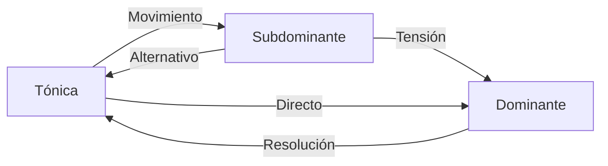

## 4. Progresiones Básicas y su Análisis


### 5.1 Utilización de Inversiones

Las inversiones permiten crear líneas de bajo fluidas y mejorar la conducción de voces:

```music-abc
X:1
T:Progresión con Inversiones
M:4/4
L:1
K:C
"C (I)"[CEG] | "F/C (IV/I)"[CFAc] | "G/B (V/VII)"[BGd] | "C (I)"[CEG] |
```

### 5.2 Acordes con Séptima

Añadir séptimas enriquece el color armónico:

```music-abc
X:1
T:Progresión con Séptimas
M:4/4
L:1
K:C
"Cmaj7 (Imaj7)"[CEGb] | "Dm7 (ii7)"[DFAc] | "G7 (V7)"[GBdF] | "Cmaj7 (Imaj7)"[CEGb] |
```

## 7. Aplicación Práctica por Tonalidades

### 7.1 Progresiones en Do Mayor (C)

| Acordes Diatónicos | Familia Tonal |
| ------------------ | ------------- |
| C (I)              | Tónica        |
| Dm (ii)            | Subdominante  |
| Em (iii)           | Tónica        |
| F (IV)             | Subdominante  |
| G (V)              | Dominante     |
| Am (vi)            | Tónica        |
| Bdim (vii°)        | Dominante     |

### 7.2 Progresiones en Re Mayor (D)

| Acordes Diatónicos | Familia Tonal |
| ------------------ | ------------- |
| D (I)              | Tónica        |
| Em (ii)            | Subdominante  |
| F#m (iii)          | Tónica        |
| G (IV)             | Subdominante  |
| A (V)              | Dominante     |
| Bm (vi)            | Tónica        |
| C#dim (vii°)       | Dominante     |

## 8. Consejos Prácticos para Composición

1. **Comienza con una estructura sencilla**: I-IV-V-I o I-vi-IV-V
2. **Decide el carácter emocional** que deseas transmitir:
   - Mayor: Normalmente brillante, alegre
   - Menor: Suele transmitir melancolía, dramatismo
3. **Experimenta con diferentes voicings** e inversiones
4. **Usa acordes de séptima** para enriquecer el color
5. **Incorpora técnicas avanzadas gradualmente**
6. **Estudia progresiones de canciones que te gusten**

## 9. Ejemplos de Progresiones Melancólicas

Como se menciona en tus apuntes sobre progresiones melancólicas, puedes crear efectos emotivos específicos:

- Utiliza el modo dórico para un tono melancólico con un toque de esperanza
- En tonalidad mayor, incorpora intercambios modales del modo menor paralelo
- Coloca notas específicas (como la 9ª) en registros agudos para resaltar su emotividad

## 10. Recursos para Práctica

1. **Análisis de canciones populares** con progresiones tonales claras
2. **Ejercicios de identificación de familias tonales**
3. **Práctica de conducción de voces** entre acordes
4. **Experimentación con diferentes ritmos armónicos**

## Conclusión

La armonía tonal proporciona un marco estructurado para crear progresiones musicales efectivas. Comprender las familias tonales y sus funciones te permitirá desarrollar progresiones que transmitan exactamente la emoción que deseas, desde la estabilidad hasta la tensión y la resolución.

Al dominar estos conceptos, podrás moverte conscientemente entre los diferentes niveles de tensión y reposo, creando música que guíe al oyente a través de un viaje armónico satisfactorio.

---
# Familias Tonales en Escalas Menores

## 1. Estructura de Familias en Modo Menor Natural

En una tonalidad menor natural, los acordes también se agrupan en tres familias funcionales, pero con características distintas al modo mayor:

### 1.1 Familia Tónica (i, III, VI)
- **Función**: Estabilidad y reposo
- **Acordes en Re menor**: Dm, F, B♭
- **Características**: 
  - Contienen la nota tónica (D)
  - Proporcionan el centro de gravedad armónico
  - El acorde VI (B♭) tiene un carácter más brillante que en modo mayor

### 1.2 Familia Subdominante (iv, VI, ii°)
- **Función**: Movimiento, alejamiento moderado
- **Acordes en Re menor**: Gm, B♭, Edim
- **Características**: 
  - El iv (Gm) es el principal acorde subdominante
  - El VI (B♭) tiene doble función (tónica/subdominante)
  - El ii° (Edim) tiene un color más oscuro que su equivalente en mayor

### 1.3 Familia Dominante (v, VII)
- **Función**: Tensión, impulso hacia la resolución
- **Acordes en Re menor**: Am, C
- **Características**:
  - El v (Am) es menor, no mayor como en la tonalidad armónica
  - Genera menos tensión que un acorde dominante con tercera mayor
  - El VII (C) actúa como dominante sustituto

## 2. Particularidades del Modo Menor Armónico

En el modo menor armónico, la familia dominante adquiere mayor fuerza:

### 2.1 Familia Dominante Reforzada (V, vii°)
- **Acordes en Re menor armónico**: A (mayor), C♯dim
- **Características**:
  - El V grado se vuelve mayor (A en lugar de Am)
  - Contiene la sensible (C♯) que impulsa fuertemente hacia la tónica
  - El vii° se convierte en totalmente disminuido (C♯dim)
  - Genera mayor tensión que en el modo menor natural

## 3. Particularidades del Modo Menor Melódico

En el modo menor melódico ascendente, las familias se modifican:

### 3.1 Familia Subdominante Ampliada (IV, ii)
- **Acordes en Re menor melódico**: G (mayor), Em
- **Características**:
  - El IV se vuelve mayor (G en lugar de Gm)
  - El ii se vuelve semidisminuido (Em en lugar de Edim)
  - Aporta un color más brillante que en menor natural

### 3.2 Familia Dominante Expandida (V, vii°)
- **Acordes en Re menor melódico**: A (mayor), C♯m7♭5
- **Características**:
  - Mantiene el V grado mayor como en la menor armónica
  - El vii° cambia a semidisminuido (C♯m7♭5)
  - Ofrece más opciones para la conducción hacia la tónica

## 4. Diferencias Clave con las Familias en Modo Mayor

1. **Ambigüedad Tonal**: En menor, hay mayor ambigüedad entre funciones
2. **Familia Tónica**: Incluye acordes mayores (III, VI) que aportan contraste
3. **Familia Subdominante**: Contiene un acorde disminuido (ii°) en menor natural
4. **Familia Dominante**: En menor natural es más débil que en mayor o menor armónica
5. **Flexibilidad**: Las escalas menores armónica y melódica permiten adaptar estas familias según necesidades expresivas

## 5. Aplicaciones Prácticas

### 5.1 Progresiones Características en Menor Natural
- **i-VII-VI-V**: Dm-C-B♭-Am (flujo descendente típico)
- **i-iv-VII-i**: Dm-Gm-C-Dm (equivalente al I-IV-V-I en mayor)

### 5.2 Progresiones con Dominante Armónica
- **i-iv-V-i**: Dm-Gm-A-Dm (incorpora la tensión del V mayor)
- **i-VI-V-i**: Dm-B♭-A-Dm (movimiento entre tónica y dominante)

### 5.3 Progresiones con Elementos Melódicos
- **i-IV-V-i**: Dm-G-A-Dm (usa el IV mayor del modo melódico)
- **i-ii-V-i**: Dm-Em-A-Dm (evita el acorde disminuido, usando el ii menor)

Las familias tonales en modo menor ofrecen una riqueza expresiva ampliada, con más posibilidades de coloración armónica y tensión que en el modo mayor, permitiendo generar desde atmósferas oscuras y melancólicas hasta contrastes dramáticos y resoluciones intensas.

---

## Archivo: `1. Teoría/1. Armonía/7. Familias tonales.md`

# Familias Tonales y Creación de Progresiones

Las familias tonales son grupos de acordes que comparten una función armónica similar dentro de una tonalidad. Estas familias son fundamentales para crear progresiones efectivas.

## Familias Tonales Básicas

Existen tres familias tonales principales:

1. **Familia Tónica** (I, iii, vi)

   - Función: Estabilidad, reposo
   - En C mayor: C, Em, Am
   - Características: Contienen la nota tónica, proporcionan sensación de resolución

2. **Familia Subdominante** (IV, ii)

   - Función: Movimiento, alejamiento
   - En C mayor: F, Dm
   - Características: Contienen la nota subdominante (4º grado), crean tensión moderada

3. **Familia Dominante** (V, vii°)
   - Función: Tensión, necesidad de resolución
   - En C mayor: G, Bdim
   - Características: Contienen la nota sensible (7º grado), generan máxima tensión

## Creación de Progresiones con Familias Tonales

### Principio de Movimiento Armónico

Las progresiones efectivas suelen seguir este patrón:

```
Tónica → Subdominante → Dominante → Tónica
```

Esto crea un "viaje armónico" de estabilidad → movimiento → tensión → resolución.

### Progresiones Comunes Usando Familias Tonales

En C mayor:

1. **I-IV-V-I** (C-F-G-C)
   Progresión clásica que muestra el movimiento entre las tres familias tonales

2. **I-vi-IV-V** (C-Am-F-G)
   Comienza en la familia tónica, pasa por subdominante y termina en dominante

3. **ii-V-I** (Dm-G-C)
   Progresión de jazz que va de subdominante a dominante a tónica

### Aplicación de Inversiones

Como explican tus apuntes sobre voicings e inversiones, puedes mejorar estas progresiones usando inversiones para:

1. **Crear líneas de bajo más fluidas**

   - Ejemplo: C-Am/C-F/C-G (mantiene C en el bajo)

2. **Suavizar la conducción de voces**

   - Como se muestra en tu ejemplo de conducción de voces II-V-I:

```music-abc
X:1
T:Conducción de Voces II-V-I
M:4/4
L:1/1
K:C
"Dm7" [D F A c] | "G7" [D F G B] | "Cmaj7" [E G C e] |
```

## Enriquecimiento con Intercambios Modales

Según tus apuntes sobre intercambios modales, puedes expandir las familias tonales tradicionales incorporando acordes "prestados" de otros modos:

1. **Familia Tónica Expandida**

   - Añadir bIII (Eb en C mayor, tomado del modo eólico/frigio)
   - Ejemplo: C → Eb → C

2. **Familia Subdominante Expandida**

   - Añadir bVI (Ab en C mayor, del modo eólico)
   - Ejemplo: F → Ab → F

3. **Familia Dominante Expandida**
   - Añadir bII (Db en C mayor, del modo frigio)
   - Ejemplo: G7 → Db → G7

### Ejemplo de Progresión con Intercambios Modales

En C mayor:

```
C (I) → Ab (bVI) → Fm (iv) → G7 (V) → C (I)
```

Aquí, Ab y Fm son préstamos del modo eólico (C menor).

## Aplicación a Tus Ejemplos

En tus apuntes sobre D mayor, puedes crear progresiones usando sus familias tonales:

```
Tónica: D, F#m, Bm
Subdominante: G, Em
Dominante: A7, C#m7b5
```

Por ejemplo:

```music-abc
X:1
T:Progresión en D Mayor con Familias Tonales
M:4/4
L:1/1
K:D
"D" [DF^A] | "Em" [EGB] | "A7" [^CEG] | "D" [DF^A] |
```

Sumando inversiones y voicings como muestran tus apuntes, puedes crear progresiones más interesantes con movimientos de bajo fluidos y buena conducción de voces.

---

## Familias modales

### 🧭 1. **Centro Modal**

Este es el **imán auditivo**. No se define por tensión y resolución, sino por repetición, pedal, inicio/final, o centro melódico.

- **Dm7**: es el acorde que establece el modo y se presenta como base.

  - Tiene las notas D – F – A – C

  - No contiene ni la sensible (C#), ni la sexta (B), por eso es **neutral** y central.

---

### 🎨 2. **Colores Modales**

Son acordes que contienen la **nota característica del modo**. En dórico, esa nota es la **sexta mayor** (B natural).  
Estos acordes **acentúan el color dórico** y deben usarse para **brillar** ese color distintivo.

- **Em7**: E – G – B – D → contiene la B natural (color dorico directo)

- **Bm7♭5**: B – D – F – A → también incluye B, D, F (con función cromática más grisácea, interesante)

📌 Usarlos en contextos suaves, medios, flotantes. No producen tensión-resolución, sino **iluminación modal**.

---

### 🌊 3. **Movimiento Modal Sin Tensión Fuerte**

Estos acordes pueden generar variación armónica sin alterar el centro modal. A veces se mueven más lejos armónicamente, pero no provocan cadencias funcionales.

- **G7**: G – B – D – F → contiene la B natural y el F (interesante fricción suave con Dm7)

- **Am7**: A – C – E – G → se siente como **una expansión natural** desde Dm7

- **Cmaj7**: C – E – G – B → puede sonar más lejano, pero aún suave, aporta atmósfera

- **Fmaj7**: F – A – C – E → conecta muy bien con Dm7 por compartir A y C, y da una sensación **pastel/etérea**

💡 Son perfectos para progresiones más amplias, sin necesidad de “volver a casa”.

---

### 💥 Tensión lateral o cromática suave

Si bien D dórico no tiene acordes dominantes, **puedes agregar acordes fuera del modo**, siempre que no quiebren el centro modal. Por ejemplo:

- **A7**: sería **tensión funcional** (NO deseada aquí si quieres mantener modo)

- Pero **Ebmaj7** o **Bbmaj7** (prestados de D menor o F mayor) podrían ser usados para **coloración momentánea lateral** si se usan con cuidado, sin cadenciar.

---

# Guía Completa de Familias Tonales y Progresiones

## 1. Fundamentos de las Familias Tonales

Las familias tonales son grupos de acordes con funciones armónicas similares dentro de una tonalidad. Este sistema permite entender las relaciones entre acordes y crear progresiones musicalmente efectivas.

### 1.1 Principio de las Familias Tonales

Cada escala o modo genera un conjunto de acordes que pueden agruparse en tres familias principales:

- **Familia Tónica**: Acordes que proporcionan estabilidad y sensación de reposo
- **Familia Subdominante**: Acordes que generan movimiento moderado
- **Familia Dominante**: Acordes que crean tensión y necesidad de resolución

Esta clasificación funcional es fundamental para entender cómo construir progresiones con dirección musical clara.

## 2. Familias Tonales en Escalas Mayores

### 2.1 Estructura de la Escala Mayor

La escala mayor tiene el siguiente patrón de tonos (T) y semitonos (S):

```
T-T-S-T-T-T-S
```

En Do Mayor: C-D-E-F-G-A-B-C

### 2.2 Acordes Diatónicos en Escala Mayor

| Grado | Cifrado | Tipo de Acorde | Ejemplo en C |
| ----- | ------- | -------------- | ------------ |
| I     | Imaj7   | Mayor 7        | Cmaj7        |
| ii    | ii7     | Menor 7        | Dm7          |
| iii   | iii7    | Menor 7        | Em7          |
| IV    | IVmaj7  | Mayor 7        | Fmaj7        |
| V     | V7      | Dominante 7    | G7           |
| vi    | vi7     | Menor 7        | Am7          |
| vii°  | viiø7   | Semidisminuido | Bm7b5        |

### 2.3 Familias Tonales en Modo Mayor

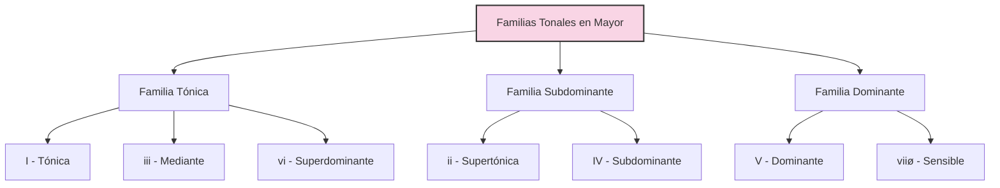

| Familia      | Acordes (Do Mayor)       | Función                 | Características                                                              |
| ------------ | ------------------------ | ----------------------- | ---------------------------------------------------------------------------- |
| Tónica       | I (C), iii (Em), vi (Am) | Estabilidad, reposo     | Contienen la nota tónica, proporcionan sensación de resolución               |
| Subdominante | ii (Dm), IV (F)          | Movimiento, alejamiento | Contienen la subdominante (4º grado), crean tensión moderada                 |
| Dominante    | V (G), viiø (Bm7b5)      | Tensión, impulso        | Contienen la sensible (7º grado), generan máxima tensión hacia la resolución |

### 2.4 Progresiones Comunes en Modo Mayor

| Progresión | Ejemplo (C mayor) | Función Tonal | Efecto Musical                      |
| ---------- | ----------------- | ------------- | ----------------------------------- |
| I-IV-V-I   | C-F-G-C           | T-SD-D-T      | Ciclo completo, estable, conclusivo |
| I-vi-IV-V  | C-Am-F-G          | T-T-SD-D      | Fluido, popular, ascendente         |
| ii-V-I     | Dm-G-C            | SD-D-T        | Conciso, jazz, conclusivo           |
| I-V-vi-IV  | C-G-Am-F          | T-D-T-SD      | Moderno, cíclico, emotivo           |
| I-IV-I-V   | C-F-C-G           | T-SD-T-D      | Balanceado, rock, fuerte            |
| vi-ii-V-I  | Am-Dm-G-C         | T-SD-D-T      | Sofisticado, jazz, completo         |
| I-iii-IV-V | C-Em-F-G          | T-T-SD-D      | Expresivo, balada, ascendente       |

## 3. Familias Tonales en Escalas Menores

### 3.1 Escala Menor Natural (Eólica)

Patrón de tonos y semitonos:

```
T-S-T-T-S-T-T
```

En La menor natural: A-B-C-D-E-F-G-A

#### 3.1.1 Acordes Diatónicos en Menor Natural

| Grado | Cifrado | Tipo de Acorde | Ejemplo en Am |
| ----- | ------- | -------------- | ------------- |
| i     | i7      | Menor 7        | Am7           |
| ii°   | iiø7    | Semidisminuido | Bm7b5         |
| III   | IIImaj7 | Mayor 7        | Cmaj7         |
| iv    | iv7     | Menor 7        | Dm7           |
| v     | v7      | Menor 7        | Em7           |
| VI    | VImaj7  | Mayor 7        | Fmaj7         |
| VII   | VII7    | Dominante 7    | G7            |

#### 3.1.2 Familias Tonales en Menor Natural

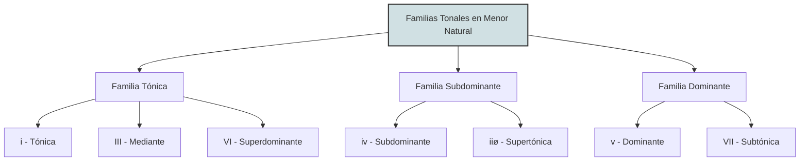

| Familia      | Acordes (La Menor Natural) | Función                   | Características                                      |
| ------------ | -------------------------- | ------------------------- | ---------------------------------------------------- |
| Tónica       | i (Am), III (C), VI (F)    | Estabilidad, reposo       | Contienen la tónica, dan sensación de centro tonal   |
| Subdominante | iv (Dm), iiø (Bm7b5)       | Movimiento, alejamiento   | Contienen la subdominante, crean movimiento moderado |
| Dominante    | v (Em), VII (G)            | Tensión moderada, impulso | Dominante menor tiene tensión más suave que en mayor |

### 3.2 Escala Menor Armónica

Patrón: Menor natural con 7º grado elevado

```
T-S-T-T-S-T+S-S
```

En La menor armónica: A-B-C-D-E-F-G#-A

#### 3.2.1 Acordes Diatónicos en Menor Armónica

| Grado | Cifrado  | Tipo de Acorde    | Ejemplo en Am |
| ----- | -------- | ----------------- | ------------- |
| i     | im/M7    | Menor/Mayor 7     | AmM7          |
| ii°   | iiø7     | Semidisminuido    | Bm7b5         |
| III+  | III+maj7 | Aumentado Mayor 7 | Caug/maj7     |
| iv    | iv7      | Menor 7           | Dm7           |
| V     | V7       | Dominante 7       | E7            |
| VI    | VImaj7   | Mayor 7           | Fmaj7         |
| vii°  | vii°7    | Disminuido 7      | G#dim7        |

#### 3.2.2 Familias Tonales en Menor Armónica

| Familia      | Acordes (La Menor Armónico) | Función                 | Cambios vs. Menor Natural                       |
| ------------ | --------------------------- | ----------------------- | ----------------------------------------------- |
| Tónica       | i (AmM7), III+ (Caug)       | Estabilidad alterada    | i con séptima mayor, III aumentado              |
| Subdominante | iv (Dm), iiø (Bm7b5)        | Movimiento, sin cambios | Igual que en menor natural                      |
| Dominante    | V (E7), vii° (G#dim7)       | Tensión fuerte, impulso | Dominante se vuelve mayor, genera mayor tensión |

### 3.3 Escala Menor Melódica (Ascendente)

Patrón: Menor natural con 6º y 7º grados elevados (ascendente)

```
T-S-T-T-T-T-S
```

En La menor melódica ascendente: A-B-C-D-E-F#-G#-A

#### 3.3.1 Acordes Diatónicos en Menor Melódica

| Grado | Cifrado    | Tipo de Acorde    | Ejemplo en Am |
| ----- | ---------- | ----------------- | ------------- |
| i     | im/M7      | Menor/Mayor 7     | AmM7          |
| ii    | ii7        | Menor 7           | Bm7           |
| III+  | III+maj7#5 | Aumentado Mayor 7 | Caug/maj7     |
| IV    | IV7        | Dominante 7       | D7            |
| V     | V7         | Dominante 7       | E7            |
| vi°   | viø7       | Semidisminuido    | F#m7b5        |
| vii°  | viiø7      | Semidisminuido    | G#m7b5        |

#### 3.3.2 Familias Tonales en Menor Melódica

| Familia      | Acordes (La Menor Melódica) | Función                 | Cambios vs. Menor Natural                     |
| ------------ | --------------------------- | ----------------------- | --------------------------------------------- |
| Tónica       | i (AmM7)                    | Estabilidad             | i con séptima mayor                           |
| Subdominante | ii (Bm7), IV (D7)           | Movimiento enriquecido  | IV se vuelve mayor, ii se vuelve menor normal |
| Dominante    | V (E7), viiø (G#m7b5)       | Tensión fuerte, impulso | Ambos contienen la sensible                   |

### 3.4 Progresiones Comunes en Escalas Menores

| Progresión   | Modo Menor       | Ejemplo (A menor) | Efecto Musical                         |
| ------------ | ---------------- | ----------------- | -------------------------------------- |
| i-iv-V-i     | Armónico         | Am-Dm-E-Am        | Clásico, conclusivo, dramático         |
| i-VI-III-VII | Natural          | Am-F-C-G          | Suave, descendente, contemplativo      |
| i-iv-VII-III | Natural          | Am-Dm-G-C         | Modal, flotante, narrativo             |
| i-VI-VII-V   | Natural/Armónico | Am-F-G-E          | Contraste, sorpresa, intensidad        |
| i-iv-i-V     | Armónico         | Am-Dm-Am-E        | Tensión concentrada, clásico           |
| i-V-VI-III   | Armónico         | Am-E-F-C          | Movimiento, desarrollo, dinámico       |
| i-bII-bVII-V | Frigio/Armónico  | Am-Bb-G-E         | Exótico, tensión, resolución dramática |
| i-II-V-i     | Melódico         | Am-B-E-Am         | Jazz menor, sofisticado                |
| i-IV-V-i     | Melódico         | Am-D-E-Am         | Brillante, conclusivo, contraste       |

## 4. Técnicas para Expandir las Progresiones Tonales

### 4.1 Intercambios Modales

Los intercambios modales permiten "pedir prestados" acordes de modos paralelos, expandiendo las posibilidades expresivas sin cambiar la tónica.

#### 4.1.1 Tabla de Intercambios Modales Comunes en Mayor

| Acorde prestado | En C Mayor | Origen                 | Función                  | Efecto Expresivo       |
| --------------- | ---------- | ---------------------- | ------------------------ | ---------------------- |
| bIII            | Eb         | Modo eólico/frigio     | Tónica alternativa       | Oscuro, sorpresivo     |
| bVI             | Ab         | Modo eólico            | Subdominante alternativa | Emotivo, melancólico   |
| bVII            | Bb         | Modo mixolidio/eólico  | Dominante alternativa    | Relajado, bluesy       |
| iv              | Fm         | Modo eólico/dórico     | Subdominante oscura      | Sombrío, tensión suave |
| iiø             | Dm7b5      | Modo locrio/frigio     | Subdominante con tensión | Inquietante, inestable |
| bII             | Db         | Modo frigio/napolitano | Subdominante especial    | Dramático, exótico     |

#### 4.1.2 Tabla de Intercambios Modales Comunes en Menor

| Acorde prestado | En A Menor | Origen                 | Función                      | Efecto Expresivo     |
| --------------- | ---------- | ---------------------- | ---------------------------- | -------------------- |
| IV              | D          | Modo melódico/dórico   | Subdominante brillante       | Elevación, contraste |
| V               | E          | Modo armónico          | Dominante fuerte             | Tensión direccional  |
| bII             | Bb         | Modo frigio            | Subdominante especial        | Exótico, oscuro      |
| VI              | F#m        | Modo dórico            | Tónica alternativa brillante | Inesperado, luminoso |
| i∆7             | AmM7       | Modo melódico/armónico | Tónica enriquecida           | Sofisticado, jazz    |
| bVII7           | G7         | Modo eólico natural    | Dominante suave              | Folclórico, relajado |

### 4.2 Progresiones con Intercambios Modales

| Progresión    | Tonalidad Base | Ejemplo    | Efecto                          |
| ------------- | -------------- | ---------- | ------------------------------- |
| I-bVI-bVII-I  | Mayor          | C-Ab-Bb-C  | Épico, cinematográfico          |
| I-iv-bVII-IV  | Mayor          | C-Fm-Bb-F  | Blues, emotivo                  |
| i-IV-v-i      | Menor          | Am-D-Em-Am | Brillante pero melancólico      |
| i-bII-bVII-i  | Menor          | Am-Bb-G-Am | Exótico, tenso                  |
| I-iii-bIII-ii | Mayor          | C-Em-Eb-Dm | Movimiento cromático colorido   |
| i-V-bVI-bVII  | Menor          | Am-E-F-G   | Contraste de brillante a oscuro |

## 5. Aplicación de las Familias Tonales según el Tipo de Escala

### 5.1 Cambios en las Familias Tonales según la Escala

Este diagrama muestra cómo varían las familias tonales según el tipo de escala:

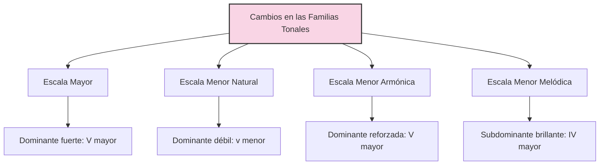

#### 5.1.1 Efecto en las Progresiones

| Tipo de Escala | Cambio Principal                | Efecto en Progresiones                          | Ejemplo en A/Am      |
| -------------- | ------------------------------- | ----------------------------------------------- | -------------------- |
| Mayor          | V con séptima menor (dominante) | Fuerte dirección hacia la tónica                | E7 → A               |
| Menor Natural  | v menor, VII mayor              | Carácter modal, menos direccional               | Em → Am, G → Am      |
| Menor Armónica | V mayor, vii° disminuido        | Fuerte impulso hacia la tónica, sabor "español" | E7 → Am, G#dim7 → Am |
| Menor Melódica | IV mayor, ii menor, V mayor     | Jazz sofisticado, brillo con melancolía         | D → Am, Bm → E7 → Am |

### 5.2 Cambios Progresivos entre Tipos de Escala

| Progresión Escala-Mezclada | Ejemplo (A menor) | Técnica                        | Efecto                           |
| -------------------------- | ----------------- | ------------------------------ | -------------------------------- |
| i-iv-V-i                   | Am-Dm-E7-Am       | Natural → Armónica             | Oscuro → Tensión → Resolución    |
| i-iv-VII-i                 | Am-Dm-G-Am        | Totalmente Natural             | Modal, flotante                  |
| i-IV-V-i                   | Am-D-E7-Am        | Melódica → Melódica → Armónica | Brillante → Tensión → Resolución |
| i-bII-V-i                  | Am-Bb-E7-Am       | Frigio → Armónica              | Exótico → Tensión → Resolución   |
| i-VI-iv-V                  | Am-F-Dm-E7        | Natural → Natural → Armónica   | Estable → Movimiento → Tensión   |
| i-II-V-i                   | Am-B-E7-Am        | Melódica todo el camino        | Jazz menor, sofisticado          |

## 6. Creación de Progresiones por Tonalidades

### 6.1 Progresiones en Do Mayor (C)

| Acordes Diatónicos | Familia Tonal | Ejemplos de Progresiones | Uso de Variantes de Escala       |
| ------------------ | ------------- | ------------------------ | -------------------------------- |
| C (I)              | Tónica        | C-F-G-C, C-Am-F-G        | Base tonal, estabilidad          |
| Dm (ii)            | Subdominante  | Dm-G-C, C-Dm-G-C         | Movimiento hacia dominante       |
| Em (iii)           | Tónica        | C-Em-Am, Em-Am-Dm-G      | Color menor dentro de mayor      |
| F (IV)             | Subdominante  | C-F-C-G, F-G-Em-Am       | Tensión moderada, alejamiento    |
| G (V)              | Dominante     | G-C, Dm-G-C              | Tensión principal, resolución    |
| Am (vi)            | Tónica        | Am-F-C-G, C-Am-Dm-G      | Relativo menor, emotividad       |
| Bm7b5 (viiø)       | Dominante     | Em-Bm7b5-C, Am-Bm7b5-C   | Pre-dominante, tensión indirecta |

#### 6.1.1 Intercambios Modales en C Mayor

| Acorde Modal | Origen      | Ejemplos de Progresiones | Efecto Expresivo                |
| ------------ | ----------- | ------------------------ | ------------------------------- |
| Eb (bIII)    | C menor     | C-Eb-Bb-C, Am-Eb-G       | Oscuro, épico                   |
| Ab (bVI)     | C menor     | C-Ab-G-C, Fm-Ab-G-C      | Dramático, melancólico          |
| Bb (bVII)    | C mixolidio | C-Bb-F-C, C-Bb-Eb-F      | Blues, rock, relajado           |
| Fm (iv)      | C menor     | C-Fm-C-G, C-Fm-Bb-C      | Sombra emocional, contraste     |
| Db (bII)     | C frigio    | C-Db-C, G-Db-C           | Napolitano, exótico, sorpresivo |

### 6.2 Progresiones en La Menor (Am)

| Acordes Diatónicos (Natural) | Familia Tonal | Ejemplos de Progresiones    | Efecto                             |
| ---------------------------- | ------------- | --------------------------- | ---------------------------------- |
| Am (i)                       | Tónica        | Am-Dm-Em-Am, Am-F-C-G-Am    | Centro tonal, melancolía           |
| Bm7b5 (iiø)                  | Subdominante  | Am-Bm7b5-E7-Am, Dm-Bm7b5-E7 | Movimiento tenso hacia dominante   |
| C (III)                      | Tónica        | Am-C-G-F, C-Am-Dm-E         | Brillo dentro de menor, contraste  |
| Dm (iv)                      | Subdominante  | Am-Dm-Am-E, Dm-G-C          | Movimiento, desarrollo             |
| Em (v)                       | Dominante     | Am-Em-Am, C-Em-Am           | Dominante suave, modal             |
| F (VI)                       | Tónica        | Am-F-G-Am, F-G-Am-Em        | Tónica alternativa, estabilidad    |
| G (VII)                      | Dominante     | Am-G-F-E, G-C-Dm-E          | Dominante natural, dirección suave |

#### 6.2.1 Variantes de Escalas en La Menor

| Acorde por Variante | Escala            | Ejemplos de Progresiones     | Efecto                                |
| ------------------- | ----------------- | ---------------------------- | ------------------------------------- |
| E (V)               | Armónica/Melódica | Am-Dm-E-Am, Am-F-E-Am        | Tensión clara, resolución tradicional |
| G#dim7 (vii°)       | Armónica          | Am-Dm-G#dim7-Am, E-G#dim7-Am | Tensión cromática intensa             |
| D (IV)              | Melódica          | Am-D-E-Am, Am-D-Bm-E         | Brillo, contraste, jazz               |
| Bm (ii)             | Melódica          | Am-Bm-E-Am, D-Bm-E-Am        | Movimiento fluido, sofisticado        |
| F#m7b5 (vi°)        | Melódica          | Am-F#m7b5-Bm-E, Am-F#m7b5-E  | Color modal distintivo, inquieto      |

## 7. Progresiones con Propósitos Específicos

### 7.1 Progresiones para Generar Emociones Específicas

| Emoción             | Tonalidad      | Progresión           | Técnica                             |
| ------------------- | -------------- | -------------------- | ----------------------------------- |
| Melancolía suave    | Mayor          | vi-IV-I-V            | Comienzo en relativo menor          |
| Melancolía intensa  | Menor          | i-bVI-bIII-bVII      | Intercambios tonales en menor       |
| Épico, grandioso    | Mayor          | I-bVI-bVII-I         | Intercambios modales épicos         |
| Tensión dramática   | Menor Armónica | i-V-bVI-V            | Dominante mayor contra bVI          |
| Esperanza, anhelo   | Menor a Mayor  | i-VI-III-V/III → III | Modulación al relativo mayor        |
| Nostalgia           | Mayor          | I-iii-IV-iv          | Subdominante menor dentro de mayor  |
| Júbilo, celebración | Mayor          | I-V-vi-iii-IV-I      | Ciclo completo con movimiento       |
| Misterio, intriga   | Menor          | i-bII-i-v            | Napolitano y dominante modal        |
| Paz, serenidad      | Mayor          | Imaj7-IVmaj7-Imaj7   | Séptimas mayores, movimiento suave  |
| Pasión, intensidad  | Menor Armónica | i-iv-V+-i            | Dominante aumentada, tensión fuerte |

### 7.2 Progresiones para Diferentes Estilos Musicales

| Estilo            | Progresión Característica | Tonalidad Típica    | Técnica Tonal Especial                   |
| ----------------- | ------------------------- | ------------------- | ---------------------------------------- |
| Rock Clásico      | I-IV-V                    | Mayor               | Uso de power chords, simplicidad         |
| Pop Contemporáneo | I-V-vi-IV                 | Mayor               | Loop de 4 acordes, optimismo             |
| Balada Pop        | vi-IV-I-V                 | Mayor (desde vi)    | Comienzo en relativo menor               |
| Jazz Estándar     | ii-V-I                    | Mayor/Menor         | Dominantes secundarias, extensiones      |
| Blues             | I7-IV7-V7                 | Mayor (con b3 y b7) | Acordes dominantes en todos los grados   |
| Folk Tradicional  | I-V-IV-I                  | Mayor               | Simplicidad, cadencia plagal             |
| Metal Progresivo  | i-bVI-bIII-bVII           | Menor               | Intercambios modales, riffs en paralelo  |
| Bossa Nova        | Imaj7-iv7-iiim7-bIImaj7   | Mayor               | Mezcla de mayor/menor, cadencias débiles |
| Música Flamenca   | i-bII-V                   | Frigio/Menor        | Cadencia andaluza, tensión exótica       |
| Country           | I-IV-V-IV                 | Mayor               | Cadencia plagal extendida                |
| Reggae            | I-bVII-I-bVI              | Mayor               | Intercambios modales, ritmo específico   |

## 8. Conclusión: Construcción de Progresiones Efectivas

Para crear progresiones armónicas efectivas utilizando las familias tonales:

1. **Definir la tonalidad y tipo de escala**: Mayor, menor natural, armónica o melódica
2. **Identificar las familias tonales** correspondientes a esa escala
3. **Establecer el propósito emocional** de la progresión
4. **Seleccionar acordes de cada familia** siguiendo el flujo Tónica → Subdominante → Dominante → Tónica
5. **Considerar intercambios modales** para enriquecer la expresión
6. **Experimentar con inversiones** para mejorar la conducción de voces
7. **Añadir acordes con séptimas** para enriquecer el color armónico

Las familias tonales proporcionan un marco estructural que permite crear progresiones con dirección y propósito musical claro, independientemente del estilo o género musical que se desee explorar.

---

## Archivo: `1. Teoría/1. Armonía/8. Tensiones.md`

### ¿Qué son las tensiones?

Las tensiones son extensiones de la armonía que corresponden a los grados 9, 11 y 13 de la escala, contados a partir de la fundamental del acorde. Estas notas equivalen a:

- **9**: II una octava arriba (9 grados desde la tónica)
- **11**: IV una octava arriba (11 grados desde la tónica)
- **13**: VI una octava arriba (13 grados desde la fundamental)

```music-abc
X:1
T:Grados sobre C
M:4/4
L:1/4
K:C
"C"[Cc] "D"[dD] "E=3"E "F=11"[fF] "G=5"G "A=13"[Aa] "B=7"B|
w:1o8 2o9 3 4o11 5 6o13 7
```

## Proceso para determinar tensiones disponibles

Para determinar si una tensión está disponible para un acorde:

1. Identificar la tensión deseada (9, 11 o 13)
2. Colocar esta nota mentalmente dentro del acorde
	1. Prácticamente es revisar si la nota inferior tiene o no un semitono
3. Verificar que no forme intervalos de semitono con la nota inferior9119

## Tensiones disponibles por tipo de acorde

| Grado | Tipo de acorde   | Símbolo | 9   | 11  | 13  |
| ----- | ---------------- | ------- | --- | --- | --- |
| I     | Mayor 7          | Cmaj7   | ✓   | ×   | ✓   |
| II    | Menor 7          | Dm7     | ✓   | ✓   | ✓   |
| III   | Menor 7          | Em7     | ×   | ✓   | ×   |
| IV    | Mayor 7          | Fmaj7   | ✓   | ✓#  | ✓   |
| V     | Dominante        | G7      | ✓   | ×   | ✓   |
| VI 7  | Menor 7          | Am7     | ✓   | ✓   | ×   |
| VII 7 | Semidisminuido 7 | Bm7b5   | ×   | ✓   | ✓b  |

## Nomenclatura y notación

Las tensiones se indican en la cifra del acorde de varias maneras:

1. **Tensiones añadidas**: Se usa el término "add" cuando solo se agrega una tensión **==sin incluir la séptima==**
   - Ejemplo: `Cadd9` = C + E + G + **D** (sin la séptima)
1. **Acordes con tensión y séptima**: Se indica el tipo de séptima seguido de la tensión
   - Ejemplo: `Cmaj9`
   - Ejemplo: `G9` 
1. **Alteraciones de tensiones**: Si la tensión está alterada, se indica con # o b
   - Ejemplo: `Fmaj7#11` = la 11 está aumentada
   - Ejemplo: `Bm7b5b13` = la 13 está disminuida

## Mapa conceptual de tensiones

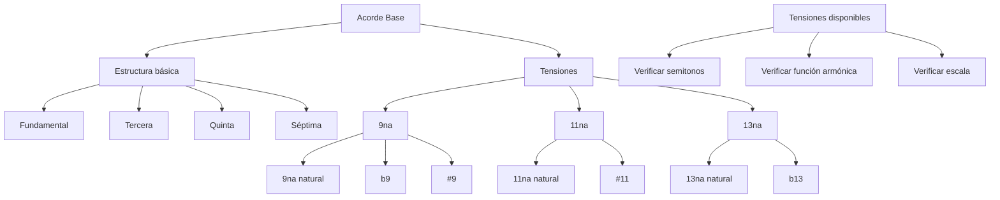


```music-abc
X:1
T:Grados sobre G
M:4/4
L:1/4
K:C
"G"[Gg] "A"[aA] "B"B "C"[Cc] "D"D "E"[eE] "F"F|
w:1o8 2o9 3 4o11 5 6o13 7
```

### G mayor (Sol mayor)

| Tónica | Tercera | Conteo | Quinta | Conteo | Nombre                | Séptima | Conteo | Nombre                       | 9   | 11  | 13  |
| ------ | ------- | ------ | ------ | ------ | --------------------- | ------- | ------ | ---------------------------- | --- | --- | --- |
| G      | B       | 4      | D      | 7      | G mayor (G)           | F#      | 11     | G mayor 7 (Gmaj7)            | A   |     | E   |
| A      | C       | 3      | E      | 7      | A menor (Am)          | G       | 10     | A menor 7 (Am7)              | B   | D   | F#  |
| B      | D       | 3      | F#     | 7      | B menor (Bm)          | A       | 10     | B menor 7 (Bm7)              |     | G   |     |
| C      | E       | 4      | G      | 7      | C mayor (C)           | B       | 11     | C mayor 7 (Cmaj7)            |     | F#  | A   |
| D      | F#      | 4      | A      | 7      | D mayor (D)           | C       | 10     | D dominante 7 (D7)           |     |     |     |
| E      | G       | 3      | B      | 7      | E menor (Em)          | D       | 10     | E menor 7 (Em7)              |     |     |     |
| F#     | A       | 3      | C      | 6      | F# disminuido (F#dim) | E       | 10     | F# semidisminuido 7 (F#m7b5) |     |     |     |

  

```music-abc
X:1
T:Progresión con tensiones en C mayor
M:4/4
L:1/2
K:C
"Cmaj9"[CEGBd] "Dm11"[DFAcg]| "G13"[GBdfae'] "Cmaj13"[CEGBda']|
```


### Funcionalidades

- **Tensión 9 (segunda)**: Para suavidad, aire, amplitud (muy usada en dream pop).
- **Tensión 11 (cuarta)**: Da un color más "etéreo" o misterioso (muy usada en jazz modal).
- **Tensión 13 (sexta)**: Agrega calidez y brillo (ideal en acordes mayores o dominantes).
- **♭13 o ♭9**: Más disonantes, se usan en acordes menores o semidisminuidos, con cuidado.

---

## Archivo: `1. Teoría/1. Armonía/9. Dominantes en progresiones.md`

Te voy a crear una guía completa con más ejemplos prácticos que incluya dominantes, sustitutos de tritono y tensiones, explicando cómo agregar cada elemento paso a paso.
¡Perfecto! He creado una guía completa con muchos ejemplos prácticos que explica paso a paso cómo integrar dominantes secundarios, sustitutos de tritono y tensiones. Te resumo los puntos clave:

## 🎯 **ESTRUCTURA COMPLETA DE LA GUÍA**

### **Parte 1: Fundamentos**

- Progresión base I-vi-IV-V como esqueleto
- Agregando séptimas como primer enriquecimiento

### **Parte 2: Dominantes Secundarios**

- **Concepto**: "Imanes armónicos" que atraen hacia acordes específicos
- **Ejemplos prácticos**: V7/vi, V7/IV, cadenas de dominantes
- **Múltiples tonalidades**: Do, Sol, Fa Mayor

### **Parte 3: Sustitutos de Tritono**

- **La magia**: "Dos llaves para la misma puerta"
- **Ventajas**: Líneas de bajo cromáticas, color sofisticado
- **Estrategias**: Mixta, por contexto, por línea de bajo

### **Parte 4: Tensiones (9, 11, 13)**

- **Regla fundamental**: No formar semitono con nota inferior
- **Tabla completa**: Tensiones disponibles por acorde
- **Efectos emocionales**: 9ª (suavidad), #11 (modernidad), 13ª (calidez)

### **Parte 5: Integración Completa** ⭐

Esta es la sección más importante - muestra cómo juntar todo:

#### **Evolución de 5 Niveles:**

```
Nivel 0: C - Am - F - G                    (Base)
Nivel 1: Cmaj7 - Am7 - Fmaj7 - G7          (+ Séptimas)
Nivel 2: Cmaj7 - E7 - Am7 - C7 - Fmaj7 - D7 - G7 - Cmaj7  (+ Dominantes)
Nivel 3: Cmaj7 - Bb7 - Am7 - Gb7 - Fmaj7 - Ab7 - Db7 - Cmaj7  (+ Sustitutos)
Nivel 4: Cmaj9 - Bb13 - Am11 - Gb7#11 - Fmaj7#11 - Ab13 - Db7alt - Cmaj9  (+ Tensiones)
```

## 🔧 **METODOLOGÍA PRÁCTICA**

### **Proceso Sistemático:**

1. **Esqueleto tonal** → Familias T-SD-D
2. **Séptimas** → Color básico
3. **Dominantes secundarios** → Dirección específica
4. **Sustitutos de tritono** → Fluidez cromática
5. **Tensiones** → Expresión emocional

### **Listas de Verificación:**

- ✅ **Dominantes**: ¿Mejoran dirección? ¿No sobrecargan?
- ✅ **Sustitutos**: ¿Mejoran línea de bajo? ¿Apropiados al estilo?
- ✅ **Tensiones**: ¿Disponibles? ¿Color emocional deseado?

## 🎵 **EJEMPLOS POR GÉNERO**

### **Jazz Estándar**: Máxima sofisticación

```
Bbmaj9 - G7alt - Cm9 - F13 - Dm7b5 - Db7alt - Cm9 - F7alt - Bbmaj9
```

### **Neo-Soul**: Tensiones modernas

```
Dmaj7#11 - Bb13 - Am11 - Eb7#11 - Gmaj9 - C13 - F#7alt - Bm11
```

### **Gospel**: Expresividad máxima

```
Cmaj9 - A7alt - Dm11 - Ab13 - Gmaj7/C - F#7alt - Fmaj9#11 - Bb13#11
```

## 🎯 **ESTRATEGIAS DE APLICACIÓN**

### **Por Secciones:**

- **Intro/Outro**: Niveles 1-2 (simplicidad)
- **Verso**: Niveles 2-3 (desarrollo)
- **Coro**: Niveles 3-4 (expresividad máxima)
- **Puente**: Nivel 4 (sofisticación total)

### **Por Estilo:**

- **Pop/Rock**: Niveles 1-2
- **R&B/Soul**: Niveles 2-3
- **Jazz/Fusion**: Niveles 3-4
- **Neo-Soul**: Nivel 4 completo

## 🏆 **PRINCIPIOS MAESTROS**

1. **Construcción gradual**: Domina cada nivel antes del siguiente
2. **Función antes que forma**: Cada recurso debe servir a la música
3. **Contexto apropiado**: Elige recursos según estilo y momento
4. **Equilibrio**: Sofisticación sin saturación

La guía incluye ejercicios prácticos, análisis inverso, y ejemplos de reharmonización para que puedas aplicar inmediatamente todo lo aprendido. ¡Es tu hoja de ruta completa hacia la maestría armónica!

---

## Archivo: `1. Teoría/1. Armonía/Progresiones/0. Progresiones melancólicas.md`

# Empírico

- Tonalidad base 
- Elección de modo: 
	- Eb Ab Bb Eb

Notas con triadas básicas:
- Para Eb: La nota que por sí sola suena más melancólica, es el B
	- Poner notas como bajo, les quita el tono melancólico
	- Poniendo B como bajo le quita lo melancólico 
	- Dejando B más alto lo hace más mel
- Para Ab:
	- El C suena muy feliz, se queda como bajo 
	- La nota que más sentí mel fue Eb, así que la dejé con el pitch más alto 
- Para Bb: 
	- Me gustó como suena B y F arriba. D suena muy alegre así que lo dejé como bajo

Notas con tensiones: 
- Eb se queda igual para no atascar todo de tensiones
- Ab: 
	- Intenté agregando 13 y 11ava pero no hay mucha diferencia,
	- Agregando 9na levanta resalta más el 
- Bb: 
	- Se agregará 7ma para que quede con dominantes 


Notas con tensiones y agudo contrastante: 
- Dejamos únicamente las notas seleccionadas en pasos anteriores como graves, pero las demás notas quedan con un pitch más alto 
- Eb:
	- sin modificaciones para no atascar: 
- Ab: 
	- Intenté agregando 13 y 11ava pero no hay mucha diferencia,
	- Agregando 9na levanta resalta más el 
- Bb: 
	- Se agregará 7ma para que quede como dominantes 

--- 
# Técnico modal

Parece que el dórico tiene un tono medio sad, pero con un tono de alegría

Topé con pared, porque los modos no siguen la misma estructura tonal que los mayores/menores. Lo que me deja una conclusión: Puedes pensar en mayores/menores cuando estás trabajando con escalas o puedes pensar en modos. 

Buscando el por qué encontré que:
- Los grados dentro de las escalas cumplen un proposito, que es la resolución/tensión
	- Teoría tonal
	- De aquí son las familias funcionales
	- Cada acorde tiene una función específica respecto a la tónica
	- Vertical: Busca darle importancia a unas notas más que otras. Lo importante es llegar a la tónica
- En los modos se pierden muchas características de los grados con estructura tonal
	- Giran en torno a un centro modal
	- Teoría modal
	- Sin jerarquias
	- Intervalos que le dan su característica al modo
	- Horizontal: Busca más que fluya y resalten más algunos colores que otros, pero lo importante es el conjunto. Repetición


- Preguntar a Chat GPT la escala de Space Song - Beach House 
	- Está en D dórico, lo mismo que Dm natural, pero con la 6ta natural. 
	- D – E – F – G – A – B – C – D
	- Dm - F - C - G 
	- Cuando no resuelve en tónica se puede crear un loop 

1. Seleccionar escala 
	1. D 
2. Seleccionar modo: 
	1. D dórico 
		1. Característica por 6to grado mayor 
3. Identificar intervalo característico( no se busca resolución, sino resalatar): 
	1. Centro modal: Se repite 
		1. D
	2. Colores modales: Acordes que tienen la note de la 6 mayor del modo (B) 
		1. 6a mayor => B
		2. Em
		3. Bmb5
	3. Movimientos modales:
		1. G - A - C - F
4. Construir esqueleto diatónico 
	1. D - G - B - C
	2. Al final moví el esqueleto diatónico, porque B => C generaba demasiada melancolía una con otra
5. Inversiones:
	1. B:
		1. Si utilizamos D, mantenemos resaltamos el modo dórico y le da continuidad a Dm
	2. C:
		1. Poniendo sol como grave, resalta E y C que en conjunto suenan más sad
6. Elegir tensiones: Solo uno con tensión: C y con 13
	1. Dm suena bien y sad por si solo
	2. B suena bien, pero está muy sad para darle continuidad a Dm. Agregarle un 13 suena un poco más alegre
	3. G: Suena demasiado alegre para la melodía, agregando 7ma rebaja un poco lo alegre
	4. C: Para no saturar 13 o 7mas, utilicé una novena, aparte que leí que se usan más en dream pop 

Escuchando nuevamente la progresión me di cuenta que termina muy alegre, pero en conjunto si le da algo. 

--- 
# Técnico tonal 

1. Elegir escala: 
	1. Dm melódica
2. Elección de esqueleto a partir de familias tonales
	1. I - IV - V - I 
3. Armonización del esqueleto con triadas básicas
	1. Dm - G - Em - Dm

Voicing de notas: 
- Agregamos las notas más alegres de grave y todas las demás las dejaré en clave de G
- G quedó aumentada en G y Em 

7mas y dominantes: 
- Siento que G podríamos hacerlo dominante agregando la 7ma 
- Agregamos tensión a Em/G para que no se ahogue por el G7. La tensión que más le da 

La cagué. A es el quinto grado, no Em. La progresión sería Dm - G - Em - Dm. La probé y está horrible

Se compone agregando 7ma a G y 11ava a Em. Suena un poco dream pop 

---

## Archivo: `1. Teoría/1. Armonía/Progresiones/1. Progresiones voicing.md`

## Progresiones de voces para E mayor:

Carácter general: Esperanzador

```
III - IV - II - V - I - II - VII - I

G#  -  A - F# - B - E - F# -  D# - E

 T  -  S - S -  D - T - S - D - T
```

En ésta progresión trataré de mantener el bajo y el tenor en clave de fa para poder darle más espacio al soprano y alto.

Trataré de comenzar armónicamente armando la melodía desde el soprano, continuando con el bajo, después el tenor y utilizando la nota restante para el alto.

## Progresiones de Voces para Gb mayor

Carácter general: Épico

Voy a tratar de hacer un voicing cerrado en las voces agudas, agregando el tenor. El bajo se mantendrá constante, pero con notas elevadas.
El soprano tendrá notas arriba de 6

```
VI - IV - V - III - IV - VII - I

Eb - Cb - Db - Bb - Cb  - F - Gb

 T - S -  D  - T  -  S -  D - T

```

---

## Progresiones de Voces para Fm armónica

| Familia      | Acordes (La Menor Armónico) | Función                 | Cambios vs. Menor Natural                       |
| ------------ | --------------------------- | ----------------------- | ----------------------------------------------- |
| Tónica       | i , III                     | Estabilidad alterada    | i con séptima mayor, III aumentado              |
| Subdominante | iv, iidim                   | Movimiento, sin cambios | Igual que en menor natural                      |
| Dominante    | V, viidim                   | Tensión fuerte, impulso | Dominante se vuelve mayor, genera mayor tensión |

Carácter general: Misterioso

Voy a tratar de hacer un voicing cerrado en las voces agudas, agregando el tenor a la clave de sol.

El bajo se mantendrá constante, pero con notas elevadas.

El soprano tendrá notas arriba de 6

```
I - IV - I - V - III - V - VI - I

F - Bb - F - C -  Ab - C - Db - F

T - SD - T - D  - T  - D - SD - T

```
Aquí se baja a mi becuadro 


## Progresiones para Em natural

Carácter general: Melancólico

Esta vez tendremos voicing abierto en los graves, bajo y tenor. Voicing cerrado para los "agudos": contra alto y soprano.

El bajo tendrá un pitch mucho más bajo para poder espaciarlo con el tenor.

```
I - VI - VII - I - VI - II - V - I

Em- C  -  D  - Em- C  - F# - Bm - Em

T - T  -  D -  T - T  - SD - D - T

```

Esperemos que demasiada tónica no sature la melodía

```

## Progresiones para A mayor

Carácter general: Luminoso y triunfante

Esta vez utilizaré voicing mixto: voicing cerrado para soprano y alto, pero con el tenor en registro medio-agudo para crear una sonoridad brillante. El bajo mantendrá las fundamentales con algunas inversiones estratégicas para crear una línea fluida.

El soprano se moverá en registro agudo (por encima del Do5) para maximizar el brillo.

```

I - V - vi - iii - IV - ii - V - I

A - E - F# - C# - D - Bm - E - A

T - D - T - T - SD - SD - D - T

```

Esta progresión combina el círculo de quintas (A-D-G-C-F#-B-E-A) con movimientos de terceras para crear una sensación ascendente y luminosa. El uso del iii (C#m) añade color emocional sin perder el carácter mayor.

---

## Progresiones para Db mayor

Carácter general: Nostálgico y cinematográfico

Utilizaré voicing abierto completo para crear una sonoridad amplia y etérea. El bajo se mantendrá en registro grave, el tenor en registro medio, y las voces superiores (alto y soprano) tendrán amplia separación.

Incorporaré algunos intercambios modales para intensificar el carácter nostálgico.

```

I - bVI - IV - bVII - iii - vi - ii - V - I

Db - A - Gb - B - Fm - Bbm - Ebm - Ab - Db

T - T - SD - D - T - T - SD - D - T

```

Esta progresión utiliza intercambios modales (bVI = A y bVII = B) tomados del modo eólico paralelo (Db menor) para crear esa atmósfera nostálgica y cinematográfica. El movimiento cromático en el bajo (Db-A-Gb-B) añade sofisticación armónica.
```

---

## Archivo: `1. Teoría/1. Armonía/Progresiones/2. Progresiones con AI.md`

## Progresiones para A mayor

Carácter general: Luminoso y triunfante

Esta vez utilizaré voicing mixto: voicing cerrado para soprano y alto, pero con el tenor en registro medio-agudo para crear una sonoridad brillante. El bajo mantendrá las fundamentales con algunas inversiones estratégicas para crear una línea fluida.

El soprano se moverá en registro agudo (por encima del Do5) para maximizar el brillo.

```

I - V - vi - iii - IV - ii - V - I

A - E - F# - C# - D - Bm - E - A

T - D - T - T - SD - SD - D - T

```

Esta progresión combina el círculo de quintas (A-D-G-C-F#-B-E-A) con movimientos de terceras para crear una sensación ascendente y luminosa. El uso del iii (C#m) añade color emocional sin perder el carácter mayor.

---

## Progresiones para Db mayor

Carácter general: Nostálgico y cinematográfico

Utilizaré voicing abierto completo para crear una sonoridad amplia y etérea. El bajo se mantendrá en registro grave, el tenor en registro medio, y las voces superiores (alto y soprano) tendrán amplia separación.

Incorporaré algunos intercambios modales para intensificar el carácter nostálgico.

```

I - bVI - IV - bVII - iii - vi - ii - V - I

Db - A - Gb - B - Fm - Bbm - Ebm - Ab - Db

T - T - SD - D - T - T - SD - D - T

```

Esta progresión utiliza intercambios modales (bVI = A y bVII = B) tomados del modo eólico paralelo (Db menor) para crear esa atmósfera nostálgica y cinematográfica. El movimiento cromático en el bajo (Db-A-Gb-B) añade sofisticación armónica.

---

## Archivo: `1. Teoría/1. Armonía/Progresiones/3. Progresiones repaso.md`

## Progresiones para Fa menor 

Carácter general:  Dreamy 

Esta vez utilizaré voicing abierto para tenert la facilidad de creación

El soprano se moverá en registro agudo (por encima del Do5) para maximizar el brillo.

| Grado | Nombre         | Función             | Uso Común            |     |
| ----- | -------------- | ------------------- | -------------------- | --- |
| i     | Tónica         | Tónica              | Inicio/Final estable |     |
| ii°   | Supertónica    | Subdominante        | Paso hacia V         |     |
| III   | Mediante       | Tónica/Dominante    | Muy versátil         |     |
| iv    | Subdominante   | Subdominante        | Preparación clásica  |     |
| v     | Dominante      | Subdominante        | Dominante modal      |     |
| VI    | Superdominante | Tónica/Subdominante | Muy popular          |     |
| VII   | Subtónica      | Subdominante        | Sonido modal/folk    |     |


```

IV - III -  II  -  V  - I 

Bbm - Ab - Gdim - Cm7 - Fm

SD  - T  -  SD. -  D -  T

```

La 7ma de Cm7 = Bb tiene que resolver a la tercera de Fm = Ab

Tratamos de preparar la mayor tensión con el subdominante sensible y después subimos la tensión al máximo con una séptima 

---

## Progresiones para Ab Mayor

|Acorde|Función Específica|Cuándo Usar|Efecto Sonoro|
|---|---|---|---|
|Ab (I)|Tónica principal|Inicio, final, puntos de reposo|Estabilidad máxima|
|Cm (iii)|Tónica sustituta|Variación melancólica|Más emotivo que Ab|
|Fm (vi)|Tónica relativa|Transiciones, modulaciones|Cálido, popular|

| Acorde   | Función Específica     | Cuándo Usar               | Efecto Sonoro     |
| -------- | ---------------------- | ------------------------- | ----------------- |
| Db (IV)  | Subdominante principal | Preparación hacia V       | Clásico, fuerte   |
| Bbm (ii) | Subdominante suave     | Preparación suave hacia V | Melancólico, jazz |
| Fm (vi)  | Función dual           | Como puente o preparación | Versátil          |

| Acorde    | Función Específica  | Cuándo Usar               | Efecto Sonoro         |
| --------- | ------------------- | ------------------------- | --------------------- |
| Eb (V)    | Dominante principal | Cadencias, máxima tensión | Resolución fuerte     |
| G° (vii°) | Dominante sustituto | Paso cromático, color     | Misterioso, inestable |


Carácter general: Épico 

Utilizaré voicing abierto completo para crear una sonoridad amplia y etérea. El bajo se mantendrá en registro grave, el tenor en registro medio, y las voces superiores (alto y soprano) tendrán amplia separación.

Incorporaré algunos intercambios modales para intensificar el carácter nostálgico.

```

I  - III - VI - II7 - V7 - I

Ab - Cm - Fm - Bbm - Eb - Ab

T. - T. - T  - SD. - D  - T

```

La 7ma de Eb7 = Db tiene que resolver a la tercera de Ab = C

---

## Archivo: `1. Teoría/1. Armonía/Progresiones/4. Progresiones largas repaso.md`

## Ronda con Gm

```
Desde Bb

I - II - III - VII - I - II - VII - VI - IV - V - VI
Bb- Cm - Dm - Adim - Bb- Cm - Adim - Gm- Eb - F - Gm


```
---

## Ronda con Em

Emociones: Reflexivo, profundo 

```

I - VI - IV - III - VI - I - IV - I - IV - VII - I 
Emb- Cb - Amb -  Gb - Cb - Emb - Amb- Emb- Amb -  Db - Emb

```


---
## Ronda con C 

Emocines: Alegre, esperanzador

```
I - III - IV - I - IV - V - III - I - VI - V - VII - I 

C -  E  - F. - C - F  - G -  E  - C - A  - G  - B  - C
```

---
## Ronda con Dm

Emociones: Melódica sofisticada 

Trataré de usar la menor melódica como base y complementar con la natural 

```

I - III - IV - V - VI - IV - VII - I - VI - [V7] - [VII] - I 
Dm-Faug - G - A - Bdim - G - C# - Dm -Bdim-  Am7 - C#dim - Dm

```

---
## Ronda con Fm 
Melancólica a más no poder 
Natural dominante y toques armónicos

Lo que está entre paréntesis son los toques armónicos 
```
I - VI - VII - (I - VI - V7  - I) - II - III - (V7) - VII - I
Fm - Db - Eb  - (Fm - Db - C7  - Fm) - Gdim- Ab - C7 -  Eb - Fm
```

>Para el cambio armónico el grado por excelencia es el V. Los toques armónicos se dan en el cierre


---

## Ronda con F# Mayor 

Aquí incluiremos acordes con 7ma y dominantes secundarios 

Progresión base
```
I - III - VI - I - IV - I - III - VI - IV - VII - I

F#-A#m - D#m - F#- B - F# - A#m -D#m - B  -E#dim -F#

```

Progresión con dominantes secundarios: 

```
I - III - VI - I - V/III - III - V/VI - VI - V/IV - IV - VII - I

F# -A#m - D#m-F#  - E#7  - A#m  - A#7 - D#m - F#7 - B  -E#dim-F#
```

>Buscar situar dominantes en tiempos débiles (practica sugerida)
---
## Ronda con Bbm 
Esperanzadora y aquí incluiremos un poco de tensiones y acordes dominantes secundarios 


```
III - II - III - I - IV - I - III - IV - VII - I - V - I 

Dm -  Cm  - Dm. - Bb- Eb - Bb - Dm - Eb - Adim- Bb- F - Bb 

```
Los acordes importantes aquí son: Bb, Dm, Adim, Cm

Cm y Adim podrían ser más profundos 
Bbm podría ser más rico 

```
III   - II -  III - I - IV - I - III - IV - VII - I - V - I 

Dm7 - Cmadd11- Dm - Bb- Eb - Bb - Dm7 - Eb - Adim- Bbadd9- F7 - Bb 

```

> Las tensiones agregan color (no tensión)
---
## Ronda con Am

Ésta será más dramática y se usará la combinación con la menor melódica para poder avanzar 

```

I - III - IV - VII - I - II - VI - [VII] - I - IV - [V7] - I

Am - C  -  D -  G - Am - Bdim - F  - G#dim - Am - D  -  E7 - Am

```

> El final me gustó como suena con la V7 de la melódica, le da mucho power 

--- 
## Ronda con Em
El mood de esta composición será dramático 

En ésta ronda combinaremos Natural con armónica 

```
I - IV - VII - I - IV - [V] - IV - [VII] - I - VI - [VII] - I 
Em - Am - D - Em - Am -  B - Am - D#dim -Em - C  -  D#dim- Em
```

---
## Ronda con Gb mayor 

Ahora utilizaremos acordes con tensiones, sustitutos de tritono 

```
I - III - VI - II - V - VII - I - VI - IV - V - VII - I 
```


---
## Ronda con Db 
Emoción: Esperanzador 
Utilizaremos únicamente dominantes secundarios y tensiones 

```

I - III - II - IV - VI - V - I - III - VI - IV - VII - I
Db - Fm  - Ebm -Gb - Bbm- Ab-Db -Fm -Bbm -Gb -Cdim- Db 

```

Identificación de acordes importantes:
Fm: Se siente melancólico
Db: Tónica 
Bbm: Le da el tono esperanzador 
Cdim: Crea contraste melancólico con resolución luminosa

> Se intentó usar dominantes secundarios para la resolución de Fm, ppero no quedó, se dejó para `G`

> Para las tensiones se agregaron en los puntos clave, para resaltar emociones 

Así queda el esqueleto
```
I(add11) - III - II(add11) - IV(add9) - V7 - I - III - VI - V/IV - IV - VII - I
```
Así quedan los acordes
```
Dbadd11 - Fm - Ebmadd11 - Gbadd9 - Ab7 - Db - Fm - Bbm - Db7 - Gbadd9 - Cdim - Db 
```


---
## Ronda con Cm 

Todo será en menor natural, con dominantes secundarios y sustitutos de tritono 

```

I - IV - III - V - VII - III - I - II - III - VI - V - I 

Cm - Fm  - Eb  - Gm  - Bb  - Eb - Cm - Ddim  -  Eb - Fm  - Gm - Cm

```

Fm: Me gusta la melancolía del acorde
Gm: Me gusta como suena en menor 

```

I - IV - III - V - VII - III - I - II - III - VI - V - I 

Cm - Fm  - Eb  - Gm  - Bb  - Eb - Cm - Ddim  -  Eb - Fm  - Gm - Cm

```

---

## Archivo: `1. Teoría/1. Armonía/Progresiones/5. Progresiones cadenciales.md`

Progresión básica cadencial


##  G mayor

Progresión sencilla desde G mayor cadencias a utilizar: 
- { I } Perfecta 
- { IV } Rota
- { V } Plagal
- { I } Perfecta

```

II - V - I - V/IV - VI/IV - IV/V - I/V - II - V - I

Am - D7 -G -Gadd11 - Am  - Gadd9 -  D -  Am - D7 - G  

```


### Fm

Progresión sencilla desde Fm cadencias a utilizar: 
- { II } Perfecta 
- { III } Plagal
- { I } Rota
- { I } Perfecta

```

II/II - V/II - I/II - IV/III - I/III - V - VI - II - V - I 

Adim. -  Dm. -  Gm. -  

```

Recomendación. 
Estaría bien utilizar 

Meter blancas y 

---

## Archivo: `1. Teoría/2. Conducción/00. Voicing e inversiones.md`

## 1. Fundamentos de Voicing

### ¿Qué es un Voicing?

Un **voicing** se refiere a la forma específica en que se distribuyen las notas de un acorde. Incluye:

- El orden vertical de las notas (qué notas van arriba o abajo)
- Qué notas se duplican o se omiten
- Qué posición o inversión se utiliza
- Cómo se espacian las notas entre sí

### Principios Básicos

1. **Dirección**: Tradicionalmente, las notas se ordenan de grave a agudo
2. **Espaciado**: En registros graves, es mejor abrir las voces (mayor distancia entre notas)
3. **Número de voces**: Generalmente se trabaja con 4 voces (aunque puede variar según el contexto)
4. **Conducción de voces**: Cómo las voces individuales se mueven de un acorde a otro
5. **Ligaduras**: Mantener notas comunes entre acordes para crear continuidad

## 2. Inversiones: Concepto y Aplicación

### ¿Qué son las Inversiones?

Una **inversión** ocurre cuando cambiamos el bajo (nota más grave) de un acorde, colocando una nota diferente a la fundamental en la posición más baja.

### Tipos de Inversiones

Para un acorde tríada (3 notas):

| Inversión          | Nota en el bajo | Ejemplo en C mayor |
| ------------------ | --------------- | ------------------ |
| Estado fundamental | Fundamental     | C - E - G          |
| Primera inversión  | Tercera         | E - G - C          |
| Segunda inversión  | Quinta          | G - C - E          |

Para un acorde cuatríada (4 notas):

| Inversión          | Nota en el bajo | Ejemplo en Cmaj7 |
| ------------------ | --------------- | ---------------- |
| Estado fundamental | Fundamental     | C - E - G - B    |
| Primera inversión  | Tercera         | E - G - B - C    |
| Segunda inversión  | Quinta          | G - B - C - E    |
| Tercera inversión  | Séptima         | B - C - E - G    |

### Propósito de las Inversiones

1. **Crear líneas de bajo más fluidas y melódicas**
2. **Obtener movimientos de voz más suaves entre acordes**
3. **Evitar saltos grandes en el bajo**
4. **Lograr diferentes colores armónicos con el mismo acorde**

## 3. Voicings en la Escala de C Mayor

### Acordes Tríada con Inversiones

```music-abc
X:1
T:Tríadas en C Mayor con Inversiones
M:4/4
L:1/1
K:C
"C" [CEG] | "C/E (1ª inv)" [EGc] | "C/G (2ª inv)" [Gce] |
"Dm" [DFA] | "Dm/F (1ª inv)" [FAd] | "Dm/A (2ª inv)" [Adf] |
"Em" [EGB] | "Em/G (1ª inv)" [GBe] | "Em/B (2ª inv)" [Beg] |
"F" [FAc] | "F/A (1ª inv)" [Acf] | "F/C (2ª inv)" [Cfa] |
"G" [GBd] | "G/B (1ª inv)" [Bdg] | "G/D (2ª inv)" [Dgb] |
"Am" [Ace] | "Am/C (1ª inv)" [Cea] | "Am/E (2ª inv)" [Eac] |
"Bdim" [Bdf] | "Bdim/D (1ª inv)" [Dfb] | "Bdim/F (2ª inv)" [Fbd] |
```

### Acordes Cuatríada con Inversiones

```music-abc
X:1
T:Cuatríadas en C Mayor con Inversiones
M:4/4
L:1/1
K:C
"Cmaj7" [CEGBc] | "Cmaj7/E (1ª inv)" [EGBcd] | "Cmaj7/G (2ª inv)" [GBceg] | "Cmaj7/B (3ª inv)" [Bcegb] |
"Dm7" [DFAcd] | "Dm7/F (1ª inv)" [FAcdf] | "Dm7/A (2ª inv)" [Acdfa] | "Dm7/C (3ª inv)" [Cdfac'] |
"Em7" [EGBde] | "Em7/G (1ª inv)" [GBdeg] | "Em7/B (2ª inv)" [Bdegb] | "Em7/D (3ª inv)" [Degbd'] |
"Fmaj7" [FAcef] | "Fmaj7/A (1ª inv)" [Acefa] | "Fmaj7/C (2ª inv)" [Cefac'] | "Fmaj7/E (3ª inv)" [Efac'e'] |
"G7" [GBdFg] | "G7/B (1ª inv)" [BdFgb] | "G7/D (2ª inv)" [DFgbd'] | "G7/F (3ª inv)" [Fgbd'f'] |
"Am7" [Aceag] | "Am7/C (1ª inv)" [Ceagc'] | "Am7/E (2ª inv)" [Eagc'e'] | "Am7/G (3ª inv)" [Gagc'e'g'] |
"Bm7b5" [BdFac] | "Bm7b5/D (1ª inv)" [dFacb] | "Bm7b5/F (2ª inv)" [Facbd'] | "Bm7b5/A (3ª inv)" [Acbd'f'] |
```

## 4. Voicings en Escalas Mayores Adicionales

### Escala de G Mayor

| Acorde | Estado Fundamental | 1ª Inversión | 2ª Inversión |
| ------ | ------------------ | ------------ | ------------ |
| G      | G - B - D          | B - D - G    | D - G - B    |
| Am     | A - C - E          | C - E - A    | E - A - C    |
| Bm     | B - D - F#         | D - F# - B   | F# - B - D   |
| C      | C - E - G          | E - G - C    | G - C - E    |
| D      | D - F# - A         | F# - A - D   | A - D - F#   |
| Em     | E - G - B          | G - B - E    | B - E - G    |
| F#dim  | F# - A - C         | A - C - F#   | C - F# - A   |

### Escala de D Mayor

```music-abc
X:1
T:Tríadas en D Mayor con Inversiones
M:4/4
L:1/1
K:D
"D" [DF^A] | "D/F# (1ª inv)" [^FAd] | "D/A (2ª inv)" [Adf] |
"Em" [EGB] | "Em/G (1ª inv)" [GBe] | "Em/B (2ª inv)" [Beg] |
"F#m" [^F^Ac] | "F#m/A (1ª inv)" [^Acf] | "F#m/C# (2ª inv)" [^cfa] |
"G" [GBd] | "G/B (1ª inv)" [Bdg] | "G/D (2ª inv)" [Dgb] |
"A" [^Ace] | "A/C# (1ª inv)" [^cea] | "A/E (2ª inv)" [Eac] |
"Bm" [Bd^f] | "Bm/D (1ª inv)" [Dfb] | "Bm/F# (2ª inv)" [^Fbd] |
"C#dim" [^cd^f] | "C#dim/E (1ª inv)" [Efc] | "C#dim/G (2ª inv)" [Gce] |
```

### Escala de F Mayor

| Acorde | Estado Fundamental | 1ª Inversión | 2ª Inversión |
| ------ | ------------------ | ------------ | ------------ |
| F      | F - A - C          | A - C - F    | C - F - A    |
| Gm     | G - Bb - D         | Bb - D - G   | D - G - Bb   |
| Am     | A - C - E          | C - E - A    | E - A - C    |
| Bb     | Bb - D - F         | D - F - Bb   | F - Bb - D   |
| C      | C - E - G          | E - G - C    | G - C - E    |
| Dm     | D - F - A          | F - A - D    | A - D - F    |
| Edim   | E - G - Bb         | G - Bb - E   | Bb - E - G   |

## 5. Técnicas de Voicing Avanzadas

### Voicing Abierto vs. Cerrado

**Voicing cerrado**: Las notas están dispuestas lo más cerca posible unas de otras.

```music-abc
X:1
T:Voicing Cerrado
M:4/4
L:1/1
K:C
"Cmaj7" [CEGBc] | "Dm7" [DFAcd] | "G7" [GBDFg] |
```

**Voicing abierto**: Las notas están separadas por intervalos más amplios.

```music-abc
X:1
T:Voicing Abierto
M:4/4
L:1/1
K:C
"Cmaj7" [CeGcB] | "Dm7" [DaFcd] | "G7" [GdBgF] |
```

### Voicings con Tensiones

Las tensiones (9, 11, 13) pueden enriquecer los voicings:

```music-abc
X:1
T:Voicing con Tensiones
M:4/4
L:1/1
K:C
"Cmaj9" [CEGBd] | "Dm11" [DFAcg] | "G13" [GBDFe] |
```

### Drop 2 Voicings

Una técnica donde la segunda nota más alta del acorde en posición cerrada se baja una octava:

```music-abc
X:1
T:Drop 2 Voicings
M:4/4
L:1/1
K:C
"Cmaj7 (cerrado)" [CEGBc] | "Cmaj7 (Drop 2)" [CGBec] |
"Dm7 (cerrado)" [DFAcd] | "Dm7 (Drop 2)" [DAcfd] |
"G7 (cerrado)" [GBDFg] | "G7 (Drop 2)" [GDFdg] |
```

## 6. Conducción de Voces

### Principios Básicos

1. **Movimiento por grado conjunto**: Mover las voces por intervalos pequeños (segundas mayores o menores)
2. **Mantener notas comunes**: Conservar las mismas notas cuando sea posible
3. **Evitar quintas y octavas paralelas**: No mover dos voces en quintas u octavas paralelas
4. **Resolución adecuada de notas sensibles**: La sensible (7º grado) tiende a resolver a la tónica

### Ejemplo de Conducción de Voces en una Progresión II-V-I

```music-abc
X:1
T:Conducción de Voces II-V-I
M:4/4
L:1/1
K:C
"Dm7" [D F A c] | "G7" [D F G B] | "Cmaj7" [E G C e] |
```

Observaciones:

- La D y F se mantienen del Dm7 al G7 (notas comunes)
- La A desciende a G (movimiento por grado conjunto)
- La C desciende a B (movimiento por grado conjunto)
- En la resolución a Cmaj7, B resuelve a C y G se mantiene

## 7. Aplicaciones Prácticas

### En Géneros Musicales

#### Metal (mencionado en las notas originales: Evil Dead, Suicidal Angels, Necrophagist, Invocator)

- Predominan las quintas y octavas en posición fundamental
- Voicings abiertos para mayor potencia en registros graves
- Uso de inversiones para crear líneas de bajo más melódicas

```music-abc
X:1
T:Voicings en Metal
M:4/4
L:1/1
K:C
"Em (power chord)" [E,E,B,E] | "C5/G" [G,CG] | "D5/F#" [^F,DdA] |
```

#### Jazz

- Voicings con tensiones (9, 11, 13)
- Uso frecuente de Drop 2 y Drop 3
- Sustituciones de acordes con inversiones creativas

```music-abc
X:1
T:Voicings en Jazz
M:4/4
L:1/1
K:C
"Cmaj9" [CEGBD] | "Dm11" [DFACg] | "G13b9" [GBDFAb] | "Cmaj7#11" [CEGB^f] |
```

#### Pop/Rock

- Voicings simplificados con notas principales
- Inversiones para facilitar transiciones entre acordes
- Uso de suspensiones (sus2, sus4) para crear color

```music-abc
X:1
T:Voicings en Pop/Rock
M:4/4
L:1/1
K:C
"Cadd9" [CEGd] | "G/B" [BDG] | "Am7" [AECG] | "F" [FAC] |
```

### En Diferentes Instrumentos

#### Piano

- Mano izquierda: bajo o inversiones de acordes
- Mano derecha: voicings completos o parciales

#### Guitarra

- Adaptación de voicings a las posibilidades del instrumento
- Uso de cuerdas abiertas para crear voicings únicos
- Inversiones para facilitar cambios de posición

#### Arreglos Orquestales

- Distribución de voicings entre diferentes secciones
- Equilibrio entre registros graves y agudos
- Duplicación selectiva de notas para enfatizar ciertos tonos

## 8. Tabla Completa de Inversiones en C Mayor (Acordes Más Comunes)

| Acorde           | Cifrado | Estructura  | Estado Fundamental | 1ª Inversión | 2ª Inversión | 3ª Inversión |
| ---------------- | ------- | ----------- | ------------------ | ------------ | ------------ | ------------ |
| C Mayor          | C       | 1-3-5       | C-E-G              | E-G-C        | G-C-E        | -            |
| C Mayor 7        | Cmaj7   | 1-3-5-7     | C-E-G-B            | E-G-B-C      | G-B-C-E      | B-C-E-G      |
| C Dominante      | C7      | 1-3-5-b7    | C-E-G-Bb           | E-G-Bb-C     | G-Bb-C-E     | Bb-C-E-G     |
| C Menor          | Cm      | 1-b3-5      | C-Eb-G             | Eb-G-C       | G-C-Eb       | -            |
| C Menor 7        | Cm7     | 1-b3-5-b7   | C-Eb-G-Bb          | Eb-G-Bb-C    | G-Bb-C-Eb    | Bb-C-Eb-G    |
| C Menor Mayor 7  | CmM7    | 1-b3-5-7    | C-Eb-G-B           | Eb-G-B-C     | G-B-C-Eb     | B-C-Eb-G     |
| C Semidisminuido | Cm7b5   | 1-b3-b5-b7  | C-Eb-Gb-Bb         | Eb-Gb-Bb-C   | Gb-Bb-C-Eb   | Bb-C-Eb-Gb   |
| C Disminuido     | Cdim7   | 1-b3-b5-bb7 | C-Eb-Gb-A          | Eb-Gb-A-C    | Gb-A-C-Eb    | A-C-Eb-Gb    |
| C Aumentado      | Caug    | 1-3-#5      | C-E-G#             | E-G#-C       | G#-C-E       | -            |
| C Sus4           | Csus4   | 1-4-5       | C-F-G              | F-G-C        | G-C-F        | -            |
| C Sus2           | Csus2   | 1-2-5       | C-D-G              | D-G-C        | G-C-D        | -            |
| C 6              | C6      | 1-3-5-6     | C-E-G-A            | E-G-A-C      | G-A-C-E      | A-C-E-G      |
| C Menor 6        | Cm6     | 1-b3-5-6    | C-Eb-G-A           | Eb-G-A-C     | G-A-C-Eb     | A-C-Eb-G     |
| C 9              | C9      | 1-3-5-b7-9  | C-E-G-Bb-D         | E-G-Bb-D-C   | G-Bb-D-C-E   | Bb-D-C-E-G   |
| C Mayor 9        | Cmaj9   | 1-3-5-7-9   | C-E-G-B-D          | E-G-B-D-C    | G-B-D-C-E    | B-D-C-E-G    |

## 9. Ejercicios Prácticos

### Ejercicio 1: Identificación de Inversiones

Escucha diferentes inversiones de un mismo acorde y trata de identificarlas.

### Ejercicio 2: Progresión con Conducción de Voces Óptima

Practica la siguiente progresión en C mayor, procurando mantener la mejor conducción de voces posible:
C - Am - F - G7 - C

### Ejercicio 3: Creación de Voicings

Toma una progresión simple y crea tres tipos diferentes de voicings para cada acorde:

- Voicing cerrado
- Voicing abierto
- Voicing con tensiones

### Ejercicio 4: Inversiones para Línea de Bajo Fluida

Practica esta progresión en D mayor usando inversiones para crear una línea de bajo por grados conjuntos:
D - Bm - G - A7 - D

## 10. Conclusión

Los voicings y las inversiones son herramientas fundamentales para:

- Enriquecer la textura armónica
- Facilitar la ejecución técnica
- Crear líneas de bajo más interesantes
- Mejorar la conducción de voces entre acordes
- Añadir color y expresividad a tu música

La práctica constante de diferentes voicings e inversiones ampliará tu vocabulario armónico y te dará mayor flexibilidad como músico, compositor o arreglista.

---

## Archivo: `1. Teoría/2. Conducción/01. Voicing 2 y reglas clásicas.md`

# Clásica 
## Movimiento de 5tas y 8avas
5ta directa. Pasar directo a una 5ta y 8avas 
Intervalo que se forma entre las voces que pones en tus graves. 

Los dos bajen o los dos suban, es cuando no.

Comparar 

Si la nota se repite no pasa nada 

La 8ava directa 

8ava paralela 

Las voces no deberían estar tan abiertas

Contrapunto como funciona: Es tener una melodía. Generas una melodía independiente y que funcione como. Especies, son algunas notas contra otras. Puedes poner la cantidad de especies que quieras 

Regla: Se permiten 8avas directas, cuand# Voicing avanzado y reglas clásicas de composición

## 1. Fundamentos de la música clásica y conducción de voces

### ¿Qué es la conducción de voces?

La **conducción de voces** se refiere a cómo las líneas melódicas individuales (voces) se mueven de un acorde a otro en una progresión armónica. Incluye:

- El movimiento de cada voz individual
- La relación entre las voces
- Las reglas y convenciones que determinan estos movimientos
- La resolución apropiada de notas tendenciales

### Principios básicos

1. **Movimiento por grado conjunto**: Siempre que sea posible, mover las voces por intervalos pequeños (segundas mayores o menores)
2. **Mantener notas comunes**: Conservar las mismas notas entre acordes consecutivos cuando sea posible
3. **Evitar saltos excesivos**: Limitar el movimiento de cada voz a intervalos menores que una octava cuando sea posible
4. **Independencia melódica**: Cada voz debe tener coherencia melódica propia
5. **Balance entre voces**: Mantener una distribución equilibrada entre las voces

## 2. Movimiento de quintas y octavas

### Quintas y octavas paralelas

Las **quintas paralelas** y **octavas paralelas** ocurren cuando dos voces se mueven en la misma dirección por el mismo intervalo, formando quintas u octavas consecutivas.

```music-abc
X:1
T:Quintas paralelas (evitar)
M:4/4
L:1/1
K:C
[CG] [DA] |
```

```music-abc
X:1
T:Octavas paralelas (evitar)
M:4/4
L:1/1
K:C
[CE] [DF] |
```

### Quintas y octavas directas

Las **quintas directas** y **octavas directas** ocurren cuando dos voces se mueven en la misma dirección (ambas ascienden o ambas descienden) y llegan a una quinta u octava.

**Regla general**: Se deben evitar las quintas y octavas directas, especialmente entre las voces extremas (soprano y bajo).

**Excepción**: Se permiten octavas directas cuando una de las voces se mueve por medio tono (movimiento cromático).

### Movimientos permitidos

1. **Movimiento contrario**: Las voces se mueven en direcciones opuestas
2. **Movimiento oblicuo**: Una voz se mantiene en la misma nota mientras la otra se mueve
3. **Movimiento paralelo**: Las voces se mueven en la misma dirección, pero sin formar quintas u octavas paralelas

## 3. Estructura de acordes y espaciado

### Disposición de las voces

1. **De grave a agudo**: Los acordes tradicionalmente se construyen desde el bajo hacia arriba
2. **Espaciado adecuado**: 
   - En registros graves: mayor separación entre notas (voicing abierto)
   - En registros medios y agudos: menor separación entre notas (voicing cerrado)

### Reglas de duplicación

1. **Duplicación preferente**: 
   - Duplicar la fundamental (preferible)
   - Duplicar la tercera o la octava (aceptable)
   - Evitar duplicar la quinta (menos recomendable)
   - Nunca duplicar la sensible (7º grado)

2. **Duplicación y tesituras**:
   - Al duplicar, evitar exceder el intervalo de octava entre notas duplicadas
   - Mantener el equilibrio entre las cuatro voces (soprano, alto, tenor, bajo)

```music-abc
X:1
T:Duplicación correcta
M:4/4
L:1/1
K:C
[C,CEG] | [C,CEG] |
```

## 4. Resoluciones específicas

### Resolución de la sensible

La **sensible** (7º grado de la escala) tiene una fuerte tendencia a resolver hacia la tónica (1er grado).

```music-abc
X:1
T:Resolución de la sensible
M:4/4
L:1/1
K:C
[GBdF] [CEGc] |
```

Observación: La nota B (sensible en tonalidad de C) resuelve a C.

### Resolución del tritono

El **tritono** (intervalo de cuarta aumentada o quinta disminuida) debe resolver expandiéndose (en dominantes) o contrayéndose (en disminuidos).

```music-abc
X:1
T:Resolución del tritono en G7 a C
M:4/4
L:1/1
K:C
[GBF] [CEG] |
```

Observación: El tritono B-F resuelve a C-E (expansión).

### Progresiones cadenciales

1. **Cadencia V-I**:
   - La sensible (en el V) resuelve a la tónica
   - El bajo se mueve de V a I (generalmente por salto de cuarta ascendente o quinta descendente)

2. **Cadencia IV-I**:
   - El 4º grado resuelve al 3º
   - La fundamental del IV se mantiene como quinta del I

## 5. Contrapunto: fundamentos

### ¿Qué es el contrapunto?

El **contrapunto** es el arte de combinar líneas melódicas independientes que suenan simultáneamente, siguiendo reglas específicas de movimiento y armonía.

### Especies de contrapunto

1. **Primera especie**: Nota contra nota (1:1)
2. **Segunda especie**: Dos notas contra una (2:1)
3. **Tercera especie**: Cuatro notas contra una (4:1)
4. **Cuarta especie**: Notas ligadas (síncopas)
5. **Quinta especie**: Contrapunto florido (combinación de todas las especies anteriores)

### Principios básicos del contrapunto

1. **Independencia melódica**: Cada línea debe tener su propio carácter e interés melódico
2. **Consonancia y disonancia controlada**: Las disonancias deben prepararse y resolverse adecuadamente
3. **Complementariedad rítmica**: Cuando una voz es activa, la otra es más estable
4. **Clímax combinado**: Evitar que todas las voces alcancen su punto culminante simultáneamente

## 6. Enlace de acordes en estado fundamental

### Conexión de acordes tríada

**Acordes con notas comunes**:
1. Mantener las notas comunes en la misma voz
2. Mover las otras voces por el camino más corto

```music-abc
X:1
T:Enlace C-Am (compartiendo dos notas comunes)
M:4/4
L:1/1
K:C
[CEG] [CEA] |
```

**Acordes sin notas comunes**:
1. Mover todas las voces en dirección contraria al bajo
2. Utilizar movimiento conjunto cuando sea posible

```music-abc
X:1
T:Enlace C-F (sin notas comunes)
M:4/4
L:1/1
K:C
[CEG] [FAc] |
```

### Progresiones armónicas estándar

1. **Progresión por quintas**: Movimiento de acordes por intervalos de quinta descendente (o cuarta ascendente)
   - Ejemplo: vi-ii-V-I

2. **Progresión por terceras**: Movimiento de acordes por intervalos de tercera descendente (o sexta ascendente)
   - Ejemplo: I-vi-IV-ii

## 7. Técnicas avanzadas de voicing

### Voicing en cuatro partes

1. **Estructura SATB** (Soprano, Alto, Tenor, Bajo):
   - Soprano: melodía principal (voz más aguda)
   - Alto: segunda voz más aguda
   - Tenor: segunda voz más grave
   - Bajo: voz más grave

2. **Disposición cerrada vs. abierta**:
   - Disposición cerrada: todas las voces superiores están separadas por menos de una octava
   - Disposición abierta: las voces superiores pueden estar separadas por más de una octava

```music-abc
X:1
T:Voicing Cerrado
M:4/4
L:1/1
K:C
[C,CEG] | [G,,BDF] | [C,CEG] |
```

```music-abc
X:1
T:Voicing Abierto
M:4/4
L:1/1
K:C
[C,Ceg] | [G,,Bdg] | [C,Ceg] |
```

### Inversiones y su uso

Las inversiones ofrecen mayor fluidez en la conducción de voces:

1. **Primera inversión** (bajo en la tercera): Suaviza la conexión, ideal para progresiones con línea de bajo por grado conjunto

```music-abc
X:1
T:Uso de primera inversión
M:4/4
L:1/1
K:C
[CEG] [FAc] [EGBd] [CEG] |
```

2. **Segunda inversión** (bajo en la quinta): Uso más restrictivo
   - En cadencias (acorde cadencial 6/4)
   - Como acorde de paso
   - Como acorde de bordadura

```music-abc
X:1
T:Acorde cadencial 6/4
M:4/4
L:1/1
K:C
[GCE] [GBd] [CEG] |
```

## 8. Reglas prácticas para la composición clásica

### Conducción de voces en corales

1. **Evitar cruces de voces**: Las voces no deben cruzarse (el alto no debe ser más agudo que el soprano, etc.)
2. **Evitar superposiciones**: Una voz no debe moverse a una posición que estaba ocupada por otra voz en el acorde anterior
3. **Mantener la independencia de las voces**: Cada voz debe tener su propia línea melódica reconocible
4. **Resolver las notas tendenciales**: Séptimas, sensibles y disonancias deben resolverse adecuadamente

### Técnicas de armonización

1. **Armonización de melodías**:
   - Identificar las notas estructurales de la melodía
   - Elegir acordes que contengan estas notas
   - Asegurar que la progresión armónica tenga sentido tonal
   - Aplicar las reglas de conducción de voces

2. **Armonización de bajos cifrados**:
   - Interpretar correctamente los símbolos de cifrado
   - Distribuir las notas restantes siguiendo las reglas de espaciado
   - Asegurar una buena conducción de voces entre acordes consecutivos

## 9. Ejercicios prácticos

### Ejercicio 1: Identificación y corrección de errores

Identifica y corrige los problemas de conducción de voces en las siguientes progresiones:

```music-abc
X:1
T:Progresión con errores (quintas paralelas)
M:4/4
L:1/1
K:C
[CEG] [DFA] |
```

### Ejercicio 2: Armonización a cuatro voces

Armoniza la siguiente melodía aplicando las reglas de conducción de voces:

```music-abc
X:1
T:Melodía para armonizar
M:4/4
L:1/4
K:C
c c d e | f e d c |
```

### Ejercicio 3: Realización de bajo cifrado

Realiza a cuatro voces el siguiente bajo cifrado:

```music-abc
X:1
T:Bajo cifrado
M:4/4
L:1/4
K:C bass
C, F, G, C, |
w: 5 6 7 -
```

### Ejercicio 4: Contrapunto a dos voces

Crea una segunda voz (contrapunto) para la siguiente melodía dada:

```music-abc
X:1
T:Melodía para contrapunto
M:4/4
L:1/4
K:C
E F G A | G F E D | C2 |
```

## 10. Aplicaciones modernas de las reglas clásicas

### En composición contemporánea

1. **Armonía expandida**: Las reglas clásicas de conducción de voces pueden aplicarse incluso con armonías más complejas (acordes con 9ª, 11ª, 13ª)
2. **Flexibilidad en las reglas**: La música moderna a menudo relaja algunas restricciones, pero mantiene la esencia de una buena conducción de voces

### En diferentes géneros musicales

#### Música de películas
- Uso de técnicas de conducción de voces clásicas para crear continuidad en momentos dramáticos
- Combinación de técnicas orquestales tradicionales con sonoridades modernas

#### Jazz
- Aplicación de principios de conducción de voces en voicings para piano y arreglos para big band
- Resolución de tensiones específicas como guía para improvisaciones melódicas

#### Música pop y rock
- Uso simplificado de las reglas para crear arreglos vocales efectivos
- Aplicación de principios básicos en arreglos de cuerdas o metales

## 11. Conclusión

Las reglas clásicas de composición y conducción de voces representan siglos de desarrollo y refinamiento musical. Aunque algunas reglas estrictas pueden relajarse en contextos modernos, los principios fundamentales siguen siendo relevantes para:

- Crear texturas musicales claras y equilibradas
- Lograr transiciones suaves entre acordes
- Generar tensión y resolución de forma efectiva
- Asegurar que cada línea musical tenga sentido por sí misma y en conjunto

Dominar estas reglas permite no solo comprender mejor la música del pasado, sino también aplicar estos conocimientos de forma creativa en contextos musicales contemporáneos, independientemente del estilo o género. o una es por media tono 

Reglas de corales de música clásica. Conducción de voces 

## Voicings: 
Fa re do la 
- Armar acordes 
- De grave a agudo 
	- Elije el que está bien
- Duplicar se puede todo menos la 5ta 
- Cuando dupliques es no pasarte de la octava 


Resolución: 7ma es la sensible. Siempre tiene que resolver 


Resolucióin de tritono 

quinto => primero 
quinto a sexto 
cuarto primero


Tonal 

---

## Archivo: `1. Teoría/2. Conducción/02. Voicing y reglas clásicas de coral.md`

# Voicing avanzado y reglas clásicas de composición

## 1. Fundamentos de la música clásica y conducción de voces

### ¿Qué es la conducción de voces?

La **conducción de voces** se refiere a cómo las líneas melódicas individuales (voces) se mueven de un acorde a otro en una progresión armónica. Es el conjunto de técnicas que determina el movimiento horizontal de las voces al pasar de un acorde a otro, mientras se mantiene una estructura armónica coherente verticalmente.

La conducción de voces incluye:

- El movimiento de cada voz individual
- La relación entre las diferentes voces
- Las reglas y convenciones que determinan estos movimientos
- La resolución apropiada de notas tendenciales

### Principios básicos

1. **Movimiento por grado conjunto**: Siempre que sea posible, mover las voces por intervalos pequeños (segundas mayores o menores)
2. **Mantener notas comunes**: Conservar las mismas notas entre acordes consecutivos cuando sea posible
3. **Evitar saltos excesivos**: Limitar el movimiento de cada voz a intervalos menores que una octava cuando sea posible
4. **Independencia melódica**: Cada voz debe tener coherencia melódica propia
5. **Balance entre voces**: Mantener una distribución equilibrada entre las voces

## 2. Escritura coral a cuatro voces

### Disposición de las voces

La escritura coral a cuatro voces es la fórmula más habitual en la armonía clásica y emula el estilo de los corales luteranos desarrollados desde el siglo XVI hasta la época de J.S. Bach. Las voces se disponen de la siguiente manera:

1. **Tesitura**: Cada voz debe ceñirse a la tesitura natural de las cuerdas vocales:

   - **Soprano**: Voz más aguda, aproximadamente desde Do4 en adelante
   - **Alto**: Segunda voz más aguda, aproximadamente desde Sol3
   - **Tenor**: Segunda voz más grave, aproximadamente desde Do3
   - **Bajo**: Voz más grave, aproximadamente desde Fa2 o Mi2

2. **Distancia entre voces**:

   - Dos voces adyacentes (soprano-alto, alto-tenor) no deben alejarse más de una octava
   - El bajo es la única voz que puede alejarse más de una octava del tenor
   - Los unísonos entre voces adyacentes están permitidos

3. **Disposición de las plicas**:

   - Soprano y tenor: plicas hacia arriba
   - Alto y bajo: plicas hacia abajo

4. **Prohibición de cruzamientos**:
   - Una voz más aguda no debe situarse por debajo de una voz más grave y viceversa
   - El unísono entre voces adyacentes sí está permitido

```music-abc
X:1
T:Disposición coral a 4 voces
M:4/4
L:1/1
K:C
[C,CEG] |
```

## 3. Reglas de conducción melódica

### Movimientos melódicos permitidos

El estilo coral busca la continuidad de los enlaces y evita los saltos excesivos. Sin embargo, los saltos están permitidos siempre que estén dosificados y cumplan ciertas reglas:

1. **Saltos permitidos**:

   - Intervalos mayores, menores o disminuidos desde la 3ª hasta la 8ª (excepto la 7ª)
   - La 8ª justa

2. **Saltos prohibidos**:
   - Intervalos de 7ª mayor o menor
   - Intervalos de 9ª y superiores
   - Todos los intervalos aumentados (incluyendo la 2ª aumentada)
   - Dos saltos consecutivos en la misma dirección si la suma forma un intervalo prohibido

```music-abc
X:1
T:Saltos permitidos vs. prohibidos
M:4/4
L:1/4
K:C
"Permitido"[G,] [E,] [C,] [G,,] | "Prohibido"[C,] [B,,] [C] [F,] |
```

## 4. Movimientos armónicos entre voces

### Tipos de movimiento

Se distinguen cuatro tipos de movimientos armónicos entre dos voces:

1. **Movimiento directo**: Cuando dos voces se mueven en la misma dirección (ambas ascienden o descienden)
2. **Movimiento paralelo**: Es un tipo de movimiento directo donde las voces mantienen el mismo intervalo
3. **Movimiento oblicuo**: Cuando una voz permanece inmóvil y la otra se mueve
4. **Movimiento contrario**: Cuando una voz asciende y la otra desciende

```music-abc
X:1
T:Tipos de movimiento entre voces
M:4/4
L:1/1
K:C
"Directo"[CE] [DF] | "Paralelo"[CE] [DF] | "Oblicuo"[CE] [CF] | "Contrario"[CE] [BD] |
```

### Reglas para evitar defectos armónicos

1. **Quintas y octavas paralelas**:

   - Estrictamente prohibido que dos voces formen quintas u octavas paralelas entre sí
   - Esta regla aplica a CUALQUIER par de voces

2. **Quintas y octavas directas**:

   - Ocurren cuando dos voces se mueven en la misma dirección y llegan a formar una quinta u octava
   - En la escritura a cuatro voces, esta prohibición se aplica especialmente a las voces extremas (soprano y bajo)
   - Es especialmente grave cuando la soprano se mueve por salto

3. **Superposición**:
   - Cuando una voz, al saltar, rebasa la altura recién abandonada por una voz adyacente
   - Un caso particular: alcanzar o abandonar un unísono por movimiento directo

```music-abc
X:1
T:Quintas paralelas (evitar)
M:4/4
L:1/1
K:C
[CG] [DA] |
```

```music-abc
X:1
T:Octavas paralelas (evitar)
M:4/4
L:1/1
K:C
[C,C] [D,D] |
```

## 5. Notas de resolución obligada

### La sensible

La **sensible** (7º grado de la escala) tiene una fuerte tendencia a resolver hacia la tónica (1er grado) por movimiento ascendente de semitono. Como nota de resolución obligada que es, la sensible no debe duplicarse.

**Excepciones a la resolución de la sensible**:

1. **Resolución indirecta**: Cuando la sensible se encuentra en una voz intermedia (alto o tenor) y no resuelve a la tónica, pero una voz superior sí lo hace
2. **Movimiento descendente**: En el enlace V-VI, se permite que la sensible no resuelva cuando forma parte del movimiento descendente 1-7-6

```music-abc
X:1
T:Resolución de la sensible
M:4/4
L:1/1
K:C
[GBdF] [CEGc] |
```

```music-abc
X:1
T:Resolución indirecta (en tenor)
M:4/4
L:1/1
K:C
[G,BDF] [C,EGC] |
```

### Las disonancias

Las **disonancias** (como la 4ª justa formada con el bajo o la 7ª) deben ser:

- **Preparadas**: La nota debe aparecer como consonancia en el acorde anterior
- **Resueltas**: Deben resolver por movimiento descendente de 2ª a una consonancia

Como notas de resolución obligada, las disonancias no deben duplicarse.

## 6. Enlace de acordes en estado fundamental

### Tipos de enlace según las fundamentales

1. **Enlace por nota común** (fundamentales a distancia de 4ª/5ª):
   - Se mantiene la nota común en la misma voz
   - Las otras dos voces superiores se mueven por grado conjunto
   - Ejemplos: I-IV, I-V, ii-V, V-I

```music-abc
X:1
T:Enlace por nota común (C-G)
M:4/4
L:1/1
K:C
[C,CEG] [G,,GBD] |
```

2. **Enlace por doble nota común** (fundamentales a distancia de 3ª/6ª):
   - Se mantienen dos notas comunes en las mismas voces
   - La tercera voz superior se mueve por grado conjunto o por tercera
   - Ejemplos: I-vi, I-iii, IV-ii, V-iii

```music-abc
X:1
T:Enlace por doble nota común (C-Am)
M:4/4
L:1/1
K:C
[C,CEG] [A,,CEA] |
```

3. **Enlace por movimiento contrario** (fundamentales a distancia de 2ª/7ª):
   - Todas las voces superiores se mueven en dirección contraria al bajo
   - Ejemplos: IV-V, V-IV, I-ii, I-viio

```music-abc
X:1
T:Enlace por movimiento contrario (F-G)
M:4/4
L:1/1
K:C
[F,,FAC] [G,,GBD] |
```

### Consideraciones para enlaces problemáticos

Algunos enlaces requieren especial atención para evitar errores:

1. **Enlace V-IV**:

   - Puede producir falsa relación de tritono
   - Utilizar preferentemente el III grado como intermediario

2. **Enlace IV-V**:

   - Evitar que la 3ª de IV (en soprano) vaya a la 3ª de V
   - Evitar que la 3ª de IV (en soprano) vaya a la 5ª de V

3. **Enlace con acordes disminuidos (viio)**:
   - Duplicar preferentemente la 3ª del acorde
   - Evitar duplicar la fundamental (que es la sensible)

## 7. Tonalidades relativas y cadencias

### Tonalidades relativas

Las **tonalidades relativas** son dos tonalidades (una mayor y otra menor) que comparten la misma armadura. Se relacionan entre sí de la siguiente manera:

- El relativo de una tonalidad mayor es su VI grado (a una 3ª menor descendente)
- El relativo de una tonalidad menor es su III grado (a una 3ª menor ascendente)

Ejemplo: Do mayor y La menor comparten la misma armadura.

Las funciones de **dominante** (V grado) son una excepción a esta regla compartida, ya que debido a la presencia de la sensible, pertenecen solo a su propia tonalidad y no a su relativo.

- Si estamos en tonalidad mayor y usamos el V del relativo menor, se cifra como V/VI
- Si estamos en tonalidad menor y usamos el ♭VII cerca del III, se cifra como V/III

### Cadencias

Las **cadencias** son giros armónicos que se encuentran al final de una frase musical. Las principales son:

1. **Cadencia auténtica perfecta**: Finaliza con V-I (ambos en estado fundamental). Tiene carácter conclusivo.

2. **Semicadencia**: Finaliza en el V grado. Tiene carácter suspensivo.

3. **Cadencia plagal**: Finaliza con IV-I. Tiene carácter conclusivo con aire arcaico o sacro.

4. **Cadencia rota**: Finaliza con V-VI. Tiene carácter de cadencia interrumpida.

```music-abc
X:1
T:Cadencia auténtica perfecta
M:4/4
L:1/1
K:C
[G,,GBD] [C,CEG] |
```

```music-abc
X:1
T:Semicadencia
M:4/4
L:1/1
K:C
[F,,FAC] [G,,GBD] |
```

## 8. Acordes de cuarta

### Tipos de acordes de cuarta

Por **acorde de cuarta** entendemos cualquier acorde o inversión donde una de sus notas forma una 4ª justa con el bajo. Los principales son:

1. **Acorde de cuarta**: Acorde de tríada que en lugar de tener una 3ª, tiene una 4ª justa. Se cifra con un 4. En la armonía clásica, esta cuarta se considera un retardo de la tercera.

2. **Acorde de sexta y cuarta**: Se obtiene mediante la 2ª inversión de un acorde de tríada (la 5ª en el bajo). Se denomina así porque forma los intervalos de sexta y cuarta con el bajo.

Los acordes de cuarta en las cadencias se consideran más como apoyaturas o disonancias que como acordes independientes.

### Preparación y resolución de la cuarta

En la conducción de voces clásica:

- La disonancia (cuarta) debe prepararse manteniéndose desde el acorde anterior
- La disonancia debe resolverse descendiendo un grado para formar una consonancia
- Al ser disonante, la cuarta no debe duplicarse
- La duplicación recomendada es la fundamental (el bajo)

```music-abc
X:1
T:Resolución de la cuarta
M:4/4
L:1/1
K:C
"I"[C,CEG] "V4-3"[G,,CFD] [G,,GBD] |
```

## 9. Voicings avanzados y aplicaciones prácticas

### Voicing abierto vs. cerrado

**Voicing cerrado**: Las notas están dispuestas lo más cerca posible unas de otras.

```music-abc
X:1
T:Voicing Cerrado
M:4/4
L:1/1
K:C
"Cmaj7" [CEGBc] | "G7" [GBDFg] |
```

**Voicing abierto**: Las voces superiores pueden estar separadas por más de una octava.

```music-abc
X:1
T:Voicing Abierto
M:4/4
L:1/1
K:C
"Cmaj7" [C,Ceg] | "G7" [G,,Bdg] |
```

### Voicings con tensiones

Las tensiones (9, 11, 13) pueden enriquecer los voicings:

```music-abc
X:1
T:Voicing con Tensiones
M:4/4
L:1/1
K:C
"Cmaj9" [CEGBd] | "Dm11" [DFAcg] | "G13" [GBDFe] |
```

### Drop 2 Voicings

Una técnica donde la segunda nota más alta del acorde en posición cerrada se baja una octava:

```music-abc
X:1
T:Drop 2 Voicings
M:4/4
L:1/1
K:C
"Cmaj7 (cerrado)" [CEGBc] | "Cmaj7 (Drop 2)" [CGBec] |
"G7 (cerrado)" [GBDFg] | "G7 (Drop 2)" [GDFdg] |
```

## 10. Ejercicios prácticos

### Ejercicio 1: Armonización a cuatro voces

Armoniza la siguiente progresión aplicando las reglas de conducción de voces:
I - IV - V - I en Do Mayor

### Ejercicio 2: Identificación de cadencias

Analiza las siguientes frases musicales e identifica qué tipo de cadencia presentan:

1. C - G - C (I - V - I)
2. Am - E - Am (i - V - i)
3. C - F - C (I - IV - I)
4. G - C - Am (V - I - vi)

### Ejercicio 3: Resolución de la sensible

Escribe tres ejemplos diferentes de resolución de la sensible:

- Resolución directa
- Resolución indirecta
- Movimiento descendente en el enlace V-VI

### Ejercicio 4: Acordes de cuarta

Escribe y resuelve correctamente los siguientes acordes de cuarta:

- Un acorde de cuarta sobre G (G4-3)
- Un acorde de sexta y cuarta cadencial (I6/4 - V - I)

## 11. Aplicaciones en diferentes contextos musicales

### En música clásica

- Corales luteranos: Aplicación rigurosa de todas las reglas
- Música barroca: Mayor libertad en la conducción de voces, especialmente en instrumentos

### En música moderna

- Jazz: Desarrollo de voicings más complejos, uso de tensiones
- Pop/Rock: Simplificación de las reglas, enfoque en la funcionalidad

### Composición contemporánea

- Uso selectivo de las reglas clásicas
- Mayor libertad para experimentar con disonancias
- Aplicación flexible de los principios básicos

## 12. Conclusión

Las reglas de conducción de voces, junto con los principios de enlace de acordes, tonalidades relativas y cadencias constituyen la base de la escritura armónica eficaz. Aunque algunas de estas reglas pueden parecer restrictivas, su propósito es lograr progresiones armónicas fluidas y musicales.

El dominio de estas técnicas permite al compositor:

- Crear texturas musicales claras y equilibradas
- Conseguir transiciones suaves entre acordes
- Generar tensión y resolución de forma efectiva
- Desarrollar líneas melódicas con sentido propio dentro de la estructura armónica

Estas reglas no deben verse como restricciones absolutas sino como directrices que han probado su eficacia a lo largo de siglos de desarrollo musical. Su aplicación puede adaptarse según el contexto y estilo musical, permitiendo tanto respetar la tradición como innovar creativamente.

---

## Archivo: `1. Teoría/2. Conducción/03. Guía de voicing coral.md`

# Guía Completa de Composición Coral a 4 Voces

## Introducción

La composición coral a cuatro voces constituye uno de los pilares fundamentales de la armonía tonal occidental. Esta técnica, desarrollada desde el Renacimiento, alcanzó su mayor refinamiento con los corales luteranos y la obra de compositores como J.S. Bach. Dominar la escritura coral no solo permite crear música para conjuntos vocales, sino que proporciona una base sólida para comprender la armonía y conducción de voces aplicable a cualquier género musical.

Esta guía ofrece una aproximación práctica y completa a la composición coral, abordando desde los aspectos más básicos hasta las técnicas avanzadas de conducción de voces y armonización.

## 1. Fundamentos de la escritura coral

### 1.1 Las cuatro voces y sus características

El coro mixto a cuatro voces está compuesto por:

| Voz       | Registro aproximado | Características                                              |
| --------- | ------------------- | ------------------------------------------------------------ |
| Soprano   | Do4 - La5           | Voz femenina aguda, generalmente lleva la melodía principal  |
| Contralto | Sol3 - Re5          | Voz femenina grave, aporta riqueza armónica                  |
| Tenor     | Do3 - Sol4          | Voz masculina aguda, frecuentemente dobla motivos de soprano |
| Bajo      | Mi2 - Do4           | Voz masculina grave, proporciona el fundamento armónico      |

```music-abc
X:1
T:Rangos vocales del coro mixto
M:C
L:1/4
K:C
V:1 clef=treble name="Soprano"
[C5e5] | z | z | z |]
V:2 clef=treble name="Contralto"
[G4d5] | z | z | z |]
V:3 clef=bass name="Tenor"
[C4G4] | z | z | z |]
V:4 clef=bass name="Bajo"
[E3C4] | z | z | z |]
```

### 1.2 Reglas básicas de notación coral

La escritura coral tradicional sigue estas convenciones:

1. **Pentagrama doble**: Las voces femeninas (soprano y contralto) se escriben en el pentagrama superior con clave de Sol, y las masculinas (tenor y bajo) en el inferior con clave de Fa.

2. **Dirección de plicas**:

   - Soprano y tenor: plicas hacia arriba
   - Contralto y bajo: plicas hacia abajo

3. **Disposición de las voces**: Las voces nunca se cruzan en la escritura clásica. Siempre mantienen su posición relativa (soprano más aguda, seguida de contralto, tenor y bajo).

## 2. Morfología de los acordes en la escritura coral

### 2.1 Acordes tríada y sus inversiones

Los acordes básicos en la escritura coral son las tríadas, compuestas por tres notas: fundamental, tercera y quinta.

#### 2.1.1 Tipos de tríadas

| Tipo de tríada | Estructura                             | Ejemplo en Do | Símbolo   |
| -------------- | -------------------------------------- | ------------- | --------- |
| Mayor          | Fundamental + 3ª mayor + 5ª justa      | Do-Mi-Sol     | C o CM    |
| Menor          | Fundamental + 3ª menor + 5ª justa      | Do-Mib-Sol    | Cm o C-   |
| Disminuida     | Fundamental + 3ª menor + 5ª disminuida | Do-Mib-Solb   | Cdim o C° |
| Aumentada      | Fundamental + 3ª mayor + 5ª aumentada  | Do-Mi-Sol#    | Caug o C+ |

#### 2.1.2 Estados de los acordes

En la escritura coral a cuatro voces, los acordes tríada (tres notas) deben distribuirse entre cuatro voces, lo que implica duplicar una de las notas:

1. **Estado fundamental**: El bajo lleva la fundamental del acorde
2. **Primera inversión**: El bajo lleva la tercera del acorde (acorde de sexta)
3. **Segunda inversión**: El bajo lleva la quinta del acorde (acorde de cuarta y sexta)

### 2.2 Disposición de las voces en los acordes

#### 2.2.1 Disposición cerrada

Las tres voces superiores están dentro del intervalo de una octava:

```music-abc
X:1
T:Disposición cerrada
M:C
L:1/1
K:C
V:1 clef=treble
[CEG]|]
V:2 clef=bass
[C,]|]
```

#### 2.2.2 Disposición abierta

Las tres voces superiores abarcan más de una octava:

```music-abc
X:1
T:Disposición abierta
M:C
L:1/1
K:C
V:1 clef=treble
[CEc]|]
V:2 clef=bass
[C,]|]
```

#### 2.2.3 Reglas de espaciado

1. La distancia entre soprano y contralto, y entre contralto y tenor, no debe exceder una octava
2. Entre tenor y bajo puede haber más de una octava
3. Se permite el unísono entre voces adyacentes, pero nunca el cruce de voces

## 3. Reglas de conducción de voces

La conducción de voces es el arte de mover las líneas melódicas individuales de forma que creen una progresión armónica coherente.

### 3.1 Principios fundamentales

1. **Economía de movimiento**: Cada voz debe moverse a la nota más cercana del siguiente acorde
2. **Independencia melódica**: Cada voz debe formar una línea melódica con sentido propio
3. **Equilibrio armónico**: Mantener una distribución equilibrada de las notas del acorde

### 3.2 Tipos de movimiento entre voces

| Tipo de movimiento   | Descripción                                                              |
| -------------------- | ------------------------------------------------------------------------ |
| Movimiento directo   | Dos voces se mueven en la misma dirección                                |
| Movimiento paralelo  | Caso especial del directo donde ambas voces mantienen el mismo intervalo |
| Movimiento oblicuo   | Una voz permanece estática mientras la otra se mueve                     |
| Movimiento contrario | Las voces se mueven en direcciones opuestas                              |
|                      |                                                                          |

```music-abc
X:1
T:Tipos de movimiento
M:C
L:1/4
K:C
V:1 clef=treble
[C4E4] [D4F4] | [G4B4] [G4B4] | [E4G4] [D4G4] | [C4E4] [D4D4] |]
V:2 clef=bass
[C3C3] [A,3A,3] | [E3E3] [D3D3] | [C3C3] [B,3B,3] | [G,2G,2] [F,2F,2] |]
W: Directo     Paralelo      Oblicuo     Contrario
```

### 3.3 Movimientos prohibidos

#### 3.3.1 Quintas y octavas paralelas

Está prohibido que dos voces formen quintas justas u octavas justas consecutivas entre sí:

```music-abc
X:1
T:Quintas paralelas (prohibido)
M:C
L:1/4
K:C
V:1 clef=treble
[C4G4] [D4A4] |]
V:2 clef=bass
[C3] [D3] |]
```

```music-abc
X:1
T:Octavas paralelas (prohibido)
M:C
L:1/4
K:C
V:1 clef=treble
[C4] [D4] |]
V:2 clef=bass
[C3] [D3] |]
```

#### 3.3.2 Quintas y octavas directas

Las quintas y octavas directas (alcanzar una quinta u octava por movimiento directo) están prohibidas entre las voces extremas (soprano y bajo), especialmente cuando la soprano se mueve por salto.

#### 3.3.3 Superposición y cruzamiento

La superposición (cuando una voz salta más allá de la posición que ocupaba otra voz en el acorde anterior) y el cruzamiento de voces (cuando una voz invade el registro de otra) deben evitarse.

### 3.4 Movimientos melódicos permitidos

1. Se permiten los movimientos por grado conjunto (segundas mayores y menores)
2. Se permiten saltos de terceras, cuartas, quintas y sextas
3. Se permiten saltos de octava con moderación
4. Se deben evitar:
   - Saltos de séptimas
   - Saltos mayores que una octava
   - Intervalos aumentados y disminuidos (excepto la cuarta aumentada en casos específicos)
   - Dos saltos consecutivos en la misma dirección cuya suma forme un intervalo prohibido

## 4. Enlace de acordes y progresiones armónicas

### 4.1 Técnicas de enlace de acordes en estado fundamental

#### 4.1.1 Enlace por nota común

Cuando las fundamentales de los acordes están a distancia de 4ª o 5ª:

1. Mantener la nota común en la misma voz
2. Las otras dos voces superiores se mueven a las notas más cercanas del nuevo acorde

```music-abc
X:1
T:Enlace por nota común (I-V)
M:C
L:1/2
K:C
V:1 clef=treble
[CEG] [DGB] |]
V:2 clef=bass
[C,] [G,,] |]
```

#### 4.1.2 Enlace por doble nota común

Cuando las fundamentales de los acordes están a distancia de 3ª o 6ª:

1. Mantener las dos notas comunes en las mismas voces
2. La otra voz superior se mueve a la nota más cercana del nuevo acorde

```music-abc
X:1
T:Enlace por doble nota común (I-VI)
M:C
L:1/2
K:C
V:1 clef=treble
[CEG] [CEA] |]
V:2 clef=bass
[C,] [A,,] |]
```

#### 4.1.3 Enlace por movimiento contrario

Cuando las fundamentales de los acordes están a distancia de 2ª:

1. No hay notas comunes
2. Las tres voces superiores se mueven en dirección contraria al bajo
3. Cada voz se mueve a la nota más cercana del nuevo acorde

```music-abc
X:1
T:Enlace por movimiento contrario (I-II)
M:C
L:1/2
K:C
V:1 clef=treble
[CEG] [DFA] |]
V:2 clef=bass
[C,] [D,] |]
```

### 4.2 Tratamiento de las notas de resolución obligada

#### 4.2.1 La sensible

La sensible (7º grado de la escala) debe resolver ascendiendo a la tónica, con dos excepciones:

1. **Resolución indirecta**: Cuando la sensible está en una voz interior y otra voz superior proporciona la tónica
2. **Movimiento 1-7-6**: Cuando la sensible forma parte de un movimiento descendente de la tónica al sexto grado

```music-abc
X:1
T:Resolución de la sensible
M:C
L:1/2
K:C
V:1 clef=treble
[GBd] [GcE] |]
V:2 clef=bass
[G,] [C,] |]
W: V     I
```

#### 4.2.2 Duplicaciones prohibidas

No se deben duplicar:

1. La sensible
2. Notas alteradas cromáticamente
3. La tercera del acorde en segunda inversión
4. Cualquier nota de resolución obligada

### 4.3 Armonización en las escalas mayor y menor

#### 4.3.1 Funciones tonales en modo mayor

| Grado | Función        | Tipo de acorde | Ejemplo en Do mayor |
| ----- | -------------- | -------------- | ------------------- |
| I     | Tónica         | Mayor          | Do-Mi-Sol (C)       |
| II    | Supertónica    | Menor          | Re-Fa-La (Dm)       |
| III   | Mediante       | Menor          | Mi-Sol-Si (Em)      |
| IV    | Subdominante   | Mayor          | Fa-La-Do (F)        |
| V     | Dominante      | Mayor          | Sol-Si-Re (G)       |
| VI    | Superdominante | Menor          | La-Do-Mi (Am)       |
| VII   | Sensible       | Disminuido     | Si-Re-Fa (B°)       |

#### 4.3.2 Funciones tonales en modo menor

| Grado | Función            | Tipo de acorde     | Ejemplo en La menor              |
| ----- | ------------------ | ------------------ | -------------------------------- |
| I     | Tónica             | Menor              | La-Do-Mi (Am)                    |
| II    | Supertónica        | Disminuido         | Si-Re-Fa (B°)                    |
| III   | Mediante           | Mayor              | Do-Mi-Sol (C)                    |
| IV    | Subdominante       | Menor              | Re-Fa-La (Dm)                    |
| V     | Dominante          | Mayor\*            | Mi-Sol#-Si (E)                   |
| VI    | Superdominante     | Mayor              | Fa-La-Do (F)                     |
| VII   | Subtónica/Sensible | Mayor/Disminuido\* | Sol-Si-Re (G) / Sol#-Si-Re (G#°) |

\*En la escala menor armónica

## 5. Técnicas avanzadas de composición coral

### 5.1 Cadencias principales

Las cadencias son fórmulas armónicas que proporcionan puntuación musical y definen secciones.

#### 5.1.1 Cadencia perfecta (V-I)

La más conclusiva, generalmente al final de una frase o pieza:

```music-abc
X:1
T:Cadencia perfecta
M:C
L:1/2
K:C
V:1 clef=treble
[GBd] [GcE] |]
V:2 clef=bass
[G,] [C,] |]
```

#### 5.1.2 Cadencia plagal (IV-I)

Menos conclusiva, a menudo usada como cadencia final tras una perfecta ("Amén"):

```music-abc
X:1
T:Cadencia plagal
M:C
L:1/2
K:C
V:1 clef=treble
[FAc] [GcE] |]
V:2 clef=bass
[F,] [C,] |]
```

#### 5.1.3 Cadencia rota (V-VI)

Crea una interrupción o sorpresa, evitando la resolución esperada:

```music-abc
X:1
T:Cadencia rota
M:C
L:1/2
K:C
V:1 clef=treble
[GBd] [AcE] |]
V:2 clef=bass
[G,] [A,] |]
```

#### 5.1.4 Semicadencia (cualquier acorde-V)

Crea tensión y expectativa, típica a mitad de una frase:

```music-abc
X:1
T:Semicadencia
M:C
L:1/2
K:C
V:1 clef=treble
[FAc] [GBd] |]
V:2 clef=bass
[F,] [G,] |]
```

### 5.2 Progresiones armónicas comunes

#### 5.2.1 Progresión cadencial (I-IV-V-I)

La progresión fundamental de la música tonal:

```music-abc
X:1
T:Progresión cadencial
M:C
L:1/2
K:C
V:1 clef=treble
[CEG] [FAc] [GBd] [CEG] |]
V:2 clef=bass
[C,] [F,] [G,] [C,] |]
```

#### 5.2.2 Marcha armónica por quintas (VI-II-V-I)

Progresión por círculo de quintas descendentes:

```music-abc
X:1
T:Marcha armónica por quintas
M:C
L:1/2
K:C
V:1 clef=treble
[CEA] [DFA] [GBd] [CEG] |]
V:2 clef=bass
[A,,] [D,] [G,] [C,] |]
```

#### 5.2.3 Progresión II-V-I

Fundamento de la armonía del jazz y muy común en música clásica:

```music-abc
X:1
T:Progresión II-V-I
M:C
L:1/2
K:C
V:1 clef=treble
[DFA] [GBd] [CEG] |]
V:2 clef=bass
[D,] [G,] [C,] |]
```

### 5.3 Notas no armónicas

Las notas no armónicas o extrañas al acorde enriquecen las líneas melódicas:

| Tipo         | Descripción                                    | Abordaje           | Resolución                     |
| ------------ | ---------------------------------------------- | ------------------ | ------------------------------ |
| Nota de paso | Conecta dos notas armónicas por grado conjunto | Por grado conjunto | Por grado conjunto             |
| Bordadura    | Rodea una nota armónica                        | Por grado conjunto | Vuelve a la misma nota         |
| Apoyatura    | Enfatiza una nota armónica                     | Por salto          | Por grado conjunto             |
| Retardo      | Prolonga una nota del acorde anterior          | Ya presente        | Por grado conjunto descendente |
| Anticipación | Adelanta una nota del siguiente acorde         | Cualquiera         | Ya está en el acorde siguiente |

## 6. Armonización coral práctica

### 6.1 Armonización de una melodía dada (soprano)

1. **Identificar las cadencias**: Determinar los puntos de reposo y sus armonizaciones
2. **Analizar el contorno melódico**: Identificar notas que sugieran acordes específicos
3. **Establecer el bajo**: Crear una línea de bajo con buen movimiento contrapuntístico
4. **Completar las voces interiores**: Añadir tenor y contralto respetando las reglas de conducción
5. **Revisar**: Comprobar que no hay quintas u octavas paralelas, y que cada voz tiene un buen contorno melódico

### 6.2 Armonización de un bajo dado

1. **Identificar las implicaciones armónicas**: Determinar qué acordes sugiere el bajo
2. **Determinar el estado de los acordes**: Decidir si son acordes en estado fundamental o inversiones
3. **Establecer la soprano**: Crear una línea melódica interesante
4. **Completar las voces interiores**: Añadir tenor y contralto respetando las reglas de conducción
5. **Revisar**: Comprobar la conducción de voces y el equilibrio general

### 6.3 Armonización a partir del cifrado armónico

1. **Disposición del primer acorde**: Elegir una buena disposición inicial (cerrada o abierta)
2. **Aplicar las técnicas de enlace adecuadas**: Nota común, doble nota común o movimiento contrario
3. **Cuidar las líneas melódicas**: Cada voz debe tener un contorno melódico natural
4. **Atender a las notas de resolución obligada**: Especialmente la sensible
5. **Revisar**: Verificar que se cumplen todas las reglas de conducción de voces

## 7. Ejemplos prácticos de composición coral

### 7.1 Ejemplo 1: Coral simple en Do mayor

```music-abc
X:1
T:Coral simple en Do mayor
M:4/4
L:1/4
K:C
V:1 clef=treble
[C4E4G4] [D4F4A4] | [E4G4c4] [D4F4B4] | [C4E4A4] [D4F4A4] | [G4B4d4] [G4C4E4] |]
V:2 clef=bass
[C,4] [D,4] | [C,4] [G,,4] | [A,,4] [D,4] | [G,,4] [C,4] |]
W: I    ii     I     V     vi    ii    V     I
```

### 7.2 Ejemplo 2: Coral con cadencia rota en La menor

```music-abc
X:1
T:Coral con cadencia rota en La menor
M:4/4
L:1/4
K:Am
V:1 clef=treble
[A4c4e4] [^G4B4e4] | [A4c4e4] [A4d4f4] | [^G4B4e4] [A4c4f4] | [E4^G4d4] [A4c4e4] |]
V:2 clef=bass
[A,4] [E,4] | [A,4] [D,4] | [E,4] [F,4] | [E,4] [A,,4] |]
W: i    V     i    iv     V    VI     V     i
```

## 8. Consejos para la composición coral

1. **Escucha corales**: Familiarízate con el sonido y estructura de los corales tradicionales
2. **Empieza simple**: Compón primero con progresiones básicas y cadencias claras
3. **Piensa horizontalmente**: Concibe cada voz como una línea melódica independiente
4. **Busca el equilibrio**: Entre movimiento y estabilidad, tensión y resolución
5. **Analiza tus composiciones**: Identifica y corrige problemas de conducción de voces
6. **Canta las partes**: Si es posible, canta cada línea para verificar su naturalidad
7. **Considera el texto**: Si compones para un texto, respeta su acentuación y significado

## Conclusión

La composición coral a cuatro voces no es solo un ejercicio académico, sino una valiosa herramienta para comprender los fundamentos de la armonía y conducción de voces. Las técnicas aprendidas en este contexto son transferibles a muchos otros géneros y estilos musicales.

La práctica constante, el análisis crítico y la familiaridad con el repertorio coral son elementos esenciales para desarrollar habilidad en esta forma de composición. Con dedicación y estudio, cualquier compositor puede dominar estas técnicas y aplicarlas creativamente en su música.

## Bibliografía recomendada

1. "Tratado de Armonía" - Walter Piston
2. "Armonía" - Arnold Schoenberg
3. "Coral Writing: A Guide to Melody, Harmony, and Counterpoint" - Thomas Benjamin
4. "The Study of Counterpoint" - Johann Joseph Fux
5. "The Study of Fugue" - Alfred Mann
6. "Analysis of J.S. Bach's Chorales" - Charles Sanford Terry
7. "El oído armónico" - Rafael Fernández (bustena.com)

## Anexo: Glosario de términos

- **Acorde**: Conjunto de tres o más notas que suenan simultáneamente
- **Cadencia**: Fórmula armónica que proporciona puntuación musical
- **Conducción de voces**: Arte de mover las líneas melódicas individuales
- **Disposición**: Organización vertical de las notas de un acorde
- **Estado fundamental**: Acorde con su fundamental en el bajo
- **Inversión**: Acorde con una nota distinta a la fundamental en el bajo
- **Resolución**: Movimiento de una nota inestable a una estable
- **Sensible**: Séptimo grado de la escala, tiende a resolver en la tónica
- **Tríada**: Acorde formado por tres notas (fundamental, tercera y quinta)

---

## Archivo: `1. Teoría/2. Conducción/04. Reglas de voicing.md`

# Reglas de Composición Coral a 4 Voces

## 1. Reglas fundamentales de disposición vocal

### Rangos vocales

Cada voz debe mantenerse dentro de su registro natural:

| Voz       | Registro óptimo | Registro extremo |
| --------- | --------------- | ---------------- |
| Soprano   | Do4 - Sol5      | Si3 - La5        |
| Contralto | Fa3 - Do5       | Mi3 - Re5        |
| Tenor     | Do3 - La4       | Si2 - Si4        |
| Bajo      | Fa2 - Re4       | Mi2 - Mi4        |

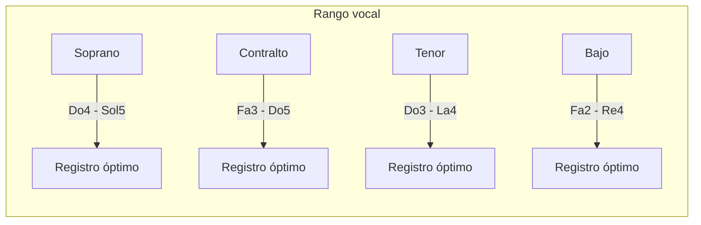

### Distancia entre voces

1. **Regla básica**: Las voces no deben cruzarse ni solaparse
2. **Distancia máxima**:
   - Entre soprano y contralto: no más de una octava
   - Entre contralto y tenor: no más de una octava
   - Entre tenor y bajo: puede exceder una octava

```music-abc
X:1
T:Distancia correcta entre voces
M:C
L:1/1
K:C
[CEGc]|]
```

```music-abc
X:1
T:Distancia incorrecta (soprano-contralto > octava)
M:C
L:1/1
K:C
[Ce'Gc]|]
```

## 2. Reglas de distribución de los acordes

### Distribución de acordes tríada (3 notas) entre 4 voces

1. **Duplicación prioritaria**:
   - Primera opción: Duplicar la fundamental
   - Segunda opción: Duplicar la quinta
   - Evitar duplicar la tercera (excepto en acordes de primera inversión)
   - Nunca duplicar la sensible (7º grado)

```music-abc
X:1
T:Duplicación correcta (fundamental)
M:C
L:1/1
K:C
[CEGc]|]
W: C-E-G-C
```

```music-abc
X:1
T:Duplicación correcta (quinta)
M:C
L:1/1
K:C
[CEGg]|]
W: C-E-G-G
```

### Disposiciones de acordes

1. **Disposición cerrada**: Las tres voces superiores están dentro del intervalo de una octava
2. **Disposición abierta**: Las tres voces superiores abarcan más de una octava

```music-abc
X:1
T:Disposición cerrada
M:C
L:1/1
K:C
[CEGc]|]
```

```music-abc
X:1
T:Disposición abierta
M:C
L:1/1
K:C
[CEgc]|]
```

## 3. Reglas básicas de conducción de voces

### Tipos de movimiento

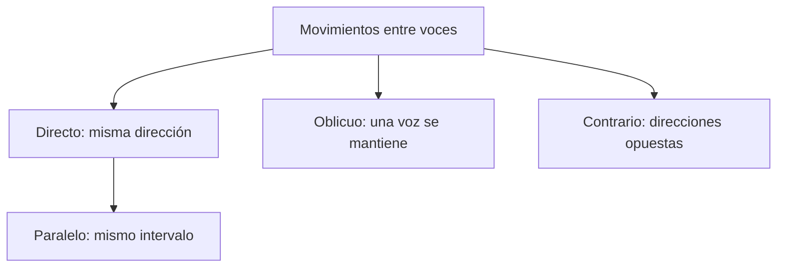

### Movimientos prohibidos

1. **Quintas paralelas**: Prohibido mover dos voces formando quintas justas consecutivas
2. **Octavas paralelas**: Prohibido mover dos voces formando octavas justas consecutivas

```music-abc
X:1
T:Quintas paralelas (PROHIBIDO)
M:C
L:1/2
K:C
[C,CG] [D,DA]|]
W: 5J    5J
```

```music-abc
X:1
T:Octavas paralelas (PROHIBIDO)
M:C
L:1/2
K:C
[C,C] [D,D]|]
W: 8J  8J
```

3. **Quintas directas**: Prohibidas entre voces extremas (soprano y bajo) cuando:
   - Ambas voces se mueven en la misma dirección
   - La soprano se mueve por salto

```music-abc
X:1
T:Quintas directas (PROHIBIDO)
M:C
L:1/2
K:C
[C,E] [G,,D]|]
W: 3M  5J
```

4. **Octavas directas**: Misma regla que las quintas directas

## 4. Reglas de movimiento melódico

### Movimientos permitidos

1. Grados conjuntos (2ª mayor o menor): ✓ Siempre permitidos
2. Saltos de 3ª, 4ª justa, 5ª justa, 6ª menor/mayor, 8ª justa: ✓ Permitidos con moderación

### Movimientos prohibidos o restringidos

1. Saltos de 7ª: ✗ Generalmente prohibidos
2. Saltos mayores que una octava: ✗ Prohibidos
3. Intervalos aumentados o disminuidos: ✗ Prohibidos (excepto 4ª aumentada en casos específicos)
4. Dos saltos consecutivos en la misma dirección cuya suma exceda una octava: ✗ Prohibidos

```music-abc
X:1
T:Movimientos melódicos permitidos
M:C
L:1/4
K:C
C D E F | G E C2 | E F G C | E C G,2 |]
W: 2M 2M 2m 2M 3m 3M  4J 2M 4J 5J 3M
```

```music-abc
X:1
T:Movimientos melódicos prohibidos
M:C
L:1/4
K:C
C B, A G | C ^F G2 | C B _B G | C _B, G,2 |]
W: 2M 2M 2M  4A   7m    2m  4D
```

## 5. Reglas de enlace de acordes

### Enlace de acordes en estado fundamental

1. **Cuando las fundamentales están a distancia de 4ª o 5ª**:
   - Mantener la nota común en la misma voz
   - Las otras voces al sonido más cercano del siguiente acorde

```music-abc
X:1
T:Enlace I-V (4ª/5ª)
M:C
L:1/2
K:C
[C,CEG] [G,,DBG]|]
W: I       V
```

2. **Cuando las fundamentales están a distancia de 3ª o 6ª**:
   - Mantener las dos notas comunes en las mismas voces
   - La otra voz al sonido más cercano del siguiente acorde

```music-abc
X:1
T:Enlace I-VI (3ª/6ª)
M:C
L:1/2
K:C
[C,CEG] [A,,CEA]|]
W: I      VI
```

3. **Cuando las fundamentales están a distancia de 2ª**:
   - No hay notas comunes
   - Las tres voces superiores se mueven en dirección contraria al bajo
   - Cada voz se mueve al sonido más cercano del siguiente acorde

```music-abc
X:1
T:Enlace I-II (2ª)
M:C
L:1/2
K:C
[C,CEG] [D,DFA]|]
W: I      II
```

## 6. Reglas de resolución obligada

### La sensible (7º grado)

1. **Regla básica**: La sensible debe resolver a la tónica (grado conjunto ascendente)
2. **Excepciones**:
   - Resolución indirecta: Cuando la sensible está en una voz interior y otra voz superior lleva la tónica
   - Conducción melódica: En el movimiento descendente 1-7-6

```music-abc
X:1
T:Resolución correcta de la sensible
M:C
L:1/2
K:C
[G,,GBD] [C,CEG]|]
W: V      I
```

```music-abc
X:1
T:Resolución indirecta (permitida)
M:C
L:1/2
K:C
[G,,GBD] [C,GCE]|]
W: V      I
```

### Duplicaciones prohibidas

1. Sensible (7º grado): ✗ No duplicar
2. Notas alteradas cromáticamente: ✗ No duplicar
3. Tercera del acorde en segunda inversión: ✗ No duplicar
4. Cualquier nota de resolución obligada: ✗ No duplicar

## 7. Reglas específicas para inversiones

### Primera inversión (acorde de sexta)

1. **Duplicación**: Se puede duplicar cualquier nota (preferentemente la fundamental o la soprano)
2. **Uso**: Para crear líneas de bajo más fluidas y evitar saltos

```music-abc
X:1
T:Primera inversión (I6)
M:C
L:1/2
K:C
[E,CEG]|]
W: C/E (I6)
```

### Segunda inversión (acorde de cuarta y sexta)

1. **Duplicación**: Preferentemente duplicar la quinta (nota del bajo)
2. **Usos limitados**:
   - Cuarta y sexta cadencial (V-I)
   - Cuarta y sexta de paso (entre inversiones del mismo acorde)
   - Cuarta y sexta de bordadura (entre diferentes inversiones del mismo acorde)

```music-abc
X:1
T:Segunda inversión cadencial
M:C
L:1/2
K:C
[G,CEG] [G,DFG] [C,CEG]|]
W: I64   V      I
```

## 8. Reglas de cadencias

### Cadencia perfecta (V-I)

1. La sensible debe resolver a la tónica
2. El bajo debe moverse por salto de 4ª ascendente o 5ª descendente
3. La soprano debe terminar en la fundamental o la tercera del acorde de tónica

```music-abc
X:1
T:Cadencia perfecta
M:C
L:1/2
K:C
[G,,GBD] [C,CEG]|]
W: V      I
```

### Cadencia plagal (IV-I)

1. El 4º grado debe resolver descendiendo al 3º
2. La soprano puede terminar en cualquier nota del acorde de tónica

```music-abc
X:1
T:Cadencia plagal
M:C
L:1/2
K:C
[F,,FAC] [C,CEG]|]
W: IV     I
```

## 9. Reglas avanzadas de conducción de voces

### Tratamiento de notas no armónicas

1. **Nota de paso**:
   - Debe conectar dos notas armónicas por grado conjunto
   - El abordaje y la resolución deben ser por grado conjunto

```music-abc
X:1
T:Nota de paso
M:C
L:1/4
K:C
[C,CEG] [C,CFA] [C,CEG]|]
W: I     (F=NP)  I
```

2. **Bordadura**:
   - Rodea una nota armónica a distancia de 2ª
   - Vuelve a la misma nota

```music-abc
X:1
T:Bordadura
M:C
L:1/4
K:C
[C,CEG] [C,CFA] [C,CEG]|]
W: I     (F=B)   I
```

3. **Retardo**:
   - Prolonga una nota del acorde anterior
   - Resuelve por grado conjunto descendente

```music-abc
X:1
T:Retardo 4-3
M:C
L:1/2
K:C
[G,,GBD] [C,CFG]4|[C,CEG]4|]
W: V      I (4-3)  I
```

## 10. Reglas de tratamiento de acordes disonantes

### Acordes de séptima

1. **Preparación**: La séptima debe estar preparada (aparecer como consonancia en el acorde anterior)
2. **Resolución**: La séptima debe resolver por grado conjunto descendente

```music-abc
X:1
T:Resolución de la séptima
M:C
L:1/2
K:C
[C,CEG] [G,,BFG] [C,CEG]|]
W: I     V7       I
```

### Acordes disminuidos

1. La quinta disminuida debe resolver por grado conjunto descendente
2. Evitar duplicar cualquier nota del acorde disminuido

```music-abc
X:1
T:Resolución acorde disminuido
M:C
L:1/2
K:C
[B,,BDF] [C,CEG]|]
W: viio    I
```

## Resumen visual de reglas principales

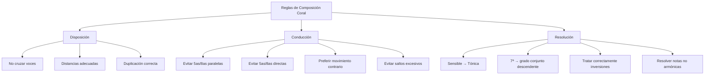

## Ejercicios recomendados

1. **Nivel Básico**: Armonizar una melodía simple usando solo acordes en estado fundamental
2. **Nivel Intermedio**: Armonizar un bajo dado usando inversiones y acordes de séptima
3. **Nivel Avanzado**: Realizar una progresión armónica añadiendo notas no armónicas

> **Consejo final**: Las reglas existen para garantizar un buen resultado sonoro. A medida que domines estas reglas, aprenderás cuándo puedes flexibilizarlas para lograr efectos expresivos específicos.

---

## Archivo: `1. Teoría/2. Conducción/05. Voicing coral paso a paso.md`

# Guía Paso a Paso para Composición Coral a 4 Voces

Esta guía te llevará sistemáticamente por el proceso de crear una composición coral a cuatro voces desde cero, siguiendo convenciones clásicas de conducción de voces.


## Fase 1: Preparación

### Paso 1: Define la tonalidad y el carácter

1. Elige una tonalidad (recomendado para principiantes: Do mayor, La menor, Sol mayor o Re menor)
2. Decide el carácter general (solemne, jubiloso, contemplativo)
3. Elige un compás (recomendado: 4/4 o 3/4)

### Paso 2: Planifica la estructura armónica

1. Decide la longitud aproximada (8-16 compases para empezar)
2. Planifica las cadencias principales:
   - Final: Cadencia perfecta (V-I)
   - Intermedia: Semicadencia (I-V) o cadencia rota (V-VI)


### Paso 3: Decide la progresión armónica básica

Para una pieza corta en Do mayor, puedes usar esta progresión básica:

## Fase 2: Escribir la melodía (soprano)

### Paso 4: Crea una línea de soprano

1. La soprano debe:

   - Tener un contorno melódico interesante
   - Mantenerse dentro del rango adecuado (Do4-Sol5)
   - Seguir movimiento principalmente por grado conjunto
   - Articular claramente las cadencias
   - Comenzar y terminar en notas del acorde de tónica

2. Ejemplo de melodía de soprano para nuestra progresión:

```music-abc
X:1
T:Línea de soprano
M:4/4
L:1/4
K:C
c2 c2 | d2 e2 | e2 d2 | c2 B2 | A2 A2 | A2 F2 | G2 G2 | c4 |]
W: I      IV     V      I      VI     II     V      I
```

### Paso 5: Verifica la melodía

✓ Confirma que:

- No hay saltos prohibidos (7as, intervalos aumentados/disminuidos)
- Los saltos están compensados con movimiento por grado conjunto en dirección opuesta
- La melodía coincide con la armonía planeada
- Los puntos cadenciales están bien definidos

## Fase 3: Escribir el bajo

### Paso 6: Crea una línea de bajo

1. El bajo debe:

   - Definir claramente la progresión armónica
   - Usar principalmente las fundamentales de los acordes
   - Tener un buen contorno melódico propio
   - Moverse mayormente por saltos de 4ª/5ª o por grado conjunto
   - Evitar movimientos cromáticos

2. Ejemplo de línea de bajo para nuestra progresión:

```music-abc
X:1
T:Línea de bajo
M:4/4
L:1/4
K:C bass
C,2 C,2 | F,2 F,2 | G,2 G,2 | C,2 C,2 | A,,2 A,,2 | D,2 D,2 | G,2 G,2 | C,4 |]
W: I       IV       V        I        VI       II       V        I
```

### Paso 7: Verifica la relación soprano-bajo

✓ Confirma que:

- No hay quintas u octavas paralelas entre soprano y bajo
- No hay quintas u octavas directas (especialmente con soprano por salto)
- El movimiento contrario se usa en los puntos cadenciales
- La distancia entre ambas voces no es excesiva

## Fase 4: Completar las voces interiores

### Paso 8: Escribe la línea de tenor

1. El tenor debe:

   - Completar la armonía
   - Mantenerse en su registro (Do3-La4)
   - Tener buena conducción de voces (movimiento mínimo)
   - Mantener distancia adecuada con el bajo y contralto

2. Ejemplo de línea de tenor:

```music-abc
X:1
T:Línea de tenor
M:4/4
L:1/4
K:C bass
E,2 E,2 | F,2 G,2 | G,2 G,2 | E,2 G,2 | E,2 E,2 | F,2 F,2 | D,2 F,2 | E,4 |]
W: I       IV     V        I       VI      II      V       I
```

### Paso 9: Escribe la línea de contralto

1. La contralto debe:

   - Completar cualquier nota faltante del acorde
   - Mantenerse en su registro (Fa3-Do5)
   - Tener la conducción de voces más suave posible
   - No cruzarse con soprano ni tenor

2. Ejemplo de línea de contralto:

```music-abc
X:1
T:Línea de contralto
M:4/4
L:1/4
K:C
G2 A2 | A2 C'2 | B2 B2 | G2 G2 | C'2 C'2 | A2 A2 | B2 B2 | G4 |]
W: I     IV      V      I      VI      II     V      I
```

## Fase 5: Revisión y refinamiento

### Paso 10: Combina todas las voces y verifica

```music-abc
X:1
T:Composición a 4 voces
M:4/4
L:1/4
K:C
V:1 clef=treble
c2 c2 | d2 e2 | e2 d2 | c2 B2 | A2 A2 | A2 F2 | G2 G2 | c4 |]
V:2 clef=treble
G2 A2 | A2 C'2 | B2 B2 | G2 G2 | C'2 C'2 | A2 A2 | B2 B2 | G4 |]
V:3 clef=bass
E,2 E,2 | F,2 G,2 | G,2 G,2 | E,2 G,2 | E,2 E,2 | F,2 F,2 | D,2 F,2 | E,4 |]
V:4 clef=bass
C,2 C,2 | F,2 F,2 | G,2 G,2 | C,2 C,2 | A,,2 A,,2 | D,2 D,2 | G,2 G,2 | C,4 |]
W: I       IV       V        I        VI       II       V        I
```

### Paso 11: Verifica todas las reglas

✓ **Verificación de disposición**:

- Cada voz está en su registro adecuado
- No hay cruzamiento entre voces
- Distancia entre voces adyacentes ≤ octava (excepto tenor-bajo)

✓ **Verificación de conducción de voces**:

- No hay quintas u octavas paralelas entre ningún par de voces
- No hay quintas u octavas directas entre soprano y bajo
- Cada voz tiene un contorno melódico natural
- Las notas comunes se mantienen en la misma voz

✓ **Verificación de resoluciones especiales**:

- La sensible (Si) resuelve a la tónica (Do)
- Las séptimas resuelven descendiendo por grado conjunto
- Los acordes de cuarta y sexta están tratados correctamente

✓ **Verificación de duplicaciones**:

- No se duplica la sensible
- No se duplican notas alteradas cromáticamente
- En acordes en estado fundamental: se duplica preferentemente la fundamental
- En primera inversión: cualquier nota puede duplicarse
- En segunda inversión: se duplica preferentemente la quinta (nota del bajo)

## Fase 6: Método para resolver problemas comunes

### Problema 1: Quintas u octavas paralelas

```music-abc
X:1
T:Problema: quintas paralelas
M:4/4
L:1/2
K:C
V:1 clef=treble
[Gc] [FA] |]
V:2 clef=bass
[G,C] [F,C] |]
W: 5J   5J
```

**Solución**: Usa movimiento contrario u oblicuo

```music-abc
X:1
T:Solución
M:4/4
L:1/2
K:C
V:1 clef=treble
[Gc] [FA] |]
V:2 clef=bass
[G,C] [F,D] |]
W: 5J   3m
```

### Problema 2: Sensible no resuelve correctamente

```music-abc
X:1
T:Problema: sensible sin resolver
M:4/4
L:1/2
K:C
V:1 clef=treble
[GBd] [GCE] |]
V:2 clef=bass
[G,D,] [C,E,] |]
W: V     I
```

**Solución**: Asegura que la sensible resuelva ascendiendo a la tónica

```music-abc
X:1
T:Solución
M:4/4
L:1/2
K:C
V:1 clef=treble
[GBd] [GCE] |]
V:2 clef=bass
[G,D,] [C,C] |]
W: V     I
```

### Problema 3: Duplicación incorrecta

```music-abc
X:1
T:Problema: duplicación de sensible
M:4/4
L:1/2
K:C
V:1 clef=treble
[GBd] |]
V:2 clef=bass
[G,B,] |]
W: V (sensible duplicada)
```

**Solución**: Duplica la fundamental o la quinta en su lugar

```music-abc
X:1
T:Solución
M:4/4
L:1/2
K:C
V:1 clef=treble
[GBd] |]
V:2 clef=bass
[G,D] |]
W: V (quinta duplicada)
```

## Fase 7: Expansión de la composición

### Paso 12: Ampliar con técnicas adicionales

Una vez dominado el proceso básico, puedes:

1. **Añadir notas no armónicas**:

   - Notas de paso
   - Bordaduras
   - Retardos (especialmente 4-3)
   - Anticipaciones

2. **Usar inversiones** para crear:

   - Líneas de bajo más melódicas
   - Mejor conducción de voces
   - Mayor variedad armónica

3. **Incorporar modulaciones** a tonalidades cercanas:
   - Tonalidad de la dominante
   - Tonalidad relativa
   - Tonalidad de la subdominante

## Ejercicio completo: Proceso de composición de un coral breve

### Paso 1: Progresión armónica en Do mayor

```
I - vi - IV - V - I - IV - V - I
```

### Paso 2: Melodía de soprano

```music-abc
X:1
T:Soprano
M:4/4
L:1/4
K:C
e2 c2 | d2 B2 | c2 A2 | B2 G2 | e2 c2 | d2 B2 | G2 G2 | c4 |]
```

### Paso 3: Línea de bajo

```music-abc
X:1
T:Bajo
M:4/4
L:1/4
K:C bass
C,2 A,,2 | F,2 G,2 | C,2 F,2 | G,2 G,,2 | C,2 F,2 | F,2 G,2 | G,2 G,,2 | C,4 |]
```

### Paso 4: Voces interiores

```music-abc
X:1
T:Contralto y Tenor
M:4/4
L:1/4
K:C
V:1 clef=treble
g2 e2 | f2 d2 | e2 c2 | d2 B2 | g2 f2 | f2 f2 | d2 f2 | e4 |]
V:2 clef=bass
C2 A,2 | A,2 G,2 | G,2 F,2 | F,2 D,2 | C2 A,2 | B,2 D2 | B,2 B,2 | C4 |]
```

### Paso 5: Composición final con todas las voces

```music-abc
X:1
T:Coral a 4 voces
M:4/4
L:1/4
K:C
V:1 clef=treble
e2 c2 | d2 B2 | c2 A2 | B2 G2 | e2 c2 | d2 B2 | G2 G2 | c4 |]
V:2 clef=treble
g2 e2 | f2 d2 | e2 c2 | d2 B2 | g2 f2 | f2 f2 | d2 f2 | e4 |]
V:3 clef=bass
C2 A,2 | A,2 G,2 | G,2 F,2 | F,2 D,2 | C2 A,2 | B,2 D2 | B,2 B,2 | C4 |]
V:4 clef=bass
C,2 A,,2 | F,2 G,2 | C,2 F,2 | G,2 G,,2 | C,2 F,2 | F,2 G,2 | G,2 G,,2 | C,4 |]
W: I   vi    IV  V     I   IV    IV  V     I   IV    IV  V     V   V     I
```

## Lista de verificación final

Antes de dar por terminada tu composición, verifica una última vez:

- [ ] Cada voz tiene un contorno melódico adecuado
- [ ] No hay errores de conducción de voces (quintas/octavas paralelas o directas)
- [ ] Las resoluciones especiales (sensible, séptima) son correctas
- [ ] Las duplicaciones son adecuadas
- [ ] Los acordes están correctamente distribuidos
- [ ] Las cadencias son claras y efectivas
- [ ] La composición suena bien en conjunto

> **Consejo práctico**: La mejor manera de mejorar en la composición coral es analizar corales existentes (como los de J.S. Bach) y practicar regularmente. Cada nueva composición será mejor que la anterior a medida que integres naturalmente estas reglas.

---

## Archivo: `1. Teoría/2. Conducción/06. Voicing 3 — guía y composiciones.md`

## Introducción

Esta guía proporciona instrucciones detalladas para componer corales a 4 voces siguiendo las reglas clásicas de composición. Está diseñada para ser práctica y metódica, permitiéndote verificar cada regla de manera sistemática durante el proceso compositivo.

## Parte 1: Fundamentos y Preparación

### Paso 1: Configuración de las voces

1. **Identifica las cuatro voces**:

   - Soprano (S): Voz femenina más aguda
   - Alto (A): Voz femenina más grave
   - Tenor (T): Voz masculina más aguda
   - Bajo (B): Voz masculina más grave

2. **Establece los rangos vocales**:

   - Soprano: Do4 (C4) - La5 (A5)
   - Alto: Fa3 (F3) - Re5 (D5)
   - Tenor: Do3 (C3) - La4 (A4)
   - Bajo: Mi2 (E2) - Re4 (D4)

3. **Comprende la función de cada voz**:
   - Soprano: Generalmente lleva la melodía principal
   - Bajo: Establece la base armónica y define las inversiones
   - Alto y Tenor: Completan la armonía interior

### Paso 2: Preparación armónica

1. **Selecciona la tonalidad** para tu coral

2. **Identifica los acordes diatónicos** en la tonalidad:

   - Para tonalidad mayor: I, ii, iii, IV, V, vi, vii°
   - Para tonalidad menor: i, ii°, III, iv, v, VI, VII (natural)
     i, ii°, III+, iv, V, VI, vii° (armónica)
     i, ii, III, IV, V, vi°, vii° (melódica)

3. **Comprende las funciones armónicas**:

   - Tónica (I/i): Estabilidad, reposo
   - Subdominante (IV/iv): Movimiento, tensión media
   - Dominante (V): Tensión, impulso hacia la tónica

4. **Prepara una progresión armónica** que servirá como esqueleto

## Parte 2: Proceso de Composición Paso a Paso

### Paso 3: Iniciar la composición

1. **Establece la melodía en la soprano**:

   - Si ya tienes una melodía, utilízala
   - Si estás componiendo desde cero, crea primero una melodía
   - Verifica que la melodía esté dentro del rango vocal
   - Asegúrate de que la melodía tenga una estructura de frase clara

2. **Asigna la línea de bajo**:

   - Escribe una línea que soporte la armonía planificada
   - Utiliza mayormente la fundamental o quinta de cada acorde
   - Verifica que esté dentro del rango vocal
   - Crea una línea melódica interesante, evitando saltos muy grandes

3. **Completa las voces intermedias (alto y tenor)**:
   - Distribuye las notas restantes del acorde
   - Prioriza la buena conducción de voces sobre la completitud del acorde
   - En caso de duda, es preferible duplicar la fundamental

### Paso 4: Refinamiento del voicing

1. **Verifica la disposición de las voces** en cada acorde:

   - **Estado fundamental o inversiones**:
     - Estado fundamental: Fundamental en el bajo
     - Primera inversión: Tercera en el bajo
     - Segunda inversión: Quinta en el bajo
     - Tercera inversión (para cuatríadas): Séptima en el bajo

2. **Ajusta el espaciado entre voces**:

   - Entre soprano y alto: No más de una octava
   - Entre alto y tenor: No más de una octava
   - Entre tenor y bajo: Puede ser mayor (hasta una docena)
   - Entre soprano y bajo: No más de dos octavas

3. **Decide qué tipo de voicing utilizar**:

   - **Voicing cerrado**: Las notas están dispuestas lo más cerca posible
   - **Voicing abierto**: Las notas están separadas por intervalos más amplios
   - En registros graves, preferir voicings abiertos para mayor claridad

4. **Revisa la distribución de notas**:
   - En acordes tríada:
     - Prioriza duplicar la fundamental
     - Evita duplicar la tercera (especialmente en acordes mayores)
     - La quinta puede duplicarse cuando sea necesario
   - En acordes de séptima:
     - Incluye las cuatro notas del acorde cuando sea posible
     - La fundamental puede duplicarse omitiendo la quinta

## Parte 3: Verificación Sistemática de Reglas

### Paso 5: Verificación de conducción de voces

1. **Verifica el movimiento melódico de cada voz**:

   - **Comprueba cada línea individualmente**:
     - Evita saltos mayores a una quinta (excepto octavas en el bajo)
     - Después de un salto grande, mueve la voz en dirección opuesta
     - Evita dos saltos consecutivos en la misma dirección
     - Limita el uso de tritonos melódicos (4ª aumentada/5ª disminuida)

2. **Verifica el movimiento entre las voces**:

   - **Identifica el tipo de movimiento**:
     - Movimiento directo: Ambas voces se mueven en la misma dirección
     - Movimiento contrario: Las voces se mueven en direcciones opuestas
     - Movimiento oblicuo: Una voz se mantiene mientras la otra se mueve
     - Movimiento paralelo: Ambas voces se mueven en la misma dirección y mismo intervalo

3. **Comprueba sistemáticamente para evitar quintas y octavas paralelas**:

   - **Método para verificar quintas paralelas**:
     a. Identifica todas las quintas entre pares de voces en el primer acorde
     b. Para cada quinta encontrada, verifica si en el siguiente acorde esas mismas voces forman otra quinta
     c. Si ambas voces se mueven en la misma dirección y mantienen el intervalo de quinta, es una quinta paralela

   - **Método para verificar octavas paralelas**:
     a. Identifica todas las octavas entre pares de voces en el primer acorde
     b. Para cada octava encontrada, verifica si en el siguiente acorde esas mismas voces forman otra octava
     c. Si ambas voces se mueven en la misma dirección y mantienen el intervalo de octava, es una octava paralela

4. **Verifica quintas y octavas ocultas (directas)**:

   - **Método para identificar quintas/octavas ocultas**:
     a. Identifica cuando dos voces se mueven en la misma dirección
     b. Verifica si forman una quinta u octava en el segundo acorde
     c. Si las encuentras entre soprano y bajo, considéralas un error
     d. Entre otras voces, son aceptables si la voz superior se mueve por grado conjunto

5. **Comprueba la resolución de disonancias**:
   - **Para cada nota disonante (7ª, 2ª, 4ª, tritono)**:
     a. Identifica la nota disonante en un acorde
     b. Verifica que resuelva por grado conjunto descendente (para 7as)
     c. Verifica que las sensibles (7º grado) resuelvan ascendentemente hacia la tónica

### Paso 6: Verificación de estructura armónica

1. **Verifica la progresión armónica**:

   - Confirma que cada acorde cumpla su función tonal
   - Asegúrate de que las cadencias sean apropiadas para las frases

2. **Comprueba las inversiones**:

   - Verifica que los acordes de segunda inversión (6/4) se usen correctamente:
     a. Cadencial: V6/4 - V - I
     b. Paso: Usado en una línea de bajo por grado conjunto
     c. Arpegiado: Cuando el bajo arpegia un acorde
     d. Pedal: Sobre un bajo que se mantiene

3. **Revisa la disposición de acordes de séptima**:
   - Verifica que la séptima esté preparada (aparezca como consonancia en el acorde anterior)
   - Comprueba que la séptima resuelva descendentemente por grado conjunto

### Paso 7: Verificación de claridad textural

1. **Verifica el equilibrio entre las voces**:

   - Ninguna voz debe dominar excesivamente
   - Mantén un espaciado consistente entre las voces

2. **Comprueba el rango de cada voz**:

   - Asegúrate de que cada voz permanezca dentro de su rango cómodo
   - Evita quedarte en los extremos del rango por períodos prolongados

3. **Verifica momentos de cruce de voces**:

   - Identifica si alguna voz cruza a otra (ej: tenor más agudo que alto)
   - Limita estos cruces a momentos específicos por razones expresivas

4. **Comprueba momentos de unísono**:
   - Identifica cuando dos voces cantan la misma nota
   - Asegúrate de que el unísono resuelva con movimiento contrario u oblicuo

## Parte 4: Lista de Verificación Final

### Paso 8: Verificación completa

Utiliza esta lista para una revisión final sistemática:

1. **Estructura general**:

   - [ ] La melodía tiene forma clara con frases equilibradas
   - [ ] La progresión armónica soporta la melodía adecuadamente
   - [ ] Las cadencias coinciden con el final de las frases musicales

2. **Voces individuales**:

   - [ ] Cada voz está dentro de su rango apropiado
   - [ ] Cada voz tiene una línea melódica cantable
   - [ ] No hay saltos excesivos o difíciles de entonar
   - [ ] Las disonancias resuelven correctamente

3. **Relaciones entre voces**:

   - [ ] No hay quintas paralelas
   - [ ] No hay octavas paralelas
   - [ ] No hay quintas u octavas directas problemáticas
   - [ ] El espaciado entre voces es apropiado
   - [ ] No hay cruces de voces innecesarios

4. **Armonía**:
   - [ ] Los acordes están completos (o hay una razón para la omisión)
   - [ ] Las inversiones se usan correctamente
   - [ ] La conducción armónica es lógica
   - [ ] Las cadencias son efectivas

## Ejemplo Práctico

```music-abc
X:1
T:Ejemplo de Coral a 4 Voces
M:4/4
L:1/4
K:C
V:1 clef=treble name="Soprano"
[K:C] G G A B | c B A G | A B c2 | B2 A2 | G4 |]
V:2 clef=treble name="Alto"
[K:C] E E F G | G G F E | F G G2 | G2 F2 | E4 |]
V:3 clef=bass name="Tenor"
[K:C] C C C D | E D C B, | C D E2 | D2 C2 | C4 |]
V:4 clef=bass name="Bajo"
[K:C] C, C, F, G, | C G, A, E, | F, G, C,2 | G,2 A,2 | C,4 |]
```

### Análisis del ejemplo

**Compás 1**:

- Acorde: C mayor (estado fundamental)
- Disposición: C-E-G-C (bajo-tenor-alto-soprano)
- Movimiento: Todas las voces se mueven por grado conjunto

**Compás 2-3**:

- Progresión: C - G7 - F - G - C
- Conducción de voces: Movimiento mayormente conjunto
- Resolución: Séptima de G7 (F) resuelve a E en el acorde de C

**Cadencia final**:

- Cadencia auténtica perfecta (G-C con soprano en la fundamental)
- Movimiento contrario entre soprano y bajo en la resolución final

## Conclusión

La composición coral a 4 voces requiere atención meticulosa tanto a las líneas melódicas individuales como a las relaciones verticales entre ellas. Siguiendo este proceso paso a paso y verificando sistemáticamente cada regla, podrás crear corales bien estructurados que respeten las convenciones clásicas de la composición coral.

Recuerda que aunque estas reglas son importantes, son guías que han evolucionado a lo largo de siglos de práctica musical. Entender su propósito te permitirá aplicarlas con criterio y, cuando sea apropiado, saber cuándo puedes flexibilizarlas por razones expresivas.

---

## Archivo: `1. Teoría/2. Conducción/07. Guía para identificar reglas.md`

# Método Sistemático para Verificar Reglas de Composición Coral

Este documento proporciona un método sistemático paso a paso para verificar todas las reglas de composición coral, enfocándose especialmente en el voicing y la progresión armónica.

## Verificación de Voicing

### 1. Verificación de Distribución de Notas

**Paso 1: Identificar el tipo de acorde**

- Determina si es un acorde tríada (3 notas) o cuatríada (4 notas)
- Identifica su cualidad: mayor, menor, disminuido, aumentado, etc.

**Paso 2: Verificar la completitud del acorde**

- Comprueba que todas las notas esenciales estén presentes:
  - Para tríadas: Fundamental, tercera y quinta
  - Para cuatríadas: Fundamental, tercera, quinta y séptima
- Si alguna nota está omitida, verifica que:
  - Sea la quinta (la más comúnmente omitida)
  - No sea la tercera (casi nunca debe omitirse)
  - No sea la séptima en acordes de séptima

**Paso 3: Revisar la duplicación de notas**

- Verifica qué notas están duplicadas:
  - ✓ Fundamental: Ideal para duplicar
  - ✓ Quinta: Aceptable para duplicar
  - ✗ Tercera: Generalmente evitar duplicar (especialmente en acordes mayores)
  - ✗ Notas sensibles (7º grado): Evitar duplicar
  - ✗ Notas alteradas cromáticamente: Evitar duplicar

**Paso 4: Verificar el estado de inversión** 

- Identifica qué nota del acorde está en el bajo:
  - Fundamental → Estado fundamental
  - Tercera → Primera inversión
  - Quinta → Segunda inversión
  - Séptima → Tercera inversión (solo en cuatríadas)

**Paso 5: Comprobar el uso adecuado de inversiones**

- Para acordes en primera inversión (6):
  - ✓ Se pueden usar libremente
- Para acordes en segunda inversión (6/4):
  - ✓ Cadencial: Precede a un acorde de dominante (V) en estado fundamental
  - ✓ De paso: El bajo forma parte de una línea por grado conjunto
  - ✓ Arpegiado: El bajo arpegia un mismo acorde
  - ✓ Pedal: El bajo mantiene la misma nota
  - ✗ Evitar usar libremente como un acorde independiente
- Para acordes en tercera inversión (4/2):
  - ✓ Debe resolver a un acorde en primera inversión

### 2. Verificación de Espaciado entre Voces

**Paso 1: Medir distancia entre voces adyacentes**

- Entre soprano y alto:
  - ✓ Máximo una octava
  - ✗ No más de una octava
- Entre alto y tenor:
  - ✓ Máximo una octava
  - ✗ No más de una octava
- Entre tenor y bajo:
  - ✓ Puede ser más amplio (hasta una docena)
  - ✗ Evitar espaciado excesivo en registros medios y agudos

**Paso 2: Verificar el espaciado total**

- Entre soprano y bajo:
  - ✓ No más de dos octavas (habitual)
  - ✓ En registros graves, mayor espaciado para claridad

**Paso 3: Comprobar consistencia de espaciado**

- Verificar si el espaciado cambia drásticamente entre acordes
- Mantener un espaciado relativamente constante a lo largo de la pieza

### 3. Verificación de Voicing Abierto vs. Cerrado

**Paso 1: Identificar el tipo de voicing**

- Voicing cerrado:
  - Las notas están dispuestas lo más cerca posible entre sí
  - No hay notas del acorde que puedan intercalarse entre las voces
- Voicing abierto:
  - Hay notas del acorde que podrían colocarse entre las voces existentes
  - El espaciado entre voces es más amplio

**Paso 2: Evaluar la adecuación del voicing elegido**

- Para registros graves:
  - ✓ Preferir voicing abierto (mayor claridad)
  - ✗ Evitar voicing cerrado (puede sonar turbio)
- Para registros agudos:
  - ✓ Ambos tipos de voicing funcionan bien
- Para acordes más disonantes:
  - ✓ Voicing abierto puede aclarar las disonancias

## Verificación de Conducción de Voces

### 1. Verificación de Movimiento Melódico Individual

**Paso 1: Revisar cada voz separadamente**

- Para cada voz (soprano, alto, tenor, bajo):
  - ✓ Movimiento por grado conjunto (2ª M/m): Ideal
  - ✓ Saltos pequeños (3ª, 4ª, 5ª): Aceptables
  - ✓ Saltos de octava: Aceptables (especialmente en el bajo)
  - ✗ Saltos mayores que una quinta: Limitarlos (excepto octavas)
  - ✗ Saltos de séptima: Generalmente evitar
  - ✗ Saltos aumentados o disminuidos: Evitar (especialmente el tritono)

**Paso 2: Verificar la dirección después de saltos**

- Después de cada salto:
  - ✓ La voz debería moverse en dirección opuesta al salto
  - ✗ Evitar dos saltos consecutivos en la misma dirección
  - ✗ Evitar tres saltos consecutivos que formen un arpegio

**Paso 3: Comprobar el rango vocal**

- Verifica que cada voz permanezca dentro de su rango:
  - Soprano: C4-A5
  - Alto: F3-D5
  - Tenor: C3-A4
  - Bajo: E2-D4

### 2. Verificación de Quintas y Octavas Paralelas

**Paso 1: Identificar intervalos entre cada par de voces**

- Para cada par de voces (6 combinaciones):
  - Soprano-Alto
  - Soprano-Tenor
  - Soprano-Bajo
  - Alto-Tenor
  - Alto-Bajo
  - Tenor-Bajo

**Paso 2: Detectar quintas paralelas**

- Para cada par de acordes consecutivos:
  1. Identifica todas las quintas justas en el primer acorde
  2. Para cada quinta encontrada, verifica el intervalo entre las mismas voces en el siguiente acorde
  3. Si se mantiene como quinta justa Y ambas voces se mueven en la misma dirección, es una quinta paralela

**Paso 3: Detectar octavas paralelas**

- Para cada par de acordes consecutivos:
  1. Identifica todas las octavas en el primer acorde
  2. Para cada octava encontrada, verifica el intervalo entre las mismas voces en el siguiente acorde
  3. Si se mantiene como octava Y ambas voces se mueven en la misma dirección, es una octava paralela

**Paso 4: Detectar quintas y octavas directas (ocultas)**

- Para cada par de voces (especialmente soprano-bajo):
  1. Verifica si ambas voces se mueven en la misma dirección
  2. Si forman una quinta u octava en el segundo acorde y no la tenían antes
  3. Si es entre soprano y bajo, solo es aceptable si la soprano se mueve por grado conjunto

### 3. Verificación de Resolución de Disonancias

**Paso 1: Identificar todas las disonancias**

- Localiza todas las notas disonantes:
  - Séptimas de cualquier acorde
  - Segundas (o novenas)
  - Cuartas (no resueltas como suspensiones)
  - Tritonos (4ª aumentada o 5ª disminuida)

**Paso 2: Verificar la preparación de disonancias**

- Para cada disonancia:
  - ✓ Debe estar preparada (presente como consonancia en el acorde anterior)
  - ✗ Evitar introducir disonancias por salto

**Paso 3: Verificar la resolución de disonancias**

- Para séptimas:
  - ✓ Deben resolver descendiendo por grado conjunto
  - ✗ No deben resolver ascendiendo o por salto
- Para sensibles (7º grado de la escala):
  - ✓ Deben resolver ascendiendo a la tónica
  - ✗ No deben descender (excepto en voz intermedia o para evitar duplicación)
- Para suspensiones:
  - ✓ Deben resolver descendiendo por grado conjunto

### 4. Verificación de Movimientos de Voces

**Paso 1: Identificar el tipo de movimiento entre voces**

- Entre cada par de voces y cada par de acordes:
  - Movimiento directo: Ambas voces se mueven en la misma dirección
  - Movimiento contrario: Las voces se mueven en direcciones opuestas
  - Movimiento oblicuo: Una voz se mantiene mientras la otra se mueve

**Paso 2: Verificar la proporción de movimientos**

- ✓ Equilibrio entre los diferentes tipos de movimiento
- ✓ Priorizar movimiento contrario y oblicuo para independencia de voces
- ✗ Evitar exceso de movimiento directo, especialmente entre voces externas

**Paso 3: Comprobar el tratamiento de notas comunes**

- ✓ Mantener notas comunes en la misma voz entre acordes sucesivos
- ✗ Evitar saltos innecesarios cuando existe la opción de mantener notas comunes

## Verificación de Estructuras Armónicas Específicas

### 1. Verificación de Cadencias

**Paso 1: Identificar las cadencias**

- Auténtica perfecta: V-I con soprano y bajo en la fundamental de I
- Auténtica imperfecta: V-I con soprano en 3ª o 5ª, o bajo en inversión
- Plagal: IV-I
- Rota: V-vi
- Semi-cadencia: Cualquier acorde-V

**Paso 2: Verificar la conducción de voces en cadencias**

- Para cadencias auténticas:
  - ✓ Sensible (en V) debe resolver a tónica (en I)
  - ✓ 7ª del V7 debe resolver descendiendo
  - ✓ Movimiento contrario entre soprano y bajo en resolución final

**Paso 3: Comprobar disposición final de cadencias**

- Para cadencias finales:
  - ✓ Acorde final en estado fundamental
  - ✓ Tercera del acorde preferiblemente en una voz interior
  - ✓ Fundamental triplicada posible en acorde final

### 2. Verificación de Acordes de Séptima

**Paso 1: Comprobar la preparación de la séptima**

- ✓ La séptima debe estar:
  - Preparada (presente como consonancia en acorde anterior), o
  - Introducida por grado conjunto descendente, o
  - En un acorde de dominante (V7), puede introducirse por salto

**Paso 2: Verificar la resolución de la séptima**

- ✓ La séptima debe resolver descendiendo por grado conjunto
- ✓ En resoluciones excepcionales:
  - Puede transferirse a otra voz antes de resolver
  - En cadenas de dominantes (círculo de quintas), puede convertirse en tercera del siguiente acorde

**Paso 3: Comprobar inversiones de acordes de séptima**

- Acorde de séptima en estado fundamental (7):
  - ✓ Uso libre
- Primera inversión (6/5):
  - ✓ Uso libre
- Segunda inversión (4/3):
  - ✓ Preferiblemente con bajo moviéndose por grado conjunto
- Tercera inversión (2):
  - ✓ Casi siempre el bajo debe resolver descendiendo

## Ejemplos Prácticos de Verificación

### Ejemplo 1: Verificación de un acorde y su progresión

Tomemos un acorde de C mayor seguido de G7 en primera inversión:

```music-abc
X:1
T:Verificación de Progresión C-G7/B
M:4/4
L:1/1
K:C
"C" [CEGc] | "G7/B" [BDFg] |
```

**Verificación paso a paso:**

1. **Distribución de notas:**

   - C mayor: C (bajo), E (tenor), G (alto), C (soprano) - ✓ Acorde completo, fundamental duplicada
   - G7/B: B (bajo), D (tenor), F (alto), G (soprano) - ✓ Acorde completo en primera inversión

2. **Espaciado:**

   - Entre soprano-alto (C-G): 4ª justa - ✓ Menor que octava
   - Entre alto-tenor (G-E): 3ª menor - ✓ Menor que octava
   - Entre tenor-bajo (E-C): 3ª mayor - ✓ Adecuado
   - Espaciado total (C-C): 2 octavas - ✓ Adecuado

3. **Conducción de voces:**

   - Bajo (C→B): 2ª menor descendente - ✓ Grado conjunto
   - Tenor (E→D): 2ª mayor descendente - ✓ Grado conjunto
   - Alto (G→F): 2ª mayor descendente - ✓ Grado conjunto
   - Soprano (C→G): 4ª justa descendente - ✓ Salto aceptable

4. **Movimiento:**

   - Todas las voces se mueven en la misma dirección (descendente) - ⚠️ Cuidado con paralelas

5. **Verificación de paralelas:**

   - No hay quintas ni octavas paralelas - ✓ Correcto

6. **Tratamiento de disonancias:**
   - F en G7 (7ª) se introduce por grado conjunto - ✓ Correcto

### Ejemplo 2: Corrección de errores comunes

Veamos un ejemplo con errores y su corrección:

**Ejemplo con errores:**

```music-abc
X:1
T:Progresión con Errores
M:4/4
L:1/1
K:C
"C" [CEGc] | "G" [GBdg] |
```

**Problemas:**

1. Quintas paralelas: C-G en bajo-alto y G-D en alto-tenor se mueven en paralelo
2. Octavas paralelas: C-C en bajo-soprano y G-G en bajo-soprano
3. Todas las voces se mueven en la misma dirección

**Corrección:**

```music-abc
X:1
T:Progresión Corregida
M:4/4
L:1/1
K:C
"C" [CEGc] | "G" [GBfd] |
```

**Solución:**

1. Mantener la nota G en el alto (movimiento oblicuo)
2. Mover la soprano a D en lugar de G (evita octavas paralelas)
3. Ahora tenemos movimiento contrario entre algunas voces

## Lista de Comprobación Final

Utiliza esta lista para verificar sistemáticamente cada aspecto:

### Voicing y Estructura Armónica

- [ ] Acordes completos (o deliberadamente incompletos)
- [ ] Duplicaciones apropiadas
- [ ] Inversiones correctamente utilizadas
- [ ] Espaciado adecuado entre voces
- [ ] Voicing apropiado para el registro (abierto/cerrado)

### Movimiento Melódico

- [ ] Cada voz tiene una línea cantable
- [ ] Saltos seguidos de movimiento conjunto en dirección opuesta
- [ ] Sin saltos difíciles o excesivos
- [ ] Cada voz dentro de su rango

### Conducción de Voces

- [ ] Sin quintas paralelas
- [ ] Sin octavas paralelas
- [ ] Sin quintas u octavas directas problemáticas
- [ ] Notas comunes mantenidas en la misma voz
- [ ] Balance entre tipos de movimiento

### Disonancias

- [ ] Todas las disonancias preparadas adecuadamente
- [ ] Todas las disonancias resueltas correctamente
- [ ] Séptimas resolviendo descendentemente
- [ ] Sensibles resolviendo ascendentemente

### Progresión General

- [ ] Progresión armónica lógica
- [ ] Cadencias correctamente formadas
- [ ] Estructura de frase clara

## Conclusión

La verificación metódica de las reglas de composición coral requiere atención tanto al detalle vertical (armonía) como horizontal (melodía y conducción de voces). Este método sistemático permite identificar y corregir los problemas más comunes en la escritura coral a 4 voces.

Recuerda que aunque estas reglas son importantes para el estilo clásico, entender su propósito te permitirá saber cuándo y cómo flexibilizarlas según las necesidades expresivas y estilísticas de tu composición.

----
## Identificar las quintas y 8avas directas

Claro, vamos a explicar de manera muy sencilla cómo identificar quintas y octavas paralelas o directas:

## Quintas y octavas paralelas

Imagina que tienes cuatro amigos cantando juntos: Sofía (soprano), Ana (alto), Tomás (tenor) y Bruno (bajo).

### Para encontrar quintas paralelas:

1. **Paso 1:** Busca pares de amigos que estén cantando notas separadas por una quinta justa (como Do y Sol)
2. **Paso 2:** Mira qué cantan estos mismos amigos en el siguiente acorde
3. **Paso 3:** Si ambos se movieron en la misma dirección (ambos subieron o ambos bajaron) y siguen cantando una quinta justa, ¡encontraste quintas paralelas!

Es como si dos amigos caminaran siempre manteniendo exactamente 5 pasos de distancia entre ellos. Eso no está permitido.

### Para encontrar octavas paralelas:

Igual que antes, pero buscando amigos que canten la misma nota pero en diferentes alturas (como Do grave y Do agudo).

1. **Paso 1:** Encuentra dos amigos cantando la misma nota en diferentes octavas
2. **Paso 2:** Mira qué cantan en el siguiente acorde
3. **Paso 3:** Si ambos se movieron en la misma dirección y siguen cantando la misma nota en diferentes octavas, ¡encontraste octavas paralelas!

## Quintas y octavas directas (ocultas)

Estas son un poco más traviesas y se esconden mejor:

1. **Paso 1:** Mira si dos amigos se mueven en la misma dirección (ambos suben o ambos bajan)
2. **Paso 2:** Fíjate si en el segundo acorde terminan formando una quinta u octava (aunque no la tuvieran antes)
3. **Paso 3:** Si esto sucede, especialmente entre Sofía y Bruno (soprano y bajo), tienes una quinta u octava directa

Las quintas y octavas directas son como dos amigos que no estaban a exactamente 5 u 8 pasos de distancia, pero caminaron de tal forma que terminaron exactamente a esa distancia.

### No importa entre qué voces se formen las quintas o las octavas paralelas. Lo importante es verificar todas las combinaciones posibles de voces.

Cuando compones a 4 voces (soprano, alto, tenor y bajo), debes revisar todas estas combinaciones de pares:

1. Soprano - Alto
2. Soprano - Tenor
3. Soprano - Bajo
4. Alto - Tenor
5. Alto - Bajo
6. Tenor - Bajo

Las quintas u octavas paralelas están prohibidas entre cualquiera de estas combinaciones de voces. No importa si son voces externas (soprano-bajo), internas (alto-tenor), o una externa con una interna (soprano-tenor, alto-bajo, etc.).

El proceso siempre es el mismo:
1. Identifica si hay una quinta justa u octava entre dos voces en un acorde
2. Verifica si esas mismas voces forman también una quinta justa u octava en el siguiente acorde
3. Comprueba si ambas voces se movieron en la misma dirección (ambas subieron o ambas bajaron)

Si se cumplen estas tres condiciones entre cualquier par de voces, tienes quintas u octavas paralelas, y según las reglas tradicionales de composición coral, deberías corregirlas.

Las quintas y octavas directas (ocultas) son más preocupantes cuando ocurren entre las voces externas (soprano-bajo), pero técnicamente pueden ocurrir entre cualquier combinación de voces.


## Ejemplo práctico

Imagina que tienes estos dos acordes seguidos:
- Primer acorde: Sofía canta Mi, Ana canta Do, Tomás canta Sol, Bruno canta Do grave
- Segundo acorde: Sofía canta Re, Ana canta Si, Tomás canta Sol, Bruno canta Sol grave

¿Hay quintas paralelas? Veamos:
- Entre Bruno y Tomás en el primer acorde: Do-Sol (quinta justa)
- Entre Bruno y Tomás en el segundo acorde: Sol-Re (quinta justa)
- Ambos se movieron (Bruno subió, Tomás bajó): ¡no hay quinta paralela porque no se movieron en la misma dirección!

Verificar todos los pares de voces de esta manera te ayudará a encontrar cualquier problema oculto en tu música.

----
This fear is only pain leaving your toses 

---

## Archivo: `1. Teoría/2. Conducción/08. Reglas corales — referencia rápida.md`

# 🎼 Guía Visual Reglas Corales - Referencia Rápida

## 🎯 RANGOS VOCALES

```
🎵 SOPRANO: Do4 ────────── Sol5 (óptimo)
            Si3 ──────────── La5 (extremo)

🎵 ALTO:    Fa3 ────────── Do5 (óptimo)
            Mi3 ──────────── Re5 (extremo)

🎵 TENOR:   Do3 ────────── La4 (óptimo)
            Si2 ──────────── Si4 (extremo)

🎵 BAJO:    Fa2 ────────── Re4 (óptimo)
            Mi2 ──────────── Mi4 (extremo)
```

---

## 🚫 PROHIBIDO SIEMPRE

### ❌ Quintas y Octavas Paralelas

```
Voz 1: Do → Re    (ambas suben)
Voz 2: Sol → La   (mantienen 5ª justa)
       ❌ PROHIBIDO
```

### ❌ Duplicaciones Prohibidas

- 🚫 **SENSIBLE** (7º grado) - NUNCA duplicar
- 🚫 **NOTAS ALTERADAS** (#, ♭) - NUNCA duplicar
- 🚫 **TERCERA** en acordes mayores - Evitar

### ❌ Saltos Prohibidos

- 🚫 **SÉPTIMAS** (7ª M, 7ª m)
- 🚫 **MAYORES QUE OCTAVA**
- 🚫 **AUMENTADOS/DISMINUIDOS** (4ª+, 5ª°)

---

## ✅ TIPOS DE SALTOS PERMITIDOS

| Salto             | Estado     | Uso       | Ejemplo       |
| ----------------- | ---------- | --------- | ------------- |
| **2ª M/m**        | ✅ IDEAL   | Siempre   | Do→Re, Mi→Fa  |
| **3ª M/m**        | ✅ BUENO   | Frecuente | Do→Mi, Re→Fa  |
| **4ª Justa**      | ✅ OK      | Moderado  | Do→Fa, Sol→Do |
| **5ª Justa**      | ✅ OK      | Moderado  | Do→Sol, Fa→Do |
| **6ª M/m**        | ⚠️ CUIDADO | Ocasional | Do→La, Re→Si  |
| **8ª Justa**      | ⚠️ CUIDADO | Ocasional | Do→Do         |
| **7ª cualquiera** | ❌ NO      | Prohibido | Do→Si, Re→Do  |

---

## 🔄 TIPOS DE MOVIMIENTO

### 🥇 CONTRARIO (Preferido)

```
Voz 1: Do → Re ↗    (una sube)
Voz 2: Sol → Fa ↘   (otra baja)
✅ EXCELENTE
```

### 🥈 OBLICUO (Bueno)

```
Voz 1: Do → Do ─    (una se mantiene)
Voz 2: Sol → La ↗   (otra se mueve)
✅ BUENO
```

### 🥉 DIRECTO (Cuidado)

```
Voz 1: Do → Re ↗    (ambas suben)
Voz 2: Mi → Fa ↗    (misma dirección)
⚠️ CUIDADO con 5tas/8vas
```

### ❌ PARALELO (Prohibido)

```
Voz 1: Do → Re ↗    (ambas suben)
Voz 2: Sol → La ↗   (mantienen 5ª)
❌ PROHIBIDO
```

---

## 🔄 INVERSIONES DE ACORDES

### Estado Fundamental

```
🎵 BAJO lleva: FUNDAMENTAL
✅ Uso: LIBRE
✅ Duplicar: FUNDAMENTAL (preferido)
Ejemplo: Do-Mi-Sol-Do
```

### Primera Inversión (6)

```
🎵 BAJO lleva: TERCERA
✅ Uso: LIBRE
✅ Duplicar: CUALQUIER NOTA
Ejemplo: Mi-Sol-Do-Mi
```

### Segunda Inversión (6/4)

```
🎵 BAJO lleva: QUINTA
⚠️ Uso: SOLO CASOS ESPECÍFICOS
  • Cadencial: I⁶⁄₄ - V - I
  • Paso: bajo por grado conjunto
  • Arpegiado: mismo acorde
  • Pedal: bajo se mantiene
✅ Duplicar: QUINTA (preferido)
```

### Tercera Inversión (4/2)

```
🎵 BAJO lleva: SÉPTIMA
⚠️ Uso: BAJO DEBE RESOLVER ↘
✅ Duplicar: FUNDAMENTAL
```

---

## 🎯 DUPLICACIONES - ORDEN DE PREFERENCIA

### 🥇 FUNDAMENTAL

```
Do-Mi-Sol-Do
✅ SIEMPRE CORRECTO
✅ PRIMERA OPCIÓN
```

### 🥈 QUINTA

```
Do-Mi-Sol-Sol
✅ SEGUNDA OPCIÓN
✅ GENERALMENTE BUENO
```

### 🥉 TERCERA

```
Do-Mi-Sol-Mi
⚠️ EVITAR en acordes MAYORES
✅ Aceptable en MENORES
✅ OK en primera inversión
```

### ❌ SENSIBLE

```
Sol-Si-Re-Si (en Do Mayor)
❌ NUNCA DUPLICAR
❌ SIEMPRE PROHIBIDO
```

---

## 📏 ESPACIADO ENTRE VOCES

```
SOPRANO  ♪ ─┐
             │ < 1 OCTAVA ✅
ALTO     ♪ ─┘

ALTO     ♪ ─┐
             │ < 1 OCTAVA ✅
TENOR    ♪ ─┘

TENOR    ♪ ─┐
             │ PUEDE SER > 1 OCTAVA ✅
BAJO     ♪ ─┘
```

---

## 🎼 CADENCIAS PRINCIPALES

### V - I (Perfecta)

```
🎵 SENSIBLE → TÓNICA ✅
🎵 7ª (si hay) → ↘ grado conjunto ✅
Ejemplo: Sol-Si-Re → Do-Do-Mi
```

### IV - I (Plagal)

```
🎵 4º GRADO → 3º GRADO ↘ ✅
Ejemplo: Fa-La-Do → Mi-Sol-Do
```

### V - vi (Rota)

```
🎵 SENSIBLE puede → 6º GRADO ↘ ✅
Ejemplo: Sol-Si-Re → La-Do-Mi
```

---

## 🔍 MÉTODO DE VERIFICACIÓN VISUAL

### PASO 1: Verificar Acorde

```
□ ¿Tiene Fund-3ª-5ª?
□ ¿Duplicación correcta?
□ ¿Espaciado < 1 octava (superiores)?
```

### PASO 2: Buscar Paralelas

```
Para CADA PAR de voces:
1. ¿5ª u 8ª en acorde 1? → SÍ/NO
2. ¿5ª u 8ª en acorde 2? → SÍ/NO
3. ¿Misma dirección? → SÍ/NO
Si TODO = SÍ → ❌ ERROR
```

### PASO 3: Verificar Resoluciones

```
□ Sensible → Tónica ↗
□ 7ª → grado conjunto ↘
□ Disonancias preparadas
```

---

## 🚨 ERRORES MÁS COMUNES

### 1. Quintas Ocultas (Soprano-Bajo)

```
❌ INCORRECTO:
Soprano: Fa → Sol ↗
Bajo:    Si → Do ↗  (forman 5ª al final)

✅ CORRECTO:
Soprano: Fa → Mi ↘  (movimiento contrario)
Bajo:    Si → Do ↗
```

### 2. Duplicar Sensible

```
❌ En Do Mayor: Sol-Si-Re-Si
✅ Corrección: Sol-Si-Re-Sol
```

### 3. Segunda Inversión Libre

```
❌ INCORRECTO: Usar Do/Sol libremente
✅ CORRECTO: Solo en contextos específicos
```

---

## 💡 TRUCOS VISUALES PARA RECORDAR

### Duplicaciones: "F-Q-T"

```
🥇 FUNDAMENTAL (Favorita)
🥈 QUINTA (Quizás)
🥉 TERCERA (Terrible)
```

### Movimientos: "C-O-D-P"

```
🥇 CONTRARIO (Correcto)
🥈 OBLICUO (Okay)
🥉 DIRECTO (Dudoso)
❌ PARALELO (Prohibido)
```

### Espaciado: "1-1-∞"

```
S-A: 1 octava máx
A-T: 1 octava máx
T-B: ∞ (libre)
```

---

## ⚡ CHECKLIST ULTRA-RÁPIDO

### ❌ NUNCA HAGAS

- [ ] Quintas/octavas paralelas
- [ ] Duplicar sensible
- [ ] Saltos de 7ª
- [ ] Segunda inversión libre
- [ ] Cruzar voces

### ✅ SIEMPRE VERIFICA

- [ ] Sensible → Tónica
- [ ] 7ª → Descendente
- [ ] Espaciado correcto
- [ ] Los 6 pares de voces
- [ ] Duplicación apropiada

### ⚠️ TEN CUIDADO CON

- [ ] Quintas/octavas directas (S-B)
- [ ] Duplicar tercera
- [ ] Saltos grandes
- [ ] Movimiento directo excesivo

---

## 🎵 PROGRESIONES SEGURAS

### Básica: I - V - I

```
Do-Mi-Sol-Do → Sol-Si-Re-Sol → Do-Mi-Sol-Do
✅ Fundamental duplicada
✅ Sensible (Si) → Tónica (Do)
```

### Cadencial: I - IV - V - I

```
Do-Mi-Sol-Do → Fa-La-Do-Fa → Sol-Si-Re-Sol → Do-Mi-Sol-Do
✅ Notas comunes mantenidas
✅ Movimiento contrario en cadencia final
```

---

Te explico los saltos y movimientos conjuntos y su relación con las reglas corales:

## 🎵 MOVIMIENTO CONJUNTO vs SALTOS

### **Movimiento Conjunto** (Grado Conjunto)

- **Definición**: Moverse por 2ª mayor o menor (semitonos o tonos)
- **Ejemplos**: Do→Re, Mi→Fa, Sol→La♭
- **Estado**: ✅ **SIEMPRE IDEAL**
- **Por qué**: Es lo más natural para cantar, crea líneas melódicas fluidas

### **Saltos**

- **Definición**: Cualquier intervalo mayor que una 2ª
- **Clasificación por tamaño**:
  - **Pequeños** (3ª, 4ª): ✅ Buenos
  - **Medianos** (5ª, 6ª): ⚠️ Moderación
  - **Grandes** (7ª, 8ª+): ❌ Problemáticos

## 🔄 RELACIÓN CON MOVIMIENTOS ENTRE VOCES

### **Movimiento Conjunto + Contrario** = 🥇 **PERFECTO**

```
Soprano: Do → Re ↗ (grado conjunto)
Bajo:    Sol → Fa ↘ (grado conjunto)
= Independencia melódica ideal
```

### **Saltos + Movimiento Directo** = ⚠️ **PELIGROSO**

```
Soprano: Do → Sol ↗ (salto de 5ª)
Bajo:    Fa → Do ↗ (salto de 5ª)
= Riesgo de quintas ocultas
```

## 🎯 REGLAS DE COMPENSACIÓN

### **Después de un Salto Grande**

1. **Cambiar dirección**: Si saltas ↗, luego ve ↘
2. **Usar grado conjunto**: Compensa con movimiento suave
3. **Evitar otro salto**: No dos saltos seguidos en misma dirección

### **Ejemplo de Buena Práctica**

```
Do → Sol ↗ (salto 5ª) → Fa ↘ (grado conjunto)
✅ Salto compensado con movimiento contrario
```

### **Ejemplo de Mala Práctica**

```
Do → Sol ↗ (salto 5ª) → Re ↗ (otro salto)
❌ Dos saltos consecutivos, misma dirección
```

## 🚫 PROBLEMAS ESPECÍFICOS

### **Quintas/Octavas Ocultas**

- Ocurren cuando **ambas voces saltan** hacia una 5ª u 8ª
- **Solución**: Una voz por grado conjunto, especialmente la soprano

### **Líneas Melódicas Angulares**

- Muchos saltos crean líneas difíciles de cantar
- **Solución**: Equilibrar saltos con grado conjunto

### **Pérdida de Independencia**

- Saltos paralelos hacen que las voces "caminen juntas"
- **Solución**: Movimiento contrario y oblicuo

## 💡 ESTRATEGIAS PRÁCTICAS

### **Para Soprano** (melodía principal)

- Priorizar grado conjunto
- Saltos solo para expresividad
- Después de salto, regresar por grado conjunto

### **Para Bajo** (fundamento armónico)

- Puede saltar más (especialmente 4ª, 5ª, 8ª)
- Pero cuidado con soprano (evitar paralelas)

### **Para Voces Interiores** (alto, tenor)

- Preferir grado conjunto
- Saltos pequeños ocasionales
- Función de "relleno armónico"

## 🎼 EN LA PRÁCTICA

El **movimiento conjunto** es tu **mejor amigo** porque:

- Crea líneas cantables
- Evita problemas de conducción
- Permite movimiento contrario fácil
- Suena natural y fluido

Los **saltos** son **herramientas expresivas** pero:

- Úsalos con propósito
- Compénsalos inmediatamente
- Evita acumularlos
- Cuidado con las paralelas que pueden crear

**La clave**: Equilibrio entre movimiento conjunto (para fluidez) y saltos ocasionales (para expresividad), siempre priorizando la independencia entre voces.

---

## Archivo: `1. Teoría/2. Conducción/09. Tonos guía.md`

## Síntesis técnica y objetivos

- **Qué son**: 3ª y 7ª de cada acorde; definen modalidad (mayor/menor) y dirección de resolución.
- **Para qué sirven**:
  - **Bajo**: diseñar líneas caminantes, cromáticas o pedal con anclajes de función.
  - **Armonía**: voicings que preservan y conducen 3ª–7ª de forma suave y funcional.
  - **Melodía**: anclar puntos estructurales (tiempos fuertes) y “rellenar” con paso/vecinas/enclosures.
  - **Tensiones**: escoger 9/11/13 (y alteradas) según función y línea superior.
- **Conexiones**: ver `Repaso 6. Acordes Dominantes.md`, `Repaso 7. Sustitutos de tritono.md`, `Repaso 9. Tensiones.md`, `Repaso 11.x Voicing...`, `Repaso 17. Cadencias, progresiones y líneas melódicas.md`.

---

## Librería de usos de tonos guías (bajo, armonía, melodía)

### A) Líneas de bajo (función y diseño)

- **Caminante (walking)**: conecta raíces por 2ª/3ª; apunta a guías superiores. Usa cromatismos hacia raíces/terceras.
- **Cromático funcional**: G→Gb→F→E (V→subV→I); ancla los cambios de función con semitonos en el bajo.
- **Pedal**: fija tónica o dominante; deja que 3ª/7ª “pinten” arriba (dream pop/pad).
- **Arpegios direccionales**: asciende hacia la 3ª del siguiente acorde (dominante empujando a tónica).
- Regla rápida: compás previo al reposo, “apunta” el bajo a la nota estructural del siguiente acorde (1 o 3) por ½ o 1 tono.
- 

### B) Armonía (voicings y conducción)

- Piano:
  - Shells LH (1+7 o 1+3), RH (3+7+tensión). Drop-2/4 para aire. #11 en I lidio, 13 en V mixolidio.
- Guitarra:
  - 3ª/7ª en cuerdas 3–2, bajo en 6/5, 9/13 en 1ª. Desplazamientos por semitono entre dominantes/subV.
- Coral (clásico):
  - Guías en voces medias (A/T), evita paralelos, duplica tónica/5ª (evita duplicar sensible en menor).

### C) Melodía (anclas y color)

- Tiempos fuertes: 3ª o 7ª (o anticipadas con retardos 4–3, 9–8).
- Tiempos débiles: notas de paso, vecinas, enclosures (sup–inf–objetivo), apoyaturas.
- Clímax por registro y densidad 1–2 compases antes del final; resolución suave en tónica/3ª.

### D) Tensiones (elección por función)

- V7: 9, 13 (mixolidio); alterado: b9/#9/#11/b13 (superlocrio).
- SubV7: 9, 13, b9; comparte tritono con V7.
- Imaj7: 9, 6/9, #11 (lidia) para brillo etéreo (dream pop).
- i(maj7): 9, 11; maneja 13 con cautela.

---

## Procedimiento ultra-detallado (pipeline)


- Tipos de cadencia: auténtica (V→I), plagal (IV→I), deceptiva (V→vi), backdoor (ivm7→bVII7→I).

---

## Tablas de referencia

### Tabla 1. Tonos guías por función (C mayor y A menor)

| Función     | Acorde (C) | 3ª  | 7ª    | Acorde (Am)    | 3ª  | 7ª  |
| ----------- | ---------- | --- | ----- | -------------- | --- | --- |
| Predominant | Dm7        | F   | C     | Bø             | D   | A   |
| Dominant    | G7         | B   | F     | E7             | G#  | D   |
| Tónica      | Cmaj7      | E   | B     | Am(maj7)       | C   | G#  |
| SubV        | Db7        | F   | Cb(B) | Bb7 (backdoor) | D   | Ab  |

### Tabla 2. Tensiones típicas por función

| Función | Modo            | Tensiones seguras | Alteradas útiles |
| ------- | --------------- | ----------------- | ---------------- |
| V7      | Mixolidio       | 9, 13             | b9, #9, #11, b13 |
| SubV7   | Mezcla          | 9, 13             | b9               |
| Imaj7   | Lidio/Ión       | 9, 6/9, #11       | —                |
| i(maj7) | Menor arm./mel. | 9, 11             | —                |
| iiø     | Locrio ♮2       | 11                | b9 opcional      |

### Tabla 3. Células rítmicas (para melodía y bajo)

| Estilo    | Célula (1 compás 4/4)                         | Uso                |
| --------- | --------------------------------------------- | ------------------ |
| Folk      | negra – dos corcheas – negra – corchea        | Melodía cantable   |
| Dream pop | blanca – blanca                               | Pad/ostinato largo |
| Walking   | 4 negras (lineal)                             | Bajo caminante     |
| Groove    | corchea – corchea – negra – corchea – corchea | Hook melódico      |

---

## Ritmo: cómo meterlo

### Armonic rhythm (cuándo cambian los acordes)

- Cambia cada compás para claridad; duplica duración en tónica para “respiro”.
- Inserta dominantes de paso en tiempos débiles (V/ii, V/V) para empuje.

### Integración rítmica por capas

- Bajo: negras (walking) o blanca (pedal). Anticipa 1/8 el cambio a V para empuje.
- Armonía: arpegio 1–7–3–9 o pad en blancas.
- Melodía: célula rítmica fija con variación de alturas; acentos preparados por apoyaturas/retardos.

```mermaid
gantt
title Ritmo armónico (ii–V–I en 4 compases)
dateFormat  X
axisFormat  %L
section Acordes
Dm7      :a1, 0, 1
G7       :a2, 1, 1
Cmaj7    :a3, 2, 2
section Capas
Bajo (negras)   :b1, 0, 4
Pad (blancas)   :b2, 0, 4
Melodía (motivo):b3, 0, 4
```

---

## Ejemplos music-abc (con voz de guías y/o bajo)

### 1) ii–V–I (C) con melodía anclada y guías

```music-abc
X:1
T:ii-V-I C mayor (Mel + Guías)
M:4/4
L:1/8
K:C
%% score (Mel|Gui)
V:Mel clef=treble
"Dm7" F E D C | "G7" B A G F | "Cmaj7" E G F E |
V:Gui clef=treble
"Dm7" F C z2 z2 | "G7" B F z2 z2 | "Cmaj7" E B z2 z2 |
```

### 2) iiø–V7alt–i (Am) con cromatismos en guías

```music-abc
X:2
T:iiø-V7alt-i (Am)
M:4/4
L:1/8
K:Am
%% score (Mel|Gui)
V:Mel
"Bø" D E F E | "E7#9" ^G A G F | "Am(maj7)" C B A ^G |
V:Gui
"Bø" D A z2 z2 | "E7#9" ^G D z2 z2 | "Am(maj7)" C ^G z2 z2 |
```

### 3) V→subV→I (G7→Db7→Cmaj7) con bajo cromático

```music-abc
X:3
T:V→subV→I con bajo cromático
M:4/4
L:1/8
K:C
%% score (Mel|Bajo)
V:Mel
"G7" B c B A | "Db7" F F^F G E | "Cmaj7" E G F E |
V:Bajo clef=bass
"G7" G, G, G, G, | "Db7" _D, _D, _D, _D, | "Cmaj7" C, B, A, G, |
```

### 4) Backdoor (ivm7→bVII7→I) en C

```music-abc
X:4
T:Backdoor (C)
M:4/4
L:1/8
K:C
%% score (Mel|Gui)
V:Mel
"Fm7" Ab G F Eb | "Bb7" D C B Ab | "Cmaj7" E B G E |
V:Gui
"Fm7" Ab Eb z2 z2 | "Bb7" D Ab z2 z2 | "Cmaj7" E B z2 z2 |
```

### 5) V→vi (deceptiva) con rutas de guías claras

```music-abc
X:5
T:Deceptiva V→vi (C)
M:4/4
L:1/8
K:C
%% score (Mel|Gui)
V:Mel
"G7" B c d c | "Am7" C B A G | "Dm7" F E D C | "G7" B A G F |
V:Gui
"G7" B F z2 z2 | "Am7" C G z2 z2 | "Dm7" F C z2 z2 | "G7" B F z2 z2 |
```

### 6) Secundarios (I–V/vi–vi–V/V–V–I) en C

```music-abc
X:6
T:Secundarios en C
M:4/4
L:1/8
K:C
%% score (Mel|Gui)
V:Mel
"C" E D C B | "A7" C^C D E F | "Am7" C B A G | "D7" F^F G A B |
"G7" B A G F | "Cmaj7" E D C B |
V:Gui
"C" E B z2 z2 | "A7" ^C G z2 z2 | "Am7" C G z2 z2 | "D7" ^F C z2 z2 |
"G7" B F z2 z2 | "Cmaj7" E B z2 z2 |
```

### 7) Intercambio modal (Imaj7–ivm7–bVII7–Imaj7) dream pop

```music-abc
X:7
T:Intercambio modal (C)
M:4/4
L:1/4
K:C
%% score (Mel|Gui)
V:Mel
"Cmaj7(6/9)" E D C A | "Fm7(9)" Ab G F Eb | "Bb7(13)" D C Bb Ab | "Cmaj7(9/#11)" E D C ^F |
V:Gui
"Cmaj7" E B z z | "Fm7" Ab Eb z z | "Bb7" D Ab z z | "Cmaj7" E B z z |
```

### 8) Folk (G–D–Em–C) con guías cantables

```music-abc
X:8
T:Pop/Folk (G)
M:4/4
L:1/8
K:G
%% score (Mel|Gui)
V:Mel
"G" B A G ^F | "D" ^F E D ^C | "Em" G ^F E D | "C" E D C B |
V:Gui
"G" B ^F z2 z2 | "D" ^F C z2 z2 | "Em" G D z2 z2 | "C" E B z2 z2 |
```

---

## Visualizaciones mermaid (función y rutas)

### Funciones y rutas típicas

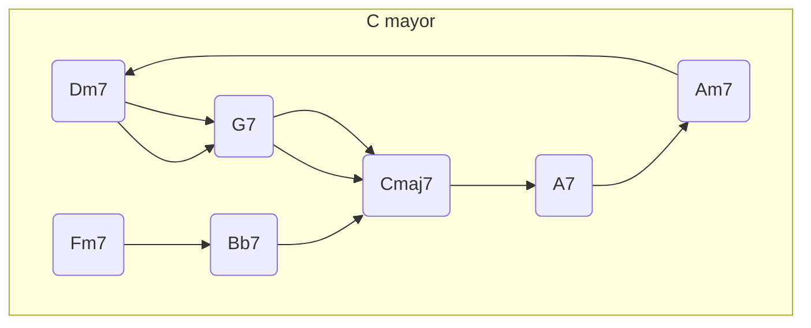

### Rutas de guías en V→I (C)

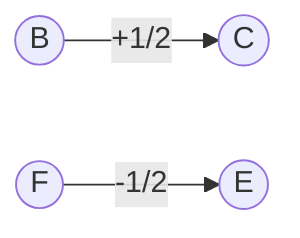

---

## Ejercicios aplicados

1. Escribe 8 compases ii–V–I anclando 3ª/7ª en tiempos fuertes; añade al menos un enclosure en la melodía.
2. Repite en menor (iiø–V7alt–i) usando dos cromatismos dirigidos a las guías.
3. Diseña un backdoor ivm7→bVII7→I manteniendo una nota común en voces internas.
4. Toma I–V–vi–IV y obliga que cada “aterrizaje” melódico sea 3ª/7ª del acorde.
5. Arregla para guitarra: guías en cuerdas 3–2, bajo en 6–5; añade 9/13 en 1ª.
6. Construye una línea de bajo: una versión caminante (4 negras), otra con pedal tónico, y una cromática G→Gb→F hacia I.

---

## Conexiones con otras notas de `Tema`

- `Repaso 6. Acordes Dominantes.md`: funciones y resoluciones canónicas de V.
- `Repaso 7. Sustitutos de tritono.md`: equivalencia de tritono y rutas intercambiadas.
- `Repaso 9. Tensiones.md`: selección de 9/11/13 y alteraciones por contexto modal.
- `Repaso 11. Voicing 2 y reglas clásicas de composición.md`, `Repaso 11.1 Voicing y reglas clásicas de coral.md`, `Repaso 11.3 Reglas voicing.md`, `Repaso 11.4 Voicing Coral paso a paso.md`: conducción clásica y duplicaciones.
- `Repaso 17. Cadencias, progresiones y líneas melódicas.md`: cierres, fraseo, dirección.

---

## Checklist final

- 3ª/7ª de cada acorde escritas y conectadas (½ tono cuando aplica).
- Bajo y textura definidos (pedal/caminante/cromático) y coherentes con el estilo.
- Voicings respetan rutas internas; sin paralelos evidentes; rangos controlados.
- Melodía ancla guías en tiempos fuertes y usa conectores claros (paso/vecinas/enclosures/retardos).
- Tensiones coherentes con función (mixolidio/alterado/lidio/menor armónica).
- Clímax y resolución planificados (1–2 compases antes del final).

- ¿Quieres que además genere una versión “por 12 tonalidades” de los ejemplos ii–V–I y iiø–V7alt–i, o preferimos transponer a Bb y E que son tonalidades frecuentes para guitarra/voz?

---

## Archivo: `1. Teoría/2. Conducción/10. Enlaces 1.0.md`

# Guía práctica — Enlaces (conexiones melódicas entre acordes)
## 1) ¿Qué son los enlaces?
Enlaces = notas de conexión entre los puntos estructurales de los acordes (especialmente 3ª y 7ª). Funcionan como notas de paso, vecinas, cromáticas o de aproximación que generan dirección hacia el siguiente acorde, preferentemente llegando por semitono a un tono guía del acorde destino.

- Objetivo: mantener continuidad y dirección; evitar saltos arbitrarios; colorear con tensiones controladas.
- Donde viven: voces internas, melodía principal o bajo melódico.


## 2) Principios que nunca fallan
- Movimiento conjunto primero; salto sólo si resuelve por movimiento contrario.
- Llegar por semitono a la 3ª o 7ª del siguiente acorde (ver `Repaso 21. Tonos guías.md`).
- Preferir notas diatónicas; usar cromáticas para intensificar dirección (apoyaturas breves, aproximaciones dobles).
- Evitar 5ªs y 8ªs paralelas en voces internas (ver `Repaso 11.x Voicing`).
- Ritmo: coloca enlaces en partes débiles y aterriza las consonancias en partes fuertes.


## 3) Tipos de enlace (vocabulario básico)
- Nota de paso diatónica: conecta dos notas por grado conjunto dentro de la escala.
- Nota de paso cromática: igual que arriba pero con un cromatismo intermedio.
- Vecina (bordadura): sale de una nota estructural, pasa por una adyacente y regresa.
- Aproximación doble (enclosure): rodea la nota objetivo por arriba y abajo (uno cromático, otro diatónico).
- Anticipación: suena antes la nota del acorde siguiente (suave en dream pop).
- Retardo/cadencia: mantiene una nota del acorde anterior que resuelve después (ver contrapunto 4ª especie).
- Escape: sale por paso y regresa por salto contrario (usar con moderación).


## 4) Marco tonal y modal para elegir notas
Usa el “modo activo” del momento: tonal mayor/menor, menor armónica/melódica, o un modo específico por intercambio modal.

- Mayor: escala mayor/jónico; color Lidio (#11) sobre I/IV para atmósferas dream pop.
- Menor natural (eólico): ideal para folk/sad; evita sensible sobre V.
- Menor armónica: sensible en V7 (b9 disponible); intensifica cadencias (ver `Repaso 4.2`).
- Menor melódica (asc.): color moderno; fuente de alteraciones sobre dominantes (ver `Repaso 4.3`).
- Dórico: m7 con 6 mayor; muy útil para ii menores modales.
- Intercambio modal: toma el acorde de la tonalidad paralela que mejor exprese la emoción (ver `Repaso 8.*`).
- Dominantes secundarios y sustitutos de tritono: rutas claras para cromatismos dirigidos (ver `Repaso 6`, `Repaso 7`).


## 5) Procedimiento paso a paso (checklist)
1. Anota los acordes y su función (ver `Repaso 17`).
2. Marca 3ª y 7ª de cada acorde (tonos guía).
3. Elige una voz a enlazar (melodía o voz interna) y define su dirección (sube/baja).
4. Selecciona el tipo de enlace: paso diatónico, cromático, vecina o aproximación doble.
5. Elige el modo/escala activo del momento (mayor, eólico, dórico, armónica, melódica, lidio, etc.).
6. Asegura llegada por semitono a 3ª/7ª del siguiente acorde cuando sea posible.
7. Comprueba paralelismos indeseados en voces internas (ver `Repaso 11.x`).
8. Decide ritmo: enlace en parte débil, consonancia en parte fuerte.
9. Documenta (ver plantilla al final): “de dónde viene”, “tensiones disponibles”, “modo activo”.


## 6) Tensiones rápidas por tipo de acorde (orientativo)
- Maj7: 9, #11 (Lidio), 13.
- m7 (eólico/dórico): 9, 11; 13 en dórico.
- 7 (mixolidio): 9, 13; alteradas desde melódica asc. (b9, #9, #11, b13) según función.
- m7b5 (locrio): 11, b13, 9 (con cuidado).
- mMaj7: 9, 11, 13 (sonoridad melancólica; pensar melódica asc.).


## 7) Ejemplos prácticos por estética

### 7.1 Dream pop (C mayor, 72–84 bpm, textura sostenida)
Progresión: Cmaj7 – Am7 – Fmaj7 – G7sus – Cmaj7

- Voz interna (3ª cuerda o registro medio):
  - Cmaj7: E → F → F# → G (aprox. cromática a 3ª de Am7)
  - Am7: G → A → Bb → A (vecina cromática breve)
  - Fmaj7: A → B (Lidio #11) → A
  - G7sus: C → B (libera la sus4 a 3ª)
  - Cmaj7: B → C

Resultado: continuidad nostálgica con un brillo Lidio en Fmaj7.

### 7.2 Folk/indie (G mayor, 92–104 bpm, arpegios)
Progresión: G – Em – C – D – G

- Melodía superior:
  - G: B → C (vecina) → B
  - Em: B → C → C# → D (paso cromático hacia D del C)
  - C: E → F → E (vecina diatónica)
  - D: F# → F#–G (anticipa G del regreso a I)

### 7.3 Menor melancólica (Am, uso de armónica/melódica)
Progresión: Am – F – Dm – E7(b9) – Am

- Voz interna:
  - Am: C → B → C (vecina con sensible prestada de melódica)
  - F: A → G# (cromático) → A
  - Dm: F → E → D
  - E7(b9): D → C# → B (llega por semitono a la 3ª: G# en la voz que corresponda)
  - Am: G# → A (resolución expresiva)


## 8) Aplicación a guitarra (rápida)
- Mantén 3ª y 7ª en cuerdas 3–4; enlaza con notas de paso en cuerdas 2–3 contiguas (medio tono = un traste).
- Para dream pop: añade add9/sus2 y usa Lidio en I/IV; desliza un semitono antes de la llegada.
- Para folk: arpegios con enlaces en contratiempo; aterriza consonancias en tiempos fuertes.


## 9) Errores comunes
- Enlace aterrizando en la 5ª cuando la 3ª o 7ª estaba disponible por semitono.
- Cromatismos sin objetivo claro (sin “nota de llegada”).
- Enlaces en tiempo fuerte y consonancias en tiempo débil (invierte la prioridad).


## 10) Micro-ejercicios (10–15 min)
1. Elige I–vi–IV–V en tu tonalidad. Diseña una voz interna que llegue por semitono a la 3ª de cada acorde.
2. Repite usando un cromatismo en cada transición.
3. Cambia a menor: usa V7(b9) desde menor armónica y crea enlace hacia la 3ª del i.
4. Aplica intercambio modal: cambia IV por iv e integra b6 como nota de paso.


## 11) Plantilla de documentación (para tus partituras/cuadernos)
- Acordes y compás: …
- Modo/escala activo: …
- Tono guía de llegada (3ª/7ª): …
- Tipo de enlace (paso/vecina/cromático/enclosure/anticipación): …
- Notas usadas y ubicación rítmica: …
- Tensiones disponibles del acorde actual: … (ver `Repaso 9. Tensiones.md`)
- Observaciones (evité paralelos, llegué por semitono, etc.): …


---
Sugerencia de estudio combinado:
1) Lee `Repaso 21. Tonos guías.md` (qué perseguir),
2) `Repaso 9. Tensiones.md` (qué colores son seguros),
3) `Repaso 5. Modos.md` y `Repaso 8.*` (qué modo activa qué notas),
4) Aplica el checklist de esta guía sobre una progresión de tu repertorio (influencias: Beach House, Bon Iver, Radiohead) y graba dos versiones: con y sin enlaces. Evalúa sensación y dirección.


Esta guía convierte la intuición de “enlaces” en un procedimiento claro y musical para conectar acordes con líneas internas y melodías expresivas. Está pensada para composición y arreglo en estilos dream pop, folk y música melancólica, y para práctica en guitarra y piano.

Relacionados en `Teoría musical/Tema`:
- `Repaso 21. Tonos guías.md` — eje de conducción (3ª y 7ª)
- `Repaso 17. Cadencias, progresiones y líneas melódicas.md`
- `Repaso 3.1 tonalidades mayores.md`, `Repaso 4.2 Armonización tonalidades menores armónicas.md`, `Repaso 4.3 Armonización tonalidades menores melódicas.md`
- `Repaso 5. Modos.md`, `Repaso 8. Intercambios modales.md`
- `Repaso 6. Acordes Dominantes.md`, `Repaso 7. Sustitutos de tritono.md`
- `Repaso 9. Tensiones.md`
- `Repaso 10–12.x Voicing*.md` — reglas y plantillas de voicing


---
Perfecto — vamos a **explicar desde cero qué son los enlaces**, cómo funcionan **exactamente** en composición **cuando tienes arpegios**, y por qué en tu ejercicio aparecen tantos movimientos entre **G y F#**.

Voy a dejar la teoría **clara, simple y aplicada**, y luego te pongo **ejemplos auditivos en ABC** para que escuches cómo se sienten los enlaces dentro de arpegios.

---

# ✅ 1. ¿QUÉ SON LOS “ENLACES” EN COMPOSICIÓN?

En composición tonal, un **enlace** es:

> **Un movimiento melódico que conecta una nota estructural con la siguiente nota estructural**, normalmente por **grado conjunto** (especialmente semitono).

O sea:

- Los **acordes** marcan los puntos importantes (estructurales).
    
- Entre esos puntos, la melodía hace movimientos **suaves** que preparan o resuelven.
    
- Esos movimientos se llaman **enlaces**.
    

### Los enlaces _no son las notas principales_, sino **cómo vas de una nota a otra.**

---

# ✅ 2. ¿POR QUÉ SON TAN IMPORTANTES CUANDO HAY ARPEGIOS?

En tu ejercicio, las voces no están sosteniendo acordes completos, sino haciendo **arpegios**.

Eso significa:

- Tus notas **cambian rápido**.
    
- No puedes depender solo del acorde completo para definir la armonía.
    
- Por lo tanto, **los enlaces se vuelven la parte estructural real** que une los arpegios.
    

En un arpegio:

- Cada nota está “sola”,
    
- pero los **movimientos entre notas** generan la **sensación de continuidad armónica**.
    

Es decir:

> **Los arpegios expresan el acorde.  
> Los enlaces expresan la lógica musical que une los acordes.**

Por eso estás sintiendo que **todo se mueve entre G y F#**:  
Eso ES el enlace tonal básico en G mayor, y aparece naturalmente en arpegios.

---

# ✅ 3. ¿POR QUÉ APARECEN TANTO G ↔ F# EN TU EJERCICIO?

Porque estás en **G mayor**.

La escala es:

- G – A – B – C – D – E – F#
    

Y en la armonía de G:

- **G** es tónica
    
- **F#** es la **sensible** (semitono abajo de G)
    

Y además:

- F# es la **3ª del acorde dominante (D)**
    
- G es la **nota que resuelve esa 3ª**
    

Entonces:

> **El semitono F# → G es el enlace melódico más importante de TODA la tonalidad.**

Por eso te salen **solos, naturales**, incluso cuando arpegias.

No está mal — es EXACTAMENTE lo que debe pasar.

Lo que falta es aprender **qué otros enlaces existen además de ese**, para enriquecer tu escritura.

---

# ✅ 4. ¿CÓMO FUNCIONAN LOS ENLACES _DENTRO DE ARPEGIOS_?

Cuando haces arpegios, cada nota del arpegio es una **nota estructural**.

Ejemplo de arpegio de Gmaj7:

G – B – D – F#

Entre cada una de estas notas puedes:

- Conectar por paso
    
- Conectar por semitono
    
- Insertar nota vecina
    
- Crear un retardo o anticipación
    
- Hacer cromatismos suaves
    
- Rodear la siguiente nota antes de llegar (enclosure)
    

### Así, tu línea melódica queda como:

**arpegio → enlace → arpegio → enlace → arpegio**

Ejemplo abstracto:

```
G   B   D   F#     ← arpegio
  A   C#   E       ← enlaces
```

Si no agregas enlaces, el arpegio se escucha rígido.  
Si agregas enlaces, el arpegio se convierte en una **melodía real**.

---

# ✅ 5. LOS 6 TIPOS DE ENLACES QUE FUNCIONAN ESPECIALMENTE BIEN EN ARPEGIOS

Aquí sí vamos a lo práctico.

### 1) **Notas de paso** (diatónicas o cromáticas)

Conectan dos notas del arpegio.

Ejemplo G → B usando A como enlace:

```abc
X:1
T:Nota de paso en arpegio
M:4/4
L:1/8
K:G
G A B d
```

---

### 2) **Notas vecinas** (bordaduras)

Sales de una nota del arpegio, haces vecina, vuelves.

Ejemplo sobre B del arpegio:

```abc
X:2
T:Vecina en arpegio
M:4/4
L:1/8
K:G
B c B d
```

---

### 3) **Aproximación cromática**

Te acercas por semitono a la siguiente nota del arpegio.

Ejemplo acercarse a G desde F#:

```abc
X:3
T:Aproximación cromática
M:4/4
L:1/8
K:G
F^F G B d
```

---

### 4) **Enclosure (doble aproximación)**

Rodeas la nota objetivo por arriba y abajo.

Objetivo: B  
Se rodea con C y A#:

```abc
X:4
T:Enclosure
M:4/4
L:1/16
K:G
c A^A B d
```

---

### 5) **Anticipación**

Metes una nota del próximo arpegio antes del cambio.

Ejemplo: vienes del arpegio de D, anticipas G de Gmaj7:

```abc
X:5
T:Anticipación
M:4/4
L:1/8
K:G
F^F G z G
```

---

### 6) **Retardo**

Mantienes una nota del arpegio anterior mientras el acorde ya cambió.

Ejemplo: se mantiene G aunque el arpegio ya pasó a D:

```abc
X:6
T:Retardo
M:4/4
L:1/8
K:G
G G F^F D
```

---

# ✅ 6. ¿POR QUÉ LOS ARPEGIOS LIMITAN LOS ENLACES?

Porque:

- Las notas del arpegio ya ocupan posiciones rítmicas importantes.
    
- Si metes muchos enlaces, puedes romper el arpegio.
    
- Si metes muy pocos, el arpegio suena rígido.
    

Por eso **la composición con arpegios es un equilibrio**:

**Arpegio (estructura)

- enlace (conexión musical)  
    = melodía fluida**
    

---

# ✅ 7. APLICADO DIRECTAMENTE A TU CASO (piano a dos voces)

### ✔ Bajo: se mueve en **F**

### ✔ Lead: se mueve en **G**

### ✔ Arpegios sobre acordes de G mayor

### ¿Qué producen esas dos voces?

1. **Pedal superior** (G constante)
    
2. **Pedal inferior** (F constante)
    

Eso significa:

- La línea superior está siempre muy cerca de F# (sensible),
    
- por eso aparece muchísimo el enlace G ↔ F#.
    

Hasta aquí, TODO correcto.

Ahora que entiendes esto, puedes enriquecer tu ejercicio introduciendo:

- Vecinas: A–G–A
    
- Pasos: E–F#–G
    
- Cromatismos: F–F#–G
    
- Enclosures: A–F#–G
    
- Anticipaciones pequeñas sobre los cambios de acorde
    

Justo los elementos que te di en ABC.

---

# ✅ 8. SI QUIERES, PUEDO ANALIZAR TUS ARPEGIOS

Si me mandas **2 compases de tu melodía o arpegios en ABC**, te digo:

- cuáles son enlaces,
    
- cuáles podrías mejorar,
    
- y dónde puedes insertar enlaces reales (no solo el semitono G ↔ F#),
    
- para que tu escritura pase de “correcta” a “musical”.
    

---

Si quieres, también puedo generarte:

🟦 una **guía visual** de cómo funcionan los enlaces dentro de arpegios  
🟦 ejemplos imitando **Dawn Chorus**  
🟦 o un **ejercicio progresivo** para que practiques crear enlaces dentro de arpegios.

---

## Archivo: `1. Teoría/2. Conducción/11. Guía de enlaces.md`

# Enlaces: qué son y qué implican realmente en composición

## 1) La idea central: “estructura” vs “conexión”

Piensa en esto:

- **Acordes = estructura** (los pilares).
    
- **Tonos guía (3ª y 7ª) = brújula** (lo que define función y dirección).
    
- **Enlaces = tejido conectivo** (la línea que “explica” cómo llegas de un pilar al otro).
    

Tu guía lo deja claro: el enlace no es “cualquier nota bonita”; es una nota (o mini‑grupo de notas) que **conduce** hacia el siguiente acorde con intención, muchas veces **por semitono** hacia **3ª o 7ª** del acorde destino.

---

## 2) Dos significados de “enlace” que en realidad son el mismo fenómeno

### A) Enlace como _conexión melódica entre acordes_ (tu “Enlaces 1.0”)

Es la idea principal de tu documento: notas entre “puntos fuertes” (guías) para mantener dirección.

- Movimiento conjunto primero; salto solo si resuelve por movimiento contrario.
    
- Llegadas por semitono a 3ª/7ª.
    
- Enlaces en partes débiles y consonancias en partes fuertes (jerarquía rítmica).
    

### B) Enlace como _conducción de voces entre acordes_ (armonía clásica / coral)

En el mundo de voicing y coral, “enlace” también se usa para describir **cómo conectas un acorde con el siguiente** (qué voces se mantienen, cuáles se mueven y en qué dirección).

Tu repaso de coral muestra tres estrategias “clásicas”:

- **Enlace por nota común** (mantener una nota compartida).
    
- **Enlace por doble nota común** (mantener dos notas).
    
- **Enlace por movimiento contrario** (las voces superiores van en dirección contraria al bajo).
    

**Traducción compositiva:**  
Tu “enlace melódico” (Enlaces 1.0) es la _micro‑escala_ (qué notas pones entre destinos).  
El “enlace coral” es la _macro‑escala_ (qué voces se mueven o se quedan para que el cambio de acorde sea suave y correcto).

Son el mismo concepto visto desde dos niveles.

---

# 3) Vocabulario real de enlaces: qué puede ser “un puente”

Tu guía te da un vocabulario base de enlaces (esto es oro porque te vuelve consciente de opciones):

- **Nota de paso diatónica** y **cromática**
    
- **Vecina/bordadura**
    
- **Aproximación doble (enclosure)**
    
- **Anticipación**
    
- **Retardo / cadencia (suspensión)**
    
- **Escape**
    

Y aquí conviene conectarlo con tu material de contrapunto/diccionario:

- En el diccionario aparecen ideas núcleo: **nota de paso** (conecta por grado conjunto), **nota auxiliar/vecina**, y “nota extraña” como nota que no pertenece al acorde.
    
- En contrapunto (en general) aparece la regla rítmica esencial: **tiempo fuerte consonante** y **tiempo débil puede ser disonante (nota de paso)**.
    

Esto no es “otra materia”: es la misma lógica aplicada a armonía moderna. Tu enlace “vive” como **disonancia controlada** que se justifica por:

1. **posición rítmica**,
    
2. **movimiento conjunto**, y
    
3. **resolución clara**.
    

---

# 4) El corazón del sistema: Tonos guía (3ª y 7ª) como destinos

Tu guía de enlaces menciona explícitamente que el enlace “apunta” a tonos guía, y tu documento de **Tonos guía** lo convierte en mapa:

En un **V → I** en Do, el ejemplo típico de resolución por semitono es:

- **B → C** (sube ½ tono)
    
- **F → E** (baja ½ tono)
    

Eso explica por qué “llegar por semitono” se siente inevitable: estás resolviendo las **tendencias** más fuertes de la función dominante.

Y el checklist de ese mismo repaso lo resume perfecto:  
conecta 3ª/7ª, define bajo/textura, evita paralelos, ancla guías en tiempos fuertes y usa conectores (paso/vecinas/enclosures/retardos), y cuida tensiones por función.

**Conclusión clave:**  
Un enlace sin “nota de llegada” (sin destino de guía) suele sonar a cromatismo aleatorio. Tu propio documento lo marca como error típico: cromatismos sin objetivo claro.

---

# 5) El otro corazón del sistema: Conducción de voces (voicing)

Para que los enlaces sean musicales, deben convivir con reglas de conducción de voces.

Tu repaso de voicing clásico define conducción de voces como el modo en que las líneas individuales se mueven de un acorde a otro, e incluye principios como:

- mover por grado conjunto cuando se pueda,
    
- mantener notas comunes,
    
- evitar saltos excesivos,
    
- asegurar independencia melódica.
    

Y también recuerda el peligro central: **quintas y octavas paralelas** / **directas**, especialmente entre voces extremas.

Esto se conecta directamente con tu guía de enlaces cuando advierte: evita paralelos en voces internas.

**Traducción práctica:**  
Un enlace puede ser genial melódicamente… y aun así arruinar el arreglo si provoca paralelismos o movimientos “pesados” entre voces.

---

# 6) “Modo activo”: enlaces dependen del contexto tonal/modal

Tu guía insiste en algo sofisticado: el enlace se elige según el **modo activo del momento** (mayor/menor, menor armónica/melódica, dórico, lidio, intercambio modal, etc.).

Esto es crucial: **la misma nota puede ser enlace “bonito” o “error”** dependiendo del modo activo.

Ejemplos (según tu guía):

- En mayor: color Lidio (#11) en I/IV para dream pop.
    
- En menor natural: evita sensible sobre V si buscas un color “modal” menos tonal.
    
- En menor armónica: aparece la sensible y b9 disponible en V7 → cadencias más intensas.
    
- En menor melódica: color moderno, fuente de alteraciones en dominantes.
    

Y esto no es solo teoría: la armonización de menor armónica muestra explícitamente el **V mayor** y el **V7** (dominante real) dentro de la escala menor armónica (ej.: en Sib menor armónica el V es F mayor y aparece F7).

---

# 7) Tensiones: cuándo un enlace es “color” y cuándo es “ruido”

Tu guía te da un mini‑mapa de tensiones seguras por tipo de acorde:

- Maj7: 9, #11 (Lidio), 13
    
- m7: 9, 11; 13 en dórico
    
- 7: 9, 13; alteradas posibles desde menor melódica ascendente  
    etc.
    

Esto conecta con tu enfoque de tonos guía donde recomiendas coherencia de tensiones por función (mixolidio/alterado/lidio/menor armónica).

**Idea esencial:**  
Un enlace no solo “rellena”; también **gestiona tensión**. Un cromatismo funciona cuando:

- está colocado en posición rítmica lógica,
    
- tiene destino claro,
    
- y su color es coherente con el acorde/función.
    

---

# 8) Ritmo: dónde cae el enlace (y por qué eso cambia todo)

Tu regla rítmica de enlaces es de las más importantes:

- Enlace en **parte débil**
    
- Consonancia/“aterrizaje” en **parte fuerte**
    

Esto está alineado con contrapunto:

- tiempo fuerte consonante, tiempo débil puede ser disonante (nota de paso).
    

Y si hablamos de retardos/suspensiones (que tu guía incluye como tipo de enlace), la cuarta especie formaliza el patrón:

- disonancia permitida en tiempo fuerte **si está ligada** desde el tiempo débil anterior,
    
- y resuelve por grado conjunto descendente (patrón Preparación‑Suspensión‑Resolución).
    

**Conclusión práctica:**  
Muchos “enlaces que suenan mal” no están mal por notas… sino por **colocación rítmica**.

---

# 9) Enlaces y estructura tonal: función, progresión y cadencia

Los enlaces no flotan; dependen del “esqueleto” armónico.

En tu guía de composición/voicing se recalca entender funciones:

- Tónica = estabilidad
    
- Subdominante = movimiento
    
- Dominante = tensión y empuje
    

Y tu repaso de familias tonales lo vuelve método:

- elegir tonalidad y escala,
    
- seleccionar acordes siguiendo flujo **Tónica → Subdominante → Dominante → Tónica**,
    
- considerar intercambios modales e inversiones para mejorar conducción de voces.
    

Esto es importante porque el enlace “bien hecho” **refuerza la función**:

- En predominante → dominante: suele aumentar dirección.
    
- En dominante → tónica: suele “resolver” (semitonos clarísimos).
    
- En tónica: puede ser más “flotante” (dream pop), con tensiones estables.
    

---

# 10) Enlace 2.0: enlazar no solo alturas… sino identidad (motivos)

Tu documento “Enlaces 2.0 y motivos” se centra en la idea de **motivo rítmico**: un patrón corto de tiempos de ataque que puedes aplicar a cualquier nota/acorde/timbre.

Esto conecta con el diccionario: motivo = pequeña unidad melódica o rítmica.

**¿Qué tiene que ver con enlaces?**  
Muchísimo: si tus enlaces son “cómo te mueves” entre acordes, el motivo es “cómo respiras” rítmicamente mientras te mueves. Un mismo enlace melódico puede sonar:

- **cantabile** (si usas células folk),
    
- **etéreo** (si lo pones en pads largos),
    
- **groovero** (si lo colocas como anticipaciones/síncopas).
    

Y tu repaso de tonos guía también aborda cómo integrar ritmo armónico y capas (bajo, pad, melodía) y sugiere anticipar cambios para dar empuje.

---

# 11) Método completo paso a paso para crear enlaces (workflow “de compositor”)

Tu guía de enlaces ya propone un checklist excelente; lo re‑ordeno y lo conecto con los demás temas:

## Paso 1 — Esqueleto armónico

1. Escribe la progresión y su función (T–S–D–T).
    

## Paso 2 — Destinos (tonos guía)

2. Marca 3ª y 7ª de cada acorde (y decide cuáles serán tus “puntos fuertes”).
    

## Paso 3 — Elige “la voz portadora”

3. Decide si el enlace vivirá en melodía, voz interna o bajo melódico.
    

## Paso 4 — Define dirección

4. Decide si esa voz tiende a subir, bajar o hacer arco (contorno).
    

## Paso 5 — Elige tipo de enlace

5. Paso, vecina, cromático, enclosure, anticipación, retardo…
    

## Paso 6 — Modo activo y tensiones

6. Decide escala/modo activo del momento (mayor, eólico, dórico, armónica, melódica, lidio, intercambio modal…).
    

## Paso 7 — Regla de oro de llegada

7. Si puedes, llega por **½ tono** a la **3ª o 7ª** del acorde destino.
    

## Paso 8 — Ritmo

8. Coloca enlace en parte débil y aterriza consonancia en parte fuerte (o usa suspensiones con preparación‑resolución).
    

## Paso 9 — Control de voicing (higiene)

9. Revisa paralelos/8vas/5tas directas y rangos; mantén notas comunes cuando convenga.
    

## Paso 10 — Documenta

10. Tu plantilla final (modo activo, tono guía de llegada, tipo de enlace, tensiones disponibles, observaciones) es exactamente lo que un compositor serio registra para repetir resultados.
    

---

# 12) Ejemplos explicados (con intención)

## Ejemplo A — El “enlace mínimo” (dirección clarísima)

**ii–V–I en C:** Dm7 → G7 → Cmaj7

- El objetivo es que el oído sienta el “tirón” del dominante al I.
    
- Piensa en las resoluciones por semitono típicas B→C y F→E.
    
- Un enlace melódico ideal aterriza en **E o B** (guías del Cmaj7) en tiempo fuerte, y usa notas de paso en subdivisiones.
    

## Ejemplo B — Menor “melancólica” con V7(b9)

Tu guía ya propone un caso de estética menor melancólica con armónica/melódica (Am – F – Dm – E7(b9) – Am) y muestra cromatismos dirigidos y resolución expresiva a A.

Aquí lo importante no es “meter G# porque sí”, sino porque en menor armónica:

- la sensible hace que la cadencia sea intensa,
    
- y el V7 admite b9 como color funcional (tu guía lo menciona).
    

## Ejemplo C — Enlace como _retardo/suspensión_ (expresividad)

Un retardo no es “ornamento”: es una disonancia preparada que resuelve por paso.  
La cuarta especie lo formula con P‑S‑R (preparación, suspensión, resolución).

En pop/jazz, esto es el típico **sus4→3** o mantener una nota “del acorde anterior” que cae después.

---

# 13) Errores comunes (y cómo corregirlos rápido)

Tu guía lista tres fallos típicos; te los traduzco a “diagnóstico compositivo”:

1. **Aterrizar en la 5ª cuando 3ª/7ª estaban disponibles**  
    → estás evitando el destino que realmente define función.
    
2. **Cromatismos sin objetivo claro**  
    → falta “nota de llegada” (guía) y por eso se siente gratuito.
    
3. **Enlaces en tiempo fuerte y consonancias en tiempo débil**  
    → invertiste la jerarquía rítmica; en contrapunto eso rompe la lógica de disonancia controlada.
    

---

# 14) Cómo practicar enlaces (rutina de 10–15 minutos con progreso real)

Tu guía ya propone micro‑ejercicios excelentes; la clave es hacerlos con enfoque:

- En I–vi–IV–V diseña una voz interna que llegue por semitono a la 3ª de cada acorde, luego repite con cromatismo en cada transición, luego pasa a menor usando V7(b9), y luego aplica intercambio modal (IV→iv e integra ♭6 como paso).
    

**Regla de oro de práctica:**  
No practiques “muchas notas”; practica **una voz** con destinos claros, y después añade capas (bajo, pads, contramelodía).

---

# 15) Una forma muy clara de resumir “todo lo involucrado”

Cuando escribes enlaces, estás tomando decisiones simultáneas en 6 capas:

1. **Armonía y función** (qué significa cada acorde en la frase)
    
2. **Destinos (tonos guía)** (3ª/7ª como puntos de aterrizaje)
    
3. **Modo activo** (qué escala gobierna el color y qué cromatismos “tienen sentido”)
    
4. **Tensiones** (qué extensiones son estables o funcionales)
    
5. **Conducción de voces** (suavidad, notas comunes, evitar paralelos)
    
6. **Ritmo/motivo** (dónde cae el enlace y cómo se integra en el groove o en la respiración del tema)
    

---

## Cierre: qué son los enlaces en una frase

**Enlaces = conducción consciente hacia destinos (guías), usando disonancia controlada (por ritmo y resolución), dentro de un modo activo y respetando la mecánica del voicing.**

Si quieres, en el siguiente mensaje puedo hacer algo muy útil y práctico:  
te tomo **una progresión tuya real** (8 compases) y te construyo **3 versiones** del mismo fragmento:

1. sin enlaces (bloques),
    
2. con enlaces diatónicos,
    
3. con enlaces cromáticos/enclosures + un motivo rítmico fijo (estilo “Enlaces 2.0”).

---

## Archivo: `1. Teoría/3. Contrapunto/0. Contrapunto.md`

# Guía Completa de Contrapunto - Repaso y Práctica

## Introducción

El contrapunto es el arte de combinar líneas melódicas independientes que suenan simultáneamente, creando una textura musical rica y equilibrada. Esta guía proporciona un repaso completo de los fundamentos del contrapunto, basada en el sistema de especies tradicional.

## Parte 1: Conceptos Fundamentales

### ¿Qué es el Contrapunto?

El contrapunto (del latín "punctus contra punctum" - nota contra nota) es una técnica compositiva que se enfoca en la relación entre líneas melódicas independientes. A diferencia de la armonía tradicional que se centra en acordes verticales, el contrapunto prioriza el movimiento horizontal de las voces.

### Elementos Básicos

1. **Canto Dado (Cantus Firmus)**

   - Melodía preexistente que sirve como base
   - Generalmente en valores largos (redondas o blancas)
   - Debe ser melódicamente equilibrada y tonalmente clara

2. **Contrapunto**
   - La línea melódica que se compone contra el canto dado
   - Puede estar por encima (contra alto) o por debajo (bajo)
   - Debe mantener independencia melódica

## Parte 2: Reglas Fundamentales del Contrapunto

### Reglas Generales

1. **Intervalos Consecutivos**

   - ❌ **Prohibido**: Más de 3 intervalos del mismo tipo consecutivos
   - ✅ **Permitido**: Máximo 3 terceras, sextas, etc. seguidas

2. **Repetición de Notas**

   - ❌ **Prohibido**: Repetir la misma nota en cualquiera de las voces
   - ✅ **Excepción**: Solo en casos específicos para resolver problemas melódicos

3. **Rango Melódico**

   - ❌ **Prohibido**: Salirse del rango de una octava
   - ✅ **Permitido**: Saltos de octava cuando sean necesarios

4. **Saltos Melódicos**
   - ✅ **Permitido**: Saltos de octava
   - ⚠️ **Cuidado**: Después de un salto grande, preferir movimiento contrario

### Intervalos Permitidos y Prohibidos

```abc
X:1
T:Intervalos en Contrapunto
M:4/4
L:1/1
K:C
%%score (T1 T2)
V:T1 clef=treble
V:T2 clef=bass
[V:T1] C D E F G A B c |
[V:T2] C, B, A, F, E, F, G, C, |
w: 8va 3ra 6ta 3ra 3ra 3ra 3ra 8va
```

**Intervalos Consonantes (Permitidos)**:

- **Consonancias Perfectas**: Unísono, 4ª justa, 5ª justa, 8ª
- **Consonancias Imperfectas**: 3ª mayor/menor, 6ª mayor/menor

**Intervalos Disonantes (Restringidos)**:

- 2ª mayor/menor, 7ª mayor/menor, 4ª aumentada, 5ª disminuida

## Parte 3: Las Cinco Especies del Contrapunto

### Primera Especie: Nota contra Nota

La especie más básica donde cada nota del canto dado corresponde a una nota del contrapunto.

#### Reglas Específicas de Primera Especie

1. **Inicio y Final**

   - ✅ **Inicio**: Octava o quinta perfecta
   - ✅ **Final**: Octava perfecta (preferible)

2. **Intervalos Intermedios**

   - ✅ **Preferidos**: Terceras y sextas
   - ⚠️ **Limitados**: Quintas y octavas (no consecutivas)

3. **Movimiento Melódico**
   - ✅ **Regla de las dos notas**: Mínimo dos notas intermedias antes de regresar a una nota ya usada
   - ❌ **Prohibido**: Arpegios en la fundamental (movimiento de abajo hacia arriba por grados del acorde)

#### Ejemplo de Primera Especie

```abc
X:2
T:Primera Especie - Ejemplo
M:4/4
L:1/1
K:C
%%score (T1 T2)
V:T1 clef=treble name="Contrapunto"
V:T2 clef=bass name="Canto Dado"
[V:T1] G A F G E F D C |
[V:T2] C, F, D, E, C, D, B,, C, |
w: 5ta 3ra 3ra 3ra 3ra 3ra 3ra 8va
```

### Segunda Especie: Dos Notas contra Una

En esta especie, el contrapunto tiene dos notas por cada nota del canto dado.

#### Reglas Específicas de Segunda Especie

1. **Tiempo Fuerte vs. Débil**

   - Tiempo fuerte: Debe ser consonante
   - Tiempo débil: Puede ser disonante (nota de paso)

2. **Notas de Paso**
   - Conectan dos consonancias por grado conjunto
   - Solo en tiempo débil

#### Ejemplo de Segunda Especie

```abc
X:3
T:Segunda Especie - Ejemplo
M:4/4
L:1/2
K:C
%%score (T1 T2)
V:T1 clef=treble name="Contrapunto"
V:T2 clef=bass name="Canto Dado"
[V:T1] G A | F G | E F | D C |
[V:T2] C,2 | F,2 | C,2 | C,2 |
```

### Tercera Especie: Cuatro Notas contra Una

El contrapunto tiene cuatro notas por cada nota del canto dado.

#### Reglas Específicas de Tercera Especie

1. **Primer y Tercer Tiempo**: Deben ser consonantes
2. **Segundo y Cuarto Tiempo**: Pueden ser disonantes (notas de paso)
3. **Cambio de Dirección**: Recomendado cada 2-3 notas

### Cuarta Especie: Síncopa

Introduce el concepto de suspensión y resolución.

#### Reglas de Síncopa

1. **Preparación**: La disonancia debe estar preparada como consonancia
2. **Suspensión**: La nota se mantiene creando disonancia
3. **Resolución**: La disonancia resuelve descendentemente por grado conjunto

### Quinta Especie: Contrapunto Florido

Combina elementos de todas las especies anteriores, permitiendo mayor libertad rítmica.

## Parte 4: Análisis de Movimientos

### Tipos de Movimiento entre Voces

Los movimientos entre voces son fundamentales para crear un contrapunto efectivo:

1. **Movimiento Contrario** ✅

   - Una voz sube mientras la otra baja
   - Es el movimiento preferido en contrapunto
   - Crea independencia melódica

2. **Movimiento Oblicuo** ✅

   - Una voz se mantiene mientras la otra se mueve
   - Siempre aceptable
   - Útil para evitar problemas de conducción

3. **Movimiento Directo** ⚠️

   - Ambas voces se mueven en la misma dirección
   - Cuidado con quintas y octavas ocultas
   - Aceptable si se evitan intervalos perfectos

4. **Movimiento Paralelo** ❌
   - Ambas voces mantienen el mismo intervalo
   - Prohibido en quintas y octavas perfectas
   - Permitido en terceras y sextas (limitadamente)

### Errores Comunes a Evitar

#### Quintas y Octavas Paralelas

```abc
X:4
T:Quintas Paralelas - INCORRECTO
M:4/4
L:1/1
K:C
%%score (T1 T2)
V:T1 clef=treble name="❌ Incorrecto"
V:T2 clef=bass name="Canto Dado"
[V:T1] G A B c |
[V:T2] C, D, E, F, |
w: 5ta 5ta 5ta 5ta
```

```abc
X:5
T:Quintas Paralelas - CORREGIDO
M:4/4
L:1/1
K:C
%%score (T1 T2)
V:T1 clef=treble name="✅ Correcto"
V:T2 clef=bass name="Canto Dado"
[V:T1] G F G A |
[V:T2] C, D, E, F, |
w: 5ta 3ra 3ra 3ra
```

#### Quintas y Octavas Ocultas

Las quintas y octavas ocultas ocurren cuando dos voces se mueven en movimiento directo hacia una quinta u octava perfecta.

```abc
X:6
T:Octavas Ocultas - Ejemplo
M:4/4
L:1/1
K:C
%%score (T1 T2)
V:T1 clef=treble name="⚠️ Oculta"
V:T2 clef=bass name="Canto Dado"
[V:T1] F G |
[V:T2] B, C, |
w: 5ta 8va
```

## Parte 5: Metodología de Práctica

### Proceso Paso a Paso para Escribir Contrapunto

#### Paso 1: Análisis del Canto Dado

1. **Identifica la tonalidad**
2. **Marca los puntos cadenciales**
3. **Observa el contorno melódico**
4. **Identifica las notas importantes** (inicio, clímax, final)

#### Paso 2: Planificación del Contrapunto

1. **Decide la posición** (superior o inferior)
2. **Establece los puntos de inicio y final**
3. **Planifica el contorno general**
4. **Identifica momentos de tensión y relajación**

#### Paso 3: Composición por Frases

1. **Trabaja frase por frase**
2. **Verifica cada intervalo**
3. **Comprueba el movimiento melódico**
4. **Revisa la independencia de las voces**

#### Paso 4: Verificación Sistemática

Utiliza esta lista de verificación:

- [ ] **Intervalos**: Solo consonancias (excepto notas de paso)
- [ ] **Movimiento**: Preferir contrario y oblicuo
- [ ] **Quintas/Octavas**: No paralelas ni ocultas problemáticas
- [ ] **Rango**: Dentro de una octava
- [ ] **Repeticiones**: Evitar repetición de notas
- [ ] **Independencia**: Cada voz tiene carácter propio

## Parte 7: Recursos Adicionales

### Compositores de Referencia

1. **Giovanni Pierluigi da Palestrina** (1525-1594)

   - Maestro del contrapunto renacentista
   - Estilo equilibrado y fluido

2. **Johann Sebastian Bach** (1685-1750)

   - Contrapunto barroco
   - "El Arte de la Fuga" como referencia suprema

3. **Johann Joseph Fux** (1660-1741)
   - "Gradus ad Parnassum" - tratado fundamental
   - Sistematización de las especies

### Términos Clave

- **Cantus Firmus**: Melodía base preexistente
- **Consonancia**: Intervalo estable y en reposo
- **Disonancia**: Intervalo inestable que requiere resolución
- **Nota de Paso**: Disonancia que conecta dos consonancias por grado conjunto
- **Síncopa**: Desplazamiento rítmico que crea suspensión
- **Imitación**: Repetición de un motivo melódico en otra voz

### Progresión de Estudio Recomendada

1. **Semanas 1-2**: Primera especie (nota contra nota)
2. **Semanas 3-4**: Segunda especie (dos contra una)
3. **Semanas 5-6**: Tercera especie (cuatro contra una)
4. **Semanas 7-8**: Cuarta especie (síncopa)
5. **Semanas 9-10**: Quinta especie (florido)
6. **Semanas 11-12**: Contrapunto a tres voces

## Conclusión

El contrapunto es una disciplina que requiere práctica constante y atención al detalle. Los principios fundamentales son:

1. **Independencia melódica** de cada voz
2. **Control riguroso** de consonancias y disonancias
3. **Movimiento preferentemente contrario** entre voces
4. **Equilibrio** entre libertad expresiva y reglas estructurales

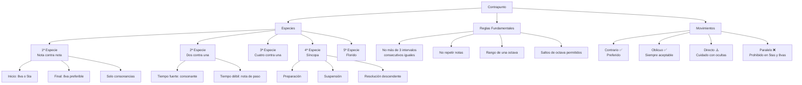

4 horas mínimo de espera

---

## Archivo: `1. Teoría/3. Contrapunto/1. Segunda especie.md`

# Guía Específica: Contrapunto de Segunda Especie

Esta guía se enfoca exclusivamente en el contrapunto de segunda especie (dos notas contra una), complementando la guía general de contrapunto. Aquí encontrarás reglas detalladas, ejemplos prácticos y un método sistemático para crear y revisar contrapunto de segunda especie.

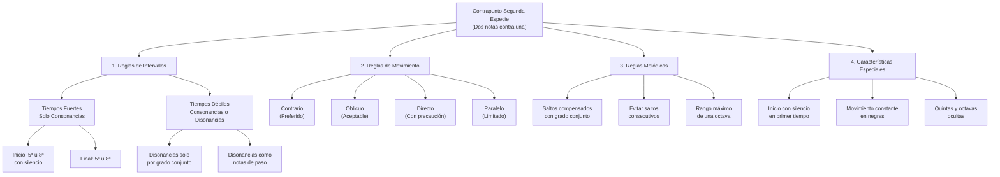

## 1. Fundamentos del Contrapunto de Segunda Especie

### 1.1 Definición

El contrapunto de segunda especie consiste en componer una línea melódica contra un canto dado (cantus firmus), donde por cada nota del canto dado hay dos notas en el contrapunto. Esta especie introduce el concepto de tiempo fuerte y tiempo débil, así como el uso controlado de disonancias.

### 1.2 Características Principales

- **Relación 2:1**: Dos notas en el contrapunto por cada nota en el canto dado
- **Inicio con silencio**: La primera nota del contrapunto se omite, comenzando con un silencio
- **Tiempos fuertes y débiles**: Distinción entre consonancias obligatorias (tiempos fuertes) y posibles disonancias (tiempos débiles)
- **Movimiento constante**: La línea contrapuntística mantiene un flujo constante de negras
- **Uso controlado de disonancias**: Introducción de disonancias como notas de paso en tiempos débiles

## 2. Reglas Específicas para Segunda Especie

### 2.1 Reglas de Intervalos Armónicos

| Posición            | Intervalos Permitidos                  | Intervalos Prohibidos               |
| ------------------- | -------------------------------------- | ----------------------------------- |
| **Tiempos Fuertes** | Unísono, 3ª, 5ª, 6ª, 8ª (consonancias) | 2ª, 4ª, 7ª, tritono (disonancias)   |
| **Tiempos Débiles** | Todos los intervalos                   | Disonancias solo como notas de paso |

#### Reglas detalladas

1. **Inicio**:

   - Comenzar con un silencio en el primer tiempo
   - Primera nota del contrapunto en tiempo débil (debe ser consonante)

2. **Final**:

   - Penúltimo compás: Puede tener dos posibilidades:
     - Opción 1: Sensible en tiempo fuerte y tónica en tiempo débil
     - Opción 2: 2º grado en tiempo fuerte y sensible en tiempo débil
   - Último compás: Unísono u octava (una sola nota que coincide con el canto dado)

3. **Consonancias y disonancias**:
   - ✅ **Tiempos fuertes**: Solo consonancias (3ª, 5ª, 6ª, 8ª)
   - ✅ **Tiempos débiles**: Consonancias o disonancias como notas de paso
   - ❌ **Prohibido**: Disonancias en tiempos fuertes
   - ❌ **Prohibido**: Disonancias en tiempos débiles que no sean por grado conjunto

Progresiones: 
- Resolución engañosa
- Tercera de picardia 
- Si mi - sol sotenido 

### 2.2 Reglas para el Uso de Disonancias

Las disonancias en segunda especie solo pueden aparecer como notas de paso en tiempos débiles y deben cumplir estas condiciones:

1. **Aproximación**: La disonancia debe venir por grado conjunto (desde una consonancia)
2. **Continuación**: La disonancia debe resolver por grado conjunto (hacia una consonancia)
3. **Posición**: Solo en tiempos débiles

**Ejemplo de nota de paso disonante correcta:**

```
Contrapunto: E  F  G  (F es disonante, pero conecta E y G por grado conjunto)
Canto dado:  C     C
Intervalos:  3ª 4ª 5ª  (4ª es disonancia en tiempo débil como nota de paso)
```

### 2.3 Reglas de Movimiento entre Voces

| Tipo de Movimiento | Descripción                                 | Uso en Segunda Especie                             |
| ------------------ | ------------------------------------------- | -------------------------------------------------- |
| **Contrario**      | Voces se mueven en direcciones opuestas     | Preferido, especialmente para resolver disonancias |
| **Oblicuo**        | Una voz se mantiene, la otra se mueve       | Aceptable en cualquier situación                   |
| **Directo**        | Ambas voces se mueven en la misma dirección | Con precaución, evitar hacia intervalos perfectos  |
| **Paralelo**       | Ambas voces mantienen el mismo intervalo    | Limitado, prohibido en quintas y octavas           |

#### Quintas y octavas ocultas o directas

En segunda especie, debemos prestar especial atención a las quintas y octavas ocultas entre tiempos fuertes consecutivos:

- ❌ **Prohibido**: Quintas u octavas paralelas entre tiempos fuertes consecutivos
- ❌ **Prohibido**: Quintas u octavas ocultas por movimiento directo (cuando ambas voces saltan)
- ✅ **Permitido**: Quintas u octavas ocultas si la voz superior se mueve por grado conjunto

### 2.4 Reglas Melódicas

1. **Saltos**:

   - ✅ **Preferidos**: Segundas y terceras (grado conjunto)
   - ✅ **Aceptables**: Cuartas, quintas y sextas (con moderación)
   - ⚠️ **Limitados**: Séptimas y octavas (máximo uno por frase)
   - ❌ **Prohibidos**: Saltos mayores que octava
   - ❌ **Prohibidos**: Dos saltos grandes consecutivos en la misma dirección
   - ✅ **Requerido**: Después de un salto grande, moverse por grado conjunto en dirección contraria

2. **Contorno melódico**:

   - ✅ **Requerido**: Equilibrio entre ascensos y descensos
   - ✅ **Requerido**: Cambio de dirección periódico
   - ❌ **Prohibido**: Patrones secuenciales obvios o repetitivos

3. **Intervalos melódicos prohibidos**:
   - ❌ **Prohibido**: Tritono melódico (cuarta aumentada/quinta disminuida)
   - ❌ **Prohibido**: Séptima mayor
   - ⚠️ **Evitar**: Saltos cromáticos

## 3. Método Paso a Paso para Segunda Especie

### 3.1 Análisis del Canto Dado

1. **Identifica la tonalidad** del canto dado
2. **Localiza los puntos cadenciales** importantes
3. **Analiza el contorno melódico** para crear un contrapunto complementario

### 3.2 Planificación del Contrapunto

1. **Decide la posición** del contrapunto (superior o inferior)
2. **Establece los puntos de anclaje**:
   - Inicio: Silencio seguido de consonancia en tiempo débil
   - Final: Planifica la cadencia final (sensible-tónica)
   - Puntos intermedios: Identifica momentos para disonancias de paso

### 3.3 Proceso de Composición

1. **Primer compás**: Comienza con silencio y una consonancia en tiempo débil
2. **Compases intermedios**:
   - Asegura consonancias en todos los tiempos fuertes
   - Introduce disonancias como notas de paso en tiempos débiles
   - Varía entre grados conjuntos y saltos compensados
3. **Cadencia final**:
   - Penúltimo compás: Sensible en tiempo débil
   - Último compás: Resolución a unísono u octava

## 4. Ejemplos Prácticos de Segunda Especie

### 4.1 Ejemplo en Do Mayor (Contrapunto Superior)

**Canto Dado (bajo):**

```
C - G - A - F - G - C
```

**Contrapunto (soprano):**

```
- G | E C | F E | D C | E D | C
```

**Análisis de intervalos:**

```
- 5ª | 6ª 3ª | 6ª 7ª | 6ª 4ª | 6ª 5ª | 8ª
```

**Tabla de análisis detallado:**

| Compás | Tiempo | Canto Dado | Contrapunto | Intervalo | Observación                     |
| ------ | ------ | ---------- | ----------- | --------- | ------------------------------- |
| 1      | 1      | C          | (silencio)  | -         | Inicio con silencio             |
| 1      | 2      | C          | G           | 5ª        | Consonancia perfecta            |
| 2      | 1      | G          | E           | 6ª        | Consonancia imperfecta          |
| 2      | 2      | G          | C           | 4ª        | Disonancia como nota de paso    |
| 3      | 1      | A          | F           | 6ª        | Consonancia imperfecta          |
| 3      | 2      | A          | E           | 5ª        | Consonancia perfecta            |
| 4      | 1      | F          | D           | 6ª        | Consonancia imperfecta          |
| 4      | 2      | F          | C           | 5ª        | Consonancia perfecta            |
| 5      | 1      | G          | E           | 6ª        | Consonancia imperfecta          |
| 5      | 2      | G          | D           | 5ª        | Consonancia perfecta            |
| 6      | 1      | C          | C           | 8ª        | Consonancia perfecta para final |

**Aspectos destacados:**

- Inicio con silencio y consonancia perfecta (5ª)
- Uso de disonancia (4ª) como nota de paso en tiempo débil (compás 2)
- Movimiento mayormente por grado conjunto
- Cadencia final con movimiento hacia la octava
- No hay quintas u octavas paralelas entre tiempos fuertes

### 4.2 Ejemplo en La menor (Contrapunto Inferior)

**Canto Dado (soprano):**

```
A - B - C - D - C - B - A
```

**Contrapunto (bajo):**

```
- E | F D | E G | A F | E G | E E | A
```

**Análisis de intervalos:**

```
- 4ª | 4ª 6ª | 6ª 4ª | 4ª 6ª | 6ª 3ª | 5ª 5ª | 8ª
```

**Aspectos destacados:**

- Inicio con silencio seguido de consonancia (4ª)
- Alternancia entre grados conjuntos y saltos compensados
- Disonancias como notas de paso en tiempos débiles
- Cadencia final con movimiento hacia la octava
- Contorno melódico complementario al canto dado

## 5. Errores Comunes y Soluciones en Segunda Especie

### 5.1 Disonancias Mal Empleadas

**Error:**

```
Contrapunto: C  A  G  (A es disonante y viene por salto desde C)
Canto dado:  F     F
Intervalos:  5ª 3ª 2ª  (3ª es disonancia en tiempo débil por salto)
```

**Solución:**

```
Contrapunto: C  B  G  (B es consonante)
Canto dado:  F     F
Intervalos:  5ª 4ª 2ª  (4ª es consonancia en este contexto)
```

### 5.2 Quintas u Octavas Paralelas entre Tiempos Fuertes

**Error:**

```
Contrapunto: G  A  E  F
Canto dado:  C     A
Intervalos:  5ª    5ª
```

**Solución:**

```
Contrapunto: G  A  C  B
Canto dado:  C     A
Intervalos:  5ª    3ª
```

### 5.3 Falta de Silencio Inicial

**Error:**

```
Contrapunto: E  F  G  A
Canto dado:  C     C
```

**Solución:**

```
Contrapunto: -  E  F  G
Canto dado:  C     C
```

## 6. Conexiones con Otros Conceptos Musicales

### 6.1 Relación con el Voicing y la Armonía

El contrapunto de segunda especie establece fundamentos importantes para:

- **Conducción de voces en acordes**: La distinción entre tiempos fuertes y débiles refleja la estructura de acordes y notas de paso en la armonía tradicional.
- **Tensión y resolución**: El uso controlado de disonancias en tiempos débiles establece el principio de tensión-resolución que es fundamental en la música tonal.
- **Voicing coral**: Las reglas de movimiento entre voces son aplicables directamente al voicing coral.

### 6.2 Conexión con Otras Especies de Contrapunto

| Especie     | Relación con Segunda Especie                                               |
| ----------- | -------------------------------------------------------------------------- |
| **Primera** | Base fundamental; segunda especie añade movimiento rítmico                 |
| **Tercera** | Extensión natural; aumenta la proporción de notas (4:1)                    |
| **Cuarta**  | Introduce síncopas y suspensiones donde la segunda introduce notas de paso |
| **Quinta**  | Incorpora elementos de segunda especie con mayor libertad rítmica          |

### 6.3 Aplicación en Composición Moderna

El contrapunto de segunda especie tiene aplicaciones prácticas en:

- **Líneas de bajo en música popular**: Creación de líneas de bajo con movimiento constante contra melodías más estáticas
- **Contramelodías**: Desarrollo de contramelodías que complementan la melodía principal
- **Arreglos instrumentales**: Distribución de voces en arreglos para conjuntos pequeños

## 7. Lista de Verificación para Segunda Especie

- [ ] **Inicio**: Silencio en primer tiempo, consonancia en tiempo débil
- [ ] **Tiempos fuertes**: Solo consonancias
- [ ] **Tiempos débiles**: Consonancias o disonancias como notas de paso
- [ ] **Disonancias**: Solo por grado conjunto en ambas direcciones
- [ ] **Quintas y octavas**: No paralelas ni directas entre tiempos fuertes
- [ ] **Movimiento melódico**: Predominantemente por grado conjunto
- [ ] **Saltos**: Compensados con movimiento contrario por grado conjunto
- [ ] **Final**: Cadencia apropiada con resolución a octava o unísono
- [ ] **Rango**: No excede una octava
- [ ] **Independencia**: Contrapunto tiene contorno melódico propio y complementario

## 8. Ejercicios Prácticos Recomendados

1. **Ejercicio básico**: Componer contrapunto de segunda especie sobre un canto dado de 4-6 notas
2. **Ejercicio de identificación**: Analizar ejemplos existentes e identificar consonancias, disonancias y notas de paso
3. **Ejercicio de corrección**: Identificar y corregir errores en ejemplos de contrapunto de segunda especie 
4. **Ejercicio de transformación**: Convertir un contrapunto de primera especie a segunda especie
5. **Ejercicio de cadencia**: Practicar diferentes opciones de cadencia para contrapunto de segunda especie

---
# Nueva guía:

Aquí tienes una **guía completa (nivel “puedo hacerlo ya”)** de **Contrapunto en Segunda Especie (2:1)** con **tablas**, **diagramas mermaid**, **plantillas**, **checklists**, y **muchos ejemplos en `music-abc`**.

> Base: tus apuntes de **Contrapunto segunda especie** (reglas, ejemplos y método) , más verificación de quintas/octavas ocultas/paralelas y metodología general de revisión .

---

## 0) Qué es (y qué NO es) la segunda especie

**Segunda especie = “dos notas contra una”**: por cada nota del **cantus firmus** (CF) escribes **2 notas** en el contrapunto. Introduce la jerarquía **tiempo fuerte / tiempo débil** y permite **disonancias controladas** .

### Estructura rítmica típica

- CF: 1 nota por compás (redonda)
    
- Contrapunto: 2 notas por compás (blancas)
    
- **Regla especial**: se empieza con **silencio** y se entra en el **tiempo débil**
    

---

## 1) El mapa mental: qué puede pasar en cada tiempo

### Tabla #1 — “Qué está permitido”

|Lugar|Regla|Qué suena bien / objetivo|
|---|---|---|
|**Tiempo fuerte** (1ª blanca del compás)|**OBLIGATORIO consonancia**|“Pilar” armónico del compás|
|**Tiempo débil** (2ª blanca)|Consonancia **o** disonancia **solo como nota de paso**|Movimiento / conexión|

### Mermaid — Flujo básico

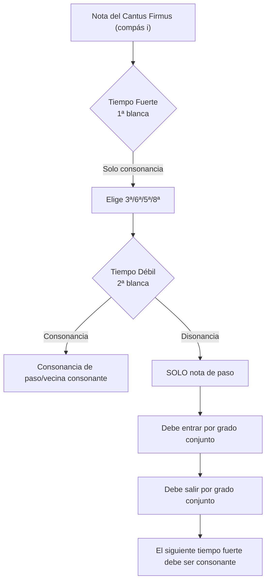

---

## 2) Intervalos: permitidos / prohibidos (la tabla que manda)

### Tabla #2 — Intervalos por posición (según tus apuntes)

|Posición|Permitidos|Prohibidos|
|---|---|---|
|**Tiempo fuerte**|Unísono, 3ª, 5ª, 6ª, 8ª|2ª, 4ª, 7ª, tritono|
|**Tiempo débil**|Todos|Disonancias **solo** si son **nota de paso**|

> Nota práctica: aunque el unísono “aparece permitido” en la tabla, en estilo severo se usa **con mucha prudencia** porque reduce independencia (ideal: reservarlo para cierre).

---

## 3) Inicio y final (fórmulas obligatorias)

### 3.1 Inicio (obligatorio)

- **Silencio en el primer tiempo**.
    
- Primera nota real del contrapunto entra en **tiempo débil** y debe ser **consonante** .
    

### 3.2 Final (obligatorio)

- **Penúltimo compás**: dos opciones típicas
    
    1. **Sensible** en tiempo fuerte → **tónica** en tiempo débil
        
    2. **2º grado** en tiempo fuerte → **sensible** en tiempo débil
        
- **Último compás**: **una sola nota** y termina en **unísono u octava** .
    

> En cadencias tonales, la **sensible tiende a resolver a tónica** (concepto-base también en tus reglas clásicas) .

---

## 4) Disonancias: solo 1 forma “legal” (nota de paso)

### Regla de oro

En segunda especie, una disonancia solo puede existir si:

1. está en **tiempo débil**
    
2. llega por **grado conjunto**
    
3. resuelve por **grado conjunto**
    
4. conecta consonancia → disonancia → consonancia
    

#### Ejemplo canónico (3ª–4ª–5ª)

(La 4ª es disonante y solo “vive” como paso)

```music-abc
X:1
T:Nota de paso disonante correcta (3-4-5)
M:4/4
L:1/2
K:C
%%score (CP CF)
V:CP clef=treble name="Contrapunto"
V:CF clef=bass  name="Cantus firmus"
[V:CF] C,1 | C,1 |
[V:CP] E2 F2 | G2 z2 |
w:3a 4a(dis) 5a
```

---

## 5) Movimiento entre voces (para que suene “independiente”)

### Tabla #3 — Tipos de movimiento y cómo usarlos

|Tipo|Uso|Regla práctica|
|---|---|---|
|Contrario|**Preferido**|Ideal para evitar perfectas seguidas|
|Oblicuo|Siempre OK|Útil para “desactivar” riesgos|
|Directo|Con precaución|Evitar caer en 5ª/8ª perfectas|
|Paralelo|Limitado|**Prohibido** si es 5ª u 8ª|

---

## 6) Quintas y octavas: paralelas y ocultas (los “fails” típicos)

### 6.1 Paralelas (prohibido)

- No puede haber **5ª→5ª** o **8ª→8ª** entre tiempos fuertes consecutivos. (También como regla general de conducción)
    

```music-abc
X:2
T:Quintas paralelas (ERROR)
M:4/4
L:1/1
K:C
%%score (CP CF)
V:CP clef=treble name="CP"
V:CF clef=bass  name="CF"
[V:CF] C, | D, |
[V:CP] G  | A  |
w:5J 5J
```

### 6.2 Ocultas / directas (cuidado extra)

Las ocultas pasan cuando dos voces van **en la misma dirección** hacia una **5ª u 8ª** perfecta .

En revisión “estilo coral”: si te ocurre, se considera error especialmente en voces extremas; entre otras voces puede tolerarse **si la voz superior va por grado conjunto** .

```music-abc
X:3
T:Octava oculta (riesgo)
M:4/4
L:1/1
K:C
%%score (CP CF)
V:CP clef=treble name="CP"
V:CF clef=bass  name="CF"
[V:CF] B, | C, |
[V:CP] F  | G  |
w:5ta -> 8va (mov. directo)
```

---

## 7) Reglas melódicas del contrapunto (para que sea “cantable”)

Aunque tu guía de 2ª especie ya resume “saltos compensados” y “rango máx. una octava” , aquí va la **lista práctica** (compatible con tu marco de reglas clásicas):

### Tabla #4 — Movimientos melódicos (permitidos / prohibidos)

|Movimiento|Estado|Nota|
|---|---|---|
|2ª (grado conjunto)|✅ ideal|“Default”|
|3ª|✅ frecuente|Buen equilibrio|
|4ª / 5ª|✅ moderación|Compensa con paso contrario|
|6ª / 8ª|⚠️ ocasional|Evita repetirlas|
|7ª|❌|Evítala|
|> 8ª|❌|Prohibido|
|Aumentados/disminuidos|❌|(salvo casos muy específicos fuera de este nivel)|

**Regla de compensación:** si saltas “grande”, vuelve con movimiento conjunto en dirección contraria (tu diagrama lo marca como “saltos compensados”) .

---

## 8) Plantillas (para componer sin perderte)

### 8.1 Plantilla vacía (2:1 sobre CF)

```text
X:10
T:Plantilla 2:1 (rellena tú)
M:4/4
L:1/2
K:C
%%score (CP CF)
V:CP clef=treble name="Contrapunto"
V:CF clef=bass  name="Cantus Firmus"
[V:CF] C,1 |    |    |    |    | C,1 |]
[V:CP] z2  ?2 | ?2 ?2 | ?2 ?2 | ?2 ?2 | ?2 ?2 | ?2 z2 |]
w:  (sil)  t.debil   fuerte debil  fuerte debil  ...   cadencia final
```

### 8.2 Librería de “células” de segunda especie (patrones seguros)

#### A) Consonancia → (paso disonante) → consonancia

```music-abc
X:11
T:Celula segura: 6-7-6 (disonancia en débil)
M:4/4
L:1/2
K:C
%%score (CP CF)
V:CF clef=bass
V:CP clef=treble
[V:CF] A,1 | A,1 |]
[V:CP] F2  G2 | F2 z2 |]
w:6a 7a(dis) 6a
```

#### B) Consonancias en ambos tiempos (sin disonancia)

```music-abc
X:12
T:Celula segura: consonancia-consonancia
M:4/4
L:1/2
K:C
%%score (CP CF)
V:CF clef=bass
V:CP clef=treble
[V:CF] G,1 | G,1 |]
[V:CP] E2  D2 | E2 z2 |]
w:6a 5a 6a
```

---

## 9) Ejemplo completo (C mayor) + análisis

Tu guía trae este ejemplo y su tabla de análisis (muy bueno para estudiar) .

### 9.1 En `music-abc`

```music-abc
X:20
T:Segunda especie - Ejemplo completo en C (CP arriba)
M:4/4
L:1/2
K:C
%%score (CP CF)
V:CP clef=treble name="Contrapunto"
V:CF clef=bass  name="Cantus Firmus"
[V:CF] C,1 | G,1 | A,1 | F,1 | G,1 | C,1 |]
[V:CP] z2  G2 | E2 C2 | F2 E2 | D2 C2 | E2 D2 | C2 z2 |]
```

### 9.2 Tabla de lectura (cómo pensar cada compás)

Esta tabla aparece en tus apuntes y resume perfecto la lógica “fuerte consonante / débil puede ser paso” .

---

## 10) Cómo usar esto para “hacer progresiones” (sin romper el estilo)

En contrapunto de especies **no piensas “acordes” primero**, piensas **líneas**. Pero para componer “sobre una progresión” puedes hacer esto:

### Método práctico: Progresión → Cantus Firmus (bajo) → Contrapunto 2:1

1. Elige una progresión (ej. I–V–vi–IV–V–I en C).
    
2. Toma el **bajo/raíz** de cada acorde como **CF** (una nota por compás).
    
3. Escribe el contrapunto 2:1 cumpliendo:
    
    - tiempo fuerte consonante
        
    - disonancia solo como paso en débil
        
    - evita paralelas/ocultas
        

#### Ejemplo rápido (solo demostración de workflow)

```music-abc
X:30
T:Progresión -> CF (raíces) -> CP 2:1 (demo)
M:4/4
L:1/2
K:C
%%score (CP CF)
V:CP clef=treble name="Contrapunto"
V:CF clef=bass  name="CF (raíces)"
% CF = C  G  A  F  G  C
[V:CF] C,1 | G,1 | A,1 | F,1 | G,1 | C,1 |]
[V:CP] z2  G2 | E2 D2 | F2 E2 | D2 C2 | E2 D2 | C2 z2 |]
```

> Importante: si tu “progresión” hace saltos raros en el bajo, tu contrapunto sufrirá. Mejor progresiones con bajos “cantables” o con movimiento por grados conjuntos.

---

## 11) Checklist final (antes de darlo por bueno)

Basado en tu método general de verificación y la guía de 2ª especie.

### Checklist #1 — estructura

-  ¿Hay silencio inicial y entrada en tiempo débil?
    
-  ¿Cada compás tiene 2 notas contra 1 del CF?
    
-  ¿Último compás tiene 1 nota (unísono u octava)?
    

### Checklist #2 — intervalos

-  ¿Todos los tiempos fuertes son consonantes?
    
-  ¿Las disonancias solo aparecen en tiempo débil y como nota de paso?
    

### Checklist #3 — conducción (los errores típicos)

-  ¿No hay 5ª/8ª paralelas?
    
-  ¿No hay 5ª/8ª ocultas problemáticas (movimiento directo a perfecta)?
    
-  ¿La línea es cantable (predominio de grado conjunto)?
    

---

## 12) Mini-kit de ejercicios (para dominarlo rápido)

1. **Ejercicio A (sin disonancias)**: escribe 8 compases 2:1 usando SOLO consonancias (fuerte y débil).
    
2. **Ejercicio B (mínimo 3 notas de paso disonantes)**: mete 3 pasos disonantes (en débil), cada uno conectando consonancias distintas.
    
3. **Ejercicio C (control de perfectas)**: obliga a que en tiempos fuertes uses principalmente **3ª/6ª** y deja 5ª/8ª para momentos puntuales.
    
4. **Ejercicio D (progresión real)**: elige una progresión simple, usa raíces como CF y crea una contramelodía 2:1 sin romper reglas.
    

---

Si me pasas **una progresión concreta** (ej. `Am – F – C – G` o lo que sea) o un **cantus firmus** que estés usando, te lo convierto en **CF + contrapunto 2:1 completo**, con **tabla de intervalos por compás** (como la de tu ejemplo) y te marco exactamente dónde hay (o no) disonancias, paralelas y ocultas.

---

## Archivo: `1. Teoría/3. Contrapunto/2. Tercera especie.md`

# Guía Específica: Contrapunto de Tercera Especie

Esta guía se enfoca exclusivamente en el contrapunto de tercera especie (cuatro notas contra una), complementando las guías anteriores de primera y segunda especie. Aquí encontrarás reglas detalladas, ejemplos prácticos y un método sistemático para crear y revisar contrapunto de tercera especie a partir de una progresión dada.

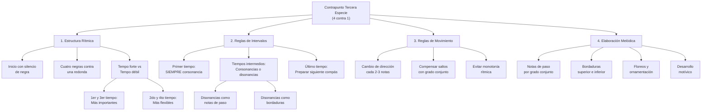

## 1. Fundamentos del Contrapunto de Tercera Especie

### 1.1 Definición

El contrapunto de tercera especie consiste en componer una línea melódica que contiene **cuatro notas (negras) contra cada nota del cantus firmus (redonda)**. Esta especie permite mayor elaboración melódica y flexibilidad rítmica que las especies anteriores, creando un flujo constante de movimiento musical.

### 1.2 Características Principales

- **Relación 4:1**: Cuatro notas en el contrapunto por cada nota en el canto dado
- **Inicio con silencio**: Comienza con un silencio de negra
- **Elaboración melódica**: Permite el uso de notas de paso, bordaduras y ornamentación
- **Flexibilidad en disonancias**: Permite disonancias en tiempos débiles como elaboración melódica
- **Movimiento constante**: Crea un flujo rítmico continuo

### 1.3 Estructura Temporal

En compás de 4/4 con redondas en el cantus firmus:

| Tiempo | Importancia | Tipo de nota permitida     | Observaciones                   |
| ------ | ----------- | -------------------------- | ------------------------------- |
| 1      | Fuerte      | Solo consonancias          | Base armónica del compás        |
| 2      | Débil       | Consonancias o disonancias | Como nota de paso o bordadura   |
| 3      | Semi-fuerte | Preferible consonancia     | Punto medio del compás          |
| 4      | Débil       | Consonancias o disonancias | Preparación al siguiente compás |

## 2. Reglas Específicas para Tercera Especie

### 2.1 Reglas de Inicio y Final

| Elemento             | Regla                                    | Ejemplo            |
| -------------------- | ---------------------------------------- | ------------------ |
| **Inicio**           | Silencio de negra + consonancia perfecta | Silencio + 5ª u 8ª |
| **Final**            | Conducción cadencial a octava            | 7ª → 8ª preferible |
| **Penúltimo compás** | Nota sensible en tiempo fuerte           | 7° grado → 1°      |
|                      |                                          |                    |

### 2.2 Reglas de Intervalos Armónicos por Tiempo

#### Primer Tiempo (Tempo Forte)

- ✅ **OBLIGATORIO**: Solo consonancias perfectas o imperfectas
- ✅ **Permitido**: 3ª, 5ª, 6ª, 8ª
- ❌ **Prohibido**: Cualquier disonancia (2ª, 4ª, 7ª, tritono)

#### Segundo y Cuarto Tiempo (Tiempos Débiles)

- ✅ **Permitido**: Consonancias perfectas e imperfectas
- ✅ **Permitido**: Disonancias como notas de paso o bordaduras
- ⚠️ **Condición**: Las disonancias deben estar entre movimientos por grado conjunto

#### Tercer Tiempo (Tempo Semi-forte)

- ✅ **Preferido**: Consonancias
- ⚠️ **Aceptable**: Disonancias ocasionales como notas de paso
- ❌ **Evitar**: Disonancias estáticas o no justificadas

### 2.3 Reglas de Movimiento Melódico

| Tipo de Movimiento              | Aplicación en Tercera Especie        | Frecuencia Recomendada |
| ------------------------------- | ------------------------------------ | ---------------------- |
| **Grado conjunto**              | Preferido para conectar consonancias | 60-70%                 |
| **Saltos pequeños** (3ª)        | Aceptables para variar el contorno   | 20-25%                 |
| **Saltos medianos** (4ª, 5ª)    | Con moderación, compensar después    | 10-15%                 |
| **Saltos grandes** (6ª, 7ª, 8ª) | Máximo uno por frase, compensar      | <5%                    |

#### Reglas específicas sobre saltos

1. **Después de saltos de 3ª o mayores**: Cambiar dirección o continuar por grado conjunto
2. **Saltos consecutivos**: Evitar dos saltos en la misma dirección
3. **Compensación obligatoria**: Después de saltos de 5ª o mayores, moverse por grado conjunto en dirección contraria
4. **Cambio de dirección**: Requerido cada 2-3 notas para evitar monotonía

### 2.4 Tratamiento de Disonancias en Tercera Especie

#### Notas de Paso

- **Ubicación**: Solo en tiempos débiles (2º y 4º tiempo)
- **Aproximación**: Por grado conjunto
- **Resolución**: Por grado conjunto en la misma dirección
- **Ejemplo**: C-D-E (donde D es disonante como nota de paso)

#### Bordaduras (Floreos)

- **Bordadura superior**: Nota consonante → paso arriba (disonante) → vuelta a nota consonante
- **Bordadura inferior**: Nota consonante → paso abajo (disonante) → vuelta a nota consonante
- **Ubicación**: Segundo y/o cuarto tiempo

#### Escapadas (Cambiatas)

- **Patrón**: Grado conjunto → salto en dirección contraria
- **Uso**: Con moderación, para crear variedad melódica
- **Ubicación**: Preferiblemente en tiempos débiles

## 3. Método Paso a Paso para Tercera Especie

### 3.1 Análisis Preparatorio

1. **Identifica la tonalidad** y el modo de la progresión
2. **Extrae el cantus firmus** (normalmente el bajo)
3. **Planifica el contorno general** del contrapunto
4. **Identifica momentos clave**: cadencias, clímax, cambios de dirección

### 3.2 Estrategia de Composición

#### Paso 1: Establece la Estructura Básica

1. **Marca el inicio**: Silencio + consonancia perfecta
2. **Planifica el final**: Cadencia con sensible → tónica
3. **Establece puntos de anclaje**: Primer tiempo de cada compás con consonancias

#### Paso 2: Crea el Contorno Melódico

1. **Define el arco general**: Ascendente, descendente, o en forma de arco
2. **Identifica el clímax**: Punto más alto o más bajo de la línea
3. **Planifica cambios de dirección**: Cada 2-3 notas aproximadamente

#### Paso 3: Completa los Tiempos Débiles

1. **Añade notas de paso** para conectar consonancias por grado conjunto
2. **Introduce bordaduras** para crear variedad e interés melódico
3. **Asegura el flujo rítmico** constante de cuatro negras por compás

### 3.3 Lista de Verificación Exhaustiva

| Categoría                | Elemento a Verificar                             | ¿Cumple? |
| ------------------------ | ------------------------------------------------ | -------- |
| **Estructura Rítmica**   | Inicia con silencio de negra                     | □        |
|                          | Mantiene patrón 4:1 consistentemente             | □        |
|                          | Termina correctamente en tiempo fuerte           | □        |
| **Intervalos Armónicos** | Primer tiempo siempre consonante                 | □        |
|                          | Disonancias solo en tiempos débiles              | □        |
|                          | Disonancias correctamente preparadas y resueltas | □        |
|                          | Final con octava o unísono                       | □        |
| **Movimiento Melódico**  | Predominio de grado conjunto                     | □        |
|                          | Saltos compensados apropiadamente                | □        |
|                          | Cambios de dirección cada 2-3 notas              | □        |
|                          | No hay dos saltos grandes consecutivos           | □        |
|                          | Rango no excede octava y media                   | □        |
| **Contrapunto**          | No hay quintas u octavas paralelas               | □        |
|                          | Equilibrio entre movimiento contrario y directo  | □        |
|                          | Independencia melódica clara                     | □        |
|                          | Un clímax melódico por frase                     | □        |

## 4. Ejemplos Detallados de Tercera Especie

### 4.1 Ejemplo Básico en Do Mayor

**Cantus Firmus (bajo):**

```
C    |    G    |    A    |    F    |    G    |    C
(redonda) (redonda) (redonda) (redonda) (redonda) (redonda)
```

**Contrapunto de Tercera Especie (soprano):**

```
Silencio | G  A  B  C | C  B  A  G | A  G  F  G | F  E  D  E | D  C
         | 1  2  3  4 | 1  2  3  4 | 1  2  3  4 | 1  2  3  4 | 1  2
```

**Análisis de intervalos por tiempo fuerte:**

```
         | 5ª        | 3ª        | 3ª        | 6ª        | 8ª
```

**Análisis detallado compás por compás:**

**Compás 1** (sobre C):

- Tiempo 1: G (5ª justa) - consonancia perfecta ✓
- Tiempo 2: A (6ª mayor) - consonancia imperfecta ✓
- Tiempo 3: B (7ª mayor) - disonancia como nota de paso ✓
- Tiempo 4: C (8ª) - consonancia perfecta ✓

**Compás 2** (sobre G):

- Tiempo 1: C (4ª justa) - **Problema**: 4ª es disonante en tiempo fuerte ❌

**Corrección del Compás 2:**

```
C  B  A  G
1  2  3  4
3ª 3ª 2ª 8ª (donde la 2ª es nota de paso en tiempo débil)
```

### 4.2 Ejemplo Corregido Completo

**Cantus Firmus (bajo):**

```
C    |    G    |    A    |    F    |    G    |    C
```

**Contrapunto Corregido (soprano):**

```
Silencio | G  A  B  C | E  D  C  B | C  B  A  B | D  C  B  C | C
         | 1  2  3  4 | 1  2  3  4 | 1  2  3  4 | 1  2  3  4 | 1
```

**Análisis de intervalos en tiempos fuertes:**

```
         | 5ª        | 6ª        | 3ª        | 5ª        | 8ª
```

**Análisis de movimiento melódico:**

- Compás 1: Ascenso por grado conjunto con bordadura superior (B como nota de paso)
- Compás 2: Descenso por grado conjunto con movimiento contrario al bajo
- Compás 3: Bordadura inferior (B-A-B) creando interés melódico
- Compás 4: Preparación cadencial con movimiento hacia la resolución
- Compás 5: Resolución final en octava

### 4.3 Ejemplo con Diferentes Tipos de Elaboración

**Cantus Firmus:**

```
D    |    A    |    F    |    G    |    A    |    D
```

**Contrapunto con Elaboraciones Variadas:**

```
Silencio | A  B  C  D | C  B  A  G | A  G  F  E | F  G  A  B | A  D
         | 1  2  3  4 | 1  2  3  4 | 1  2  3  4 | 1  2  3  4 | 1  2
```

**Tipos de elaboración identificados:**

- **Compás 1**: Ascenso escalar (grado conjunto)
- **Compás 2**: Descenso escalar con cambio de dirección
- **Compás 3**: Nota de paso (F en tiempo 3) seguida de bordadura inferior (E en tiempo 4)
- **Compás 4**: Ascenso por grado conjunto con bordadura superior
- **Compás 5**: Cadencia final con salto de 4ª compensado

## 5. Técnicas Avanzadas en Tercera Especie

### 5.1 Uso de Secuencias Melódicas

Las secuencias pueden crear coherencia e interés en el contrapunto de tercera especie:

**Ejemplo de secuencia descendente:**

```
Cantus:     G    |    F    |    E    |    D
Contrapunto: E F G A | D E F G | C D E F | B C D E
```

**Reglas para secuencias:**

- Mantener la lógica armónica en los tiempos fuertes
- No extender más de 2-3 repeticiones
- Variar el patrón para evitar monotonía

### 5.2 Integración de Elementos de Especies Anteriores

**Combinación con Primera Especie:**
Ocasionalmente puedes usar valores largos para crear contraste:

```
Contrapunto: G  A  B  C | E  (blanca)  D | C  D  E  F | D
             1  2  3  4 | 1     2     3 | 1  2  3  4 | 1
```

**Combinación con Segunda Especie:**
Usar patrones de dos negras ocasionalmente:

```
Contrapunto: G  A  (blanca) | C  B  A  G | E  F  G  A | G
             1  2      3   4 | 1  2  3  4 | 1  2  3  4 | 1
```

### 5.3 Tratamiento de Modos y Cromatismo

En contextos modales o cromáticos:

1. **Respeta las características interválicas** del modo
2. **Usa alteraciones** coherentes con el estilo
3. **Mantén la integridad modal** en los puntos estructurales

## 6. Errores Comunes y Soluciones

### 6.1 Disonancias en Tiempo Fuerte

**Error:**

```
Cantus:      C
Contrapunto: F  G  A  B  (F en tiempo 1 = 4ª justa, disonante)
             1  2  3  4
```

**Solución:**

```
Cantus:      C
Contrapunto: E  F  G  A  (E en tiempo 1 = 3ª mayor, consonante)
             1  2  3  4
```

### 6.2 Falta de Dirección Melódica

**Error (monotonía ascendente):**

```
Contrapunto: C  D  E  F | G  A  B  C | D  E  F  G
             1  2  3  4 | 1  2  3  4 | 1  2  3  4
```

**Solución (con cambios de dirección):**

```
Contrapunto: C  D  E  D | E  F  E  D | E  F  G  F
             1  2  3  4 | 1  2  3  4 | 1  2  3  4
```

### 6.3 Saltos Excesivos sin Compensación

**Error:**

```
Contrapunto: C  G  D  A  (múltiples saltos grandes)
             1  2  3  4
```

**Solución:**

```
Contrapunto: C  G  F  E  (salto compensado con descenso gradual)
             1  2  3  4
```

## 7. Aplicación Creativa

### 7.1 Adaptación a Estilos Modernos

Para aplicar tercera especie en contextos modernos:

1. **Jazz**: Usar como línea de walking bass con elaboraciones rítmicas
2. **Popular**: Crear contramelodías elaboradas
3. **Clásico-romántico**: Base para desarrollos temáticos

### 7.2 Composición de Variaciones

Usar tercera especie para crear variaciones sobre temas dados:

**Tema original:**

```
C  -  G  -  A  -  F  -  G  -  C
```

**Variación en tercera especie:**

```
Silencio | G A B C | E D C B | C B A B | D C B C | C
```

## 8. Ejercicios Prácticos

### 8.1 Ejercicio Básico

**Cantus Firmus dado:**

```
F  -  C  -  D  -  Bb  -  C  -  F
```

**Tarea:**

1. Compón un contrapunto de tercera especie superior
2. Incluye al menos una nota de paso y una bordadura
3. Analiza todos los intervalos y tipos de elaboración

### 8.2 Ejercicio Intermedio

**Cantus Firmus modal (dórico):**

```
D  -  G  -  F  -  A  -  G  -  D
```

**Tarea:**

1. Compón un contrapunto de tercera especie inferior
2. Respeta las características del modo dórico
3. Crea un contorno melódico en forma de arco

### 8.3 Ejercicio Avanzado

**Progresión armónica moderna:**

```
Am7 - Dm7 - G7 - Cmaj7
```

**Tarea:**

1. Extrae un cantus firmus de la progresión
2. Compón un contrapunto de tercera especie
3. Adapta las reglas según el contexto armónico moderno

## Conclusión

El contrapunto de tercera especie representa un paso significativo hacia la elaboración melódica completa. Al dominar el flujo constante de cuatro notas contra una, desarrollas la habilidad de crear líneas melódicas elaboradas pero estructuralmente sólidas. La clave está en equilibrar el movimiento constante con la coherencia armónica, siempre respetando la jerarquía entre tiempos fuertes y débiles.

Este fundamento te preparará para abordar la cuarta especie (síncopa) y eventualmente la quinta especie (contrapunto florido), donde podrás combinar elementos de todas las especies anteriores para crear texturas contrapuntísticas complejas y expresivas.

---

**Nota:** Esta guía complementa las guías anteriores de primera y segunda especie. Se recomienda dominar completamente las especies anteriores antes de proceder con ejercicios avanzados de tercera especie.

---

# Guía Específica Remasterizada: Contrapunto de Tercera Especie

_Basada en el método del Conservatorio Profesional de Getafe y la práctica polifónica del siglo XVI_

Esta guía remasterizada integra los principios académicos del contrapunto severo en tercera especie, enfocándose en los patrones melódicos históricos y las técnicas de composición del Renacimiento. La tercera especie representa quizá las mayores dificultades iniciales debido a que su flujo constante de negras contradice el uso establecido en la polifonía del siglo XVI, donde estos flujos eran ocasionales.

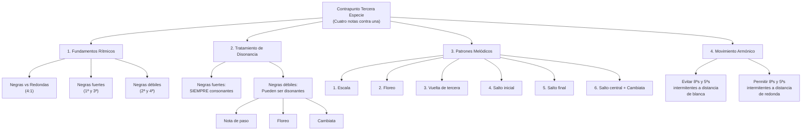

## 1. Principios Fundamentales de la Tercera Especie

### 1.1 Definición Histórica

El contrapunto de tercera especie consiste en componer una línea melódica que se mueve a **cuádruple velocidad** respecto al cantus firmus. En términos rítmicos: **negras contra redondas**. Esta especie, aunque técnicamente sencilla, presenta dificultades estilísticas particulares debido a la naturaleza excepcional de los flujos continuos de negras en la música del siglo XVI.

### 1.2 Características del Siglo XVI

En la polifonía renacentista, los flujos de negras (semínimas) eran:

- **Ocasionales**, no constantes
- **Decorativos**, para momentos de particular expresividad
- **Contextuales**, dependientes del texto y la estructura musical

El contrapunto severo en tercera especie, por tanto, representa una **abstracción pedagógica** que enfatiza el control del movimiento melódico continuo.

### 1.3 Jerarquía Temporal

| Posición en el Tactus | Denominación | Importancia | Tratamiento Armónico       |
| --------------------- | ------------ | ----------- | -------------------------- |
| **1ª negra**          | Tempo forte  | Máxima      | Solo consonancias          |
| **2ª negra**          | Tempo débil  | Mínima      | Consonancias o disonancias |
| **3ª negra**          | Tempo forte  | Alta        | Solo consonancias          |
| **4ª negra**          | Tempo débil  | Mínima      | Consonancias o disonancias |

## 2. Tratamiento de la Disonancia en Tercera Especie

### 2.1 Reglas Básicas de Disonancia

**Negras Fuertes (1ª y 3ª):**

- ✅ **OBLIGATORIO**: Siempre consonantes
- ✅ **Permitido**: 3ª, 5ª, 6ª, 8ª (incluir 4ª es disonancia)
- ❌ **Prohibido**: Cualquier disonancia

**Negras Débiles (2ª y 4ª):**

- ✅ **Permitido**: Consonancias
- ✅ **Permitido**: Disonancias correctamente tratadas
- ⚠️ **Condición**: Disonancias solo como elaboración melódica

### 2.2 Tipos de Disonancias Permitidas

#### A) Nota de Paso

- **Definición**: Disonancia formada al enlazar por grados conjuntos un marco consonante de tercera
- **Patrón**: Consonancia → grado conjunto (disonancia) → grado conjunto (consonancia)
- **Ejemplo**: C-D-E (donde D es disonante como nota de paso)

#### B) Floreo (Bordadura)

- **Definición**: Disonancia formada al realizar un movimiento de ida y vuelta a una nota vecina
- **Patrón**: Nota → vecina disonante → vuelta a la nota original
- **Tipos**: Floreo superior e inferior

#### C) Cambiata

- **Definición**: Caso especial de escapada que enlaza un marco consonante de cuarta descendente
- **Patrón**: Nota superior → segunda inferior → tercera inferior (marco de 4ª desc.)
- **Particularidad**: Técnica específica del siglo XVI de gran importancia estilística

## 3. Los Seis Patrones Melódicos Fundamentales

Según la práctica del siglo XVI, el repertorio de fórmulas melódicas en tercera especie se reduce a **seis tipos fundamentales**:

### 3.1 Patrón 1: Escala

**Descripción**: Movimiento por grados conjuntos ascendente o descendente

```
Ascendente:  C  D  E  F
Descendente: F  E  D  C
```

**Características:**

- Más simple y frecuente
- Permite integración natural de notas de paso
- Base para la mayoría de pasajes en tercera especie

### 3.2 Patrón 2: Floreo

**Descripción**: Movimiento de ornamentación alrededor de una nota central

```
Floreo superior:     C  D  C  B
Floreo inferior:     C  B  C  D
Floreo descendente:  D  C  D  E  (preferido en el s. XVI)
```

**Observaciones históricas:**

- El floreo descendente era predominante en la práctica renacentista
- Usado principalmente para momentos de particular elegancia melódica

### 3.3 Patrón 3: Vuelta de Tercera

**Descripción**: Recorrer una tercera de arriba a abajo por grados conjuntos y salto

```
Versión 1:  E  D  C  E  ✅ (Usable)
Versión 2:  E  C  D  E  ❌ (Salto ascendente en parte débil)
Versión 3:  C  D  E  C  ❌ (Salto ascendente en parte débil)
Versión 4:  C  E  D  C  ⚠️  (Problemática con cantus firmus de redondas)
```

**Limitaciones importantes:**

- Solo la primera versión es completamente usable en contrapunto severo
- Demuestra las restricciones específicas de la tercera especie
- La cuarta versión puede causar disonancias en tiempos fuertes

### 3.4 Patrón 4: Salto Inicial (2ª negra)

**Descripción**: Salto descendente en la segunda negra con diferentes continuaciones

```
Salto + relleno:      C  G  A  B
Salto + compensación: C  G  F  E
Salto + repetición:   C  G  G  A
```

**Reglas:**

- Solo saltos descendentes en posiciones débiles
- Compensar con movimiento contrario posterior
- Evitar saltos de más de quinta

### 3.5 Patrón 5: Salto Final (4ª negra)

**Descripción**: Salto descendente en la cuarta negra como cierre de línea

```
Cierre con tercera:   C  B  A  F  (seguir ascendente)
Cierre con cuarta:    C  B  A  E  (límite estilístico)
```

**Observaciones:**

- Saltos de cuarta están en el límite de lo permisible
- Requieren compensación ascendente posterior
- Los saltos de tercera son preferibles estilísticamente

### 3.6 Patrón 6: Salto Central + Cambiata

**Descripción**: Saltos en la tercera negra (mitad del compás) con énfasis en la técnica cambiata

```
Salto central simple:    C  D  G  F
Cambiata descendente:    F  E  C  D  (patrón característico)
Cambiata ascendente:     C  D  F  E  (menos común)
```

```abc
X:1
T:Cambiata simple (idea melódica)
M:4/4
L:1/4
K:C
F E C D |

```

**Importancia estilística:**

- La cambiata es fundamental en el estilo del siglo XVI
- Crea elegantes conexiones melódicas
- Debe incluirse ocasionalmente para autenticidad histórica

## 4. Reglas Específicas de Movimiento Melódico

### 4.1 Restricciones en Saltos

**Saltos Ascendentes:**

- ✅ **Permitidos**: Solo en negras fuertes (1ª y 3ª)
- ❌ **Prohibidos**: En negras débiles (2ª y 4ª)
- **Objetivo**: Evitar efectos sincopados indeseados

**Saltos Descendentes:**

- ✅ **Permitidos**: En cualquier posición
- ⚠️ **Condición**: Siempre compensar con movimiento contrario
- **Límite**: Preferiblemente no más de quinta

### 4.2 Compensación Obligatoria

**Después de saltos de 3ª o mayores:**

- Cambiar dirección inmediatamente
- Continuar por grados conjuntos preferiblemente
- No realizar saltos compuestos (varios saltos consecutivos)

**Fórmulas de integración:**

- **Ascendente**: 3-2-2... o excepcionalmente 4-2-2...
- **Descendente**: ...2-2-3 o excepcionalmente ...2-2-4
- El salto debe estar siempre en la base del movimiento

### 4.3 Repertorio Melódico Limitado

Debido a las restricciones severas, el repertorio efectivo se reduce a:

1. **60%**: Movimientos escalares (patrón 1)
2. **20%**: Floreos y bordaduras (patrón 2)
3. **10%**: Vueltas de tercera (patrón 3, versión usable)
4. **5%**: Saltos iniciales compensados (patrón 4)
5. **3%**: Saltos finales (patrón 5)
6. **2%**: Cambiatas y saltos centrales (patrón 6)

## 5. Movimiento Armónico y Quintas/Octavas

### 5.1 Regla Específica de Tercera Especie

**Octavas y quintas intermitentes:**

- ❌ **Prohibidas**: A distancia de blanca (entre negras fuertes contiguas)
- ✅ **Permitidas**: A distancia de redonda (entre negras fuertes de diferentes compases)

### 5.2 Ejemplos de Aplicación

**Problemático (distancia de blanca):**

```
Compás 1:    C     vs    C
            1ª     3ª
            8ª     8ª  ❌ (octavas intermitentes a distancia de blanca)
```

**Correcto (distancia de redonda):**

```
Compás 1:     C              Compás 2:     G
             1ª                           1ª
             8ª                           5ª  ✅
```

## 6. Metodología de Trabajo: Secuencia de 3-4 Sesiones

### 6.1 Sesión 1: Ejercicios Preparatorios

**Objetivo**: Verificar asimilación de normas y entrenar la búsqueda de soluciones

**Material**: Fragmentos de cantus firmus de **tres notas**

**Tarea**: Encontrar **dos soluciones distintas** para cada fragmento

**Ejemplo:**

```
Cantus firmus: F - G - C

Solución A: Silencio | A B C D | E D C B | E D C
Solución B: Silencio | D E F G | C B A G | G E C
```

**Criterios:**

- Usar consonancias imperfectas también en notas inicial y final (no es cantus firmus completo)
- Escribir debajo de cada nota el intervalo formado
- Maximizar movimientos por grado conjunto
- Cumplir todas las reglas de saltos

### 6.2 Sesión 2: Cantus Firmus Convencional

**Objetivo**: Aplicar reglas en contexto formal completo

**Material**: Dos cantus firmus completos

**Criterios de evaluación**:

1. **ARMONÍA**: Corrección en el tratamiento de consonancias y disonancias
2. **VARIEDAD**: Uso equilibrado de los diferentes patrones melódicos
3. **CLÍMAX**: Un punto melódico más alto o más bajo por frase
4. **SORPRESA**: Elementos inesperados que enriquezcan el discurso

**Estructura formal:**

- **Inicio**: Consonancia perfecta obligatoria
- **Desarrollo**: Aplicación variada de los 6 patrones
- **Conclusión**: Fórmula cadencial característica (ver cuarta especie)
- **Nota final**: Redonda en consonancia perfecta

### 6.3 Sesión 3: Ejercicio de Disminución

**Objetivo**: Conocer técnica improvisatoria renacentista

**Concepto**: Adaptar un contrapunto de primera especie a tercera especie

**Método**:

1. Partir de un contrapunto simple (primera especie) ya compuesto
2. El nuevo contrapunto debe pasar por las mismas notas del original
3. Si no en la primera negra, sí en alguna posterior de cada compás
4. El resultado es una ornamentación del contrapunto original

**Ejemplo:**

```
Original (1ª especie):  G    -    C    -    E    -    G
Disminución (3ª esp.):  Silencio | G A B C | C B A G | E F G A | F E D G
```

### 6.4 Sesión 4: Ejercicio Libre

**Objetivo**: Integración creativa de las tres primeras especies

**Libertades permitidas**:

- Combinar libremente primera, segunda y tercera especies
- Usar cadencias intermedias en distintos grados
- Introducir imitaciones sencillas
- Extender a piezas de mayor longitud

**Requisito práctico**: Las piezas deben poder ser cantadas o tocadas en grupo, preferiblemente con instrumentos monódicos

## 7. Análisis de Repertorio: Canciones Sacras de Orlando di Lasso

### 7.1 Material de Estudio Recomendado

**Fuente**: _Canciones sacras a dos voces_ (1577) de Orlando di Lasso

**Enfoque analítico**:

- Diseño melódico-rítmico de las voces
- Tratamiento específico de la disonancia
- Aplicación práctica de los 6 patrones melódicos
- Contexto estilístico real del siglo XVI

### 7.2 Elementos a Identificar

1. **Flujos de negras**: Cuándo y por qué se usan
2. **Patrones melódicos**: Cuáles de los 6 tipos aparecen
3. **Tratamiento de disonancias**: Notas de paso, floreos, cambiatas
4. **Integración textual**: Cómo la música sirve al texto
5. **Efectos expresivos**: Momentos de particular intensidad melódica

## 8. Ejercicios Progresivos

### 8.1 Ejercicio Básico: Cantus Firmus en Do Mayor

**Cantus Firmus dado:**

```
C  -  G  -  A  -  F  -  G  -  C
```

**Requisitos específicos:**

1. Usar al menos 4 de los 6 patrones melódicos
2. Incluir una cambiata
3. Crear un arco melódico coherente
4. Aplicar fórmula cadencial apropiada

### 8.2 Ejercicio Intermedio: Modo Dórico

**Cantus Firmus modal:**

```
D  -  G  -  F  -  A  -  G  -  D
```

**Desafíos adicionales:**

1. Respetar las características interválicas del modo dórico
2. Usar el Si♭ apropiadamente según el contexto
3. Crear contraste entre secciones ascendentes y descendentes
4. Integrar floreos característicos del modo

### 8.3 Ejercicio Avanzado: Disminución Libre

**Base (Primera especie):**

```
E  -  C  -  D  -  G  -  C
```

**Tarea de disminución:**

1. Crear versión en tercera especie que mantenga la estructura armónica
2. Usar ornamentación histórica apropiada
3. Integrar elementos de segunda especie ocasionalmente
4. Justificar cada decisión compositiva según el estilo del siglo XVI

## 9. Errores Comunes y Correcciones Históricas

### 9.1 Anachronismos Estilísticos

**Error**: Usar patrones melódicos de épocas posteriores

```
❌ Incorrecto: C D# E F G A B C (cromatismo moderno)
✅ Correcto:   C D  E F E D E F (patrón renacentista)
```

**Error**: Exceso de saltos "expresivos"

```
❌ Incorrecto: C G E C F D (demasiados saltos)
✅ Correcto:   C D E F E D C D (predominio escalar)
```

### 9.2 Problemas de Flujo Rítmico

**Error**: Crear acentos inadecuados

```
❌ Incorrecto: C E D F (saltos en tiempos débiles)
✅ Correcto:   C E F G (salto en tiempo fuerte)
```

### 9.3 Tratamiento Inadecuado de Disonancias

**Error**: Disonancias sin preparación

```
❌ Incorrecto: C F# G A (tritono sin tratamiento)
✅ Correcto:   C D  E F (nota de paso correcta)
```

## 10. Aplicación a Composición Moderna

### 10.1 Adaptación Jazz/Popular

**Principios aplicables:**

- Control del flujo melódico continuo
- Jerarquía entre tiempos fuertes y débiles
- Ornamentación sistemática de líneas básicas
- Integración de notas de paso y bordaduras

### 10.2 Líneas de Bajo Elaboradas

Usar tercera especie para crear walking bass lines:

```
Acorde: Cmaj7
Bajo básico: C
Elaboración 3ª especie: C D E F (manteniendo función armónica)
```

### 10.3 Contramelodías en Música Camerística

Aplicar patrones melódicos para crear contramelodías independientes pero complementarias en música de cámara moderna.

## Conclusión: La Tercera Especie como Puente Estilístico

El dominio de la tercera especie representa un momento crucial en el desarrollo contrapuntístico. A diferencia de las especies anteriores, aquí la técnica se encuentra directamente con las limitaciones y posibilidades expresivas del estilo histórico. Los seis patrones melódicos no son abstracciones teóricas, sino herramientas compositivas reales extraídas de la práctica musical del Renacimiento.

La aparente simplicidad del "cuatro contra uno" esconde una complejidad estilística que prepara para entender que el contrapunto no es solo técnica, sino **lenguaje musical específico de una época**. Esta comprensión será fundamental para abordar la cuarta especie (síncopa) y la quinta especie (floridus), donde la libertad compositiva debe equilibrarse con la coherencia estilística.

El repertorio limitado de fórmulas melódicas en tercera especie, lejos de ser una restricción, demuestra cómo la creatividad musical surge no de la libertad absoluta, sino del **dominio completo de un vocabulario específico**. Esta lección trasciende el contrapunto histórico y se aplica a cualquier idioma musical que se desee dominar con autenticidad y profundidad.

---

**Conexión con otros temas:** Esta guía se relaciona directamente con los contenidos de primera y segunda especie ya estudiados, y prepara para la comprensión de las reglas de voicing coral y las técnicas de ornamentación melódica que aparecen en nuestros estudios de composición moderna.

---

## Archivo: `1. Teoría/3. Contrapunto/3. Tercera especie — guía.md`

La **tercera especie** consiste en escribir una voz de **negras contra redondas** del _cantus firmus_ (velocidad ×4). Aunque en el siglo XVI los flujos continuos de negras eran más bien **ocasionales y decorativos**, en el aprendizaje se usa como “laboratorio” para dominar **control rítmico, dirección melódica y disonancia en tiempos débiles**.

---

## 1) Estructura rítmica: el “tactus” y qué tiempos importan

En cada compás (4/4), tus 4 negras no pesan igual:

|Negra|Nombre|Importancia|Regla armónica|
|---|---|--:|---|
|1ª|**tempo forte**|máxima|**solo consonancias**|
|2ª|tempo débil|mínima|consonancia **o** disonancia controlada|
|3ª|**tempo forte**|alta|**solo consonancias**|
|4ª|tempo débil|mínima|consonancia **o** disonancia controlada|

Esto es el corazón de la 3ª especie: **1 y 3 son “pilares” consonantes; 2 y 4 pueden ornamentar**.

---

## 2) Consonancia vs disonancia: la regla de oro

### Regla de oro (obligatoria)

- **Negras fuertes (1ª y 3ª): SIEMPRE consonantes.**
    
- **Negras débiles (2ª y 4ª): pueden ser disonantes**, pero **solo** si se justifican como:
    
    - **nota de paso**
        
    - **floreo/bordadura**
        
    - **cambiata**
        

### Intervalos típicos (según la guía)

En tiempos fuertes, la guía trabaja con consonancias como **3ª, 5ª, 6ª y 8ª**.

⚠️ Ojo importante del propio material: la **4ª** aquí se trata como **disonante en tiempo fuerte** (por ejemplo, sobre G en el bajo, un C arriba “4ª” en tiempo 1 se marca como problema).

---

## 3) Tratamiento de disonancias (solo en 2ª y 4ª): “qué se permite y cómo”

### 3.1 Nota de paso

Disonancia **entre dos consonancias**, conectada **por grado conjunto** (arriba o abajo). Patrón prototípico:

- Consonancia → **disonancia** → consonancia  
    Ej.: **E–F–G** (F es la disonancia)
    

### 3.2 Floreo / bordadura (vecina)

Te separas por paso a una vecina y vuelves:

- Nota base → **vecina** → nota base  
    Ej.: **C–D–C** o **C–B–C**
    

### 3.3 Cambiata (especial del estilo XVI)

Figura característica (se recomienda incluirla ocasionalmente por autenticidad):

- Cambiata descendente típica: **F–E–C–D**
    
- Cambiata ascendente (menos común): **C–D–F–E**
    

> La guía insiste en que la cambiata es **fundamental** en el estilo del siglo XVI y “debe incluirse ocasionalmente”.

---

## 4) Mini “árbol de decisión” (Mermaid) para cada negra

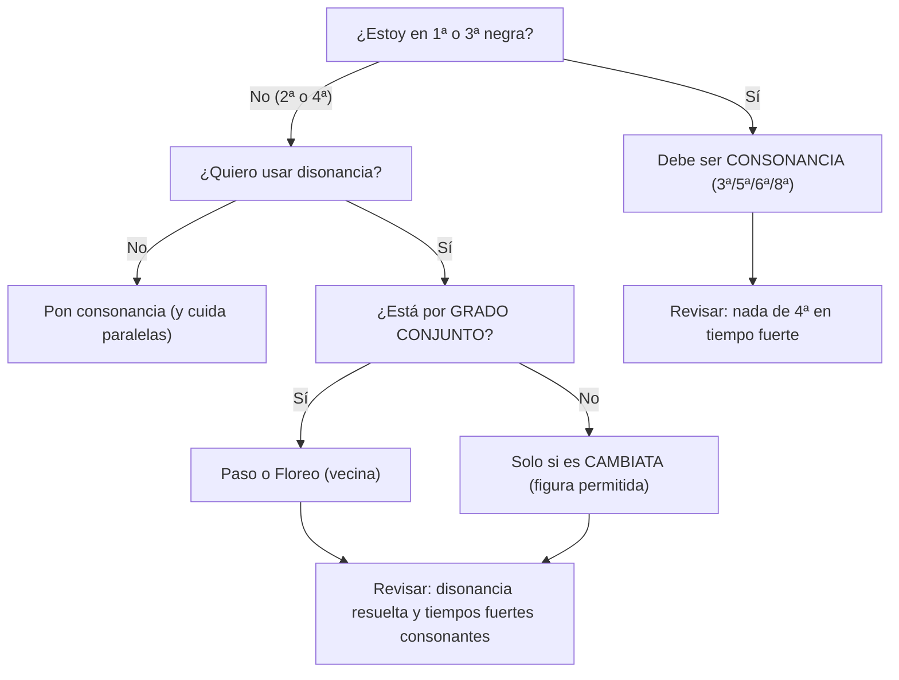

Esto resume literalmente la lógica del material: **fuerte = consonante**, **débil = consonante o disonante justificada**.

---

## 5) Vocabulario obligatorio: los **6 patrones melódicos** (y cuánto usarlos)

La guía reduce el repertorio “realmente efectivo” a estos patrones (con proporciones orientativas):

- **60%** escala (patrón 1)
    
- **20%** floreos/bordaduras (patrón 2)
    
- **10%** vueltas de tercera (patrón 3, _versión usable_)
    
- **5%** saltos iniciales compensados (patrón 4)
    
- **3%** saltos finales (patrón 5)
    
- **2%** cambiatas/saltos centrales (patrón 6)
    

### Tabla-resumen de los 6 patrones

|Patrón|Nombre|Qué hace|Riesgo típico|
|---|---|---|---|
|1|Escala|Línea continua por grado conjunto|monotonía si no cambias dirección|
|2|Floreo|Vecinas (arriba/abajo)|disonancia mal resuelta en 2ª/4ª|
|3|Vuelta de 3ª|Pequeña figura con retorno|puede forzar saltos/tiempos fuertes peligrosos si se coloca mal|
|4|Salto inicial (2ª negra)|**salto descendente** temprano + relleno|si subes con salto en débil, mal; si no compensas, mal|
|5|Salto final (4ª negra)|cierre del grupo con salto descendente|saltos de 4ª “límite”; requiere compensación|
|6|Salto central + Cambiata|salto en 3ª negra + cambiata|abusar rompe estilo; úsala “ocasionalmente”|

---

## 6) Biblioteca de patrones en **music-abc** (para que los “veas” rápido)

> Nota: son **micro-ejemplos pedagógicos**. En ejercicios reales, revisa siempre que 1ª y 3ª negras formen consonancia con el cantus.

### 6.1 Patrón 1 — Escala (C D E F)

```music-abc
X:1
T:Patrón 1 - Escala (4 negras)
M:4/4
L:1/4
K:C
C D E F |
```

Ejemplos del material: **C D E F** o **C B A G**.

---

### 6.2 Patrón 2 — Floreo (vecina)

```music-abc
X:2
T:Patrón 2 - Floreo (vecina)
M:4/4
L:1/4
K:C
C D C B |
```

Ejemplos del material: **C D C B**, **C B C D**, etc.

---

### 6.3 Patrón 3 — Vuelta de tercera (familia)

```music-abc
X:3
T:Patrón 3 - Vueltas de 3a (familia)
M:4/4
L:1/4
K:C
% Ejemplos de formas
C D C E |
E D E C |
C B C A |
```

Formas listadas: **C D C E**, **E D E C**, **C B C A**, y una versión “completa” **C D E C** marcada como problemática.

---

### 6.4 Patrón 4 — Salto inicial (2ª negra, descendente)

```music-abc
X:4
T:Patrón 4 - Salto inicial (2ª negra)
M:4/4
L:1/4
K:C
% "Salto + relleno"
C G A B |
% "Salto + compensación"
C G F E |
```

Reglas: solo **saltos descendentes** en posiciones débiles; **compensar**; evitar saltos > 5ª.

---

### 6.5 Patrón 5 — Salto final (4ª negra)

```music-abc
X:5
T:Patrón 5 - Salto final (4ª negra)
M:4/4
L:1/4
K:C
C B A F |
```

Observación del material: saltos de 4ª están “en el límite”; 3ª preferible; compensación posterior.

---

### 6.6 Patrón 6 — Salto central + Cambiata

```music-abc
X:6
T:Patrón 6 - Salto central + Cambiata
M:4/4
L:1/4
K:C
% Salto central simple
C D G F |
% Cambiata descendente (característica)
F E C D |
% Cambiata ascendente (menos común)
C D F E |
```

La cambiata se considera **fundamental** y recomendable “de vez en cuando”.

---

## 7) Reglas melódicas específicas de 3ª especie (saltos y compensaciones)

### 7.1 Saltos ascendentes vs descendentes (muy estricto)

- **Saltos ascendentes**:
    
    - ✅ permitidos **solo** en negras fuertes (1ª y 3ª)
        
    - ❌ prohibidos en negras débiles (2ª y 4ª)
        
- **Saltos descendentes**:
    
    - ✅ permitidos en cualquier posición
        
    - ⚠️ condición: **compensar siempre** con movimiento contrario
        
    - límite preferible: no más de **quinta**
        

### 7.2 Compensación obligatoria después de saltos

Después de saltos de **3ª o mayores**:

- cambia dirección inmediatamente,
    
- continúa por grados conjuntos,
    
- evita saltos compuestos (varios seguidos).
    

La guía incluso propone “fórmulas” típicas:

- Ascendente: **3–2–2…** o excepcionalmente **4–2–2…**
    
- Descendente: **…2–2–3** o excepcionalmente **…2–2–4**
    

### 7.3 Checklist melódico rápido

- Predominio de **grado conjunto**
    
- Saltos compensados
    
- Cambio de dirección cada **2–3 notas**
    
- No dos saltos grandes consecutivos
    
- Rango no excede **octava y media**
    

---

## 8) Movimiento armónico entre voces: paralelas y “intermitentes”

### 8.1 Regla general

- ❌ Nada de **quintas u octavas paralelas** (y cuidado con el directo hacia perfectas).  
    Esto aparece como principio general del contrapunto (paralelo prohibido) y se recuerda en checklist.
    

### 8.2 Regla ESPECÍFICA de 3ª especie: **quintas/octavas intermitentes**

Aquí viene lo “técnico fino”:

- ❌ Prohibidas a distancia de **blanca** (entre negras fuertes contiguas: 1ª→3ª dentro del mismo compás)
    
- ✅ Permitidas a distancia de **redonda** (entre negras fuertes de compases distintos)
    

Esto existe porque hay **dos tiempos fuertes por compás** y puedes “fabricar” perfectas repetidas sin ser paralelas estrictas… pero suenan igual de vacías.

---

## 9) Inicio, desarrollo y final (lo mínimo que no puedes romper)

La guía de trabajo formal (sesión 2) pide:

- **Inicio**: consonancia perfecta obligatoria
    
- **Desarrollo**: aplicación variada de los 6 patrones
    
- **Conclusión**: fórmula cadencial característica (se remite a cuarta especie)
    
- **Nota final**: **redonda** en consonancia perfecta
    

Y en los ejemplos de tercera especie aparece el arranque con **“Silencio | …”** (tradición de entrar después de un pequeño silencio).

---

## 10) Método paso a paso para componer (de forma “segura”)

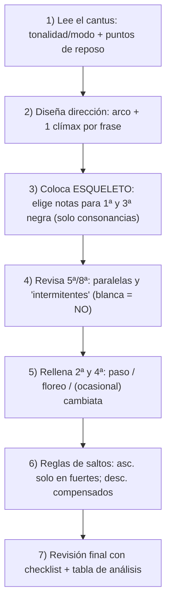

La lógica del esqueleto (tiempos fuertes consonantes) y el relleno en débiles es exactamente la esencia de la especie.

---

## 11) Plantilla de análisis (tabla “tipo conservatorio”)

Úsala para revisar **cada negra**:

|Compás|Tiempo (1-4)|CF|CP|Intervalo|¿Cons/Dis?|Si dis: ¿Paso / Floreo / Cambiata?|Nota|
|--:|--:|---|---|---|---|---|---|
|1|1|C|E|3ª|Cons ✅|—|ok|
|1|2|C|F|4ª|Dis ✅|Paso|E–F–G|
|1|3|C|G|5ª|Cons ✅|—|ok|
|1|4|C|A|6ª|Cons ✅|—|ok|

Puedes copiarla y hacer tu auditoría compás por compás.

---

## 12) Checklist final (de la propia guía)

Te la dejo como tabla compacta (basada en el checklist del documento):

|Área|Revisión|
|---|---|
|Armonía|Disonancias preparadas y resueltas; final con octava o unísono|
|Movimiento melódico|Predomina grado conjunto; saltos compensados; cambios de dirección cada 2–3 notas; no 2 saltos grandes seguidos; rango ≤ octava y media|
|Contrapunto|No hay 5ª/8ª paralelas; equilibrio entre movimiento contrario y directo; independencia clara; un clímax por frase|

---

## 13) Errores comunes (con “antídoto” inmediato)

### Error 1: disonancia en tiempo fuerte

Ejemplo del material: sobre **C** en el cantus, poner **F** en tiempo 1 crea **4ª** disonante (prohibido).  
Solución: reubicar para que el tiempo 1 sea consonante (E en 3ª).

### Error 2: falta de dirección (escala infinita hacia arriba)

Se muestra como error una subida continua (C D E F | G A B C | …).  
Solución: introducir cambios de dirección y micro-figuras para crear discurso.

### Error 3: saltos grandes sin compensación

Error: C–G–D–A (saltos grandes seguidos).  
Solución: compensar con descenso gradual tras el salto (C–G–F–E).

---

## 14) Plan de estudio “serio” (3–4 sesiones) para dominar la especie

### Sesión 1 — Fragmentos cortos (3 notas de cantus)

- Objetivo: entrenar búsqueda de soluciones y asimilación de normas.
    
- Tarea: encontrar **2 soluciones distintas** por fragmento; escribir intervalos; maximizar grado conjunto; cumplir reglas de saltos.
    

### Sesión 2 — Cantus firmus completo

Criterios de evaluación:

1. armonía (consonancia/disonancia), 2) variedad de patrones, 3) clímax por frase, 4) “sorpresa” controlada.  
    Y estructura formal: inicio perfecto, desarrollo con los 6 patrones, cadencia, nota final en perfecta.
    

### Sesión 3 — Disminución (de 1ª especie a 3ª)

Método: tomar un contrapunto de 1ª especie y “ornamentarlo” en 3ª, pasando por las mismas notas del original en cada compás (si no en la 1ª negra, en alguna posterior).

### Sesión 4 — Libre (integración 1ª–2ª–3ª)

Se permite combinar especies, cadencias intermedias, imitaciones sencillas, y ampliar longitud (siempre cantable).

---

## 15) Ejercicios progresivos (incluye aplicación a progresiones)

El documento propone:

- **Básico** (CF): `F - C - D - Bb - C - F`  
    Tarea: tercera especie superior + al menos 1 nota de paso y 1 bordadura.
    
- **Intermedio modal (dórico)** (CF): `D - G - F - A - G - D`  
    Tarea: tercera especie inferior + arco melódico.
    
- **Avanzado moderno** (progresión): `Am7 - Dm7 - G7 - Cmaj7`  
    Tarea: extraer un “cantus” de la progresión y componer tercera especie adaptando reglas al contexto armónico.
    

Y además se sugiere la aplicación creativa: jazz (walking bass), popular (contramelodías) y clásico-romántico (variaciones).

---

## 16) Truco práctico para “progresiones” (sin traicionar la lógica de especie)

Si estás sobre acordes (Am7–Dm7–G7–Cmaj7), piensa así:

- **Tiempos fuertes (1 y 3)** = **notas estructurales** (tensiones estables / chord tones / guías)
    
- **Tiempos débiles (2 y 4)** = **conectores** (paso, vecinas, cambiata) que **resuelven** hacia un tiempo fuerte consonante
    

Es literalmente el mismo principio de “pilares vs ornamentos” que define la especie.

---

Si quieres, en tu próximo mensaje pega un **cantus firmus** (6–10 notas) y te lo convierto en:

1. **esqueleto** (solo 1ª y 3ª negras),
    
2. **versión completa** en 3ª especie con patrones etiquetados (paso/floreo/cambiata),
    
3. **tabla de análisis** ya rellenada.

---

## Archivo: `1. Teoría/3. Contrapunto/4. Cuarta especie.md`

# Guía Específica: Contrapunto de Cuarta Especie (Síncopa)

_Basada en el método del Conservatorio Profesional de Getafe y la práctica polifónica del siglo XVI_

La cuarta especie, conocida como **contrapunto sincopado**, representa uno de los aspectos más expresivos y técnicamente desafiantes del contrapunto severo. Se caracteriza por el uso sistemático de **ligaduras** que crean tensiones y resoluciones, generando un efecto de suspensión armónica que ha sido fundamental en el desarrollo de la música occidental.

```mermaid
flowchart TD
    A["Contrapunto Cuarta Especie<br/>(Síncopa - 2 contra 1)"] --> B["1. Fundamentos de Síncopa"]
    A --> C["2. Ligaduras y Tensión"]
    A --> D["3. Resolución de Disonancias"]
    A --> E["4. Estructura Rítmica"]

    B --> B1["Blancas ligadas<br/>contra redondas"]
    B --> B2["Tiempo fuerte:<br/>Preparación"]
    B --> B3["Tiempo débil:<br/>Resolución"]

    C --> C1["Ligadura obligatoria<br/>tiempo débil → fuerte"]
    C --> C2["Disonancia en<br/>tiempo fuerte"]
    C --> C3["Resolución por<br/>grado descendente"]

    D --> D1["Preparación:<br/>Consonancia"]
    D --> D2["Suspensión:<br/>Disonancia ligada"]
    D --> D3["Resolución:<br/>Grado conjunto desc."]

    E --> E1["Inicio: 8ª o 5ª"]
    E --> E2["Desarrollo: Síncopas"]
    E --> E3["Final: Resolución"]
    E --> E4["Excepciones: Consonancias"]
```

## 1. Principios Fundamentales de la Cuarta Especie

### 1.1 Definición y Características

El contrapunto de cuarta especie consiste en componer una línea melódica que utiliza **blancas ligadas** contra las redondas del cantus firmus, creando un patrón rítmico de **dos contra uno** con énfasis en la **síncopa**.

**Características principales:**

- **Relación 2:1**: Dos blancas contra cada redonda del cantus firmus
- **Ligaduras sistemáticas**: La segunda blanca se liga con la primera del siguiente compás
- **Disonancias expresivas**: Permitidas y deseadas en tiempo fuerte cuando están ligadas
- **Resolución obligatoria**: Toda disonancia debe resolver por grado conjunto descendente

### 1.2 Estructura Rítmica Fundamental

```abc
X:1
T:Estructura Básica de Cuarta Especie
M:4/4
L:1/2
K:C
V:1 clef=treble name="Contrapunto"
G2 A-A B-B C-C B2 |
w:1ª 2ª-ligada 1ª-ligada 2ª-ligada 1ª-ligada 2ª
V:2 clef=bass name="Cantus Firmus"
C1 F1 G1 C1 |
```

### 1.3 Jerarquía Temporal en Cuarta Especie

| Posición      | Denominación  | Importancia | Tratamiento Armónico            | Función                |
| ------------- | ------------- | ----------- | ------------------------------- | ---------------------- |
| **1ª blanca** | Tiempo fuerte | Máxima      | Consonancia o disonancia ligada | Preparación/Suspensión |
| **2ª blanca** | Tiempo débil  | Media       | Consonancia (preparación)       | Resolución/Preparación |

## 2. Reglas Específicas de la Síncopa

### 2.1 Regla Fundamental de Ligadura

**OBLIGATORIO**: La segunda blanca de cada compás **SIEMPRE** debe ligarse con la primera blanca del compás siguiente.

```abc
X:2
T:Ligadura Correcta
M:4/4
L:1/2
K:C
G2 A-A B-B C2 |
w:✅ ✅ ✅ ✅
```

```abc
X:3
T:ERROR - Sin ligadura
M:4/4
L:1/2
K:C
G2 A2 B2 C2 |
w:❌ ❌ ❌ ❌
```

### 2.2 Tratamiento de Disonancias en Tiempo Fuerte

**Regla revolucionaria**: En cuarta especie, las **disonancias están PERMITIDAS en tiempo fuerte** si están **ligadas** desde el tiempo débil anterior.

#### Patrón de Preparación-Suspensión-Resolución

```abc
X:4
T:Patrón P-S-R (Preparación-Suspensión-Resolución)
M:4/4
L:1/2
K:C
V:1 clef=treble
C2 D-D C2 |
w:Prep. Susp. Res.
V:2 clef=bass
C1 G1 |
w:Consonancia Disonancia→Consonancia
```

**Análisis del ejemplo:**

1. **Preparación**: C (8ª) - consonancia en tiempo débil
2. **Suspensión**: D (5ª aumentada/4ª) - disonancia ligada en tiempo fuerte
3. **Resolución**: C (3ª) - consonancia por grado conjunto descendente

### 2.3 Tipos de Síncopas Principales

#### A) Síncopa de 4ª (Suspensión de 4ª)

La más común y expresiva de las síncopas:

```abc
X:5
T:Síncopa de 4ª - Ejemplo en Do Mayor
M:4/4
L:1/2
K:C
V:1 clef=treble
G2 F-F E2 |
w:Prep.(5ª) Susp.(4ª) Res.(3ª)
V:2 clef=bass
C1 C1 |
```

#### B) Síncopa de 7ª (Suspensión de 7ª)

Menos común pero muy expresiva:

```abc
X:6
T:Síncopa de 7ª - Ejemplo
M:4/4
L:1/2
K:C
V:1 clef=treble
B2 B-B A2 |
w:Prep.(7ª) Susp.(7ª) Res.(6ª)
V:2 clef=bass
C1 C1 |
```

#### C) Síncopa de 2ª (Suspensión de 2ª)

Muy disonante, uso ocasional:

```abc
X:7
T:Síncopa de 2ª - Ejemplo
M:4/4
L:1/2
K:C
V:1 clef=treble
D2 D-D C2 |
w:Prep.(2ª) Susp.(2ª) Res.(unísono)
V:2 clef=bass
C1 C1 |
```

## 3. Reglas de Inicio y Final

### 3.1 Inicio del Contrapunto

**Regla**: El contrapunto de cuarta especie debe comenzar con una **consonancia perfecta** (8ª o 5ª).

```abc
X:8
T:Inicios Correctos
M:4/4
L:1/2
K:C
V:1 clef=treble name="Opción 1 (8ª)"
C2 D-D E2 |
V:2 clef=treble name="Opción 2 (5ª)"
G2 A-A B2 |
V:3 clef=bass name="Cantus Firmus"
C1 F1 |
```

### 3.2 Final del Contrapunto

**Regla**: El contrapunto debe terminar con una **consonancia perfecta** (preferiblemente 8ª).

#### Fórmulas Cadenciales Típicas

**Cadencia con sensible:**

```abc
X:9
T:Cadencia Final - Con Sensible
M:4/4
L:1/2
K:C
V:1 clef=treble
D2 B-B C2 |
w:Prep. Sensible→Tónica
V:2 clef=bass
G1 C1 |
```

**Cadencia sin sensible añadida:**

```abc
X:10
T:Cadencia Final - Sin Sensible Añadida
M:4/4
L:1/2
K:C
V:1 clef=treble
E2 D-D C2 |
w:Prep. Susp.→Resolución
V:2 clef=bass
C1 C1 |
```

## 4. Excepciones y Variaciones

### 4.1 Consonancias en Tiempo Fuerte

**Excepción permitida**: Ocasionalmente se pueden usar **consonancias** en tiempo fuerte sin ligadura para crear variedad.

```abc
X:11
T:Consonancias Excepcionales
M:4/4
L:1/2
K:C
V:1 clef=treble
G2 A-A G2 E-E F2 |
w:Síncopa Consonancia-excepción Síncopa
V:2 clef=bass
C1 F1 G1 C1 |
```

**Reglas para las excepciones:**

- Usar con moderación (máximo 20% del contrapunto)
- Preferir consonancias imperfectas (3ª, 6ª)
- Mantener el carácter sincopado general

### 4.2 Versión "Fácil" - Disonancias sin Resolver

**Concepto**: En ejercicios preparatorios, se pueden usar disonancias en tiempo débil sin resolución obligatoria.

```abc
X:12
T:Versión Fácil - Disonancias en Tiempo Débil
M:4/4
L:1/2
K:C
V:1 clef=treble
C2 D-D E-E F2 |
w:Cons. Dis.(no-resuelve) Cons.
V:2 clef=bass
C1 C1 G1 C1 |
```

## 5. Metodología de Composición

### 5.1 Proceso de Composición en Etapas

**Etapa 1: Planificación Estructural**

1. Identificar tonalidad y modo del cantus firmus
2. Planificar inicio (8ª o 5ª) y final (8ª preferible)
3. Ubicar puntos de máxima tensión (síncopas más disonantes)
4. Diseñar el arco melódico general

**Etapa 2: Esqueleto Básico**

1. Establecer las primeras blancas de cada compás (tiempos fuertes)
2. Asegurar que el contorno melódico sea coherente
3. Planificar las resoluciones de las principales disonancias

**Etapa 3: Completar las Ligaduras**

1. Añadir las segundas blancas (tiempos débiles)
2. Crear las ligaduras sistemáticamente
3. Verificar que todas las disonancias resuelvan correctamente

**Etapa 4: Refinamiento**

1. Añadir excepciones consonantes para variedad
2. Verificar el equilibrio entre tensión y reposo
3. Asegurar la cantabilidad de la línea melódica

### 5.2 Ejemplo de Proceso Compositivo

**Cantus Firmus dado:**

```abc
X:13
T:Cantus Firmus para Cuarta Especie
M:4/4
L:1/1
K:C
C | G | A | F | G | C |]
```

**Etapa 1 - Planificación (solo tiempos fuertes):**

```abc
X:14
T:Etapa 1 - Esqueleto (Tiempos Fuertes)
M:4/4
L:1/2
K:C
V:1 clef=treble
G2 z2 E2 z2 A2 z2 D2 z2 B2 z2 C2 |
V:2 clef=bass
C1 G1 A1 F1 G1 C1 |
w:8ª→5ª 6ª→3ª 8ª→5ª 6ª→3ª 3ª→8ª Final
```

**Etapa 2 - Completar con ligaduras:**

```abc
X:15
T:Etapa 2 - Con Ligaduras Completas
M:4/4
L:1/2
K:C
V:1 clef=treble
G2 E-E A-A D-D B-B C2 |
w:Inicio Síncopa Síncopa Síncopa Síncopa Final
V:2 clef=bass
C1 G1 A1 F1 G1 C1 |
```

**Etapa 3 - Versión final con excepciones:**

```abc
X:16
T:Versión Final - Con Variaciones
M:4/4
L:1/2
K:C
V:1 clef=treble
G2 E-E F2 D-D B-B C2 |
w:Inicio Síncopa Excepción-consonante Síncopa Síncopa Final
V:2 clef=bass
C1 G1 A1 F1 G1 C1 |
```

## 6. Análisis de Ejemplo Completo

### 6.1 Análisis Detallado del Ejemplo

**Compás 1 (sobre C)**:

- 1ª blanca: G (5ª justa) - consonancia perfecta de inicio ✓
- 2ª blanca: E (3ª mayor) - preparación para la siguiente síncopa ✓

**Compás 2 (sobre G)**:

- 1ª blanca: E ligada (6ª mayor) - consonancia, pero crea tensión melódica ✓
- 2ª blanca: F (7ª menor) - **EXCEPCIÓN**: consonancia sin ligadura para variedad ✓

**Compás 3 (sobre A)**:

- 1ª blanca: F (6ª menor) - consonancia imperfecta ✓
- 2ª blanca: D (4ª justa) - preparación para síncopa disonante ✓

**Compás 4 (sobre F)**:

- 1ª blanca: D ligada (6ª mayor) - consonancia ligada ✓
- 2ª blanca: B (4ª aumentada/tritono) - preparación muy disonante ✓

**Compás 5 (sobre G)**:

- 1ª blanca: B ligada (3ª mayor) - resolución de la disonancia anterior ✓
- 2ª blanca: C (4ª justa) - preparación para cadencia final ✓

**Compás 6 (sobre C)**:

- Final: C (8ª) - resolución cadencial perfecta ✓

### 6.2 Elementos Técnicos Destacados

1. **Arco melódico**: Ascenso gradual hasta F, luego descenso hacia la resolución
2. **Variedad rítmica**: Combinación de síncopas y excepciones consonantes
3. **Tensión controlada**: Uso del tritono (B sobre F) como punto de máxima tensión
4. **Resolución cadencial**: Preparación y resolución final efectiva

## 7. Conexiones con Otros Temas Musicales

### 7.1 Relación con el Jazz y la Armonía Moderna

El contrapunto de cuarta especie es **fundamental** para entender:

**Suspensiones en jazz**:

```abc
X:17
T:Suspensión 4-3 en Jazz (Cmaj7sus4 → Cmaj7)
M:4/4
L:1/2
K:C
V:1 clef=treble
F2 F-F E2 |
w:Sus4 Resolución-a-3ª
V:2 clef=bass
C1 C1 |
```

**Walking bass con síncopas**:

```abc
X:18
T:Walking Bass Sincopado
M:4/4
L:1/2
K:C
V:1 clef=treble
G2 A-A B-B C2 |
V:2 clef=bass
C2 F-F G-G C2 |
w:Línea-sincopada-en-bajo
```

### 7.2 Aplicación a Géneros de tu Interés

**Dream Pop (estilo Beach House)**:
Las síncopas crean la **atmósfera etérea** característica:

```abc
X:19
T:Síncopa Etérea - Estilo Dream Pop
M:4/4
L:1/2
K:C
V:1 clef=treble
[V:1] E2 | F-F | E-E | D2 |
w:Suspensión-suave Resolución-melancólica
V:2 clef=bass
[V:2] "C"C2 | "Am"A2 | "F"F2 | "G"G2 |
```

**Folk Melancólico (estilo Bon Iver)**:
Síncopas que crean **tensión emocional**:

```abc
X:20
T:Síncopa Folk - Estilo Melancólico
M:4/4
L:1/2
K:C
V:1 clef=treble
G2 A-A G-G F2 |
w:Tensión-nostálgica Resolución-descendente
V:2 clef=bass
C1 F1 |
```

### 7.3 Conexión con Familias Tonales [[memoria:4888487]]

Las síncopas pueden aplicarse sobre **cadencias básicas**:

**Cadencia 2-5-1 con síncopas**:

```abc
X:21
T:Cadencia 2-5-1 Sincopada
M:4/4
L:1/2
K:C
V:1 clef=treble
A2 B-B C2 |
w:ii V-I con-síncopa
V:2 clef=bass
D1 G1 C1 |
```

## 8. Ejercicios Progresivos

### 8.1 Ejercicio Básico: Cantus Firmus Corto

**Cantus Firmus:**

```abc
X:22
T:Ejercicio Básico - CF Corto
M:4/4
L:1/1
K:C
C | F | G | C |]
```

**Requisitos:**

1. Comenzar con consonancia perfecta (8ª o 5ª)
2. Incluir al menos dos síncopas disonantes
3. Terminar con cadencia en octava
4. Usar una excepción consonante

### 8.2 Ejercicio Intermedio: Modo Menor

**Cantus Firmus en La menor:**

```abc
X:23
T:Ejercicio Intermedio - La Menor
M:4/4
L:1/1
K:Am
A | E | F | G | E | A |]
```

**Desafíos adicionales:**

1. Respetar las características del modo menor
2. Usar la sensible (G#) apropiadamente en la cadencia
3. Crear contraste entre secciones tensas y relajadas
4. Integrar al menos una síncopa de 7ª

### 8.3 Ejercicio Avanzado: Cantus Firmus Modal

**Cantus Firmus en Modo Dórico:**

```abc
X:24
T:Ejercicio Avanzado - Modo Dórico
M:4/4
L:1/1
K:D dor
D | G | F | A | G | D |]
```

**Objetivos:**

1. Mantener el carácter modal (evitar sensible moderna)
2. Usar el Bb característico del modo dórico
3. Crear múltiples puntos de tensión sincopada
4. Demostrar dominio completo de la cuarta especie

## 9. Errores Comunes y Correcciones

### 9.1 Falta de Ligaduras

**❌ Error**: Usar blancas sin ligar

```abc
X:25
T:INCORRECTO - Sin ligaduras
M:4/4
L:1/2
K:C
G2 A2 B2 C2 |
w:❌ ❌ ❌ ❌
```

**✅ Corrección**: Ligar sistemáticamente

```abc
X:26
T:CORRECTO - Con ligaduras
M:4/4
L:1/2
K:C
G2 A-A B-B C2 |
w:✅ ✅ ✅ ✅
```

### 9.2 Resolución Incorrecta de Disonancias

**❌ Error**: Disonancia que no resuelve por grado conjunto descendente

```abc
X:27
T:INCORRECTO - Resolución por salto
M:4/4
L:1/2
K:C
V:1 clef=treble
C2 D-D E2 |
w:❌ Salto-ascendente
V:2 clef=bass
C1 G1 |
```

**✅ Corrección**: Resolución por grado conjunto descendente

```abc
X:28
T:CORRECTO - Resolución descendente
M:4/4
L:1/2
K:C
V:1 clef=treble
E2 D-D C2 |
w:✅ Grado-conjunto-descendente
V:2 clef=bass
C1 G1 |
```

### 9.3 Exceso de Excepciones

**❌ Error**: Demasiadas consonancias sin ligar

```abc
X:29
T:INCORRECTO - Exceso de excepciones
M:4/4
L:1/2
K:C
G2 A2 B2 C2 E2 F2 |
w:❌ Pierde-carácter-sincopado
```

**✅ Corrección**: Equilibrio entre síncopas y excepciones

```abc
X:30
T:CORRECTO - Equilibrio apropiado
M:4/4
L:1/2
K:C
G2 A-A B2 C-C E-E F2 |
w:✅ Síncopa Excepción Síncopa Síncopa
```

## 10. Aplicación a Composición Moderna

### 10.1 Suspensiones en Progresiones Contemporáneas

**Progresión vi-IV-I-V con suspensiones**:

```abc
X:31
T:Progresión Moderna con Suspensiones
M:4/4
L:1/2
K:C
V:1 clef=treble
[V:1] G2 | A-A | G-G | F2 |
w:Sus4→3 Sus2→1 Sus4→3
V:2 clef=bass
[V:2] "Am"A2 | "F"F2 | "C"C2 | "G"G2 |
```

### 10.2 Líneas de Bajo Sincopadas

Para crear **walking bass** con carácter sincopado:

```abc
X:32
T:Walking Bass Sincopado - Estilo Jazz
M:4/4
L:1/2
K:C
V:1 clef=treble
C2 D-D E-E F2 |
V:2 clef=bass
C2 F-F G-G C2 |
w:Líneas-paralelas-sincopadas
```

### 10.3 Contramelodías Expresivas

Usar cuarta especie para crear **contramelodías** en música camerística:

```abc
X:33
T:Contramelodía Sincopada
M:4/4
L:1/2
K:C
V:1 clef=treble name="Melodía Principal"
C2 D2 E2 F2 |
V:2 clef=treble name="Contramelodía Sincopada"
E2 F-F G-G A2 |
```

## 11. Tabla de Referencia Rápida

### 11.1 Reglas Esenciales

| Elemento        | Regla                                   | Ejemplo                 |
| --------------- | --------------------------------------- | ----------------------- |
| **Ligaduras**   | Siempre 2ª blanca → 1ª blanca siguiente | G2 A-A                  |
| **Inicio**      | 8ª o 5ª                                 | C o G sobre C           |
| **Final**       | 8ª preferible                           | C sobre C               |
| **Disonancias** | Solo si están ligadas                   | D-D sobre C (4ª ligada) |
| **Resolución**  | Grado conjunto descendente              | D-D C sobre C-G         |
| **Excepciones** | Máximo 20% consonancias sin ligar       | Ocasional               |

### 11.2 Tipos de Síncopas

| Tipo   | Intervalo | Preparación  | Suspensión | Resolución | Uso       |
| ------ | --------- | ------------ | ---------- | ---------- | --------- |
| **4ª** | 4ª justa  | 5ª o 3ª      | 4ª         | 3ª         | Muy común |
| **7ª** | 7ª menor  | 8ª o 6ª      | 7ª         | 6ª         | Moderado  |
| **2ª** | 2ª mayor  | 3ª o unísono | 2ª         | unísono    | Ocasional |
| **9ª** | 9ª mayor  | 8ª           | 9ª         | 8ª         | Raro      |

## 12. Análisis de Repertorio Recomendado

### 12.1 Fuentes Históricas

**Palestrina - Missa Papae Marcelli**:

- Uso magistral de suspensiones 4-3
- Integración con otras especies
- Efectos expresivos en el texto

**J.S. Bach - Invenciones a dos voces**:

- Adaptación de la síncopa al estilo barroco
- Combinación con ornamentación
- Desarrollo motívico con síncopas

### 12.2 Aplicaciones Modernas

**Jazz Standards**:

- "Body and Soul" - suspensiones características
- "Autumn Leaves" - líneas sincopadas
- "All The Things You Are" - resoluciones cromáticas

**Música Popular Contemporánea**:

- Beach House - "Space Song" (síncopas etéreas)
- Bon Iver - "Holocene" (suspensiones melancólicas)
- Radiohead - "Exit Music" (tensiones sincopadas)

## Conclusión: La Síncopa como Lenguaje Expresivo

El contrapunto de cuarta especie representa un **punto de inflexión** en el aprendizaje contrapuntístico. Por primera vez, las disonancias no solo están permitidas en tiempo fuerte, sino que son **deseadas** y **expresivamente necesarias**. Esta aparente contradicción con las especies anteriores enseña una lección fundamental: **las reglas musicales no son absolutas, sino contextuales**.

La síncopa, como técnica compositiva, trasciende épocas y estilos. Desde las suspensiones de Palestrina hasta las tensiones del jazz moderno, desde las líneas etéreas del Dream Pop hasta las melancolías del Folk contemporáneo, la cuarta especie proporciona un **vocabulario expresivo** que conecta directamente con la **emoción musical**.

Para tu desarrollo como compositor en los géneros que te interesan, el dominio de la síncopa te permitirá:

1. **Crear tensión controlada**: Fundamental para la música melancólica
2. **Desarrollar líneas expresivas**: Esencial para contramelodías sofisticadas
3. **Comprender la suspensión armónica**: Base para progresiones emotivas
4. **Integrar tradición y modernidad**: Conectar técnicas históricas con sonoridades contemporáneas

El **reinicio emocional** que crea cada síncopa - esa sensación de suspensión seguida de resolución - es análogo al **reinicio formal** que estudiamos en quinta especie, pero opera a nivel **micro-estructural**, creando un pulso expresivo que da vida a la música.

---

**Conexión con otros temas**: Esta guía se conecta directamente con el **sistema de familias tonales** para crear melodías sincopadas sobre cadencias básicas, con las **técnicas de voicing coral** para integrar suspensiones en texturas homofónicas, y con el **contrapunto floridus** donde las síncopas se combinan con otras especies para crear texturas de máxima complejidad expresiva.


----
# Guía **súper mega** del Contrapunto de **4ª Especie** (Síncopa / Suspensiones)

La **cuarta especie** (también llamada **contrapunto sincopado**) es el entrenamiento “oficial” para dominar **suspensiones**: crear tensión manteniendo una nota (ligadura) y resolverla con elegancia. En tus notas se describe como un **2 contra 1** (dos blancas contra cada redonda del cantus firmus) con **ligaduras sistemáticas**, donde la disonancia en tiempo fuerte **se permite** si viene **ligada**, y toda disonancia debe **resolver descendiendo por grado conjunto**.

---

## 0) Diccionario express (para que tu alumno no se pierda)

|Término|En cristiano|Lo que significa en 4ª especie|
|---|---|---|
|**Cantus firmus (CF)**|“melodía base”|La voz dada (normalmente en **redondas**)|
|**Síncopa**|acento “corridito”|Acentuación de tiempos débiles / desplazamiento rítmico|
|**Suspensión**|“me quedo pegado”|Nota que se mantiene y resuelve **descendiendo**|
|**Retardación**|“me quedo pegado” (pero al revés)|Mantener y resolver **ascendiendo** (útil como extra, no es lo típico aquí)|
|**Consonancia / Disonancia**|estable / inestable|La disonancia **exige** resolución|

> Nota importante para esta guía: asumiré el caso clásico de especie: **CF abajo** (bajo) en redondas y **contrapunto arriba** en blancas (2:1) con ligaduras.

---

## 1) El “motor” de la 4ª especie: la **ligadura obligatoria**

### Regla #1 (la que manda)

**OBLIGATORIO**: _La segunda blanca de cada compás SIEMPRE debe ligarse con la primera blanca del compás siguiente._

Si no haces esto… ya no es 4ª especie (o al menos pierdes el carácter sincopado).

### Ejemplo (correcto vs incorrecto)

```music-abc
X:1
T:Ligadura obligatoria (idea)
M:4/4
L:1/2
K:C
V:1 clef=treble name="Contrapunto"
V:2 clef=bass name="Cantus"
[V:2] C,2 | F,2 | G,2 | C,2 |]
[V:1] G E- | E D- | D C- | C B |]
```

- En cada compás, la **2ª blanca** (tiempo débil) se liga hacia la **1ª blanca** del compás siguiente (tiempo fuerte).
    
- Esa ligadura es lo que permite que _la misma nota_ cambie de función al cambiar el CF.
    

Tus notas también muestran explícitamente el “✅ con ligadura / ❌ sin ligadura”.

---

## 2) Jerarquía rítmica (qué importa más y por qué)

En tus notas aparece esta tabla (clave total):

- **1ª blanca (tiempo fuerte)**: máxima importancia. Puede ser **consonancia** o **disonancia ligada** (si es suspensión).
    
- **2ª blanca (tiempo débil)**: importancia media. Normalmente consonancia, funcionando como **resolución** o **preparación**.
    

Eso explica por qué en 4ª especie “rompemos” la regla de especies previas: aquí la disonancia puede caer en el fuerte… **pero** solo si está amarrada (ligada) y se resuelve como Dios manda.

---

## 3) La regla “revolucionaria”: disonancia en tiempo fuerte ✅ (pero con condiciones)

**Regla**: En 4ª especie, las disonancias **están permitidas en tiempo fuerte** si están **ligadas** desde el tiempo débil anterior.

Traducción pedagógica para tu alumno:

> “No ‘ataco’ una disonancia. La **sostengo** y el **CF cambia abajo**, entonces aparece la disonancia.”

---

## 4) El patrón rey: **P–S–R** (Preparación → Suspensión → Resolución)

Tus notas lo modelan tal cual: **Preparación–Suspensión–Resolución**, y dicen explícitamente que la resolución debe ser **por grado conjunto descendente**.

### Diagrama (mermaid) del “ciclo” P–S–R

```mermaid
flowchart LR
P["Preparación (consonancia)\nTiempo débil"] -->|ligadura| S["Suspensión (disonancia)\nTiempo fuerte (ligada)"]
S --> R["Resolución (consonancia)\nBaja por grado conjunto\nTiempo débil"]
R --> P2["(Opcional)\nLa resolución puede ser\nla nueva preparación"]
```

### Regla #2 (importantísima)

**Toda disonancia debe resolver por grado conjunto descendente**.

---

## 5) “Cómo se fabrica” una suspensión (paso a paso, sin humo)

Voy a describirlo como un algoritmo que tu alumno puede repetir:

### Algoritmo de 3 pasos

1. **Elige una resolución consonante** en el tiempo débil (por ejemplo, una 3ª o 6ª).
    
2. **Sube 1 grado** (o define la nota que al bajarla por grado conjunto te lleve a esa resolución). Esa nota será la **nota de suspensión**.
    
3. Asegúrate de que esa nota de suspensión **esté preparada como consonancia** en el compás anterior y **ligada** al tiempo fuerte donde se vuelve disonancia.
    

### Diagrama (decisión rápida)

```mermaid
flowchart TD
A["¿Quieres disonancia en el fuerte?"] --> B["Sí"]
B --> C["¿La nota viene LIGADA del débil anterior?"]
C -->|No| X["No vale: en fuerte sin ligadura\nsolo en 'excepción' muy controlada"]
C -->|Sí| D["¿Resuelve BAJANDO 1 grado en el débil?"]
D -->|No| Y["Error: disonancia sin resolución descendente"]
D -->|Sí| OK["Perfecto: suspensión válida"]
```

---

## 6) Tipos de síncopas / suspensiones (tu “vocabulario”)

Tus notas listan como principales: **4ª, 7ª, 2ª, 9ª**, con su preparación y resolución típicas.

### Tabla de referencia (súper útil para clase)

|Tipo|Fórmula (intervalo)|Preparación típica|Resolución típica|Uso|
|---|---|---|---|---|
|**4ª**|4–3|5ª o 3ª|3ª|Muy común|
|**7ª**|7–6|8ª o 6ª|6ª|Moderado|
|**2ª**|2–1|3ª o unísono|1|Ocasional|
|**9ª**|9–8|8ª|8ª|Raro|

> **Cómo leer “4–3”**: en el tiempo fuerte suena una **4ª** (disonante) y en el tiempo débil resuelve a **3ª** (consonante).

---

## 7) Biblioteca de patrones en `music-abc` (para que lo veas y lo copies)

### 7.1 Suspensión 4–3 (la clásica)

```music-abc
X:10
T:Suspensión 4-3 (CP arriba)
M:4/4
L:1/2
K:C
V:1 clef=treble name="CP"
V:2 clef=bass name="CF"
[V:2] D,2 | C,2 |]
[V:1] A  F- | F  E |]
```

- Compás 1 (CF = D): **F** es 3ª (preparación consonante)
    
- Compás 2 (CF = C): **F** pasa a ser 4ª (suspensión disonante), resuelve a **E** (3ª)
    

Tus notas también dan el ejemplo de síncopa de 4ª y la señalan como la más común.

---

### 7.2 Suspensión 7–6

```music-abc
X:11
T:Suspensión 7-6
M:4/4
L:1/2
K:C
V:1 clef=treble name="CP"
V:2 clef=bass name="CF"
[V:2] D,2 | C,2 |]
[V:1] G  B- | B  A |]
```

Tus notas también muestran un ejemplo de síncopa de 7ª (7–6).

---

### 7.3 Suspensión 2–1 (muy “picante”)

```music-abc
X:12
T:Suspensión 2-1
M:4/4
L:1/2
K:C
V:1 clef=treble name="CP"
V:2 clef=bass name="CF"
[V:2] F,2 | C,2 |]
[V:1] A  D- | D  C |]
```

Tus notas la describen como “muy disonante, uso ocasional”.

---

### 7.4 Suspensión 9–8 (rara, pero hermosa)

```music-abc
X:13
T:Suspensión 9-8
M:4/4
L:1/2
K:C
V:1 clef=treble name="CP"
V:2 clef=bass name="CF"
[V:2] D,2 | C,2 |]
[V:1] A  d- | d  c |]
```

---

## 8) Reglas de inicio y final (cadencias)

### Inicio

**Debe comenzar con consonancia perfecta: 8ª o 5ª.**

> Pedagógico: inicia “limpio”, para que el oído entienda el modo/tono desde el primer compás.

### Final

**Debe terminar con consonancia perfecta (preferiblemente 8ª).**

Tus notas incluyen fórmulas cadenciales típicas, con y sin sensible.  
Y también ponen ejercicios donde se pide terminar en octava.

---

## 9) Reglas de intervalos por “posición” (lo que puede caer en cada blanca)

### Regla práctica (ultra útil)

- **Tiempo fuerte (1ª blanca)**:
    
    - ✅ Consonancia **o** disonancia **si está ligada** (suspensión).
        
- **Tiempo débil (2ª blanca)**:
    
    - ✅ Normalmente consonancia (resolución o preparación).
        

> Truco: en 4ª especie, el tiempo débil es “taller de carpintería”: o preparas la siguiente tensión o recoges (resuelves) la tensión anterior.

---

## 10) Reglas de **resolución** (la policía de la 4ª especie)

### Regla #3

La disonancia **resuelve** (sí o sí) por **grado conjunto descendente**.

En tus notas incluso aparece el “incorrecto por salto” vs “correcto descendente”.

---

## 11) Excepciones (sí, pero con bozal)

### 11.1 Consonancias en tiempo fuerte sin ligadura (excepción “de estilo”)

Tus notas permiten romper la cadena **ocasionalmente** para variedad:

- máximo **20%** del contrapunto
    
- preferir consonancias imperfectas (**3ª, 6ª**)
    
- mantener el carácter sincopado
    

Esto es clave: si lo haces demasiado, se te deshace el “idioma” de la 4ª especie.

### 11.2 “Versión fácil” (pedagógica)

Tus notas también mencionan ejercicios preparatorios donde se aceptan disonancias en tiempo débil sin resolución obligatoria.  
Úsalo como _nivel tutorial_, no como la regla final del estilo estricto.

---

## 12) Reglas melódicas generales (sí aplican aquí)

En 4ª especie, aunque el ritmo “te amarra”, la melodía sigue teniendo que cantar.

De tu guía general (Repaso 13), reglas base muy útiles para exigir a un alumno:

- ❌ No más de **3 intervalos del mismo tipo** consecutivos (evita monotonía)
    
- ❌ Evitar repetir la misma nota (salvo excepción justificada)
    
- ✅ Mantenerte **dentro de una octava** (como regla académica de especie)
    
- ✅ Preferir movimiento contrario y oblicuo; revisar independencia
    

> Extra (fuera de tus notas, pero súper estándar):
> 
> - Prefiere **grados conjuntos** (sobre todo porque la resolución de suspensiones ya te obliga a bajar por paso).
>     
> - Si saltas, que sea pequeño (3ª) y compensa cambiando dirección después.
>     

---

## 13) Conducción entre voces: paralelas, ocultas, etc. (qué revisar)

De tus notas generales:

- Movimiento **contrario** preferido; **oblicuo** siempre aceptable; **directo** con cuidado; **paralelo** prohibido en 5tas/8vas.
    

### ¿Por qué en 4ª especie parece “más fácil” evitar paralelas?

Porque con la ligadura obligatoria, a menudo:

- en el **fuerte** cambia el CF y el CP se mantiene (oblicuo)
    
- en el **débil** cambia el CP y el CF se mantiene (oblicuo)
    

Así que la especie “te empuja” a movimientos oblicuos.

### PERO ojo:

- En **cadencias** y en **excepciones** (cuando rompes la ligadura), sí puede haber movimiento directo hacia 5ª/8ª (ocultas). Tus notas explican qué es una oculta: dos voces en movimiento directo hacia 5ª u 8ª.
    

> **Regla pedagógica**: en 4ª especie, revisa ocultas/ directas sobre todo en:
> 
> 1. compases donde **no** ligas (excepción)
>     
> 2. los **dos últimos** compases (cadencia)
>     

---

## 14) Metodología para componer (tu “receta” paso a paso)

Tus notas proponen un proceso por etapas que está buenísimo para enseñar (y evaluar):

1. **Planificación estructural**: tonalidad/modo, inicio y final, puntos de máxima tensión, arco melódico.
    
2. **Esqueleto básico**: primeras blancas (tiempos fuertes), contorno, plan de resoluciones.
    
3. **Completar ligaduras**: segundas blancas, ligar sistemáticamente, comprobar resoluciones.
    
4. **Refinamiento**: excepciones consonantes, balance tensión/reposo, cantabilidad.
    

### Mermaid (flujo de trabajo)

```mermaid
flowchart TD
A["1) Analiza CF\n(tono/modo + cadencias)"] --> B["2) Esqueleto\n(1ª blanca de cada compás)"]
B --> C["3) Añade 2ª blanca\n(preparaciones)"]
C --> D["4) LIGA TODO\n(2ª → 1ª siguiente)"]
D --> E["5) Marca disonancias\n(solo si ligadas)"]
E --> F["6) Verifica resoluciones\n(bajan 1 grado)"]
F --> G["7) Ajusta melodía\n(rango, saltos, clímax)"]
G --> H["8) Varía con excepciones\n(≤ 20%)"]
```

---

## 15) Checklist de corrección (para que tu alumno “debuggee”)

### Lista corta (lo esencial)

-  ¿La **2ª blanca** de _cada_ compás está **ligada** a la 1ª del siguiente?
    
-  ¿Toda disonancia en fuerte está **ligada**?
    
-  ¿Toda disonancia **resuelve descendiendo** por grado conjunto?
    
-  ¿Inicio y final con consonancia perfecta?
    
-  ¿Excepciones ≤ 20%?
    
-  ¿Rango dentro de una octava y sin repeticiones bestias?
    

### Errores comunes (de tus notas) + solución

- ❌ Falta de ligaduras → ✅ Ligar sistemáticamente
    
- ❌ Resolución por salto → ✅ Resolución descendente
    
- ❌ Exceso de excepciones → ✅ Equilibrio síncopa/excepción
    

---

## 16) Ejercicios progresivos (listos para clase)

Tus notas traen una progresión didáctica muy usable (te la dejo como plantilla):

- **Básico**: CF corto en mayor, con requisitos claros (inicio perfecto, al menos 2 síncopas disonantes, cadencia en octava, 1 excepción).
    
- **Intermedio (menor)**: CF en La menor, usar sensible (G#) en cadencia, integrar una síncopa de 7ª.
    
- **Avanzado (modal)**: Dórico, evitar “sensible moderna”, usar nota característica (Bb).
    

---

## 17) Aplicación real (por qué esto importa fuera del examen)

Tus notas conectan directamente la 4ª especie con:

- **suspensiones en jazz** (sus4 → 3, etc.)
    
- **walking bass sincopado**
    
- contramelodías expresivas
    

Y también recomiendan repertorio para escuchar suspensiones “de verdad” (Palestrina, Bach).

---

## 18) Chuleta final (1 minuto antes de entregar)

|Si quieres…|Haz esto|
|---|---|
|“Sonido 4ª especie auténtico”|Ligadura constante 2ª→1ª siguiente|
|Tensión rica|Usa 4–3 como default; mete 7–6 con moderación|
|Que no te penalicen|Toda disonancia en fuerte: ligada + resuelve bajando 1 grado|
|Variedad|Excepciones consonantes ≤ 20%|
|Buen cierre|Cadencia + final en 8ª (preferible)|

---

Si quieres, en el siguiente paso puedo hacerte **una plantilla imprimible** para tu alumno (tipo “worksheet”):

1. tabla para anotar intervalos por blancas,
    
2. checklist de entrega,
    
3. 3 cantus firmus listos (mayor, menor, modal) con espacio para escribir encima,  
    y con ejemplos `music-abc` ya preparados para que él solo copie/pegue y escuche.

---

## Archivo: `1. Teoría/3. Contrapunto/5. Cuarta especie — guía.md`

# Guía **súper mega** del Contrapunto de **4ª Especie** (Síncopa / Suspensiones)

La **cuarta especie** (también llamada **contrapunto sincopado**) es el entrenamiento “oficial” para dominar **suspensiones**: crear tensión manteniendo una nota (ligadura) y resolverla con elegancia. En tus notas se describe como un **2 contra 1** (dos blancas contra cada redonda del cantus firmus) con **ligaduras sistemáticas**, donde la disonancia en tiempo fuerte **se permite** si viene **ligada**, y toda disonancia debe **resolver descendiendo por grado conjunto**.

---

## 0) Diccionario express (para que tu alumno no se pierda)

|Término|En cristiano|Lo que significa en 4ª especie|
|---|---|---|
|**Cantus firmus (CF)**|“melodía base”|La voz dada (normalmente en **redondas**)|
|**Síncopa**|acento “corridito”|Acentuación de tiempos débiles / desplazamiento rítmico|
|**Suspensión**|“me quedo pegado”|Nota que se mantiene y resuelve **descendiendo**|
|**Retardación**|“me quedo pegado” (pero al revés)|Mantener y resolver **ascendiendo** (útil como extra, no es lo típico aquí)|
|**Consonancia / Disonancia**|estable / inestable|La disonancia **exige** resolución|

> Nota importante para esta guía: asumiré el caso clásico de especie: **CF abajo** (bajo) en redondas y **contrapunto arriba** en blancas (2:1) con ligaduras.

---

## 1) El “motor” de la 4ª especie: la **ligadura obligatoria**

### Regla #1 (la que manda)

**OBLIGATORIO**: _La segunda blanca de cada compás SIEMPRE debe ligarse con la primera blanca del compás siguiente._

Si no haces esto… ya no es 4ª especie (o al menos pierdes el carácter sincopado).

### Ejemplo (correcto vs incorrecto)

```music-abc
X:1
T:Ligadura obligatoria (idea)
M:4/4
L:1/2
K:C
V:1 clef=treble name="Contrapunto"
V:2 clef=bass name="Cantus"
[V:2] C,2 | F,2 | G,2 | C,2 |]
[V:1] G E- | E D- | D C- | C B |]
```

- En cada compás, la **2ª blanca** (tiempo débil) se liga hacia la **1ª blanca** del compás siguiente (tiempo fuerte).
    
- Esa ligadura es lo que permite que _la misma nota_ cambie de función al cambiar el CF.
    

Tus notas también muestran explícitamente el “✅ con ligadura / ❌ sin ligadura”.

---

## 2) Jerarquía rítmica (qué importa más y por qué)

En tus notas aparece esta tabla (clave total):

- **1ª blanca (tiempo fuerte)**: máxima importancia. Puede ser **consonancia** o **disonancia ligada** (si es suspensión).
    
- **2ª blanca (tiempo débil)**: importancia media. Normalmente consonancia, funcionando como **resolución** o **preparación**.
    

Eso explica por qué en 4ª especie “rompemos” la regla de especies previas: aquí la disonancia puede caer en el fuerte… **pero** solo si está amarrada (ligada) y se resuelve como Dios manda.

---

## 3) La regla “revolucionaria”: disonancia en tiempo fuerte ✅ (pero con condiciones)

**Regla**: En 4ª especie, las disonancias **están permitidas en tiempo fuerte** si están **ligadas** desde el tiempo débil anterior.

Traducción pedagógica para tu alumno:

> “No ‘ataco’ una disonancia. La **sostengo** y el **CF cambia abajo**, entonces aparece la disonancia.”

---

## 4) El patrón rey: **P–S–R** (Preparación → Suspensión → Resolución)

Tus notas lo modelan tal cual: **Preparación–Suspensión–Resolución**, y dicen explícitamente que la resolución debe ser **por grado conjunto descendente**.

### Diagrama (mermaid) del “ciclo” P–S–R

```mermaid
flowchart LR
P["Preparación (consonancia)\nTiempo débil"] -->|ligadura| S["Suspensión (disonancia)\nTiempo fuerte (ligada)"]
S --> R["Resolución (consonancia)\nBaja por grado conjunto\nTiempo débil"]
R --> P2["(Opcional)\nLa resolución puede ser\nla nueva preparación"]
```

### Regla #2 (importantísima)

**Toda disonancia debe resolver por grado conjunto descendente**.

---

## 5) “Cómo se fabrica” una suspensión (paso a paso, sin humo)

Voy a describirlo como un algoritmo que tu alumno puede repetir:

### Algoritmo de 3 pasos

1. **Elige una resolución consonante** en el tiempo débil (por ejemplo, una 3ª o 6ª).
    
2. **Sube 1 grado** (o define la nota que al bajarla por grado conjunto te lleve a esa resolución). Esa nota será la **nota de suspensión**.
    
3. Asegúrate de que esa nota de suspensión **esté preparada como consonancia** en el compás anterior y **ligada** al tiempo fuerte donde se vuelve disonancia.
    

### Diagrama (decisión rápida)

```mermaid
flowchart TD
A["¿Quieres disonancia en el fuerte?"] --> B["Sí"]
B --> C["¿La nota viene LIGADA del débil anterior?"]
C -->|No| X["No vale: en fuerte sin ligadura\nsolo en 'excepción' muy controlada"]
C -->|Sí| D["¿Resuelve BAJANDO 1 grado en el débil?"]
D -->|No| Y["Error: disonancia sin resolución descendente"]
D -->|Sí| OK["Perfecto: suspensión válida"]
```

---

## 6) Tipos de síncopas / suspensiones (tu “vocabulario”)

Tus notas listan como principales: **4ª, 7ª, 2ª, 9ª**, con su preparación y resolución típicas.

### Tabla de referencia (súper útil para clase)

|Tipo|Fórmula (intervalo)|Preparación típica|Resolución típica|Uso|
|---|---|---|---|---|
|**4ª**|4–3|5ª o 3ª|3ª|Muy común|
|**7ª**|7–6|8ª o 6ª|6ª|Moderado|
|**2ª**|2–1|3ª o unísono|1|Ocasional|
|**9ª**|9–8|8ª|8ª|Raro|

> **Cómo leer “4–3”**: en el tiempo fuerte suena una **4ª** (disonante) y en el tiempo débil resuelve a **3ª** (consonante).

---

## 7) Biblioteca de patrones en `music-abc` (para que lo veas y lo copies)

### 7.1 Suspensión 4–3 (la clásica)

```music-abc
X:10
T:Suspensión 4-3 (CP arriba)
M:4/4
L:1/2
K:C
V:1 clef=treble name="CP"
V:2 clef=bass name="CF"
[V:2] D,2 | C,2 |]
[V:1] A  F- | F  E |]
```

- Compás 1 (CF = D): **F** es 3ª (preparación consonante)
    
- Compás 2 (CF = C): **F** pasa a ser 4ª (suspensión disonante), resuelve a **E** (3ª)
    

Tus notas también dan el ejemplo de síncopa de 4ª y la señalan como la más común.

---

### 7.2 Suspensión 7–6

```music-abc
X:11
T:Suspensión 7-6
M:4/4
L:1/2
K:C
V:1 clef=treble name="CP"
V:2 clef=bass name="CF"
[V:2] D,2 | C,2 |]
[V:1] G  B- | B  A |]
```

Tus notas también muestran un ejemplo de síncopa de 7ª (7–6).

---

### 7.3 Suspensión 2–1 (muy “picante”)

```music-abc
X:12
T:Suspensión 2-1
M:4/4
L:1/2
K:C
V:1 clef=treble name="CP"
V:2 clef=bass name="CF"
[V:2] F,2 | C,2 |]
[V:1] A  D- | D  C |]
```

Tus notas la describen como “muy disonante, uso ocasional”.

---

### 7.4 Suspensión 9–8 (rara, pero hermosa)

```music-abc
X:13
T:Suspensión 9-8
M:4/4
L:1/2
K:C
V:1 clef=treble name="CP"
V:2 clef=bass name="CF"
[V:2] D,2 | C,2 |]
[V:1] A  d- | d  c |]
```

---

## 8) Reglas de inicio y final (cadencias)

### Inicio

**Debe comenzar con consonancia perfecta: 8ª o 5ª.**

> Pedagógico: inicia “limpio”, para que el oído entienda el modo/tono desde el primer compás.

### Final

**Debe terminar con consonancia perfecta (preferiblemente 8ª).**

Tus notas incluyen fórmulas cadenciales típicas, con y sin sensible.  
Y también ponen ejercicios donde se pide terminar en octava.

---

## 9) Reglas de intervalos por “posición” (lo que puede caer en cada blanca)

### Regla práctica (ultra útil)

- **Tiempo fuerte (1ª blanca)**:
    
    - ✅ Consonancia **o** disonancia **si está ligada** (suspensión).
        
- **Tiempo débil (2ª blanca)**:
    
    - ✅ Normalmente consonancia (resolución o preparación).
        

> Truco: en 4ª especie, el tiempo débil es “taller de carpintería”: o preparas la siguiente tensión o recoges (resuelves) la tensión anterior.

---

## 10) Reglas de **resolución** (la policía de la 4ª especie)

### Regla #3

La disonancia **resuelve** (sí o sí) por **grado conjunto descendente**.

En tus notas incluso aparece el “incorrecto por salto” vs “correcto descendente”.

---

## 11) Excepciones (sí, pero con bozal)

### 11.1 Consonancias en tiempo fuerte sin ligadura (excepción “de estilo”)

Tus notas permiten romper la cadena **ocasionalmente** para variedad:

- máximo **20%** del contrapunto
    
- preferir consonancias imperfectas (**3ª, 6ª**)
    
- mantener el carácter sincopado
    

Esto es clave: si lo haces demasiado, se te deshace el “idioma” de la 4ª especie.

### 11.2 “Versión fácil” (pedagógica)

Tus notas también mencionan ejercicios preparatorios donde se aceptan disonancias en tiempo débil sin resolución obligatoria.  
Úsalo como _nivel tutorial_, no como la regla final del estilo estricto.

---

## 12) Reglas melódicas generales (sí aplican aquí)

En 4ª especie, aunque el ritmo “te amarra”, la melodía sigue teniendo que cantar.

De tu guía general (Repaso 13), reglas base muy útiles para exigir a un alumno:

- ❌ No más de **3 intervalos del mismo tipo** consecutivos (evita monotonía)
    
- ❌ Evitar repetir la misma nota (salvo excepción justificada)
    
- ✅ Mantenerte **dentro de una octava** (como regla académica de especie)
    
- ✅ Preferir movimiento contrario y oblicuo; revisar independencia
    

> Extra (fuera de tus notas, pero súper estándar):
> 
> - Prefiere **grados conjuntos** (sobre todo porque la resolución de suspensiones ya te obliga a bajar por paso).
>     
> - Si saltas, que sea pequeño (3ª) y compensa cambiando dirección después.
>     

---

## 13) Conducción entre voces: paralelas, ocultas, etc. (qué revisar)

De tus notas generales:

- Movimiento **contrario** preferido; **oblicuo** siempre aceptable; **directo** con cuidado; **paralelo** prohibido en 5tas/8vas.
    

### ¿Por qué en 4ª especie parece “más fácil” evitar paralelas?

Porque con la ligadura obligatoria, a menudo:

- en el **fuerte** cambia el CF y el CP se mantiene (oblicuo)
    
- en el **débil** cambia el CP y el CF se mantiene (oblicuo)
    

Así que la especie “te empuja” a movimientos oblicuos.

### PERO ojo:

- En **cadencias** y en **excepciones** (cuando rompes la ligadura), sí puede haber movimiento directo hacia 5ª/8ª (ocultas). Tus notas explican qué es una oculta: dos voces en movimiento directo hacia 5ª u 8ª.
    

> **Regla pedagógica**: en 4ª especie, revisa ocultas/ directas sobre todo en:
> 
> 1. compases donde **no** ligas (excepción)
>     
> 2. los **dos últimos** compases (cadencia)
>     

---

## 14) Metodología para componer (tu “receta” paso a paso)

Tus notas proponen un proceso por etapas que está buenísimo para enseñar (y evaluar):

1. **Planificación estructural**: tonalidad/modo, inicio y final, puntos de máxima tensión, arco melódico.
    
2. **Esqueleto básico**: primeras blancas (tiempos fuertes), contorno, plan de resoluciones.
    
3. **Completar ligaduras**: segundas blancas, ligar sistemáticamente, comprobar resoluciones.
    
4. **Refinamiento**: excepciones consonantes, balance tensión/reposo, cantabilidad.
    

### Mermaid (flujo de trabajo)

```mermaid
flowchart TD
A["1) Analiza CF\n(tono/modo + cadencias)"] --> B["2) Esqueleto\n(1ª blanca de cada compás)"]
B --> C["3) Añade 2ª blanca\n(preparaciones)"]
C --> D["4) LIGA TODO\n(2ª → 1ª siguiente)"]
D --> E["5) Marca disonancias\n(solo si ligadas)"]
E --> F["6) Verifica resoluciones\n(bajan 1 grado)"]
F --> G["7) Ajusta melodía\n(rango, saltos, clímax)"]
G --> H["8) Varía con excepciones\n(≤ 20%)"]
```

---

## 15) Checklist de corrección (para que tu alumno “debuggee”)

### Lista corta (lo esencial)

-  ¿La **2ª blanca** de _cada_ compás está **ligada** a la 1ª del siguiente?
    
-  ¿Toda disonancia en fuerte está **ligada**?
    
-  ¿Toda disonancia **resuelve descendiendo** por grado conjunto?
    
-  ¿Inicio y final con consonancia perfecta?
    
-  ¿Excepciones ≤ 20%?
    
-  ¿Rango dentro de una octava y sin repeticiones bestias?
    

### Errores comunes (de tus notas) + solución

- ❌ Falta de ligaduras → ✅ Ligar sistemáticamente
    
- ❌ Resolución por salto → ✅ Resolución descendente
    
- ❌ Exceso de excepciones → ✅ Equilibrio síncopa/excepción
    

---

## 16) Ejercicios progresivos (listos para clase)

Tus notas traen una progresión didáctica muy usable (te la dejo como plantilla):

- **Básico**: CF corto en mayor, con requisitos claros (inicio perfecto, al menos 2 síncopas disonantes, cadencia en octava, 1 excepción).
    
- **Intermedio (menor)**: CF en La menor, usar sensible (G#) en cadencia, integrar una síncopa de 7ª.
    
- **Avanzado (modal)**: Dórico, evitar “sensible moderna”, usar nota característica (Bb).
    

---

## 17) Aplicación real (por qué esto importa fuera del examen)

Tus notas conectan directamente la 4ª especie con:

- **suspensiones en jazz** (sus4 → 3, etc.)
    
- **walking bass sincopado**
    
- contramelodías expresivas
    

Y también recomiendan repertorio para escuchar suspensiones “de verdad” (Palestrina, Bach).

---

## 18) Chuleta final (1 minuto antes de entregar)

| Si quieres…                   | Haz esto                                                     |
| ----------------------------- | ------------------------------------------------------------ |
| “Sonido 4ª especie auténtico” | Ligadura constante 2ª→1ª siguiente                           |
| Tensión rica                  | Usa 4–3 como default; mete 7–6 con moderación                |
| Que no te penalicen           | Toda disonancia en fuerte: ligada + resuelve bajando 1 grado |
| Variedad                      | Excepciones consonantes ≤ 20%                                |
| Buen cierre                   | Cadencia + final en 8ª (preferible)                          |
|                               |                                                              |

---

Si quieres, en el siguiente paso puedo hacerte **una plantilla imprimible** para tu alumno (tipo “worksheet”):

1. tabla para anotar intervalos por blancas,
    
2. checklist de entrega,
    
3. 3 cantus firmus listos (mayor, menor, modal) con espacio para escribir encima,  
    y con ejemplos `music-abc` ya preparados para que él solo copie/pegue y escuche.

---

## Archivo: `1. Teoría/3. Contrapunto/6. Quinta especie.md`

# Guía Específica: Contrapunto de Quinta Especie (Floridus)

_Basada en el método del Conservatorio Profesional de Getafe y la práctica polifónica del siglo XVI_

La quinta especie, conocida como **contrapunto floridus** o "florido", representa la síntesis y culminación de todas las especies anteriores. Es la forma más libre y expresiva del contrapunto severo, donde se combinan todos los valores rítmicos y técnicas aprendidas para crear líneas melódicas de gran belleza y complejidad.

```mermaid
flowchart TD
    A["Contrapunto Quinta Especie<br/>(Floridus - Florido)"] --> B["1. Síntesis de Especies"]
    A --> C["2. Libertad Rítmica"]
    A --> D["3. Técnicas Avanzadas"]
    A --> E["4. Estructura Formal"]

    B --> B1["Primera Especie<br/>(Redondas)"]
    B --> B2["Segunda Especie<br/>(Blancas)"]
    B --> B3["Tercera Especie<br/>(Negras)"]
    B --> B4["Cuarta Especie<br/>(Síncopas)"]

    C --> C1["Valores Mixtos"]
    C --> C2["Octavos Ornamentales"]
    C3["Silencios Expresivos"]
    C --> C3

    D --> D1["Bordados Complejos"]
    D --> D2["Cambiatas Elaboradas"]
    D --> D3["Escapadas"]
    D --> D4["Anticipaciones"]

    E --> E1["Reinicio a Mitad"]
    E --> E2["Clímax Melódico"]
    E --> E3["Cadencia Final"]
    E --> E4["Arco Expresivo"]
```

## 1. Principios Fundamentales de la Quinta Especie

### 1.1 Definición y Características

El contrapunto floridus es la **combinación libre** de todas las especies anteriores en una sola línea melódica. Sus características principales son:

- **Libertad rítmica**: Uso de redondas, blancas, negras y octavos
- **Síntesis técnica**: Integración de todas las técnicas de ornamentación
- **Expresividad máxima**: Mayor capacidad de crear líneas melódicas expresivas
- **Complejidad estructural**: Requiere planificación formal más sofisticada

### 1.2 Valores Rítmicos Permitidos

| Valor Rítmico | Uso Principal     | Restricciones                        | Función Expresiva       |
| ------------- | ----------------- | ------------------------------------ | ----------------------- |
| **Redonda**   | Reposo, énfasis   | Solo en consonancias perfectas       | Estabilidad, conclusión |
| **Blanca**    | Estructura básica | Síncopas permitidas                  | Movimiento moderado     |
| **Negra**     | Ornamentación     | Grupos de 2-4 notas                  | Actividad melódica      |
| **Octavo**    | Bordados          | Solo en bordados, por grado conjunto | Ornamentación refinada  |

### 1.3 Jerarquía de Importancia Rítmica

```mermaid
graph TB
    A["Redonda"] --> B["Máxima Importancia<br/>Solo consonancias perfectas"]
    C["Blanca en tiempo fuerte"] --> D["Alta Importancia<br/>Consonancias preferidas"]
    E["Blanca en tiempo débil"] --> F["Importancia Media<br/>Disonancias controladas"]
    G["Negra en tiempo fuerte"] --> H["Importancia Media<br/>Consonancias preferidas"]
    I["Negra en tiempo débil"] --> J["Importancia Baja<br/>Disonancias permitidas"]
    K["Octavo"] --> L["Importancia Mínima<br/>Solo ornamentación"]
```

## 2. Reglas Específicas de la Quinta Especie

### 2.1 Uso de Octavos (Corcheas)

**Regla fundamental**: Los octavos **SIEMPRE** deben estar en bordado (floreo)

```abc
X:1
T:Octavos Correctos - Bordado Superior
M:4/4
L:1/8
K:C
C4 D2C2 D4 |
w:Negra Octavos Negra
```

```abc
X:2
T:Octavos Correctos - Bordado Inferior
M:4/4
L:1/8
K:C
E4 D2E2 F4 |
w:Negra Octavos Negra
```

**❌ Incorrecto**: Octavos por salto o grado conjunto sin bordado

```abc
X:3
T:Octavos INCORRECTOS - Sin bordado
M:4/4
L:1/8
K:C
C4 D2E2 F4 |
w:❌ ❌ ❌ ❌
```

### 2.2 Movimiento por Grado Conjunto en Octavos

**Regla**: Todos los octavos deben moverse por **grado conjunto**

**Patrón correcto**: Nota → vecina → vuelta a la nota original (o continuación lógica)

```abc
X:4
T:Bordado Completo con Octavos
M:4/4
L:1/4
K:C
C/2D/2C/2B/2 C2 E/2F/2E/2D/2 E2 |
w:Bordado-superior Reposo Bordado-inferior Reposo
```

### 2.3 Tratamiento de Disonancias en Octavos

**En octavos**: El segundo octavo puede ser disonante si forma parte del bordado

```abc
X:5
T:Disonancia en Segundo Octavo (Permitida)
M:4/4
L:1/8
K:C
V:1 clef=treble
C4 D2C2 E4 |
V:2 clef=bass
C2 C2 C2 C2 |
w:Cons. Dis. Cons. Cons.
```

## 3. Estructura Formal: El Reinicio a Mitad

### 3.1 Concepto del Reinicio

**Definición**: A la mitad del cantus firmus, se inicia nuevamente con un **silencio**, creando una sensación de cierre y nuevo comienzo.

```mermaid
graph LR
    A["Inicio<br/>Silencio"] --> B["Primera Sección<br/>Desarrollo melódico"]
    B --> C["Reinicio<br/>Silencio a mitad"]
    C --> D["Segunda Sección<br/>Desarrollo hacia cadencia"]
    D --> E["Final<br/>Cadencia perfecta"]
```

### 3.2 Ejemplo de Estructura con Reinicio

```abc
X:6
T:Estructura con Reinicio - Cantus Firmus
M:4/4
L:1/1
K:C
C | F | G | A | F | G | C |]
```

```abc
X:7
T:Contrapunto Floridus con Reinicio
M:4/4
L:1/4
K:C
z2 G2 A B c B A G F G A2 z2 E2 F G A G F E D E F G E2 C2 |]
w:Silencio-inicial Primera-sección Reinicio Segunda-sección Final
```

### 3.3 Función Expresiva del Reinicio

- **Articulación formal**: Divide la pieza en dos secciones equilibradas
- **Respiración musical**: Permite que la línea melódica "respire"
- **Sensación de cierre**: El primer silencio debe sentirse como una conclusión temporal
- **Renovación**: El segundo inicio debe aportar material melódico fresco

## 4. Técnicas Ornamentales Avanzadas

### 4.1 Bordados Complejos

**Bordado simple**:

```abc
X:8
T:Bordado Simple
M:4/4
L:1/4
K:C
C D C E |
```

**Bordado doble**:

```abc
X:9
T:Bordado Doble
M:4/4
L:1/8
K:C
C4 D2C2 B2C2 D4 |
```

**Bordado con octavos**:

```abc
X:10
T:Bordado con Octavos
M:4/4
L:1/8
K:C
C2 D/2C/2B/2C/2 D4 E4 |
```

### 4.2 Cambiatas Elaboradas

La **cambiata** del siglo XVI puede elaborarse en quinta especie:

```abc
X:11
T:Cambiata Simple (Tercera Especie)
M:4/4
L:1/4
K:C
F E C D |
```

```abc
X:12
T:Cambiata Elaborada (Quinta Especie)
M:4/4
L:1/8
K:C
F4 E/2F/2E2 C2 D4 |
w:Base Bordado Salto Resolución
```

### 4.3 Escapadas y Anticipaciones

**Escapada**: Salto desde una consonancia hacia una disonancia que resuelve por grado conjunto

```abc
X:13
T:Escapada en Quinta Especie
M:4/4
L:1/4
K:C
C E D C |
w:Cons. Escapada Resolución Cons.
```

**Anticipación**: Nota que anticipa la resolución armónica

```abc
X:14
T:Anticipación
M:4/4
L:1/8
K:C
D4 C2D2 C4 B4 |
w:Prep. Anticipación Resolución
```

## 5. Reglas de Terminación

### 5.1 Finales Permitidos

**Intervalos de terminación**:

- ✅ **Octava**: El más común y estable
- ✅ **Quinta**: Permitido, especialmente en voces intermedias
- ❌ **Otros intervalos**: No apropiados para el final

### 5.2 Fórmulas Cadenciales

**Cadencia con sensible**:

```abc
X:15
T:Cadencia Final - Con Sensible
M:4/4
L:1/4
K:C
A B C2 |
V:2 clef=bass
F G C2 |
w:Sensible-resolución
```

**Cadencia sin sensible** (cuando el cantus firmus ya la proporciona):

```abc
X:16
T:Cadencia Final - Sin Sensible Añadida
M:4/4
L:1/4
K:C
D E C2 |
V:2 clef=bass
B C C2 |
w:Evitar-duplicar-sensible
```

## 6. Especies Permitidas y su Integración

### 6.1 Tabla de Especies Utilizables

| Especie     | Cuándo Usar          | Función             | Limitaciones                   |
| ----------- | -------------------- | ------------------- | ------------------------------ |
| **Primera** | Puntos de reposo     | Estabilidad         | No excesiva (evitar estatismo) |
| **Segunda** | Estructura básica    | Movimiento moderado | Base del contrapunto           |
| **Tercera** | Ornamentación activa | Fluidez melódica    | Grupos cortos (2-4 notas)      |
| **Cuarta**  | Expresividad         | Tensión-resolución  | Uso ocasional                  |
| **Quinta**  | Síntesis             | Máxima expresividad | Equilibrio entre especies      |

### 6.2 Proporciones Recomendadas

```mermaid
pie title Distribución de Especies en Contrapunto Floridus
    "Segunda Especie (40%)" : 40
    "Tercera Especie (30%)" : 30
    "Primera Especie (15%)" : 15
    "Cuarta Especie (10%)" : 10
    "Ornamentación Octavos (5%)" : 5
```

## 7. Metodología de Composición

### 7.1 Proceso de Composición en Etapas

**Etapa 1: Planificación Estructural**

1. Identificar el punto de reinicio (mitad del cantus firmus)
2. Planificar el arco melódico general
3. Ubicar el clímax melódico
4. Diseñar la cadencia final

**Etapa 2: Esqueleto Básico**

1. Crear una línea básica en segunda especie
2. Asegurar corrección armónica fundamental
3. Establecer el movimiento melódico general

**Etapa 3: Ornamentación**

1. Añadir tercera especie en pasajes apropiados
2. Integrar síncopas ocasionales (cuarta especie)
3. Incluir bordados con octavos
4. Añadir primera especie en puntos de reposo

**Etapa 4: Refinamiento**

1. Verificar todas las reglas de disonancia
2. Asegurar variedad rítmica equilibrada
3. Confirmar la efectividad del reinicio
4. Pulir la línea melódica final

### 7.2 Ejemplo de Proceso Compositivo

**Cantus Firmus dado**:

```abc
X:17
T:Cantus Firmus para Quinta Especie
M:4/4
L:1/1
K:C
C | G | A | F | G | C |]
```

**Etapa 1 - Esqueleto básico (Segunda especie)**:

```abc
X:18
T:Etapa 1 - Esqueleto Básico
M:4/4
L:1/2
K:C
z G A B c B A G F G A B G E C2 |]
```

**Etapa 2 - Añadir ornamentación**:

```abc
X:19
T:Etapa 2 - Con Ornamentación
M:4/4
L:1/4
K:C
z2 G A B c B A G F G A2 z2 B c B A G F E F G E C2 |]
```

**Etapa 3 - Versión final con octavos**:

```abc
X:20
T:Versión Final - Contrapunto Floridus Completo
M:4/4
L:1/8
K:C
z4 G2A2 B2c2 B/2c/2B2 A2G2 F2G2 A4 z4 B2c2 B2A2 G2F2 E/2F/2E2 F2G2 E4 C4 |]
w:Silencio Primera-sección Reinicio Segunda-sección Final
```

## 8. Análisis de Ejemplo Completo

### 8.1 Análisis Detallado del Ejemplo

**Compás 1 (sobre C)**:

- Silencio inicial (tradición del contrapunto)
- Entrada en consonancia imperfecta (quinta)

**Compás 2 (sobre G)**:

- Segunda especie básica: G-A
- Intervalos: 8ª-9ª (octava-segunda)
- Movimiento ascendente por grado conjunto

**Compás 3 (sobre A)**:

- Tercera especie: B-c-B-A
- Patrón de vuelta con bordado
- Clímax melódico en c (octava)

**Compás 4 (sobre F) - REINICIO**:

- Silencio de reinicio
- Nueva entrada: B-c
- Sensación de nuevo comienzo

**Compás 5 (sobre G)**:

- Movimiento descendente: B-A-G-F
- Preparación cadencial
- Tercera especie fluida

**Compás 6 (sobre C) - FINAL**:

- Bordado con octavos: E-F-E
- Resolución cadencial: F-G-E
- Final en octava (C)

### 8.2 Elementos Técnicos Destacados

1. **Arco melódico**: Ascenso hasta c, luego descenso gradual
2. **Reinicio efectivo**: El silencio del compás 4 articula claramente las secciones
3. **Variedad rítmica**: Combinación equilibrada de todas las especies
4. **Ornamentación**: Bordados con octavos en momento cadencial
5. **Coherencia**: Línea melódica lógica y cantable

## 9. Conexiones con Otros Temas Musicales

### 9.1 Relación con Familias Tonales [[memoria:4888487]]

El contrapunto floridus puede aplicarse al sistema de **cadencias y arpegios melódicos**:

**Cadencia 2-5-1 como base**:

```abc
X:21
T:Cadencia 2-5-1 Armonizada
M:4/4
L:1/1
K:C
D | G | C |]
```

**Aplicación de quinta especie sobre la cadencia**:

```abc
X:22
T:Contrapunto Floridus sobre Cadencia 2-5-1
M:4/4
L:1/8
K:C
F2G2 A2B2 c2B2 A2G2 F2E2 D2C2 E4 C4 |]
w:Arpegio-ornamentado Resolución-melódica Final
```

### 9.2 Aplicación a Voicing Coral

Los principios del contrapunto floridus se aplican directamente a la **ornamentación de voces en coral**:

- **Soprano**: Puede usar quinta especie para crear líneas expresivas
- **Alto/Tenor**: Ornamentación moderada respetando la armonía
- **Bajo**: Principalmente segunda especie con ornamentación ocasional

### 9.3 Conexión con Progresiones Melancólicas

Las técnicas de quinta especie son especialmente efectivas para crear **progresiones melancólicas** en los géneros que te interesan (Dream pop, Folk):

**Progresión vi-IV-I-V ornamentada**:

```abc
X:23
T:Progresión Melancólica con Ornamentación Floridus
M:4/4
L:1/8
K:C
A2G2 F2E2 D2E2 F2G2 E2D2 C2B2 A4 G4 |]
w:vi IV I V (ornamentado estilo floridus)
```

## 10. Ejercicios Progresivos

### 10.1 Ejercicio Básico: Cantus Firmus Corto

**Cantus Firmus**:

```abc
X:24
T:Ejercicio Básico - CF Corto
M:4/4
L:1/1
K:C
C | F | G | C |]
```

**Requisitos**:

1. Incluir reinicio en el compás 3
2. Usar al menos tres especies diferentes
3. Incluir un bordado con octavos
4. Crear arco melódico coherente

### 10.2 Ejercicio Intermedio: Modo Dórico

**Cantus Firmus Modal**:

```abc
X:25
T:Ejercicio Intermedio - Modo Dórico
M:4/4
L:1/1
K:D dor
D | G | A | F | G | D |]
```

**Desafíos adicionales**:

1. Respetar las características del modo dórico
2. Usar el Bb apropiadamente
3. Crear contraste entre las dos secciones
4. Integrar cambiata característica del siglo XVI

### 10.3 Ejercicio Avanzado: Cantus Firmus Largo

**Cantus Firmus Extendido**:

```abc
X:26
T:Ejercicio Avanzado - CF Largo
M:4/4
L:1/1
K:C
C | E | F | D | G | A | F | G | C |]
```

**Objetivos**:

1. Planificar dos reinicios (compases 5 y 7)
2. Crear múltiples clímax melódicos
3. Usar todas las especies de manera equilibrada
4. Demostrar dominio completo del estilo floridus

## 11. Errores Comunes y Correcciones

### 11.1 Exceso de Ornamentación

**❌ Error**: Usar demasiados octavos sin criterio

```abc
X:27
T:INCORRECTO - Exceso de octavos
M:4/4
L:1/8
K:C
C/2D/2C/2B/2 C/2D/2E/2F/2 G/2F/2E/2D/2 C4 |
w:❌ ❌ ❌ ❌
```

**✅ Corrección**: Usar octavos solo en bordados específicos

```abc
X:28
T:CORRECTO - Octavos controlados
M:4/4
L:1/8
K:C
C4 D/2C/2B/2C/2 D2E2 F4 |
w:✅ ✅ ✅ ✅
```

### 11.2 Reinicio Inadecuado

**❌ Error**: Reinicio que no se siente como cierre

```abc
X:29
T:INCORRECTO - Reinicio sin sensación de cierre
M:4/4
L:1/4
K:C
C D E F z G A B |
w:❌ No-hay-sensación-de-cierre
```

**✅ Corrección**: Reinicio con preparación cadencial

```abc
X:30
T:CORRECTO - Reinicio con cierre
M:4/4
L:1/4
K:C
C D E C z G A B |
w:✅ Sensación-de-cierre-y-reinicio
```

### 11.3 Desequilibrio de Especies

**❌ Error**: Uso excesivo de una sola especie

```abc
X:31
T:INCORRECTO - Solo tercera especie
M:4/4
L:1/4
K:C
C D E F G A B C |
w:❌ ❌ ❌ ❌
```

**✅ Corrección**: Equilibrio entre especies

```abc
X:32
T:CORRECTO - Especies equilibradas
M:4/4
L:1/4
K:C
C2 D E F2 G A B C2 |
w:1ª-esp. 3ª-esp. 1ª-esp. 3ª-esp. 1ª-esp.
```

## 12. Aplicación a Composición Moderna

### 12.1 Líneas Melódicas en Dream Pop

Los principios del contrapunto floridus son especialmente útiles para crear las **líneas melódicas etéreas** características del Dream Pop:

**Ejemplo aplicado a progresión vi-IV-I-V**:

```abc
X:33
T:Línea Melódica Dream Pop (Inspirada en Beach House)
M:4/4
L:1/8
K:C
A2G2 F/2G/2F2 E2D2 C/2D/2C2 B2A2 G4 F4 E4 |]
w:Ornamentación-etérea Bordados-suaves Resolución-melancólica
```

### 12.2 Contramelodías en Folk

Para el estilo Folk (Lumineers, Bon Iver), el contrapunto floridus proporciona herramientas para crear **contramelodías expresivas**:

```abc
X:34
T:Contramelodía Folk sobre I-vi-IV-V
M:4/4
L:1/8
K:C
C4 D2E2 F2G2 A/2G/2F2 E2D2 C4 B4 C4 |]
w:Base-simple Ornamentación-folk Resolución-natural
```

### 12.3 Ornamentación en Música Melancólica

Los bordados y escapadas del contrapunto floridus son perfectos para crear la **atmósfera melancólica** de artistas como Radiohead o Andrew Bird:

```abc
X:35
T:Ornamentación Melancólica (Estilo Radiohead)
M:4/4
L:1/8
K:C
E2D2 C/2D/2C2 B2A2 G/2A/2G2 F2E2 D4 C4 |]
w:Descendente-ornamentado Bordados-expresivos Resolución-melancólica
```

## 13. Tabla de Referencia Rápida

### 13.1 Reglas Esenciales

| Elemento        | Regla                   | Ejemplo                  |
| --------------- | ----------------------- | ------------------------ |
| **Octavos**     | Solo en bordados        | C-D-C o E-D-E            |
| **Reinicio**    | A mitad del CF          | Silencio + nueva entrada |
| **Final**       | 8ª o 5ª                 | Preferir octava          |
| **Disonancias** | Solo en tiempos débiles | 2ª y 4ª negra, octavos   |
| **Especies**    | Equilibrio              | No exceso de una sola    |

### 13.2 Patrones Melódicos Útiles

| Patrón                   | Notación    | Uso                    |
| ------------------------ | ----------- | ---------------------- |
| **Bordado simple**       | C-D-C       | Ornamentación básica   |
| **Bordado con octavos**  | C-D/C-B/C   | Ornamentación refinada |
| **Escala ornamentada**   | C-D-E/D-C   | Movimiento fluido      |
| **Cambiata floridus**    | F-E/F-E-C-D | Técnica del s. XVI     |
| **Cadencia ornamentada** | A-B/A-G-C   | Final expresivo        |

## Conclusión: El Contrapunto Floridus como Síntesis Artística

La quinta especie representa la **culminación del aprendizaje contrapuntístico**. No es simplemente la suma de las especies anteriores, sino su **síntesis creativa** en un lenguaje musical coherente y expresivo. El dominio del contrapunto floridus proporciona:

1. **Libertad controlada**: Máxima expresividad dentro de un marco estilístico coherente
2. **Herramientas compositivas**: Técnicas aplicables a cualquier estilo musical
3. **Sensibilidad melódica**: Comprensión profunda del flujo y la articulación melódica
4. **Base histórica**: Conexión directa con la tradición polifónica occidental

Para tu desarrollo como compositor en los géneros que te interesan (Dream Pop, Folk, música melancólica), el contrapunto floridus ofrece un **vocabulario refinado** para crear líneas melódicas de gran belleza y sofisticación técnica. Las técnicas de ornamentación, el manejo de la tensión y resolución, y la capacidad de crear arcos melódicos expresivos son directamente aplicables a la composición moderna.

El **reinicio a mitad** del contrapunto floridus, en particular, es una técnica formal que puede enriquecer enormemente la estructura de tus composiciones, creando momentos de respiración y renovación que mantienen el interés del oyente a lo largo de piezas más extensas.

---

**Conexión con otros temas**: Esta guía culmina el estudio del contrapunto severo y se conecta directamente con las técnicas de **ornamentación melódica** en voicing coral, las **progresiones cadenciales** que hemos estudiado, y el **sistema de familias tonales** para crear melodías a partir de cadencias armónicas. El dominio del contrapunto floridus prepara para abordar el contrapunto libre y la composición polifónica moderna.

---

## Archivo: `1. Teoría/4. Melodía/0. Enlaces 2.0 y motivos.md`

# The Rhythm–Motif Playbook — **ABC Notation Edition**

_A practical, musician-to-musician guide to building, transforming, and planting rhythmic motifs—with ready‑to‑paste **ABC notation** examples._

> **How to use this:** Every concept below includes a tiny **ABC** snippet. Copy any block into an ABC player (e.g., abcjs in the browser or abcm2ps/abc2midi locally) to **hear** the rhythm. I keep pitches simple (often all “C”) so the **rhythm** is the focus. Swap pitches however you like.

---

## 0) ABC **cheat sheet** for rhythm

- **Headers:**  
    `X:` index · `T:` title · `M:` meter · `L:` default note length · `Q:` tempo · `K:` key
    
- **Notes & rests:** Letters A–G (lowercase = higher octave). `z` = rest. `z2` = a rest twice the **L:** value.
    
- **Durations:** Append numbers (e.g., with `L:1/8`, `C` = 1/8, `C2` = 1/4, `C3` = 3/8, `C/2` = 1/16).
    
- **Bars & ties:** `|` barline. Same‑pitch tie with a hyphen: `C- C`.
    
- **Tuplets:** `(3 CDE` = three notes in the time of two of the next value; `(5 abcde` = five in the time of four.
    
- **Dotted pairs:** `A>B` makes A longer and B shorter (dot‑sixteenth feel with `L:1/8`). `A<B` inverses it.
    
- **Voices (polyphony):**
    
    ```
    V:1 name=Top
    V:2 name=Bottom
    %%score (V1 V2)
    ```
    

> **Tip:** For pure rhythm, set `K:C` and keep a single pitch like `C` for attacks; use `z` for rests.

---

## 1) What is a **rhythmic motif**? (with a first ABC)

A **rhythmic motif** is a short, distinct pattern of **attack times** that you can apply to any notes, chords, or timbral events.

**A 1‑bar 4/4 motif (tresillo 3‑3‑2) as rests+hits, `L:1/8`:**

```abc
X:1
T:Tresillo (3-3-2) as Rhythm
M:4/4
L:1/8
Q:1/4=96
K:C
C z2 C z2 C z |
```

- Reads as: **hit** + two rests, **hit** + two rests, **hit** + rest.
    

---

## 2) Five **seed cells** you can use anywhere

> All examples below use `M:4/4, L:1/8, K:C` unless noted.

### 2.1 Backbeat (snare on 2 & 4)

```abc
X:2
T:Backbeat skeleton
M:4/4   
L:1/8
Q:1/4=100
K:C
z2 C2 z2 C2 |
```

### 2.2 Tresillo (3‑3‑2)

```abc
X:3
T:Tresillo seed
M:4/4
L:1/8
Q:1/4=100
K:C
C z2 C z2 C z |
```

### 2.3 Anticipations (off‑beat 8ths)

```abc
X:4
T:Off-beat 8ths
M:4/4
L:1/8
Q:1/4=108
K:C
z C z C z C z C |
```

### 2.4 Long–Short–Short (q + 2 eighths)

```abc
X:5
T:Long-Short-Short
M:4/4
L:1/8
Q:1/4=88
K:C
C2 C C z2 C2 z |
```

### 2.5 Sync‑pair (two off‑beats grouped)

```abc
X:6
T:Sync-pair
M:4/4
L:1/8
Q:1/4=110
K:C
z C z z z C z z |
```

---

## 3) Core transformations (each with ABC)

### 3.1 **Diminution** / **Augmentation**

- Diminution = faster grid; Augmentation = slower grid.
    

**Base motif (quarters) → diminish to 8ths → augment to half‑notes**

```abc
X:7
T:Diminution & Augmentation
M:4/4
L:1/8
Q:1/4=96
K:C
%%text Base (quarters)
C2 C2 C2 C2 |
%%text Diminution (eighths)
C C C C C C C C |
%%text Augmentation (halves) -- change L to 1/4 for clarity
L:1/4
C2 C2 |
```

### 3.2 **Displacement** (shift start without changing spacing)

```abc
X:8
T:Displacement of Tresillo
M:4/4
L:1/8
Q:1/4=96
K:C
%%text Base
C z2 C z2 C z |
%%text Displaced by one 8th
z C z2 C z2 C |
```

### 3.3 **Rotation** (treat a different hit as “home”)

```abc
X:9
T:Rotation of Tresillo (start on last hit)
M:4/4
L:1/8
Q:1/4=96
K:C
C z C z2 C z2 |
```

### 3.4 **Fragmentation** / **Extension**

```abc
X:10
T:Fragment + Extension
M:4/4
L:1/8
Q:1/4=96
K:C
%%text Full motif
C z2 C z2 C z |
%%text Fragment (first 1/2) as "question"
C z2 C z |
%%text Extension: add a syncopated tail
C z2 C z2 C C |
```

### 3.5 **Retrograde** (reverse the on/off pattern)

```abc
X:11
T:Retrograde (reverse of C z2 C z2 C z)
M:4/4
L:1/8
Q:1/4=96
K:C
z C z2 C z2 C |
```

### 3.6 **Invert accent logic** (strong↔weak)

> In ABC we simulate by **re‑accenting** positions while keeping durations. Use `!accent!` or `!tenuto!` on notes:

```abc
X:12
T:Accent inversion demo
M:4/4
L:1/8
Q:1/4=96
K:C
!accent!C z2 !accent!C z2 !accent!C z |
```

### 3.7 **Additive / Subtractive syncopation**

```abc
X:13
T:Additive pickup (insert 16th before a hit)
M:4/4
L:1/16
Q:1/4=96
K:C
z C C3 z3 C C3 z3 |
```

```abc
X:14
T:Subtractive (remove the downbeat)
M:4/4
L:1/8
Q:1/4=96
K:C
z C z2 C z2 C |
```

### 3.8 **Hemiola / cross‑accents** (3s over 2s)

```abc
X:15
T:Hemiola accents in 4/4 (triplet 8ths)
M:4/4
L:1/8
Q:1/4=90
K:C
(3 CDE (3 CDE (3 CDE (3 CDE |
```

### 3.9 **Phase shifting** (à la Reich)

```abc
X:16
T:Phase (two voices; V2 enters displaced)
M:4/4
L:1/8
Q:1/4=100
K:C
V:1 name=Steady
V:2 name=Shifted
%%score (V1 V2)
V:1 C z2 C z2 C z |
V:2 z2 C z2 C z2 C |
```

### 3.10 **Isorhythm** (talea vs color)

```abc
X:17
T:Isorhythm (talea=5, color=7)
M:4/4
L:1/8
Q:1/4=96
K:C
V:1 name=Talea5
V:2 name=Color7
%%score (V1 V2)
%%text V1 repeats 5-slot rhythm: C z C z z
V:1 C z C z z C z C z z |
%%text V2 loops 7 pitches; rhythm stays plain 8ths
V:2 C D E F G A B C D E F G A B |
```

### 3.11 **Euclidean / maximally even** seeds

- **E(3,8)** = `x..x..x.`
    
- **E(5,8)** = `x.x.x.x x` → positions 1,3,5,7,8
    

```abc
X:18
T:Euclidean E(3,8)
M:4/4
L:1/8
Q:1/4=102
K:C
C z2 C z2 C z |
```

```abc
X:19
T:Euclidean E(5,8)
M:4/4
L:1/8
Q:1/4=102
K:C
C z C z C z C C |
```

### 3.12 **Tihai / Mora** (land the downbeat)

- **Formula (16 sixteenths in 4/4):** choose phrase length **P** in 16ths; compute gap **G** so `3P + 2G = 16`.
    

**Example:** `P=4`, `G=2` ⇒ `4+2+4+2+4=16`.

```abc
X:20
T:Tihai P=4, G=2 (lands on next 1)
M:4/4
L:1/16
Q:1/4=92
K:C
C3 C z2 C3 C z2 C3 C |
```

### 3.13 **Metric modulation** (tempo pivot, rhythm identity preserved)

- Declare a subdivision as the **new beat**. Here, triplet‑eighth (old) = straight 8th (new).
    

```abc
X:21
T:Metric Modulation demo
M:4/4
L:1/8
Q:1/4=100
K:C
%%text Old feel: triplet 8ths implying swing
(3 CDE (3 CDE (3 CDE (3 CDE |
%%text New feel: reinterpret triplet 8th as new straight 8th
Q:1/4=150
C C C C C C C C |
```

---

## 4) **Counting & feel** (how to make it groove)

- **Binary grid:** `1 e & a` → use `L:1/16`.
    
- **Triplet grid:** `(3 ...)`.
    
- **Swing:** not standardized in ABC; emulate with **dotted pairs** `A>B` or **triplet‑feel** `(3 A B z` patterns at medium tempos.
    

**16th grid with a swing‑ish pair (dotted 8th + 16th):**

```abc
X:22
T:Dotted-pair swing emulation
M:4/4
L:1/8
Q:1/4=90
K:C
C>D C>D C>D C>D |
```

---

## 5) Planting a motif across layers (same rhythm, different roles)

**Motivic matrix in two voices:** top plays exact tresillo; bottom plays **augmentation** (quarters).

```abc
X:23
T:Motivic Matrix: Melody vs Bass
M:4/4
L:1/8
Q:1/4=96
K:C
V:1 name=Melody
V:2 name=Bass
%%score (V1 V2)
V:1 C z2 C z2 C z |
V:2 C2 z2 C2 z2 |
```

> Try: put the same tresillo on hats (8ths), map the **first** hit to **kick**, the **second** to **snare**, and leave the **third** for a **bass anticipation**.

---

## 6) **Polyrhythm** & **Polymeter** in ABC

### 6.1 3:2 polyrhythm in one bar of 2/4

- Top: six **triplet 8ths** (3 evenly spaced over 2 beats).
    
- Bottom: four straight 8ths (2 beats).
    

```abc
X:24
T:3 against 2 in 2/4
M:2/4
L:1/8
Q:1/4=92
K:C
V:1 name=3s
V:2 name=2s
%%score (V1 V2)
V:1 (3 CDE (3 CDE |
V:2 C C C C |
```

### 6.2 5:4 over a 1‑bar span (tuplet 5s over 4)

```abc
X:25
T:5:4 polyrhythm
M:4/4
L:1/8
Q:1/4=84
K:C
V:1 name=5s
V:2 name=4s
%%score (V1 V2)
V:1 (5 CDEFG (5 CDEFG |
V:2 C2 C2 C2 C2 |
```

### 6.3 **Polymeter** (3/4 against 4/4; align every 3 bars of 4/4 = 4 bars of 3/4)

> We’ll show just 1 bar of each to illustrate; when you loop, they realign after 12 quarter‑notes.

```abc
X:26
T:Polymeter 3/4 vs 4/4 (loop to feel alignment)
M:4/4
L:1/8
Q:1/4=96
K:C
V:1 name=Part-4-4
V:2 name=Part-3-4
%%score (V1 V2)
V:1 C z2 C z2 C z |
V:2 M:3/4 L:1/8 C z C z C z |
```

---

## 7) **Additive meters** (odd‑time cells you’ll actually use)

### 7.1 7/8 as 3+2+2

```abc
X:27
T:7/8 (3+2+2)
M:7/8
L:1/8
Q:1/8=176
K:C
C C C  C C  C C |
```

### 7.2 7/8 as 2+2+3 (contrast phraseology)

```abc
X:28
T:7/8 (2+2+3)
M:7/8
L:1/8
Q:1/8=176
K:C
C C  C C  C C C |
```

### 7.3 5/4 as 3+2

```abc
X:29
T:5/4 (3+2)
M:5/4
L:1/8
Q:1/4=100
K:C
C C C  C C |
```

---

## 8) **Style frames** (insert motif tastefully)

### 8.1 4/4 pop/rock backbeat + tresillo bass

```abc
X:30
T:Pop: backbeat + tresillo bass
M:4/4
L:1/8
Q:1/4=96
K:C
V:1 name=Snare-ish
V:2 name=Bass-ish
%%score (V1 V2)
V:1 z2 C2 z2 C2 |
V:2 C z2 C z2 C z |
```

### 8.2 12/8 shuffle skeleton

```abc
X:31
T:12/8 shuffle
M:12/8
L:1/8
Q:3/8=50
K:C
C z z  C z  C  z  C  z  C  z  z |
```

### 8.3 Afro‑Cuban **son clave** 3‑2 (two bars)

```abc
X:32
T:Son clave 3-2 (rendered on 8th grid over 2 bars)
M:4/4
L:1/8
Q:1/4=96
K:C
%%text Bar 1: 1, & of 2, 4
C z z C z z C z |
%%text Bar 2: & of 2, 3
z z C z C z z z |
```

> Keep clave **orientation** consistent across the section.

---

## 9) **Worked flows** (paste, then adapt)

### 9.1 _Chorus lift_ from a bland 8th groove

- **Idea:** Use tresillo; displace melody by one 8th; drums keep 2 & 4; bass augments.
    

```abc
X:33
T:Chorus Lift (displaced melody + backbeat + aug bass)
M:4/4
L:1/8
Q:1/4=100
K:C
V:1 name=Melody (displaced)
V:2 name=Snare
V:3 name=Bass (aug)
%%score (V1 V2 V3)
V:1 z C z2 C z2 C z |
V:2 z2 C2 z2 C2 |
V:3 C2 z2 C2 z2 |
```

### 9.2 _7/8 film cue pulse_ with polymeter B‑section

```abc
X:34
T:7/8 Pulse, then polymetric contrast
M:7/8
L:1/8
Q:1/8=168
K:C
%%text A: 3+2+2 ostinato
C C C  C C  C C |
%%text B: overlay 3/4 feel against continued 7/8 (loop the next bar)
V:1 name=Seven
V:2 name=Three
%%score (V1 V2)
V:1 M:7/8 L:1/8 C C C  C C  C C |
V:2 M:3/4 L:1/8 C z C z C z |
```

### 9.3 _12/8 phase shimmer_ (E(7,12) rotated)

```abc
X:35
T:12/8 phase shimmer
M:12/8
L:1/8
Q:3/8=56
K:C
V:1 name=Gtr1
V:2 name=Gtr2 (phases)
%%score (V1 V2)
V:1 C z C z C z z C z C z z |
V:2 z C z C z C z C z C z z |
```

---

## 10) **Harmonizing with rhythm** (land the right notes)

**Align motif hits with harmonic functions** (cadences, V→I, color changes). Example: target the **final hit** on the cadence downbeat.

```abc
X:36
T:Cadential target (motif lands on 1)
M:4/4
L:1/8
Q:1/4=92
K:C
%%text Setup bar (dominant area)
z z z z z z z z |
%%text Landing bar (I) - final hit on beat 1
C z2 C z2 C z |
```

---

## 11) **Production tips** (stamp a feel)

- **Consistent swing ratio** within a section (emulate via `A>B` at slower tempos or triplets).
    
- **Microtiming roles:** bass slightly behind, hats on top—stay **consistent by part**.
    
- **Hocketing:** split a motif across voices; the **composite** is the identity.
    

---

## 12) **Practice plan** (ABC‑ready)

**Day 1:** Extract 3 rhythmic motifs from your piece; transcribe each as an ABC bar (rests+hits).  
**Day 2:** For Motif A, produce **diminution** (set `L:1/16`) and **augmentation** (`L:1/4`).  
**Day 3:** Place the motif in **two voices** (melody exact, bass augmented).  
**Day 4:** Build a **tihai** (Section 3.12) that lands your chorus.  
**Day 5:** Add a **3:2 polyrhythm** (Section 6.1) for 1–2 bars.  
**Day 6:** Try **rotation** and **displacement** to vary phrases.  
**Day 7:** Record a 90‑sec sketch using **one** motif and two transformations.

---

## 13) **Appendix: copy‑paste ABC library**

> Each “tune” is one bar unless noted. Replace pitches as needed.

```abc
X:100
T:Backbeat 2&4
M:4/4
L:1/8
Q:1/4=100
K:C
z2 C2 z2 C2 |
```

```abc
X:101
T:Tresillo (3-3-2)
M:4/4
L:1/8
Q:1/4=100
K:C
C z2 C z2 C z |
```

```abc
X:102
T:Euclidean E(5,8)
M:4/4
L:1/8
Q:1/4=102
K:C
C z C z C z C C |
```

```abc
X:103
T:Displaced Tresillo
M:4/4
L:1/8
Q:1/4=96
K:C
z C z2 C z2 C |
```

```abc
X:104
T:Diminution (set L:1/16)
M:4/4
L:1/16
Q:1/4=96
K:C
C z z C z z C z z C z z C z z C |
```

```abc
X:105
T:Augmentation (set L:1/4)
M:4/4
L:1/4
Q:1/4=96
K:C
C z C z |
```

```abc
X:106
T:3:2 in 2/4
M:2/4
L:1/8
Q:1/4=92
K:C
V:1 name=3s
V:2 name=2s
%%score (V1 V2)
V:1 (3 CDE (3 CDE |
V:2 C C C C |
```

```abc
X:107
T:Tihai P=4, G=2 (L:1/16)
M:4/4
L:1/16
Q:1/4=92
K:C
C3 C z2 C3 C z2 C3 C |
```

```abc
X:108
T:12/8 Bell-ish
M:12/8
L:1/8
Q:3/8=50
K:C
C z z  C z  C  z  C  z  C  z  z |
```

```abc
X:109
T:7/8 (3+2+2)
M:7/8
L:1/8
Q:1/8=176
K:C
C C C  C C  C C |
```

```abc
X:110
T:Phase Pair (two bars)
M:4/4
L:1/8
Q:1/4=100
K:C
V:1 name=Steady
V:2 name=Shift+1
%%score (V1 V2)
V:1 C z2 C z2 C z | C z2 C z2 C z |
V:2 z2 C z2 C z2 C | C z2 C z2 C z |
```

---

## 14) Troubleshooting (quick fixes)

- **Motif drift (too many variants):** Limit to **two** transformations per section.
    
- **Grid‑locked feel:** Use dotted pairs or triplet slur groups to imply groove.
    
- **Everyone plays the motif:** Use **negative space**—let one voice sustain while another carries the pattern.
    
- **Cultural mismatch:** Respect frames like **clave** orientation or swing context; don’t flip them casually.
    

---

## 15) Your next 30 minutes

1. Pick one finished section.
    
2. Extract one **rhythmic motif** (just the hit pattern).
    
3. Paste **X:23** (Motivic Matrix) and replace with your motif in V:1; put **augmentation** in V:2.
    
4. Add a **tihai** (`X:20`) to re‑enter your chorus.
    
5. Try a **phase** bar (`X:16` or `X:110`) once—then return to the main groove.
    

---

### Final thought

Great pieces don’t need many ideas—just **one rhythmic motif** used with intent. The ABC blocks here are meant to be _Lego bricks_: paste, hear, rotate, and plant them across your arrangement.

---

## Archivo: `1. Teoría/4. Melodía/1. Composición melódica.md`

# Repaso 26: Composición melódica

> Guía extendida para entender, reconocer y construir melodías con foco en **patrones**, **componentes internos** y aplicación directa a una **forma AB**.
>
> Este repaso conecta especialmente con:
> - `Repaso 17. Cadencias, progresiones y líneas melódicas.md`
> - `Repaso 23. Enlaces 2.0 y motivos.md`
> - `Repaso 24. Composición binaria.md`
> - `Repaso 25. Composición binaria — Contraste, Intro y Puente.md`

## Índice

1. [Qué es componer una melodía](#qué-es-componer-una-melodía)
2. [La idea central: patrón antes que “muchas notas”](#la-idea-central-patrón-antes-que-muchas-notas)
3. [Qué significa componer melódicamente en forma AB](#qué-significa-componer-melódicamente-en-forma-ab)
4. [Anatomía completa de una melodía](#anatomía-completa-de-una-melodía)
5. [Sección exclusiva: reconocer los elementos de la melodía y detectar patrones](#sección-exclusiva-reconocer-los-elementos-de-la-melodía-y-detectar-patrones)
6. [Células melódicas: interválicas, rítmicas y de contorno](#células-melódicas-interválicas-rítmicas-y-de-contorno)
7. [Cómo construir la Parte A](#cómo-construir-la-parte-a)
8. [Cómo construir la Parte B sin perder unidad](#cómo-construir-la-parte-b-sin-perder-unidad)
9. [Relación entre melodía y primer acorde que escuchas](#relación-entre-melodía-y-primer-acorde-que-escuchas)
10. [Librería de transformaciones melódicas](#librería-de-transformaciones-melódicas)
11. [Plantillas prácticas para escribir melodías AB](#plantillas-prácticas-para-escribir-melodías-ab)
12. [Ejemplos guiados](#ejemplos-guiados)
13. [Piano-lab: probar la melodía al teclado](#piano-lab-probar-la-melodía-al-teclado)
14. [Ejercicios y checklist de revisión](#ejercicios-y-checklist-de-revisión)

---

## Qué es componer una melodía

Componer una melodía **no** es simplemente escoger notas “bonitas” sobre acordes.  
Componer una melodía es diseñar una **línea con identidad**, dirección, respiración y memoria.

Una buena melodía suele tener estas cuatro cualidades al mismo tiempo:

| Cualidad | Qué significa | Cómo se percibe |
|---|---|---|
| **Identidad** | Tiene un gesto reconocible | La recuerdas después de oírla una o dos veces |
| **Dirección** | Va hacia algún sitio | Sientes pregunta, avance, llegada o cierre |
| **Coherencia** | Sus partes se relacionan | No parece una cadena de ideas desconectadas |
| **Variedad** | No se queda estática | Mantiene interés sin perder unidad |

La melodía vive en el cruce de:
- **ritmo**
- **contorno**
- **intervalos**
- **puntos de apoyo armónicos**
- **fraseo**
- **tensión / resolución**

Si cualquiera de estas capas falla, la melodía suele sentirse:
- aleatoria
- plana
- demasiado “cuadrada”
- demasiado hablada y poco cantable
- técnicamente correcta pero sin identidad

---

## La idea central: patrón antes que “muchas notas”

La mayoría de melodías convincentes no nacen como una frase larga de ocho compases completa.  
Nacen de una **semilla pequeña**:

- una célula rítmica
- una célula interválica
- un contorno
- una nota objetivo
- una combinación corta de las anteriores

### Regla práctica

> **Primero se diseña el patrón. Luego se expande.**

Si empiezas “improvisando notas” sin una semilla clara:
- la melodía cambia de idioma cada compás
- no hay memoria temática
- A y B parecen materiales distintos

Si empiezas con una semilla clara:
- puedes repetirla
- variarla
- secuenciarla
- fragmentarla
- desplazarla
- invertirla
- contrastarla sin perder identidad

### La melodía como sistema

```mermaid
flowchart TD
    A[Semilla] --> B[Patrón reconocible]
    B --> C[Frase]
    C --> D[Sección A]
    D --> E[Sección B]
    E --> F[Forma completa]
    A --> G[Identidad]
    B --> H[Memoria]
    C --> I[Dirección]
    E --> J[Contraste con unidad]
```

---

## Qué significa componer melódicamente en forma AB

En forma **AB**, la melodía debe cumplir dos tareas distintas:

| Sección | Función principal | Qué debe lograr |
|---|---|---|
| **A** | Presentar identidad | Definir el “idioma” melódico |
| **B** | Contrastar y desarrollar | Sonar nueva, pero emparentada con A |

### Lo más importante en AB

La Parte B **no** debe sentirse como una melodía totalmente nueva salvo que ese sea el objetivo estético.  
En composición tonal, popular, cinematográfica o instrumental, normalmente buscas:

- **misma familia**
- **otro punto de vista**

### Fórmula práctica para AB

> **A = presentar patrón**  
> **B = cambiar 1–3 parámetros del patrón**

### Qué puede mantenerse y qué puede cambiar

| Mantener | Cambiar |
|---|---|
| Célula rítmica | Registro |
| Contorno base | Intervalos |
| Cabeza del motivo | Densidad |
| Nota de llegada | Armonía debajo |
| Tipo de fraseo | Longitud de la cola |

### Error típico

Muchos problemas de composición melódica vienen de aquí:

- A tiene una lógica
- B ignora esa lógica
- entonces la forma existe “en papel”, pero no en el oído

---

## Anatomía completa de una melodía

Aquí está la parte clave del tema.  
Para componer bien, tienes que aprender a escuchar la melodía como un conjunto de **componentes distinguibles**.

## 1. Ritmo

El ritmo es la dimensión más fácil de reconocer y una de las más importantes para la identidad.

| Elemento | Qué observar | Qué preguntas hacer |
|---|---|---|
| Duraciones | negras, corcheas, semicorcheas, silencios | ¿qué figura domina? |
| Ubicación | tiempos fuertes o débiles | ¿entra en el 1, en contratiempo o con anacrusa? |
| Densidad | pocas o muchas notas | ¿la línea respira o se satura? |
| Repetición | patrón fijo o cambiante | ¿hay una célula rítmica estable? |
| Acento | natural o desplazado | ¿qué notas se sienten “importantes”? |

## 2. Contorno

El contorno es la forma general del movimiento melódico.

| Tipo de contorno | Sensación típica | Reconocimiento rápido |
|---|---|---|
| Ascendente | crecimiento, impulso | cada gesto sube más de lo que baja |
| Descendente | relajación, caída, respuesta | termina bajando o cediendo tensión |
| Arco | apertura y regreso | sube a un pico y vuelve |
| Onda | flexibilidad, conversación | alterna subida y bajada |
| Estático / nota pivote | mantra, suspensión | gira alrededor de 1–2 notas |
| Salto + compensación | énfasis expresivo | salto notable seguido de paso contrario |

## 3. Intervalos

Los intervalos son el esqueleto expresivo del motivo.

| Tipo de intervalo | Efecto frecuente | Uso típico |
|---|---|---|
| 2ª | natural, cantable | líneas fluidas |
| 3ª | dulce, clara, muy usable | motivos cantables, pop, folk |
| 4ª | abierta, firme | aperturas, llamados |
| 5ª | estable, amplia | gesto fuerte, himno, fanfarria |
| 6ª | expresiva, amplia | lirismo, salto memorable |
| 7ª / tritono | tensión fuerte | color especial, evitar si no está controlado |

## 4. Nota de apoyo o anclaje

No toda nota pesa igual. Algunas notas “sostienen” la melodía.

| Tipo de nota | Función |
|---|---|
| Nota estructural | define el acorde o el punto de reposo |
| Nota de paso | conecta dos notas estructurales |
| Bordadura | rodea una nota principal |
| Anticipación | aparece antes del acorde al que pertenece |
| Retardo | se queda de más y resuelve después |
| Escape / apoyatura | añade tensión expresiva breve |

## 5. Relación con la armonía

La melodía no flota sola: dialoga con el acorde y con el bajo.

| Situación | Efecto |
|---|---|
| Nota melódica = fundamental / 3ª / 5ª | estabilidad |
| Nota melódica = 7ª / 9ª / 11ª | color o tensión |
| Melodía contradice el bajo con intención | fricción expresiva |
| Melodía y bajo se mueven juntos todo el tiempo | menos independencia |

## 6. Registro y rango

| Concepto | Definición | Qué revisar |
|---|---|---|
| Registro | zona del instrumento donde cae la melodía | grave, medio, agudo |
| Rango | distancia entre nota más baja y más alta | ¿es cantable o demasiado amplio? |
| Tesitura útil | zona donde la línea “vive” cómodamente | ¿se sostiene el carácter? |

## 7. Fraseo y respiración

| Elemento | Qué significa |
|---|---|
| Inicio | cómo arranca la idea |
| Desarrollo interno | cómo se mueve entre su inicio y su meta |
| Punto alto | dónde sube la energía |
| Cadencia | cómo aterriza |
| Silencio | dónde respira |

## 8. Repetición y variación

| Recurso | Función |
|---|---|
| Repetición literal | fijar identidad |
| Repetición secuencial | trasladar el material |
| Variación mínima | mantener unidad y evitar monotonía |
| Fragmentación | concentrar energía |
| Extensión | cerrar o expandir |

## 9. Tensión y relajación

Una melodía casi siempre alterna estos dos polos:

| Genera tensión | Genera relajación |
|---|---|
| notas agudas | descenso |
| notas largas sobre tensión | resolución |
| intervalos amplios | paso conjunto posterior |
| cromatismo | nota estable |
| síncopa / contratiempo | aterrizaje en tiempo fuerte |

---

## Sección exclusiva: reconocer los elementos de la melodía y detectar patrones

Esta es la parte más importante del repaso si tu objetivo es **entender el patrón** y no solo “copiar el resultado”.

## Método de observación: qué mirar primero

Cuando escuches o analices una melodía, haz estas preguntas en este orden:

| Orden | Pregunta | Qué buscas |
|---|---|---|
| 1 | ¿Qué se repite? | ritmo, notas, dirección, longitud |
| 2 | ¿Qué cambia? | final, registro, armonía, densidad |
| 3 | ¿Dónde respira? | silencios, notas largas, cadencias |
| 4 | ¿Dónde cae el peso? | notas estructurales y acentos |
| 5 | ¿Cuál es el gesto base? | subida, bajada, arco, pivote |
| 6 | ¿Qué hace la Parte B con ese gesto? | contraste, secuencia, inversión, expansión |

## Cómo detectar si de verdad hay un patrón

Un patrón existe si puedes describirlo sin depender de notas exactas.

Ejemplos de descripción correcta:

- “dos corcheas y una negra, subiendo por terceras”
- “salto inicial y luego descenso conjunto”
- “misma célula rítmica, pero la segunda vez arranca una nota antes”
- “la cabeza es igual y la cola resuelve distinto”

Ejemplos de descripción pobre:

- “suena bonito”
- “parece parecida”
- “usa varias notas”

## Test de reconocimiento rápido

Si quieres saber si entendiste una melodía, intenta completar esta ficha:

| Campo | Ejemplo de respuesta |
|---|---|
| Célula rítmica | corchea-corchea-negra |
| Célula interválica | +3, +2, -2 |
| Contorno | ascenso corto y caída |
| Nota pivote | G |
| Punto de llegada | E sobre C |
| Recurso de repetición | secuencia descendente |
| Tipo de cierre | abierto en A, cerrado en B |

Si no puedes completar esta ficha, aún no entendiste la melodía desde dentro.

### Proceso visual de reconocimiento

```mermaid
flowchart LR
    A[Escuchar la melodía] --> B[Identificar ritmo]
    B --> C[Identificar contorno]
    C --> D[Identificar intervalos]
    D --> E[Marcar notas de apoyo]
    E --> F[Comparar compases]
    F --> G[Nombrar el patrón]
    G --> H[Detectar qué cambia en B]
```

## Cómo empezar a reconocer patrones en la práctica

### 1. Quita la armonía por un momento

Primero mira solo la línea.  
Muchos alumnos intentan entender la melodía pensando primero en los acordes. Eso ayuda, pero **antes** necesitas reconocer la lógica interna del gesto.

### 2. Reduce la línea a su esqueleto

Convierte una melodía compleja en:

- ataque principales
- notas estructurales
- dirección general

Ejemplo:

```
Melodía original: E4 G4 A4 G4 F4 E4 D4
Esqueleto:       E4    A4    F4    D4
Contorno:        sube, pico, baja
```

### 3. Distingue “cabeza” y “cola”

Muchas melodías funcionan así:

| Parte | Función |
|---|---|
| **Cabeza** | lo que la hace reconocible |
| **Cola** | lo que la adapta al contexto y la lleva al cierre |

Si reconoces la cabeza, podrás construir muchas variantes.

### 4. Aprende a oír lo constante y lo variable

En buena composición melódica, no todo cambia ni todo se repite.

| Se mantiene | Se modifica |
|---|---|
| ritmo | final |
| contorno | registro |
| primera mitad del motivo | armonía debajo |
| nota pivote | resolución |

### 5. Haz análisis “por capas”

No analices solo notas. Analiza por separado:

1. ritmo
2. dirección
3. intervalos
4. apoyo armónico
5. fraseo

---

## Células melódicas: interválicas, rítmicas y de contorno

Una **célula** es una unidad pequeña con identidad reconocible.  
Las melodías convincentes se construyen uniendo y transformando células.

## 1. Células interválicas

No se definen por notas exactas, sino por **distancias** y **direcciones**.

### Tabla base de células interválicas

| Tipo | Fórmula | Sensación | Uso frecuente |
|---|---|---|---|
| Conjunta | `+2, -2, +2` | fluida | líneas cantables |
| Por terceras | `+3, -3` o `+3, +3` | clara, estable | folk, pop, piano |
| Arpegiada | `+3, +3, -2` | más armónica | melodías sobre tríadas |
| Salto + relleno | `+5, -2, -2, -1` | expresiva | tema principal memorable |
| Vecina | `0, +2, 0` o `0, -2, 0` | suspensión | giros sencillos |
| Cromática | `+1, +1, -1` | tensión fina | transición, color |
| Ondulante | `+2, -2, +2, -2` | insistente | motivos cortos |

### Cómo reconocerlas

| Si escuchas esto | Probablemente hay |
|---|---|
| notas que “caminaron” | célula conjunta |
| sensación de acorde dibujado | célula arpegiada |
| salto claro seguido de compensación | salto + relleno |
| sensación de insistencia alrededor de una nota | célula vecina |
| color de tensión fina o “deslizamiento” | célula cromática |

## 2. Células rítmicas

La identidad muchas veces está más en el ritmo que en las notas.

| Nombre práctico | Fórmula simple | Sensación | Comentario |
|---|---|---|---|
| Paso básico | negra - negra - negra - negra | neutral | útil para bosquejar |
| Célula cantable | corchea - corchea - negra | muy usable | excelente para motivos |
| Entrada con pickup | silencio de corchea + corchea + negra | impulso | crea arrastre |
| Cola activa | negra + corchea + corchea | respuesta | útil para finales |
| Síncopa suave | corchea ligada a negra | suspensión | genera aire |
| Densificación | 4 semicorcheas | empuje | cuidado con exceso |
| Tresillo 3-3-2 | ataque irregular en 4/4 | insistencia | más rítmico y moderno |

## 3. Células de contorno

| Tipo | Dibujo verbal | Función |
|---|---|---|
| Escalón ascendente | sube poco a poco | presentación |
| Caída escalonada | baja por grados | respuesta o cierre |
| Arco | sube y vuelve | frase completa |
| Pico tardío | se guarda el punto alto | intensificación |
| Giro de vecindad | ronda una nota | fijación |
| Salto inicial | énfasis inmediato | inicio fuerte |

## 4. Células de apoyo armónico

| Tipo | Qué hace |
|---|---|
| 3ª del acorde | define el color del acorde |
| 7ª del acorde | define dirección y tensión |
| 9ª como color | embellece si resuelve o se sostiene con intención |
| Retardo 4-3 | tensión clásica y expresiva |
| Anticipación | conecta dos acordes sin cortar la línea |

## 5. Células combinadas

Lo verdaderamente útil es combinar capas:

| Célula combinada | Ejemplo |
|---|---|
| Rítmica + interválica | corchea-corchea-negra con terceras |
| Contorno + apoyo | arco que aterriza en la 3ª del acorde |
| Rítmica + cromática | patrón fijo con una nota cromática de llegada |
| Arpegiada + síncopa | salto armónico con entrada desplazada |

### Regla práctica de diseño

> Si una célula funciona, no la cambies completa.  
> Cambia solo una capa a la vez.

Por ejemplo:
- mismo ritmo, otros intervalos
- mismo contorno, otra resolución
- misma cabeza, otra cola
- misma célula interválica, otra colocación métrica

---

## Cómo construir la Parte A

La Parte A debe establecer el idioma.  
Si A no está clara, B tampoco podrá contrastar con sentido.

## Objetivos de A

| Objetivo | Explicación |
|---|---|
| Presentar la semilla | mostrar el patrón principal |
| Fijar una lógica | que el oyente entienda “cómo habla” la pieza |
| Crear una pequeña pregunta | dejar espacio para el desarrollo |
| Definir el clima | estable, melancólico, brillante, tenso, etc. |

## Método paso a paso para A

### Paso 1. Elige una célula principal

Ejemplo:
- ritmo: `corchea-corchea-negra`
- intervalos: `+3, +2, -2`

### Paso 2. Escríbela dos veces

La segunda vez puede ser:
- literal
- secuencial
- con otra nota final

### Paso 3. Decide si A cierra o deja abierta la puerta

| Tipo de final de A | Efecto |
|---|---|
| Cierre débil / abierto | invita a B |
| Cierre medio | da pequeña pausa |
| Cierre fuerte | hace A más autónoma |

### Paso 4. Diseña una pequeña jerarquía interna

Dentro de A debe sentirse:

1. inicio
2. repetición o eco
3. intensificación pequeña
4. llegada provisional

### Plantilla mínima de A (4 compases)

| Compás | Función |
|---|---|
| 1 | presentación del motivo |
| 2 | repetición o respuesta cercana |
| 3 | secuencia o mini-variación |
| 4 | cierre abierto o semicierre |

### Qué revisar en A

- ¿la primera idea se puede cantar?
- ¿se reconoce el patrón en el compás 2 o 3?
- ¿el cierre deja ganas de seguir?
- ¿hay demasiadas notas?
- ¿la melodía depende demasiado de la armonía para funcionar?

---

## Cómo construir la Parte B sin perder unidad

La Parte B no es “otra melodía”: es una **respuesta, ampliación o contraste** de A.

## Funciones posibles de B

| Tipo de B | Qué hace |
|---|---|
| Desarrollo | toma el patrón y lo expande |
| Respuesta | responde la pregunta de A |
| Contraste | cambia clima, registro o densidad |
| Reencuadre | vuelve a mirar el mismo material desde otra armonía |
| Recapitulación parcial | vuelve a la cabeza de A pero la cierra distinto |

## Qué cambiar en B

### Contraste controlado

| Parámetro | Cambio posible |
|---|---|
| Registro | subir o bajar |
| Ritmo | densificar o espaciar |
| Intervalos | pasar de segundas a terceras, o de terceras a arpegios |
| Armonía | cambiar la función debajo |
| Longitud | extender la cola |
| Direccionalidad | si A subía, B puede caer o expandirse |

### Qué conviene mantener

| Para conservar unidad | Qué mantener |
|---|---|
| Identidad rítmica | misma célula o variante cercana |
| Identidad de contorno | misma cabeza o misma curva |
| Identidad interválica | mismo tipo de salto |
| Identidad formal | misma longitud básica de frase |

## Estrategias fuertes para B

| Estrategia | Resultado |
|---|---|
| Misma cabeza, otra cola | unidad inmediata |
| Misma rítmica, otra altura | contraste limpio |
| Secuencia | desarrollo claro |
| Fragmentación | intensificación |
| Cambio de registro | expansión emocional |
| Inversión parcial | respuesta inteligente |
| Densificación rítmica | más energía |
| Ampliación rítmica | más espacio, más peso |

### Plantilla útil de B (4 compases)

| Compás | Función |
|---|---|
| 5 | reentrada con parentesco claro con A |
| 6 | variación o secuencia |
| 7 | intensificación / preparación del cierre |
| 8 | resolución clara |

### Error común en B

- cambiar ritmo, registro, armonía, contorno e intervalos al mismo tiempo

Eso genera contraste, sí, pero rompe parentesco.

---

## Relación entre melodía y primer acorde que escuchas

En tus notas aparece esta idea mínima pero muy importante:

> **Primer acorde que escuchas**

Eso importa mucho porque el primer acorde:
- enmarca cómo se interpreta la primera nota
- define si una nota suena estable o tensa
- condiciona la percepción del color general

## La misma nota cambia según el acorde

| Nota melódica | Acorde debajo | Cómo se siente |
|---|---|---|
| E | C mayor | 3ª estable y definitoria |
| E | Am | 5ª estable pero más oscura |
| E | F | 7ª mayor muy colorida |
| E | Dm | 9ª suave y abierta |

Conclusión:

> La melodía no se entiende del todo sin su contexto armónico, y el **primer acorde** condiciona la primera lectura emocional.

## Aplicación directa

Antes de escribir la melodía de A, responde:

| Pregunta | Para qué sirve |
|---|---|
| ¿Cuál es el primer acorde? | fija el marco emocional |
| ¿Qué nota quiero arriba? | define color inicial |
| ¿Será estable o tensa? | define si la pieza entra asentada o en suspenso |

## Regla práctica

- Si quieres claridad desde el inicio: empieza con 1, 3 o 5 del acorde
- Si quieres intriga: empieza con 7, 9, 4/sus o una anticipación

---

## Librería de transformaciones melódicas

Aquí está el arsenal central para desarrollar una melodía a partir de un patrón.

| Transformación | Qué conserva | Qué cambia | Uso fuerte |
|---|---|---|---|
| Repetición literal | todo | nada | fijar identidad |
| Secuencia | ritmo y contorno | altura | desarrollo |
| Variación de cola | cabeza | final | respuesta |
| Fragmentación | parte del motivo | longitud | intensificación |
| Extensión | cabeza + dirección | duración | cierre más fuerte |
| Inversión | ritmo | dirección interválica | contraste |
| Retrogradación parcial | material | orden | color raro / recurso puntual |
| Desplazamiento métrico | patrón | punto de entrada | empuje o sorpresa |
| Diminución | perfil | velocidad | energía |
| Augmentación | perfil | amplitud temporal | peso, reposo |
| Cambio de registro | patrón | altura global | expansión |
| Cambio armónico | melodía similar | función debajo | recontextualización |

### Diagrama de decisión

```mermaid
flowchart TD
    A[Motivo base] --> B{Qué necesitas?}
    B -->|Más identidad| C[Repetición literal]
    B -->|Más avance| D[Secuencia]
    B -->|Más energía| E[Fragmentación o disminución]
    B -->|Más contraste| F[Inversión parcial o cambio de registro]
    B -->|Más cierre| G[Extensión o cola nueva]
```

### Jerarquía recomendada

Para no perder el control:

1. repetición
2. variación de cola
3. secuencia
4. fragmentación
5. cambio de registro
6. inversión / desplazamiento

Si empiezas por transformaciones muy agresivas, la melodía pierde claridad demasiado pronto.

---

## Plantillas prácticas para escribir melodías AB

## Plantilla 1: AB básico de 4 + 4 compases

| Compases | Objetivo | Recurso |
|---|---|---|
| 1-2 | presentar motivo | repetición literal o eco |
| 3-4 | cerrar A provisionalmente | pequeña secuencia o cola abierta |
| 5-6 | reabrir con parentesco claro | mismo ritmo, otro registro |
| 7-8 | cerrar B | extensión + resolución |

## Plantilla 2: AB de 8 + 8 compases

| Bloque | Función |
|---|---|
| A1 (1-4) | presentación |
| A2 (5-8) | confirmación y salida |
| B1 (9-12) | contraste / desarrollo |
| B2 (13-16) | regreso / conclusión |

## Plantilla 3: AB por “cabeza y cola”

| Sección | Cabeza | Cola |
|---|---|---|
| A | X | Y |
| B | X' o X igual | Z |

Esta es una de las mejores maneras de mantener unidad:

- `X` = identidad
- `Y/Z` = función distinta

## Plantilla 4: AB por células

| Sección | Célula rítmica | Célula interválica | Resultado |
|---|---|---|---|
| A | misma | misma | identidad plena |
| B | misma | distinta | contraste limpio |
| B | distinta | misma | contraste más rítmico |
| B | parecida | parecida | relación más sutil |

---

## Ejemplos guiados

## Ejemplo 1: A partir de una célula de terceras

Idea:
- ritmo: `corchea-corchea-negra`
- intervalos: terceras y paso conjunto

### Descripción analítica

| Capa | Diseño |
|---|---|
| Ritmo | corchea-corchea-negra |
| Intervalos | +3, +2, -2 |
| Contorno | ascenso corto y caída |
| Armonía | estable sobre I y V |
| Función | A presenta, B amplía |

### Melodía de ejemplo

```music-abc
X:1
T:Ejemplo AB - celula de terceras
M:4/4
L:1/8
Q:1/4=84
K:C
V:1 clef=treble
%%score { V }
% A
E G A2 G2 | E G A2 F2 |
E G A2 G2 | D E F2 E2 |
% B
G B c'2 B2 | G B c'2 a2 |
G A G E D2 | D E F2 C2 |
```

### Qué está pasando

| Compás | Función |
|---|---|
| 1 | presenta la cabeza |
| 2 | misma lógica, cola distinta |
| 3 | confirma patrón |
| 4 | deja A relativamente abierta |
| 5 | B sube de registro |
| 6 | intensifica |
| 7 | reduce y prepara cierre |
| 8 | cierra en C |

## Ejemplo 2: misma rítmica, otro contorno en B

| Sección | Ritmo | Contorno |
|---|---|---|
| A | fijo | ascendente |
| B | fijo | descendente |

Esto es útil cuando quieres que el contraste sea claro, pero la identidad rítmica permanezca.

## Ejemplo 3: misma cabeza, diferente cola

```
Cabeza: E4 G4 A4
Cola A: G4 F4 E4
Cola B: B4 A4 G4 C5
```

Esto suele funcionar muy bien porque el oyente reconoce la apertura de inmediato.

---

## Piano-lab: probar la melodía al teclado

Aunque este repaso está centrado en melodía, el piano es una herramienta excelente para comprobar si la línea funciona de verdad.

## Método rápido al piano

| Mano | Qué toca |
|---|---|
| Mano izquierda | fundamental o voicing simple del acorde |
| Mano derecha | melodía sola |

### Test mínimo

1. toca la melodía sola
2. tócala con bajo
3. tócala con acorde simple
4. canta la melodía mientras tocas la armonía

Si falla en alguno de estos puntos, hay algo que revisar.

## Qué escuchar al tocarla

| Señal | Posible problema |
|---|---|
| La melodía solo funciona con el acorde completo | falta identidad propia |
| La mano derecha se siente torpe o poco natural | intervalos o ritmo poco idiomáticos |
| El punto alto llega demasiado pronto | frase mal dosificada |
| La melodía y el bajo chocan demasiado | notas objetivo mal elegidas |
| B parece otro tema | cambiaste demasiadas capas |

### Versión mínima para probar una A y una B

```text
LH: C    G    Am   G
RH: E4 G4 A4 G4 | E4 G4 A4 F4 | G4 B4 C5 B4 | D4 E4 F4 C4
```

### Aplicación útil

Prueba tres variantes de la misma idea:

| Variante | Qué cambias |
|---|---|
| 1 | solo ritmo |
| 2 | solo intervalo |
| 3 | solo final |

Eso te obliga a entender la melodía por componentes, no por intuición vaga.

---

## Ejercicios y checklist de revisión

## Ejercicio 1: detectar patrón

Escoge una melodía que te guste y completa esta tabla:

| Pregunta | Tu respuesta |
|---|---|
| Célula rítmica principal |  |
| Célula interválica principal |  |
| Contorno dominante |  |
| Nota pivote |  |
| Punto alto |  |
| Cierre de A |  |
| Cambio principal en B |  |

## Ejercicio 2: crear A desde una célula

### Restricciones

| Parámetro | Condición |
|---|---|
| Longitud | 4 compases |
| Ritmo | usa solo dos tipos de figuras |
| Intervalos | máximo un salto grande |
| Cierre | deja A abierta |

## Ejercicio 3: construir B con parentesco

Parte de la misma A y elige solo **dos** cambios:

| Opción | Cambio |
|---|---|
| 1 | subir registro |
| 2 | densificar ritmo |
| 3 | cambiar cola |
| 4 | secuenciar |
| 5 | invertir parcialmente |

## Ejercicio 4: análisis de componentes

Toma una melodía tuya y marca:

- notas estructurales
- notas de paso
- células rítmicas
- contorno por compás
- dónde aparece la cabeza
- dónde cambia la cola

## Checklist profesional de revisión

- [ ] ¿Puedo describir el patrón sin nombrar notas exactas?
- [ ] ¿La Parte A establece una lógica clara?
- [ ] ¿La Parte B contrasta sin borrar la identidad?
- [ ] ¿Hay una célula rítmica reconocible?
- [ ] ¿Hay una célula interválica reconocible?
- [ ] ¿La melodía tiene notas de apoyo claras?
- [ ] ¿El punto alto está bien colocado?
- [ ] ¿La respiración está clara?
- [ ] ¿La melodía funciona sin acompañamiento denso?
- [ ] ¿El primer acorde y la primera nota se sienten intencionales?

## Regla final de composición melódica

> Una melodía buena no es la que tiene más notas ni más “sorpresas”.  
> Es la que convierte una pequeña idea en una experiencia reconocible, variada y dirigida.

## Resumen operativo

| Paso | Acción |
|---|---|
| 1 | diseña una semilla |
| 2 | nombra su patrón |
| 3 | construye A con repetición y pequeña variación |
| 4 | construye B cambiando 1–3 capas |
| 5 | verifica contorno, ritmo, apoyo armónico y cierre |
| 6 | toca, canta, reduce y reescribe |

---

## Frase-resumen para recordar todo el tema

**Componer melodía = escuchar patrón + controlar componentes + transformar una semilla dentro de una forma.**


---

## **Cómo encontrar el motivo en cualquier melodía**
  

## **Método de análisis melódico paso a paso**

|**Paso**|**Qué buscar**|**Pregunta clave**|
|---|---|---|
|1|Célula rítmica|¿Cuál es el grupo rítmico más reconocible?|
|2|Intervalos recurrentes|¿Qué saltos o grados conjuntos se repiten?|
|3|Contorno|¿La melodía sube, baja, ondula, rebota?|
|4|Repetición|¿Qué vuelve literal o casi literal?|
|5|Variación|¿Qué cambia sin perder identidad?|
|6|Función formal|¿Eso abre, desarrolla, responde o cierra?|

---

## **Plantilla simple que puedes usar siempre**

  

Cuando analices otra melodía, escribe esto:

|**Elemento**|**Mi respuesta**|
|---|---|
|Célula rítmica principal|…|
|Intervalo o gesto principal|…|
|Contorno principal|…|
|Repetición literal|…|
|Variación|…|
|Motivo resultante|…|

---

## **Qué elementos necesitas para hacer el mismo análisis tú solo**

  

Necesitas observar estas 6 cosas:

|**Elemento**|**Qué significa**|
|---|---|
|Ritmo|Duraciones y acentos|
|Intervalos|Distancia entre notas consecutivas|
|Contorno|Dirección general de la línea|
|Repetición|Lo que vuelve|
|Variación|Lo que cambia pero sigue relacionado|
|Función|Qué papel cumple dentro de la frase|

Si te falta uno, casi siempre el análisis queda incompleto.

---

## **Mermaid: plantilla universal de análisis melódico**

```mermaid
flowchart TD
    A[Escuchar o leer la melodia] --> B[Detectar celula ritmica]
    B --> C[Detectar intervalos recurrentes]
    C --> D[Observar contorno]
    D --> E[Buscar repeticion]
    E --> F[Buscar variacion]
    F --> G[Definir motivo]
    G --> H[Explicar su funcion en la frase]
```

---

## **Un mini modelo de motivo abstracto para tu caso**

```music-abc
X:1
T:Modelo abstracto del gesto motívico
M:4/4
L:1/8
K:Bb
d c Bb c | a g f g |
```

No lo tomes como transcripción exacta de tu imagen, sino como **modelo del comportamiento** que estás usando:

- caída
- pequeña recuperación
- nueva caída
- pequeña recuperación
    

---

## **Common mistakes**

- Creer que el motivo son solo las primeras notas exactas
    
- Ignorar el ritmo y mirar solo alturas
    
- Ver intervalos aislados pero no el contorno
    
- Confundir secuencia con motivo
    
- Pensar que si cambia una nota ya no es el mismo motivo
    
- No distinguir entre repetición literal y variación motívica
    

---


### **Criterio de éxito**

  

Si puedes explicar la melodía **sin nombrar todas las notas**, ya entendiste el motivo de verdad.

---

## **Next step**

  

El siguiente paso correcto es que hagamos esto juntos sobre tu misma imagen:

  

**compás por compás**, sacando:

- notas exactas
    
- intervalos exactos
    
- motivo
    
- secuencias
    
- y después convertirlo en una **composición binaria A–A’**.
    

  

Si quieres, en el siguiente mensaje te hago el análisis **compás 1, 2, 3 y 4** de forma totalmente detallada.

---

## Archivo: `1. Teoría/5. Forma/0. Cadencias, progresiones y líneas melódicas.md`

## 🎯 **OBJETIVO PRINCIPAL**

Dominar el proceso completo desde la comprensión de cadencias básicas hasta la creación de melodías expresivas, aplicando las cadencias desde diferentes grados de la escala y transformándolas en líneas melódicas mediante arpegios y variaciones rítmicas.

---

## 📚 **FUNDAMENTOS: QUÉ SON LAS CADENCIAS**

### **Concepto Esencial**

Como establece el principio fundamental: **"Cadencias en realidad solo son una colección de notas"**. Las cadencias son fórmulas armónicas que funcionan como **arquitectura emocional**, creando patrones específicos de tensión y resolución que el oído reconoce instintivamente.

### **Las Tres Cadencias Fundamentales**

| Cadencia     | Fórmula            | Función Armónica     | Sensación Emocional    | Ejemplo en C mayor | Contexto de Uso        |
| ------------ | ------------------ | -------------------- | ---------------------- | ------------------ | ---------------------- |
| **Perfecta** | **ii-V-I** (2-5-1) | Tensión → Resolución | Conclusión definitiva  | Dm - G - C         | Finales, confirmación  |
| **Rota**     | **V-vi** (5-6)     | Tensión → Evasión    | Sorpresa, continuación | G - Am             | Desarrollo, transición |
| **Plagal**   | **IV-I** (4-1)     | Relajación → Reposo  | Calidez, abrazo        | F - C              | Religiosa, folk        |

### **Principio Fundamental: "La resolución define la escala"**

El acorde hacia el cual resuelve una progresión determina el centro tonal:
- **(G - D) → C** = Estamos en C mayor
- **(G - D) → Am** = Estamos en A menor
- **(E - A) → Dm** = Estamos en D menor

---

## 🏗️ **SISTEMA DE CADENCIAS DESDE DIFERENTES GRADOS**

### **Aplicando Familias Tonales**

Cada cadencia puede aplicarse desde cualquier grado de la escala, creando diferentes colores tonales y modulaciones. Esto multiplica exponencialmente las posibilidades expresivas.

#### **Tabla Completa: Cadencias ii-V-I desde cada grado en C Mayor**

| Grado Base  | Acorde ii | Acorde V | Acorde I | Familia Tonal | Color Resultante | Aplicación Musical      |
| ----------- | --------- | -------- | -------- | ------------- | ---------------- | ----------------------- |
| **I (C)**   | Dm        | G        | C        | SD→D→T        | Clásico, estable | Confirmación tonal      |
| **ii (D)**  | Em        | A        | Dm       | T→SD→SD       | Hacia menor      | Desarrollo melancólico  |
| **iii (E)** | F#m7b5    | B        | Em       | SD→D→T        | Menor relativo   | Expresión introspectiva |
| **IV (F)**  | Gm        | C        | F        | SD→D→SD       | Modal, folk      | Carácter rústico        |
| **V (G)**   | Am        | D        | G        | T→SD→D        | Hacia dominante  | Elevación, brillo       |
| **vi (A)**  | Bm7b5     | E        | Am       | SD→D→T        | Menor natural    | Melancolía profunda     |
|             |           |          |          |               |                  |                         |
|             |           |          |          |               |                  |                         |

#### **Ejemplo Práctico: Cadencia V-vi desde diferentes grados**

```music-abc
X:1
T:Cadencias V-vi desde diferentes grados
M:4/4
L:1/1
K:C
"G→Am" [GBd] [Ace] | "A→Bm" [A^ce] [B^df] | "B→Cm" [B^df] [ceg] | "C→Dm" [CEG] [DFA] |
w: Mayor→menor Modulación Cromático Modal
````

| Desde Grado | V   | vi  | Resultado     | Efecto Emocional   | Uso Estilístico            |
| ----------- | --- | --- | ------------- | ------------------ | -------------------------- |
| **I**       | G   | Am  | Mayor → menor | Melancolía súbita  | Baladas pop, introspección |
| **ii**      | A   | Bm  | Modulación    | Hacia Si menor     | Desarrollo, expansión      |
| **iii**     | B   | Cm  | Cromático     | Exótico, dramático | Cine, música dramática     |
| **IV**      | C   | Dm  | Modal         | Folk, estable      | Música tradicional         |
| **V**       | D   | Em  | Luminoso      | Hacia Mi menor     | Elevación emocional        |
| **vi**      | E   | F#m | Brillante     | Hacia F# menor     | Sofisticación armónica     |

---

## 🎵 **PROCESO SISTEMÁTICO: DE ACORDES A MELODÍAS**

### **Paso 1: Selección de Progresión Base**

**Ejemplo de trabajo:** ii-V-I en C mayor = **Dm7 - G7 - Cmaj7**

#### **Análisis Funcional:**

- **Dm7:** Subdominante (preparación)
- **G7:** Dominante (tensión)
- **Cmaj7:** Tónica (resolución)

### **Paso 2: Conversión a Arpegios Básicos**

#### **Estructura de Arpegios por Acorde:**

```music-abc
X:1
T:Arpegios básicos de la progresión ii-V-I
M:4/4
L:1/4
K:C
% Dm7        G7         Cmaj7
D F A c | G B d f | C E G B |]
w: Subdominante Dominante Tónica
```

| Acorde    | Notas del Arpegio | Intervalos | Función Melódica    | Carácter Emocional   |
| --------- | ----------------- | ---------- | ------------------- | -------------------- |
| **Dm7**   | D - F - A - C     | 1-b3-5-b7  | Preparación suave   | Contemplativo        |
| **G7**    | G - B - D - F     | 1-3-5-b7   | Tensión activa      | Urgente, direccional |
| **Cmaj7** | C - E - G - B     | 1-3-5-7    | Resolución luminosa | Satisfacción, paz    |

### **Paso 3: Aplicación de Variaciones Rítmicas**

#### **Método 1: Simplificación (Quitar Notas)**

```music-abc
X:1
T:Variación por sustracción rítmica
M:4/4
L:1/4
K:C
% Original completo
D F A c | G B d f | C E G B |]
% Versión blues simplificada
D z A z | G z d z | C z G z |]
% Versión minimalista
D z z c | G z z f | C z z B |]
w: Básico Simplificado Minimalista
```

**Aplicaciones por género:**

- **Blues/Rock:** Acentos en tiempos fuertes
- **Minimalismo:** Notas largas, espacios
- **Reggae:** Síncopa en contratiempos

#### **Método 2: Ornamentación (Añadir Notas)**

```music-abc
X:1
T:Variación por ornamentación
M:4/4
L:1/8
K:C
% Versión con notas de paso cromáticas
D ^D E F F ^F G A A ^A B c | G ^G A B B c ^C d d ^d e f | C D E F G A B c |]
w: Cromática ascendente Cromática continua Escala diatónica
```

**Técnicas de ornamentación:**

- **Notas de paso:** Conectan arpegios suavemente
- **Bordaduras:** Embellecen notas principales
- **Anticipaciones:** Adelantan la resolución

#### **Método 3: Transformaciones Rítmicas Avanzadas**

| Patrón Rítmico    | Notación | Aplicación al Arpegio | Género Típico | Efecto Emocional        |
| ----------------- | -------- | --------------------- | ------------- | ----------------------- |
| **Corchea-Negra** | ♪♩ ♪♩    | D(♪) F(♩) A(♪) C(♩)   | Pop, rock     | Pulso dinámico          |
| **Tresillo**      | ♪♪♪      | D-F-A (tresillo)      | Blues, jazz   | Swing, relajación       |
| **Sincopado**     | ♪.♪ ♪.♪  | D.F A.C (síncopa)     | Funk, R&B     | Groove, movimiento      |
| **Puntillo**      | ♩. ♪     | D(♩.) F(♪) A(♩.) C(♪) | Balada, folk  | Elegancia, nostalgia    |
| **Quintillo**     | ♪♪♪♪♪    | D-E-F-G-A (quintillo) | Jazz moderno  | Sofisticación rítmica   |
| **Hemiola**       | 3+3+2    | D-F(3) A-C(3) E-G(2)  | Música latina | Complejidad polirítmica |

---

## 🎸 **EJEMPLOS PRÁCTICOS POR GÉNERO MUSICAL**

### **1. Dream Pop/Ambient (Estilo Beach House)**

**Progresión base:** vi-IV-I-V (Am-F-C-G)

**Características del estilo:**

- Arpegios flotantes con séptimas
- Reverb etéreo
- Ritmos suaves con puntillos
- Octavas saltadas

```music-abc
X:1
T:Dream Pop - Arpegios atmosféricos
M:4/4
L:1/8
K:C
% Am7       Fmaj7     Cmaj7     G7sus4
A c e a | F a c f | C e g b | G c d g |]
w: Etéreo Flotante Luminoso Suspendido
```

**Variaciones melódicas específicas:**

- **Técnica 1:** Saltar octavas dentro del arpegio (A-e-c-a')
- **Técnica 2:** Pedal en nota aguda mientras cambian las graves
- **Técnica 3:** Arpegios descendentes con delay

**Desarrollo rítmico:**

```music-abc
X:1
T:Desarrollo rítmico Dream Pop
M:4/4
L:1/8
K:C
% Patrón base con silencios atmosféricos
A z c z e z a z | F z a z c' z f z | C z e z g z b z | G z c z d z g z |]
w: Espacios para reverb y atmosfera
```

### **2. Folk Melancólico (Estilo Bon Iver/Lumineers)**

**Progresión base:** i-iv-V-i (Am-Dm-G-Am)

**Características del estilo:**

- Arpegios descendentes
- Compás ternario (6/8 o 3/4)
- Técnica fingerpicking
- Dinámicas sutiles

```music-abc
X:1
T:Folk melancólico - Fingerpicking pattern
M:3/4
L:1/4
K:Am
% Am        Dm        G         Am
a e c | f d A | g d B | a e c |]
w: Descendente Preparación Tensión Resolución
```

**Patrón fingerpicking típico:**

```music-abc
X:1
T:Patrón fingerpicking expandido
M:6/8
L:1/8
K:Am
% Bajo-medio-agudo-medio-agudo-medio
A c e c e c | D f a f a f | G b d' b d' b | A c e c e c |]
w: Pulgar-índice-medio patrón clásico
```

**Variaciones emocionales:**

- **Intro:** Solo arpegio básico
- **Verso:** Añadir bajos caminantes
- **Coro:** Duplicar en octavas
- **Puente:** Arpegios rotos con silencios

### **3. Sad Music Experimental (Estilo Thom Yorke/Radiohead)**

**Progresión base:** i-bVI-bIII-bVII (Am-F-C-G)

**Características del estilo:**

- Arpegios fragmentados irregularmente
- Silencios expresivos
- Alteraciones cromáticas
- Ritmos asimétricos

```music-abc
X:1
T:Sad experimental - Arpegios rotos
M:4/4
L:1/8
K:Am
% Fragmentación rítmica irregular y disonante
A z c z ^F z z | F z z c =B z z | C z z g ^F z z | G z d z ^F z z |]
w: Alteraciones cromáticas y espacios expresivos
```

**Técnicas de fragmentación:**

- **Temporal:** Cambiar velocidades dentro del arpegio
- **Espacial:** Saltos de registro inesperados
- **Armónica:** Añadir notas ajenas al acorde
- **Dinámica:** Contrastes súbitos de volumen

**Desarrollo de tensión:**

```music-abc
X:1
T:Escalada de tensión progresiva
M:7/8
L:1/8
K:Am
% Compás irregular con cromatismos crecientes
A c e | ^F a c' | F b ^d' g | G ^c' ^f' b |]
w: Simple Cromática Disonante Climax
```

### **4. Jazz Modal (Estilo Bill Evans)**

**Progresión base:** iim7-V7-Imaj7 con extensiones

**Características del estilo:**

- Voicings con tensiones (9, 11, 13)
- Arpegios con alteraciones
- Sustituciones armónicas
- Contrapunto interno

```music-abc
X:1
T:Jazz modal - Arpegios con tensiones
M:4/4
L:1/4
K:C
% Dm9       G13       Cmaj7#11
D F A E | G B F A | C E ^F B |]
w: 9na 13va #11va
```

**Sustituciones avanzadas:**

- **Tritono:** Db7 por G7
- **Relativos:** Em7b5 por Dm7
- **Cromática:** C#dim por Dm7

---

## 🔄 **TÉCNICAS DE COMBINACIÓN Y DESARROLLO**

### **Cadencias Encadenadas**

**Método 1: Concatenación directa**

```
ii-V-vi (rota) + iv-I (plagal) = Dm-G-Am + F-C
```

**Método 2: Modulación por cadencias**

```
ii-V-I en C → ii-V-I en G → ii-V-I en D
Dm-G-C → Am-D-G → Em-A-D
```

**Método 3: Cadencias superpuestas**

```
Dm-G-Am (ii-V-vi) mientras F-C (IV-I) en el bajo
```

### **Desarrollo Melódico de Formas Largas**

#### **Estructura AABA con cadencias:**

| Sección | Cadencias              | Función Formal       | Desarrollo Melódico             |
| ------- | ---------------------- | -------------------- | ------------------------------- |
| **A**   | ii-V-vi (Am-Dm-G-Am)   | Establecimiento      | Arpegio básico                  |
| **A**   | ii-V-vi (Am-Dm-G-Am)   | Confirmación         | Arpegio con ornamentación       |
| **B**   | V/V-V-vi-IV (D-G-Am-F) | Contraste/Desarrollo | Arpegios modulados + cromatismo |
| **A**   | ii-V-I (Dm-G-C)        | Resolución final     | Arpegio expandido + coda        |

### **Técnicas de Variación Progresiva**

**Variación 1: Rítmica**

```music-abc
X:1
T:Variación rítmica progresiva
M:4/4
L:1/8
K:C
% Compás 1: Negras
D2 F2 A2 c2 |
% Compás 2: Corcheas
D F A c d f a c' |
% Compás 3: Tresillos
(3DFA (3dfa (3c'af (3c'ad' |
% Compás 4: Semicorcheas
D F A c d f a c' d' f' a' c'' |]
```

**Variación 2: Armónica (Reharmonización)**

```
Base:     Dm - G - C
Nivel 1:  Dm7 - G7 - Cmaj7
Nivel 2:  Dm9 - G13 - Cmaj7#11
Nivel 3:  Dm9/A - Db7 - Cmaj7#11/E
```

**Variación 3: Contrapuntística**

```music-abc
X:1
T:Contrapunto sobre arpegios
M:4/4
L:1/4
K:C
% Voz superior: arpegio ascendente
D F A c |
% Voz inferior: movimiento contrario
A, F, D, C, |]
w: Movimiento contrario clásico
```

---

## 🎭 **APLICACIÓN EMOCIONAL Y EXPRESIVA**

### **Mapeo Emocional de Cadencias**

| Emoción Objetivo       | Cadencia Recomendada | Desarrollo del Arpegio    | Técnica Rítmica     | Ejemplo Estilístico |
| ---------------------- | -------------------- | ------------------------- | ------------------- | ------------------- |
| **Nostalgia suave**    | iv-I (Fm-C)          | Descendente con puntillos | Rubato, espaciado   | Balada pop          |
| **Melancolía intensa** | i-bVI-bIII-bVII      | Fragmentado, irregular    | Síncopa, silencios  | Alternative rock    |
| **Esperanza**          | vi-IV-I-V            | Ascendente progresivo     | Acelerando gradual  | Himno, anthem       |
| **Tensión dramática**  | V7/V-V7-i            | Cromático ascendente      | Staccato, agresivo  | Música de cine      |
| **Paz contemplativa**  | I-iii-vi-IV          | Ondulante, legato         | Largo, sostenido    | New age, meditación |
| **Alegría exuberante** | I-V-vi-iii-IV-I      | Saltos amplios, octavas   | Allegro, marcato    | Pop optimista       |
| **Misterio**           | i-bII-bVII-i         | Descendente cromático     | Staccato pianissimo | Música de suspense  |

### **Técnicas de Intensidad Dinámica**

**Crescendo Armónico:**

1. **Inicio:** Arpegio simple en registro medio
2. **Desarrollo:** Añadir tensiones y expandir registro
3. **Clímax:** Arpegios rotos en toda la extensión
4. **Resolución:** Vuelta al material simple

**Diminuendo Textural:**

1. **Inicio:** Arpegios complejos con muchas notas
2. **Desarrollo:** Ir eliminando notas gradualmente
3. **Final:** Solo las notas esenciales del acorde

---

## 📊 **GUÍAS DE REFERENCIA RÁPIDA**

### **Tabla de Cadencias por Tonalidad**

| Tonalidad | ii-V-I  | V-vi (Rota) | IV-I (Plagal) | i-iv-V-i (Menor) |
| --------- | ------- | ----------- | ------------- | ---------------- |
| **C/Am**  | Dm-G-C  | G-Am        | F-C           | Am-Dm-G-Am       |
| **G/Em**  | Am-D-G  | D-Em        | C-G           | Em-Am-D-Em       |
| **F/Dm**  | Gm-C-F  | C-Dm        | Bb-F          | Dm-Gm-C-Dm       |
| **D/Bm**  | Em-A-D  | A-Bm        | G-D           | Bm-Em-A-Bm       |
| **A/F#m** | Bm-E-A  | E-F#m       | D-A           | F#m-Bm-E-F#m     |
| **E/C#m** | F#m-B-E | B-C#m       | A-E           | C#m-F#m-B-C#m    |

### **Checklist de Desarrollo Melódico**

**✓ Fase 1: Preparación**

- [ ] Elegir progresión de acordes base
- [ ] Determinar tempo y compás
- [ ] Seleccionar registro y extensión
- [ ] Definir carácter emocional objetivo

**✓ Fase 2: Construcción**

- [ ] Crear arpegios básicos de cada acorde
- [ ] Aplicar primera variación rítmica
- [ ] Añadir ornamentación melódica
- [ ] Desarrollar contornos expresivos

**✓ Fase 3: Refinamiento**

- [ ] Ajustar dinámicas y articulación
- [ ] Añadir variaciones de intensidad
- [ ] Crear transiciones suaves
- [ ] Pulir detalles interpretativos

**✓ Fase 4: Integración**

- [ ] Conectar con otras secciones
- [ ] Balancear repetición y variación
- [ ] Verificar coherencia estilística
- [ ] Preparar versiones alternativas

---

## 🎯 **EJERCICIOS PRÁCTICOS PROGRESIVOS**

### **Ejercicio 1: Dominio de Cadencias Básicas**

**Objetivo:** Internalizar las tres cadencias en todas las tonalidades

**Método:**

1. Tocar ii-V-I en C, luego en G, luego en F (ciclo de quintas)
2. Repetir con V-vi en las mismas tonalidades
3. Finalizar con IV-I en progresión descendente

**Tempo sugerido:** ♩ = 60 BPM, incrementar gradualmente

### **Ejercicio 2: Transformación de Arpegios**

**Secuencia de desarrollo:**

```music-abc
X:1
T:Ejercicio progresivo de arpegios
M:4/4
L:1/4
K:C
% Nivel 1: Básico
D F A c |
% Nivel 2: Inversión
F A c d |
% Nivel 3: Salto de octava
D f A c' |
% Nivel 4: Ornamentación
D E F ^F G A ^A B c |]
```

### **Ejercicio 3: Aplicación Estilística**

**Reto:** Tomar la progresión Am-F-C-G y crear 5 versiones:

1. **Folk fingerpicking** (6/8, arpegios descendentes)
2. **Dream pop** (4/4, arpegios flotantes con delay)
3. **Jazz ballad** (4/4, arpegios con tensiones)
4. **Indie rock** (4/4, arpegios staccato)
5. **Classical** (3/4, arpegios legato con dinámicas)

---

## 🏆 **PRINCIPIOS MAESTROS PARA LA COMPOSICIÓN**

### **Las 7 Leyes Fundamentales**

1. **Ley de la Dirección:** Toda progresión debe tener un destino tonal claro
2. **Ley del Equilibrio:** Balancear repetición con variación
3. **Ley de la Economía:** Máximo impacto con mínimos recursos
4. **Ley del Contraste:** Variar registro, ritmo y dinámica
5. **Ley de la Coherencia:** Mantener unidad estilística
6. **Ley del Desarrollo:** Evolucionar el material gradualmente
7. **Ley de la Resolución:** Proveer conclusión satisfactoria

### **Metodología de Trabajo Compositivo**

**Enfoque "Cadencia-Céntrico":**

1. **Seleccionar cadencia** base según emoción objetivo
2. **Aplicar desde diferentes grados** para crear modulaciones
3. **Convertir a arpegios** manteniendo conducción de voces
4. **Aplicar variaciones rítmicas** según estilo deseado
5. **Desarrollar contrapunto** y ornamentación
6. **Integrar en forma musical** completa

**Flujo de trabajo sugerido:**

```
Emoción → Cadencia → Tonalidad → Arpegios → Ritmo → Ornamentación → Forma
```

---

## 📚 **CONEXIONES CON OTROS TEMAS MUSICALES**

### **Relación con Voicing Coral** [[memoria:4888487]]

- Los arpegios siguen las mismas reglas de conducción de voces
- Evitar paralelismos de quinta y octava en arpegios melódicos
- Preferir movimiento por grados conjuntos entre acordes

### **Integración con Contrapunto**

- Los arpegios pueden funcionar como una voz en textura polifónica
- Aplicar especies de contrapunto sobre progresiones de acordes
- Desarrollar líneas melódicas independientes desde cada arpegio

### **Aplicación de Tensiones y Alteraciones**

- Incorporar 9nas, 11nas y 13nas en arpegios jazz
- Usar alteraciones cromáticas para conectar acordes
- Aplicar sustitutos de tritono en progresiones ii-V-I

### **Modalidad y Escalas**

- Adaptar arpegios a modos específicos (dórico, mixolidio, etc.)
- Usar escalas pentatónicas sobre progresiones tonales
- Incorporar escalas sintéticas (diminuida, por tonos enteros)

---

## 🎼 **CONCLUSIÓN: HACIA LA MAESTRÍA MELÓDICA**

El dominio de la creación melódica a partir de cadencias es un proceso sistemático que conecta la comprensión armónica profunda con la expresión musical intuitiva. [[memoria:4888487]] El proceso que hemos desarrollado - desde cadencias hasta melodías a través de familias tonales y arpegios rítmicamente variados - proporciona un marco sólido para la composición musical en cualquier estilo.

**Recordatorio del flujo de trabajo maestro:**

1. **Cadencias** (estructura armónica)
2. **Familias tonales** (aplicación desde diferentes grados)
3. **Arpegios** (conversión melódica)
4. **Variaciones rítmicas** (personalización estilística)
5. **Desarrollo expresivo** (arte interpretativo)

Este enfoque sistemático transforma la composición de algo misterioso en un proceso comprensible y reproducible, manteniendo siempre el espacio para la creatividad y la expresión personal.

La música surge cuando la técnica se vuelve tan natural que puede servir transparentemente a la emoción. En tus propias palabras: **"Todo depende de las cadencias"** - y ahora sabes cómo transformar esa dependencia en libertad creativa.

---

## Archivo: `1. Teoría/5. Forma/1. Composición binaria.md`

# Repaso 24: Composición binaria (guía con ejemplos, plantillas y citaciones)

## Índice

1. [Composición binaria: definición, tipos y mapa](#composición-binaria-definición-tipos-y-mapa)
2. [Plan tonal y cadencial (lo que “hace funcionar” la binaria)](#plan-tonal-y-cadencial-lo-que-hace-funcionar-la-binaria)
3. [Cómo componer una binaria paso a paso](#cómo-componer-una-binaria-paso-a-paso)
4. [Plantillas rápidas (listas para usar)](#plantillas-rápidas-listas-para-usar)
5. [Ejemplos de repertorio (mini-análisis)](#ejemplos-de-repertorio-mini-análisis)
6. [Forma binaria (AB) y binaria redondeada (ABA')](#forma-binaria-ab-y-binaria-redondeada-aba)
7. [Herramientas de apoyo](#herramientas-de-apoyo)
8. [Bibliografía citada](#bibliografía-citada)

---

## Composición binaria: definición, tipos y mapa

### Qué es “binaria”
En forma **binaria** la música se organiza en **dos grandes secciones**: **A** y **B**, normalmente con repetición:

```
||: A :||: B :||
```

En repertorio tonal (Barroco y Clasicismo temprano, especialmente danzas), lo más común es que:
- **A** establezca el material principal y **modula** o “apunta” hacia otra tonalidad.
- **B** **regrese** a la tonalidad principal y cierre con mayor fuerza.

### AB vs. ABA' (binaria redondeada)
Algo clave: muchas piezas “parecen” tener regreso de A dentro de B. Cuando **B reintroduce** el motivo inicial **sin separar** una sección A completa al final, hablamos de **binaria redondeada** (**ABA'**) (el regreso está “dentro” de B). Esto no es lo mismo que una **ternaria** (ABA) con tres secciones claramente separadas.[^caplin]

### Tipos de binaria (tabla rápida)

| Tipo | Esquema | Rasgo auditivo | Dónde aparece |
|---|---|---|---|
| **Binaria simple** | AB | B no “trae de vuelta” el inicio de A de forma clara | Danzas sencillas, temas breves |
| **Binaria redondeada** | ABA' | B recupera el gesto/motivo de A cerca del final | Minuets, gavottes, sonatas barrocas |
| **Binaria balanceada** | AB (con eco de A) | El final de B recuerda el inicio de A (a veces literal) | Danzas barrocas |
| **Binaria seccional** | AB | A termina con **cadencia perfecta** en la nueva tonalidad | Mucha música de danza barroca |
| **Binaria continua** | AB | A termina con **cadencia menos conclusiva** (p. ej. semicadencia) y B “sigue” | Frecuente en binaria redondeada |

> Nota de terminología: “seccional/continua” y “redondeada/balanceada” son distinciones usadas en teoría formal; diferentes autores usan matices distintos, pero la idea práctica es la misma: **qué tan fuerte cierra A** y **cuánto vuelve A dentro de B**.[^green]

### Mapa mental (qué debes controlar al componer)

| Capa | En A | En B |
|---|---|---|
| **Tonalidad** | Salir (o apuntar) a V (mayor) / III (menor) | Volver a I/i |
| **Cadencias** | Cierre “intermedio” (en nueva tonalidad o semicierre) | Cierre “final” (en I/i) |
| **Motivo** | Presentación + repetición/variación mínima | Desarrollo (secuencias, fragmentación) + regreso parcial (si redondeada) |
| **Contraste** | Identidad | Diferencia + reconciliación |

---

## Plan tonal y cadencial (lo que “hace funcionar” la binaria)

### Plan tonal típico (mayor y menor)

| Modo | Sección A (tendencia) | Sección B (tendencia) |
|---|---|---|
| **Mayor** | I → V (a veces I → iii / vi como paso) | V → I (con preparación cadencial) |
| **Menor** | i → III (muy común) o i → v/V | III o v/V → i |

Esto es una generalización práctica (no una regla rígida), pero funciona muy bien para binaria “clásica” y danzas.[^green]

### Cadencias: qué cerrar dónde

| Cadencia | Sensación | Uso típico en binaria |
|---|---|---|
| **Semicadencia (HC)** | “coma”, tensión en V | Final de una frase interna; final de A en binaria continua |
| **Cadencia auténtica imperfecta (IAC)** | cierre moderado | Final de subfrases; cierres intermedios |
| **Cadencia auténtica perfecta (PAC)** | cierre fuerte/definitivo | Final de A (en la nueva tonalidad) en binaria seccional; final de B en I/i |

### Cómo “se siente” A y B (fraseo)
En práctica, A y B suelen tener longitudes simétricas (8+8, 16+16), pero puedes “romper duración” (como decían tus notas) si el contraste lo pide. Aun así, conviene que el oyente perciba:
- **A**: presentación + afirmación.
- **B**: desarrollo/contraste + retorno + conclusión.

Para construir frases con claridad, te sirve pensar en **periodo** (pregunta/respuesta) y **sentencia** (presentación + continuación). Esto ayuda muchísimo a que A no se vuelva “inconclusa” sin intención.[^caplin]

---

## Cómo componer una binaria paso a paso

### Paso 0: Decide el “marco”
- **Género/estilo**: ¿danza barroca? ¿tema instrumental? ¿verso-coro (binaria moderna)?
- **Compás**: 2/4, 3/4, 6/8, 4/4 (elige según carácter).
- **Longitud objetivo**: 8+8 o 16+16 como punto de partida.

### Paso 1: Crea un motivo que aguante repetición
Regla práctica: un motivo usable en binaria debe sobrevivir a:
- **repetición literal**
- **transposición**
- **secuencia** (subir/bajar por grados)
- **fragmentación** (usar solo su “cabeza”)

Esto está muy alineado con la idea de “desarrollo a partir de un motivo” y la **variación desarrollante**.[^schoenberg]

### Paso 2: Escribe A como “presentación + salida tonal”
Objetivo: que A sea reconocible, y que su final deje al oyente listo para B.

Checklist de A:
- [ ] Presentas el motivo en los primeros 1–2 compases.
- [ ] Lo repites o lo respondes (variación mínima).
- [ ] Preparas una cadencia clara (HC o PAC) en V (mayor) o III (menor).
- [ ] El último gesto de A “pide” continuar.

### Paso 3: Escribe B como “contraste + regreso + cierre”
B es donde “pasa algo”: secuencias, modulaciones de paso, registro, textura, etc.

Checklist de B:
- [ ] Arrancas desde la tonalidad alcanzada (V/III) o su entorno.
- [ ] Usas 1–2 técnicas de desarrollo (secuencia, fragmentación, inversión rítmica, etc.).
- [ ] Preparas el regreso a la tónica con una progresión cadencial fuerte.
- [ ] Cierras con PAC en I/i.
- [ ] Si es **binaria redondeada**: haces volver material del inicio (motivo/contorno/rítmica) antes del cierre.[^caplin]

### Paso 4: Contraste (sin perder unidad)
Contraste efectivo suele ser **1–3 cambios** (no 7 cambios a la vez).

| Parámetro | A | B (idea de contraste) |
|---|---|---|
| **Registro** | medio | más agudo o más grave |
| **Ritmo** | regular | sincopas, tresillos, desplazamientos |
| **Textura** | homofónica | contrapunto / acompañamiento distinto |
| **Armonía** | funcional simple | secuencias, dominantes secundarias |
| **Articulación** | legato | staccato (o viceversa) |
| **Dinámica** | mf | p o f con intención formal |

---

## Plantillas rápidas (listas para usar)

### Plantilla 1: Binaria seccional 8 + 8 (modo mayor)

**A (8 compases):** I → V (PAC en V)
```
I  | I6  | ii6 | V  || I/V | V  | V7 | I (en V)
```

**B (8 compases):** V → I (PAC en I)
```
I (en V) | vi (en V) | ii (en V) | V (en V) || I (en I) | ii | V7 | I
```

### Plantilla 2: Binaria continua 8 + 8 (modo mayor)
A termina con **HC** (no cierra del todo), ideal para binaria redondeada.

**A (8):** I → V (HC)
```
I | I6 | IV | V | I6 | ii6 | V | V (HC)
```

**B (8):** (desarrollo) → regreso → cierre
```
(secuencia) | (secuencia) | V/V | V || [regreso de motivo de A] | ii | V7 | I
```

### Plantilla 3: Binaria 8 + 8 (modo menor)
**A:** i → III (PAC en III)  
**B:** III → i (PAC en i)

```
A: i | iv6 | V/V | V | III | VII°7/III | V/III | III
B: III | (secuencia) | iv | V | i6 | ii°6 | V7 | i
```

> Consejo: en binaria tonal, la claridad cadencial importa más que la “complejidad” armónica. Armonía simple bien dirigida suele sonar más convincente que una cadena de acordes sin cadencias claras.[^piston]

---

## Ejemplos de repertorio (mini-análisis)

### Danzas barrocas (la “casa” de la binaria)
Muchísimos movimientos de suite (allemande, courante, sarabande, gigue, minuet, gavotte, bourrée) están escritos en binaria con repeticiones:

```
||: A :||: B :||
```

Rasgos frecuentes:
- A termina en **V** (mayor) o **III** (menor).
- B regresa a la tónica y cierra.
- En binaria redondeada, el final de B **recuerda** el inicio de A.

#### Tabla: danzas comunes y su “perfil” binario

| Danza / movimiento | Compás típico | Carácter (muy general) | Final de A (tendencia) | Notas de composición |
|---|---:|---|---|---|
| **Minuet / Minué** | 3/4 | elegante, simétrico | V (mayor) / III (menor) | Frases 4+4 muy comunes; ideal para **binaria redondeada** |
| **Gavotte** | 2/2 o 4/4 | firme, con anacrusa | V / III | Buen lugar para contrastar con textura (acordes vs. arpegios) |
| **Bourrée** | 2/2 | enérgica | V / III | B suele usar secuencias para “dar vuelo” |
| **Sarabande** | 3/4 (lenta) | solemne, expresiva | V / III | Contraste más por armonía/tensión que por ritmo |
| **Gigue** | 6/8 o 12/8 | viva, motórica | V / III | Contraste por imitación y figuración continua |

#### Repertorio sugerido para escuchar/analizar (binaria)

| Obra | Sección / movimiento | Qué observar |
|---|---|---|
| (Atrib.) **J. S. Bach**, *Minuet in G major* **BWV Anh. 114** | Minuet | Plan tonal I→V / V→I y regreso motívico (redondeada) |
| **G. F. Handel**, *Keyboard Suite in D minor* **HWV 437** | **Sarabande** | Binaria clara con cadencias muy marcadas y variación en B |
| **D. Scarlatti**, sonatas para tecla (varias) | Sonata | Secuencias y contraste de registro dentro del esquema AB |

### Ejemplo 1 (muy usado en enseñanza): “Minuet in G major” (atrib. J. S. Bach, BWV Anh. 114)
Lectura formal típica:
- **A**: presenta el motivo, conduce a **D mayor (V)** y cierra allí.
- **B**: parte desde V, desarrolla con patrones/secuencias y vuelve a **G mayor (I)**; cerca del final reaparece material del inicio (carácter “redondeado”).

Esto es un patrón “de manual” para componer tus propias binarias: **salida tonal en A** + **retorno con cierre fuerte en B**.[^green]

### Ejemplo 2: Sonatas barrocas (D. Scarlatti, muchas sonatas para teclado)
Muchas sonatas de Scarlatti funcionan como:
- **A**: I → V (o i → III)
- **B**: desarrollo secuencial + regreso a I/i
Con un uso muy característico de secuencias y cambios de registro para contraste.

---

## Forma binaria (AB) y binaria redondeada (ABA')

### Estructura fundamental (corregida)
La binaria es, por defecto, **AB** (dos secciones). La idea “ABA” suele referirse a **binaria redondeada** (**ABA'**), donde el regreso de A ocurre **dentro** de la sección B, no como tercera sección independiente.[^caplin]

```
Binaria simple:        ||: A :||: B :||
Binaria redondeada:    ||: A :||: B (A') :||
Ternaria (distinta):   A  B  A   (tres secciones separadas)
```

### Tabla comparativa (binaria vs. ternaria)

| Rasgo | Binaria (AB) | Binaria redondeada (ABA') | Ternaria (ABA) |
|---|---|---|---|
| Nº de secciones “macro” | 2 | 2 | 3 |
| Regreso de A | no necesario | sí, parcial y embebido | sí, sección completa |
| Función de B | contraste + retorno tonal | contraste + retorno + “recuerdo” de A | contraste fuerte, luego retorno completo |
| Dónde se siente el “cierre” | final de B | final de B | final de A (3ª sección) |

### Instrucciones (resumen operativo)
- **Si quieres binaria simple**: evita traer el motivo inicial de forma clara al final (o tráelo muy transformado).
- **Si quieres binaria redondeada**: reserva 2–4 compases hacia el final de B para **reintroducir** el gesto inicial (melodía, ritmo o contorno), ya en tónica, y luego cierra con cadencia final.

---

## Herramientas de apoyo
Lo siguiente no es “el tema”, pero son herramientas que hacen que una binaria suene profesional (armonía funcional, patrones, ritmo, etc.).

## 1. Resolución del Tritono

### Definición

El tritono es un intervalo de tres tonos (6 semitonos) considerado históricamente como el "diabolus in musica" (diablo en la música). Su tensión armónica requiere resolución.

### Regla de Resolución

**El tritono se resuelve por movimiento de semitonos en direcciones opuestas:**

- La nota superior desciende un semitono
- La nota inferior asciende un semitono

### Tabla de Resoluciones Comunes

| Tritono   | Notas  | Resolución          | Contexto Armónico  |
| --------- | ------ | ------------------- | ------------------ |
| Do - Fa#  | C - F# | Do → Si, Fa# → Sol  | V7 → I en G mayor  |
| Fa - Si   | F - B  | Fa → Mi, Si → Do    | V7 → I en C mayor  |
| Re - Sol# | D - G# | Re → Do#, Sol# → La | V7 → I en A mayor  |
| Mi♭ - La  | E♭ - A | Mi♭ → Re, La → Si♭  | V7 → I en B♭ mayor |

### Ejemplos Prácticos

**Ejemplo 1: Resolución en Do mayor**

```
Acorde V7 (G7): Sol - Si - Re - Fa
Tritono: Si - Fa
Resolución: Si → Do (↑), Fa → Mi (↓)
Acorde I (C): Do - Mi - Sol
```

**Ejemplo 2: Resolución en Re menor**

```
Acorde V7 (A7): La - Do# - Mi - Sol
Tritono: Do# - Sol
Resolución: Do# → Re (↑), Sol → Fa (↓)
Acorde i (Dm): Re - Fa - La
```

### Aplicaciones Compositivas

- **Cadencias auténticas**: El tritono del V7 resuelve naturalmente al I
- **Dominantes secundarias**: Usar tritonos para modular temporalmente
- **Jazz**: Sustitución tritonal (V7 por ♭II7)
- **Música contemporánea**: Uso sin resolución para crear tensión sostenida

---

## 2. Patrones Melódicos

### Principio Fundamental

**Los patrones no tienen que ser totales ni exactos.** La variación es esencial para mantener el interés musical.

### Tipos de Patrones

#### A. Patrones Secuenciales

| Tipo                      | Descripción                                 | Ejemplo                          |
| ------------------------- | ------------------------------------------- | -------------------------------- |
| **Secuencia ascendente**  | Repetición del motivo en alturas crecientes | Do-Mi-Sol → Re-Fa-La → Mi-Sol-Si |
| **Secuencia descendente** | Repetición del motivo bajando               | Sol-Mi-Do → Fa-Re-Si → Mi-Do-La  |
| **Secuencia modal**       | Mantiene intervalos dentro de la escala     | C-D-E → D-E-F → E-F-G            |
| **Secuencia tonal**       | Mantiene intervalos exactos (cromática)     | C-D-E → D-E-F# → E-F#-G#         |

#### B. Variaciones de Patrones

**Técnicas de Transformación:**

1. **Inversión**: Invertir la dirección de los intervalos
   - Original: Do-Mi-Sol (↑3ª, ↑3ª)
   - Inversión: Do-La-Fa (↓3ª, ↓3ª)

2. **Retrogradación**: Tocar el patrón al revés
   - Original: Do-Re-Mi-Fa
   - Retrógrado: Fa-Mi-Re-Do

3. **Aumentación**: Duplicar o aumentar las duraciones
   - Original: ♩ ♩ ♩ ♩
   - Aumentación: 𝅗𝅥 𝅗𝅥 𝅗𝅥 𝅗𝅥

4. **Diminución**: Reducir las duraciones a la mitad
   - Original: 𝅗𝅥 𝅗𝅥 𝅗𝅥 𝅗𝅥
   - Diminución: ♩ ♩ ♩ ♩

### Instrucciones para Crear Patrones Efectivos

**Paso 1:** Crea un motivo base (2-4 notas)

```
Ejemplo: Fa - Sol - La
```

**Paso 2:** Decide el tipo de repetición

- Exacta: mismo patrón
- Transpuesta: mismo patrón en diferentes alturas
- Variada: alteraciones rítmicas o melódicas

**Paso 3:** Aplica el patrón 2-3 veces

```
Fa - Sol - La | Sol - La - Si | La - Si - Do
```

**Paso 4:** Rompe el patrón para evitar monotonía

```
Fa - Sol - La | Sol - La - Si | La - Si - Do | Re - Mi - Fa - Sol (escape)
```

---

## 3. Forma binaria: repaso rápido (AB / ABA')

> Nota: este encabezado se dejó por compatibilidad con una versión anterior del apunte. La explicación completa y corregida (AB y **binaria redondeada ABA'**) está arriba en:
> - `Composición binaria: definición, tipos y mapa`
> - `Plan tonal y cadencial`
> - `Cómo componer una binaria paso a paso`

### Repaso rápido (operativo)
En la práctica, la binaria se siente como **dos secciones** (A y B), casi siempre con repeticiones:

```
||: A :||: B :||
```

Si hay regreso de A dentro de B (muy común), lo nombramos como **binaria redondeada**:

```
||: A :||: B (A') :||
```

### Mini-checklist A / B
- **A**: presenta el motivo + conduce a una cadencia intermedia (a menudo en V/III, o HC).
- **B**: contrasta/desarrolla + regresa a I/i + cierra con cadencia final (PAC).

### Contraste (herramienta práctica)
**Crear contraste mediante:**

| Técnica                   | Aplicación                     | Efecto                      |
| ------------------------- | ------------------------------ | --------------------------- |
| **Cambio de registro**    | Melodía más aguda o grave      | Cambio de color             |
| **Cambio de compás**      | 4/4 → 3/4 o 6/8                | Sensación rítmica diferente |
| **Modulación**            | Tonalidad relativa o dominante | Novedad armónica            |
| **Inversión rítmica**     | Sincopas vs. tiempos fuertes   | Variación rítmica           |
| **Cambio de textura**     | Homofónico → Contrapunto       | Interés textural            |
| **Dinámica contrastante** | forte → piano                  | Contraste emocional         |

**Regla importante:**

> "Se tiene que generar contraste Y tiene que romper con la duración"

### Micro-ejemplo (solo para oír el concepto)
```
A (8 compases): Do mayor → (cadencia en Sol mayor)
B (8 compases): empieza en Sol mayor → desarrolla → vuelve a Do mayor y cierra
```

---

## 4. Métodos de Composición

Existen dos enfoques principales para comenzar una composición:

### A. Partir del Motivo Melódico

**Flujo de trabajo:**

```
Motivo melódico → Armonización → Desarrollo → Estructura completa
```

**Instrucciones paso a paso:**

**Paso 1:** Crear el motivo (2-4 compases)

```
Ejemplo: Sol - La - Si - Do (escala ascendente)
```

**Paso 2:** Analizar las notas y determinar posibles armonías

```
Compás 1 (Sol-La): Sol mayor (G) o Mi menor (Em)
Compás 2 (Si-Do): Do mayor (C) o La menor (Am)
```

**Paso 3:** Asignar acordes

```
Sol - La | Si - Do
  G   G  |  C   C
```

**Paso 4:** Desarrollar el motivo (variación, secuencia, inversión)

**Paso 5:** Crear secciones contrastantes

### B. Partir de la Armonía

**Flujo de trabajo:**

```
Progresión armónica → Melodía → Ritmo → Desarrollo
```

**Instrucciones paso a paso:**

**Paso 1:** Definir tonalidad y progresión

```
Tonalidad: Re mayor
Progresión: D - G - A7 - D
            I - IV - V7 - I
```

**Paso 2:** Usar notas de los acordes para melodía

| Acorde  | Notas del acorde    | Notas de paso | Melodía posible     |
| ------- | ------------------- | ------------- | ------------------- |
| D (I)   | Re - Fa# - La       | Mi, Sol       | Re - Fa# - La - Fa# |
| G (IV)  | Sol - Si - Re       | La, Do        | Sol - La - Si - La  |
| A7 (V7) | La - Do# - Mi - Sol | Si, Re        | Do# - Mi - Re - Do# |
| D (I)   | Re - Fa# - La       | Mi, Sol       | Re - Mi - Fa# - Re  |

**Paso 3:** Añadir ritmo y valores

```
D: 𝅗𝅥 ♩ ♩ ♩ | G: 𝅗𝅥 ♩ ♩ ♩ | A7: ♩ ♩ ♩ ♩ | D: 𝅝
```

**Paso 4:** Desarrollar y variar

### Tabla Comparativa de Enfoques

| Aspecto               | Partir del Motivo               | Partir de la Armonía            |
| --------------------- | ------------------------------- | ------------------------------- |
| **Ventaja**           | Melodías más memorables         | Coherencia armónica             |
| **Dificultad**        | Armonización puede ser compleja | Melodías pueden ser predecibles |
| **Mejor para**        | Pop, folk, música vocal         | Jazz, música clásica            |
| **Libertad creativa** | Alta (melodía libre)            | Media (limitada por acordes)    |
| **Riesgo**            | Armonías forzadas               | Melodías aburridas              |

---

## 5. Elementos Estructurales

### Lista de Herramientas Compositivas

#### A. Tonalidad

**Opciones comunes:**

| Tonalidad     | Acordes principales | Carácter              | Uso típico            |
| ------------- | ------------------- | --------------------- | --------------------- |
| **Do mayor**  | C - F - G7          | Brillante, claro      | Música alegre, himnos |
| **Sol mayor** | G - C - D7          | Alegre, pastoral      | Folk, country         |
| **Re menor**  | Dm - Gm - A7        | Melancólico, serio    | Música dramática      |
| **La menor**  | Am - Dm - E7        | Triste, introspectivo | Baladas               |
| **Mi♭ mayor** | E♭ - A♭ - B♭7       | Cálido, noble         | Jazz, música sacra    |

#### B. Progresiones de Acordes Fundamentales

**Tabla de Progresiones Clásicas:**

| Nombre             | Progresión      | Ejemplo en C     | Uso                     |
| ------------------ | --------------- | ---------------- | ----------------------- |
| **I-IV-V-I**       | Básica          | C - F - G - C    | Rock, blues básico      |
| **I-vi-IV-V**      | Años 50         | C - Am - F - G   | Pop clásico             |
| **I-V-vi-IV**      | Axis of Awesome | C - G - Am - F   | Pop moderno (4 acordes) |
| **ii-V-I**         | Jazz            | Dm7 - G7 - Cmaj7 | Jazz estándar           |
| **I-♭VII-♭VI-V**   | Andaluz         | Am - G - F - E   | Flamenco, rock épico    |
| **i-♭III-♭VII-IV** | Menor épica     | Am - C - G - F   | Pop épico, alternativo  |

#### C. Arpegios

**Patrones de arpegios para composición:**

**Arpegio ascendente simple:**

```
Do mayor: Do - Mi - Sol - Do (octava superior)
Uso: Introducción, acompañamiento tranquilo
```

**Arpegio roto (broken chord):**

```
Do mayor: Do - Sol - Mi - Sol - Do - Sol - Mi - Sol
Uso: Acompañamiento estilo Alberti, piano clásico
```

**Arpegio en secuencia:**

```
C: Do-Mi-Sol | Dm: Re-Fa-La | G: Si-Re-Sol | C: Do-Mi-Sol
Uso: Progresiones fluidas, música ambiental
```

#### D. Cambios Rítmicos

**Tabla de Variaciones Rítmicas:**

| Técnica          | Original | Variación   | Efecto              |
| ---------------- | -------- | ----------- | ------------------- |
| **Sincopación**  | ♩ ♩ ♩ ♩  | ♪𝅗𝅥♪ ♩ ♩    | Energía, groove     |
| **Puntillos**    | ♩ ♩ ♩ ♩  | ♩. ♪ ♩. ♪   | Elegancia, swing    |
| **Tresillos**    | ♩ ♩ ♩ ♩  | ♪♪♪ ♪♪♪ ♩ ♩ | Fluidez, polirritmo |
| **Aumentación**  | ♩ ♩ ♩ ♩  | 𝅗𝅥 𝅗𝅥       | Peso, solemnidad    |
| **Anticipación** | ♩ ♩ ♩ ♩  | ♩ ♩ ♪♪ ♩    | Impulso forward     |

**Instrucciones para aplicar cambios rítmicos:**

1. **Identificar el ritmo básico** de tu melodía o acompañamiento
2. **Elegir 1-2 compases** para modificar
3. **Aplicar una técnica** de la tabla
4. **Escuchar el resultado** y ajustar
5. **Repetir la variación** para crear patrón
6. **Alternar** entre original y variación

#### E. Generación de Motivos

**Métodos para crear motivos originales:**

**Método 1: A partir de intervalos**

```
Elige 2-3 intervalos: 3ª mayor + 2ª menor
Construye: Do - Mi - Fa
Aplica ritmo: ♩ ♩ 𝅗𝅥
```

**Método 2: A partir de escalas**

```
Toma 4 notas consecutivas: Do - Re - Mi - Fa
Reorganiza: Mi - Do - Fa - Re
Resultado: motivo no escalar
```

**Método 3: A partir de ritmo**

```
Crea patrón rítmico: ♪♪♩ ♩
Añade alturas: Sol-La-Si Do
```

**Método 4: Pregunta y respuesta**

```
Pregunta (tenso): Do - Re - Mi - Fa (termina en IV)
Respuesta (reposo): Sol - Fa - Mi - Do (termina en I)
```

---

## 6. Técnicas Avanzadas

### A. Cambios de Tempo

**Nota importante:** "Cambiar el tempo es algo más avanzado"

**Tipos de cambios de tempo:**

| Tipo            | Símbolo | Descripción                 | Uso Compositivo                |
| --------------- | ------- | --------------------------- | ------------------------------ |
| **Accelerando** | accel.  | Gradualmente más rápido     | Aumentar tensión hacia clímax  |
| **Ritardando**  | rit.    | Gradualmente más lento      | Preparar final o sección nueva |
| **A tempo**     | a tempo | Volver al tempo original    | Después de rit. o accel.       |
| **Rubato**      | rubato  | Tempo flexible, expresivo   | Música romántica, cadenzas     |
| **Fermata**     | 𝄐       | Sostener más de lo indicado | Puntos de énfasis              |

**Ejemplo de aplicación:**

```
Compases 1-8: Allegro (♩ = 120)
Compases 9-10: ritardando (120 → 100)
Compases 11-16: Andante (♩ = 100)
Compases 17-18: accelerando (100 → 120)
Compases 19-24: Allegro (♩ = 120)
Final: ritardando + fermata
```

### B. Fills (Rellenos)

**Definición:** Breves pasajes que conectan secciones o llenan espacios en la melodía.

**Tipos de Fills:**

**1. Fill melódico (vocal/solista):**

```
Final de frase: ...Sol-Fa-Mi-Re-Do
Fill: Mi-Fa-Sol-La-Si-Do-Re-Mi (escala rápida)
Nueva frase: Mi...
```

**2. Fill rítmico (batería/percusión):**

```
Patrón base: Bombo-caja-bombo-caja
Fill: Tom-tom-tom-redoble-platillo
Vuelta al patrón
```

**3. Fill armónico (teclado/guitarra):**

```
Progresión: C - Am - F - G
Fill: G - G7 - Gsus4 - G7 (variación sobre V)
Resolución: C
```

**Tabla de Ubicación de Fills:**

| Ubicación                       | Frecuencia          | Ejemplo               |
| ------------------------------- | ------------------- | --------------------- |
| **Final de frase (4 compases)** | Cada 4 compases     | Compás 4, 8, 12...    |
| **Transición verso-coro**       | Una vez por sección | Antes de cada coro    |
| **Antes del puente**            | Una vez             | Compás 16-17 (típico) |
| **Final de canción**            | Final absoluto      | Últimos 2-4 compases  |

### C. Estructura Verso-Coro (Forma Binaria Moderna)

**Equivalencia conceptual:**

```
Verso = Parte A
Coro = Parte B
(A veces se regresa al verso = A')
```

**Estructura típica de canción pop:**

| Sección        | Duración   | Función                     | Características                      |
| -------------- | ---------- | --------------------------- | ------------------------------------ |
| **Intro**      | 4-8 comp.  | Establecer ambiente         | Instrumental, motivo principal       |
| **Verso 1**    | 8-16 comp. | Contar historia (estrofa 1) | Dinámico bajo, letra narrativa       |
| **Verso 2**    | 8-16 comp. | Continuar historia          | Similar a V1, letra diferente        |
| **Pre-coro**   | 4-8 comp.  | Transición, tensión         | Aumentar energía hacia coro          |
| **Coro**       | 8-16 comp. | Hook principal, mensaje     | Más fuerte, más memorable            |
| **Puente**     | 8 comp.    | Contraste máximo            | Armonía diferente, perspectiva nueva |
| **Coro final** | 8-16 comp. | Resolución, salida          | A veces repetido, con variación      |
| **Outro**      | 4-8 comp.  | Conclusión                  | Fade out o final definido            |

**Ejemplo de estructura completa:**

```
Intro (4) → Verso 1 (8) → Verso 2 (8) → Coro (8) →
Verso 3 (8) → Pre-coro (4) → Coro (8) →
Puente (8) → Coro (8) → Coro (8) → Outro (4)

Total: 74 compases ≈ 2:30-3:00 minutos a tempo moderado
```

---

## 7. Ejercicios Prácticos

### Ejercicio 1: Resolución de Tritonos

1. Identifica el tritono en D7 (Re7)
2. Resuélvelo hacia Sol mayor
3. Crea una progresión de 4 acordes usando esta resolución

### Ejercicio 2: Crear Patrón Variado

1. Inventa un motivo de 3 notas
2. Repítelo 3 veces con transposición
3. Rompe el patrón en la 4ª repetición
4. Añade variación rítmica a la repetición 2

### Ejercicio 3: Composición en Forma ABA

1. Compón 8 compases en Mi mayor (Parte A)
2. Compón 6 compases en Do# menor con cambio a 3/4 (Parte B)
3. Regresa a los 8 compases de A con ornamentación
4. Añade fills en las transiciones

### Ejercicio 4: Dos Enfoques

**Versión A:** Crea una melodía de 4 compases, luego armonízala
**Versión B:** Crea una progresión de 4 acordes, luego añade melodía
Compara los resultados: ¿cuál te resulta más natural?

---

## 8. Referencias y Recursos Adicionales

### Libros Recomendados

- **"Armonía" - Walter Piston**: Tratado clásico de armonía funcional
- **"Classical Form" - William E. Caplin**: Fraseo, cadencias, binaria redondeada vs ternaria
- **"Form in Tonal Music" - Douglass M. Green**: Taxonomía clara de formas (incluida binaria)
- **"Fundamentals of Musical Composition" - Arnold Schoenberg**: Motivos, desarrollo, variación desarrollante
- **"Harmony and Voice Leading" - Edward Aldwell & Carl Schachter**: Cadencias, conducción de voces, función tonal
- **"The Study of Counterpoint" - Johann Joseph Fux**: Contrapunto y construcción melódica
- **"Tratado de la Forma Musical" - Clementi**: Análisis de estructuras compositivas
- **"Técnica de mi Lenguaje Musical" - Olivier Messiaen**: Técnicas del siglo XX

### Compositores de Referencia por Técnica

| Técnica                   | Compositor  | Obra Representativa   |
| ------------------------- | ----------- | --------------------- |
| **Forma ABA**             | Mozart      | Sonatas para piano    |
| **Variación de motivos**  | Beethoven   | Sinfonía No. 5        |
| **Uso del tritono**       | Wagner      | Tristán e Isolda      |
| **Patrones secuenciales** | Vivaldi     | Las Cuatro Estaciones |
| **Estructura verso-coro** | The Beatles | Yesterday, Let It Be  |

### Análisis Recomendados

1. **"Claro de Luna" (Beethoven)**: Analizar forma ternaria y desarrollo motívico
2. **"Autumn Leaves"**: Analizar progresiones ii-V-I y forma AABA
3. **"Bohemian Rhapsody" (Queen)**: Analizar forma libre y secciones contrastantes

---

## Bibliografía citada

[^caplin]: Caplin, William E. *Classical Form: A Theory of Formal Functions for the Instrumental Music of Haydn, Mozart, and Beethoven*. Oxford University Press, 1998. (Útil para distinguir **binaria redondeada (ABA')** de **ternaria (ABA)** y para el rol de las cadencias y el fraseo).
[^green]: Green, Douglass M. *Form in Tonal Music: An Introduction to Analysis*. 2nd ed., Holt, Rinehart and Winston, 1979 (reimpresiones posteriores). (Guía clásica para **forma binaria**, seccional/continua y análisis por frases).
[^schoenberg]: Schoenberg, Arnold. *Fundamentals of Musical Composition*. Faber & Faber, 1967. (Motivo, repetición/variación, continuidad y coherencia).
[^piston]: Piston, Walter. *Harmony*. (Varias ediciones; texto estándar para función tonal, dominantes, modulación y cadencias).

## 9. Checklist del Compositor

Usa esta lista al revisar tu composición:

- [ ] **Forma clara**: ¿Se distinguen las secciones A y B?
- [ ] **Contraste suficiente**: ¿La parte B contrasta con A?
- [ ] **Resolución de tensiones**: ¿Los tritonos y disonancias resuelven bien?
- [ ] **Variedad de patrones**: ¿Hay repetición pero también variación?
- [ ] **Coherencia tonal**: ¿La tonalidad está clara o las modulaciones son intencionales?
- [ ] **Interés rítmico**: ¿Hay variedad rítmica sin perder el pulso?
- [ ] **Direccionalidad**: ¿La música avanza hacia un objetivo?
- [ ] **Balance entre unidad y variedad**: ¿Es reconocible pero no aburrido?
- [ ] **Fills apropiados**: ¿Las transiciones son fluidas?
- [ ] **Final convincente**: ¿La composición termina de forma satisfactoria?

---

## Conclusión

La composición musical es un balance entre **estructura y creatividad**, entre **repetición y variedad**, entre **reglas y expresión personal**.

**Recuerda:**

- Los tritonos crean tensión que busca resolución
- Los patrones no necesitan ser exactos para ser efectivos
- La forma binaria es tu aliada para estructuras claras
- Puedes partir del motivo o de la armonía (ambos son válidos)
- El contraste es esencial en la Parte B
- Las técnicas avanzadas (cambios de tempo, fills) añaden profesionalismo

**Consejo final:** La mejor manera de aprender composición es **componer**. Aplica estos conceptos en ejercicios cortos (8-16 compases) antes de abordar obras largas. Analiza música que admires y experimenta sin miedo.

---

## Archivo: `1. Teoría/5. Forma/2. Composición binaria — contraste, intro y puente.md`

# Repaso 25: Composición binaria — **Contraste, Intro y Puente (enlaces)**

> Este repaso nace de `Notas 25. Composición binaria.md` y se integra con las ideas de:
> - `Repaso 24. Composición binaria.md` (forma AB / ABA', plan tonal y cadencial)
> - `Repaso 22. Enlaces 1.0.md` + `Repaso 23. Enlaces 2.0 y motivos.md` (conexiones melódicas/armónicas)
> - `Repaso 21. Tonos guías.md` (3ª y 7ª como brújula de dirección)

## Índice
1. [Qué significa “contraste” en binaria (sin perder unidad)](#qué-significa-contraste-en-binaria-sin-perder-unidad)
2. [Procedimiento ultra-detallado (pipeline)](#procedimiento-ultra-detallado-pipeline)
3. [Intro: funciones, tipos y longitudes](#intro-funciones-tipos-y-longitudes)
4. [Puente/Enlace: el “pegamento” entre secciones](#puenteenlace-el-pegamento-entre-secciones)
5. [Librería de puentes (por técnica) con `music-abc`](#librería-de-puentes-por-técnica-con-music-abc)
6. [Caja de herramientas para crear contraste en la Parte B](#caja-de-herramientas-para-crear-contraste-en-la-parte-b)
7. [Contraste por voces (capas) y textura](#contraste-por-voces-capas-y-textura)
8. [Plantillas completas (con compases y objetivos)](#plantillas-completas-con-compases-y-objetivos)
9. [Ejemplos `music-abc` (A / puente / B)](#ejemplos-music-abc-a--puente--b)
10. [Diagramas Mermaid (mapas de forma y energía)](#diagramas-mermaid-mapas-de-forma-y-energía)
11. [Ejercicios (con reloj) + checklist profesional](#ejercicios-con-reloj--checklist-profesional)
12. [Bibliografía citada](#bibliografía-citada)

---

## Qué significa “contraste” en binaria (sin perder unidad)

En forma binaria (AB o binaria redondeada ABA'), **la Parte B debe sentirse diferente** a la Parte A, pero sin “borrar” la identidad del tema.

### Regla de oro (20 años de aula, composición y arreglos)
**Cambia 1–3 parámetros en B (no 7).**  
Si cambias demasiadas cosas a la vez, el oyente siente “otra canción”; si no cambias nada, B se siente como repetición.

### Unidad vs. variedad (tabla de control)

| Si quieres… | Mantén (unidad) | Cambia (variedad/contraste) |
|---|---|---|
| Que la pieza sea reconocible | **Motivo** (contorno o ritmo), tempo base, “sonido” central | Registro, densidad, armonía, compás, modo |
| Que B sea claramente otra sección | 1 ancla: motivo, guía tonal, patrón rítmico | 2–3 cambios: compás + textura, o modo + armonía, etc. |

### En binaria tonal “clásica”
El contraste suele estar en:
- **Tonalidad/área** (A suele apuntar a V/III; B vuelve a I/i y desarrolla)
- **Desarrollo** (secuencia, fragmentación, dominantes de paso)

En binaria moderna (verso-coro):
- A = verso (menos denso), B = coro (más denso / hook)
- El puente (bridge) se usa para “reiniciar” tensión o cambiar perspectiva

Referencia formal: distinción AB vs. ABA' y rol cadencial/funcional.[^caplin][^green]

---

## Procedimiento ultra-detallado (pipeline)

La forma más rápida de que una binaria “suene compuesta” (y no pegada) es tratar **Intro** y **Puente** como decisiones formales, no como adorno.

### Pipeline (de idea a estructura)

```mermaid
flowchart LR
A0[Define el marco<br/>estilo, compás, tempo] --> A1[Escribe A<br/>8-16 compases + cadencia clara]
A1 --> A2[Define el contraste de B<br/>elige 1-3 parámetros]
A2 --> A3[Diseña el puente<br/>elige técnica + nota objetivo]
A3 --> A4[Diseña la intro<br/>identidad + preparación]
A4 --> A5[Escribe B<br/>contraste + cierre]
A5 --> A6[Orquesta por capas<br/>densidad y registro]
A6 --> A7[Revisa continuidad<br/>guías / enlaces / energía]
```

### Hoja de decisiones (tabla)

| Pregunta | Respuesta | Consecuencia compositiva |
|---|---|---|
| ¿Qué hace que esto sea “mi tema”? | motivo / timbre / ritmo | eso **no se rompe** en B |
| ¿Cómo será diferente B? | compás / modo / textura / armonía / registro | elige solo 1–3 |
| ¿Qué nota objetivo “abre” B? | 3ª o 7ª del 1er acorde de B | el puente “apunta” ahí[^guia] |
| ¿Qué tipo de intro necesito? | teaser / pedal / progresión | intro prepara el primer gesto de A |

### Regla de maestro: “si no lo puedes describir, no lo puedes controlar”
Antes de escribir B, completa esta frase:

> **“En B voy a cambiar ____ y ____ (máx. 3) mientras mantengo ____ (unidad).”**

---

## Intro: funciones, tipos y longitudes

La **Intro** no es “relleno”: es la primera decisión de *dirección*. No hay número fijo de compases; lo importante es **a qué punto quieres llegar**.

### Funciones típicas de una Intro

| Función | Qué logra | Señales auditivas |
|---|---|---|
| **Anclar tonalidad** | El oído entiende el “hogar” | pedal, I–V, bordón |
| **Presentar groove/compás** | El cuerpo entiende el pulso | patrón de batería/bajo |
| **Sembrar el motivo** | La mente reconoce identidad | “teaser” del motivo |
| **Crear expectativa** | Hace que A entre con sentido | subida de energía / pausa |

### Tipos de Intro (plantillas)

| Tipo | Longitud común | Material | Ideal para |
|---|---:|---|---|
| **Pick-up / anacrusa** | 1–2 tiempos o 1 compás | fragmento del motivo | temas cantables |
| **Pedal + color** | 1–4 compases | nota pedal + acordes | ambient/dream pop |
| **Progresión mini** | 2–4 compases | I–IV–V (o ii–V) | pop/rock/jazz |
| **Motivo “a contraluz”** | 2–8 compases | ritmo del motivo sin melodía | música cinematográfica |
| **Intro con puente interno** | 4–8 compases | intro modula y aterriza | si A entra en tono “no obvio” |

### Checklist de intro (rápido)
- [ ] ¿Se entiende el pulso y el compás?
- [ ] ¿Presenta 1 identidad (motivo / timbre / pedal)?
- [ ] ¿La última figura “invita” a A (pickup, silencio, dominante, fill)?

### Biblioteca de intros (rápidas) en `music-abc`

#### Intro 1: anacrusa (pickup) con el “cabezal” del motivo

```music-abc
X:3
T:Intro pickup (1 compas) hacia A
M:4/4
L:1/8
Q:1/4=96
K:C
%%score (Mel|Bas)
V:Mel clef=treble name="Mel"
V:Bas clef=bass name="Bas"
V:Bas z6 "G" G,,2 |
V:Mel z6 G A |
```

Idea: el pickup “tira” del oyente hacia el compás 1 de A.

#### Intro 2: pedal + color (2 compases) para atmósfera

```music-abc
X:4
T:Intro pedal (2 compases) + color
M:4/4
L:1/8
Q:1/4=84
K:C
%%score (Top|Bas)
V:Top clef=treble name="Top"
V:Bas clef=bass name="Bas"
V:Bas "C" C,2 z2 "C" C,2 z2 | "C" C,2 z2 "C" C,2 z2 |
V:Top "Cmaj7" E2 G2 B2 G2 | "Cmaj7(#11)" E2 ^F2 G2 B2 |
```

#### Intro 3: mini-progresión (2 compases) que instala función

```music-abc
X:5
T:Intro mini-progresion (I-vi-IV-V)
M:4/4
L:1/8
Q:1/4=96
K:C
%%score (Mel|Bas)
V:Mel clef=treble name="Mel"
V:Bas clef=bass name="Bas"
V:Bas "C" C,2 "Am" A,,2 "F" F,,2 "G" G,,2 |
V:Mel E2 E2 F2 G2 |
```

---

## Puente/Enlace: el “pegamento” entre secciones

En tus notas: **Puente = lo que existe entre partes**. Su objetivo no es “lucirse”: es **unir**.

### Qué hace un buen puente

| Objetivo del puente | Qué cambia | Qué conserva |
|---|---|---|
| **Reencuadrar** (pasar de A a B) | armonía / modo / compás / textura | pulso o motivo |
| **Preparar regreso** (B → A') | tensión → resolución | identidad temática |
| **Evitar el “corte”** | suaviza el salto | continuidad de conducción de voces |

### Técnicas de puente (las de tus notas + cómo decidir)

| Técnica | Cómo suena | Cuándo usar | Regla práctica |
|---|---|---|---|
| **Tonos guía** (3ª/7ª) | línea “inevitable” | cuando hay acordes claros | llega por semitono al destino[^guia] |
| **Movimiento cromático** | tensión controlada | si B cambia de tonalidad o color | cromatismo con objetivo (nota de llegada) |
| **Salto de 4ª** | gesto “heroico”/abierto | para despegar energía | compensa con movimiento contrario después |
| **Acorde de paso** | escalón lógico | para modular o acercar cadencia | úsalo en tiempo débil |
| **Mini-resolución** | micro-cadencia | para “cerrar” A antes de B | HC o IAC antes del cambio |
| **Un nuevo acorde** (pivote) | puerta a otro mundo | cuando B es modal/relativa | que comparta notas con ambos lados |

> Puente “libre” no significa “sin reglas”: significa que **no repite la forma** de A ni B, pero sigue obedeciendo dirección y objetivo.

### Errores comunes de puente
- Puente demasiado largo (olvidas que era transición).
- Cromatismo sin objetivo (tensión sin llegada).
- Cambiar todo (compás + tempo + textura + tonalidad) y perder continuidad.

---

## Librería de puentes (por técnica) con `music-abc`

Esta sección es para cuando estás componiendo y dices: “necesito un puente de 1–2 compases y no sé qué escribir”.

### Plantilla universal (1 compás)
1. Elige la **nota objetivo** (3ª o 7ª del primer acorde de B).[^guia]  
2. Decide cómo llegas: diatónico, cromático, salto (4ª), acorde de paso, mini-cadencia.  
3. Coloca la llegada en un lugar “fuerte” (inicio de B) y el movimiento en lugar “débil”.

### A) Puente con tonos guía (mínimo y elegante)
Ejemplo: de **G7** a **Am** (objetivo: **C** o **E** en Am; aquí apuntamos a **C** por semitono).

```music-abc
X:10
T:Puente por tonos guía (G7 -> Am)
M:4/4
L:1/8
Q:1/4=92
K:C
%%score (Lin|Bas)
V:Lin clef=treble name="Linea"
V:Bas clef=bass name="Bajo"
V:Bas "G7" G,,2 z2 z4 |
V:Lin "G7" B A G ^G | "Am" A2 c2 z2 |
```

Qué escuchar:
- La línea superior hace **G → G# → A** (tensión-resolución clara).

### B) Puente cromático (tensión dirigida)
Ejemplo: de **F** a **G** (cromatismo al V para preparar el regreso).

```music-abc
X:11
T:Puente cromático (F -> G)
M:4/4
L:1/8
Q:1/4=96
K:C
%%score (Lin|Bas)
V:Lin clef=treble name="Linea"
V:Bas clef=bass name="Bajo"
V:Bas "F" F,,2 z2 "G" G,,2 z2 |
V:Lin "F" A G ^G A | "G" B A G z |
```

Regla: cromático sin objetivo = ruido; cromático con objetivo = puente.

### C) Puente con salto de 4ª (gesto que abre espacio)
Ejemplo: salto **D → G** para anunciar cambio de sección; luego aterriza por paso.

```music-abc
X:12
T:Puente con salto de 4a (gesto) + aterrizaje
M:4/4
L:1/8
Q:1/4=92
K:G
%%score (Lin|Bas)
V:Lin clef=treble name="Linea"
V:Bas clef=bass name="Bajo"
V:Bas "D" D,2 z2 "G" G,2 z2 |
V:Lin D2 G2 F# E | "G" D2 B2 z2 |
```

Uso: cuando B necesita “levantar la ceja” sin cambiar todo.

### D) Puente con acorde de paso (escalón armónico)
Ejemplo: **C → C#° → Dm** (paso cromático funcional).

```music-abc
X:13
T:Puente con acorde de paso (C -> C#dim -> Dm)
M:4/4
L:1/8
Q:1/4=88
K:C
%%score (Arp|Bas)
V:Arp clef=treble name="Arpegio"
V:Bas clef=bass name="Bajo"
V:Bas "C" C,2 "C#dim" ^C,2 "Dm" D,2 z2 |
V:Arp "C" E G c z2 | "C#dim" ^C E G z2 | "Dm" D F A z2 |
```

### E) Puente con mini-resolución (micro-cadencia)
Ejemplo: termina A en **HC** (dominante), y B entra como respuesta.

```music-abc
X:14
T:Mini-resolucion (HC) antes de entrar a B
M:4/4
L:1/8
Q:1/4=96
K:C
%%score (Mel|Bas)
V:Mel clef=treble name="Mel"
V:Bas clef=bass name="Bas"
% Fin de A: prepara dominante
V:Bas "Dm" D,2 "G" G,,2 z4 |
V:Mel A G F E | D2 G2 z2 |
% Entrada de B: responde y cierra en I
V:Bas "C" C,2 z2 z4 |
V:Mel E G F E | D2 C2 z2 |
```

### F) Puente con “nuevo acorde” pivote (puerta de color)
Ejemplo: A en C mayor, B entra con color mixolidio usando **Bb** como acorde pivote hacia bVII → I.

```music-abc
X:15
T:Pivote (Bb) para color mixolidio en B
M:4/4
L:1/8
Q:1/4=92
K:C
%%score (Mel|Bas)
V:Mel clef=treble name="Mel"
V:Bas clef=bass name="Bas"
V:Bas "C" C,2 "Bb" _B,,2 "F" F,,2 "C" C,2 |
V:Mel E2 D2 C2 _B2 | A2 G2 F4 |
```

---

## Caja de herramientas para crear contraste en la Parte B

### 1) Contraste por compás (métrica)

| A | B | Efecto | Uso típico |
|---:|---:|---|---|
| 4/4 | 6/8 | “rodar” ternario | coro más cantable, gigue feel |
| 4/4 | 3/4 | danza/elegancia | minuet feel |
| 6/8 | 4/4 | aterrizaje | final más “cuadrado” |

Regla: si cambias compás, **mantén el pulso** (misma negra o misma corchea) para que no parezca cambio de tempo.

### 2) Contraste por modo (modalidad)

| A (mayor) | B (opción) | Color | Ejemplo práctico |
|---|---|---|---|
| Iónico | **Lidio** | brillo (#11) | Imaj7(#11) |
| Iónico | **Mixolidio** | rock/blues | bVII → I |
| Mayor | **Menor relativo** | introspectivo | C → Am |
| Menor | **Dórico** | “menor luminoso” | i con 6 mayor |

### 3) Contraste por ritmo (células)
Usa una célula nueva **pero derivada** (misma densidad o misma acentuación base).

| Técnica | Qué haces | Resultado |
|---|---|---|
| **Desplazamiento** | mueves el inicio 1/8 | groove “adelantado” |
| **Aumentación** | duplicas duraciones | B se siente más grande |
| **Diminución** | mitad de duraciones | B se siente más activo |
| **Sincopa selectiva** | 1–2 ataques fuera de pulso | energía sin caos |

### 4) Contraste por armonía (sin complicarte)

| Contraste | Cómo hacerlo | “Seguro” en pop/tonal |
|---|---|---|
| **Más tensión** | dominantes secundarios | V/V, V/ii |
| **Más color** | intercambio modal | iv en mayor, bVII |
| **Más estabilidad** | pedal + acordes lentos | tónica prolongada |
| **Más dirección** | secuencias | ii–V encadenados |

### 5) Contraste por resolución (tu nota: “resolución diferente”)
Una forma fina de contraste es **cambiar el tipo de cierre**:

| En A cierras con… | En B prueba… | Efecto |
|---|---|---|
| PAC | IAC + coda | final “más hablado” |
| HC | PAC fuerte | B se siente conclusivo |
| auténtica | deceptiva (V→vi) | sorpresa emocional |

---

## Contraste por voces (capas) y textura

Tu nota es clave: **usar otras voces genera contraste** incluso si los acordes siguen parecidos.

### Tabla de “densidad por capas”

| Sección | Capas sugeridas | Sensación |
|---|---|---|
| **Intro** | 1–2 (pad + motivo sombra) | expectativa |
| **A** | 2–3 (bajo + armonía + melodía) | claridad |
| **Puente** | 1–4 (depende: puede desnudar o escalar) | transición |
| **B** | 3–5 (sumar contramelodía o ritmo) | clímax/contraste |

### Dos estrategias profesionales (muy usadas)
- **Estrategia “strip”**: antes de B, quitas capas (dejas solo bajo/pedal) → B entra grande.
- **Estrategia “riser”**: puente suma tensión (cromatismo + densidad + registro) → B aterriza.

---

## Plantillas completas (con compases y objetivos)

### Plantilla A: binaria moderna (Intro + Verso/Coro)
```
Intro (2–4) → A (8–16) → Puente (1–2) → B (8–16) → (A' opcional) → Outro
```

**Objetivos**
- Intro: pulso + identidad
- Puente: unión + preparación (sin robar escena)
- B: contraste claro (1–3 cambios) + hook

### Plantilla B: binaria redondeada (estilo danza)
```
||: A (8) :||: B (8) con regreso de A' (2–4) :||
```
Aquí el “puente” muchas veces está embebido: secuencias → dominante → regreso del motivo.

### Plantilla C: A cambia de tonalidad, B vuelve (clásico tonal)
```
A: I → V (o i → III)
Puente: pivote / dominante de preparación
B: V/III → I/i con cierre fuerte
```

---

## Ejemplos `music-abc` (A / puente / B)

> Nota: los ejemplos son deliberadamente “claros” (no virtuosísticos). Úsalos como plantilla: cambia acordes, registro, ritmo y textura.

### Ejemplo 1: A (C mayor, 4/4) → Puente cromático → B (A menor relativo)

```music-abc
X:1
T:Repaso 25 - A (C) puente cromático B (Am)
M:4/4
L:1/8
Q:1/4=96
K:C
%%score (Mel|Arp|Bas)
V:Mel clef=treble name="Mel"
V:Arp clef=treble name="Arp"
V:Bas clef=bass name="Bas"
% Intro (2): pedal + teaser
V:Bas "C" C,2 z2 "C" C,2 z2 |
V:Arp "Cmaj7" E G B G "Cmaj7" E G B G |
V:Mel z2 E2 z2 G2 |
% A (4): motivo simple + cadencia a G (V)
V:Bas "C" C,2 "Am" A,,2 "F" F,,2 "G" G,,2 |
V:Arp "C" E G c G "Am" E A c A "F" A c e c "G" B d g d |
V:Mel E D E G | A G F E | D E F A | G2 z2 |
% Puente (2): cromatismo dirigido (G -> G# -> A)
V:Bas "G" G,,2 "E7" E,,2 |
V:Arp "G7" B d g f "E7" ^G B e d |
V:Mel G A ^G F | E2 z2 |
% B (4): cambia modo y densidad (Am) + regreso a C al final
V:Bas "Am" A,,2 "Dm" D,,2 "E7" E,,2 "Am" A,,2 |
V:Arp "Am" A c e c "Dm" A d f d "E7" ^G B e d "Am" A c e c |
V:Mel A G E D | F E D C | B ^G A B | A2 z2 |
```

Qué observar:
- Contraste en B: **modo** (Am) + **densidad** (más arpegio) sin cambiar tempo.
- Puente: cromatismo con objetivo (**G#** como guía hacia Am).

### Ejemplo 2: Contraste por compás (A en 4/4 → B en 6/8) con mismo tempo percibido

```music-abc
X:2
T:A 4/4 -> Puente -> B 6/8 (mismo pulso)
M:4/4
L:1/8
Q:1/4=92
K:G
%%score (Mel|Bas)
V:Mel clef=treble name="Mel"
V:Bas clef=bass name="Bas"
% A (2): estable (4/4)
V:Bas "G" G,2 "Em" E,2 "C" C,2 "D" D,2 |
V:Mel B A G F# | E2 z2 |
% Puente (1): mini-resolución (HC) a D
V:Bas "Am" A,2 "D" D,2 |
V:Mel A B c2 |
% B (2): cambia a 6/8 (misma negra ≈ pulso), motivo rítmico nuevo
M:6/8
L:1/8
V:Bas "Em" E,3 "C" C,3 | "D" D,3 "G" G,3 |
V:Mel B A G | A B c | d c B | B3 |
```

---

## Diagramas Mermaid (mapas de forma y energía)

### Mapa de forma (binaria con intro y puente)

```mermaid
flowchart LR
I[Intro<br/>identidad + pulso] --> A[A<br/>tema + dirección]
A --> P[Puente<br/>pegamento + preparación]
P --> B[B<br/>contraste + cierre]
B --> O[Outro / regreso A' opcional]
```

### “Perilla de contraste”: cambia 1–3 cosas

```mermaid
flowchart TD
U[Unidad<br/>motivo / pulso / timbre] --> C{Contraste en B}
C -->|1 cambio| OK1[Suena variado<br/>sin perder tema]
C -->|2-3 cambios| OK2[B claro y fuerte<br/>con identidad]
C -->|4+ cambios| R[Se siente otra pieza<br/>o puente insuficiente]
```

### Curva de energía típica (Intro → A → Puente → B)

```mermaid
gantt
title Curva de energia (modelo practico)
dateFormat  X
axisFormat  %L
section Secciones
Intro (identidad)     :a1, 0, 2
A (tema)              :a2, 2, 8
Puente (tension)      :a3, 10, 2
B (contraste/climax)  :a4, 12, 8
```

---

## Ejercicios (con reloj) + checklist profesional

### Ejercicio 1 (15 min): contraste mínimo que funciona
- Escribe A de 8 compases en 4/4 (I–vi–IV–V).
- Escribe B de 8 compases **solo cambiando 1 parámetro**:
  - opción A: cambia **registro** (una octava arriba)
  - opción B: cambia **densidad** (arpegios vs. acordes)
  - opción C: cambia **modo** (relativo menor)

### Ejercicio 0 (10 min): “poco tiempo para crear” (método de emergencia)
Cuando no hay tiempo, tu meta no es “una obra perfecta”, sino un **borrador tocable**.

1. **Min 0–2**: escribe un motivo de 2 compases (solo ritmo + contorno).
2. **Min 2–5**: armoniza A (4 compases) con I–vi–IV–V (o i–VI–III–VII).
3. **Min 5–7**: decide contraste de B (1 cosa): modo *o* densidad *o* registro.
4. **Min 7–9**: escribe puente de 1 compás apuntando a 3ª/7ª del primer acorde de B.[^guia]
5. **Min 9–10**: cierra B con una cadencia clara (PAC o equivalente).

Regla: si al final puedes tocar **Intro–A–Puente–B** sin parar, vas bien.

### Ejercicio 2 (20 min): puente “con objetivo”
Toma tu A y crea un puente de 1–2 compases usando 2 técnicas:
- tonos guía + acorde de paso, o
- cromatismo + mini-resolución

Regla: el puente debe “apuntar” a una nota objetivo (3ª o 7ª del primer acorde de B).[^guia]

### Ejercicio 3 (30 min): intro funcional (no decorativa)
Compón 4 compases de intro con una función clara:
- 2 compases pedal + teaser del motivo
- 1 compás fill o pausa
- 1 compás pickup hacia A

### Checklist profesional (antes de dar por “terminado”)
- [ ] **B se siente diferente** (puedo nombrar 1–3 cambios concretos).
- [ ] Hay **unidad** (motivo/pulso/timbre sigue presente).
- [ ] El **puente une** (no se siente corte; cromatismos tienen llegada).
- [ ] La **intro tiene función** (pulso + identidad + preparación).
- [ ] La conducción de voces en el puente y cadencias apunta a tonos guía (3ª/7ª).[^guia]

### Conexiones con otros repasos (para profundizar)
- Si tu puente suena “cortado”: revisa `Repaso 22. Enlaces 1.0.md` (enlace por paso/vecina/enclosure) y `Repaso 21. Tonos guías.md` (3ª/7ª como objetivo).
- Si B suena “igual” que A: vuelve a `Repaso 24. Composición binaria.md` (plan tonal/cadencial) y aplica la regla de 1–3 cambios.
- Si quieres que el contraste sea rítmico sin perder identidad: toma ideas de tu librería de motivos rítmicos (si estás usando ABC) y plántalas por capas (melodía vs bajo).

---

## Bibliografía citada

[^caplin]: Caplin, William E. *Classical Form: A Theory of Formal Functions for the Instrumental Music of Haydn, Mozart, and Beethoven*. Oxford University Press, 1998.
[^green]: Green, Douglass M. *Form in Tonal Music: An Introduction to Analysis*. 2nd ed., Holt, Rinehart and Winston, 1979.
[^guia]: Sobre tonos guía (3ª/7ª) y su rol en dirección y resolución: ver `Repaso 21. Tonos guías.md` en tu carpeta `Teoría musical/Tema`.
[^schoenberg]: Schoenberg, Arnold. *Fundamentals of Musical Composition*. Faber & Faber, 1967. (Unidad/variedad por motivo y desarrollo).
[^piston]: Piston, Walter. *Harmony*. (Varias ediciones; cadencias, dominantes, acordes de paso y función).

---

## Archivo: `1. Teoría/6. Ritmo/0. Introducción.md`

Aquí tienes la **guía completa y súper extendida de Ritmo como Lenguaje**, ahora **con ejemplos en `music-abc`** y **diagramas en `mermaid.js`**, pensada para que puedas **leer**, **entender**, y **usar** el ritmo como un sistema con **reglas**, **jerarquías** y **recursos expresivos** (no solo “patrones”).  
(La base de ejemplos ABC y transformaciones rítmicas está alineada con tu playbook de motivos rítmicos en ABC).

---

# Guía Súper Extendida: Ritmo como Lenguaje

## 0) Cómo usar esta guía

- **Ritmo = lenguaje**: tiene _fonética_ (subdivisión), _gramática_ (métrica y acento), _sintaxis_ (frases), _semántica_ (energía/expectativa) y _pragmática_ (estilo/contexto).
    
- Los ejemplos `music-abc` están **con una sola nota (C)** muchas veces para que el foco sea el **timing** (ataques y silencios). Puedes reemplazar “C” por notas reales o mapearlo a **kick/snare/hat**.
    

---

## 1) Ritmo como lenguaje: qué “dice” cada cosa

### 1.1 Mapa del lenguaje rítmico

```mermaid
flowchart TD
A[Ritmo como Lenguaje] --> B[Fonología<br/>subdivisión, duración, silencio]
A --> C[Gramática<br/>métrica, acento, jerarquía fuerte-débil]
A --> D[Sintaxis<br/>motivos, frases, periodos, forma]
A --> E[Semántica<br/>energía, tensión, estabilidad, dirección]
A --> F[Pragmática<br/>estilo: swing, clave, backbeat, etc.]

B --> B1["Pulso (beat)"]
B --> B2["Subdivisión (8vos, 16vos, tresillos)"]
B --> B3["Duración (sostener vs cortar)"]
B --> B4["Silencio (puntuación)"]

C --> C1["Compás y acentos naturales"]
C --> C2["Síncopa y contratiempo"]
C --> C3["Hiper-métrica (frases de 2/4/8 compases)"]

D --> D1["Motivo (unidad)"]
D --> D2["Repetición + variación"]
D --> D3["Call/response"]
D --> D4["Cadencias rítmicas"]

E --> E1["Densidad (más notas = más energía)"]
E --> E2["Anticipación (empuje)"]
E --> E3["Retardo (suspensión)"]
E --> E4["Regularidad vs sorpresa"]
```

### 1.2 Semántica práctica: “qué comunica qué”

|Recurso|Qué suele comunicar|Cómo se siente|
|---|---|---|
|**Regularidad** (hits en tiempos fuertes)|estabilidad / certeza|“en el piso”, firme|
|**Síncopa** (acento en débil)|impulso / deseo de avanzar|“hacia delante”|
|**Anticipación** (llegar antes)|prisa / intención / groove|“empuja”|
|**Retardo** (llegar tarde/ligar)|peso / sensualidad / suspensión|“flota” o “se cuelga”|
|**Silencio**|puntuación / dramatismo / respiración|“corte” expresivo|
|**Aumentación** (valores largos)|grandeza / calma / “espacio”|cinematográfico|
|**Disminución** (valores cortos)|urgencia / brillo / drive|nervio|
|**Polirritmia**|complejidad / trance / expansión|“dos mundos”|

---

## 2) La jerarquía del tiempo: pulso, subdivisión y capas

### 2.1 La regla madre

**Todo ritmo se entiende mejor como una jerarquía:**

- Compás (macro)
    
- Pulso / beats (medio)
    
- Subdivisión (micro)
    

```mermaid
flowchart TD
M[Compás] --> B1[Beat 1]
M --> B2[Beat 2]
M --> B3[Beat 3]
M --> B4[Beat 4]
B1 --> S1[Subdivisión]
B2 --> S2[Subdivisión]
B3 --> S3[Subdivisión]
B4 --> S4[Subdivisión]
```

### 2.2 Ejemplo: pulso “neutral” (cuartos en 4/4)

```music-abc
X:1
T:Pulso básico (4/4) - cuartos
M:4/4
L:1/4
Q:1/4=90
K:C
C C C C |
```

### 2.3 Subdivisión en 8vos (misma música, más resolución)

```music-abc
X:2
T:Subdivisión en 8vos (4/4)
M:4/4
L:1/8
Q:1/4=90
K:C
C C C C C C C C |
```

**Idea clave:** la subdivisión es como aumentar los “pixeles” del ritmo: no cambia el compás, cambia la definición.

---

## 3) Métrica: el “marco gramatical” del ritmo

### 3.1 Qué es la métrica (y por qué manda)

La métrica define:

- **qué se siente “fuerte”** y qué “débil”
    
- qué agrupaciones son “naturales”
    
- cómo se interpreta una síncopa
    

### 3.2 Simple vs compuesta

- **Métrica simple**: el beat se subdivide en **2** (2/4, 3/4, 4/4).
    
- **Métrica compuesta**: el beat se subdivide en **3** (6/8, 9/8, 12/8).
    

```mermaid
flowchart LR
A[Métricas] --> B[Simples<br/>subdivisión binaria]
A --> C[Compuestas<br/>subdivisión ternaria]
B --> B1[2/4]
B --> B2[3/4]
B --> B3[4/4]
C --> C1[6/8]
C --> C2[9/8]
C --> C3[12/8]
```

### 3.3 Tabla: acentos típicos

|Compás|Conteo típico|Acento natural (fuerte→débil)|
|---|---|---|
|4/4|1 & 2 & 3 & 4 &|**1** fuerte, 3 medio, 2/4 débiles|
|3/4|1 2 3|**1** fuerte, 2/3 débiles|
|2/4|1 2|**1** fuerte, 2 débil|
|6/8|1 la li 2 la li|**1** fuerte, 2 medio (dos beats grandes)|
|12/8|1..2..3..4.. (en tresillos)|1 fuerte, 3 medio, etc|

### 3.4 Ejemplos ABC: 4/4 vs 6/8 “se sienten diferente”

**4/4 (binario)**

```music-abc
X:3
T:4/4 - sensación binaria
M:4/4
L:1/8
Q:1/4=96
K:C
C z C z C z C z |
```

**6/8 (ternario)**

```music-abc
X:4
T:6/8 - sensación compuesta (2 beats grandes)
M:6/8
L:1/8
Q:3/8=84
K:C
C z z C z z |
```

---

## 4) Lectura rítmica: “alfabeto” y “ortografía” (sin dolor)

### 4.1 Tabla esencial de valores (para leer y escribir)

|Nombre|En 4/4|En ABC (si L:1/8)|Comentario|
|---|--:|---|---|
|Negra|1 beat|`C2`|2×1/8 = 1/4|
|Corchea|1/2 beat|`C`|1/8|
|Blanca|2 beats|`C4`|4×1/8 = 1/2|
|Redonda|4 beats|`C8`|8×1/8 = 1|
|Silencio|—|`z`|mismo valor que nota|

### 4.2 Tres herramientas que cambian TODO

1. **Ligadura (tie)** = sostener y crear síncopa real
    
2. **Puntillo** = alargar 50%
    
3. **Tresillo (tuplet)** = “3 en el tiempo de 2”
    

**Ligadura (síncopa por tie)**

```music-abc
X:5
T:Ligadura creando síncopa (4/4)
M:4/4
L:1/8
Q:1/4=90
K:C
C2- C z2 C2 z |
```

**Tresillos**

```music-abc
X:6
T:Tresillos sobre 4/4 (sensación ternaria encima)
M:4/4
L:1/8
Q:1/4=84
K:C
(3 C C C (3 C C C (3 C C C (3 C C C |
```

---

## 5) Groove: acento + repetición + microvariación

### 5.1 El groove no es “complicación”

Groove = **claridad repetida** + **pequeñas variaciones** que hacen que respire.

```mermaid
flowchart TD
G[Groove] --> P[Pulso claro]
G --> A[Acentos consistentes]
G --> R["Repetición (loop)"]
G --> V[Variación mínima]
G --> S[Silencios estratégicos]
V --> V1["ghost / huecos"]
V --> V2["anticipaciones pequeñas"]
V --> V3["fills cortos"]
```

### 5.2 Backbeat (2 y 4): “gramática pop/rock”

```music-abc
X:7
T:Backbeat (2 y 4) - esqueleto
M:4/4
L:1/8
Q:1/4=100
K:C
z2 C2 z2 C2 |
```

### 5.3 Swing / shuffle (aproximación práctica en ABC)

**Dotted-pair “swingish” (no es swing perfecto, pero sirve para ilustrar)**

```music-abc
X:8
T:Par punteado (swing emulado)
M:4/4
L:1/8
Q:1/4=90
K:C
C>D C>D C>D C>D |
```

**Shuffle 12/8 (muy claro)**

```music-abc
X:9
T:12/8 shuffle skeleton
M:12/8
L:1/8
Q:3/8=52
K:C
C z z  C z  C  z  C  z  C  z  z |
```

---

## 6) Motivo rítmico: la unidad mínima con identidad

Un **motivo rítmico** es una “palabra”: un patrón reconocible de **ataques** (y silencios) que puedes transportar a melodía, bajo, acordes o percusión.

### 6.1 Tresillo (3–3–2): una palabra extremadamente útil

```music-abc
X:10
T:Tresillo 3-3-2 (4/4 en 8vos)
M:4/4
L:1/8
Q:1/4=96
K:C
C z2 C z2 C z |
```

### 6.2 Off-beats: “aire” + empuje

```music-abc
X:11
T:Off-beat 8ths (contratiempo constante)
M:4/4
L:1/8
Q:1/4=108
K:C
z C z C z C z C |
```

### 6.3 Long–Short–Short: recurso universal para hooks

```music-abc
X:12
T:Long-Short-Short (negra + dos corcheas)
M:4/4
L:1/8
Q:1/4=92
K:C
C2 C C z2 C2 z |
```

---

## 7) Transformaciones: “morfología” del ritmo (cómo haces que evolucione sin perder identidad)

### 7.1 Las 7 transformaciones más productivas

```mermaid
flowchart LR
M[Motivo base] --> A[Aumentación<br/>más largo]
M --> D[Disminución<br/>más corto]
M --> R[Rotación<br/>cambiar punto de inicio]
M --> S[Desplazamiento<br/>moverlo en el grid]
M --> F[Fragmentación<br/>usar solo una parte]
M --> E[Extensión<br/>añadir cola]
M --> I[Inversión de acento<br/>re-accentuar]
```

### 7.2 Aumentación y disminución (misma idea, distinto zoom)

```music-abc
X:13
T:Aumentación/Disminución del pulso
M:4/4
K:C
% Base (cuartos)
L:1/4
C C C C |
% Disminución (8vos)
L:1/8
C C C C C C C C |
% Aumentación (blancas)
L:1/2
C C |
```

### 7.3 Desplazamiento (displacement): mismo patrón, otro “piso”

```music-abc
X:14
T:Desplazamiento de tresillo (por 1 corchea)
M:4/4
L:1/8
Q:1/4=96
K:C
% Base
C z2 C z2 C z |
% Desplazado
z C z2 C z2 C |
```

### 7.4 Rotación (otra sílaba se vuelve “inicio”)

```music-abc
X:15
T:Rotación del tresillo (arranca en el último golpe)
M:4/4
L:1/8
Q:1/4=96
K:C
C z C z2 C z2 |
```

---

## 8) Síncopa: la “disonancia rítmica” (y sus reglas)

### 8.1 Qué es, de verdad

Síncopa = cuando tu oído espera que el peso caiga en un lugar (fuerte), pero:

- el ataque cae en **débil**, o
    
- se sostiene (tie) desde débil hacia fuerte, o
    
- se acentúa un “entre”.
    

> Importante: la síncopa **no es caos**. Funciona porque existe una **jerarquía fuerte-débil** previa.

### 8.2 Reglas prácticas de síncopa (para que suene “musical”)

- **Regla de claridad**: si sincopas todo el tiempo, dejas de sincopar.
    
- **Regla de respiración**: la síncopa necesita _espacios_ (silencios o notas largas) para que se entienda.
    
- **Regla de resolución**: mucha síncopa se “resuelve” cuando vuelves a aterrizar en fuerte (aunque sea 1 golpe).
    

### 8.3 Síncopa por ligadura (la más clásica y controlable)

```music-abc
X:16
T:Síncopa por ligadura (ataque en débil, sostén al fuerte)
M:4/4
L:1/8
Q:1/4=92
K:C
z C- C z z C- C z |
```

### 8.4 Anticipación: “llegar antes” (empuje)

```music-abc
X:17
T:Anticipación (pickup al siguiente beat)
M:4/4
L:1/8
Q:1/4=96
K:C
C z C z C z z C |
```

### 8.5 Conexión oro con melodía y armonía

En escritura tonal/contrapuntística, una regla de oro es:

- **tensiones/enlaces** en partes débiles
    
- **consonancias/anclas** en partes fuertes  
    Esto aplica tanto a notas no armónicas como a síncopas: coloca “movimiento” en débil y “estructura” en fuerte.
    

---

## 9) Hemiola, cross-accents y “cambiar el lente” sin cambiar el compás

### 9.1 Hemiola: sentir 3 sobre un marco de 2 (o viceversa)

Ejemplo típico: en 4/4, agrupar en 3+3+2 o acentuar cada 3 corcheas.

```music-abc
X:18
T:Hemiola de acentos (3s sobre 4/4 en 8vos)
M:4/4
L:1/8
Q:1/4=92
K:C
!accent!C C C  !accent!C C C  !accent!C C |
```

**Qué comunica:** “cambio de gravedad” sin cambiar la métrica escrita.

---

## 10) Polirritmia vs Polímetro: dos fenómenos distintos

### 10.1 Diferencia esencial

- **Polirritmia**: misma duración de compás, pero subdivisiones distintas al mismo tiempo (3:2, 5:4).
    
- **Polímetro**: cada capa tiene distinto compás (3/4 contra 4/4), se realinean más tarde.
    

```mermaid
flowchart LR
A[Superposición] --> B[Polirritmia]
A --> C[Polímetro]
B --> B1["3:2, 5:4... (subdivisiones distintas)"]
C --> C1["3/4 vs 4/4... (métricas distintas)"]
```

### 10.2 3 contra 2 (polirritmia)

```music-abc
X:19
T:3:2 (polirritmia básica en 2/4)
M:2/4
L:1/8
Q:1/4=92
K:C
V:1 name=Triplets
V:2 name=Straight
%%score (V1 V2)
V:1 (3 C C C (3 C C C |
V:2 C C C C |
```

### 10.3 Polímetro (3/4 contra 4/4): se alinea después

```music-abc
X:20
T:Polímetro (idea): 4/4 vs 3/4
M:4/4
L:1/8
Q:1/4=96
K:C
V:1 name=4-4
V:2 name=3-4
%%score (V1 V2)
V:1 C z2 C z2 C z |
V:2 M:3/4 C z C z C z |
```

---

## 11) Ritmo armónico: cuándo cambian los acordes (y por qué es tu “pacing”

### 11.1 Ritmo armónico = edición cinematográfica

Aunque no cambies tu groove, el simple hecho de cambiar:

- **cada compás**, o
    
- **cada 2 compases**, o
    
- **a contratiempo**,  
    cambia el discurso completo.
    

### 11.2 Diagrama (ii–V–I con respiro en I)

```mermaid
gantt
title Ritmo armónico (ii–V–I) + capas (concepto)
dateFormat  X
axisFormat  %L
section Acordes
Dm7      :a1, 0, 1
G7       :a2, 1, 1
Cmaj7    :a3, 2, 2
section Capas
Bajo (pulso)     :b1, 0, 4
Acomp (pads)     :b2, 0, 4
Melodía (motivo) :b3, 0, 4
```

Esto se alinea con tu enfoque de integrar ritmo por capas (bajo/pad/melodía) y planear el pacing armónico.

---

## 12) Capas: cómo repartir el ritmo para que suene grande sin saturar

### 12.1 La regla de orquestación rítmica

Un groove sólido casi siempre tiene estas funciones:

|Capa|Rol rítmico|Qué debe hacer|
|---|---|---|
|**Pulso**|“reloj”|dar referencia (a veces mínimo)|
|**Ancla**|“suelo”|marcar 1 / 2&4 / patrón base|
|**Contrapunto**|“movimiento”|síncopas, respuestas, fills|
|**Colchón**|“espacio”|notas largas / pads / drones|
|**Motivo**|“identidad”|frase rítmica repetible|

### 12.2 Matriz de capas (ejemplo con tresillo)

```mermaid
flowchart TD
A["Motivo: tresillo 3-3-2"] --> B["Melodía: motivo literal"]
A --> C["Bajo: aumentación (más lento)"]
A --> D["Percusión: fragmentación (solo golpes 1 y 2)"]
A --> E["Pad: blancas (espacio)"]
```

**ABC: tresillo arriba + bajo más lento**

```music-abc
X:21
T:Capas: tresillo arriba + bajo en aumentación
M:4/4
L:1/8
Q:1/4=96
K:C
V:1 name=Top
V:2 name=Bass
%%score (V1 V2)
V:1 C z2 C z2 C z |
V:2 C2 z2 C2 z2 |
```

---

## 13) Ritmo y melodía: “anclas” y “relleno” (la regla más útil)

Piensa la melodía rítmicamente como:

- **Anclas** (notas estructurales) en tiempos fuertes
    
- **Enlaces** (pasos, vecinas, cromáticos) en tiempos débiles
    

Eso es literalmente el puente entre ritmo y conducción de voces: colocar el “enlace” donde no destruye el acento estructural.

**Ejemplo: anclas en beats, enlaces en offbeats**

```music-abc
X:22
T:Anclas (fuertes) + enlaces (débiles)
M:4/4
L:1/8
Q:1/4=96
K:C
% Acentos: 1 2 3 4 (anclas), los "&" (enlace)
C D C D  C D C D |
```

_(Aquí “D” podría ser nota de paso/vecina; la idea es el esquema rítmico.)_

---

## 14) Additive meters: cuando la gramática es “3+2+2” en vez de 4

### 14.1 7/8 como 3+2+2

```music-abc
X:23
T:7/8 (3+2+2) - agrupación clara
M:7/8
L:1/8
Q:1/8=176
K:C
C C C  C C  C C |
```

### 14.2 7/8 como 2+2+3 (cambia la frase)

```music-abc
X:24
T:7/8 (2+2+3)
M:7/8
L:1/8
Q:1/8=176
K:C
C C  C C  C C C |
```

**Regla:** en compases aditivos, lo importante no es “contar hasta 7”, sino **sentir los grupos**.

---

## 15) Puntuación rítmica: comas, puntos y signos de interrogación

### 15.1 Cómo se “cierra” una idea sin cambiar armonía

Puntuación rítmica típica:

- **nota larga** al final (cadencia rítmica)
    
- **silencio** al final (corte)
    
- **break**: quitar el pulso un instante y volver
    
- **respuesta**: mini fill que “contesta” y reinicia
    

**Ejemplo: cerrar con silencio**

```music-abc
X:25
T:Puntuación: cierre con silencio
M:4/4
L:1/8
Q:1/4=96
K:C
C C C C  C C z2 |
```

**Ejemplo: cierre con nota larga**

```music-abc
X:26
T:Puntuación: cierre con nota larga
M:4/4
L:1/8
Q:1/4=96
K:C
C C C C  C2 z2 |
```

---

## 16) Reglas de “buen ritmo” en composición (checklists reales)

### 16.1 Checklist de claridad (si falla esto, nada importa)

- ¿Se entiende **dónde está el 1**?
    
- ¿Tu patrón tiene un **motivo identificable** (aunque sea simple)?
    
- ¿Hay **respiración** (espacios/silencios/notas largas) o es una ametralladora constante?
    

### 16.2 Checklist de interés (lo que hace que no sea aburrido)

- ¿Tienes **repetición + variación** (no una sola de las dos)?
    
- ¿Tu variación es **pequeña** (micro) la mayor parte del tiempo y **grande** (macro) solo en momentos clave?
    
- ¿El ritmo “cuenta una historia” (crece / afloja / vuelve)?
    

### 16.3 Checklist de coherencia entre capas

- ¿Las capas compiten por el mismo espacio rítmico?
    
- ¿Alguna capa debería ser “colchón” (espacio) en vez de “contrapunto”?
    
- ¿Tu motivo aparece en **más de una capa** (aunque transformado)? Eso crea unidad.
    

---

## 17) Ruta para avanzar (sin ejercicios, pero con mapa claro)

```mermaid
flowchart TD
A["Nivel 0: Pulso y subdivisión"] --> B["Nivel 1: Métrica y acentos"]
B --> C["Nivel 2: Motivos (células) y repetición"]
C --> D["Nivel 3: Variación (desplazar, rotar, fragmentar)"]
D --> E["Nivel 4: Groove por capas + ritmo armónico"]
E --> F["Nivel 5: Polirritmia, compases aditivos, modulación métrica"]
```

### Qué significa “dominar” cada nivel

- **Nivel 0**: puedes escribir/leer un patrón en 4/4 y 6/8 sin perderte.
    
- **Nivel 1**: puedes decidir dónde están los acentos (y sostenerlos).
    
- **Nivel 2**: puedes inventar 3–5 motivos simples que suenen distintos.
    
- **Nivel 3**: puedes hacer que un motivo dure 16 compases sin aburrir.
    
- **Nivel 4**: puedes distribuir el ritmo entre bajo/armonía/melodía.
    
- **Nivel 5**: puedes usar complejidad sin perder claridad.
    

---

## 18) Mini-glosario de términos rítmicos (para que todo sea consistente)

- **Anacrusa**: notas antes del primer tiempo fuerte (pickup).
    
- **Contratiempo**: acento en “&” u otras partes débiles.
    
- **Síncopa**: ataque/acentuación que contradice el acento natural.
    
- **Hemiola**: sensación de 3 sobre 2 (o 2 sobre 3).
    
- **Ostinato**: patrón repetitivo persistente.
    
- **Polirritmia**: distintas subdivisiones simultáneas.
    
- **Polímetro**: distintos compases simultáneos.
    

---

## 19) Conexión directa con tu path de composición (armonía/voicings/contrapunto)

Tu material previo refuerza una idea poderosa: **el ritmo decide dónde “pesan” las cosas**. En conducción de voces y enlaces, eso se traduce en:

- **enlaces/tensiones** en débiles
    
- **resoluciones/consonancias** en fuertes  
    y eso vale igual para melodía, voces internas y bajo.
    

---

Si quieres, en el siguiente paso (sin convertirlo en “ejercicios”), puedo:

- armarte una **biblioteca por estilos** (dream pop / folk / neo-soul / latin / funk) con **8–12 grooves base** en `music-abc`,
    
- y un set de **diagramas mermaid** por estilo (capas, acentos, ritmo armónico típico),  
    todo manteniendo esta misma lógica de “ritmo como lenguaje”.

---

## Archivo: `1. Teoría/6. Ritmo/1. Motivos rítmicos.md`

# The Rhythm–Motif Playbook — **ABC Notation Edition**

_A practical, musician-to-musician guide to building, transforming, and planting rhythmic motifs—with ready‑to‑paste **ABC notation** examples._

> **How to use this:** Every concept below includes a tiny **ABC** snippet. Copy any block into an ABC player (e.g., abcjs in the browser or abcm2ps/abc2midi locally) to **hear** the rhythm. I keep pitches simple (often all “C”) so the **rhythm** is the focus. Swap pitches however you like.

---

## 0) ABC **cheat sheet** for rhythm

- **Headers:**  
    `X:` index · `T:` title · `M:` meter · `L:` default note length · `Q:` tempo · `K:` key
    
- **Notes & rests:** Letters A–G (lowercase = higher octave). `z` = rest. `z2` = a rest twice the **L:** value.
    
- **Durations:** Append numbers (e.g., with `L:1/8`, `C` = 1/8, `C2` = 1/4, `C3` = 3/8, `C/2` = 1/16).
    
- **Bars & ties:** `|` barline. Same‑pitch tie with a hyphen: `C- C`.
    
- **Tuplets:** `(3 CDE` = three notes in the time of two of the next value; `(5 abcde` = five in the time of four.
    
- **Dotted pairs:** `A>B` makes A longer and B shorter (dot‑sixteenth feel with `L:1/8`). `A<B` inverses it.
    
- **Voices (polyphony):**
    
    ```
    V:1 name=Top
    V:2 name=Bottom
    %%score (V1 V2)
    ```
    

> **Tip:** For pure rhythm, set `K:C` and keep a single pitch like `C` for attacks; use `z` for rests.

---

## 1) What is a **rhythmic motif**? (with a first ABC)

A **rhythmic motif** is a short, distinct pattern of **attack times** that you can apply to any notes, chords, or timbral events.

**A 1‑bar 4/4 motif (tresillo 3‑3‑2) as rests+hits, `L:1/8`:**

```abc
X:1
T:Tresillo (3-3-2) as Rhythm
M:4/4
L:1/8
Q:1/4=96
K:C
C z2 C z2 C z |
```

- Reads as: **hit** + two rests, **hit** + two rests, **hit** + rest.
    

---

## 2) Five **seed cells** you can use anywhere

> All examples below use `M:4/4, L:1/8, K:C` unless noted.

### 2.1 Backbeat (snare on 2 & 4)

```abc
X:2
T:Backbeat skeleton
M:4/4
L:1/8
Q:1/4=100
K:C
z2 C2 z2 C2 |
```

### 2.2 Tresillo (3‑3‑2)

```abc
X:3
T:Tresillo seed
M:4/4
L:1/8
Q:1/4=100
K:C
C z2 C z2 C z |
```

### 2.3 Anticipations (off‑beat 8ths)

```abc
X:4
T:Off-beat 8ths
M:4/4
L:1/8
Q:1/4=108
K:C
z C z C z C z C |
```

### 2.4 Long–Short–Short (q + 2 eighths)

```abc
X:5
T:Long-Short-Short
M:4/4
L:1/8
Q:1/4=88
K:C
C2 C C z2 C2 z |
```

### 2.5 Sync‑pair (two off‑beats grouped)

```abc
X:6
T:Sync-pair
M:4/4
L:1/8
Q:1/4=110
K:C
z C z z z C z z |
```

---

## 3) Core transformations (each with ABC)

### 3.1 **Diminution** / **Augmentation**

- Diminution = faster grid; Augmentation = slower grid.
    

**Base motif (quarters) → diminish to 8ths → augment to half‑notes**

```abc
X:7
T:Diminution & Augmentation
M:4/4
L:1/8
Q:1/4=96
K:C
%%text Base (quarters)
C2 C2 C2 C2 |
%%text Diminution (eighths)
C C C C C C C C |
%%text Augmentation (halves) -- change L to 1/4 for clarity
L:1/4
C2 C2 |
```

### 3.2 **Displacement** (shift start without changing spacing)

```abc
X:8
T:Displacement of Tresillo
M:4/4
L:1/8
Q:1/4=96
K:C
%%text Base
C z2 C z2 C z |
%%text Displaced by one 8th
z C z2 C z2 C |
```

### 3.3 **Rotation** (treat a different hit as “home”)

```abc
X:9
T:Rotation of Tresillo (start on last hit)
M:4/4
L:1/8
Q:1/4=96
K:C
C z C z2 C z2 |
```

### 3.4 **Fragmentation** / **Extension**

```abc
X:10
T:Fragment + Extension
M:4/4
L:1/8
Q:1/4=96
K:C
%%text Full motif
C z2 C z2 C z |
%%text Fragment (first 1/2) as "question"
C z2 C z |
%%text Extension: add a syncopated tail
C z2 C z2 C C |
```

### 3.5 **Retrograde** (reverse the on/off pattern)

```abc
X:11
T:Retrograde (reverse of C z2 C z2 C z)
M:4/4
L:1/8
Q:1/4=96
K:C
z C z2 C z2 C |
```

### 3.6 **Invert accent logic** (strong↔weak)

> In ABC we simulate by **re‑accenting** positions while keeping durations. Use `!accent!` or `!tenuto!` on notes:

```abc
X:12
T:Accent inversion demo
M:4/4
L:1/8
Q:1/4=96
K:C
!accent!C z2 !accent!C z2 !accent!C z |
```

### 3.7 **Additive / Subtractive syncopation**

```abc
X:13
T:Additive pickup (insert 16th before a hit)
M:4/4
L:1/16
Q:1/4=96
K:C
z C C3 z3 C C3 z3 |
```

```abc
X:14
T:Subtractive (remove the downbeat)
M:4/4
L:1/8
Q:1/4=96
K:C
z C z2 C z2 C |
```

### 3.8 **Hemiola / cross‑accents** (3s over 2s)

```abc
X:15
T:Hemiola accents in 4/4 (triplet 8ths)
M:4/4
L:1/8
Q:1/4=90
K:C
(3 CDE (3 CDE (3 CDE (3 CDE |
```

### 3.9 **Phase shifting** (à la Reich)

```abc
X:16
T:Phase (two voices; V2 enters displaced)
M:4/4
L:1/8
Q:1/4=100
K:C
V:1 name=Steady
V:2 name=Shifted
%%score (V1 V2)
V:1 C z2 C z2 C z |
V:2 z2 C z2 C z2 C |
```

### 3.10 **Isorhythm** (talea vs color)

```abc
X:17
T:Isorhythm (talea=5, color=7)
M:4/4
L:1/8
Q:1/4=96
K:C
V:1 name=Talea5
V:2 name=Color7
%%score (V1 V2)
%%text V1 repeats 5-slot rhythm: C z C z z
V:1 C z C z z C z C z z |
%%text V2 loops 7 pitches; rhythm stays plain 8ths
V:2 C D E F G A B C D E F G A B |
```

### 3.11 **Euclidean / maximally even** seeds

- **E(3,8)** = `x..x..x.`
    
- **E(5,8)** = `x.x.x.x x` → positions 1,3,5,7,8
    

```abc
X:18
T:Euclidean E(3,8)
M:4/4
L:1/8
Q:1/4=102
K:C
C z2 C z2 C z |
```

```abc
X:19
T:Euclidean E(5,8)
M:4/4
L:1/8
Q:1/4=102
K:C
C z C z C z C C |
```

### 3.12 **Tihai / Mora** (land the downbeat)

- **Formula (16 sixteenths in 4/4):** choose phrase length **P** in 16ths; compute gap **G** so `3P + 2G = 16`.
    

**Example:** `P=4`, `G=2` ⇒ `4+2+4+2+4=16`.

```abc
X:20
T:Tihai P=4, G=2 (lands on next 1)
M:4/4
L:1/16
Q:1/4=92
K:C
C3 C z2 C3 C z2 C3 C |
```

### 3.13 **Metric modulation** (tempo pivot, rhythm identity preserved)

- Declare a subdivision as the **new beat**. Here, triplet‑eighth (old) = straight 8th (new).
    

```abc
X:21
T:Metric Modulation demo
M:4/4
L:1/8
Q:1/4=100
K:C
%%text Old feel: triplet 8ths implying swing
(3 CDE (3 CDE (3 CDE (3 CDE |
%%text New feel: reinterpret triplet 8th as new straight 8th
Q:1/4=150
C C C C C C C C |
```

---

## 4) **Counting & feel** (how to make it groove)

- **Binary grid:** `1 e & a` → use `L:1/16`.
    
- **Triplet grid:** `(3 ...)`.
    
- **Swing:** not standardized in ABC; emulate with **dotted pairs** `A>B` or **triplet‑feel** `(3 A B z` patterns at medium tempos.
    

**16th grid with a swing‑ish pair (dotted 8th + 16th):**

```abc
X:22
T:Dotted-pair swing emulation
M:4/4
L:1/8
Q:1/4=90
K:C
C>D C>D C>D C>D |
```

---

## 5) Planting a motif across layers (same rhythm, different roles)

**Motivic matrix in two voices:** top plays exact tresillo; bottom plays **augmentation** (quarters).

```abc
X:23
T:Motivic Matrix: Melody vs Bass
M:4/4
L:1/8
Q:1/4=96
K:C
V:1 name=Melody
V:2 name=Bass
%%score (V1 V2)
V:1 C z2 C z2 C z |
V:2 C2 z2 C2 z2 |
```

> Try: put the same tresillo on hats (8ths), map the **first** hit to **kick**, the **second** to **snare**, and leave the **third** for a **bass anticipation**.

---

## 6) **Polyrhythm** & **Polymeter** in ABC

### 6.1 3:2 polyrhythm in one bar of 2/4

- Top: six **triplet 8ths** (3 evenly spaced over 2 beats).
    
- Bottom: four straight 8ths (2 beats).
    

```abc
X:24
T:3 against 2 in 2/4
M:2/4
L:1/8
Q:1/4=92
K:C
V:1 name=3s
V:2 name=2s
%%score (V1 V2)
V:1 (3 CDE (3 CDE |
V:2 C C C C |
```

### 6.2 5:4 over a 1‑bar span (tuplet 5s over 4)

```abc
X:25
T:5:4 polyrhythm
M:4/4
L:1/8
Q:1/4=84
K:C
V:1 name=5s
V:2 name=4s
%%score (V1 V2)
V:1 (5 CDEFG (5 CDEFG |
V:2 C2 C2 C2 C2 |
```

### 6.3 **Polymeter** (3/4 against 4/4; align every 3 bars of 4/4 = 4 bars of 3/4)

> We’ll show just 1 bar of each to illustrate; when you loop, they realign after 12 quarter‑notes.

```abc
X:26
T:Polymeter 3/4 vs 4/4 (loop to feel alignment)
M:4/4
L:1/8
Q:1/4=96
K:C
V:1 name=Part-4-4
V:2 name=Part-3-4
%%score (V1 V2)
V:1 C z2 C z2 C z |
V:2 M:3/4 L:1/8 C z C z C z |
```

---

## 7) **Additive meters** (odd‑time cells you’ll actually use)

### 7.1 7/8 as 3+2+2

```abc
X:27
T:7/8 (3+2+2)
M:7/8
L:1/8
Q:1/8=176
K:C
C C C  C C  C C |
```

### 7.2 7/8 as 2+2+3 (contrast phraseology)

```abc
X:28
T:7/8 (2+2+3)
M:7/8
L:1/8
Q:1/8=176
K:C
C C  C C  C C C |
```

### 7.3 5/4 as 3+2

```abc
X:29
T:5/4 (3+2)
M:5/4
L:1/8
Q:1/4=100
K:C
C C C  C C |
```

---

## 8) **Style frames** (insert motif tastefully)

### 8.1 4/4 pop/rock backbeat + tresillo bass

```abc
X:30
T:Pop: backbeat + tresillo bass
M:4/4
L:1/8
Q:1/4=96
K:C
V:1 name=Snare-ish
V:2 name=Bass-ish
%%score (V1 V2)
V:1 z2 C2 z2 C2 |
V:2 C z2 C z2 C z |
```

### 8.2 12/8 shuffle skeleton

```abc
X:31
T:12/8 shuffle
M:12/8
L:1/8
Q:3/8=50
K:C
C z z  C z  C  z  C  z  C  z  z |
```

### 8.3 Afro‑Cuban **son clave** 3‑2 (two bars)

```abc
X:32
T:Son clave 3-2 (rendered on 8th grid over 2 bars)
M:4/4
L:1/8
Q:1/4=96
K:C
%%text Bar 1: 1, & of 2, 4
C z z C z z C z |
%%text Bar 2: & of 2, 3
z z C z C z z z |
```

> Keep clave **orientation** consistent across the section.

---

## 9) **Worked flows** (paste, then adapt)

### 9.1 _Chorus lift_ from a bland 8th groove

- **Idea:** Use tresillo; displace melody by one 8th; drums keep 2 & 4; bass augments.
    

```abc
X:33
T:Chorus Lift (displaced melody + backbeat + aug bass)
M:4/4
L:1/8
Q:1/4=100
K:C
V:1 name=Melody (displaced)
V:2 name=Snare
V:3 name=Bass (aug)
%%score (V1 V2 V3)
V:1 z C z2 C z2 C z |
V:2 z2 C2 z2 C2 |
V:3 C2 z2 C2 z2 |
```

### 9.2 _7/8 film cue pulse_ with polymeter B‑section

```abc
X:34
T:7/8 Pulse, then polymetric contrast
M:7/8
L:1/8
Q:1/8=168
K:C
%%text A: 3+2+2 ostinato
C C C  C C  C C |
%%text B: overlay 3/4 feel against continued 7/8 (loop the next bar)
V:1 name=Seven
V:2 name=Three
%%score (V1 V2)
V:1 M:7/8 L:1/8 C C C  C C  C C |
V:2 M:3/4 L:1/8 C z C z C z |
```

### 9.3 _12/8 phase shimmer_ (E(7,12) rotated)

```abc
X:35
T:12/8 phase shimmer
M:12/8
L:1/8
Q:3/8=56
K:C
V:1 name=Gtr1
V:2 name=Gtr2 (phases)
%%score (V1 V2)
V:1 C z C z C z z C z C z z |
V:2 z C z C z C z C z C z z |
```

---

## 10) **Harmonizing with rhythm** (land the right notes)

**Align motif hits with harmonic functions** (cadences, V→I, color changes). Example: target the **final hit** on the cadence downbeat.

```abc
X:36
T:Cadential target (motif lands on 1)
M:4/4
L:1/8
Q:1/4=92
K:C
%%text Setup bar (dominant area)
z z z z z z z z |
%%text Landing bar (I) - final hit on beat 1
C z2 C z2 C z |
```

---

## 11) **Production tips** (stamp a feel)

- **Consistent swing ratio** within a section (emulate via `A>B` at slower tempos or triplets).
    
- **Microtiming roles:** bass slightly behind, hats on top—stay **consistent by part**.
    
- **Hocketing:** split a motif across voices; the **composite** is the identity.
    

---

## 12) **Practice plan** (ABC‑ready)

**Day 1:** Extract 3 rhythmic motifs from your piece; transcribe each as an ABC bar (rests+hits).  
**Day 2:** For Motif A, produce **diminution** (set `L:1/16`) and **augmentation** (`L:1/4`).  
**Day 3:** Place the motif in **two voices** (melody exact, bass augmented).  
**Day 4:** Build a **tihai** (Section 3.12) that lands your chorus.  
**Day 5:** Add a **3:2 polyrhythm** (Section 6.1) for 1–2 bars.  
**Day 6:** Try **rotation** and **displacement** to vary phrases.  
**Day 7:** Record a 90‑sec sketch using **one** motif and two transformations.

---

## 13) **Appendix: copy‑paste ABC library**

> Each “tune” is one bar unless noted. Replace pitches as needed.

```abc
X:100
T:Backbeat 2&4
M:4/4
L:1/8
Q:1/4=100
K:C
z2 C2 z2 C2 |
```

```abc
X:101
T:Tresillo (3-3-2)
M:4/4
L:1/8
Q:1/4=100
K:C
C z2 C z2 C z |
```

```abc
X:102
T:Euclidean E(5,8)
M:4/4
L:1/8
Q:1/4=102
K:C
C z C z C z C C |
```

```abc
X:103
T:Displaced Tresillo
M:4/4
L:1/8
Q:1/4=96
K:C
z C z2 C z2 C |
```

```abc
X:104
T:Diminution (set L:1/16)
M:4/4
L:1/16
Q:1/4=96
K:C
C z z C z z C z z C z z C z z C |
```

```abc
X:105
T:Augmentation (set L:1/4)
M:4/4
L:1/4
Q:1/4=96
K:C
C z C z |
```

```abc
X:106
T:3:2 in 2/4
M:2/4
L:1/8
Q:1/4=92
K:C
V:1 name=3s
V:2 name=2s
%%score (V1 V2)
V:1 (3 CDE (3 CDE |
V:2 C C C C |
```

```abc
X:107
T:Tihai P=4, G=2 (L:1/16)
M:4/4
L:1/16
Q:1/4=92
K:C
C3 C z2 C3 C z2 C3 C |
```

```abc
X:108
T:12/8 Bell-ish
M:12/8
L:1/8
Q:3/8=50
K:C
C z z  C z  C  z  C  z  C  z  z |
```

```abc
X:109
T:7/8 (3+2+2)
M:7/8
L:1/8
Q:1/8=176
K:C
C C C  C C  C C |
```

```abc
X:110
T:Phase Pair (two bars)
M:4/4
L:1/8
Q:1/4=100
K:C
V:1 name=Steady
V:2 name=Shift+1
%%score (V1 V2)
V:1 C z2 C z2 C z | C z2 C z2 C z |
V:2 z2 C z2 C z2 C | C z2 C z2 C z |
```

---

## 14) Troubleshooting (quick fixes)

- **Motif drift (too many variants):** Limit to **two** transformations per section.
    
- **Grid‑locked feel:** Use dotted pairs or triplet slur groups to imply groove.
    
- **Everyone plays the motif:** Use **negative space**—let one voice sustain while another carries the pattern.
    
- **Cultural mismatch:** Respect frames like **clave** orientation or swing context; don’t flip them casually.
    

---

## 15) Your next 30 minutes

1. Pick one finished section.
    
2. Extract one **rhythmic motif** (just the hit pattern).
    
3. Paste **X:23** (Motivic Matrix) and replace with your motif in V:1; put **augmentation** in V:2.
    
4. Add a **tihai** (`X:20`) to re‑enter your chorus.
    
5. Try a **phase** bar (`X:16` or `X:110`) once—then return to the main groove.
    

---

### Final thought

Great pieces don’t need many ideas—just **one rhythmic motif** used with intent. The ABC blocks here are meant to be _Lego bricks_: paste, hear, rotate, and plant them across your arrangement.

---

## Archivo: `1. Teoría/6. Ritmo/2. Path completo.md`

# Path completo de Ritmo para Composición (de “lenguaje” → notación → integración → percusión)

> **Meta:** que el ritmo deje de ser “duraciones” y se vuelva un **lenguaje compositivo** que puedas **pensar, hablar, escribir (partitura/scores) e integrar** con melodía, armonía y percusión dentro de tus composiciones.

---

## Cómo usar este documento (modo autodidacta)

- Este path está dividido en **etapas**.
    
- Cada etapa incluye:
    
    - **A qué se refiere** (para qué sirve)
        
    - **Subtemas** (qué estudiar exactamente)
        
    - **Qué buscas aprender**
        
    - **Entregables** (cosas concretas que produces)
        
    - **Qué necesitas saber antes**
        
    - **Ejercicios** (práctica mínima y práctica potente)
        
    - **Errores comunes**
        
    - **Recursos / términos de búsqueda**
        
    - **Conexión con lo que ya sabes** (armonía, enlaces, tonos guía, cadencias)
        

### Regla de oro de progreso

No “pasas” una etapa hasta que puedas cumplir sus **entregables** sin trabarte.

---

## Modelo mental base: Ritmo como lenguaje

Piensa en 5 niveles (como idioma):

1. **Fonemas**: pulso, subdivisión, silencio
    
2. **Sílabas**: células rítmicas (2–5 ataques)
    
3. **Palabras**: motivos (1–2 compases)
    
4. **Oraciones**: frases (4–8 compases)
    
5. **Párrafos**: secciones (verso/coro/puente) + forma
    

La composición rítmica es: **elegir “palabras” (motivos)** y construir **frases y secciones** con **variación controlada**.

---

## Toolkit (para que puedas escribir y escuchar lo que haces)

**Imprescindible**

- Metrónomo con subdivisiones (8ths/16ths/triplets).
    
- Editor de partituras: **MuseScore / Dorico / Sibelius** (cualquiera sirve si lo dominas).
    
- Un DAW (si lo usas) con piano roll y batería básica.
    

**Opcional (pero muy útil para prototipar ritmos rápido)**

- ABC notation para probar patrones rítmicos sin pensar en alturas.
    

---

## Plantilla de “tarjeta de motivo” (úsala desde la Etapa 3)

Copia y rellena esto para cada motivo:

```markdown
## Motivo #__
**Nombre:** (ej. “tresillo 3-3-2” / “anticipación” / “backbeat offset”)
**Métrica:** (4/4, 6/8…)
**Rejilla:** (8ths / 16ths / triplets)
**Conteo hablado:** (1 & 2 & … / 1 e & a…)
**Patrón (hits/rests):** x..x..x. (ejemplo)
**Función típica:** (melodía / bajo / percusión / comping)
**Variaciones:** (desplazar, fragmentar, aumentar, etc.)
**Dónde lo uso:** (verso, pre, coro, puente)
```

---

# ETAPA 0 — Setup y “calibración” (para que todo sea medible)

## A qué se refiere

Preparas tu sistema para estudiar ritmo **sin caos**: rejilla, conteo, escritura y feedback (escuchar lo escrito).

## Subtemas

- Pulso vs tempo vs métrica
    
- Subdivisión (8ths / 16ths / ternario)
    
- Click “inteligente”: clic en 2 y 4, clic en contratiempos, clic cada 2 compases
    

## Qué buscas aprender

- Que tu cuerpo (voz/manos) pueda **sostener** un pulso mientras tu mente mueve subdivisiones.
    
- Que puedas **escuchar** lo que escribes (no solo verlo).
    

## Entregables

1. Plantilla en tu editor con: 4/4, 3/4, 6/8, 12/8.
    
2. Un documento (o proyecto) donde guardas: “Motivos”, “Frases”, “Grooves”, “Fills”.
    

## Qué necesitas saber antes

Nada, pero ayuda que ya manejes compases y figuras básicas.

## Ejercicios

**Mínimo (5 min/día)**

- 2 minutos: click en negras (1-2-3-4)
    
- 2 minutos: click solo en 2 y 4
    
- 1 minuto: click solo en “&” (contratiempos)
    

**Potente**

- Click cada **2 compases**: tú sostienes la métrica.
    

## Errores comunes

- Estudiar ritmos “bonitos” sin poder contarlos.
    
- No escuchar lo que escribes.
    

## Recursos / búsquedas

- “beat vs meter vs rhythm”
    
- “metronome practice off beat”
    
- “internal time exercises”
    

## Conexión con lo que ya sabes

Esto es tu equivalente rítmico de “armaduras/tonalidad”: sin un marco fijo, todo se vuelve ambiguo.

---

# ETAPA 1 — Alfabetización rítmica (leer, contar, escribir limpio)

## A qué se refiere

Dominas el “alfabeto”: leer y escribir ritmos con claridad.

## Subtemas (lo que estudias)

### 1.1 Rejillas y conteo

- 4/4 en **8ths**: `1 & 2 & 3 & 4 &`
    
- 4/4 en **16ths**: `1 e & a 2 e & a ...`
    
- 6/8 y 12/8 (pulso compuesto): `1 la li 2 la li ...` (o equivalente)
    

### 1.2 Figuras y silencios (legibilidad)

- Negras, corcheas, semicorcheas
    
- Silencios equivalentes
    
- Puntillo (dotted)
    
- Ligaduras (ties) vs puntillo (cuándo usar cada uno)
    

### 1.3 Beaming (agrupación correcta)

- Agrupar según el pulso del compás (para que se lea fácil)
    
- Separar grupos en 4/4 y en 6/8
    

## Qué buscas aprender

- “Veo un ritmo → lo cuento → lo escribo → lo escucho → lo corrijo”.
    

## Entregables

1. **20 compases** de ritmos solo con figuras/silencios (sin alturas), en 4/4:
    
    - 10 en 8ths
        
    - 10 en 16ths
        
2. **10 ritmos re-notados**: tomas patrones “mal escritos” y los conviertes a notación limpia.
    

## Qué necesitas saber antes

Etapa 0.

## Ejercicios

**Mínimo (10 min/día)**

- 5 min lectura rítmica (palmas + voz)
    
- 5 min escritura de 4 compases
    

**Potente**

- Dictado: escuchas un patrón (o lo inventas con palmas), lo escribes y lo reproduces.
    

## Errores comunes

- No respetar agrupaciones (beaming) → partitura confusa.
    
- Escribir silencios “raros” que ocultan el pulso.
    

## Recursos / búsquedas

- “rhythmic dictation beginner”
    
- “beaming rules 4/4 6/8”
    
- “ties vs dots notation”
    

## Conexión con lo que ya sabes

Es el equivalente a **nomenclatura de acordes**: si no escribes claro, no puedes construir ni comunicar.

---

# ETAPA 2 — Gramática del groove (acento, síncopa, anticipación, silencio)

## A qué se refiere

Aquí el ritmo deja de ser “correcto” y se vuelve **con sentido musical**.

## Subtemas

### 2.1 Jerarquía métrica (fuerte/débil)

- En 4/4: 1 es el “suelo”, 3 es secundario, 2 y 4 se sienten “respuesta”
    
- Contratiempo: acento en “&”
    
- Síncopa: tensión por acento donde “no toca”
    

### 2.2 Anticipación

- Notas que “llegan antes” del tiempo fuerte (muy común en pop/indie)
    

### 2.3 El silencio como herramienta

- Espacio = tensión = respiración
    
- Silencio como “gancho” (hook)
    

## Qué buscas aprender

- Controlar tensión/relajación solo moviendo acentos y silencios.
    
- Generar groove sin “complicar”.
    

## Entregables

1. Un mismo compás 4/4 (rejilla 8ths) en 4 versiones:
    
    - solo fuertes
        
    - solo contratiempos
        
    - síncopa
        
    - síncopa + silencios estratégicos
        
2. 8 compases con un “groove” de palmas (sin notas) que tenga:
    
    - repetición clara
        
    - 1 variación
        
    - 1 “cierre” (cadencia rítmica)
        

## Qué necesitas saber antes

Etapa 1.

## Ejercicios

**Mínimo**

- Aplaude 2 y 4 por 1 minuto, luego cambia a contratiempo por 1 minuto.
    
- Alterna sin perder el pulso.
    

**Potente**

- “Swap de acento”: mantén las mismas duraciones pero cambia qué golpes acentúas.
    

## Errores comunes

- Confundir síncopa con “tocar mucho”.
    
- Llenar todo (sin aire) → no hay fraseo.
    

## Recursos / búsquedas

- “syncopation basics”
    
- “anticipation rhythm”
    
- “rhythmic accents hierarchy”
    

## Conexión con lo que ya sabes

Esto es rítmicamente lo mismo que **tensión/resolución armónica**: síncopa = dominante; caída fuerte = tónica.

---

# ETAPA 3 — Vocabulario (células y motivos: tu biblioteca reutilizable)

## A qué se refiere

Construyes tu “diccionario” de ritmos: células que se vuelven motivos y se pueden variar.

## Subtemas

### 3.1 Células semilla (imprescindibles)

- Backbeat (2 y 4)
    
- Tresillo 3-3-2
    
- Off-beat 8ths (puro contratiempo)
    
- Clave (si te interesa color latino)
    
- Hemiola (sensación 3 sobre 2)
    
- Euclidean seeds (patrones “uniformes”)
    

> Si quieres ejemplos listos y transformaciones ya explicadas, tu playbook de motivo rítmico es oro.

### 3.2 Motivo = célula con identidad

- 1 compás o 2 compases
    
- Debe sobrevivir a cambios de pitch, instrumento y registro
    

## Qué buscas aprender

- Crear un motivo rítmico que puedas:
    
    - repetir
        
    - variar
        
    - reconocer aunque cambie la melodía
        

## Entregables

1. **Diccionario de 12 células** (con tarjeta de motivo).
    
2. De esas 12, elige 4 y crea:
    
    - versión A (original)
        
    - versión B (variación ligera)
        
    - versión C (variación fuerte)
        

## Qué necesitas saber antes

Etapas 1–2.

## Ejercicios

**Mínimo**

- Crea 1 célula al día (30 segundos) y escríbela.
    

**Potente**

- “Misil de 8 compases”: un motivo de 1 compás repetido 8 veces con microvariación cada 2 compases.
    

## Errores comunes

- Motivos que dependen de una melodía específica (no son rítmicamente fuertes).
    
- Motivos sin “espacio” (fatigan).
    

## Recursos / búsquedas

- “rhythmic motif composition”
    
- “tresillo 3-3-2 rhythm”
    
- “hemiola rhythm examples”
    
- “euclidean rhythms 3 8”
    

## Conexión con lo que ya sabes

Esto es tu equivalente rítmico de “familias tonales”: un motivo es un “centro” del que salen variaciones, como una tónica.

---

# ETAPA 4 — Sintaxis (transformación: cómo un motivo genera música)

## A qué se refiere

Aquí aprendes las “operaciones” de compositor: el motivo se vuelve material para una sección completa.

## Subtemas (transformaciones esenciales)

- **Desplazamiento** (empieza en otro punto)
    
- **Rotación** (otro golpe se vuelve “inicio”)
    
- **Aumentación / disminución** (mismo patrón, otra velocidad)
    
- **Fragmentación** (te quedas con parte)
    
- **Extensión** (añades cola)
    
- **Retrogradación** (inviertes patrón de on/off)
    

Esto está explicado con ejemplos prácticos (si quieres copiar/pegar y oír).

## Qué buscas aprender

- Variar sin perder identidad (variación ≠ cambiar todo).
    

## Entregables

Elige 2 motivos tuyos y produce:

1. 6 variaciones (una por transformación)
    
2. 1 “familia” de 8 compases que use:
    
    - motivo base
        
    - 2 variaciones
        
    - cierre
        

## Qué necesitas saber antes

Etapa 3.

## Ejercicios

**Mínimo**

- Toma un motivo y desplázalo 1/8 y 1/16.
    

**Potente**

- “Cadena de variación”: A → A’ → B (contraste) → A’’ (regresa con giro).
    

## Errores comunes

- Variar demasiado pronto (pierdes el gancho).
    
- Variar solo “densidad” (meter más notas) en vez de variar estructura.
    

## Recursos / búsquedas

- “rhythmic displacement”
    
- “augmentation diminution rhythm”
    
- “rhythmic fragmentation”
    

## Conexión con lo que ya sabes

Esto es análogo a reharmonización: misma idea, distinto traje.

---

# ETAPA 5 — Fraseo y forma (que la música respire y cierre)

## A qué se refiere

Construyes **frases** (4–8 compases) y **secciones** (verso/coro/puente) con cadencias rítmicas.

## Subtemas

### 5.1 Frase rítmica

- Pregunta / respuesta
    
- Desarrollo / resolución
    
- Densidad como narrativa (menos → más → caída)
    

### 5.2 Cadencia rítmica (cierre)

- “Landing” en tiempo fuerte
    
- Reducción de densidad
    
- Silencio final “con intención”
    

## Qué buscas aprender

- Que tus ritmos tengan dirección (no loop infinito).
    

## Entregables

1. 2 frases de 8 compases:
    
    - Frase A: motivo claro + repetición
        
    - Frase B: variación + cierre
        
2. Una sección de 16 compases (mini-verso) con:
    
    - 1 motivo principal
        
    - 2 submotivos (respuestas)
        
    - 1 cadencia rítmica
        

## Qué necesitas saber antes

Etapas 3–4.

## Ejercicios

**Mínimo**

- Escribe 4 compases y decide: ¿dónde respira?
    

**Potente**

- “Forma con densidad”: Verso (espacio) → Pre (empuje) → Coro (claridad y energía).
    

## Errores comunes

- No planear respiración.
    
- No diferenciar secciones (todo suena igual).
    

## Recursos / búsquedas

- “phrase rhythm composition”
    
- “call and response rhythm”
    
- “rhythmic cadence”
    

## Conexión con lo que ya sabes

Tu oído ya entiende cadencias armónicas; aquí haces lo mismo con tiempo/energía.

---

# ETAPA 6 — Integración con armonía y melodía (tu ventaja real)

## A qué se refiere

Conectas el ritmo con lo que ya dominas: **función armónica, enlaces, tonos guía y cadencias**.

## Subtemas clave

### 6.1 Ritmo armónico (cuándo cambian los acordes)

- 1 acorde por compás (claridad)
    
- 2 compases por acorde (espacio)
    
- anticipaciones (empuje)
    

Tu guía de tonos guía y el enfoque de “anclas” te ayudan muchísimo aquí.

### 6.2 Anclaje melódico (tiempos fuertes vs débiles)

Una regla compositiva brutalmente efectiva:

- **Tiempos fuertes:** notas estructurales (acorde / guías 3ª y 7ª)
    
- **Tiempos débiles:** enlaces (paso, vecinas, anticipaciones)
    

Esto se alinea con tu concepto de enlaces: coherencia en fuertes, movimiento en débiles.

## Qué buscas aprender

- Que melodía/armonía “se sientan rítmicamente inevitables”.
    
- Que tu ritmo sea el pegamento entre capas.
    

## Entregables

1. Elige una progresión (ej. I–V–vi–IV o ii–V–I) y produce 3 versiones:
    
    - ritmo armónico lento
        
    - medio
        
    - con anticipaciones
        
2. Melodía por etapas (8 compases):
    
    - primero solo **ritmo** con una nota repetida
        
    - luego alturas con “anclas” en fuertes (guías / acorde)
        
    - luego una variación por desplazamiento 1/8
        

## Qué necesitas saber antes

Etapas 1–5 + noción básica de función armónica (ya la tienes).

## Ejercicios

**Mínimo**

- Compón ritmos de melodía sin pitch (1 nota) y tararéalos.
    

**Potente**

- Repite el mismo ritmo de melodía sobre 2 progresiones diferentes (verás si el ritmo es fuerte de verdad).
    

## Errores comunes

- Escribir melodías “bonitas” pero rítmicamente planas.
    
- Cambiar demasiadas cosas a la vez (armonía + ritmo + registro).
    

## Recursos / búsquedas

- “harmonic rhythm in composition”
    
- “melody rhythm writing chord tones strong beats”
    
- “anticipation chord change rhythm”
    

---

# ETAPA 7 — Escritura en partitura y scores (comunicar como compositor)

## A qué se refiere

Aprendes a dejarlo listo para:

- tú mismo en el futuro
    
- otros músicos
    
- arreglos y sesiones
    

## Subtemas

### 7.1 Lead sheet + slash notation

- melodía con ritmo claro
    
- cifrado armónico
    
- acompañamiento rítmico en slash notation
    

### 7.2 Notación legible (profesional)

- beaming correcto
    
- ligaduras bien usadas
    
- silencios con intención
    
- articulaciones (staccato, accents, tenuto)
    
- dinámica por secciones
    

## Qué buscas aprender

- Escribir de forma que **nadie te pregunte** “¿qué querías aquí?”
    

## Entregables

1. 1 lead sheet completa (16–32 compases):
    
    - melodía
        
    - cifrado
        
    - ritmo de comping
        
2. 1 página “de referencia” con tus 12 motivos escritos impecables.
    

## Qué necesitas saber antes

Etapas 1–6.

## Errores comunes

- Partitura “correcta” pero ilegible.
    
- No indicar dinámicas/acentos (y perder el groove).
    

## Recursos / búsquedas

- “lead sheet notation rhythmic figures”
    
- “slash notation comping”
    
- “beaming best practices”
    

## Conexión con lo que ya sabes

Si ya eres preciso con armonía, aquí haces lo mismo con ritmo: precisión = libertad.

---

# ETAPA 8 — Percusión y orquestación rítmica (hacer que el groove sea composición)

## A qué se refiere

Dejas de usar batería como “loop” y la conviertes en **arquitectura**: capas con roles.

## Subtemas (capas y roles)

- **Kick**: ancla y empuje (gramática)
    
- **Snare/Clap**: puntuación (backbeat, half-time/double-time feel)
    
- **Hi-hat/Shaker**: subdivisión y energía (textura)
    
- **Percusión extra**: identidad (motivo, clave, tresillo, etc.)
    

## Qué buscas aprender

- Diseñar grooves por secciones (verso/coro/puente) con intención.
    
- Hacer variación sin romper el pulso.
    

## Entregables

1. Para una misma canción (o loop de 16 compases), crea:
    
    - Groove de verso (espacio)
        
    - Groove de coro (más energía)
        
    - Groove de puente (contraste: half-time o cambio de subdivisión)
        
2. 2 fills escritos (transiciones) + 1 break (silencio/stop-time).
    

## Qué necesitas saber antes

Etapas 1–7.

## Ejercicios

**Mínimo**

- Toma tu motivo principal y asígnalo:
    
    - a hi-hat
        
    - luego a percusión extra
        
    - luego al kick (simplificado)
        

**Potente**

- “Economía de capa”: el coro no es “más notas”, es **mejor distribución**.
    

## Errores comunes

- Meter fills para “adornar” en vez de para estructurar.
    
- Cambiar todo entre secciones (pierdes identidad).
    

## Recursos / búsquedas

- “drum orchestration layering”
    
- “kick snare hat groove design”
    
- “drum set notation basics”
    
- “ghost notes notation”
    

## Conexión con lo que ya sabes

Esto es la versión rítmica de conducción de voces: capas que se mueven con independencia pero suenan como un todo.

---

## Ruta práctica: cómo se integra con tu plan general de composición

Usa este pipeline (siempre):

1. **Define**: tempo + métrica + feel (recto / shuffle / 6/8)
    
2. **Elige**: 1 motivo rítmico (1–2 compases)
    
3. **Define ritmo armónico**: cada cuánto cambian acordes
    
4. **Compón melodía rítmica primero** (una nota repetida)
    
5. **Añade alturas**: anclas en fuertes (guías/acorde), enlaces en débiles
    
6. **Orquesta percusión** por capas (kick/snare/hat/motivo)
    
7. **Entrega final**: lead sheet + parte rítmica (o batería)
    

---

## Checklist de dominio (autoevaluación honesta)

Antes de avanzar, pregúntate:

- ¿Puedo **contarlo** sin instrumento?
    
- ¿Puedo **aplaudirlo** sin perder el pulso?
    
- ¿Puedo **escribirlo** legible (beaming/ligaduras/silencios)?
    
- ¿Mi motivo sobrevive si cambio:
    
    - tempo,
        
    - instrumento,
        
    - registro,
        
    - armonía?
        
- ¿Puedo crear **A, A’, B, A’’** con el mismo material?
    

---

## Recursos recomendados (sin casarte con uno)

**Sistemas de lectura rítmica**

- Búsqueda: “Takadimi rhythm syllables”
    
- Búsqueda: “Kodály rhythm syllables”
    
- Búsqueda: “rhythmic dictation exercises”
    

**Composición y groove**

- Búsqueda: “rhythmic motif composition”
    
- Búsqueda: “harmonic rhythm composition”
    
- Búsqueda: “syncopation and anticipation songwriting”
    

**Notación**

- Búsqueda: “beaming rules 4/4 6/8”
    
- Búsqueda: “lead sheet rhythmic notation slash notation”
    
- Búsqueda: “drum set notation kick snare hat”
    

**Para construir motivos con ejemplos listos**

- Tu playbook de motivo rítmico (con transformaciones y ejemplos)
    

---

## Si quieres que lo haga aún más “ejecutable”

Dime si prefieres componer más en **4/4 recto**, **6/8**, o **shuffle/12/8**, y si tu estilo base es más:

- folk/indie (Lumineers, Head and the Heart),
    
- cantautor (Dylan),
    
- texturas (Andrew Bird / dream-pop).
    

Y sin preguntarte nada más, te armo:

- una **biblioteca inicial de 12 motivos** adaptada a ese feel,
    
- una **plantilla de partitura** (lead sheet + drumset),
    
- y un set de **entregables** para tu primera canción completa (verso/coro/puente) usando este pipeline.

---

## Archivo: `1. Teoría/7. Solfeo/0. Introducción.md`

# Objetivo

Aprender solfeo para poderlo utilizar en el voicing de composiciones musicales

Aprenderé con base en un libro y con ejercios igualmente

---

## Archivo: `1. Teoría/Diagramas/0. Diagramas Repaso.md`

Aquí tienes 10 diagramas en formato mermaid.js que muestran las interrelaciones entre los conceptos musicales que hemos analizado en los documentos de repaso:

### 1. Jerarquía de las escalas y modos

```mermaid
flowchart TD
    A[Escala Mayor] --> B1[Jónico]
    A --> B2[Dórico]
    A --> B3[Frigio]
    A --> B4[Lidio]
    A --> B5[Mixolidio]
    A --> B6[Eólico]
    A --> B7[Locrio]
    B6 -.equivale a.-> C[Escala Menor Natural]
    A -.armadura.-> D[Tonalidad]
    D --> E1[Sostenidos]
    D --> E2[Bemoles]
```

### 2. Estructura de intervalos en los modos

```mermaid
graph LR
    A[Patrón de Intervalos] --> B1[Jónico: T-T-S-T-T-T-S]
    A --> B2[Dórico: T-S-T-T-T-S-T]
    A --> B3[Frigio: S-T-T-T-S-T-T]
    A --> B4[Lidio: T-T-T-S-T-T-S]
    A --> B5[Mixolidio: T-T-S-T-T-S-T]
    A --> B6[Eólico: T-S-T-T-S-T-T]
    A --> B7[Locrio: S-T-T-S-T-T-T]
    B1 -.Define.-> C1[Notas Características]
    B2 -.Define.-> C2[Notas Características]
    B3 -.Define.-> C3[Notas Características]
    B4 -.Define.-> C4[Notas Características]
    B5 -.Define.-> C5[Notas Características]
    B6 -.Define.-> C6[Notas Características]
    B7 -.Define.-> C7[Notas Características]
```

### 3. Armonización de escalas mayores

```mermaid
graph TD
    A[Escala Mayor] --> B[Armonización]
    B --> C1[I: Mayor]
    B --> C2[ii: Menor]
    B --> C3[iii: Menor]
    B --> C4[IV: Mayor]
    B --> C5[V: Mayor]
    B --> C6[vi: Menor]
    B --> C7[vii°: Disminuido]
    C1 --> D1[Maj7]
    C2 --> D2[m7]
    C3 --> D3[m7]
    C4 --> D4[Maj7]
    C5 --> D5[7]
    C6 --> D6[m7]
    C7 --> D7[m7b5]
```

### 4. Ciclo de quintas y armaduras

```mermaid
flowchart LR
    A[Ciclo de Quintas] --> B1[C]
    B1 --> B2[G]
    B2 --> B3[D]
    B3 --> B4[A]
    B4 --> B5[E]
    B5 --> B6[B]
    B6 --> B7[F#/Gb]
    B7 --> B8[Db]
    B8 --> B9[Ab]
    B9 --> B10[Eb]
    B10 --> B11[Bb]
    B11 --> B12[F]
    B12 --> B1
    B1 -.0.-> C1[0 alteraciones]
    B2 -.1.-> C2[1#: F#]
    B3 -.2.-> C3[2#: F#,C#]
    B4 -.3.-> C4[3#: F#,C#,G#]
    B5 -.4.-> C5[4#: F#,C#,G#,D#]
    B6 -.5.-> C6[5#: F#,C#,G#,D#,A#]
    B7 -.6.-> C7[6#: F#,C#,G#,D#,A#,E#]
    B12 -.1.-> D1[1b: Bb]
    B11 -.2.-> D2[2b: Bb,Eb]
    B10 -.3.-> D3[3b: Bb,Eb,Ab]
    B9 -.4.-> D4[4b: Bb,Eb,Ab,Db]
    B8 -.5.-> D5[5b: Bb,Eb,Ab,Db,Gb]
```

### 5. Dominantes secundarios y su resolución

```mermaid
graph TD
    A[Dominantes Secundarios] --> B[Acordes no diatónicos]
    A --> C[Resolución por 4ta Justa]
    A --> D[Tensión Armónica]

    B --> E1[V7/I]
    B --> E2[V7/ii]
    B --> E3[V7/iii]
    B --> E4[V7/IV]
    B --> E5[V7/V]
    B --> E6[V7/vi]
    B --> E7[V7/vii°]

    E1 --> F1[Resuelve a I]
    E2 --> F2[Resuelve a ii]
    E3 --> F3[Resuelve a iii]
    E4 --> F4[Resuelve a IV]
    E5 --> F5[Resuelve a V]
    E6 --> F6[Resuelve a vi]
    E7 --> F7[Resuelve a vii°]

    D --> G[Géneros musicales]
    G --> H1[Jazz]
    G --> H2[Rock]
    G --> H3[Música clásica]
```

### 6. Relación entre modos y tonalidades

```mermaid
graph LR
    A[Armadura] --- B[Tonalidad Mayor]
    A --- C[Modos]
    B --> D1[Tónica en 1° grado = Jónico]
    C --> D1
    C --> D2[Tónica en 2° grado = Dórico]
    C --> D3[Tónica en 3° grado = Frigio]
    C --> D4[Tónica en 4° grado = Lidio]
    C --> D5[Tónica en 5° grado = Mixolidio]
    C --> D6[Tónica en 6° grado = Eólico]
    C --> D7[Tónica en 7° grado = Locrio]
    D1 --> E1[Misma armadura]
    D2 --> E1
    D3 --> E1
    D4 --> E1
    D5 --> E1
    D6 --> E1
    D7 --> E1
```

### 7. Construcción de acordes en armonización

```mermaid
flowchart LR
    A[Construcción de Acordes] --> B1[Tónica]
    A --> B2[Tercera]
    A --> B3[Quinta]
    A --> B4[Séptima]

    B1 --- C[Base del acorde]
    B2 --- D1[Mayor: 4 semitonos]
    B2 --- D2[Menor: 3 semitonos]
    B3 --- E1[Justa: 7 semitonos]
    B3 --- E2[Disminuida: 6 semitonos]
    B3 --- E3[Aumentada: 8 semitonos]
    B4 --- F1[Mayor: 11 semitonos]
    B4 --- F2[Menor: 10 semitonos]
    B4 --- F3[Disminuida: 9 semitonos]

    D1 --- G1[Acorde Mayor]
    D2 --- G2[Acorde Menor]
    E2 --- G3[Acorde Disminuido]
    E3 --- G4[Acorde Aumentado]
```

### 8. Relación entre acordes dentro de una tonalidad

```mermaid
graph TD
    A[Tonalidad] --> B[Progresiones Armónicas]
    B --> C1[Progresión I-IV-V]
    B --> C2[Progresión ii-V-I]
    B --> C3[Progresión vi-ii-V-I]

    A --> D[Funciones Armónicas]
    D --> E1[Tónica: I, iii, vi]
    D --> E2[Subdominante: ii, IV]
    D --> E3[Dominante: V, vii°]

    E1 --> F1[Estabilidad]
    E2 --> F2[Movimiento]
    E3 --> F3[Tensión]

    F3 --> G[Resolución]
    G --> E1
```

### 9. Interrelación entre escalas mayores y sus relativos menores

```mermaid
flowchart TD
    A[Escala Mayor] --- B[Escala Menor Relativa]
    A --- C[Misma Armadura]
    B --- C

    A --> D1[Tónica = 1er grado mayor]
    B --> D2[Tónica = 6to grado mayor]

    D1 --> E1[C mayor]
    D1 --> E2[G mayor]
    D1 --> E3[D mayor]
    D1 --> E4[A mayor]
    D1 --> E5[E mayor]
    D1 --> E6[F mayor]
    D1 --> E7[Bb mayor]

    D2 --> F1[A menor]
    D2 --> F2[E menor]
    D2 --> F3[B menor]
    D2 --> F4[F# menor]
    D2 --> F5[C# menor]
    D2 --> F6[D menor]
    D2 --> F7[G menor]

    E1 --- F1
    E2 --- F2
    E3 --- F3
    E4 --- F4
    E5 --- F5
    E6 --- F6
    E7 --- F7
```

### 10. Sistema completo de relaciones entre tonalidades, modos y dominantes

```mermaid
graph TD
    A[Sistema Tonal] --> B[Tonalidades]
    A --> C[Modos]
    A --> D[Armonización]
    A --> E[Dominantes Secundarios]

    B --> B1[Mayores]
    B --> B2[Menores]

    C --> C1[Jónico]
    C --> C2[Dórico]
    C --> C3[Frigio]
    C --> C4[Lidio]
    C --> C5[Mixolidio]
    C --> C6[Eólico]
    C --> C7[Locrio]

    D --> D1[Triadas]
    D --> D2[Cuatriadas]

    E --> E1[V7/I]
    E --> E2[V7/ii]
    E --> E3[V7/iii]
    E --> E4[V7/IV]
    E --> E5[V7/V]
    E --> E6[V7/vi]

    B1 -.Define.-> C
    B -.Determina.-> D
    D -.Permite.-> E
    C1 -.Equivale a.-> B1
    C6 -.Equivale a.-> B2
    D2 -.Base para.-> E
```

Estos diagramas muestran visualmente cómo se relacionan los conceptos de tonalidades, modos, armonización y dominantes secundarios en el sistema musical.

---

## Archivo: `1. Teoría/Diagramas/1. Diagramas de Composición Coral - Mapa Visual.md`

# Diagramas de Composición Coral a 4 Voces - Mapa Visual

## Panorama General de la Composición Coral

```mermaid
graph TD
    A[Composición Coral a 4 Voces] --> B[Estructura Vertical]
    A --> C[Estructura Horizontal]
    A --> D[Estructura Armónica]

    B --> B1[Disposición Vocal]
    B --> B2[Distribución de Acordes]
    B --> B3[Voicing]
    B --> B4[Duplicaciones]

    C --> C1[Conducción de Voces]
    C --> C2[Resoluciones Obligadas]
    C --> C3[Movimientos Melódicos]
    C --> C4[Notas No Armónicas]

    D --> D1[Progresiones Armónicas]
    D --> D2[Cadencias]
    D --> D3[Inversiones]
    D --> D4[Tratamiento de Disonancias]

    style A fill:#f96,stroke:#333,stroke-width:4px
    style B fill:#9cf,stroke:#333,stroke-width:2px
    style C fill:#9cf,stroke:#333,stroke-width:2px
    style D fill:#9cf,stroke:#333,stroke-width:2px
```

## Tesituras y Rangos Vocales

```mermaid
graph LR
    subgraph "Registro Vocal"
        S[Soprano]
        A[Contralto]
        T[Tenor]
        B[Bajo]
    end

    S --- S1[Do4 - Sol5]
    A --- A1[Fa3 - Do5]
    T --- T1[Do3 - La4]
    B --- B1[Fa2 - Re4]

    classDef vocales fill:#fcf,stroke:#333
    class S,A,T,B vocales
```

## Tipos de Movimiento entre Voces

```mermaid
graph TD
    A[Tipos de Movimiento] --> B[Movimiento Directo]
    A --> C[Movimiento Contrario]
    A --> D[Movimiento Oblicuo]

    B --> B1[Mismo sentido, intervalo diferente]
    B --> E[Movimiento Paralelo]
    E --> E1[Mismo sentido, mismo intervalo]

    C --> C1[Voces en sentido opuesto]
    D --> D1[Una voz se mantiene estática]

    style E fill:#f99,stroke:#333,stroke-width:2px
    style E1 fill:#f99,stroke:#333,stroke-width:2px
```

## Movimientos Prohibidos

```mermaid
graph TD
    A[Movimientos Prohibidos] --> B[Quintas Paralelas]
    A --> C[Octavas Paralelas]
    A --> D[Quintas Directas]
    A --> E[Octavas Directas]
    A --> F[Cruzamiento de Voces]

    B --> B1["5ª justa → 5ª justa (misma dirección)"]
    C --> C1["8ª justa → 8ª justa (misma dirección)"]

    D --> D1["Llegar a 5ª justa por movimiento directo"]
    D --> D2["Especialmente entre soprano-bajo"]
    D --> D3["Con soprano por salto"]

    E --> E1["Llegar a 8ª justa por movimiento directo"]
    E --> E2["Especialmente entre soprano-bajo"]
    E --> E3["Con soprano por salto"]

    F --> F1[Una voz invade el registro de otra]

    style A fill:#f99,stroke:#333,stroke-width:4px
    style B,C,D,E,F fill:#f99,stroke:#333,stroke-width:2px
```

## Relación entre Intervalos y Movimientos

```mermaid
graph TD
    A[Intervalos] --> B[Melódicos]
    A --> C[Armónicos]

    B --> B1[Permitidos]
    B --> B2[Prohibidos]

    B1 --> B1a[2ª mayor/menor]
    B1 --> B1b[3ª mayor/menor]
    B1 --> B1c[4ª justa]
    B1 --> B1d[5ª justa]
    B1 --> B1e[6ª mayor/menor]
    B1 --> B1f[8ª justa]

    B2 --> B2a[7ª mayor/menor]
    B2 --> B2b[Intervalos > 8ª]
    B2 --> B2c[Intervalos aumentados/disminuidos]

    C --> C1[Consonancias]
    C --> C2[Disonancias]

    C1 --> C1a[Consonancias Perfectas]
    C1 --> C1b[Consonancias Imperfectas]

    C1a --> C1a1[Unísono]
    C1a --> C1a2[5ª justa]
    C1a --> C1a3[8ª justa]

    C1b --> C1b1[3ª mayor/menor]
    C1b --> C1b2[6ª mayor/menor]

    C2 --> C2a[2ª mayor/menor]
    C2 --> C2b[4ª justa]
    C2 --> C2c[7ª mayor/menor]
    C2 --> C2d[Intervalos aumentados/disminuidos]

    style B2 fill:#f99,stroke:#333,stroke-width:2px
    style C2 fill:#fc9,stroke:#333,stroke-width:2px
```

## Métodos de Enlace de Acordes

```mermaid
graph TD
    A[Métodos de Enlace de Acordes] --> B[Por Distancia entre Fundamentales]
    B --> C[Distancia de 4ª/5ª]
    B --> D[Distancia de 3ª/6ª]
    B --> E[Distancia de 2ª/7ª]

    C --> C1[1 nota común]
    C --> C2[Mantener nota común]
    C --> C3[Mover otras voces al sonido más cercano]

    D --> D1[2 notas comunes]
    D --> D2[Mantener notas comunes]
    D --> D3[Mover otras voces al sonido más cercano]

    E --> E1[Sin notas comunes]
    E --> E2[Voces superiores en dirección contraria al bajo]
    E --> E3[Cada voz al sonido más cercano]

    style C fill:#9cf,stroke:#333,stroke-width:2px
    style D fill:#9cf,stroke:#333,stroke-width:2px
    style E fill:#9cf,stroke:#333,stroke-width:2px
```

## Estructura de Cadencias

```mermaid
graph LR
    A[Cadencias] --> B[Cadencia Perfecta V-I]
    A --> C[Cadencia Plagal IV-I]
    A --> D[Cadencia Rota V-VI]
    A --> E[Semicadencia X-V]

    B --> B1[Conclusiva fuerte]
    C --> C1[Conclusiva suave]
    D --> D1[Suspensiva inesperada]
    E --> E1[Suspensiva esperada]

    style B fill:#9f9,stroke:#333,stroke-width:2px
    style C fill:#9f9,stroke:#333,stroke-width:2px
    style D fill:#fc9,stroke:#333,stroke-width:2px
    style E fill:#fc9,stroke:#333,stroke-width:2px
```

## Inversiones de Acordes

```mermaid
graph TD
    A[Inversiones de Acordes] --> B[Estado Fundamental]
    A --> C[Primera Inversión]
    A --> D[Segunda Inversión]

    B --> B1[Bajo = Fundamental]
    B --> B2[Duplicar fundamental preferentemente]

    C --> C1[Bajo = Tercera]
    C --> C2[Duplicación flexible]
    C --> C3[Líneas de bajo más fluidas]

    D --> D1[Bajo = Quinta]
    D --> D2[Duplicar el bajo preferentemente]
    D --> D3[Usos restringidos]

    D3 --> D3a[Cadencial]
    D3 --> D3b[De paso]
    D3 --> D3c[De bordadura]

    style D fill:#fc9,stroke:#333,stroke-width:2px
    style D3 fill:#fc9,stroke:#333,stroke-width:2px
```

## Técnicas de Voicing

```mermaid
graph TD
    A[Técnicas de Voicing] --> B[Voicing Cerrado]
    A --> C[Voicing Abierto]
    A --> D[Drop 2 Voicing]
    A --> E[Voicing con Tensiones]

    B --> B1[Voces superiores dentro de una octava]
    B --> B2[Sonido compacto y equilibrado]

    C --> C1[Voces superiores más separadas]
    C --> C2[Mayor amplitud sonora]

    D --> D1[2ª nota más alta baja una octava]
    D --> D2[Sonoridad más abierta]

    E --> E1[Añadir 9as, 11as, 13as]
    E --> E2[Mayor colorido armónico]

    style A fill:#9cf,stroke:#333,stroke-width:4px
```

## Resoluciones Obligadas

```mermaid
graph TD
    A[Resoluciones Obligadas] --> B[Sensible]
    A --> C[Séptima]
    A --> D[Disonancias]

    B --> B1[Resolver a la tónica ascendente]
    B --> B2[Excepciones]

    B2 --> B2a[Resolución indirecta]
    B2 --> B2b[Movimiento 1-7-6]

    C --> C1[Resolver descendente por grado conjunto]
    C --> C2[Preparar-Sonar-Resolver]

    D --> D1[Notas no armónicas]
    D --> D2[Intervalos aumentados/disminuidos]

    style A fill:#fc9,stroke:#333,stroke-width:4px
```

## Notas No Armónicas

```mermaid
graph TD
    A[Notas No Armónicas] --> B[Nota de Paso]
    A --> C[Bordadura]
    A --> D[Apoyatura]
    A --> E[Retardo]
    A --> F[Anticipación]

    B --> B1[Abordaje por grado conjunto]
    B --> B2[Resolución por grado conjunto en misma dirección]

    C --> C1[Abordaje por grado conjunto]
    C --> C2[Resolución a la misma nota]

    D --> D1[Abordaje por salto]
    D --> D2[Resolución por grado conjunto]

    E --> E1[Preparación]
    E --> E2[Suspensión]
    E --> E3[Resolución descendente]

    F --> F1[Abordaje cualquiera]
    F --> F2[Nota ya presente en el acorde siguiente]
```

## Proceso de Composición

```mermaid
graph TD
    A[Proceso de Composición Coral] --> B[1. Preparación]
    B --> C[2. Melodía de Soprano]
    C --> D[3. Línea de Bajo]
    D --> E[4. Voces Interiores]
    E --> F[5. Revisión]
    F --> G[6. Refinamiento]

    B --> B1[Elección de tonalidad]
    B --> B2[Planificación de cadencias]
    B --> B3[Progresión armónica]

    C --> C1[Contorno melódico]
    C --> C2[Registro adecuado]
    C --> C3[Movimientos permitidos]

    D --> D1[Fundamentales de acordes]
    D --> D2[Inversiones para fluidez]
    D --> D3[Verificar relación con soprano]

    E --> E1[Completar armonía]
    E --> E2[Conducción de voces]
    E --> E3[Evitar paralelismos]

    F --> F1[Verificar reglas verticales]
    F --> F2[Verificar reglas horizontales]
    F --> F3[Verificar resoluciones]

    G --> G1[Añadir notas no armónicas]
    G --> G2[Refinar voicings]
    G --> G3[Ajustar expresividad]

    style A fill:#f96,stroke:#333,stroke-width:4px
```

## Verificación Sistemática

```mermaid
graph TD
    A[Verificación de Composición] --> B[Por Compás]
    A --> C[Entre Compases]
    A --> D[Global]

    B --> B1[Registro vocal]
    B --> B2[Disposición]
    B --> B3[Duplicaciones]
    B --> B4[Distancias entre voces]

    C --> C1[Quintas/octavas paralelas]
    C --> C2[Quintas/octavas directas]
    C --> C3[Resoluciones obligadas]
    C --> C4[Movimiento melódico]

    D --> D1[Cadencias]
    D --> D2[Línea de bajo]
    D --> D3[Línea de soprano]
    D --> D4[Sentido musical]

    style A fill:#9cf,stroke:#333,stroke-width:4px
```

## Relaciones entre Tipos de Acordes

```mermaid
flowchart TD
    A[Acordes] --> B[Tríadas]
    A --> C[Cuatríadas]

    B --> B1[Mayor: 1-3-5]
    B --> B2[Menor: 1-b3-5]
    B --> B3[Disminuido: 1-b3-b5]
    B --> B4[Aumentado: 1-3-#5]

    C --> C1[Mayor 7: 1-3-5-7]
    C --> C2[Dominante 7: 1-3-5-b7]
    C --> C3[Menor 7: 1-b3-5-b7]
    C --> C4[Semidisminuido: 1-b3-b5-b7]
    C --> C5[Disminuido 7: 1-b3-b5-bb7]

    style B1 fill:#9f9,stroke:#333,stroke-width:2px
    style B2 fill:#fc9,stroke:#333,stroke-width:2px
    style B3 fill:#f99,stroke:#333,stroke-width:2px
    style B4 fill:#f9f,stroke:#333,stroke-width:2px
```

## Grados de la Escala y sus Funciones

```mermaid
graph TD
    A[Grados de la Escala Mayor] --> B[I: Tónica]
    A --> C[II: Supertónica]
    A --> D[III: Mediante]
    A --> E[IV: Subdominante]
    A --> F[V: Dominante]
    A --> G[VI: Superdominante]
    A --> H[VII: Sensible]

    B --> B1[Función: Reposo]
    C --> C1[Función: Predominante]
    D --> D1[Función: Tónica Secundaria]
    E --> E1[Función: Predominante]
    F --> F1[Función: Tensión]
    G --> G1[Función: Tónica Secundaria]
    H --> H1[Función: Dominante Secundaria]

    style B fill:#9f9,stroke:#333,stroke-width:2px
    style E fill:#fc9,stroke:#333,stroke-width:2px
    style F fill:#f99,stroke:#333,stroke-width:2px
    style G fill:#9cf,stroke:#333,stroke-width:2px
```

## Conexión entre Reglas y Resultado Musical

```mermaid
flowchart LR
    A[Reglas de Composición] --> B[Disposición Correcta]
    A --> C[Conducción de Voces]
    A --> D[Resoluciones Adecuadas]
    A --> E[Tratamiento de Inversiones]

    B & C & D & E --> F[Equilibrio Armónico]
    B & C & D & E --> G[Líneas Cantables]
    B & C & D & E --> H[Claridad Funcional]

    F & G & H --> I[Composición Coral Efectiva]

    style A fill:#f96,stroke:#333,stroke-width:4px
    style I fill:#9f9,stroke:#333,stroke-width:4px
```

---

## Archivo: `1. Teoría/Diagramas/2. Diagramas intuitivo.md`

# 📊 **DIAGRAMAS Y TABLAS - GUÍAS INTUITIVAS**

## 🏛️ **1. FAMILIAS TONALES - DIAGRAMA VISUAL**

### **Mapa Emocional de Familias**

```mermaid
graph TD
    T[🏠 FAMILIA TÓNICA<br/>Estabilidad - Hogar]
    SD[⚡ FAMILIA SUBDOMINANTE<br/>Preparación - Movimiento]
    D[🔥 FAMILIA DOMINANTE<br/>Tensión - Resolución]

    T --> SD
    SD --> D
    D --> T

    T --> |"Sorpresa"| SD
    SD --> |"Drama"| T
    D --> |"Evitación"| SD
```

### **Tabla de Funciones por Escala**

| Escala             | Tónica       | Subdominante    | Dominante   | Color Característico |
| ------------------ | ------------ | --------------- | ----------- | -------------------- |
| **Mayor Natural**  | I - iii - vi | ii - IV         | V - vii°    | Luminoso, estable    |
| **Menor Natural**  | i - bIII     | iv - bVI        | v - bVII    | Melancólico, modal   |
| **Menor Armónica** | i - bIII     | ii° - iv - bVI  | V7 - vii°7  | Dramático, exótico   |
| **Menor Melódica** | i - bIII     | ii7 - IV7 - bVI | V7 - vii7b5 | Sofisticado, jazz    |

---

## 🎪 **2. DOMINANTES SECUNDARIOS - SISTEMA VISUAL**

### **Diagrama de Identificación de Candidatos**

```mermaid
flowchart TD
    A[🎵 Acorde en Progresión] --> B{¿Se siente importante?}
    B -->|Sí| C{¿Aparece múltiples veces?}
    B -->|No| H[❌ No es candidato]
    C -->|Sí| D{¿Crea contraste emocional?}
    C -->|No| E{¿Está en posición clave?}
    D -->|Sí| F[✅ CANDIDATO PERFECTO]
    D -->|No| E
    E -->|Sí| G[⚠️ Candidato interesante]
    E -->|No| H
```

### **Tabla de Candidatos por Prioridad**

| Prioridad       | Criterios                                                                                                 | Ejemplos    | Uso Intuitivo                      |
| --------------- | --------------------------------------------------------------------------------------------------------- | ----------- | ---------------------------------- |
| **🔥 ALTA**     | • Se siente importante<br/>• Aparece múltiples veces<br/>• Contraste emocional<br/>• Posición estructural | A#m, D#m, B | Intensificar emociones principales |
| **⚡ MEDIA**    | • Aparece múltiples veces<br/>• Posición estructural                                                      | F# (centro) | Dramatizar "vuelta a casa"         |
| **🎨 ESPECIAL** | • Ya es tenso<br/>• Posición de climax                                                                    | E#dim       | Maximizar tensión existente        |

### **Preguntas de Verificación**

| Fase        | Pregunta Clave                                                           | Objetivo              |
| ----------- | ------------------------------------------------------------------------ | --------------------- |
| **ANTES**   | ¿Qué acorde haría que el siguiente se sienta como LLEGADA más dramática? | Identificar necesidad |
| **DURANTE** | ¿Este acorde mantiene la función pero cambia el color?                   | Verificar efectividad |
| **DESPUÉS** | ¿La emoción se intensifica sin confundir la progresión?                  | Confirmar éxito       |

---

## 🔄 **3. SUSTITUTOS DE TRITONO - MAPA CONCEPTUAL**

### **Diagrama de Búsqueda Intuitiva**

```mermaid
graph LR
    A[🎵 Dominante Original] --> B[🔍 Siente la Tensión]
    B --> C[❓ ¿Qué otro acorde da la misma inestabilidad?]
    C --> D[🧪 Experimenta a Distancia de Tritono]
    D --> E{¿Mantiene función + cambia color?}
    E -->|Sí| F[✅ Sustituto Válido]
    E -->|No| G[🔄 Sigue Experimentando]
    G --> D
```

### **Tabla de Colores de Sustitutos**

| Color Buscado      | Característica            | Cuándo Usar              | Efecto                   |
| ------------------ | ------------------------- | ------------------------ | ------------------------ |
| **🎨 CROMÁTICO**   | Movimiento fluido en bajo | Transiciones             | Línea melódica suave     |
| **🎭 SOFISTICADO** | Sonido "jazz" o elegante  | Reexposiciones           | Refinamiento armónico    |
| **⚡ SORPRESIVO**  | Giro inesperado           | Cadencias                | Elemento sorpresa        |
| **🌊 SUAVE**       | Tensión más sutil         | Progresiones repetitivas | Variedad sin agresividad |

### **Contextos Ideales**

| Contexto         | Aplicación         | Pregunta Guía                                           |
| ---------------- | ------------------ | ------------------------------------------------------- |
| **CADENCIAS**    | Finales de frases  | ¿Qué sustituto haría esta cadencia más elegante?        |
| **REPETICIONES** | Evitar monotonía   | ¿Qué sustituto agregaría variedad sin romper el patrón? |
| **TRANSICIONES** | Conexiones fluidas | ¿Qué sustituto haría esta transición más cromática?     |
| **VARIACIONES**  | Segundas veces     | ¿Qué sustituto haría que esta repetición suene fresca?  |

---

## 🎨 **4. TENSIONES - SISTEMA DE SABORES**

### **Diagrama de Identificación de Necesidades**

```mermaid
flowchart TD
    A[🎵 Acorde Base] --> B{¿Se siente completo?}
    B -->|No| C[🎯 Candidato para Tensión]
    B -->|Sí| D[✅ Mantener Simple]
    C --> E[❓ ¿Qué sabor necesita?]
    E --> F[😢 Melancólico]
    E --> G[🎭 Sofisticado]
    E --> H[🌟 Luminoso]
    E --> I[🔥 Dramático]
    E --> J[❓ Misterioso]
```

### **Tabla de Sabores por Tipo de Acorde**

| Tipo de Acorde  | Sabores Disponibles                       | Preguntas Guía                                   | Efecto Buscado                  |
| --------------- | ----------------------------------------- | ------------------------------------------------ | ------------------------------- |
| **MENORES**     | Melancólico<br/>Nostálgico<br/>Misterioso | ¿Qué tensión haría esta melancolía más profunda? | Intensificar emoción            |
| **MAYORES**     | Luminoso<br/>Sofisticado<br/>Brillante    | ¿Qué tensión haría esta luz más radiante?        | Realzar luminosidad             |
| **DISMINUIDOS** | Dramático<br/>Tenso<br/>Inestable         | ¿Qué tensión maximizaría esta inestabilidad?     | Amplificar tensión              |
| **DOMINANTES**  | Sofisticado<br/>Urgente<br/>Colorido      | ¿Qué tensión agregaría color sin quitar función? | Enriquecer sin perder dirección |

### **Método "Prueba y Siente"**

| Paso  | Acción                | Pregunta Clave                  |
| ----- | --------------------- | ------------------------------- |
| **1** | Toca acorde básico    | ¿Cómo se siente ahora?          |
| **2** | Agrega nota intuitiva | ¿Esto mejora el sabor buscado?  |
| **3** | Compara versiones     | ¿Cuál cuenta mejor la historia? |
| **4** | Verifica cantabilidad | ¿Puedo cantarlo naturalmente?   |

---

## 🎯 **5. PROGRESIONES INTUITIVAS - NAVEGACIÓN EMOCIONAL**

### **Mapa de Navegación por Sensaciones**

```mermaid
graph TD
    CALMA[😌 SIENTO CALMA] --> TONICA[🏠 Quedarme en Tónica<br/>I, iii, vi]
    INQUIETUD[😟 SIENTO INQUIETUD] --> SUBDOMINANTE[⚡ Ir a Subdominante<br/>ii, IV]
    TENSION[😤 SIENTO TENSIÓN] --> DOMINANTE[🔥 Ir a Dominante<br/>V, vii°]
    NECESIDAD[🏃 NECESITO RESOLUCIÓN] --> TONICA

    TONICA --> INQUIETUD
    SUBDOMINANTE --> TENSION
    DOMINANTE --> NECESIDAD
```

### **Tabla de Movimientos Emocionales**

| Movimiento  | Sensación             | Ejemplo             | Cuándo Usar          |
| ----------- | --------------------- | ------------------- | -------------------- |
| **I → ii**  | Suave preparación     | Tomar impulso       | Inicio de desarrollo |
| **I → iii** | Melancolía ascendente | Nostalgia que crece | Giro emotivo         |
| **I → IV**  | Fuerza que se alza    | Determinación       | Preparación fuerte   |
| **I → V**   | Tensión máxima        | Climax emocional    | Momento dramático    |
| **I → vi**  | Sorpresa melancólica  | Giro inesperado     | Cambio de mood       |
| **V → I**   | Llegada a casa        | Resolución perfecta | Cadencia final       |
| **V → vi**  | Sorpresa suave        | Evitación hermosa   | Evitar resolución    |

---

## 🎪 **6. INTEGRACIÓN - COMBINANDO ELEMENTOS**

### **Matriz de Combinaciones**

| Base                  | + Dominante Secundario | + Sustituto Tritono  | + Tensión          | Resultado           |
| --------------------- | ---------------------- | -------------------- | ------------------ | ------------------- |
| **Progresión Simple** | Intensifica llegadas   | Agrega sofisticación | Enriquece color    | Progresión rica     |
| **Acorde Repetido**   | Varía segunda vez      | Alterna versiones    | Evoluciona tensión | Desarrollo dinámico |
| **Cadencia Final**    | Dramatiza resolución   | Sorprende elegante   | Colorea acordes    | Climax sofisticado  |

### **Orden de Aplicación Sugerido**

| Paso  | Elemento               | Objetivo               | Verificación                     |
| ----- | ---------------------- | ---------------------- | -------------------------------- |
| **1** | Dominantes Secundarios | Intensificar emociones | ¿Se siente más dramático?        |
| **2** | Sustitutos de Tritono  | Agregar sofisticación  | ¿Mantiene función + nuevo color? |
| **3** | Tensiones              | Enriquecer acordes     | ¿Suena más interesante?          |
| **4** | Integración            | Balancear elementos    | ¿Cuenta una historia coherente?  |

---

## 🏆 **7. SEÑALES DE ÉXITO - CHECKLIST VISUAL**

### **✅ Indicadores Positivos**

| Aspecto       | Señal de Éxito                           | Verificación           |
| ------------- | ---------------------------------------- | ---------------------- |
| **Emocional** | Quieres escuchar esa parte repetidamente | ¿Te emociona?          |
| **Funcional** | Mantiene dirección armónica clara        | ¿Sabes hacia dónde va? |
| **Natural**   | Puedes cantarlo intuitivamente           | ¿Es cantable?          |
| **Integrado** | Se siente como "siempre debió sonar así" | ¿Suena inevitable?     |

### **⚠️ Señales de Alerta**

| Problema        | Síntoma                       | Solución                              |
| --------------- | ----------------------------- | ------------------------------------- |
| **Académico**   | Suena forzado o teórico       | Simplificar, confiar en oído          |
| **Confuso**     | Pierde dirección armónica     | Reducir elementos, clarificar función |
| **Complejo**    | Demasiados elementos juntos   | Aplicar "menos es más"                |
| **Distractivo** | Llama atención sobre sí mismo | Hacer más sutil o eliminar            |

---

## 💫 **OBJETIVO FINAL - MAPA DE DESARROLLO**

```mermaid
journey
    title Desarrollo de Intuición Armónica
    section Principiante
      Reconocer familias: 3: Usuario
      Identificar candidatos: 4: Usuario
      Experimentar básico: 5: Usuario
    section Intermedio
      Combinar elementos: 6: Usuario
      Desarrollar estilo: 7: Usuario
      Aplicar por género: 8: Usuario
    section Avanzado
      Intuición automática: 9: Usuario
      Creación personal: 10: Usuario
      Sonido único: 10: Usuario
```

---

## Archivo: `1. Teoría/Diagramas/3. Contrapunto Segunda Especie - Diagrama Visual.md`

# Contrapunto Segunda Especie - Diagrama Visual

## Estructura Básica

```mermaid
flowchart TD
    A["Contrapunto Segunda Especie"] --> B["Estructura Básica"]
    A --> C["Reglas de Disonancias"]
    A --> D["Cadencias"]

    B --> B1["Dos notas contra una"]
    B --> B2["Inicio con silencio"]
    B --> B3["Tiempos fuertes: consonancias"]
    B --> B4["Tiempos débiles: consonancias<br/>o disonancias como notas de paso"]

    C --> C1["Disonancia por<br/>grado conjunto"]
    C --> C2["Solo en<br/>tiempo débil"]
    C --> C3["Resolución por<br/>grado conjunto"]

    D --> D1["Penúltimo compás:<br/>preparación cadencial"]
    D --> D2["Último compás:<br/>octava o unísono"]

    subgraph "Ejemplo Básico"
    E["Canto Dado<br/>C - - - F - - - G - - - C"]
    F["Contrapunto<br/>- G | E C | D F | E - | C"]
    G["Intervalos<br/>- 5ª | 3ª 4ª | 5ª 7ª | 6ª - | 8ª"]
    H["Análisis<br/>Silencio | Consonancia | Nota de paso | Cadencia | Final"]
    end
```

## Notación Musical - Ejemplos Visuales

### Ejemplo 1: Contrapunto Segunda Especie en Do Mayor

```
Soprano (contrapunto):   -  G | E  C | F  E | D  C | E  D | C
                         |    | |  | | |  | | |  | | |  | |
Bajo (canto dado):       C    | G    | A    | F    | G    | C
```

#### Análisis:

1. **Compás 1**: Inicio con silencio y 5ª (consonancia perfecta)
2. **Compás 2**: 6ª (consonancia) y 4ª (disonancia como nota de paso)
3. **Compás 3**: 6ª (consonancia) y 5ª (consonancia)
4. **Compás 4**: 6ª (consonancia) y 5ª (consonancia)
5. **Compás 5**: 6ª (consonancia) y 5ª (consonancia)
6. **Compás 6**: 8ª (consonancia perfecta para final)

### Ejemplo 2: Uso Correcto de Disonancias

```
Contrapunto:  E  F  G    (F es disonante, conecta E y G por grado conjunto)
              |  |  |
Canto dado:   C     C
Intervalos:   3ª 4ª 5ª    (4ª es disonancia en tiempo débil como nota de paso)
```

### Ejemplo 3: Uso Incorrecto de Disonancias

```
Contrapunto:  C  A  G    (A es disonante y viene por salto desde C) ❌
              |  |  |
Canto dado:   F     F
Intervalos:   5ª 3ª 2ª    (3ª es disonancia en tiempo débil por salto)
```

### Ejemplo 4: Quintas Paralelas (Incorrecto)

```
Contrapunto:  G  A  E  F    ❌
              |     |
Canto dado:   C     A
Intervalos:   5ª    5ª      (Quintas paralelas en tiempos fuertes)
```

### Ejemplo 5: Cadencia Final Correcta

```
Contrapunto:  B  C  C
              |  |  |
Canto dado:   G     C
Intervalos:   3ª 8ª 8ª    (Movimiento hacia octava en final)
```

## Tabla Comparativa: Primera vs. Segunda Especie

| Característica        | Primera Especie        | Segunda Especie                                  |
| --------------------- | ---------------------- | ------------------------------------------------ |
| **Relación de notas** | 1:1 (nota contra nota) | 2:1 (dos notas contra una)                       |
| **Inicio**            | Consonancia perfecta   | Silencio + consonancia                           |
| **Disonancias**       | Prohibidas             | Permitidas en tiempos débiles como notas de paso |
| **Movimiento**        | Más estático           | Mayor fluidez melódica                           |
| **Final**             | Octava o unísono       | Octava o unísono                                 |

## Diagrama de Flujo: Proceso de Composición

```mermaid
flowchart TB
    A["1. Analizar el canto dado"] --> B["2. Establecer puntos de anclaje<br/>(inicio y final)"]
    B --> C["3. Planificar tiempos fuertes<br/>(solo consonancias)"]
    C --> D["4. Añadir notas en tiempos débiles<br/>(consonancias o notas de paso)"]
    D --> E["5. Revisar movimientos<br/>entre voces"]
    E --> F["6. Verificar contorno<br/>melódico general"]
    F --> G["7. Comprobar reglas<br/>de disonancias"]
```

## Aplicación Práctica: Transformación de Primera a Segunda Especie

### Primera Especie Original:

```
Contrapunto:  G  E  F  D  C
              |  |  |  |  |
Canto dado:   C  A  F  G  C
Intervalos:   5ª 5ª 8ª 5ª 8ª
```

### Transformación a Segunda Especie:

```
Contrapunto:  -  G | E  C | F  A | D  B | C
              |    | |  | | |  | | |  | |
Canto dado:   C    | A    | F    | G    | C
Intervalos:   -  5ª| 5ª 3ª| 8ª 3ª| 5ª 3ª| 8ª
```

#### Análisis de la transformación:

1. Se añadió un silencio al inicio
2. Se insertaron notas intermedias (C, A, B) para crear movimiento
3. Se mantuvieron las consonancias en tiempos fuertes
4. Se creó un contorno melódico más fluido y dinámico
