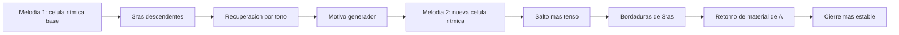
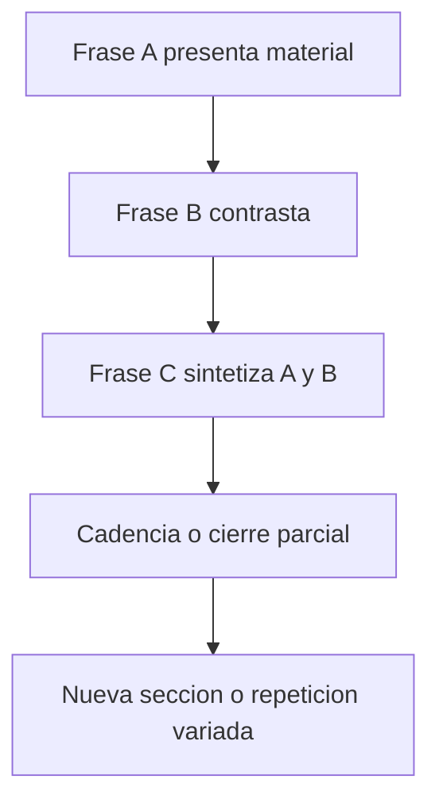
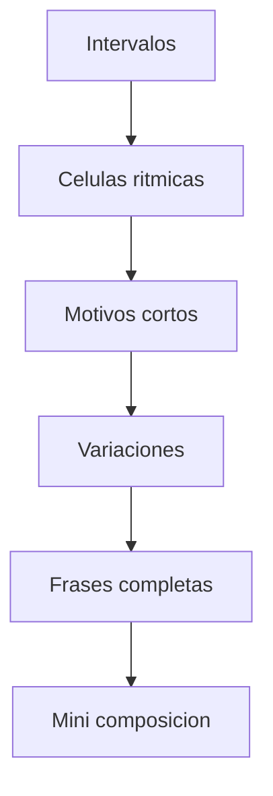
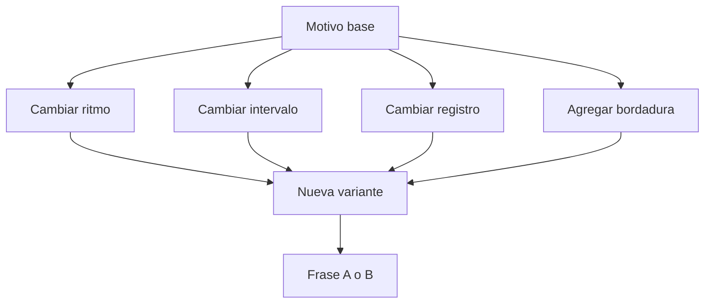
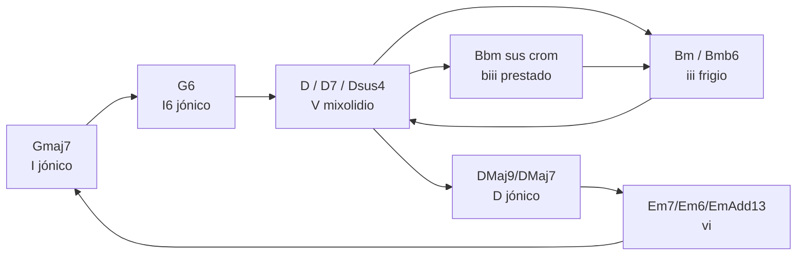

# Obras: todas las composiciones

> Archivo derivado: lo genera `_scripts/generar-chatgpt.py` desde la bóveda de música del usuario (Obsidian + git), el 2026-10-18. Cada sección es una nota de la bóveda, con su ruta. La bóveda es la fuente de verdad: si algo de aquí contradice a una conversación más reciente, pregunta.

Una carpeta por obra, de Cyclone a Louise, con sus decisiones y su estado.

Contiene:

- `3. Composiciones/0. Ideas/Ideas letras.md`
- `3. Composiciones/1. cyclone/Cyclone.md`
- `3. Composiciones/2. nocturno/Nocturno.md`
- `3. Composiciones/3. melódica/0. AI/0. Qué es un motivo.md`
- `3. Composiciones/3. melódica/0. AI/1. AI Análisis de melodías.md`
- `3. Composiciones/3. melódica/0. AI/2. Exploración melódica en piano y guitarra -- AI.md`
- `3. Composiciones/3. melódica/0. AI/3. Decisiones estructurales --AI.md`
- `3. Composiciones/3. melódica/1. Desarrollo/0. Desarrollo.md`
- `3. Composiciones/4. melódica II/0. Desarrollo.md`
- `3. Composiciones/5. dawn-chorus/Dawn Chorus.md`
- `3. Composiciones/6. louise/0. Intro.md`
- `3. Composiciones/6. louise/1. Adding verse.md`
- `3. Composiciones/6. louise/2. Drums and separation.md`
- `3. Composiciones/6. louise/3. Verse and choruse.md`
- `3. Composiciones/6. louise/4. Adding specific voicing.md`
- `3. Composiciones/6. louise/5. Adding bridge1.md`
- `3. Composiciones/6. louise/6. Second bridge.md`
- `3. Composiciones/6. louise/7. Second bridge.md`
- `3. Composiciones/6. louise/AI/10. Feedback del B2 - Louise.md`
- `3. Composiciones/6. louise/AI/9. Recursos de energía y forma - Louise.md`

---

## Archivo: `3. Composiciones/0. Ideas/Ideas letras.md`

- Atrapado en las sombras de tu ausencia
	- Gritando en los reflejos tu nombre 
	- Atrapado en el espejo de tu mirada
	- Liberado por el sol de tus palabras 
		- En esta libertad que parece carcel 
- 
- 
- 
- Y en las formas más simples seguiste apareciendo 
	- Desde la luz por mi ventana hasta la estrella más lejana 
	- Corriendo entre rincones ocultos 
	- Que solo son vistos por mis ojos llenos de ti 
	- Que solo serán reconocidos por mis ojos que atraparon tu presencia 
	- Que solo pueden ver lo más bonito de ti 
	- Que solo pueden ver si es a tí


- MCP: Test unit 
- 

---

## Archivo: `3. Composiciones/1. cyclone/Cyclone.md`

Inspirada en Cyclone de Sticky Fingers

La escala que usan en Cyclone es E mayor. 
Y la progresión que se usa en prácticamente toda la canción es: `I-II-III-II`
- Lo cuál es: 
	- Tonica - subdominante - tónica - subdominante
		- La base de todo no es la tónica, sino la subdominante 
		- Terminar en la subdominante, para dejar colgando el oído y después resolver en la dominante 

![[Pasted image 20260223192252.png]]

Me encantó la receta y me encantó meter otras notas que causan ciertos movimientos de color, comom Em7, Csus2 => D7 => G

El cambio de Csus2 => D7 suena natural, pero con cierto grado de tensión 

---

Al componer me salió algo así:
![[Pasted image 20260224111018.png]]

El principio super bien, tuve muchas cosas super firmes con las cuáles trabajar 

---

## Contrapunto y armonización 

Meter contrapuntos y armonización 

Si queremos meter 

Armonización no atasca la melodía 

Cadencia perfecta, 

No terminar en triada, máximo 3 o 4 cómpaces 

- Decidir movimiento armónico para resolver 
- Armonización y contrapunto 
	- A

---
Motivos 


Cuando tienes motivos: 2-3 compaces
La parte más atmosférico, usas el motivo o algo as{i 


Cuántos motivos aproximadamente tienes 

tomas escala
Tomas un elemento 

Modificarlo 
- Generar motivos 
- Los motivos
	- Dentro de la 


Villancico 

---

## Archivo: `3. Composiciones/2. nocturno/Nocturno.md`

Para ir acorde a los nocturnes puse un tiempo de 12/8 y agregué arpegios simples en el bajo y en la melodía algo muy fácil y muy cantable 

El beat siempre es menor de 70

Tiene turns 

Mayormente usa negras y corcheas 

La melodía no es atascada 

La armonía es muy repetitiva 

Los tiempos mayormente son 12/8 


Me encantan los Add4 porque dan un tono muy esperanzador, que puede servir para romper la expectativa o para darle redención a un acorde mayor 


Me encantó el paso de Re bemol a Mi, aunque no sea un enlace crom{atico}


En los nocturnos, los enlaces cromáticos son realmente muy útiles 

---

## Archivo: `3. Composiciones/3. melódica/0. AI/0. Qué es un motivo.md`

## **Goal of this step**

  

Construir una base clara de lenguaje compositivo: distinguir **motivo**, **melodía**, **armonía**, **célula rítmica** y **célula interválica** para que, cuando compongas, sepas **qué estás manipulando realmente**.

---

## **La idea central**

  

Cuando compones, no trabajas siempre con “una canción” completa.

Trabajas por **capas de información**:

- una capa de **gesto pequeño** → motivo
    
- una capa de **línea completa** → melodía
    
- una capa de **soporte vertical** → armonía
    
- una capa de **duración y acento** → célula rítmica
    
- una capa de **distancias entre notas** → célula interválica
    

---

## **Definiciones claras**

|**Concepto**|**Qué es**|**Tamaño habitual**|**Qué controla**|
|---|---|---|---|
|**Motivo**|unidad pequeña reconocible|1–2 compases o menos|identidad|
|**Melodía**|línea completa con dirección|frase o sección|discurso|
|**Armonía**|acordes y sus relaciones|simultánea / progresiva|color, tensión, reposo|
|**Célula rítmica**|patrón corto de duraciones/accentos|muy pequeño|pulso y carácter|
|**Célula interválica**|patrón corto de distancias entre notas|muy pequeño|contorno y ADN melódico|

---

## **1) Qué es un motivo**

  

Un **motivo** es una **unidad pequeña pero reconocible**.

No necesita cerrar. No necesita ser larga. Necesita tener **identidad**.

  

Esa identidad puede venir de:

- el ritmo
    
- el contorno
    
- un salto característico
    
- una repetición
    
- una combinación de todo eso
    

  

### **Ejemplo simple**

  

Si tocas:

  

C4 - E4 - D4

  

y luego repites el mismo gesto en otro punto, ya puedes empezar a crear un motivo.

  

### **Regla práctica**

  

Un motivo es como una **palabra** en el lenguaje musical.

---

## **2) Qué es una melodía**

  

La **melodía** es una **línea organizada en el tiempo** que tiene sentido completo o semicompleto.

  

No es solo “unas notas bonitas”.

Tiene:

- dirección
    
- respiración
    
- puntos de tensión
    
- puntos de reposo
    
- forma
    

  

### **Relación con el motivo**

  

La melodía muchas veces se construye a partir de uno o varios motivos.

  

### **Analogía útil**

- **motivo** = palabra
    
- **melodía** = oración o párrafo
    

---

## **3) Qué es la armonía**

  

La **armonía** es el sistema de **acordes** y de relaciones entre ellos.

  

Responde preguntas como:

- ¿qué acorde suena debajo?
    
- ¿dónde hay estabilidad?
    
- ¿dónde hay tensión?
    
- ¿qué nota se siente “como llegada”?
    

  

La melodía va en horizontal.

La armonía organiza la dimensión vertical y funcional.

  

### **Ojo importante**

  

Puedes tener un motivo sin armonía definida todavía.

Eso es justamente donde estás ahora: primero material melódico, luego soporte armónico.

---

## **4) Qué es una célula rítmica**

  

Una **célula rítmica** es un patrón pequeño de duraciones y acentos.

  

No depende de qué notas uses, sino de **cómo caen en el tiempo**.

  

### **Ejemplo**

  

Estas dos versiones tienen distinta melodía, pero misma célula rítmica:

- C4 (negra) D4 (dos corcheas)
    
- G4 (negra) E4 (dos corcheas)
    

  

La identidad rítmica es la misma.

  

### **Muy importante**

  

A veces lo más memorable de una idea no es la altura, sino **el ritmo**.

---

## **5) Qué es una célula interválica**

  

Una **célula interválica** es un patrón pequeño de **distancias entre notas**.

  

Por ejemplo:

- subir una 3ra, bajar una 2da
    
- subir una 4ta, repetir, bajar una 3ra
    

  

Eso define un tipo de gesto.

  

### **Ejemplo**

  

C4 → E4 → D4

  

no solo son notas.

Son intervalos:

- +3ra
    
- -2da
    

  

Ese patrón puede trasladarse a otras alturas y seguir sonando emparentado.

---

## **Relación entre todos**

```
flowchart TD
A[Célula rítmica] --> M[Motivo]
B[Célula interválica] --> M
M --> L[Melodía]
H[Armonía] --> L
H --> F[Función: tensión / reposo]
L --> P[Frase]
P --> S[Sección]
```

---

## **Comparación directa**

|**Si cambias…**|**¿sigue siendo el mismo motivo?**|**Comentario**|
|---|---|---|
|Solo las notas, pero mantienes ritmo y gesto|Muchas veces sí|parentesco claro|
|Solo el ritmo, pero mantienes intervalos|A veces|depende de cuánto cambie|
|Todo: ritmo, intervalos y contorno|No|ya es otra idea|
|Solo el final|Sí, como variación|muy útil para componer|

---

## **Ejemplo didáctico con una sola idea**

  

### **Idea base**

  

C4 - E4 - D4

  

### **Como célula interválica**

- sube 3ra
    
- baja 2da
    

  

### **Como célula rítmica**

- negra, corchea, corchea
    

  

### **Como motivo**

- combinas ese ritmo + ese contorno
    

  

### **Como melodía**

- repites, secuencias, desarrollas y cierras esa idea en varios compases
    

  

### **Como armonía**

- después decides qué acordes hacen que ese gesto suene estable, abierto, triste, luminoso, etc.
    

---

## **Otra forma de entenderlo**

|**Nivel**|**Pregunta**|
|---|---|
|**Célula rítmica**|¿cómo cae en el tiempo?|
|**Célula interválica**|¿cómo se mueven las distancias?|
|**Motivo**|¿qué gesto reconozco?|
|**Melodía**|¿qué línea completa estoy diciendo?|
|**Armonía**|¿qué significado tonal o color le doy?|

---

## **Piano-specific application**

  

En piano, estudia cada concepto **por separado**.

  

### **A) Motivo**

  

Toca una célula pequeña 4 veces y observa si sigue siendo reconocible.

  

### **B) Célula rítmica**

  

Mantén una sola nota y cambia solo el ritmo.

```
C4   C4 C4
negra corchea corchea
```

### **C) Célula interválica**

  

Mantén el patrón de distancias y transpónlo.

```
C4 - E4 - D4
D4 - F#4 - E4
Eb4 - G4 - F4
```

### **D) Melodía**

  

Une 2 o 3 apariciones del motivo y crea una pequeña frase.

  

### **E) Armonía**

  

Más adelante, añade una nota pedal en LH o acordes simples y escucha cómo cambia el sentido.

---

## **Ejercicio de teclado muy concreto**

|**Paso**|**Mano derecha**|**Mano izquierda**|
|---|---|---|
|1|toca 3 notas con un mismo ritmo|nada|
|2|repite el gesto una 2da arriba|nada|
|3|cambia solo el final|nada|
|4|toca una nota pedal grave|una redonda por compás|

### **Ejemplo**

  

RH:

- C4 E4 D4
    
- D4 F4 E4
    
- C4 E4 C4
    

  

LH:

- C3 sostenido todo el compás
    

  

Esto te deja oír:

**motivo + variación + comienzo de melodía**, sin meterte todavía en armonía real.

---

## **Mapa mental útil**

```
mindmap
  root((Material musical))
    Ritmo
      célula rítmica
      acento
      duración
    Alturas
      célula interválica
      contorno
      registro
    Identidad
      motivo
      variación
      repetición
    Discurso
      melodía
      frase
      sección
    Soporte
      armonía
      función
      color
```

---

## **Ejemplo con lenguaje cotidiano**

  

Piensa en hablar:

- **célula rítmica** = la cadencia con la que dices algo
    
- **célula interválica** = la forma en que sube o baja tu entonación
    
- **motivo** = una palabra o mini-idea
    
- **melodía** = una frase entera
    
- **armonía** = el contexto emocional de esa frase
    

---

## **Errores comunes de principiante**

|**Error**|**Corrección**|
|---|---|
|Llamar “melodía” a cualquier grupo pequeño de notas|primero pregunta si es motivo o frase|
|Pensar que motivo = algo ya cerrado|no, puede quedar abierto|
|Ignorar el ritmo y fijarse solo en alturas|el ritmo suele dar identidad|
|Pensar que armonía es “después no importa”|importa mucho, solo que no siempre va primero|
|Cambiar demasiadas cosas a la vez al variar|cambia una variable por vez|

---

## **Common mistakes**

- confundir motivo con frase completa
    
- no separar ritmo de alturas
    
- creer que la armonía “crea” sola la melodía
    
- escribir demasiadas notas antes de encontrar una célula clara
    
- variar ritmo e intervalos al mismo tiempo sin control
    
- no practicar el motivo aislado en piano
    

---

## **Practice task**

|**Tarea**|**Meta medible**|
|---|---|
|Escribe una **célula rítmica** de 1 compás|solo duraciones, sin pensar en notas|
|Escribe una **célula interválica** de 3 notas|por ejemplo +3ra, -2da|
|Combínalas para crear **1 motivo**|máximo 1 compás|
|Repite el motivo 3 veces con pequeñas variaciones|una secuencia, una repetición, un cierre|
|Tócalo a **60 bpm**|limpio y estable|

### **Criterio de éxito**

  

Debes poder responder con claridad:

- cuál es el **ritmo**
    
- cuál es el **patrón de intervalos**
    
- cuál es el **motivo**
    
- dónde empieza a sentirse una **melodía**
    

---

## **Next step**

  

En el siguiente paso te propongo hacer algo muy útil: tomar **tu motivo real** y desarmarlo en estas 5 capas para identificar exactamente **qué parte de tu idea es rítmica, cuál es interválica y cuál ya funciona como melodía**.

---

## Archivo: `3. Composiciones/3. melódica/0. AI/1. AI Análisis de melodías.md`

# Primera melodía: 
![[Pasted image 20260405121756.png]]


  

Tu propia marcación ya apunta a lo esencial:

1. Hay una **célula rítmica inicial** muy clara
    
2. Luego aparece una **repetición/variación interválica**
    
3. Se alternan sobre todo:
    
    - **terceras descendentes**
        
    - **saltos de un tono ascendente**
        
    - **terceras mayores descendentes**
        
    

  

O sea: **no estás viendo notas sueltas**, estás viendo un **patrón organizado**.

---

## **Mi diagnóstico directo**

  

Sí: **ahí sí hay motivo**.

  

Pero no es solo un motivo “de notas”.

Es un motivo formado por **3 capas al mismo tiempo**:

|**Capa**|**Qué veo en tu melodía**|**Por qué importa**|
|---|---|---|
|Rítmica|La célula azul se repite o se proyecta|Es la identidad más fácil de reconocer|
|Interválica|Terceras descendentes + paso de tono ascendente|Da el “gesto” melódico|
|De contorno|Baja por salto, luego corrige/sube un poco, luego vuelve a bajar|Eso le da dirección y coherencia|

Entonces, el motivo no es “estas 4 notas exactas” solamente.

El motivo es más bien:

  

> **una célula rítmica fija + una caída por tercera + una recuperación por grado conjunto o tono**

  

Ese es el verdadero ADN.

---

## **Tabla: qué probablemente sea el motivo principal**

|**Elemento**|**Observación**|**Función en el motivo**|
|---|---|---|
|Célula azul|Grupo rítmico corto y reconocible|Núcleo de identidad|
|Tercera descendente verde|Gesto melódico recurrente|Firma melódica|
|Tono ascendente rojo|Respuesta o compensación|Da continuidad|
|Repetición secuencial|El patrón vuelve varias veces|Confirma que no es accidente|

---

## **Cómo encontrar el motivo aquí**

  

### **Regla principal**

  

Un **motivo** suele ser la unidad más pequeña que:

- se **reconoce**
    
- se **repite**
    
- se **transforma**
    
- y sigue sonando como “la misma idea”
    

  

En tu melodía, yo lo buscaría así:

  

### **Opción A: motivo rítmico-melódico corto**

  

Tomar la **célula azul** como semilla, porque:

- aparece primero
    
- tiene identidad rítmica fuerte
    
- luego sus intervalos se expanden en el resto de la frase
    

  

### **Opción B: motivo interválico**

  

Tomar como motivo esta fórmula abstracta:

```
baja una 3ª  -> sube 1 tono -> baja una 3ª
```

Eso parece estar muy presente en el diseño.

  

### **Mi conclusión**

  

La mejor lectura es esta:

  

> **El motivo generador es la célula azul, pero su desarrollo real se reconoce por el patrón de terceras descendentes interrumpidas por pequeños ascensos conjuntos.**

---

## **Mermaid: cómo leer el proceso motívico**


---

## **Análisis más musical de tu frase**

  

## **1. Análisis rítmico**

  

La célula azul parece funcionar como **gatillo de la frase**.

  

Eso significa:

- no solo “empieza” la melodía
    
- también **establece el pulso interno**
    
- y hace que lo demás parezca continuación lógica
    

  

Entonces, cuando analices melodías, primero pregunta:

  

**¿qué célula rítmica podría sobrevivir aunque cambien las notas?**

  

En esta melodía, esa respuesta parece clara: **la azul**.

---

## **2. Análisis interválico**

  

Tú ya detectaste algo muy importante: no hay movimiento totalmente libre; hay una preferencia por ciertos saltos.

|**Tipo de movimiento**|**Presencia**|**Efecto**|
|---|---|---|
|3ª menor descendente|Alta|Color melancólico, cantable|
|3ª mayor descendente|Alta|Más brillo, pero sigue siendo estable|
|Ascenso de 1 tono|Recurrente|Compensa la caída|
|Movimiento conjunto corto|Sí|Une los fragmentos|

Eso produce esta sensación:

- la melodía **cae**
    
- luego **reacciona**
    
- luego **vuelve a caer**
    
- y así se construye una unidad
    

  

Eso es muy típico de una melodía bien organizada.

---

## **3. Análisis de contorno**

  

El contorno general no es lineal.

Tiene un comportamiento de tipo:

```
descenso por salto
-> pequeña recuperación
-> nuevo descenso
-> nueva recuperación
```

Eso da mucha unidad porque el oído no memoriza solo notas: memoriza **gestos**.

---

## **4. Análisis por repetición y variación**

  

Esto es lo más importante para decidir si hay motivo:

|**Pregunta**|**Respuesta en tu melodía**|
|---|---|
|¿Se repite el ritmo?|Sí|
|¿Se repite el tipo de salto?|Sí|
|¿Se repite el contorno?|Sí|
|¿Hay variación sin perder identidad?|Sí|

Entonces sí puedes decir técnicamente que hay un **trabajo motívico**.

---

## **Qué diría yo como análisis resumido formal**

  

Podrías describirla así:

  

> La melodía se construye a partir de una célula rítmica inicial claramente identificable, desarrollada mediante la reiteración de un gesto interválico basado en terceras descendentes compensadas por ascensos conjuntos o de tono. La unidad melódica no depende únicamente de la repetición literal de alturas, sino de la persistencia de su diseño rítmico, contorno y perfil interválico.

  

Eso ya suena a análisis musical serio.


### **Ejercicio pianístico**

|**Mano**|**Tarea**|**Objetivo**|
|---|---|---|
|RH|Tocar terceras descendentes legato|Sentir el gesto|
|RH|Insertar un tono ascendente entre saltos|Oír la compensación|
|LH|Mantener una nota pedal simple|Escuchar la melodía con apoyo|
|Ambas|Repetir el patrón en otras alturas|Entender la secuencia|

---


---
# Segunda melodía: 
![[Pasted image 20260405124350.png]]
![[Pasted image 20260405124457.png]]
  
1. **Aparece una nueva célula rítmica** al inicio
    
2. Luego **reaparece la célula de la primera melodía**
    
3. El discurso melódico usa más:
    
    - **bordaduras**
        
    - **saltos más expresivos** como la **5ª disminuida**
        
    - mezcla de **3ras menores y mayores**
        
    - un pequeño tramo de **grado conjunto**
        
    
4. Al final hay un **cierre armónico vertical** en acordes, así que la línea ya no queda “abierta” como puro discurso melódico

> **nueva célula + más variedad interválica + reuso de material anterior + cierre más estable**

---

## **Tabla general del análisis**

| **Capa**   | **Qué observo**                                                              | **Función musical**       |
| ---------- | ---------------------------------------------------------------------------- | ------------------------- |
| Ritmo      | Nueva célula azul al inicio + retorno de la célula de la primera melodía     | Contraste con unidad      |
| Intervalos | 5ª disminuida ascendente, 2ª mayor ascendente, 3ras bordadas, grado conjunto | Mayor tensión y color     |
| Contorno   | Más irregular y más “quebrado” que la primera                                | Da carácter contrastante  |
| Motivo     | No es totalmente nuevo: mezcla material nuevo y material derivado            | Relación con la melodía 1 |
| Cierre     | Termina con acordes verticales                                               | Sensación de conclusión   |


### **Estructura rítmica**

1. **Abre con identidad nueva**
    
2. **Desarrolla con material intermedio**
    
3. **Recupera el ADN rítmico anterior**

---

## **2. Análisis interválico**

  

Aquí el análisis se vuelve muy interesante.

  

Tus marcas indican:

- **5ª disminuida ascendente**
- **3ª menor bordada**
- **4ª justa descendente**
- **2ª mayor ascendente**
- **3ª mayor bordada**
- **3ª menor bordada**
- **grado conjunto**
    
- y finalmente una especie de extensión con **3ras menores** y cierre bordado con **5ª justa**
    

  

### **Qué significa eso musicalmente**

  

Esta melodía tiene más tensión que la primera porque incluye un intervalo muy marcado:

- **5ª disminuida ascendente**  

Ese salto cambia muchísimo el carácter.

Ya no estás solo en una melodía “cantable y suave” basada mayormente en terceras y tonos; ahora aparece un gesto más inestable.

---

## **Tabla interválica**

|**Intervalo / gesto**|**Presencia**|**Efecto expresivo**|
|---|---|---|
|5ª disminuida ascendente|Muy llamativa|Tensión, rareza, contraste|
|3ª menor bordada|Recurrente|Color melancólico|
|3ª mayor bordada|Recurrente|Más brillo, variedad|
|2ª mayor ascendente|Conectiva|Suaviza la línea|
|4ª justa descendente|Estructural|Da impulso de caída|
|Grado conjunto|Local|Relaja y conecta|

---

## **3. Análisis del contorno**
La primera melodía tenía una lógica más clara de:

- caída
- pequeña recuperación
- nueva caída
    
Esta segunda me parece más:

- **quiebre**
- **salto expresivo**
- **ornamentación**
- **respuesta**
 **reencuentro con material conocido**
    


## **¿Cuál es el motivo de esta segunda melodía?**

### **Motivo A: el nuevo gesto de apertura**

- nueva célula rítmica
    
- salto llamativo
    
- bordadura posterior
    ### **Motivo B: material heredado de la primera melodía**

- reaparición de la célula rítmica conocida
    
- uso de 3ras como elemento organizador
    
---

## **5. Análisis de contraste con la primera melodía**

## **En qué contrasta**

|**Elemento**|**Primera melodía**|**Segunda melodía**|
|---|---|---|
|Ritmo|Más uniforme en su identidad inicial|Introduce una nueva célula|
|Intervalos|Más centrada en 3ras y tonos|Incluye 5ª disminuida y más irregularidad|
|Contorno|Más estable y reconocible|Más quebrado y expresivo|
|Desarrollo|Repetición clara del gesto|Derivación y contraste|
|Final|Más lineal melódico|Cierre vertical con acordes|

## **En qué se mantiene relacionada**

|**Elemento**|**Relación**|
|---|---|
|Uso de 3ras|Sigue siendo central|
|Reaparición de célula|Une ambas melodías|
|Bordadura|Sigue habiendo elaboración alrededor de núcleos|
|Coherencia formal|No parece material ajeno, sino derivado|

---

## **6. Análisis formal**

Esta segunda melodía funciona muy bien como una **frase contrastante B** o como una **respuesta desarrollada** a A.

  

Podría entenderse así:

- **A** = primera melodía: presenta identidad básica
    
- **B** = segunda melodía: contrasta, intensifica, recuerda material anterior y cierra
    

  

Eso sirve mucho para composición binaria o frase periódica.

---

## **Tabla formal**

|**Sección**|**Función**|
|---|---|
|Inicio de melodía 2|Contraste|
|Zona media|Desarrollo|
|Reaparición de célula 1|Recuerdo / cohesión|
|Cierre en acordes|Resolución|

---

## **7. Cierre armónico final**

  

La segunda imagen muestra acordes al final, no solo línea melódica.

  

Eso cambia la función:

- ya no estamos solo en el plano horizontal
    
- aparece un **cierre vertical**
    
- se refuerza la conclusión
    

  

Eso suele indicar:

- final de frase
    
- final de sección
    
- o afirmación tonal
    

Podrías describir esta melodía así:

  

> La segunda melodía presenta un contraste respecto a la primera mediante una nueva célula rítmica de apertura y un diseño interválico más tenso e irregular, destacando el uso de bordaduras de terceras y un salto expresivo de quinta disminuida ascendente. Sin embargo, la unidad estructural se mantiene por la reaparición posterior de la célula rítmica inicial de la primera melodía y por la persistencia del trabajo interválico en torno a terceras. El cierre en acordes refuerza su función conclusiva dentro de la frase o sección.

  

Eso ya es un análisis bastante sólido.

---

# Análisis conjunto


Tus dos melodías **sí están emparentadas**.

No son dos ideas separadas al azar.

La relación principal es esta:

  

> **La primera melodía presenta el material básico. La segunda lo contrasta, lo estira, lo vuelve más expresivo, y luego recupera parte del ADN de la primera para que todo siga sonando como una sola pieza.**

  

Eso, compositivamente, está muy bien.

---

## **Tabla-resumen ultra clara**

|**Aspecto**|**Melodía 1**|**Melodía 2**|**Relación**|
|---|---|---|---|
|Función|Presentación|Contraste / desarrollo|B nace de A|
|Célula rítmica|Muy clara desde el inicio|Nueva al inicio, luego reaparece la de A|Contraste con unidad|
|Intervalos dominantes|3ras descendentes + tono ascendente|3ras bordadas + 2das + salto más tenso|B amplía el vocabulario|
|Contorno|Más estable y reconocible|Más quebrado y expresivo|B intensifica|
|Sensación|Más cantable / simple|Más dramática / desarrollada|Complementarias|
|Final|Más lineal|Más conclusivo, incluso vertical|B cierra mejor|

---

# **1. Análisis full de la** 

# **Melodía 1**

  

## **1.1 Qué hace musicalmente**

  

La primera melodía funciona como **material generador**.

  

No se siente como “una frase cualquiera”, sino como una frase que:

- presenta una **célula rítmica clara**
    
- organiza el discurso con **intervalos recurrentes**
    
- usa una lógica de **caída y recuperación**
    
- y deja una identidad fácil de recordar
    

---

## **1.2 Material principal**

|**Elemento**|**Observación**|**Función**|
|---|---|---|
|Célula rítmica inicial|Muy reconocible|Núcleo del motivo|
|3ras descendentes|Recurrentes|Firma melódica|
|Tono ascendente|Compensación|Continuidad|
|Repetición de gesto|Clara|Confirma el motivo|

---

## **1.3 Fórmula abstracta de la melodía 1**

  

La primera melodía se puede resumir así:

```
célula rítmica fija
+ caída por 3ª
+ recuperación por paso o tono
+ nueva caída por 3ª
```

Eso es casi su ADN.

---

## **1.4 Contorno de la melodía 1**

|**Rasgo**|**Descripción**|
|---|---|
|Dirección general|Ondulante, pero controlada|
|Gestos principales|Caída - pequeña subida - nueva caída|
|Nivel de tensión|Moderado|
|Cantabilidad|Alta|

---

## **1.5 Función formal de la melodía 1**

  

La melodía 1 cumple muy bien la función de:

- **Apertura**
    
- **Presentación**
    
- **Exposición del material motívico**
    

  

En otras palabras:

**aquí nace el lenguaje de la pieza**.

---

# **2. Análisis full de la** 

# **Melodía 2**

  

## **2.1 Qué hace musicalmente**

  

La segunda melodía no rompe la unidad.

Lo que hace es:

- abrir con un material rítmico distinto
    
- usar intervalos más tensos y más variados
    
- bordar más el material
    
- luego recuperar una célula conocida
    
- y cerrar con más estabilidad
    

  

Eso la vuelve una excelente **respuesta contrastante**.

---

## **2.2 Material principal**

|**Elemento**|**Observación**|**Función**|
|---|---|---|
|Nueva célula rítmica|Aparece al inicio|Contraste|
|5ª disminuida ascendente|Muy llamativa|Tensión|
|3ras bordadas|Muy presentes|Relación con A, pero más ornamentada|
|Grado conjunto breve|Zona de alivio|Conexión|
|Reaparición de la célula de A|Muy importante|Unidad|
|Cierre con acordes|Más estable|Conclusión|

---

## **2.3 Fórmula abstracta de la melodía 2**

```
nueva célula
+ salto expresivo más tenso
+ bordadura de 3ras
+ pequeño alivio por grado conjunto
+ retorno de material anterior
+ cierre más firme
```

---

## **2.4 Contorno de la melodía 2**

|**Rasgo**|**Descripción**|
|---|---|
|Dirección general|Más quebrada|
|Gestos principales|Salto tenso - bordadura - respuesta|
|Nivel de tensión|Más alto que en la melodía 1|
|Cantabilidad|Sí, pero más expresiva que simple|

---

## **2.5 Función formal de la melodía 2**

  

La melodía 2 funciona como:

- **contraste**
    
- **desarrollo**
    
- **intensificación**
    
- **cierre**
    

  

O sea, si la primera es **A**, la segunda puede ser perfectamente **B** o **A’ contrastante**.

---

# **3. Relación real entre las dos melodías**

  

## **La clave: contraste con parentesco**

  

La segunda melodía contrasta con la primera en tres dimensiones:

|**Dimensión**|**Cómo contrasta**|
|---|---|
|Ritmo|Nueva célula al inicio|
|Intervalos|Mayor tensión y más variedad|
|Contorno|Más irregular y expresivo|

Pero también conserva tres vínculos esenciales:

|**Dimensión**|**Cómo se mantiene unida**|
|---|---|
|Trabajo con 3ras|Sigue siendo central|
|Material rítmico heredado|Reaparece la célula de A|
|Lógica de derivación|No parece una idea ajena|

---

## **Tabla comparativa profunda**

|**Elemento**|**Melodía 1**|**Melodía 2**|**Lectura compositiva**|
|---|---|---|---|
|Identidad base|Clara y compacta|Más expandida|B desarrolla A|
|Ornamentación|Menor|Mayor|B es más rica|
|Tensión|Media|Alta|B empuja más|
|Claridad motívica|Muy directa|Más mixta|B transforma|
|Repetición literal|Más visible|Menos literal|B varía más|
|Función en la forma|Presenta|Contrasta y concluye|A → B|

---

## **Mermaid: cómo se relacionan A y B**



---

# **4. Qué estás haciendo bien sin darte cuenta**

  

Esto es importante para desbloquearte.

  

Ya hiciste varias cosas que **sí son composición real**:

|**Lo que hiciste**|**Por qué está bien**|
|---|---|
|Detectaste células rítmicas|Estás pensando en unidades, no en notas sueltas|
|Marcaste intervalos|Estás oyendo/viendo el gesto|
|Diferenciaste A y B|Ya estás trabajando forma|
|Reutilizaste material|Eso crea coherencia|
|Contrastaste sin romper la unidad|Eso es justo lo correcto|

Entonces el problema no parece ser “no sabes componer”.

El problema parece más bien:

> **te atoras en cómo continuar después de detectar el material inicial.**

  

Eso es normal.

---

## **Método práctico de continuación**

  ### **Paso 1: reduce ambas melodías a su esqueleto**

No pienses en todas las notas. Piensa en:

- célula rítmica
- salto característico
- contorno

| **Melodía** | **Esqueleto**                                    |
| ----------- | ------------------------------------------------ |
| A           | célula + 3ª descendente + recuperación           |
| B           | nueva célula + salto tenso + bordadura + retorno |
|             |                                                  |

### **Paso 2: decide qué quieres hacer con ese material**

Solo hay 4 movimientos básicos:

| **Opción** | **Qué haces**          |
| ---------- | ---------------------- |
| Repetir    | mantener casi igual    |
| Variar     | cambiar una parte      |
| Expandir   | hacerlo más largo      |
| Cerrar     | simplificar y resolver |

### **Paso 3: elige una sola**

Tu bloqueo muchas veces aparece porque intentas hacer las 4 a la vez.

---

## **Mi recomendación concreta**


Con el material que ya tienes, el mejor siguiente paso es:

> **hacer una tercera frase que tome el ritmo de A, el salto llamativo de B, y termine más estable que ambas.**

Eso te da continuidad y avance real.

---

# **6. Modelo de continuación para una tercera frase**

  

## **Opción buena para destrabarte**

  

### **Frase 3 = “síntesis”**

- empieza con la **célula rítmica de A**
    
- introduce **un solo salto expresivo heredado de B**
    
- vuelve al trabajo de **3ras**
    
- termina con un gesto más corto y claro
    

|**Sección**|**Material**|
|---|---|
|Inicio|ritmo de A|
|Centro|un gesto interválico de B|
|Final|simplificación + cierre|

Eso es mucho mejor que intentar inventar otra frase totalmente distinta.

---

## **Mermaid: estrategia para seguir componiendo**



---

# **7. Roadmap corto para salir del bloqueo**

  

## **Horizonte inmediato**

|**Tiempo**|**Tarea**|
|---|---|
|Hoy|reducir A y B a fórmula abstracta|
|Mañana|escribir una frase 3 de síntesis|
|Después|decidir si la forma será A-B-A’, A-B-C, o binaria|

## **La mejor forma ahora mismo**

  

Con lo que muestras, veo muy viable:

- **A – B – A’**
- o **A – B – cierre**

No intentaría una forma muy grande todavía.

---

# **8. Piano-specific application**

  

Te recomiendo este trabajo al piano, porque te va a ordenar la mente.

  

## **Ejercicio 1: tocar solo esqueletos**

  

Toca solo los puntos estructurales de cada melodía.

|**Melodía**|**Qué tocar**|
|---|---|
|A|notas de llegada de las 3ras|
|B|salto tenso + notas de llegada|
|C (nueva)|mezcla de ambas|

## **Ejercicio 2: tocar con una sola nota rítmica**

  

Haz esto:

- misma nota repetida
    
- primero con el ritmo de A
    
- luego con el ritmo de B
    

  

Eso te obliga a entender el ritmo como forma.

  

## **Ejercicio 3: componer una frase 3 en el teclado**

  

Regla:

- 1 célula de A
    
- 1 gesto de B
    
- cierre por grado conjunto o 3ª descendente
    

---

## **Tabla de práctica pianística**

|**Drill**|**Meta**|
|---|---|
|Ritmo solo de A|memorización estructural|
|Ritmo solo de B|sentir el contraste|
|Saltos clave de B|interiorizar tensión|
|Frase 3 de síntesis|desbloquear composición|

---

# **9. Qué elementos necesitas para hacer este análisis siempre**

|**Elemento**|**Qué debes mirar**|
|---|---|
|Célula rítmica|patrón reconocible|
|Intervalo principal|salto o movimiento característico|
|Intervalos recurrentes|lo que más se repite|
|Contorno|forma de la línea|
|Repetición|qué vuelve|
|Variación|qué cambia|
|Función formal|presenta, contrasta, desarrolla o cierra|
|Tipo de final|abierto o conclusivo|

---

# **10. Plantilla completa de análisis comparativo**

  

Puedes usar esto siempre:

|**Campo**|**Melodía A**|**Melodía B**|
|---|---|---|
|Célula rítmica principal|…|…|
|Intervalo más llamativo|…|…|
|Intervalos recurrentes|…|…|
|Contorno|…|…|
|Nivel de tensión|…|…|
|Relación con la otra|…|…|
|Función formal|…|…|
|Tipo de cierre|…|…|

---

## **Common mistakes**

- Creer que para contrastar necesitas material totalmente nuevo
    
- Intentar continuar sin reducir primero el material a su esqueleto
    
- Pensar en demasiadas notas y no en gestos
    
- No decidir la función de la siguiente frase antes de escribirla
    
- Querer “inspiración nueva” en vez de transformar lo que ya existe
    

---

## **Practice task**

  

### **Tarea de hoy**

  

Haz estas tres cosas por escrito:

|**Tarea**|**Meta concreta**|
|---|---|
|1. Resume A en una sola fórmula|máximo 1 línea|
|2. Resume B en una sola fórmula|máximo 1 línea|
|3. Diseña la frase 3|inicio de A + gesto de B + cierre claro|

### **Meta medible**

  

En **15 minutos**, debes terminar esta plantilla:

|**Campo**|**Respuesta**|
|---|---|
|Fórmula A|…|
|Fórmula B|…|
|Función de frase 3|…|
|Material de inicio de frase 3|…|
|Material de contraste en frase 3|…|
|Tipo de cierre|…|

### **Criterio de éxito**

  

Si puedes explicar tu frase 3 **antes de escribir cada nota**, ya estás componiendo con control real.

---

## **Next step**

  

El siguiente paso correcto es que hagamos juntos la **frase 3**, nota por nota, usando exactamente esta regla:

  

**ritmo de A + gesto interválico de B + cierre más estable**.

---

## Archivo: `3. Composiciones/3. melódica/0. AI/2. Exploración melódica en piano y guitarra -- AI.md`

# **Enfoque general**

  

Tus dos melodías ya te dieron un material muy bueno:

| **Elemento**            | **Ya apareció en tus melodías** | **Lo vamos a practicar como** |
| ----------------------- | ------------------------------- | ----------------------------- |
| Célula rítmica A        | Sí                              | patrón base                   |
| Célula rítmica B        | Sí                              | patrón contrastante           |
| 3ras descendentes       | Sí                              | motivo melódico principal     |
| 2das ascendentes        | Sí                              | conexión                      |
| 3ras bordadas           | Sí                              | variación                     |
| Salto más tenso         | Sí, especialmente en B          | color / contraste             |
| Reaparición de material | Sí                              | forma y unidad                |

---

# **Plan de trabajo**

  

## **4 bloques de estudio**

|**Bloque**|**Qué entrenas**|**Resultado**|
|---|---|---|
|1|Intervalos aislados|Reconocer el gesto|
|2|Células rítmicas|Sentir identidad sin depender de alturas|
|3|Motivos y variaciones|Componer sin bloquearte|
|4|Frases completas|Construir A, B y una frase C|

---

## **Mermaid: mapa del estudio**



---

# **BLOQUE 1 — Ejercicios de intervalos**

  

## **1. Piano — terceras descendentes y ascendentes**

  

### **Ejercicio 1A: terceras puras**

  

Toca lentamente:

```text
RH:
D5-B4 | C5-A4 | E5-C5 | F5-D5
```

Luego al revés:

```text
RH:
B4-D5 | A4-C5 | C5-E5 | D5-F5
```

### **Objetivo**

  

Sentir:

- 3ra menor descendente
    
- 3ra mayor descendente
    
- 3ra menor ascendente
    
- 3ra mayor ascendente
    

|**Variante**|**Tempo**|**Meta**|
|---|---|---|
|Legato|60 bpm|oír el color|
|Staccato|72 bpm|sentir el gesto|
|Con acento en la primera nota|66 bpm|marcar el motivo|

---

## **2. Guitarra — terceras en dos cuerdas**

  

### **Ejercicio 1B: terceras en pares de cuerdas**

  

Toca terceras en cuerdas 1 y 2, luego 2 y 3.

  

Ejemplo simple en tonalidad de Bb o Gm:

```
e|--6-----5-----8-----6--
B|--6-----6-----8-----6--
```

Luego busca versiones donde una voz baje y la otra acompañe.

  

### **Objetivo**

  

Que la mano empiece a reconocer:

- forma visual de la 3ra
    
- diferencia entre 3ra mayor y menor
    
- sensación de “caída” melódica
    

|**Nivel**|**Tarea**|
|---|---|
|Básico|tocar dobles notas|
|Intermedio|arpegiarlas una por una|
|Compositivo|hacer una mini melodía con 4 terceras|

---

## **3. Piano y guitarra — salto tenso**

  

### **Ejercicio 1C: salto característico de contraste**

  

Como en tu melodía B apareció un salto más fuerte, practica:

- tocarlo aislado
    
- resolverlo
    
- usarlo una sola vez dentro de un motivo
    

  

### **Regla**

  

Nunca practiques el salto solo:

**salto + resolución**.

|**Fórmula**|**Ejemplo**|
|---|---|
|salto tenso + paso conjunto|X → salto → nota vecina|
|salto tenso + 3ra descendente|X → salto → caída|
|salto tenso + bordadura|X → salto → bordar la llegada|

---

# **BLOQUE 2 — Ejercicios de células rítmicas**

  

## **4. Piano — ritmo sin melodía**

  

### **Ejercicio 2A: una sola nota, dos células**

  

Toca una sola nota, por ejemplo **D4**, pero usando:

- primero la célula rítmica A
    
- luego la célula rítmica B
    

  

No cambies de nota todavía.

  

### **Objetivo**

  

Separar:

- **ritmo**
    
- de **altura**
    

  

Eso ayuda muchísimo a desbloquearse.

|**Fase**|**Qué haces**|
|---|---|
|1|una sola nota con célula A|
|2|una sola nota con célula B|
|3|alternas A / B|
|4|inventas una célula C derivada|

---

## **5. Guitarra — palma/rítmica + una nota**

  

### **Ejercicio 2B: púa o pulgar con una sola nota**

  

En una sola cuerda, por ejemplo cuerda 3, toca la misma nota con:

- célula A
    
- célula B
    
- A-A-B-A
    
- A-B-A’-cierre
    

  

### **Objetivo**

  

Entender que un motivo puede vivir aunque todavía no haya melodía compleja.

---

## **6. Music-abc: célula rítmica abstracta**

```music-abc
X:1
T:Celulas ritmicas abstractas
M:4/4
L:1/8
K:C
"D4 ritmo A" D2 D D2 D | "D4 ritmo B" D D2 D D D2 |
```

No importa si no coincide exactamente con tus compases reales: esto es para entrenar el concepto.

---

# **BLOQUE 3 — Motivos y bordaduras**

  

## **7. Piano — motivo A, luego 3 variaciones**

  

### **Ejercicio 3A**

  

Toma este esquema:

```
caida de 3ra -> subida por paso
```

Ejemplo:

```
D5-B4-C5
```

Ahora crea 3 variantes:

|**Variación**|**Ejemplo**|
|---|---|
|Literal|D5-B4-C5|
|Bordada|D5-B4-C5-B4|
|Expandida|D5-B4-C5-A4|

### **Regla**

  

La identidad debe seguir clara.

---

## **8. Guitarra — motivo corto en una cuerda, luego en dos cuerdas**

  

### **Ejercicio 3B**

  

Haz un motivo de 3 notas en una sola cuerda.

  

Ejemplo:

```
G|--7--4--5--
```

Luego llévalo a dos cuerdas con bordadura o doble nota.

  

### **Meta**

  

Que el motivo no dependa del lugar físico, sino de su gesto.

---

## **9. Piano — bordaduras de terceras**

  

### **Ejercicio 3C**

  

Como en tu segunda melodía aparecen **3ras bordadas**, practica esto:

```
E5-C5-D5-C5
F5-D5-E5-D5
D5-B4-C5-B4
```

### **Qué estás entrenando**

- nota estructural
    
- nota vecina
    
- regreso
    
- continuidad motívica
    

|**Meta**|**Resultado esperado**|
|---|---|
|5 min|que la bordadura te suene natural|
|10 min|crear tú 4 bordaduras distintas|
|15 min|usarlas dentro de una frase real|

---

# **BLOQUE 4 — Frases completas**

  

## **10. Piano — A, B y C**

  

### **Ejercicio 4A**

  

Haz tres frases cortas:

|**Frase**|**Regla**|
|---|---|
|A|usa la célula rítmica A y 3ras descendentes|
|B|usa célula B y un salto más tenso|
|C|mezcla inicio de A + gesto de B + cierre estable|

### **Estructura sugerida**

- 1 compás A
    
- 1 compás A’
    
- 1 compás B
    
- 1 compás Cierre
    

---

## **11. Guitarra — frase-respuesta**

  

### **Ejercicio 4B**

  

Haz esto como si fuera pregunta y respuesta:

|**Compás**|**Función**|
|---|---|
|1|pregunta (motivo A)|
|2|eco o secuencia|
|3|contraste (motivo B)|
|4|respuesta/cierre|

### **Reglas**

- máximo 5 notas por compás al principio
    
- no más de 1 salto grande por compás
    
- siempre debe haber al menos 1 gesto reconocible repetido
    

---

# **Ejercicios específicos por instrumento**

  

# **Piano — rutina de 20 minutos**

|**Minutos**|**Ejercicio**|**Objetivo**|
|---|---|---|
|5|terceras ascendentes y descendentes|oído + mano|
|5|células rítmicas con una nota|independencia rítmica|
|5|bordaduras y saltos|color|
|5|construir A-B-C|composición|

## **Piano-specific application**

  

Trabaja siempre en estas 3 capas:

```
1) Ritmo solo
2) Esqueleto interválico
3) Melodía completa
```

Y luego prueba estas distribuciones:

|**Mano izquierda**|**Mano derecha**|
|---|---|
|nota pedal|motivo|
|bajo en blancas|célula rítmica|
|raíz + quinta|melodía con bordaduras|

---

# **Guitarra — rutina de 20 minutos**

|**Minutos**|**Ejercicio**|**Objetivo**|
|---|---|---|
|5|terceras en pares de cuerdas|mapa visual|
|5|célula A y B en una cuerda|ritmo y articulación|
|5|motivo con bordaduras|fraseo|
|5|pregunta-respuesta A-B|composición|

### **Sugerencia técnica**

  

Alterna estas texturas:

|**Textura**|**Cómo practicarla**|
|---|---|
|Una sola cuerda|claridad melódica|
|Dos cuerdas|intervalos|
|Arpegio|célula rítmica|
|Acorde parcial|cierre|

---

# **Ejercicios creativos para desbloquearte**

  

## **12. Ejercicio: “solo cambia una cosa”**

  

Toma tu motivo y solo cambia una variable por vez.

|**Variable**|**Qué puedes cambiar**|
|---|---|
|Ritmo|misma altura, nuevo ritmo|
|Intervalo|mismo ritmo, nuevo salto|
|Dirección|mismo patrón, invertido|
|Registro|mismo motivo una octava arriba|
|Final|mismo inicio, cierre diferente|

Este ejercicio es oro para dejar de bloquearte.

---

## **13. Ejercicio: “3 versiones del mismo motivo”**

  

Haz tres versiones del mismo motivo:

|**Versión**|**Carácter**|
|---|---|
|1|suave|
|2|tensa|
|3|conclusiva|

### **Regla**

  

No puedes cambiar todo.

Solo 1 o 2 parámetros.

---

## **14. Ejercicio: “motivo sin instrumento”**

  

Antes de tocar, escribe en una línea:

```
ritmo A + 3ra descendente + paso ascendente
```

Luego tócala.

  

Eso obliga a componer con intención, no solo con dedos.

---

# **Mermaid: método para crear variaciones sin bloquearte**



---

# **Mini repertorio de micro-drills**

|**Drill**|**Piano**|**Guitarra**|
|---|---|---|
|3ra descendente|sí|sí|
|3ra bordada|sí|sí|
|2da ascendente conectiva|sí|sí|
|salto tenso + resolución|sí|sí|
|célula A en una nota|sí|sí|
|célula B en una nota|sí|sí|
|A-B-C de 1 compás|sí|sí|
|pregunta-respuesta|sí|sí|

---

# **Practice task**

  

## **Tarea semanal simple**

  

### **Día 1**

- 10 min ritmo
    
- 10 min terceras
    

  

### **Día 2**

- 10 min bordaduras
    
- 10 min salto + resolución
    

  

### **Día 3**

- 20 min construir A y A’
    

  

### **Día 4**

- 20 min construir B contrastante
    

  

### **Día 5**

- 20 min construir C de síntesis
    

  

### **Día 6**

- tocar A-B-C seguido
    

  

### **Día 7**

- grabarte y evaluar
    

---

## **Tabla de evaluación**

|**Criterio**|**1–5**|
|---|---|
|Claridad del motivo||
|Ritmo reconocible||
|Uso de intervalos||
|Contraste entre frases||
|Unidad entre frases||
|Comodidad en piano||
|Comodidad en guitarra||

---

## **Common mistakes**

- Practicar demasiadas notas y no el gesto
    
- No separar ritmo de altura
    
- Hacer saltos sin resolución
    
- Cambiar demasiadas cosas a la vez
    
- Querer “inspiración” antes de hacer micro-variaciones
    
- No grabarte
    
- No repetir un motivo suficiente para que exista de verdad
    

---

## **Next step**

  

El mejor siguiente paso es que te prepare una **rutina exacta de 7 días**, con ejercicios ya escritos en notas para **piano y guitarra**, basados específicamente en tus melodías A y B.

---

## Archivo: `3. Composiciones/3. melódica/0. AI/3. Decisiones estructurales --AI.md`

## **Goal of this step**

  

Diseñar **formas posibles alrededor de A y A’** para que no tengas que saltar directo a B, sino **prepararla con más fundamento** mediante:

- intro
    
- puente(s)
    
- expansión
    
- preparación de contraste
    

  

La meta aquí no es decidir una sola forma todavía, sino darte **opciones formales claras** para que puedas pensar compositivamente con menos bloqueo y más intención.

---

# **Idea central**

  

Lo que estás buscando es muy bueno:

  

> **no escribir B “porque sí”, sino construir el contexto que haga que B tenga sentido.**

  

Eso cambia todo.

  

Porque muchas veces el bloqueo no está en “no sé escribir una melodía”, sino en:

- no saber **qué función** debe cumplir la siguiente sección
    
- no saber **qué energía falta**
    
- no saber **qué necesita oír el oyente antes de que aparezca B**
    

  

Entonces, antes de escribir B, vamos a pensar en **arquitectura**.

---

# **Primero: qué papel podrían tener A y A’**

  

Ya sabemos esto:

|**Material**|**Lo que hace mejor**|
|---|---|
|**A**|presenta el ADN principal|
|**A’ / A+**|desarrolla, contrasta internamente, intensifica|

Entonces, si quieres “construir alrededor” de eso, lo más natural es que el material previo:

- **prepare**
    
- **insinúe**
    
- **abra espacio**
    
- o **retrase la llegada del tema**
    

---

# **Pregunta clave antes de elegir forma**

  

## **¿Qué quieres que se sienta cuando por fin entre A?**

  

Hay 4 respuestas típicas:

|**Deseo expresivo**|**Qué conviene construir antes**|
|---|---|
|Que A se sienta como revelación|intro atmosférica|
|Que A se sienta inevitable|puente acumulativo|
|Que A se sienta ya conocido al entrar|intro basada en fragmentos de A|
|Que A se sienta como “entrada fuerte”|silencio, pedal, o preámbulo muy contenido|

---

# **Opción 1 —** 

# **Intro → A → puente → A’ → puente → B**

  

Esta es casi la estructura que tú mismo intuyes, y es muy buena.

  

## **Forma**

```
Intro | A | Puente 1 | A’ | Puente 2 | B
```

## **Qué hace cada parte**

|**Sección**|**Función**|
|---|---|
|Intro|crear atmósfera o anticipación|
|A|presentar motivo|
|Puente 1|mover energía, evitar repetición plana|
|A’|intensificar o variar|
|Puente 2|abrir el espacio para una nueva sección|
|B|contraste más fundado|

## **Por qué funciona**

  

Porque te da una progresión psicológica muy clara:

- primero se **abre el mundo**
    
- luego aparece el **tema**
    
- luego se **transforma**
    
- luego se **despega**
    
- luego llega un nuevo plano: **B**
    

  

## **Cuándo elegirla**

  

Cuando quieres una pieza con sensación más narrativa y menos “bloque cuadrado”.

---

# **Opción 2 —** 

# **Intro basada en fragmentos de A → A → A’ → B**

  

## **Forma**

```
Intro(fragmentaria) | A | A’ | B
```

## **Idea**

  

La intro no es material nuevo, sino una especie de:

- eco
    
- sombra
    
- respiración previa
    
- fragmento incompleto de A
    

  

Eso puede ser bellísimo.

  

## **Cómo sería esa intro**

|**Recurso**|**Ejemplo**|
|---|---|
|Solo ritmo de A, sin melodía completa|una sola nota o dos alturas|
|Solo un intervalo de A|3ra descendente aislada|
|Solo bordadura o gesto pequeño|insinuación|
|Pedal + fragmento superior|atmósfera|

## **Por qué funciona**

  

Porque cuando entra A, el oído siente:

  

> “esto ya lo conocía un poco”

  

Y eso hace que A entre con más peso.

---

# **Opción 3 —** 

# **A como entrada temprana, luego expansión alrededor**

  

## **Forma**

```
A | Interludio/puente | A’ | Interludio | B
```

## **Idea**

  

Aquí no hay una intro separada; entras rápido a A.

Luego construyes “alrededor” con pequeños puentes o interludios.

  

## **Cuándo sirve**

  

Si A ya tiene mucha fuerza y no quieres retrasarla.

  

## **Funciona bien si:**

- quieres una pieza más directa
    
- no quieres una intro larga
    
- prefieres construir forma por contraste local
    

---

# **Opción 4 —** 

# **Intro → Pre-A → A → A’ → B**

  

Esta es una opción finísima si quieres desbloquearte poco a poco.

  

## **Forma**

```
Intro | Pre-A | A | A’ | B
```

## **¿Qué es Pre-A?**

  

No es todavía A completa.

Es una especie de **antesala** del tema.

  

Puede ser:

|**Pre-A posible**|**Qué hace**|
|---|---|
|versión rítmica reducida de A|prepara identidad|
|contorno de A pero con otras notas|anticipa forma|
|acompañamiento que luego sostendrá A|prepara textura|
|frase más simple que desemboca en A|genera llegada|

## **Por qué ayuda mucho**

  

Porque te evita sentir que tienes que pasar de “nada” a “tema completo” de golpe.

---

# **Opción 5 —** 

# **Intro → A → A’ → re-transición → B**

  

## **Forma**

```
Intro | A | A’ | Retransicion | B
```

## **Diferencia con puente**

  

Aquí la re-transición no es un puente temático grande, sino una zona de **vaciamiento o preparación**.

  

Después de A y A’, quizá la música necesita:

- soltar tensión
    
- simplificarse
    
- cambiar registro
    
- quedarse en pedal
    
- secarse rítmicamente
    

  

para que B llegue con fundamento.

  

## **Cuándo elegirla**

  

Cuando A’ termina muy cargada y no quieres que B entre abruptamente.

---

# **Tabla comparativa de opciones**

|**Opción**|**Sensación**|**Mejor para**|
|---|---|---|
|Intro → A → puente → A’ → puente → B|narrativa y gradual|pieza con recorrido claro|
|Intro fragmentaria → A → A’ → B|muy orgánica|unidad fuerte|
|A → interludio → A’ → interludio → B|directa|ir al tema rápido|
|Intro → Pre-A → A → A’ → B|elegante y progresiva|desbloquearte sin presión|
|Intro → A → A’ → re-transición → B|más madura y respirada|si A’ cierra muy fuerte|

---

# **Mi recomendación para ti**

  

Con lo que has descrito, yo te sugeriría pensar primero en estas dos:

  

## **Recomendación A**

  

### **Intro fragmentaria → A → puente → A’ → re-transición → B**

  

o

  

## **Recomendación B**

  

### **Intro → Pre-A → A → A’ → puente → B**

  

¿Por qué estas dos?

  

Porque tú no estás buscando solo “poner secciones”, sino:

- **construir alrededor**
    
- dejar que B nazca con más lógica
    
- no sentir que la forma está pegada artificialmente
    

  

Y estas opciones te dejan hacer exactamente eso.

---

# **Cómo pensar cada sección sin bloquearte**

  

No pienses “qué notas van aquí”.

Piensa primero:

  

## **1. ¿Qué no debe hacer esta sección?**

  

Eso ayuda más que pensar qué sí debe hacer.

|**Sección**|**Qué NO debería hacer**|
|---|---|
|Intro|no debería gastar toda la energía del tema|
|Puente hacia A’|no debería sonar ya como B|
|Retransición hacia B|no debería repetir A otra vez tal cual|
|B|no debería borrar del todo el parentesco|

---

## **2. ¿Qué papel energético tiene?**

|**Sección**|**Energía**|
|---|---|
|Intro|suspender|
|Pre-A|insinuar|
|A|afirmar|
|A’|intensificar|
|Puente a B|despegar|
|B|abrir otro plano|

---

# **Mermaid: mapa energético recomendado**

```
flowchart LR
    I[Intro<br/>suspension] --> P[Pre-A o fragmento<br/>insinuacion]
    P --> A[A<br/>afirmacion]
    A --> Ap[A'<br/>intensificacion]
    Ap --> T[Puente o retransicion<br/>despegue]
    T --> B[B<br/>nuevo plano]
```

---

# **Ahora bajémoslo a decisiones concretas**

  

# **Qué podría ser una** 

# **Intro**

  

## **Tipos de intro posibles**

|**Tipo**|**Material**|**Efecto**|
|---|---|---|
|Atmosférica|pedal + pocas notas|abre el mundo|
|Motívica|fragmentos de A|unidad inmediata|
|Rítmica|célula de A sin melodía completa|prepara identidad|
|Interválica|3ras aisladas o gesto de A|anticipación sutil|
|Armónica|acordes o voicings del clima|establece color|

## **Mi recomendación**

  

Para ti, una intro **motívica-atmosférica**.

  

### **O sea:**

- no tocar A completa
    
- pero sí usar:
    
    - una 3ra descendente
        
    - una célula rítmica reducida
        
    - una nota pedal
        
    - un registro más aireado
        
    

---

# **Qué podría ser un** 

# **Puente hacia A’**

  

## **Función**

  

No debe ser enorme. Solo necesita:

- mover el registro
    
- cambiar un poco el ritmo
    
- preparar la entrada más desarrollada de A’
    

  

## **Recursos posibles**

|**Recurso**|**Cómo ayuda**|
|---|---|
|secuencia corta|mueve sin perder unidad|
|simplificación rítmica|limpia el espacio|
|bordadura repetida|mantiene parentesco|
|pedal + fragmentos|transición suave|

---

# **Qué podría ser un** 

# **Puente / retransición hacia B**

  

Este sí es más importante que el primero.

  

Porque aquí debes convencer al oído de que:

  

> “ya no estamos solo desarrollando A; algo nuevo viene”

  

## **Qué podría hacer esa sección**

|**Acción**|**Resultado**|
|---|---|
|quitar densidad rítmica|crea espacio|
|mover a otro registro|anuncia novedad|
|usar secuencia ascendente|prepara expansión|
|sostener pedal|crea expectativa|
|reducir el motivo a un esqueleto|deja una puerta abierta hacia B|

---

# **Cómo decidir si necesitas Intro, Pre-A o ambos**

  

## **Usa esta tabla**

|**Si sientes que…**|**Entonces usa…**|
|---|---|
|A entra demasiado abrupta|Intro|
|A todavía necesita preparación motívica|Pre-A|
|ya tienes mucho material y no quieres alargar|solo un puente|
|B todavía no nace clara|retransición antes de B|
|todo suena demasiado “pegado”|interludios / puentes cortos|

---

# **Piano-specific application**

  

## **Cómo construir estas secciones en piano**

  

Piensa por capas.

  

## **Intro**

|**Mano izquierda**|**Mano derecha**|
|---|---|
|pedal o raíz sostenida|fragmentos de 3ras|
|blancas o redondas|célula rítmica reducida|
|voicing abierto|notas aisladas|

## **Puente hacia A’**

|**Mano izquierda**|**Mano derecha**|
|---|---|
|bajo más móvil|secuencia breve|
|menos pedal|bordaduras o eco de A|

## **Retransición hacia B**

|**Mano izquierda**|**Mano derecha**|
|---|---|
|pedal o línea ascendente|contorno más simple|
|preparación armónica|despojo del motivo|

### **Regla útil**

  

En piano, si quieres que una sección se sienta “alrededor” del material ya existente:

- **no copies la melodía completa**
    
- toca solo:
    
    - ritmo
        
    - intervalo
        
    - contorno reducido
        
    - pedal/armonía
        
    

---

# **Ejercicio de desbloqueo inmediato**

  

## **Haz este ejercicio antes de escribir notas definitivas**

  

Completa esta tabla:

|**Sección**|**Qué debe hacer**|**Qué NO debe hacer**|**Material heredado**|
|---|---|---|---|
|Intro|…|…|…|
|A|presentar|no explicar demasiado|motivo completo|
|Puente 1|…|…|…|
|A’|intensificar|no ser ya B|motivo transformado|
|Puente 2 / retransición|…|…|…|
|B|…|…|…|

Eso te ordena muchísimo.

---

# **Propuesta concreta de forma para empezar a pensar**

  

## **Opción muy equilibrada**

|**Sección**|**Compases sugeridos**|**Función**|
|---|---|---|
|Intro|2–4|atmósfera + fragmento|
|A|4|exposición|
|Puente 1|2|transición|
|A’|4|expansión|
|Retransición|2–4|abrir espacio|
|B|4–8|nuevo plano|

Esto ya parece una pieza real.

---

# **Otra opción más compacta**

|**Sección**|**Compases sugeridos**|
|---|---|
|Intro fragmentaria|2|
|A|4|
|A’|4|
|Puente a B|2|
|B|4|

Más directa, menos riesgo de perderte.

---

# **Mi recomendación final**

  

## **Empieza pensando así:**

  

### **Intro fragmentaria → A → A’ → retransición → B**

  

Porque:

- no complica demasiado
    
- construye alrededor de lo que ya tienes
    
- deja que A y A’ sean el corazón inicial
    
- y le da a B más fundamento cuando llegue
    

---

## **Common mistakes**

- Hacer una intro que ya dice demasiado
    
- Hacer puentes demasiado largos sin función clara
    
- Repetir A en el puente casi igual y pensar que eso es transición
    
- Querer decidir B antes de definir qué necesita escuchar el oyente
    
- Construir demasiadas secciones nuevas en vez de derivar del material existente
    

---

## **Practice task**

  

### **Tarea**

  

Elige **2 formas candidatas** de las que vimos y llena esto:

|**Forma candidata**|**Por qué me atrae**|
|---|---|
|1|…|
|2|…|

Luego define:

|**Sección**|**Idea en una frase**|
|---|---|
|Intro|…|
|A|…|
|A’|…|
|transición a B|…|
|B|…|

### **Meta medible**

  

En **15 minutos**, debes tener:

- 2 formas posibles
    
- 1 favorita
    
- 1 frase funcional para cada sección
    

  

### **Criterio de éxito**

  

Si puedes decir:

  

> “mi intro no presenta el tema completo; solo lo insinúa”

  

entonces ya estás pensando formalmente muy bien.

---

# Siguientes pasos al modelo de intro 


Tu bloqueo ahora probablemente no es musical. Es estructural.

  

No estás pensando:

  

> “¿qué notas pongo?”

  

Estás pensando:

  

> “¿cómo empiezo algo que todavía no es A, pero que debe llevar a A?”

  

La solución es esta:

  

## **La Intro no tiene que “ser una melodía completa”**

  

La Intro solo necesita cumplir **3 funciones**:

|**Función**|**Qué debe hacer**|
|---|---|
|**Abrir el mundo**|establecer atmósfera, registro, respiración|
|**Insinuar el ADN**|mostrar fragmentos de A sin tocar A completa|
|**Generar llegada**|hacer que A entre como algo esperado|

Entonces tu Intro debe ser una mezcla de:

- **fragmento**
    
- **aire**
    
- **anticipación**
    

  

No de “tema completo”.

---

# **Regla de oro para empezar ahora mismo**

  

## **La Intro debe usar solo 2 o 3 de estos elementos de A:**

- una **3ra descendente**
    
- una **célula rítmica reducida**
    
- una **nota pedal**
    
- un **contorno incompleto**
    
- una **bordadura pequeña**
    
- un **registro distinto del de A**
    

  

Eso basta.

---

# **La mejor estrategia para ti**

  

## **Empieza con una** 

## **Intro fragmentaria**

  

No con una intro totalmente nueva.

  

### **¿Qué significa?**

  

Que tomas el ADN de A y lo presentas así:

- más lento
    
- más incompleto
    
- más espaciado
    
- menos afirmativo
    

---

# **Tres modelos de Intro para desbloquearte**

  

Voy a darte **3 opciones concretas**.

No para elegir “la perfecta”, sino para que una de ellas te haga arrancar.

---

## **Opción A — Intro de** 

## **pedal + fragmento interválico**

  

### **La más recomendable para ti**

  

## **Cómo funciona**

- Mano izquierda o bajo: una nota pedal
    
- Mano derecha o voz superior: fragmentos de 3ras descendentes
    
- ritmo muy respirado
    
- no aparece aún la célula completa de A
    

  

## **Sensación**

- suspendida
    
- íntima
    
- “algo viene”
    

  

### **Esquema**

|**Capa**|**Qué hace**|
|---|---|
|Bajo|una nota sostenida o repetida|
|Voz superior|2 o 3 gestos cortos|
|Ritmo|amplio, con silencios|
|Meta|llegar a A con claridad|

### **Mini ejemplo abstracto**

```music-abc
X:1
T:Modelo Intro A - pedal y fragmento
M:4/4
L:1/4
K:Bb
V:1
d2 b2 | c2 z2 | f2 d2 | c4 |
V:2 clef=bass
B,4 | B,4 | B,4 | F,4 |
```

No lo leas como versión definitiva: léelo como idea de **aire + gesto**.

---

## **Opción B — Intro de** 

## **ritmo reducido de A**

  

### **Muy útil si piensas mejor desde el ritmo**

  

## **Cómo funciona**

- tomas la célula de A
    
- la simplificas
    
- usas una sola nota o dos alturas
    
- haces que la melodía verdadera entre después
    

  

## **Sensación**

- prepara identidad
    
- genera familiaridad
    
- A entra con fuerza porque la Intro no la quema
    

  

### **Esquema**

|**Capa**|**Qué hace**|
|---|---|
|Ritmo|eco lejano de A|
|Altura|casi fija|
|Contorno|mínimo|
|Meta|que A se sienta inevitable|

### **Mini ejemplo abstracto**

```
X:1
T:Modelo Intro B - ritmo reducido
M:4/4
L:1/8
K:Bb
d2 z2 d2 z2 | c2 z2 c2 z2 | d2 c2 b2 z2 | a4 z4 |
```

---

## **Opción C — Intro de** 

## **bordadura lenta**

  

### **Buena si quieres un inicio más lírico**

  

## **Cómo funciona**

- empiezas con una nota estructural
    
- haces una pequeña bordadura
    
- vuelves
    
- repites en otra altura
    

  

## **Sensación**

- íntima
    
- vocal
    
- muy orgánica
    

  

### **Esquema**

|**Elemento**|**Papel**|
|---|---|
|nota principal|centro|
|vecina|movimiento|
|regreso|identidad|
|repetición|unidad|

### **Mini ejemplo abstracto**

```
X:1
T:Modelo Intro C - bordadura lenta
M:4/4
L:1/4
K:Bb
d e d2 | c d c2 | b c b2 | a4 |
```

---

# **Mi recomendación real**

  

## **Empieza con la** 

## **Opción A**

  

### **Pedal + fragmento interválico**

  

Porque conecta perfecto con lo que ya tienes:

- vienes de analizar **terceras**
    
- vienes de pensar en **gestos**
    
- y necesitas una intro que no te obligue a “componer demasiado” desde el segundo 1
    

  

Esta opción te deja empezar con muy poco material.

---

# **Cómo construirla paso a paso**

  

## **Paso 1 — Elige una nota pedal**

  

No pienses todavía en muchos acordes.

  

Elige una base.

|**Tipo de pedal**|**Efecto**|
|---|---|
|Tónica|estabilidad|
|Dominante|expectativa|
|Nota ambigua/modal|más atmósfera|

## **Mi sugerencia**

  

Empieza con **tónica o dominante**.

No compliques esto al principio.

---

## **Paso 2 — Elige 1 gesto de A**

  

Solo uno.

  

Mi sugerencia:

  

> **3ra descendente**

  

Porque es lo más reconocible y lo más fácil de manipular.

---

## **Paso 3 — Espácialo**

  

No lo conviertas en frase todavía.

  

Haz algo así:

- gesto
    
- silencio
    
- gesto parecido
    
- silencio
    
- pequeño acercamiento a A
    

---

## **Paso 4 — Diseña la llegada a A**

  

La intro no termina “bonito”; termina **abriendo la puerta**.

  

Necesitas que el último compás haga una de estas dos cosas:

|**Final de Intro**|**Qué produce**|
|---|---|
|deja suspensión|A entra como respuesta|
|hace mini levantamiento rítmico|A entra con impulso|

---

# **Plantilla concreta de Intro de 4 compases**

  

## **Modelo funcional**

|**Compás**|**Función**|**Qué pones**|
|---|---|---|
|1|atmósfera|pedal + primer fragmento|
|2|eco|repetición o variante|
|3|acercamiento|un poco más de movimiento|
|4|preparación de A|ritmo o nota de llegada que abra la entrada|

---

# **Ejemplo de pensamiento, no de notas exactas**

```
Compás 1: pedal + 3ra descendente
Compás 2: pedal + eco del gesto
Compás 3: pequeño ascenso o bordadura
Compás 4: célula reducida que apunta a A
```

Eso ya es suficiente para empezar.

---

# **Qué hacer ahora mismo en piano**

  

## **Piano-specific application**

  

## **Mano izquierda**

  

Mantén una base muy simple:

|**Opción**|**Qué tocar**|
|---|---|
|Pedal puro|una nota larga|
|Pedal pulsado|misma nota en negras o blancas|
|Bajo simple|tónica–dominante|

## **Mano derecha**

  

Haz solo fragmentos, no melodía completa:

|**Gesto**|**Ejemplo de función**|
|---|---|
|3ra descendente|ADN de A|
|bordadura pequeña|resonancia de A’|
|nota larga + caída|intro cantable|

### **Ejercicio inmediato en piano**

  

Toca durante 5 minutos solamente esto:

```
LH: una nota pedal
RH: 3ra descendente -> silencio -> 3ra descendente variante -> silencio
```

No hagas más.

  

Ese es tu desbloqueo.

---

# **Si prefieres pensar primero sin notas exactas**

  

Haz esta tabla ya:

|**Compás**|**Función**|**Gesto**|
|---|---|---|
|1|abrir|3ra descendente|
|2|eco|misma idea, otra altura|
|3|mover|bordadura o paso ascendente|
|4|preparar A|mini impulso rítmico|

---

# **Mermaid: cómo nace la Intro**

```
flowchart TD
    A[Elegir pedal] --> B[Elegir un gesto de A]
    B --> C[Espaciarlo con silencios]
    C --> D[Repetir con pequena variacion]
    D --> E[Preparar la entrada de A]
```

---

# **Cómo saber si tu Intro sí funciona**

  

## **Checklist rápido**

|**Pregunta**|**Sí/No**|
|---|---|
|¿No dice todavía A completa?||
|¿Sí usa un gesto reconocible de A?||
|¿Tiene aire y espacio?||
|¿Hace que A entre con sentido?||
|¿No intenta resolver todo demasiado pronto?||

Si respondes “sí” a 4 de 5, ya funciona.

---

# **Qué NO hacer**

|**Error**|**Por qué bloquea**|
|---|---|
|Escribir una intro demasiado compleja|te roba energía del tema|
|Meter toda la célula de A desde el inicio|A pierde impacto|
|Cambiar demasiadas cosas a la vez|pierdes el hilo|
|Empezar con armonía muy elaborada|te distrae del gesto|
|Intentar decidir toda la pieza antes de 4 compases de intro|te paraliza|

---

# **Mi sugerencia exacta de arranque**

  

Haz esto hoy:

  

## **Intro de 4 compases**

- **Compás 1:** pedal + 3ra descendente
    
- **Compás 2:** eco de la misma idea
    
- **Compás 3:** bordadura breve o paso ascendente
    
- **Compás 4:** pequeña preparación rítmica para entrar a A
    

  

Nada más.

---

# **Practice task**

  

## **Tarea inmediata**

  

Escribe una **Intro de 4 compases** con estas reglas:

|**Regla**|**Obligatoria**|
|---|---|
|usar pedal|sí|
|usar una 3ra descendente|sí|
|dejar silencios o aire|sí|
|no tocar todavía A completa|sí|
|preparar la entrada de A al final|sí|

## **Meta medible**

  

En **15 minutos**, debes tener:

- una versión en esqueleto
    
- una versión tocable en piano
    

  

## **Criterio de éxito**

  

Si al tocar la Intro sientes:

  

> “ahora sí dan ganas de que entre A”

  

entonces ya destrabaste el inicio.

---

## **Common mistakes**

- Querer que la Intro sea tan memorable como A
    
- No dejar suficiente espacio
    
- Usar demasiadas notas
    
- Entrar a A sin preparación real
    
- Empezar con armonía compleja antes de tener el gesto
    

---

## **Next step**

  

El siguiente paso ideal es que construyamos juntos **un borrador exacto de Intro de 4 compases** en notas, aunque sea muy simple, usando la opción **pedal + 3ra descendente + eco + preparación de A**.

---

## Archivo: `3. Composiciones/3. melódica/1. Desarrollo/0. Desarrollo.md`

 Se empieza creando un motivo, pero aquí viene lo importante qué es un motivo 


![[Pasted image 20260404173630.png]]
Comencé con una melodía y con células claras usando semicorcheas y corcheas. 

Con intervalos de tercera, algunos menores y otros mayores. Me gustó mucho el paso entre terceras mayores y menores 


Después siguiendo la misma lógica y sin pensar tanto en el intervalo que generaba utilicé la misma célula rítmica de la melodía que cree primero, y partí la primera corchea, para que entrara una nota más. 
Al tener una nota más entraba una nota, que venía con un movimiento descendente una nota arriba. A veces por movimiento cromático y a veces con un salto de un tono 

![[Pasted image 20260404174000.png]]


Me gustó como contraste, porque se mantiene la misma célula rítmica y el agregar una primera nota, le da mucha diferencia, aunque las notas medulares sigan siendo terceras 

---
Primera melodía: 
![[Pasted image 20260405121756.png]]


  


---
Segunda melodía: 
![[Pasted image 20260405124350.png]]
![[Pasted image 20260405124457.png]]


El siguiente paso correcto es hacer un **análisis comparativo A vs B** en una sola tabla, y luego convertirlo en un esquema de **forma binaria o período** para que ya empieces a componer a partir de ambos materiales.


---

Decidí hacer mi melodía como A,A' y B. Lo que haré será que presento A, después le agrego algunas capas de complejidad, probablemente regrese a A. Y después de un pequeño puente, nos movemos a B, quizá haya un B'?

----


Al final me encantó como quedaron las dos partes, manteniendo las mismas notas logré mantener una parte A con A' que hace que resalte mucho más. Un intro que salió de un ritmo clásico de Piano que obtuve de Midi

![[Pasted image 20260414193318.png]]

Ahora donde me encuentro un poco atorado es en no convertir mi parte A en final al darle tanta resolución. Pero al mismo tiempo no se como crear un puente, porque sería introducir muchoç


---

Comentarios Fabs
![[Pasted image 20260428195100.png]]

Siempre se busca simetría
Dividir las figuras para entender exactamente como es que se 
FIGURA RODEADA POR LA MITAD DE SU VALOR

Contra de un diciceisavo

Limpiarlo


Darle variación 

Ligar notas o modificar algún tiempo 

Octavo 

Csus4 

Meter más ligaduras 

- Rítmica 
- Mismo 5 compaces de la misma rítmica 
	- Menos es más 
- Una pequeña modficiación 
- Darle más respiro y modificar la rítmica 
- Y poder darle más respiro 
- Se sienta más equilibrado 

---

## Archivo: `3. Composiciones/4. melódica II/0. Desarrollo.md`

Todo comenzó con un pedazo que tenía compuesto y dos que se me ocurrieron 

Una melodía fue en la guitarra

![[Pasted image 20260428172730.png]]

Esta salió del acorde de admin que me gustó mucho y de un ritmo que me gustó en mi cabeza. Quise comenzar arpegiando, pero terminó mejor como motivo 


Transposición en la guitarra siempre está una 8ava arriba

---

## Archivo: `3. Composiciones/5. dawn-chorus/Dawn Chorus.md`

### 1. Qué es este ejercicio y qué estás practicando

Tu partitura **“17. Arpegios Down Chorus”** es básicamente un **laboratorio de enlaces** sobre la progresión de _Dawn Chorus_ en G mayor: arpegios en corcheas/semicorcheas en la mano derecha y la fundamental del acorde en blancas/semibreves en la izquierda.

Estás trabajando:

- **Tonalidad base:** G mayor.
    
- **Familias tonales:**
    
    - Tónica: Gmaj7, G6
        
    - Dominante: D, D7, D7sus4, Dsus4, Dsus2Add13
        
    - Relativos y vecinos: Bm, Bmb6, Bm7, Em7/Em6, DMaj7/9, Bbm (sus cromático)
        
- **Modos usados:** etiquetas Jónico, Frigio, Mixolidio, Locrio, D Jónico, etc., tomadas de tu hoja de **modos**.
    

A nivel de textura, es **contrapunto a dos voces**: bajo muy simple (pedales de fundamental) y línea superior muy activa, tal como se recomienda en el repaso de contrapunto (independencia melódica pero estructura clara).

---

### 2. Macroestructura del ejercicio

#### 2.1 Secciones

Podemos dividir lo escrito en tres bloques de 8 compases y luego la zona en blanco:

|Compases|Armonía principal|Comentario|
|---|---|---|
|1–8|Gmaj7 – G6 – D – D7sus4 / Bmb6 – Bm – D7 – Dsus2Add13|Presentación de la progresión y color modal básico.|
|9–16|Gmaj7–Gmaj – G6 – D7 – Dsus4 / Bbm – Bm – D7 – Dsus2Add13|Variación con intercambio modal (Bbm) y pequeños cambios de voicing.|
|17–28|Gmaj7 – G6 – DMaj9→DMaj7 – DMaj7 / Em7–Em6 – Bm7 – Em7 / Em→EmAdd13 – DMaj9→DMaj7 – DMaj7 – Gmaj7|Zona de prolongación de D y Em que prepara el regreso a Gmaj7.|
|30–fin|Pentagramas vacíos|Espacio perfecto para **motivos** y variaciones.|

#### 2.2 Diagrama de flujo armónico (mermaid)



---

### 3. Enlaces en este ejercicio: qué estás haciendo realmente

En tus apuntes de **Enlaces 1.0** planteas el procedimiento:

1. Anotar acordes y función.
    
2. Marcar 3ª y 7ª (tonos guía).
    
3. Elegir tipo de enlace (paso diatónico/cromático, vecina, enclosure…).
    
4. Llegar por semitono a 3ª o 7ª cuando sea posible.
    

Aquí lo estás aplicando pero de forma **implícita**, sobre todo con el patrón F# ↔ G que comentabas:

- **F#** = 3ª de D, 7ª de G
    
- **G** = 4ª de D (11) y tónica de G
    

Así, muchos compases terminan/cosen los arpegios **moviéndose entre F# y G por semitono/grado conjunto**, que es exactamente un enlace de **nota de paso / nota común** entre las funciones de dominante (D) y tónica (G).

#### 3.1 Ejemplo simplificado (texto)

_No es literal a tus notas, es un resumen de lo que haces:_

```text
Compás 1 (Gmaj7):  D – E – F# – G – A ...
Compás 2 (G6):     G – A – B – D – E ...
Enlace: último F# -> G en el cambio de acorde

Compás 3 (D):      A – B – C# – D – E – F#
Compás 4 (D7sus4): G – A – B – C – D ...
Enlace: F# -> G (3ª de D -> 4ª de D / 7ª de G)
```

Estás usando sobre todo:

- **Notas comunes:** G entre Gmaj7, G6 y Dsus4.
    
- **Notas de paso diatónicas:** E–F#–G dentro de la escala de G jónico / D mixolidio.
    
- Algún **cromatismo** puntual (Bbm→Bm) como enlace de intercambio modal.
    

---

### 4. Análisis sección por sección

#### 4.1 Compases 1–8: presentación

Armonía:

```text
1  Gmaj7 (Jónico, 9 13)
2  G6   (Jónico, 9 13)
3  D    (Mixolidio, 9 13)
4  D7sus4 (Mixolidio, 9 13)
5  Bmb6 (Frigio, 11 13)
6  Bm   (Frigio, 11 13)
7  D7   (Mixolidio, 9 13)
8  Dsus2→Dsus2Add13 (Mixolidio, 9 13)
```

**Qué funciona muy bien aquí**

- Se ve clarísima la lógica de **familias tonales**: I → V → iii → V otra vez (toda la zona sigue orbitando a G).
    
- Las tensiones que escribes (9 y 13 en maj7 y 7, 11 y 13 en Bm) coinciden con las “tensiones seguras” que enumera tu resumen de tensiones y modos.
    
- El bajo está en pedales de fundamental, lo que deja muy libre la voz superior para practicar enlaces sin perder la armonía.
    

**Puntos a mejorar**

- Casi todos los enlaces “apuntan” a F# o G. Está genial como primera capa, pero según la guía de **tonos guía** conviene perseguir también la **3ª y 7ª de cada acorde**, no solo la tónica.
    
    - Ej.: hacia D7 podrías intentar terminar en **F# (3ª)** o **C (7ª)**, y no siempre en G/F#.
        
- Rítmicamente todo es “motor de semicorcheas”. En **Tonos guías** y **Enlaces 2.0 y motivos** se sugiere fijar una célula rítmica reconocible y variarla (tresillo, 3-3-2, síncopa…).
    

#### 4.2 Compases 9–16: variación + Bbm

Armonía principal:

```text
9   Gmaj7→Gmaj
10  G6
11  D→D7
12  Dsus4
13  Bbm (sus cromático)
14  Bm
15  D→D7
16  Dsus2→Dsus2Add13
```

Aquí ya estás aplicando **intercambio modal**:

- **Bbm** puede leerse como **bIII** prestado (del modo eólico/frigio paralelo), exactamente uno de los acordes típicos de intercambio modal que aparecen en la tabla de familias tonales.
    
- El regreso a **Bm** y luego a **D** cierra el desvío cromático sin perder la tónica G.
    

**Muy positivo**

- Introduces color cromático sin romper el marco de G; textbook `bIII` dream-pop / Radiohead.
    
- Mantienes el mismo patrón de arpegios, pero el oído siente un “pliegue” armónico gracias a Bbm.
    

**A mejorar**

- Sería buen sitio para un enlace **claramente cromático dirigido**: por ejemplo, línea superior Ab–A (3ª de Bbm → 5ª de D) o Db–D (5ª → 3ª de Bm/D), siguiendo la regla de “cromatismo con objetivo claro”.
    

#### 4.3 Compases 17–28: zona D / Em y regreso

Armonía:

```text
17  Gmaj7
18  G6
19  DMaj9→DMaj7Add9 (D jónico)
20  DMaj7
21  Em→Em7 (Locrio según tu etiqueta)
22  Em6
23  Bm7
24  Em7
25  Em→EmAdd13
26  DMaj9→DMaj7Add9
27  DMaj7
28  Gmaj7
```

Musicalmente esto funciona como:

- Una **prolongación de V (D)** que se abre a **vi (Em)** y luego vuelve a I (G).
    
- Está muy alineado con las progresiones tipo I–iii–vi–V que se recomiendan para suavidad y sensación “flotante” en menor/relativo.
    

Notas:

- Etiquetar Em como **locrio** es discutible en G mayor (en teoría clásica sería **eólico** en relación a G). Pero como práctica lo que realmente estás marcando es que quieres usar **11 y 13b** (A y C) como tensiones, que sí son típicas de un m7b5 / locrio.
    
- DMaj9/DMaj7Add9 como **D jónico** está perfecto: es I de D mayor, que aquí funciona como **dominante secundario muy suavizado** hacia G.
    

---

### 5. Qué está muy bien, qué falta y cómo mejorar

#### 5.1 Lo muy bueno ✅

1. **Marco teórico sólido**  
    Estás usando conscientemente modos, tensiones y familias tonales, tal como está organizado en tus resúmenes (`Modos`, `Tensiones`, `Familias tonales`).
    
2. **Uso real de intercambio modal**  
    Bbm, Bmb6 y la zona Em/DMaj muestran que ya integraste los capítulos de `Intercambios modales` y `Familias tonales` (bIII, iv, etc.).
    
3. **Textura clara para practicar enlaces**  
    El bajo en blancas/semibreves es casi un **pedal por acordes**, que es exactamente la definición de “pedal” del diccionario: una base perfecta para experimentar con notas de paso y vecinas arriba.
    
4. **Secuencia lógica de dificultad**  
    Has pasado de acordes básicos (Gmaj7, G6, D) a sonoridades más ricas (DMaj9, EmAdd13), como recomienda la progresión de estudio de contrapunto/voicing: primero estabilidad, luego más libertad.
    

#### 5.2 Cosas mejorables ⚠️

1. **Enlaces demasiado concentrados en F#–G**
    
    - Buenísimo como primer paso, pero ahora conviene expandir el mapa de objetivos:
        
        - En Gmaj7: busca también B (3ª) y F# (7ª).
            
        - En D7: F# (3ª), C (7ª).
            
        - En Em7: G (3ª), D (7ª).
            
    - Esto viene directamente del capítulo de **Tonos guía (3ª y 7ª)**.
        
2. **Ritmo “demasiado perfecto”**
    
    - Todo son semicorcheas regulares. En `Enlaces 2.0 y motivos` tienes un montón de células rítmicas (tresillo, Euclidean 5/8, etc.) para generar motivos rítmicos encima de tus arpegios.
        
3. **Poca diferenciación entre secciones**
    
    - Armónicamente sí hay secciones, pero la **línea superior se siente igual** en todas. Podrías:
        
        - Cambiar de registro (una octava más alta en la zona Em/DMaj).
            
        - Introducir notas largas / silencios en los compases de llegada (Gmaj7 final), como en los ejemplos de líneas melódicas y cadencias.
            

---

### 6. Estrategias concretas para mejorar tus enlaces aquí

#### 6.1 Plantilla de análisis (aplicando Enlaces 1.0)

Para cada cambio de acorde, rellena algo así (resumen de la plantilla de tu guía):

```text
Compás 7 → 8
Acordes: D7 → Dsus2Add13
Modo activo: D mixolidio
Tono guía de llegada: E (9 sobre D, pero también 4 sobre Bm si piensas en el siguiente)
Tipo de enlace: nota de paso cromática (F#–F–E)
Notas usadas: ... (escríbelas)
Ritmo: enlace en parte débil, llegada en parte fuerte
Observaciones: evité quintas paralelas, mantuve nota común D en una voz...
```

Haz esto para 2–3 enlaces por día y en una semana tendrás un control brutal de cómo estás conectando.

#### 6.2 Propuesta de nuevos enlaces para tu propia partitura

Te propongo tres “familias” de enlaces para probar en tu ejercicio:

1. **Enlaces a 3ª de cada acorde (tono guía)**
    
    - Gmaj7 → G6: terminar en **B**, luego B→A (3ª de G → 3ª de Em imaginaria / 2ª de G).
        
    - D7 → Gmaj7: C#–D–B (3ª de D→ tónica → 3ª de G).
        
2. **Cromatismos dirigidos en los cromáticos**
    
    - Bbm → Bm: Ab–A, Db–D o F–F# en la voz superior.
        
    - Em6 → Bm7: C–C# (13b locrio → 5ª de Bm).
        
3. **Enlaces con notas vecinas y anticipaciones**
    
    - Mantener un F# como nota **retenida** mientras el acorde cambia (tipo retardación suave), luego caer a E o G.
        
    - Anticipar una nota del siguiente acorde 1/8 antes del cambio (estrategia de ritmo armónico del capítulo de tonos guía).
        

---

### 7. Ejemplos en `music-abc` para experimentar

#### 7.1 Versión “actual” simplificada (I–V en G)

```music-abc
X:1
T:Down Chorus simple - actual
M:4/4
L:1/8
K:G
%% score (Mel|Bass)
V:Mel clef=treble
"Gmaj7" D E F G A B c | "D7" a b c d e f g f |
V:Bass clef=bass
"Gmaj7" G,4 G,4 | "D7" D,4 D,4 |
```

#### 7.2 Versión con enlaces a 3ª y cromatismo

```music-abc
X:2
T:Down Chorus - enlaces mejorados
M:4/4
L:1/8
K:G
%% score (Mel|Bass)
V:Mel clef=treble
"Gmaj7" d e f g a b a g | "D7" ^c d e f e d c B |
V:Bass clef=bass
"Gmaj7" G,4 G,4 | "D7" D,4 D,4 |
```

- Aquí fuerzo llegadas en **B (3ª de G)** y **F# / C (3ª/7ª de D)** con pequeñas aproximaciones cromáticas.
    

Usa estos miniejemplos como “laboratorio” antes de reescribir barras completas de tu partitura.

---

### 8. Cómo empezar a crear un **motivo** (texto largo con referencia a tus archivos)

En tu **Diccionario** se define _motivo_ como una **pequeña unidad melódica o rítmica** que puede repetirse y transformarse. En `Enlaces 2.0 y motivos` amplías la idea con una biblioteca de células rítmicas en `music-abc` (tresillo, Euclidean 5/8, 7/8, tihai, etc.), pensadas justo para ser semillas de motivos.

Si juntamos eso con:

- la importancia de los **tonos guía (3ª y 7ª)** como puntos de llegada,
    
- el marco de **familias tonales** e **intercambio modal** para elegir acordes y colores,
    
- y el procedimiento de **Enlaces 1.0** para planear notas de paso y tensiones,
    

puedes diseñar una estrategia bastante clara para construir un motivo encima de tu “Down Chorus”:

---

#### 8.1 Paso 1 – Elegir el material armónico y modal

Ya lo tienes: G mayor como tónica; usas G jónico, D mixolidio, B frigio, regioncita Em “locria” y algún prestado cromático (Bbm). Piensa en esto como el **campo de juego**: todas las notas que has usado como arpegios son el “alfabeto” de tu motivo.

Checklist rápido (sacado de Enlaces 1.0):

1. Apunta la progresión resumida (G – G – D – Dsus – Bm – D – etc.).
    
2. Marca 3ª y 7ª de cada acorde (B/F# en Gmaj7, F#/C en D7, D/A en Bm, etc.).
    
3. Decide qué modo está “activo” en cada sección (G jónico, D mixolidio, B frigio, D jónico, etc.).
    

---

#### 8.2 Paso 2 – Escoger una **célula rítmica**

En `Enlaces 2.0 y motivos` tienes muchas plantillas. Por ejemplo, el **tresillo 3-3-2** en 4/4:

```abc
X:101
T:Tresillo (3-3-2)
M:4/4
L:1/8
Q:1/4=100
K:C
C z2 C z2 C z |
```

Traducción a tu contexto:

- Usa esa malla rítmica (nota – silencio – tresillo…) pero toca alturas de tu escala de G.
    
- Mantén esa misma célula en varios compases, cambiando solo las notas → eso ya es un **motivo rítmico-melódico**.
    

---

#### 8.3 Paso 3 – Definir el “núcleo” melódico

Empieza con **2 o 3 notas**, máximo 4, preferiblemente relacionadas con tonos guía:

- Por ejemplo, para Gmaj7: **B–D–G** (3ª–5ª–1ª).
    
- Encájalas en la célula rítmica escogida (tresillo, 3-3-2, lo que quieras).
    

Tu motivo podría ser algo tan simple como:

```music-abc
X:3
T:Motivo núcleo
M:4/4
L:1/8
K:G
"Gmaj7" B d g z B d g z |
```

Lo importante no es que sea espectacular, sino que **puedas reconocerlo** cuando lo repites o lo transformas.

---

#### 8.4 Paso 4 – Variaciones (las “trampas” buenas del motivo)

Apoyándote en tus resúmenes de contrapunto y líneas melódicas, puedes transformar el motivo sin perder identidad:

1. **Transposición diatónica**
    
    - Mismo motivo pero en D mixolidio (para los compases de D7) o en B frigio (para Bm/Bmb6).
        
2. **Inversión parcial**
    
    - Si el motivo sube B–D–G, haz una versión que baje G–E–D pero con el mismo ritmo.
        
3. **Diminución / augmentación**
    
    - Usa la versión de célula `L:1/16` (diminución) o `L:1/4` (augmentación) que aparece en tu biblioteca ABC.
        
4. **Desplazamiento rítmico (phase / síncopa)**
    
    - Desplaza el motivo un 1/8 hacia la derecha, o empieza en la segunda parte del compás (fuera de tiempo fuerte), como en los ejemplos de sincopa en contrapunto 4ª especie.
        

---

#### 8.5 Paso 5 – Integrar el motivo a tus enlaces

Ahora sí, vuelve a tu partitura:

- En los primeros 8 compases, reemplaza una de las pasadas de arpegio por tu **motivo** (Gmaj7 y D7, por ejemplo).
    
- Asegúrate de que **al menos una nota del motivo sea un tono guía** del acorde actual o del siguiente (3ª o 7ª).
    
- Usa el motivo como **enlace**: que la última nota caiga exactamente en la 3ª/7ª del próximo acorde, a veces por semitono.
    

De esta forma:

- Los **arpegios** siguen dando la textura “Dawn Chorus”.
    
- Los **enlaces** se vuelven expresivos y dirigidos (no solo F#–G).
    
- El **motivo** da identidad: algo que se puede cantar o reconocer aunque cambien acordes, modos e intercambios modales.
    

---

### 9. Conclusión rápida

Vas muy bien:

- El marco armónico y modal está súper sólido.
    
- Ya estás haciendo enlaces funcionales entre G y D usando F#–G.
    
- Has integrado intercambio modal (Bbm, Bmb6) y extensiones (9, 13).
    

Lo que sigue no es “más teoría”, sino **refinar la intención**:

1. Pensar cada enlace como viaje hacia una 3ª o 7ª concreta.
    
2. Escoger una célula rítmica y 2–3 notas para construir un **motivo**.
    
3. Repetir, variar y desplazar ese motivo por toda la pieza, usando tus guías de `Enlaces 1.0`, `Enlaces 2.0 y motivos`, `Tonos guía`, `Modos` y `Familias tonales` como mapa.
    

Si quieres, en el siguiente paso podemos diseñar **un motivo específico** para compases 1–4 y escribir juntos una versión 2.0 de tu página 1 con esos cambios.


```strudel
stack(
  s("bd*4, hh*8").bank("brown"),
  notes("<cc>")
)
```

---

## Archivo: `3. Composiciones/6. louise/0. Intro.md`

```yaml
tipo: composicion
estado: boceto
inicio: 2026-10-02
cierre:
instrumento: Strudel — piano, guitarra nylon, batería AkaiLinn
tonalidad: Re mayor
metrica: 3/4
tempo: 160
definicion_terminado:
referencias:
conceptos:
  - "[[2. Composición binaria — contraste, intro y puente]]"
  - "[[0. Enlaces 2.0 y motivos]]"
ultimo_audio:
tags:
  - curso-musica/obra
```

# Louise

> [!important] Antes de la primera nota
> `definicion_terminado` está vacío a propósito: lo escribes tú, en la sesión 0.
> "Que quede bien" no es una definición. "90 s, forma AABA, una toma limpia exportada" sí.

## Cronograma

Dos semanas, ocho sesiones. Los pasos de cada sesión y lo que se registra están en la nota de su
semana, en la bitácora.

| Semana                                                       | Fecha      | Sesión              | Objetivo                               | Hecho cuando                               | ✓     |
| ------------------------------------------------------------ | ---------- | ------------------- | -------------------------------------- | ------------------------------------------ | ----- |
| [[2026-10-05 - Semana 02 - Louise, del loop a la forma\|02]] | lun 5 oct  | 0 · Definición      | escribir `definicion_terminado`        | el campo está lleno y hay audio de partida | [ X ] |
|                                                              | mar 6 oct  | 1 · Limpiar         | decidir las cuatro dudas               | 4 líneas en `## Decisiones` y un audio     | [ ]   |
|                                                              | jue 8 oct  | 2 · Motivo          | el motivo en los compases de respuesta | 1–2 versiones elegidas y un audio          | [ ]   |
|                                                              | sáb 10 oct | 3 · Forma en papel  | la tabla de secciones                  | tabla llena, sin código                    | [ ]   |
|                                                              | dom 11 oct | Revisión            | revisión semanal                       | la revisión de la semana está llena        | [ ]   |
| [[2026-10-12 - Semana 03 - Louise, forma y cierre\|03]]      | lun 12 oct | 4 · Forma en código | la tabla en `arrange()`                | **primer audio de la pieza entera**        | [ ]   |
|                                                              | mar 13 oct | 5 · Escucha en frío | rúbrica, 24 h después                  | rúbrica llena y una prioridad elegida      | [ ]   |
|                                                              | jue 15 oct | 6 · Revisión        | la prioridad y dos detalles            | un audio revisado                          | [ ]   |
|                                                              | sáb 17 oct | 7 · Cierre          | exportar y cerrar                      | se cumple `definicion_terminado`           | [ ]   |
|                                                              | dom 18 oct | Revisión            | revisión semanal y retrospectiva       | `estado: cerrada` o la causa escrita       | [ ]   |

> [!info] Cómo se usa
> 1. **Antes de cada sesión:** abre la nota de la semana y lee solo la sesión del día.
> 2. **Durante:** marca los pasos. No hagas los de otra sesión.
> 3. **Al terminar:** llena *Registro*, graba el audio en `render/` (con la fecha delante) y pasa
>    la decisión del día a `## Decisiones`. Marca ✓ en esta tabla.
> 4. **El domingo:** haz la revisión semanal en la misma nota de la semana y actualiza
>    *Último audio* en [[Inicio]].
> 5. **Si se pierde un día:** la sesión pasa al siguiente día libre y las demás se corren. No se
>    recupera con un maratón.

## Origen

- Nació en Strudel, sin partitura. El esqueleto es `3. wddl.strudel.js` (2 oct): vals con el bajo
  en el 1 y el acorde en el 2 y el 3, armado con grados (`RAIZ.add(voicing)`).
	- El origen viene de tratar de replicar un walz tipo Elouise de the lumineers, pero con una progresión que me gustó y una melodía que logré hacer en el piano, a partir de mi acorde favorito. Bb
- *Louise* nace el mismo día sobre ese esqueleto y le suma melodía y batería. La guitarra entra el 3 oct.
- El motivo **La–Sol–Fa#–Re–Fa#** ya estaba antes, en 4/4, en
  `5. Experiments/2. House/0.happy_beats.strudel.js`. Louise es el tercer archivo donde aparece.
- Archivo: `4. Instrumento/2. Strudel/5. Experiments/1. Happy/4. Louise.strudel.js`
  (Obsidian no muestra `.js`; se abre en VS Code).
- Qué escuchabas, por qué *Louise*: ____

## Material

Estado al 2026-10-05, con las notas que salen al evaluar el archivo compás por compás.

**La frase dura 5 compases.** `RAIZ = "<0@2 4 5 3>"` → **D · D · A · Bm · G**.

| Capa | Suena en | Qué toca |
|---|---|---|
| melodía (piano) | cc. 1–2 | el motivo, una vez. Pesos 0.5 · 0.75 · 0.5 · 0.75 · 1, repartidos en 6 tiempos |
| bajo (piano) | cc. 1, 3, 4, 5 | la raíz, una por compás: D2 · A2 · B2 · G2 |
| armonía (piano) | cc. 3–5 | `CHORD_TYPES.nor` (1-3-5 y la 3ª arriba) sobre RAIZ, en el 2 y el 3, con el balanceo de `x@1.2` |
| guitarra (nylon) | cc. 3–5 | Re fijo: D2 F#2 · A2 D3 · F#4 A4, rasgueada con `late()` |
| kick | ciclo de 4 | tiempo 3 · tiempo 1 · tiempo 3 · nada |
| toms y crash | ciclo de 5 | crash al empezar, toms después |
| shaker | cada compás | ghost a 0.1 |

**Cómo está armada hoy:** los cc. 1–2 son una *pregunta* (melodía sola sobre el bajo) y los
cc. 3–5 la *respuesta* (entra la banda y se va la melodía). La melodía y la armonía nunca suenan juntas.

Cambios que ya hiciste. El *qué* sale de git; el *por qué* es tuyo:

| Fecha | Cambio | Por qué |
|---|---|---|
| 2026-10-03 | `nor` pierde la octava: `[0,2,4,7,9]` → `[0,2,4,9]` | |
| 2026-10-03 | armonía: `[~ x]` → `[~ x@1.2 x]`, de un golpe a dos y con balanceo | |
| 2026-10-03 | entra la guitarra nylon | |
| 2026-10-05 | tempo 180 → 160 | |
| 2026-10-05 | `sus` gana la 6ª: `[0,1,4]` → `[0,1,4,9]` (todavía no se usa) | |

## Decisiones

> Una línea por decisión: **qué hice · por qué · qué cambió → enlace al concepto**.
> Sin esto, las decisiones quedan dentro de la narración: valiosas pero irrecuperables.

> Redactadas con Claude el 2026-10-13, a partir de las notas 1–6 y de la revisión de la partitura.
> Donde dice `____`, el porqué es tuyo y no está escrito en ningún lado.

### Forma

- 2026-10-06 · **Puente automático** · por qué: ____ · qué cambió: ____ → [[2. Composición binaria — contraste, intro y puente]]
- 2026-10-13 · **Bridge 1 (c.43–50): tres compases nuevos (Bm · Em7 · E/A) y la frase de 5 de la intro** · contraste después del coro, y que el verso 2 entre solo · la frase de 5 queda en 8, el bajo baja por quintas B–E–A–D, y suena el piano solo → [[2. Composición binaria — contraste, intro y puente]]
- 2026-10-13 · **Forma: Intro · V1 · C1 · B1 · V2 · C2 · B2 · C3 · Outro, con el pico en el B2** · le va a una canción triste (cada vez que llega a D se escapa) y es la ruta más barata para cerrar el 17 · de 82 compases pasa a unos 100–115 (1:50–2:10) → [[2. Composición binaria — contraste, intro y puente]]
- 2026-10-13 · **C3 de despedida: el coro con capas quitadas, que sí cierra en A7→D** · después del pico llega la resolución que el B2 retuvo · por escribir → [[0. Cadencias, progresiones y líneas melódicas]]

### Energía y arreglo

> Sin nota de concepto en Teoría todavía: candidatas para `8. Textura y arreglo` (ver *Qué sube a Teoría*).

- 2026-10-08 · **Un rol específico para cada parte, y un coro que crezca con más fuerza** · lo aprendí al ver las capas por separado · en los compases de cadencia el vals se reparte: piano en el 1, guitarra en el 2 y el 3 (c.19, 30, 34, 38)
- 2026-10-13 · **C1 más plano: se va la decoración (fills cada 4 compases, brillo) y se queda el cambio de patrón respecto al verso** · el C1 gastaba toda la batería y no dejaba adónde crecer · lo que pierde el C1 es lo que recupera el C2
- 2026-10-13 · **C2 sube: recupera lo que perdió el C1, hace crescendo y no cierra en D** · tensión hacia el B2 · c.67–82 dejan de ser copia exacta del coro
- 2026-10-13 · **El B2 estrena lo único que nunca sonó** · el pico tiene que superar a todos los coros, no solo al C2

### Armonía

- 2026-10-06 · **Cadencias sencillas con dirección, y cadencia rota** · "me gustó más crear cadencias sencillas, pero que tuvieran dirección" · V7→vi en c.14→15 y c.22→23: el verso nunca cierra en el I y el coro sí (c.33–34, c.41–42) → [[0. Cadencias, progresiones y líneas melódicas]]
- 2026-10-06 · **Mayormente acordes diatónicos** · por qué: ____ · el único cromatismo de toda la pieza es el G♯ del c.45, que sube al La del motivo → [[2. Armonización de tonalidades mayores]]
- 2026-10-13 · **c.12 y c.52: bajo de F♯m (F♯3) en lugar de G3** · el piano decía A7/G mientras la guitarra decía F♯m · en el c.12 el G3 queda solo al final, como anticipación del C♯° del c.13; el c.52 queda como el c.20 → [[00. Voicing e inversiones]]

### Ritmo

- 2026-10-06 · **El vals se queda** · el origen es replicar un vals tipo *Elouise* de The Lumineers · 3/4 en toda la pieza, bajo en el 1 y acorde en el 2 y el 3

### Por decidir

> Qué implica cada punto y con qué recursos se cambia → [[9. Recursos de energía y forma - Louise]]

- [ ] **¿Voz o instrumental?** Define `definicion_terminado`.
- [ ] **c.51: ¿el bajo es Mi o Re?** El D3 nuevo queda encima del E2 de la guitarra, así que el verso 2 sigue llegando sobre Mi. D2 como en el c.11, quitar el Mi grave de la guitarra, o dejarlo a propósito.
- [ ] **Qué le quito al C1:** crash, hi-hat abierto, fills cada 4 compases.
- [ ] **Qué capa estrena el B2:** aahs, guitarra rasgueada, *ff*, cromatismo.
- [ ] **Que el B2 no arranque como el B1:** hoy el c.82 lleva el mismo enlace D–C♯–B que el c.42. Cambia el final del C2 o el arranque del B2.
- [ ] **La descarga después del B2:** corte o vaciado.
- [ ] **C3 de 8 o de 16 compases.** Cada mitad del coro ya termina en A7→D.
- [ ] **Outro:** ¿qué riff? El motivo de la intro es el candidato natural. ¿Termina en D (cerrado) o en el Gmaj7♯11 de la intro (suspendido)?
- [ ] **Mapa de dinámicas:** hoy no hay ninguna marca en toda la partitura.
- [ ] **Guitarra: ¿la grabas tú?** Si sí, hay que revoicear lo que no se puede tocar: c.13/53, el Em del coro (c.27, 31, 35, 39 y copias) y las aperturas de c.12, 14, 15, 16 y 18 (y copias).

## Problemas abiertos

> Los bloqueos, formulados como problema y no como queja.

- [ ] **La guitarra pisa al bajo.** Toca Re fijo y solo suena en los compases que *no* son Re
  (A, Bm, G). Su D2 queda debajo del bajo, así que el A suena a Dmaj9, el G a G/D, y el V
  desaparece. D2–F#2 es una tercera en registro de barro. → sesión 1
- [ ] **La melodía no cae en los tiempos del vals.** Dentro de `[ ]`, `@` reparte en proporción:
  los cinco pesos suman 3.5 y se estiran sobre 6 tiempos. De las cinco notas, solo el Re cae en
  un tiempo. ¿Flotando o en rejilla? → sesión 1
- [ ] **El kick dura 4 compases y la frase 5.** Solo coinciden cada 20. ¿Recurso o accidente? → sesión 1
- [ ] **La frase dura 5 compases (2 + 3).** ¿La asimetría es buscada, o le falta o le sobra un compás? → sesión 1
- [ ] **Los compases de respuesta no tienen voz.** El motivo suena una vez y desaparece. → sesión 2
- [ ] **No hay forma.** No tiene intro, B ni final: es un loop de 5 compases. → sesiones 3 y 4

## Feedback

> Fechado y con fuente. Incluye el tuyo propio después de 24 h.

### 2026-10-05 — *Claude (código evaluado nota por nota, sin escucharlo)*

- Funciona: el `x@1.2` (el tiempo 2 entra antes y el 3 después, como el balanceo de un vals
  vienés), un motivo que vuelve desde `happy_beats`, las cuentas de `CHORD_TYPES` y el rasgueo con `late()`.
- Choca: ver *Problemas abiertos*.

## Revisiones

- [ ]

## Grabaciones

> Bounce incondicional: cada vez que dejas de trabajar, exportas. Aunque esté feo.
> Van a `render/` con la fecha delante.

| Fecha | Archivo | Qué cambió respecto a la anterior |
|---|---|---|
| | | |

---

## Cierre

- [ ] Se cumple `definicion_terminado`
- [ ] Rúbrica aplicada → [[Rúbrica - Composición]]
- [ ] Escuchada tras 24 h de descanso
- [ ] Exportada con fecha
- [ ] Retrospectiva de tres líneas

### Retrospectiva

- Qué aprendí:
- Qué evitaría la próxima:
- Qué me llevo a la siguiente pieza:

### Qué sube a Teoría

> Una obra no es solo un producto: es una fuente.
> Lo que descubriste aquí pertenece a una nota de concepto, con enlace de vuelta a esta pieza.

- [ ] `[[...]]` ←

---

## Archivo: `3. Composiciones/6. louise/1. Adding verse.md`

```yaml
tipo: composicion
estado: boceto
fecha: 06/10/2026
```

# What

I added a new verse, but it was literally just adding some chords

## Then

Cambié la progresión, porque me gustó más crear cadencias sencillas, pero que tuvieran dirección

## Decisiones

- Caedncias y cadencia rota
- Puente automático
- Nos quedamos mayormente con acordes diatónicos
- La parte waltz se queda

Me gusta mucho como se queda la progresión.
El motivo aún no me convence y no sé bien como incluírlo o replicarlo. En la siguiente sesión haré un análisis de la estructura que tiene la melodía y las distancias de las otras notas, para entender como es que fluyen y como es que siguen.

Quizá será buena idea terminarla, y al final la paso a partitura.
También sería buena idea que si me bloqueo lo paso a partitura desde antes

---

## Archivo: `3. Composiciones/6. louise/2. Drums and separation.md`

```yaml
tipo: composicion
estado: boceto
fecha: 07/10/2026
```

# What

Hoy voy a separar todo y añadir la batería a la composición para ver como suena

## Then

Añadí la batería replicando un poco de waltz, me gustó bastante, si siento como la música comienza a fluir, pero igual y faltan un poco de cambios y crear un poco más de contraste

## Decisiones

- Caedncias y cadencia rota
- Puente automático
- Nos quedamos mayormente con acordes diatónicos
- La parte waltz se queda

Me gusta mucho como se queda la progresión.
El motivo aún no me convence y no sé bien como incluírlo o replicarlo. En la siguiente sesión haré un análisis de la estructura que tiene la melodía y las distancias de las otras notas, para entender como es que fluyen y como es que siguen.

Quizá será buena idea terminarla, y al final la paso a partitura.
También sería buena idea que si me bloqueo lo paso a partitura desde antes

---

Al final aprendí que es posible y mejor ver como se ve todo por su cuenta

---

## Archivo: `3. Composiciones/6. louise/3. Verse and choruse.md`

```yaml
tipo: composicion
estado: boceto
fecha: 08/10/2026
```

# Desription

Converting the chorus and verse with his own melodies and structure

---

I ended up just fixing some small stuff and putting everything together so it make sense

Now we'll be checking and continuing with tiny details

---

Lo que aprendí más bien fue que es mejor arreglar bien los voicings y darle un rol específico a cada parte, también hacer crecer el coro con más fuerza

---

## Archivo: `3. Composiciones/6. louise/4. Adding specific voicing.md`

```yaml
tipo: composicion
estado: boceto
fecha: 09/10/2026
```

### Description

Trying to add the voicing to the chorus to see if I can polish a motif there

After that I'll start thinking on bridges and how to join the different notes between

---

Now that the voicings are already in place in the score, is easy to understand some movements. Still have a way to go. But now I feel more in touch with the melody

Next steps will be to improve voicing over the piano, on the verse. Then move to the chorus and then start with the guitar, and also give space to the voice

---

## Archivo: `3. Composiciones/6. louise/5. Adding bridge1.md`

```yaml
tipo: composicion
estado: boceto
fecha: 13/10/2026
```

### Description

I already had the voicings and now I just added a bridge that includes the actual bridging between chorus and verse again

Now we have a first bridge and the second verse just slip through nicely

---

## Archivo: `3. Composiciones/6. louise/6. Second bridge.md`

```yaml
tipo: composicion
estado: boceto
fecha: 09/10/2026 - 14/10/26
```

### Description

After the bridge we'll have a chorus 2 and then we'll have the pick of the song

So the plan right now is to have a peak in the C2 and then the super peak at B2


```
            energía      compases          duración
Intro    ██░░░   2       c.1–10            11 s
V1       ███░░   3       c.11–26           18 s
C1       ███░░   3       c.27–42           18 s   ← más plano
B1       █░░░░   1       c.43–50            9 s   ← valle, piano solo
V2       ███░░   3       c.51–66           18 s
C2       ███▓░   3→4     c.67–82           18 s   ← sube, no cierra
B2       █████   5       c.83–             9–18 s ← pico, estrena lo nuevo
C3       ██░░░   2       —                 9–18 s ← despedida, cierra A7→D
Outro    █░░░░   1–2     —                 6–11 s
```

---

## Archivo: `3. Composiciones/6. louise/7. Second bridge.md`

Aún sigo buscando como es que se puede dar una conversación entre piano y guitarra, para que uno le dé armonía al otro y después intercambien el rol

Me gusta como va, pero no siento que realmente esté generando mucho

---

## Archivo: `3. Composiciones/6. louise/AI/10. Feedback del B2 - Louise.md`

```yaml
tipo: guia-ai
estado: vigente
area: 5. Forma
concepto: "[[2. Composición binaria — contraste, intro y puente]]"
fecha: 2026-10-18
```

# Feedback del B2 de Louise (c.82–91)

> [!info] Fuente
> **Claude, 2026-10-18.** Partitura leída nota por nota y un render de MuseScore medido compás por
> compás. Versión evaluada: la del disco ese día, con **c.89–106 sin commit** (el C3 recién escrito).
> Las alturas de guitarra son **reales**: suena una octava abajo de lo escrito.

> [!important] Esto no decide nada
> Aquí está qué falla, qué se puede mejorar y qué recursos quedan sin usar. **Qué cambias y con qué
> notas lo decides tú.** Lo que decidas va como una línea a
> [[3. Composiciones/6. louise/0. Intro#Decisiones|Decisiones de Louise]].

Contexto: la curva acordada y el catálogo de recursos están en
[[9. Recursos de energía y forma - Louise]] (§0 la curva, §1 el inventario, §3.3 el B2).

---

## 1. Qué funciona (para no romperlo)

- **A7 → E♭7 (c.81→82).** Sustituto tritonal: el Do♯ del A7 se queda como Re♭ y comparten el tritono
  Sol–Do♯/Re♭; La→Si♭ y Mi→Mi♭ se mueven por semitono en movimiento contrario. Además resuelve el
  pendiente *"que el B2 no arranque como el B1"* → [[9. Dominantes en progresiones]].
- **Novedad armónica real.** Hasta el c.81 todas las notas son de Re mayor, salvo el Sol♯ del c.45. El
  B2 estrena Si♭, Fa♮, Do♮ y Mi♭, y por fin suena tu B♭ → [[3. Intercambios modales]].
- **Registro nuevo.** Piano hasta Fa6 (antes el tope era Sol5, c.14). Guitarra hasta Si♭5 (antes Fa♯5, c.15).
- **La guitarra cambia de rol.** Deja el arpegio y hace línea en corcheas: 2.4 ataques por compás contra
  1.2 en el C2.
- **c.88→89.** Fa3→Mi3 en la mano izquierda (suspensión 4–3), y el Mi3 se queda como séptima del F.

---

## 2. Qué está mal

### 2.1 c.91: el piano sigue en el B2 cuando la guitarra ya está en el C3

- [ ] **Mi2 de guitarra + Fa2 del piano a la vez:** semitono en el bajo, el registro donde más embarra.
- [ ] **Si♭4 contra Em:** tritono con el Mi. Lo que suena en el tiempo 1 es Mi–Fa–Sol–Si♭, no Em.
- [ ] **Falsa relación:** el c.90 (3&) tiene Fa♯3 y Fa♯4, y el c.91 abre con Fa♮2.
- [ ] **Deshace las dos resoluciones del c.90:** Si♭→La vuelve a Si♭ (La4→Si♭4) y Fa→Fa♯ vuelve a Fa.

### 2.2 c.90: el Dm que quieres no llega a sonar

- [ ] Durante 2.5 tiempos suena Re2 La3 Fa4 Re5 Si♭5: **B♭maj7/D** (o Dm con ♭6 arriba), con La3 contra
  Si♭5 a semitono de dos octavas.
- [ ] Un Dm limpio (Re–Fa–La sin Si♭) no suena en ningún momento.
- [ ] El D mayor dura **una corchea** (~0.19 s a ♩=160). Es lo único que suena a "casa" desde el c.81, y
  llega como anticipación.

### 2.3 c.89, tiempo 3&: el cifrado y el bajo no coinciden

- [ ] La mano derecha toca F7 (La–Mi♭–Do), pero la izquierda sigue con Si♭2–Fa3–Si♭3: es lo que había en el
  último commit, cuando ese tiempo era B♭. Suena **F7/B♭**.

### 2.4 c.83: tu acorde favorito llega disfrazado

- [ ] **Cuatro Re contra un Si♭ en el piano** (D2, D3, D4, D6 contra Si♭4): primera inversión con la tercera
  cuadruplicada. Como Re es la tónica de toda la pieza, el oído oye "Re con algo", no "B♭" → [[00. Voicing e inversiones]].
- [ ] **La guitarra toca Mi natural** (con un bemol de armadura no lleva alteración). Queda un tritono
  Mi4–Si♭4 en la base de su acorde, y el Mi4 choca contra el Fa5 del piano a novena menor. Suena **B♭(♯11)/D**.
  - Si querías Mi♭ o Fa, es una nota equivocada.
  - Si es lidio a propósito, es tu tercer color ♯11: ya están el Gmaj7♯11 del c.10 y el F con Si del c.87 → [[8. Tensiones]].
- [ ] La nota más aguda de todo el B2 (Fa6) es una corchea en el 3& de este primer compás.

### 2.5 La batería se apaga justo donde empieza el pico

- [ ] El **c.82 es el compás más denso de toda la pieza**: crash, bombo en 1-2-3, toms, palmas, shaker,
  pandereta, cencerro y hi-hat.
- [ ] **c.83–90: cero.** El B2 tiene la misma batería que el B1: ninguna.
- [ ] El redoble anuncia una llegada y lo que sigue es silencio.

### 2.6 En el render, el B2 suena a valle

| Sección | dB medio |
|---|---|
| Intro (c.1–10) | −17.7 |
| V1 (c.11–26) | −13.2 |
| C1 (c.27–42) | −13.4 |
| B1 (c.43–50) | −19.1 |
| V2 (c.51–66) | −12.8 |
| C2 (c.67–81) | −12.6 |
| **B2 (c.83–90)** | **−16.5** |
| ↳ c.84–86 | ≈ −18 |
| C3 (c.91–106) | −14.3 |

- [ ] El B2 queda **4 dB por debajo del C2**. El tramo c.84–86 está casi al nivel del B1.
- [ ] El **C3**, planeado en energía 2, **suena más fuerte que el B2**: la curva está invertida.
- [ ] Como no hay ninguna marca de dinámica en la pieza, este render es lo único que dice cuánto pesa cada sección.

---

## 3. Qué puede mejorar

### 3.1 El B2 empieza arriba y baja

Nota más aguda de cada compás:

| c. | 83 | 84 | 85 | 86 | 87 | 88 | 89 | 90 |
|---|---|---|---|---|---|---|---|---|
| tope | **Fa6** | Re6 | Do6 | Do6 | La5 | Sol5 | Do6 | Si♭5 |

El punto más alto está en el primer compás y después todo desciende. Esa es la forma de una descarga, no
de una subida: dentro del B2 no hay ningún tramo que trepe.

### 3.2 El B2 se cierra solo, dos compases antes de terminar

El c.87 dice G7, pero **el G7 dura un tiempo**: en los tiempos 2 y 3 suenan Do3–Fa3, La4–Do5 y Fa4–Do5 en la
guitarra, o sea **F/C**. Entonces c.87–89 forman:

> **V/V → I⁶₄ → V⁷ → I en Fa** (G7 → F/C → C7 → F)

Es la cadencia perfecta más completa de toda la pieza, y cae en el c.89. La tensión se libera dentro del
pico, y el c.90 tiene que arrancar de cero para llegar al C3 → [[0. Cadencias, progresiones y líneas melódicas]].

### 3.3 "B2 en B♭" no es lo que dice la partitura

- La armadura de un bemol y la cadencia dicen **Fa mayor, empezando en su IV**.
- Visto desde Re: B♭ (♭VI), Gm (iv), Am (v), C (♭VII), F (♭III) y Dm (i) son todos de **Re menor
  natural**. Solo el E♭7 y el G7 quedan fuera.
- El B2 es Louise en su menor paralelo, y por eso **Dm es su destino natural**.
- El problema es que la cadencia en Fa convierte a Fa en el centro, y entonces el Dm del c.90 suena a vi de
  Fa, no a "casa en menor".

### 3.4 El camino B♭ → Dm → Em

| Par | Notas en común |
|---|---|
| B♭ – Dm | Re, Fa |
| Dm – Em | **ninguna** |
| D – Em | **ninguna** |
| B♭ – Em | ninguna (raíces a tritono) |

- El c.83 (B♭/D) y el c.90 (B♭maj7/D) son casi el mismo acorde sobre el mismo bajo. El B2 entra y sale
  por el mismo punto, como un círculo.
- Sin notas comunes entre Dm y Em, todo el peso del enlace cae en la conducción de voces y en el bajo, que
  hoy es el Fa2 de §2.1.
- **Em es el ii, no la tónica.** Su fuerza como llegada depende de que es el arranque conocido del coro y
  de cómo se prepara.
- Los coros anteriores entraban desde F♯m (c.26 y c.66), un grado arriba de Em. El C3 entra desde D, un
  grado abajo.
- La vuelta a casa después de 8 compases fuera cabe en poco más de un compás, con tres armonías:
  F7/B♭ → B♭maj7/D → D.

Lo que suena hoy en c.89–91 (reducción, armadura neutra y alteraciones escritas):

```abc
X:1
T:Louise c.89–91, como suena hoy
M:3/4
L:1/8
Q:1/4=160
K:C
V:1 clef=treble name="Piano MD"
V:2 clef=bass name="Piano MI"
V:3 clef=bass name="Guitarra (real)"
[V:1] "^F"[Afc']2 [Afc']3 "^F7"[A_ec']1 | "^Dm (suena Bbmaj7/D)"[Fd_b]2 [Fd_b]3 "^D"[^FAa]1 | "^Em"[G_Bg]2 E2 E2 |
[V:2] [F,,E,A,]4 z1 "^bajo Sib"[_B,,F,_B,]1 | [D,,A,]4-[D,,A,]1 [D,,^F,]1 | "^Fa2"[F,,E,]2 z4 |
[V:3] [CAca]6 | z6 | "^Mi2"[E,,G,,E,G,]6 |
```

### 3.5 Ritmo

- En los 8 compases, al menos una mano toca el mismo patrón: **1 · 2 con puntillo · 3&**. Viene de los A7
  del coro y de los c.45 y c.49 del B1, y es buena fuente. Pero si todos los compases empujan, ninguno empuja.
- El piano casi nunca toca el tiempo 3 (solo una vez, en el c.87). El vals lo sostiene únicamente la guitarra.

### 3.6 Piano y guitarra hablan a la vez y en la misma octava

- La guitarra se mueve casi siempre entre Si♭4 y Si♭5, que es justo la zona de la mano derecha del piano.
- **Unísonos:**

| c. | Unísono guitarra–piano |
|---|---|
| 83 | Si♭4 |
| 84 | Re5, Sol5 |
| 85 | La4, Mi5, La5 |
| 86 | Fa5 (dos veces) |
| 87 | Si4, Do5 |
| 88 | Si♭4, Mi5 |
| 89 | La4 |

- En el c.84, dos de las cuatro notas de la guitarra caen dentro del acorde que el piano sostiene, y la línea
  desaparece.
- **Roces de semitono en la misma octava:** Fa5 guitarra contra Mi5 piano (c.85, 3&), Mi5 guitarra contra
  Fa5 piano (c.86, tiempo 3) y Si4 contra Do5 (c.87, 2&).
- Esto es justo lo que escribiste en [[7. Second bridge]]: querías que uno armonizara y después cambiaran de
  papel. En el B2 los dos llevan melodía y armonía al mismo tiempo, sin turnos.

### 3.7 El motivo aparece, pero enterrado

En los c.85–86 la guitarra toca **La–Sol–Fa♮ … Re … Fa**: el esqueleto del motivo (La–Sol–Fa♯–Re–Fa♯) en
menor → [[0. Enlaces 2.0 y motivos]].

- Si fue a propósito, es la idea más fuerte del B2.
- Hoy va en la guitarra, en unísono con el piano en La5 y Fa5, sin el ritmo del motivo y en los compases más
  bajos de volumen (−18 dB).

### 3.8 Registro grave

La nota más grave del B2 es Re2, la misma que en el resto de la pieza, y en los c.86 y 88 el bajo sube a Do3.
El B2 solo se abre hacia arriba.

### 3.9 Duración

El B2 tiene 9 compases (c.82–90, unos 10 s), casi lo mismo que el B1 (8 compases, 9 s). **El pico dura lo
que dura el valle.**

### 3.10 Si grabas tú la guitarra

- El c.83 (Mi4–Si♭4–Re5–Si♭5, sostenido) cae en los trastes 14–18 (cuerdas 4 a 1). En nylon es casi intocable.
- El Si♭5 del c.84 está en el traste 18.
- Por encima del traste 12 la nylon pierde proyección y sustain: su registro de pico es su timbre más débil.
  El render no lo muestra.

---

## 4. Qué más puedes agregar (recursos que el B2 no usa)

| Recurso | Cómo está hoy | Catálogo |
|---|---|---|
| Batería | nada en los c.83–90 | §2.5 |
| Dinámica | ninguna marca en toda la pieza | §2.1 |
| Coro (aahs) | pentagrama vacío | §2.8 |
| Voz | vacía, y la decisión sigue pendiente | §3.8 |
| Silencio o corte | ninguno en toda la pieza, ni antes del B2 ni antes del C3 | §2.9 |
| Nota pedal | el bajo cambia en cada compás | §2.6 |
| Guitarra rasgueada | no aparece en toda la pieza | §2.4 |
| Dominantes secundarias | solo el E/A del c.45 y el G7 del c.87 | §2.6 |
| Transformaciones del motivo | solo la de c.85–86, escondida | §2.7 |
| Repetir los últimos 2–4 compases | no se usa | §2.10 |

Los números de la última columna son secciones de [[9. Recursos de energía y forma - Louise]].

---

## 5. Detalles aparte

- [ ] c.67: además de "Coro 2" hay una marca de ensayo vacía.
- [ ] c.89–106 sin commit al momento de esta revisión.

---

## Cómo se midió

- La partitura se exportó a MusicXML con MuseScore y se leyó compás por compás: alturas, duraciones y qué
  suena a la vez en cada corchea.
- El audio es un render de MuseScore por línea de comandos (sin marcas de dinámica, porque la partitura no
  tiene ninguna). El volumen es el RMS de cada compás: a ♩=160 en 3/4, un compás dura 1.125 s.
- Ni la partitura ni el repositorio se modificaron. Todo se hizo sobre copias temporales.

---

## Archivo: `3. Composiciones/6. louise/AI/9. Recursos de energía y forma - Louise.md`

```yaml
tipo: guia-ai
estado: vigente
area: 5. Forma
concepto: "[[2. Composición binaria — contraste, intro y puente]]"
```

# Recursos de energía y forma, aplicados a Louise

Para cada decisión de [[3. Composiciones/6. louise/0. Intro#Decisiones|Louise]]: qué implica y con qué
recursos se puede mover. Primero la idea de fondo (§0), después qué se ha gastado ya (§1), luego el
catálogo de recursos (§2) y al final cada decisión con sus implicaciones (§3).

> [!important] Esto no decide nada
> Aquí están las palancas y sus consecuencias. **Qué palanca usas y con qué notas lo decides tú.**
> Lo que elijas va como una línea a `## Decisiones` de Louise.

---

## 0. La idea: la energía es un presupuesto

Cada recurso funciona como una moneda. Si una sección lo gasta, la siguiente solo puede sonar "más"
de dos maneras: gastando un recurso distinto, o gastando más del mismo. Por eso el C1 tiene que
bajar: hoy gasta toda la batería y ya no queda a dónde subir.

La regla de oro de tu nota de concepto vale aquí sección por sección: **cambia de 1 a 3 parámetros,
no 7** → [[2. Composición binaria — contraste, intro y puente#Qué significa “contraste” en binaria (sin perder unidad)|contraste sin perder unidad]].

### La curva acordada (13 oct)

```
            energía      compases          duración
Intro    ██░░░   2       c.1–10            11 s
V1       ███░░   3       c.11–26           18 s
C1       ███░░   3       c.27–42           18 s   ← más plano
B1       █░░░░   1       c.43–50            9 s   ← valle, piano solo
V2       ███░░   3       c.51–66           18 s
C2       ███▓░   3→4     c.67–82           18 s   ← sube, no cierra
B2       █████   5       c.83–             9–18 s ← pico, estrena lo nuevo
C3       ██░░░   2       —                 9–18 s ← despedida, cierra A7→D
Outro    █░░░░   1–2     —                 6–11 s
```

A ♩=160 en 3/4, cada compás dura 1.125 s. 8 compases son 9 s, 16 son 18 s.

---

## 1. Inventario: qué ya gastó Louise

| Recurso              | Dónde suena hoy                                                                                                           | Margen que queda                                     |
| -------------------- | ------------------------------------------------------------------------------------------------------------------------- | ---------------------------------------------------- |
| **Capas**            | piano solo (c.1, B1); piano + batería (intro); + guitarra (verso y coro)                                                  | Choir (aahs) y Voz: **pentagramas vacíos**           |
| **Batería**          | verso: bombo en 1, shaker, cencerro, pandereta, fill cada 8. Coro: bombo en 1 y 3, hi-hat abierto, crash, toms **cada 4** | hoy **ninguno por arriba**: el coro lo usa todo      |
| **Dinámica**         | **ninguna marca** en piano ni guitarra; solo la batería tiene velocidades                                                 | **todo**                                             |
| **Registro**         | piano: D2 a **G5** (c.14/22). Guitarra: hasta F♯5 real                                                                    | por encima de G5; octavas; el bajo en D2 se usa poco |
| **Densidad rítmica** | guitarra con un acorde por compás entero casi siempre; piano en negras en el coro; anticipaciones en c.48–50              | **guitarra rasgueada o arpegiada**; corcheas         |
| **Ritmo armónico**   | un acorde por compás en toda la pieza (a veces dos: A→A7, G→G6)                                                           | más rápido, más lento, pedal                         |
| **Cromatismo**       | **solo el G♯ del c.45**                                                                                                   | todo lo demás                                        |
| **Cadencias**        | rota V7→vi (verso), abierta en Bm y cerrada en D (coro), plagal G→D (c.10→11, 50→51)                                      | semicadencia, corte sin resolver                     |
| **Silencio**         | ningún corte en toda la pieza                                                                                             | break, corte                                         |
| **Motivo**           | c.1–2, 6–7 y 46–47: **siempre igual y siempre sobre D**                                                                   | cualquier transformación es nueva para el oído       |
| **Tempo**            | ♩=160 fijo                                                                                                                | rit. final                                           |

---

## 2. Catálogo de recursos

Cada recurso con: cómo **sube**, cómo **baja**, cómo se hace en **MuseScore** y qué **cuidar**.

### 2.1 Dinámica

- **Sube:** *mf* → *f* → *ff*. Un regulador `<` de 4 a 8 compases antes de una llegada. Un acento en el
  primer tiempo de la sección.
- **Baja:** *p*, *pp*. Regulador `>`. *Subito p* (bajar de golpe) funciona como un corte sin silencio.
- **MuseScore:** paleta *Dinámicas*, con la nota o el compás seleccionado. Los reguladores se ponen
  seleccionando el rango y pulsando `<` o `>`. **La marca afecta solo a su pentagrama:** ponla en
  piano y en guitarra por separado.
- **Cuidado:** la batería ya tiene velocidades nota por nota. Escucha cómo se combina con una marca
  antes de ponerla en todas las secciones.

Para traducir la curva a dinámicas: energía 1 = *p* · 2 = *mp* · 3 = *mf* · 4 = *f* · 5 = *ff*.

### 2.2 Capas (densidad de textura)

- **Sube:** entra un instrumento; el mismo instrumento duplica en octavas; los voicings ganan notas.
- **Baja:** sale un instrumento, o toca menos notas (dos en lugar del acorde de seis).
- **El orden importa:** lo decorativo (shaker, cencerro, pandereta) es lo primero en irse y lo último
  en volver. Lo que define la armonía (el bajo y el acorde) es lo último en irse.
- **Louise:** la guitarra con acordes de 6 notas en redonda es una capa muy pesada. Quitarle notas
  baja la energía sin sacar el instrumento.
- **MuseScore:** prueba en el *Mezclador* (silenciar) antes de borrar. Los pentagramas que no uses se
  ocultan en el panel *Instrumentos* (el ojo).

### 2.3 Registro

- **Sube:** la voz superior una octava arriba; voicing más abierto (más distancia entre el bajo y la voz
  de arriba); el bajo más grave.
- **Baja:** el voicing cerrado en el registro medio; quitar los extremos.
- **Louise:** el piano nunca pasa de G5. **Lo que suene por encima se oye como novedad.**
- **Cuidado:** las terceras por debajo de C3 se embarran. Y **el bajo real es la nota más grave de todos
  los instrumentos juntos**, no solo la del piano: eso es lo que pasa en el c.51.

### 2.4 Densidad rítmica

- **Sube:** más ataques por compás (redonda → negras → corcheas); la guitarra rasgueada en el vals;
  anticipaciones, como las de c.49–50.
- **Baja:** notas largas, acordes que se sostienen, solo el tiempo 1.
- **Louise:** la guitarra casi siempre toca un acorde por compás entero. **Rasguearla es la palanca
  más grande que tienes sin usar.**
- **Un punto medio:** el vals repartido (piano en el 1, guitarra en el 2 y el 3), que ya usas en los cierres.

### 2.5 Batería

| Elemento | Qué hace | Más energía | Menos energía |
|---|---|---|---|
| Bombo | peso | en 1 y 3 empuja hacia el compás siguiente (como en el coro) | solo en 1 es vals ligero; uno cada dos compases es *half-time* |
| Hi-hat abierto | brillo, aire | más seguido | cerrado o fuera |
| Crash | marca el **inicio** de una sección | uno por sección; más lo gasta | sin crash, la sección entra "de lado" |
| Toms (fill) | marca el **final** de una frase | fill más largo (de 1 tiempo a 1 compás) | cada 8 compases respira; cada 4 da urgencia |
| Shaker, pandereta, cencerro | movimiento continuo | corcheas | lo primero en salir |
| Toda la batería | — | — | **break**: calla un tiempo o un compás antes de una llegada |

- **Diferenciar cierres:** que el fill de los cierres abiertos (en Bm: c.30, 38, 70, 78) sea más corto,
  o no exista, y el de los cerrados (en D: c.34, 42, 74, 82) sea completo. Así la batería dice lo
  mismo que la armonía.

### 2.6 Armonía

**Ritmo armónico.** Más acordes por compás dan urgencia; un acorde cada dos compases da amplitud y
deja respirar.

**Pedal.** El bajo se queda en una nota mientras los acordes cambian arriba.
- Pedal en el V (A): la máxima expectativa de llegada.
- Pedal en el I (D): reposo. Sirve para outros.

**Cadencias** → [[0. Cadencias, progresiones y líneas melódicas]]

| Tipo                           | Cómo suena                               | En Louise              |
| ------------------------------ | ---------------------------------------- | ---------------------- |
| Perfecta, V–I (A7→D)           | fin, cierre                              | coro, c.33–34 y 41–42  |
| Rota, V–vi (A7→Bm)             | llega y se escapa: **tu firma**          | verso, c.14→15 y 22→23 |
| Semicadencia (termina en el V) | pregunta, deja colgado                   | **sin usar**           |
| Plagal, IV–I (G→D)             | suave                                    | c.10→11, 24→25, 50→51  |
| Corte                          | la frase se interrumpe antes de resolver | **sin usar**           |

**Cromatismo, lo que no has gastado:**
- **Dominantes secundarias** → [[9. Dominantes en progresiones]]. En Re: V/ii = B7 (→Em), V/iii = C♯7
  (→F♯m), V/IV = D7 (→G), V/V = E7 (→A), V/vi = F♯7 (→Bm). El E/A del c.45 ya es un V/V suave.
- **Intercambio modal**, acordes prestados de Re menor → [[3. Intercambios modales]]: Gm (iv),
  B♭ (♭VI), C (♭VII), F (♭III).
  - Un dato: **tu acorde favorito, B♭** (lo cuentas en *Origen*), **es el ♭VI de Re**. En toda Louise
    no suena ni una vez.
- **Tensiones** (maj7, 9, ♯11) → [[8. Tensiones]]. Ya tienes una: el Gmaj7♯11 del c.10.

**Cuidado:** un color nuevo solo pega más que tres juntos. El G♯ del c.45 funciona porque está solo.

### 2.7 Melodía y motivo

→ [[0. Enlaces 2.0 y motivos]]

- **Repetirlo igual** lo convierte en ancla: es lo que hacen la intro y el B1.
- **Transformaciones:**
  - transposición (a otra altura)
  - inversión (los intervalos al revés)
  - aumentación (valores al doble: más lento)
  - disminución (valores a la mitad)
  - fragmentación (solo las primeras notas)
  - **otra armonía debajo:** el mismo motivo sobre otro acorde cambia lo que significa
- **Louise:** el motivo solo suena sobre D. Cualquiera de estas transformaciones es nueva para el oído.

### 2.8 Timbre nuevo

- **Choir (aahs):** el pentagrama está vacío. Es una capa larga y sostenida que no compite en ritmo con
  nadie, así que sirve para estrenarla en un pico.
- **Voz:** si la hay, su registro agudo es la palanca más fuerte para un pico.
- **La guitarra con otro rol:** arpegio, rasgueo, notas agudas sueltas.
- **Cuidado:** en MuseScore los aahs suenan sintéticos. Pruébalos en el render antes de decidir.

### 2.9 Silencio y corte

- Un silencio de un tiempo o un compás antes de una llegada hace que la llegada pese el doble.
- Un corte después del pico es la descarga inmediata.
- La fermata detiene el tiempo. En MuseScore alarga la nota también en la reproducción.

### 2.10 Proporción (longitud)

- **Acortar** una sección da urgencia o despedida (un C3 de 8 compases).
- **Repetir los últimos 2 a 4 compases** (un *tag*) da insistencia. Es típico de picos y finales.
- **Alargar un acorde** (dos compases en lugar de uno) suspende.
- **Louise:** todas las secciones miden 8 o 16 compases, salvo la intro (10). Romper eso una sola vez
  se nota.

### 2.11 Tempo

- **rit. al final:** el cierre clásico de un vals. En MuseScore está en la paleta *Tempo* (línea de
  cambio gradual).
- **Cambiar el tempo a mitad de pieza** sería una dificultad nueva, y la regla es una por proyecto.

---

## 3. Qué implica cada decisión

### 3.1 C1 más plano (c.27–42)

**Implica:**
- Se edita **solo la batería** de c.27–42. Piano y guitarra pueden quedar igual.
- **El C2 deja de ser copia del C1.** A partir de aquí c.67–82 se editan por separado: cuidado al
  copiar y pegar después.
- El C1 tiene que seguir por encima del verso: el cambio de patrón respecto al verso se queda.

**Recursos:** §2.5 (crash del c.27, hi-hat abierto, bombo en el 3, toms de c.30/34/38/42 o solo los de
Bm) · §2.1 (el C1 en *mf*).

**Decides tú:** qué sale.

### 3.2 C2 sube y no cierra (c.67–82)

**Implica:**
- **Recupera lo que perdió el C1.** El oído reconoce el mismo recurso que vuelve como "más".
- Un crescendo, y hay que decidir dónde empieza. La segunda mitad del coro empieza en el c.75.
- **No cerrar en D cambia c.81–82**, que hoy son A7→D más el enlace D–C♯–B.
- **El final del C2 decide cómo arranca el B2:** piénsalos juntos.

**Recursos:** §2.5 · §2.1 · §2.3 (el piano más arriba en la segunda mitad) · §2.4 (guitarra más densa) ·
§2.6 (semicadencia, rota o corte).

**Decides tú:** qué tipo de final abierto.

### 3.3 B2: el pico (desde el c.83)

**Implica:**
- **Es lo único que se compone de cero.**
- Tiene que superar al C2 con al menos un recurso que **nunca sonó** (ver la columna *Margen* del §1).
- **No debería aterrizar en el I:** el reposo le toca al C3.
- **No debe arrancar como el B1** (Bm, piano solo, enlace D–C♯–B), o el oído piensa "otra vez el bridge 1".
- Con 8 compases la pieza crece 9 s; con 16, crece 18 s.

**Recursos:** §2.8 · §2.4 · §2.6 (cromatismo, pedal en el V, ritmo armónico) · §2.7 · §2.3 · §2.1
(*f* o *ff*).

**Recuerda:** de 1 a 3 parámetros, no 7.

### 3.4 La descarga (del B2 al C3)

| Corte | Vaciado |
|---|---|
| silencio, o queda una sola capa | las capas salen una por una |
| *subito p* | diminuendo, quizá rit. |
| el C3 entra de golpe en calma | el C3 llega cuando ya bajó todo |

**Implica:** decide cómo empieza el C3.

**Recursos:** §2.9 · §2.1 · §2.2 · §2.11.

### 3.5 C3 de despedida

**Implica:**
- **Copiar la mitad (8) o el coro entero (16).** Las dos mitades cierran en A7→D, pero solo la segunda
  (c.35–42) tiene el Sol del A7 (c.41), así que su resolución es más fuerte.
- **Quitar capas** hasta lo mínimo que todavía se reconoce como el coro.
- **El último compás no lleva el enlace D4–C♯4**, salvo que lleve hacia el outro.
- La dinámica en *p* o *mp*.

**Recursos:** §2.2 · §2.1 · §2.10 · §2.6 (cadencia perfecta).

### 3.6 Outro

**Implica:**
- **El material:** el motivo (su frase de 5 compases, como en c.1–5) u otra cosa.
- **El último acorde:** D (cerrado) o Gmaj7♯11 (suspendido, como el c.10).
- **La duración:** 5 compases son unos 6 s; 10 compases, unos 11 s, lo mismo que la intro.
- **La batería:** fuera, mínima, o un último golpe.

**Recursos:** §2.7 · §2.6 (pedal en D) · §2.11 (rit.) · §2.9 (fermata).

### 3.7 c.51: ¿el bajo es Mi o Re?

**Implica:** en el c.51 hay D3 en el piano y E2 en la guitarra (la sexta cuerda al aire). Manda la nota
más grave, así que hoy suena a Dmaj9/E y no a D.

**Opciones:**
- D2 en el piano, como en el c.11.
- La guitarra sin el Mi grave en ese compás.
- Dejarlo así, pero escrito como decisión.

**Recursos:** §2.3.

### 3.8 ¿Voz o instrumental?

| Si hay voz | Si es instrumental |
|---|---|
| melodía de verso y coro: 32 compases como mínimo, más la letra | ocultar Voz, y Choir si no se usa |
| abrir espacio en D4–A4, que hoy ocupan la mano derecha y la guitarra | la voz superior del piano es la melodía |
| la voz se vuelve la palanca principal del pico | el motivo es la identidad de la pieza |
| difícil de cerrar el sábado 17 | cabe en la semana |

Hay un punto medio: instrumental ahora, y la voz en una segunda versión.

**Implica:** la respuesta va en `definicion_terminado`.

### 3.9 Mapa de dinámicas

**Implica:**
- Una marca en piano y en guitarra al inicio de cada sección.
- Reguladores en las subidas (C2) y en las bajadas (la descarga).
- Usa la equivalencia del §2.1 (energía 1–5 → *p*…*ff*) sobre la curva del §0.

### 3.10 Guitarra: ¿la grabas tú?

**Si la grabas:** hay que revoicear lo que no se puede tocar:
- c.13/53
- el Em del coro (c.27, 31, 35, 39 y copias)
- las aperturas de c.12, 14, 15, 16 y 18 (y copias)

**El modelo es tu primer voicing,** el del c.11 (0‑0‑0‑2‑2‑2): cuerdas al aire con una forma pequeña.
Además: posiciones abiertas, cejillas, 4 voces en lugar de 6.

**Si no la grabas:** se queda como está. MuseScore la reproduce igual.

---

## 4. Orden de trabajo

0. Commit antes de empezar.
1. C1 (§3.1)
2. C2 (§3.2)
3. **B2 (§3.3)**: lo único que se compone de cero
4. La descarga (§3.4)
5. C3 (§3.5)
6. El outro (§3.6)
7. Dinámicas (§3.9)
8. Exportar el audio y hacer commit.

## 5. Qué podría subir a Teoría

La idea del **presupuesto de energía** (§0 y §1) no tiene nota de concepto en `8. Textura y arreglo/`.
Si después de cerrar Louise la puedes explicar con tus palabras, ahí va. La nota la escribes tú.
